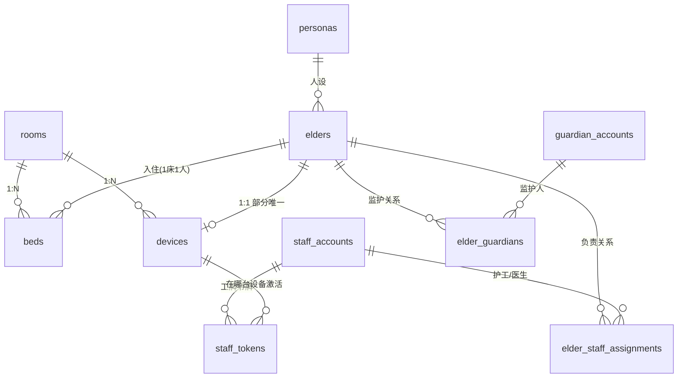
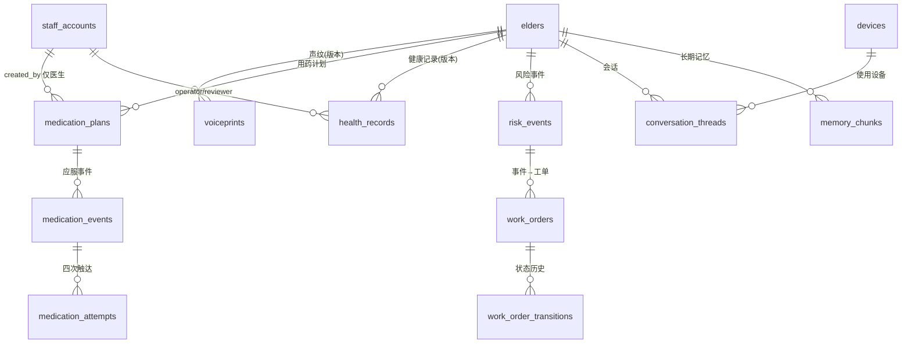
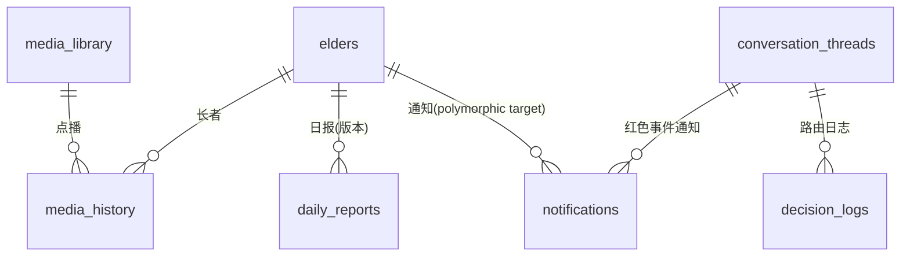

# 康伴（SilverMate）数据模型设计

> **版本**：v0.4（草案 · 裁决 B1–B6 已定 + AC 逐条取证已跑通，尚未冻结）
> **状态**：第 2 步（建模）与第 3 步（取证演练）已完成；评审通过后升 v1.0 冻结，作为 Alembic 迁移的唯一依据。
> **事实来源**：表结构 = `docs/康伴3D数字人_技术设计文档.md` §3（下称 **TD**）；业务规则/状态机/幂等/枚举/边界 = `docs/康伴3D数字人_PRD.md`（下称 **PRD**）。
> **不引用大纲**：大纲只提供迭代流程，不提供数据事实（`AGENTS.md`「前置 · 文档角色与事实来源」铁律 1）。
> **建表口径**：**27 张表 = A 身份组织 7 + B 关系绑定 3 + C 业务数据 10 + D 内容通知日志 7**（Day 5 追加 `metrics`，裁决 B6）；迁移批次 5+5+2+1+1+9+3+1 亦合计 27。

**阅读约定**

| 标记 | 含义 |
| --- | --- |
| ⚠️ | 与 TD §3 原文不同，已在本文 §1 裁决，落地时以本文为准 |
| ⏸ | 暂缓建列，等外部输入（见 §1 B2） |
| 🔒 | 与 PRD 验收条款强绑定，改动需同步验收脚本 |

---

## 0. 元信息

| 项 | 值 |
| --- | --- |
| 数据库 | PostgreSQL 15 + pgvector |
| ORM / 迁移 | SQLAlchemy 2.x（async）+ Alembic，分批迁移，**主迁移合入后不再改，只加新迁移** |
| Checkpointer | `langgraph-checkpoint-postgres`，独立 schema `langgraph`、独立连接池，**与业务表物理隔离** |
| 主键策略 | 全部 UUID（`gen_random_uuid()`），不设全局自增；业务表以 `graph_thread_id` 文本列回指 checkpoint |
| 编码 | 表名复数 snake_case；主键 `<entity>_id`；布尔 `is_*`；枚举值小写下划线 |
| 时间 | 一律 `timestamptz`，存 UTC，展示层转 `Asia/Shanghai` |
| 枚举实现 | 统一 `CHECK` 约束，**不用 PG ENUM**（见 §1 C6） |

---

## 1. 裁决记录

状态均为 **已定**（2026-11-04，主理人确认「按建议执行」）。任何后续改判必须新增条目，不覆盖本表。

### 1.1 阻塞项（已定）

| # | 议题 | 结论 | 落地方式 |
| --- | --- | --- | --- |
| **B1** | `health_records.source` 枚举冲突 | 采用 TD §3.4 的**四个值**：`voice_scheduled` / `voice_active` / `staff_scheduled` / `staff_active`。PRD 的 `staff_report` / `resident` 判为旧文本 | 建 CHECK 约束（§5.3）；PRD FR-HLT-06、AC-32 需补修订记录，回改为 `staff_scheduled` / `voice_scheduled`；FR-HLT-07 已用 `voice_active`，与 TD 一致无需改 |
| **B2** | `voiceprints.embedding` 维度未定 | TD 标注 `vector(512)` 为**占位**，Day 4 定模型后才定维度（resemblyzer 256 / CAM++ 192）。**绝不把 512 写进已合入的迁移** | 该列 ⏸ **Day 4 迁移新建时一并 `ADD COLUMN` 定准维度**；Day 1–3 的 `voiceprints` 先不含 embedding 列，比对逻辑 Day 4 才上线 |
| **B3** | 表数量表述不一致 | 冻结 **26 张**（7+3+10+6）。TD §3 开头「全量 24 张」与 C 组标题「9 张」均为陈旧数字 | 本文按 26 张定稿；TD 那两处文字回改（见 §9 待办） |
| **B4** | 大纲 1.3「11 张表」与 TD 26 表冲突 | 执行按 **26 张**、Day 1 建 **5 张**（含 `beds`）；大纲 1.3 的**流程部分全部保留**（产出物路径、分批节奏、人工读 diff、验收动作） | 差异对照见 §8 |
| **B5** | Web Push 做到什么深度 | P0 只落库 + 演示卡片：`notifications.channel='webpush'` 记录照写，真实浏览器推送归 **P1**（与 PRD §2.5「只生成推送记录和演示卡片」一致） | `guardian_accounts.webpush_subscription` 字段保留备用；`.env.example` 的 `WEBPUSH_VAPID_*` 保持占位 |
| **B6** | Day 5 延迟基线需要分段耗时明细落库（2026-11-07 主理人裁决 D2，自裁合规） | **追加第 27 张表 `metrics`**（D 组）：trace_id / elder_id 可空 / stage 七值 CHECK / duration_ms / source / created_at；迁移批次改 5+5+2+1+1+9+3+1 = 27 | 表定义见 §4.4.7；迁移 `0006_day5_metrics.py`；TD v1.8 同批修订记录；不触碰已合入迁移 0001–0005 |

### 1.2 可后置项（已定，影响实现不影响主体结构）

| # | 议题 | 结论 |
| --- | --- | --- |
| **C1** | 声纹「3 段样本」落点 | `voiceprints` 增加 ⚠️ `sample_index`（int，默认 1），同 `(elder_id, version)` 可存 3 行；唯一约束见 §5.1 |
| **C2** | Agent 拒执行后的跟进任务 | `work_orders.type` 增加 ⚠️ 值 `follow_up`（不复用 `drug_question`，语义更清楚） |
| **C3** | `trace_id` 与 `thread_id` 关系 | `decision_logs` 增加 ⚠️ `trace_id text`（Langfuse trace 直接对应）；`thread_id` 仍作会话串联键 |
| **C4** | 监护人 ≤2 的约束 | **服务层校验 + 唯一约束**，不写触发器（Alembic 难维护、跨行 CHECK 不支持） |
| **C5** | `elders.session_seq` 并发 +1 | 事务内 `SELECT … FOR UPDATE`（单长者并发极低） |
| **C6** | 枚举约束实现 | 一律 `CHECK`，不用 PG ENUM（加值要 `ALTER TYPE`，迁移成本高） |
| **C7** | 设备解绑是否留流水 | 不建流水表，只靠 `devices.status` + `audit_logs`（action=`unbind_device`） |

### 1.3 默认采纳项（无需裁决）

| # | 内容 |
| --- | --- |
| **P1** | 补两个唯一约束：`notifications(dedupe_key)` 部分唯一（`WHERE dedupe_key IS NOT NULL`）；`voiceprints(elder_id, version, sample_index)` 唯一 |
| **P2** | 补三条查询索引：`medication_plans(elder_id, status)`、`conversation_threads(elder_id, started_at DESC)`、`voiceprints(elder_id, status)` |

### 1.4 取证回补（第 3 步产出，5 条）

跑完 AC-01~AC-42 逐条取证后回补的结构改动，明细见 **§7.2**。摘要：

| # | 内容 | 落地位置 |
| --- | --- | --- |
| D1 | `medication_events.failure_reason` 增加 `rtc_failed`（AC-41 反向外呼降级） | §4.3.3 |
| D2 | 拒服（AC-07）的跟进工单类型定为 `work_orders.type='follow_up'` | §4.3.7 |
| D3 | AC-26 的 10 秒撤销窗**不新增列**，服务层按 `confirmed_at` 判窗 + `audit_logs.action='undo_confirm'` | §7.2 |
| D4 | AC-11 的"连续两次解析失败"计数**不落库**，仅产出数据复核工单 | §7.2 |
| D5 | AC-01 的天气外部耗时归 **OTel span**，不入库 | §7.2 |

---

## 2. 全局约定

1. **主键与例外**：全表 UUID 主键。唯二例外——`elders.session_seq`（按长者单调递增的业务序列，每次新会话事务内 +1，供服务端生成 `thread_id=(elder_id, session_seq)`，属业务字段非自增主键）、`work_orders.order_no`（人类可读编号 `WO-20261103-0007`，普通业务字段带唯一约束，不参与主外键）。
2. **为什么不加自增主键**：防 ID 遍历泄露、支持离线预生成；双 ID（uuid + bigserial）只增加误用风险。
3. **软删与保留**：业务删除用状态位（`status='archived'` / `'deleted'` / `'unbound'`），物理删除只由定时任务处理超期条目；`audit_logs` 只增不改。
4. **加密与脱敏**：声纹向量走**磁盘/KMS 层加密**，列保持明文可算（应用层加密会让库内 cosine 与索引失效）；`token_hash` / `password_hash` 只存哈希；日志与 Trace 上传前脱敏（姓名/手机号/身份证号/房间号/健康数值）；`decision_logs.input_text` 落库前即脱敏；原始音频不入库（72h 定时物理删除）。
5. **checkpoint 隔离**：`langgraph_checkpoints` / `langgraph_writes` 由插件管理，**不进本文的 27 张表**，也不与业务表建外键。
6. **三道隔离闸门依赖**：闸门② = `memory_chunks` 所有查询强制 `WHERE elder_id=:runtime.elder_id`（配合 §5.1 索引）；闸门③ = 身份只从 `runtime_context` 注入，任何表都不接受模型自报的 `elder_id`。

---

## 3. ER 总图

### 3.1 A 组（身份组织）+ B 组（关系绑定）

### 3.2 C 组（业务数据）

### 3.3 D 组（内容、通知与日志）

---

## 4. 表定义

> 每表给「字段 / 类型 / 空 / 说明」。`空` 指可空（是/否）。约束与索引集中在 §5，不在每表重复。

### 4.1 A 组 · 身份与组织（7 张）

#### 4.1.1 `rooms` 房间表

| 字段 | 类型 | 空 | 说明 |
| --- | --- | --- | --- |
| room_id | uuid PK | 否 | 房间唯一编号 |
| room_no | text | 否 | 房号（如 `A-301`），展示与统计用 |
| status | text | 否 | `available` / `partial` / `full` / `maintenance`；由 `beds` 聚合，**服务层维护** |

#### 4.1.2 `beds` 床位表

| 字段 | 类型 | 空 | 说明 |
| --- | --- | --- | --- |
| bed_id | uuid PK | 否 | 床位编号 |
| room_id | uuid FK→rooms | 否 | 所属房间；**双人间声纹候选集**即 `WHERE beds.room_id = 设备房间` |
| bed_no | text | 否 | 床号（`1 号床`） |
| status | text | 否 | `available` / `occupied` / `maintenance` |
| elder_id | uuid FK→elders | 是 | 当前入住长者（1 床 1 人，空床为 NULL） |

#### 4.1.3 `devices` 模拟设备表

| 字段 | 类型 | 空 | 说明 |
| --- | --- | --- | --- |
| device_id | uuid PK | 否 | 设备编号（如 `device-001`） |
| room_id | uuid FK→rooms | 否 | 所在房间 → 决定声纹候选范围 |
| elder_id | uuid FK→elders | 是 | 绑定主使用者（**device:elder = 1:1**，部分唯一）；可空以支持先建设备后绑定、退房解绑后保设备行 |
| token_hash | text | 否 | 设备长期令牌哈希（解绑/吊销即时失效） |
| status | text | 否 | `online` / `offline` / `locked`（陌生人 + 30s 无操作 → locked，P2） |
| last_heartbeat | timestamptz | 是 | 最后心跳；超 2 周期判掉线 |

#### 4.1.4 `elders` 长者表

| 字段 | 类型 | 空 | 说明 |
| --- | --- | --- | --- |
| elder_id | uuid PK | 否 | 长者编号 |
| name | text | 否 | 姓名（默认虚构演示数据，日志脱敏） |
| birth_date | date | 是 | 出生日期；**用 date 不用 text**（可算年龄、可比较）；敏感字段可选填 |
| gender | text | 是 | 性别（可选填） |
| persona_id | uuid FK→personas | 是 | 数字人人设分配 |
| status | text | 否 | `active` / `away`（暂离停采集，日报改暂离告知）/ `transferred`（转区停服务**保数据**）/ `archived`（退房已脱敏） |
| session_seq | int | 否 | 会话计数器（默认 0，每新会话 +1 → `thread_id`；闸门①的原料） |
| created_at | timestamptz | 否 | 建档时间 |

#### 4.1.5 `personas` 人设表

| 字段 | 类型 | 空 | 说明 |
| --- | --- | --- | --- |
| persona_id | uuid PK | 否 | 人设编号 |
| name | text | 否 | 人设名（`小满` / 孙女 / 老同事…） |
| personality | text | 否 | 性格描述（拼进 system prompt 固定前缀） |
| greeting | text | 否 | 开场白 |
| tone_examples | jsonb | 是 | 口吻示例 few-shot（≤3 条，保 prompt cache 稳定） |
| voice_id | text | 否 | TTS 音色 ID |
| avatar_url | text | 是 | VRM 模型地址（nginx 静态托管） |

#### 4.1.6 `staff_accounts` 机构侧账号表

| 字段 | 类型 | 空 | 说明 |
| --- | --- | --- | --- |
| staff_id | uuid PK | 否 | 员工编号 |
| name | text | 否 | 姓名 |
| role | text | 否 | `admin` / `care_worker` / `doctor`；**权限以服务端为准，前端隐藏按钮不算数** |
| phone | text | 是 | 手机号（脱敏规则覆盖） |
| password_hash | text | 否 | 密码哈希 |
| token_version | int | 否 | 停用/解绑/角色变化 +1，旧 Token 立即失效 |
| status | text | 否 | `active` / `disabled` |

#### 4.1.7 `guardian_accounts` 监护人账号表

| 字段 | 类型 | 空 | 说明 |
| --- | --- | --- | --- |
| guardian_id | uuid PK | 否 | 监护人编号 |
| name | text | 否 | 姓名 |
| phone | text | 是 | 手机号（脱敏） |
| webpush_subscription | jsonb | 是 | 浏览器 Web Push 订阅凭证；**P0 只存不真推**（B5） |
| password_hash | text | 否 | 密码哈希 |
| token_version | int | 否 | 同 `staff_accounts`（解绑即时失效） |
| status | text | 否 | `active` / `disabled` |

> 监护关系不在本表，存 `elder_guardians`（一人可绑多位长者，关系随绑定变化）。

### 4.2 B 组 · 关系绑定（3 张）

#### 4.2.1 `elder_staff_assignments` 长者-员工绑定表

| 字段 | 类型 | 空 | 说明 |
| --- | --- | --- | --- |
| id | uuid PK | 否 | 记录编号 |
| elder_id | uuid FK→elders | 否 | 长者 |
| staff_id | uuid FK→staff_accounts | 否 | 护工或医生 |
| relation | text | 否 | `primary_care` 责任护工 / `doctor` 负责医生；**范围过滤的唯一依据**，每位长者 ≥1 护工（服务层校验） |
| assigned_at | timestamptz | 否 | 分配时间 |

#### 4.2.2 `elder_guardians` 长者-监护人绑定表

| 字段 | 类型 | 空 | 说明 |
| --- | --- | --- | --- |
| id | uuid PK | 否 | 记录编号 |
| elder_id | uuid FK→elders | 否 | 长者 |
| guardian_id | uuid FK→guardian_accounts | 否 | 监护人 |
| relation | text | 否 | 与长者关系（子/女/孙辈/配偶…）；**绑定级非账号级**，同一人绑两位长者关系可不同 |
| status | text | 否 | `active` / `unbound`（解绑保痕） |
| assigned_at | timestamptz | 否 | 绑定时间 |

> 每位长者 active 绑定 **≤2**：服务层校验（C4）。家属登录反查「我能看哪些长者」= `WHERE guardian_id=:uid AND status='active'`。

#### 4.2.3 `staff_tokens` 护工工牌临时令牌表

| 字段 | 类型 | 空 | 说明 |
| --- | --- | --- | --- |
| token_hash | text PK | 否 | 临时令牌哈希（刷工牌/扫码换取） |
| staff_id | uuid FK→staff_accounts | 否 | 所属护工 |
| device_id | uuid FK→devices | 否 | 在哪台设备激活（权限范围随该设备绑定长者收敛） |
| scope | text | 否 | 受限操作范围（`workorder:handle` / `health:staff_form`） |
| expires_at | timestamptz | 否 | 短时效，到期自动 401 |

### 4.3 C 组 · 业务数据（10 张）

#### 4.3.1 `voiceprints` 声纹表

| 字段 | 类型 | 空 | 说明 |
| --- | --- | --- | --- |
| id | uuid PK | 否 | 记录编号 |
| elder_id | uuid FK→elders | 否 | 所属长者（退房清数据连向量一起删） |
| embedding | vector(N) ⏸ | — | **暂缓建列**：维度 Day 4 定模型后一次性定准（B2） |
| version | int | 否 | 版本号（重训 +1，旧版本 `retired` 保留对比） |
| sample_index | int ⚠️ | 否 | 样本序号 1–3（C1；注册语音现场录 3 段） |
| status | text | 否 | `active` / `retired` |
| created_at | timestamptz | 否 | 采集时间 |

#### 4.3.2 `medication_plans` 用药计划表

| 字段 | 类型 | 空 | 说明 |
| --- | --- | --- | --- |
| plan_id | uuid PK | 否 | 计划编号 |
| elder_id | uuid FK→elders | 否 | 长者 |
| drug_name | text | 否 | 药品名（教学演示数据，不构成真实处方） |
| dose | text | 否 | 剂量（`5mg 一片`） |
| schedule_cron | text | 否 | 服用时间规则（每天 08:00 等） |
| start_date | date | 否 | 起始日期 |
| end_date | date | 是 | 结束日期（临近 → 提醒医生复核续方，P2） |
| version | int | 否 | 药单版本；修改生成新版本，历史提醒保留旧快照 |
| created_by | uuid FK→staff_accounts | 否 | 创建人**仅医生**；护工/管理员只读，越权 403 + 审计 |
| status | text | 否 | `active` / `stopped` |

#### 4.3.3 `medication_events` 用药事件表

> 与 checkpointer 分工：图运行时状态在 `langgraph` schema，看板/统计/日报查本表。

| 字段 | 类型 | 空 | 说明 |
| --- | --- | --- | --- |
| reminder_id | uuid PK | 否 | 事件编号（PRD 称 reminder；**不叫 event_id**，避免与 `risk_events.event_id` 同名不同义） |
| plan_id | uuid FK→medication_plans | 否 | 对应计划（已含 elder_id，幂等键不再冗余） |
| elder_id | uuid FK→elders | 否 | 冗余存长者（按人统计用，**不进幂等键**） |
| scheduled_at | timestamptz | 否 | 应服时间 T0 |
| drug_snapshot | jsonb | 否 | 药品剂量快照（药单改版不影响历史） |
| payload_hash | text | 否 | `drug_snapshot` 的 hash；**同幂等键同时间但内容不同 → 409** 的判定依据 |
| created_at | timestamptz | 否 | 事件生成时间（scheduler 通常提前生成，与 `scheduled_at` 区分） |
| triggered_by | text | 否 | `scheduler` 定时 / `dialog` 对话内（「我吃过药了」走同一张图） |
| status | text | 否 | `calling` / `waiting_confirm` / `confirmed` / `escalated` |
| terminal_state | text | 是 | `taken_reported` / `refused` / `missed_unconfirmed` / `notification_failed`（**不得互写**；`missed_unconfirmed`=有回执无响应，**不等于漏服**） |
| late_taken | bool | 否 | 补确认标记（默认 false；追加不覆盖原终态、工单不自动关闭） |
| failure_reason | text | 是 | `no_answer` / `denied` / `tts_failed` / `offline` / **`rtc_failed` ⚠️**（D1：反向外呼建连失败，AC-41） |
| retry_count | int | 否 | 已重试次数（≤3，对应 T+5/+10/+15） |
| confirmed_at | timestamptz | 是 | 确认时间 |
| confirm_channel | text | 是 | `voice` / `button` |
| graph_thread_id | text | 是 | 回指 checkpoint 图状态（可 `graph.get_state` 复盘） |

#### 4.3.4 `medication_attempts` 触达记录表

| 字段 | 类型 | 空 | 说明 |
| --- | --- | --- | --- |
| attempt_id | uuid PK | 否 | 记录编号 |
| event_id | uuid FK→medication_events | 否 | 所属用药事件（**注意此处列名沿用 TD 原文 `event_id`，指向 `medication_events`**） |
| attempt_no | int | 否 | 第几次触达（1=T0，2=T+5，3=T+10，4=T+15+终态分流） |
| sent_at | timestamptz | 否 | 发送时间 |
| receipt | text | 是 | 页面回执 `card_rendered` / `tts_finished` / `none`（「提醒送达」判定依据） |
| tts_result | text | 是 | `ok` / `tts_failed`（卡片成功但 TTS 失败 = 已送达 + 追加 `tts_failed`） |
| response | text | 是 | 长者响应摘要（脱敏文本） |
| response_channel | text | 是 | `voice` / `button` / `none` |

#### 4.3.5 `health_records` 健康记录表 🔒

| 字段 | 类型 | 空 | 说明 |
| --- | --- | --- | --- |
| record_id | uuid PK | 否 | 记录编号 |
| elder_id | uuid FK→elders | 否 | 长者 |
| recorded_at | timestamptz | 否 | 采集时间 |
| source | text | 否 | **四值**（B1）：`voice_scheduled` / `voice_active` / `staff_scheduled` / `staff_active` |
| operator_id | uuid FK→staff_accounts | 是 | 代填护工（`source` 含 `staff_*` 时必填） |
| systolic | int | 是 | 收缩压（缺失标缺失不阻断；**单分量达红即判红**） |
| diastolic | int | 是 | 舒张压 |
| sleep_hours | numeric(3,1) | 是 | 睡眠时长（>24h 无效） |
| mood_score | int | 是 | 情绪自评 1–5（1=很差，5=很好） |
| mood_note | text | 是 | 情绪自由描述 |
| complaint | text | 是 | 主诉原文 |
| severity | text | 否 | `green` / `yellow` / `red`（规则引擎写入，**阈值在代码不在 prompt**） |
| rule_version | text | 否 | 分级规则版本（阈值调整后可追溯） |
| review_status | text | 否 | `pending` / `confirmed` / `corrected`（HITL 承接，如 130 输成 180 的纠错） |
| reviewed_by | uuid FK→staff_accounts | 是 | 复核人（黄档护工、红档医生） |
| version | int | 否 | 数据版本（补录追加不覆盖原值） |
| superseded_by | uuid | 是 | 指向新版本（原值保留可查） |
| graph_thread_id | text | 是 | 回指健康决策图状态（决策依据可回溯） |

#### 4.3.6 `risk_events` 风险事件表

| 字段 | 类型 | 空 | 说明 |
| --- | --- | --- | --- |
| event_id | uuid PK | 否 | 事件编号 |
| elder_id | uuid FK→elders | 否 | 长者 |
| type | text | 否 | `red_emergency` / `health_alert` / `med_risk` / `sensitive` / `sos` |
| severity | text | 否 | `red` / `yellow`（多项并存取最高；黄可升红） |
| source_type | text | 是 | `health_record` / `medication_event` / `conversation_thread` |
| source_id | uuid | 是 | 来源对象 ID |
| status | text | 否 | `open` / `escalated` / `closed`（2 分钟无人确认 → **原事件标 escalated，不建第二个事件**） |
| created_at | timestamptz | 否 | 生成时间（升级计时起点，不因通知失败暂停） |
| acknowledged_at | timestamptz | 是 | 首次确认时间 |
| closed_at | timestamptz | 是 | 关闭时间（须待关联工单全部关闭后） |

#### 4.3.7 `work_orders` 工单表

| 字段 | 类型 | 空 | 说明 |
| --- | --- | --- | --- |
| order_id | uuid PK | 否 | 工单编号 |
| order_no | text | 否 | 人类可读编号（唯一约束，业务字段非主键） |
| elder_id | uuid FK→elders | 否 | 长者 |
| event_id | uuid FK→risk_events | 是 | 来源风险事件 |
| type | text | 否 | `missed_medication` / `sensitive_alert` / `health_alert` / `device_fault` / `sos` / `collection_missed` / `drug_question` / **`follow_up` ⚠️**（C2：Agent 拒执行后的护工跟进） |
| severity | text | 否 | **建单时从 `risk_events` 复制的快照，不随后同步**（避免黄升红时两表漂移） |
| status | text | 否 | `new` → `acknowledged` → `in_progress` → `resolved` → `closed`（可 `reopened`） |
| assignee_id | uuid FK→staff_accounts | 是 | 当前处理护工 |
| false_alarm | bool | 否 | 误报标记（默认 false；关误报必填原因并保留原始输入） |
| false_alarm_reason | text | 是 | 误报原因 |
| actual_handled_at | timestamptz | 是 | 实际处置时间（红色事件必填） |
| note | text | 是 | 处置备注 |
| created_at | timestamptz | 否 | 创建时间 |
| closed_at | timestamptz | 是 | 关闭时间 |

#### 4.3.8 `work_order_transitions` 工单状态变更历史表

| 字段 | 类型 | 空 | 说明 |
| --- | --- | --- | --- |
| transition_id | uuid PK | 否 | 记录编号 |
| order_id | uuid FK→work_orders | 否 | 所属工单 |
| from_status | text | 否 | 变更前状态 |
| to_status | text | 否 | 变更后状态 |
| actor_id | uuid FK→staff_accounts | 是 | 操作人（系统自动流转可空） |
| at | timestamptz | 否 | 变更时间 |
| note | text | 是 | 备注（如 reopen 原因） |

> 常规流转记本表，**不塞 `audit_logs`**（后者只管敏感操作）。

#### 4.3.9 `conversation_threads` 会话表 🔒

| 字段 | 类型 | 空 | 说明 |
| --- | --- | --- | --- |
| thread_id | text PK | 否 | **服务端按 `(elder_id, session_seq)` 生成**，前端不可指定；伪造/跨长者 403（闸门①） |
| elder_id | uuid FK→elders | 是 | 识别出的说话人（双人间=声纹判定结果，非设备绑定者）；`generic` 降级模式可空 |
| device_id | uuid FK→devices | 否 | 实际使用设备 |
| started_at | timestamptz | 否 | 开始时间 |
| ended_at | timestamptz | 是 | 结束时间 |
| identity_source | text | 否 | `device` / `voice` / `confirm` / `generic` |
| identity_confidence | numeric(4,3) | 是 | 声纹置信度（阈值调优数据源；`generic` 为 NULL） |

#### 4.3.10 `memory_chunks` 记忆表 🔒

| 字段 | 类型 | 空 | 说明 |
| --- | --- | --- | --- |
| chunk_id | uuid PK | 否 | 记忆条目编号 |
| elder_id | uuid FK→elders | 否 | 所属长者——**所有查询强制 `WHERE elder_id=:runtime.elder_id`**（闸门②） |
| content | text | 否 | 记忆文本（仅明确表达的信息入库） |
| embedding | vector(1536) | 是 | 语义向量（对齐常见 embedding 模型）；可空以支持仅关键词条目 |
| category | text | 否 | 默认 `private`（本版无 shared，字段预留） |
| importance | numeric(3,2) | 否 | 重要性分（默认 1.0；90 天衰减、每周归并） |
| status | text | 否 | `active` / `superseded` / `deleted`（相似度 >0.9 且语义矛盾 → 旧条目标 `superseded`；`deleted`=已删但向量物理残留，召回只取 `active`，硬删由定期任务处理） |
| source_thread_id | text | 是 | 萃取来源会话 |
| created_at | timestamptz | 否 | 创建时间 |
| last_accessed | timestamptz | 是 | 最后召回时间（冷热分层依据） |

### 4.4 D 组 · 内容、通知与日志（7 张）

#### 4.4.1 `media_library` 媒体库表

| 字段 | 类型 | 空 | 说明 |
| --- | --- | --- | --- |
| media_id | uuid PK | 否 | 媒体编号 |
| type | text | 否 | `opera` 戏曲 / `movie` 老电影（电影 P2） |
| title | text | 否 | 标题 |
| genre | text | 是 | 剧种/类型 |
| era | text | 是 | 年代 |
| artist | text | 是 | 演员 |
| media_url | text | 否 | 文件地址（**nginx 静态托管，浏览器直连，不经后端转发**） |
| duration | int | 是 | 时长（秒） |
| copyright_status | text | 否 | 版权状态（仅教师授权/公有领域样例） |

#### 4.4.2 `media_history` 点播历史表

| 字段 | 类型 | 空 | 说明 |
| --- | --- | --- | --- |
| history_id | uuid PK | 否 | 记录编号 |
| elder_id | uuid FK→elders | 否 | 长者 |
| media_id | uuid FK→media_library | 否 | 媒体 |
| started_at | timestamptz | 否 | 开始时间 |
| finished_at | timestamptz | 是 | 结束时间 |
| completion_rate | numeric(4,3) | 是 | 完播率（频繁「换一段」→ 偏好降权信号） |

#### 4.4.3 `daily_reports` 家属日报表 🔒

| 字段 | 类型 | 空 | 说明 |
| --- | --- | --- | --- |
| report_id | uuid PK | 否 | 日报编号 |
| elder_id | uuid FK→elders | 否 | 长者（家属只能查绑定长者） |
| report_date | date | 否 | 日期（采集完成或 20:00 强制结束时生成首版） |
| version | int | 否 | 版本号（补录生成新版本，历史保留） |
| status | text | 否 | `normal` / `away_notice`（长者暂离告知） |
| summary_text | text | 否 | 摘要（**不含私密记忆/原始对话/音频**；固定声明「教学模拟信息，不构成医疗诊断」） |
| medication_stats | jsonb | 否 | 用药四类状态分别统计 |
| audio_url | text | 是 | TTS 语音条地址（P1；内容与文本一致） |
| pushed_at | timestamptz | 是 | 通知时间 |

#### 4.4.4 `notifications` 通知表

| 字段 | 类型 | 空 | 说明 |
| --- | --- | --- | --- |
| notification_id | uuid PK | 否 | 通知编号 |
| target_type | text | 否 | `guardian` / `staff`（红色事件同时通知护工与 ≤2 名监护人） |
| target_id | uuid | 否 | 目标对象 ID |
| type | text | 否 | `emergency_health` / `sensitive` / `missed_medication` / `report_ready` / `sos` … |
| payload | jsonb | 否 | 通知内容（脱敏） |
| channel | text | 否 | `inapp` 站内（保底）/ `webpush` 浏览器推送（**无微信、无邮件**） |
| status | text | 否 | `generated` / `pending` / `delivered` / `acknowledged` / `failed`（送达 ≠ 确认） |
| is_mock | bool | 否 | 是否模拟通知（默认 false；不计入送达率分母） |
| retry_count | int | 否 | 重试次数（pending 每 30s 重试，3 次失败 → failed） |
| dedupe_key | text | 是 | 幂等键（如「同一日报 ID+版本号只发一次」） |
| created_at | timestamptz | 否 | 生成时间（重试计时起点） |
| sent_at | timestamptz | 是 | 发送时间 |
| acknowledged_by | uuid | 是 | 确认人（staff/guardian_id） |
| acknowledged_at | timestamptz | 是 | 确认时间 |
| read_at | timestamptz | 是 | 阅读时间 |

#### 4.4.5 `decision_logs` 路由决策日志表

| 字段 | 类型 | 空 | 说明 |
| --- | --- | --- | --- |
| log_id | uuid PK | 否 | 日志编号 |
| thread_id | text FK→conversation_threads | 否 | 所属会话（串规则→Laya→Agent→Tool→TTS） |
| trace_id | text ⚠️ | 否 | **新增**（C3）：Langfuse trace 直接对应，供 Metrics/Trace 双向检索 |
| elder_id | uuid | 否 | 长者 |
| input_text | text | 否 | 用户输入（**落库前即脱敏**，grep 零明文） |
| intent | text | 否 | 识别意图 |
| confidence | numeric(4,3) | 否 | 置信度 |
| is_sensitive | bool | 否 | 是否命中敏感一票否决 |
| route_layer | text | 否 | `rule` / `laya` / `agent`（分层命中率与 S1 闭环率统计，目标 ≥60%） |
| escalated_to_s2 | bool | 否 | 是否升级大模型 |
| latency_ms | int | 否 | 本层延迟（P95 统计） |
| asr_confidence | numeric(4,3) | 是 | ASR 置信度（P2 埋点） |
| model_version | text | 否 | 模型/规则版本（bad case 回归定位） |
| created_at | timestamptz | 否 | 时间 |

#### 4.4.6 `audit_logs` 审计日志表

| 字段 | 类型 | 空 | 说明 |
| --- | --- | --- | --- |
| audit_id | uuid PK | 否 | 审计编号（**不叫 log_id**，与 `decision_logs.log_id` 区分） |
| actor_type | text | 否 | `staff` / `guardian` / `system` |
| actor_id | uuid | 是 | 操作者 ID（系统动作可空） |
| action | text | 否 | `delete_voiceprint` / `clear_data` / `unbind_guardian` / `unbind_device` / `medication_plan_update` / `reopen_order` … |
| resource_type | text | 否 | 操作对象类型 |
| resource_id | uuid | 是 | 操作对象 ID |
| detail | jsonb | 是 | 操作细节（退房清数据流水线每步都记；**越权拒绝也记**） |
| created_at | timestamptz | 否 | 时间 |

> 只增不改；不承担常规状态流转（那是 `work_order_transitions`）。

#### 4.4.7 `metrics` 分段耗时打点表（Day 5 追加，裁决 B6）

| 字段 | 类型 | 空 | 说明 |
| --- | --- | --- | --- |
| id | uuid PK | 否 | 打点编号 |
| trace_id | varchar(64) | 否 | 全链路追踪 ID（与日志 / Langfuse trace 对应；P50/P95 复算的串联键） |
| elder_id | uuid | 是 | 长者（**可空**：唤醒前打点无身份；不建 FK，对齐 `decision_logs.elder_id` 口径） |
| stage | text | 否 | CHECK 七值：`wakeup` / `connection` / `asr` / `route` / `llm_first_token` / `tts_first_packet` / `playback` |
| duration_ms | int | 否 | 该段耗时（毫秒，≥0） |
| source | varchar(32) | 是 | 口径区分：`client`（端侧 wake_ts）/ `backend`（WS accept 兜底）/ `non_stream`（LLM/TTS 非流式口径）等 |
| created_at | timestamptz | 否 | 打点入库时间 |

> **只写指标不写内容**：不含转写全文、不含长者隐私字段（对齐 `app/core/metrics.py` 纪律）；写库唯一入口 `app/services/metrics_service.py`；写失败降级为日志告警，不阻塞对话主链路。

---

## 5. 索引与约束总表

### 5.1 唯一 / 部分唯一（幂等与闸门的物理保证）

| 约束 | 表 | 依据 |
| --- | --- | --- |
| PK `thread_id` | conversation_threads | 闸门① 会话隔离 |
| 部分唯一 `(elder_id) WHERE elder_id IS NOT NULL` | devices | device:elder 1:1，空值不冲突 |
| 唯一 `(room_id, bed_no)` | beds | 同房间床号唯一 |
| 唯一 `(elder_id, staff_id, relation)` | elder_staff_assignments | 同一关系不重复分配 |
| 唯一 `(elder_id, guardian_id)` | elder_guardians | 绑定唯一 |
| 唯一 `order_no` | work_orders | 人类可读编号唯一 |
| **唯一 `(plan_id, scheduled_at)`** 🔒 | medication_events | 用药幂等键（同键同内容返回原结果） |
| **唯一 `(event_id, attempt_no)`** 🔒 | medication_attempts | 触达幂等键（防重复触达） |
| **唯一 `(elder_id, report_date, version)`** 🔒 | daily_reports | 日报幂等（每版只发一次） |
| 部分唯一 `(dedupe_key) WHERE dedupe_key IS NOT NULL` ⚠️ | notifications | **P1 补充**：「同一日报+版本只发一次」的物理保证 |
| 唯一 `(elder_id, version, sample_index)` ⚠️ | voiceprints | **P1 补充**（C1 落地后） |
| PK `token_hash` | staff_tokens | 令牌主键即哈希 |

### 5.2 查询索引

| 索引 | 表 | 用途 |
| --- | --- | --- |
| `(elder_id, recorded_at DESC)` | health_records | 健康趋势（医生视图） |
| `(elder_id, scheduled_at)` | medication_events | 用药日历 / 漏服扫描 |
| `(status, severity, created_at)` | work_orders | 看板排序（红档置顶） |
| `(status, created_at)` | notifications | 重试扫描（pending 每 30s 轮询） |
| `(target_type, target_id, status)` | notifications | 家属/员工未读列表 |
| `(elder_id, status)` | memory_chunks | 召回前过滤（强制 elder_id + active） |
| `(order_id, at)` | work_order_transitions | 工单状态历史 |
| `(guardian_id, status)` | elder_guardians | 家属反查可看长者 |
| `(elder_id, status)` ⚠️ | medication_plans | **P2 补充**：查在用计划 |
| `(elder_id, started_at DESC)` ⚠️ | conversation_threads | **P2 补充**：按人翻会话 |
| `(elder_id, status)` ⚠️ | voiceprints | **P2 补充**：取 active 声纹 |
| `(trace_id)` ⚠️ | metrics | **B6 补充**（Day 5）：按 trace_id 串一次对话各分段 |
| `(stage, created_at)` ⚠️ | metrics | **B6 补充**（Day 5）：P50/P95 按段复算（stage 过滤 + 时间窗） |

> 向量索引：`voiceprints.embedding` / `memory_chunks.embedding` 在万行级走**精确检索**，暂不建 ivfflat/HNSW，避免过早优化。

### 5.3 CHECK 约束（枚举一律走这里，C6）

| 表 | 规则 |
| --- | --- |
| health_records | `systolic IS NULL OR systolic BETWEEN 0 AND 300`；`diastolic IS NULL OR diastolic BETWEEN 0 AND 300` |
| health_records | `sleep_hours IS NULL OR sleep_hours BETWEEN 0 AND 24` |
| health_records | `mood_score IS NULL OR mood_score BETWEEN 1 AND 5` |
| health_records 🔒 | `source IN ('voice_scheduled','voice_active','staff_scheduled','staff_active')`（**B1**） |
| health_records | `(source LIKE 'staff_%') = (operator_id IS NOT NULL)` |
| conversation_threads 🔒 | `(identity_source='generic' AND elder_id IS NULL) OR (identity_source IN ('device','voice','confirm') AND elder_id IS NOT NULL)` |
| medication_events | `terminal_state IS NULL OR terminal_state IN ('taken_reported','refused','missed_unconfirmed','notification_failed')` |
| medication_events | `status IN ('calling','waiting_confirm','confirmed','escalated')` |
| work_orders | `status IN ('new','acknowledged','in_progress','resolved','closed','reopened')`；`type IN (...)`（含 `follow_up`） |
| risk_events | `severity IN ('red','yellow')`；`status IN ('open','escalated','closed')` |
| notifications | `channel IN ('inapp','webpush')`；`status IN (...)`；`target_type IN ('guardian','staff')` |
| daily_reports | `status IN ('normal','away_notice')` |
| memory_chunks | `status IN ('active','superseded','deleted')`；`category = 'private'` |
| elders / staff_accounts / guardian_accounts / devices | 各 `status` 枚举（见 §4 各表） |
| 其余枚举 | `rooms.status`、`beds.status`、`medication_plans.status`、`voiceprints.status`、`health_records.review_status` / `severity`、`decision_logs.route_layer`、`conversation_threads.identity_source`、`media_library.type`、`medication_events.failure_reason` / `triggered_by`、`medication_attempts.receipt` / `tts_result`、`audit_logs.actor_type` 等，逐列建 CHECK |

### 5.4 服务层校验（无法入 DDL）

| 规则 | 原因 |
| --- | --- |
| 每位长者 active 监护人 ≤2 | 跨行约束，CHECK 不支持（C4） |
| 每位长者 ≥1 责任护工 | 跨行 + 业务规则 |
| `rooms.status` 由 `beds` 聚合 | 冗余字段，服务层维护 |
| `work_orders.severity` 建单时复制不随后同步 | 业务口径（防两表漂移） |
| `elders.session_seq` 递增 | 事务内 `FOR UPDATE`（C5） |
| 药单只有医生可写 | 权限（`created_by` + role 校验 + 审计） |

---

## 6. 迁移分批（Day 1 冻结全量设计，分批执行）

| 批次 | 张数 | 表 | 交付 |
| --- | --- | --- | --- |
| **Day 1** | 5 | rooms, beds, devices, elders, personas | 房间/床位/设备/长者/人设骨架（**含 `beds`，比大纲 1.3 多 1 张**，B4） |
| Day 2 | 5 | staff_accounts, guardian_accounts, elder_staff_assignments, elder_guardians, staff_tokens | 三类凭证 + 员工/监护人绑定 |
| Day 4 | 2 | voiceprints（**此时才加 `embedding`**，B2）, conversation_threads | 声纹闭环 + 会话隔离 |
| Day 5 | 1 | metrics | 延迟基线分段耗时（B6，2026-11-07 裁决 D2） |
| Day 6 | 1 | decision_logs | 三级路由评测数据源 |
| Day 7 | 9 | memory_chunks, medication_plans, medication_events, medication_attempts, risk_events, work_orders, work_order_transitions, media_library, media_history | 记忆治理 + 用药子图 + 工单流转 + 点播 |
| Day 8 | 3 | health_records, daily_reports, notifications | 健康决策图 HITL + 家属端 |
| Day 9 | 1 | audit_logs | 权限闸门与审计 |
| **合计** | **27** | — | — |

> 规则：**主迁移一经合入不再改，后续只加新迁移**；`alembic revision --autogenerate` 后必须人工逐行读 diff 再 `upgrade`。

---

## 7. AC 逐条取证矩阵（第 3 步产出）

> 目的：证明「每条 P0 验收都能指到某张表某个字段」。**判定**：✅ = 可从库内取到证据；⊘ = 非数据面（渲染 / 链路 / 应答内容），由实现与测试覆盖，数据库不承担。
> AC 原文见 `docs/康伴3D数字人_PRD.md` §5.1（AC-01 ~ AC-42）。

### 7.1 逐条矩阵

| AC | 用例 | 数据证据（表.字段） | 判定 |
| --- | --- | --- | --- |
| AC-01 | 简单天气 | `decision_logs`(intent, route_layer, latency_ms) | ✅ |
| AC-02 | 天气失败不编造 | 无表落点：属应答内容约束 | ⊘ |
| AC-03 | 低置信澄清一次 | `decision_logs`(confidence, escalated_to_s2, route_layer) | ✅ |
| AC-04 | 急症规则优先 | `decision_logs.is_sensitive` + `risk_events`(type='red_emergency', severity='red', acknowledged_at) + `work_orders` + `notifications` | ✅ |
| AC-05 | 用药正常确认 | `medication_events`(status='confirmed', terminal_state='taken_reported', confirmed_at, confirm_channel) + `medication_attempts.receipt` | ✅ |
| AC-06 | 四次触达未确认 | `medication_attempts.attempt_no` 1–4 + `medication_events`(retry_count, terminal_state='missed_unconfirmed') + 唯一工单 | ✅ |
| AC-07 | 拒服与不适 | `medication_events.terminal_state='refused'` + `work_orders.type='follow_up'`（D2） | ✅ |
| AC-08 | 补确认不关单 | `medication_events.late_taken=true`（terminal_state 不覆盖）+ `work_orders.status` 仍非 closed | ✅ |
| AC-09 | 黄色分级 | `health_records.severity='yellow'` + `work_orders`(type='health_alert', severity='yellow') | ✅ |
| AC-10 | 红色分级 | `health_records.severity='red'` + `risk_events.severity='red'` + `work_orders` + `notifications` | ✅ |
| AC-11 | 无效数据 | `health_records.systolic/diastolic IS NULL` + `work_orders`(type='health_alert')（D4） | ✅ |
| AC-12 | 红色超时升级 | `risk_events.status='escalated' AND acknowledged_at IS NULL` + `audit_logs` | ✅ |
| AC-13 | 日报权限 | `daily_reports.elder_id` + `elder_guardians`(guardian_id, status='active')（服务层过滤） | ✅ |
| AC-14 | 记忆删除 | `memory_chunks.status='deleted'` + `audit_logs.action='delete_memory'` | ✅ |
| AC-15 | 3D 降级 | 无表落点：渲染层行为 | ⊘ |
| AC-16 | 断网与恢复 | `medication_events.terminal_state='notification_failed'` + `medication_attempts.receipt='none'` | ✅ |
| AC-17 | 服务重启恢复 | `medication_events.graph_thread_id` + checkpoint + `notifications.dedupe_key` | ✅ |
| AC-18 | 越权访问 | `audit_logs`(actor_id, action, resource_id) + 接口 403 | ✅ |
| AC-19 | 数据重置 | `memory_chunks` 物理清 + `audit_logs.action='data_reset'`（D5） | ✅ |
| AC-20 | 终态分流 | `medication_events.terminal_state` ∈ {missed_unconfirmed, notification_failed} + `medication_attempts.receipt` | ✅ |
| AC-21 | 单分量判红 | `health_records`(systolic=182, diastolic NULL, severity='red') | ✅ |
| AC-22 | 补录黄升红 | `health_records`(version+1, superseded_by) + `risk_events.severity` 升 red + 不重复建单 | ✅ |
| AC-23 | 通知状态边界 | `notifications.status` 四态 + sent_at / acknowledged_at / read_at | ✅ |
| AC-24 | 凭证即时失效 | `staff_accounts.token_version` / `guardian_accounts.token_version` / `devices.token_hash` + `audit_logs` | ✅ |
| AC-25 | 日报版本更新 | `daily_reports`(report_date, version) + `notifications.dedupe_key` | ✅ |
| AC-26 | 撤销边界 | `medication_events.confirmed_at` 10 秒窗（D3）+ `audit_logs.action='undo_confirm'`；`risk_events` 不撤销 | ✅ |
| AC-27 | 药单快照 | `medication_events`(plan_id, drug_snapshot) + `medication_plans`(version, status) + `work_orders` 不自动关 | ✅ |
| AC-28 | 声纹双人间 | `voiceprints`(elder_id, version, status) + `beds.room_id` / `devices.room_id` + `conversation_threads`(identity_source, identity_confidence) | ✅ |
| AC-29 | MCP 越权拒绝 | `audit_logs` + `decision_logs.trace_id` | ✅ |
| AC-30 | 子图重启恢复 | `medication_events.graph_thread_id` + checkpoint + `medication_attempts`(event_id, attempt_no) 唯一 | ✅ |
| AC-31 | Langfuse Trace | `decision_logs`(trace_id, thread_id, route_layer, latency_ms) | ✅ |
| AC-32 | 护工代填 | `health_records`(source='staff_scheduled'\|'staff_active', operator_id) + `audit_logs` | ✅ |
| AC-33 | 医疗边界拒答 | `work_orders`(type='follow_up' 或 'drug_question') + `audit_logs` | ✅ |
| AC-34 | 主动主诉走决策图 | `health_records`(source='voice_active', graph_thread_id) + `risk_events` | ✅ |
| AC-35 | 对话内用药确认 | `medication_events.triggered_by='dialog'` | ✅ |
| AC-36 | 注入拦截与脱敏 | `decision_logs.input_text`（落库前脱敏）+ `audit_logs` | ✅ |
| AC-37 | 播放控制指令 | `decision_logs`(route_layer='rule', intent, latency_ms) + `media_history` | ✅ |
| AC-38 | 通知监护人 | `notifications`(target_type ∈ {guardian, staff}, type='emergency_health', is_mock) | ✅ |
| AC-39 | 三道隔离闸门 | `conversation_threads` PK thread_id + `memory_chunks.elder_id` + `audit_logs` | ✅ |
| AC-40 | WebRTC 全双工 | 无表落点：媒体链路 | ⊘ |
| AC-41 | 反向 WebRTC 外呼 | `medication_events.failure_reason='rtc_failed'`（D1 补值）+ `medication_attempts.tts_result` | ✅ |
| AC-42 | 唤醒词激活 | 无表落点：端侧检测（优先级待定） | ⊘ |

### 7.2 取证发现与回补（5 条）

| # | 发现 | 处置 |
| --- | --- | --- |
| **D1** | AC-41 要求 `failure_reason=rtc_failed`，§4.3.3 原枚举（no_answer/denied/tts_failed/offline）**缺该值** | 已在 §4.3.3 补入 `rtc_failed` |
| **D2** | AC-07「拒服 → 护工跟进工单」的工单类型此前未定 | 定为 `work_orders.type='follow_up'`（C2 引入的值）；**不用** `missed_medication`（那是"未触达"，语义冲突） |
| **D3** | AC-26「普通已服自报 10 秒内撤销」需要时间窗，无现成字段 | **不新增列**：服务层以 `confirmed_at + 10s` 判窗，动作写 `audit_logs(action='undo_confirm')`，不覆盖 `terminal_state` |
| **D4** | AC-11「连续两次血压无法解析」需要计数，无落点 | **不落库**：服务层计数，仅产出 `work_orders`(type='health_alert', note='数据复核')；`health_records` 以 NULL 表达缺失 |
| **D5** | AC-01「天气外部调用耗时与数据时间单独记录」无表落点 | 归 **OTel span**（不入库）；若后续要报表再加 `decision_logs.tool_latency_ms` |

### 7.3 覆盖结论

| 项 | 结果 |
| --- | --- |
| AC 总数 | 42（PRD §5.1，AC-01 ~ AC-42） |
| 库内可取证 | **38 条** |
| 非数据面（⊘） | 4 条：AC-02（应答内容）、AC-15（渲染）、AC-40（媒体链路）、AC-42（端侧检测） |
| 需回补的结构改动 | 1 个枚举值（`rtc_failed`）+ 1 处口径（拒服工单类型） |
| 缺失的表 | **0 张**（26 表足以覆盖全部 P0 验收的数据面） |

> 说明：⊘ 的 4 条不是"没设计"，而是验收证据不在库里——分别由前端渲染测试、浏览器 WebRTC 联调、提示词与话术审查承担，已在 PRD §5.4 的追踪关系中保留。

**已知不覆盖（刻意为之）**：Web Push 真推（B5 归 P1）；声纹防重放（PRD 列为非目标）；多租户隔离。

---

## 8. 与大纲课时 1.3 的差异（流程保留、内容替换）

| 项 | 大纲 1.3 原文 | 本文口径 | 依据 |
| --- | --- | --- | --- |
| 表数量 | 一次定全 **11 张** | **26 张** | TD §3（B3/B4） |
| 表名 | `workorders` / `conversations` | `work_orders` / `conversation_threads` | TD §3.4/§3.5 |
| Day 1 建表 | 4 张（rooms/devices/elders/personas） | 5 张（+ `beds`） | TD §3.6 批次表 |
| 其余表的处理 | 建空迁移占位 | 按 §6 分批，Day 2/4/6/7/8/9 各自成批 | TD §3.6 |
| `memory_chunks` | Day 1 就带 `elder_id` + vector 列 | Day 7 建表，带 `elder_id` + `vector(1536)` | TD §3.6 分批（记忆治理在 Day 7） |
| `voiceprints` | Day 1 带 `elder_id` + embedding | Day 4 建表，`embedding` 维度同批定准 | TD §3.6 + B2 |
| 流程要求 | 产出物路径、字段语义人审、迁移人工读 diff、`alembic upgrade head` / `psql \d` 验收 | **全部保留** | 大纲（流程部分有效） |

---

## 9. 待办

| # | 事项 | 归属 | 状态 |
| --- | --- | --- | --- |
| 1 | TD §3 的「24 张」「C 组 9 张」陈旧数字 | 文档 | ✅ 已落地两轮：TD 附 C **v1.5**（只加记录）+ **v1.6**（按主理人指示回改正文：架构图与 §3 开头 24→26、§3.4 标题 9→10，并补 26=7+3+10+6 算式） |
| 2 | PRD FR-HLT-06 / AC-32 的 `staff_report` / `resident` 口径 | 文档（B1） | ✅ 已落地：PRD §7 修订记录 **v2.6** |
| 3 | Day 4 定声纹模型后 `ADD COLUMN embedding vector(N)` | 迁移（B2） | ⏳ 待 Day 4 |
| 4 | AC-01~AC-42 与表/字段的逐条追溯矩阵 | 本文 | ✅ 本文 **v0.2 §7**（38 条可取证 / 4 条非数据面） |
| 5 | Day 1 五张表的 Alembic 初始化迁移 | 迁移 | ✅ `alembic/versions/0001_day1_identity_skeleton.py`；已在 PostgreSQL 16 + pgvector 容器内实测：`upgrade head` → 5 表、`downgrade base` → 0 表、再次 `upgrade` → 5 表，可逆 |
| 6 | 本轮改动入库（AGENTS.md 前置节、README 口径、本文、回改记录、alembic 骨架） | git | ⏳ 待提交 |

---

## 10. 变更记录

| 版本 | 日期 | 变更 |
| --- | --- | --- |
| v0.1 | 2026-11-04 | 首版：26 张表全量字段；落定 12 条裁决（B1–B5、C1–C7）与 2 项默认采纳（P1/P2）；与大纲 1.3 的差异对照 |
| v0.2 | 2026-11-04 | ① 新增 **§7 AC 逐条取证矩阵**（42 条，38 库内可证 / 4 非数据面）；② 取证回补 5 条（D1–D5，摘要入 §1.4）：`failure_reason` 增 `rtc_failed`、拒服工单定格 `follow_up`、撤销窗与解析失败计数走服务层、天气耗时归 OTel；③ §9 待办状态更新（TD/PRD 以修订记录落地，Day 1 迁移实测通过） |
| v0.3 | 2026-11-04 | 裁决记录**反向下游**：TD 正文已按本文 §1 回改（TD 附 C **v1.6**，不再只加记录）——24→26 张、C 组 9→10、`voiceprints.sample_index`、`embedding` Day 1–3 不建、`work_orders.type` 增 `follow_up`、`decision_logs.trace_id`、P1/P2 的索引与唯一约束、`health_records.source` 四值 CHECK、监护人上限改服务层、枚举一律 CHECK、设备解绑不留流水、Web Push 归 P1；同步关闭 TD 附 B 的「22 张表/`medication_attempts` 是否合并」待确认项。§9 待办 1 更新为「两轮已落地」 |
| v0.4 | 2026-11-07 | **B6**：Day 5 追加第 27 张表 `metrics`（分段耗时打点，AC-42/PRD §5.3 数据底座）——§4.4.7 表定义、§5.2 两条查询索引、§6 批次表增 Day 5 行（5+5+2+1+1+9+3+1 = 27）。依据：2026-11-07 主理人裁决 D2（docs/plans/day05/day-05-延迟基线与护栏.md S1 自裁留痕）；TD v1.8 修订记录同批。不触碰已合入迁移 0001–0005，走新迁移 0006 |
