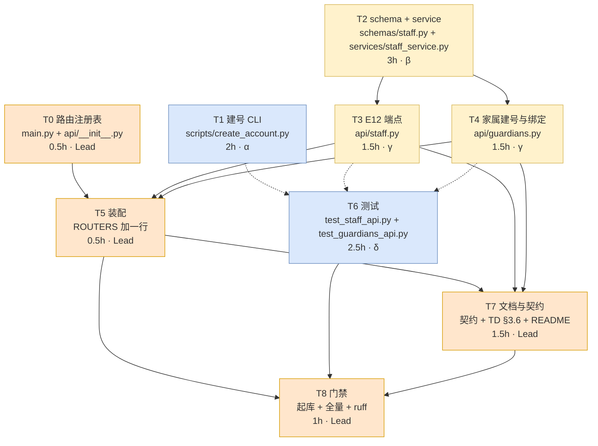

# 员工与家属建号接口 · 执行 DAG

> 状态：进行中　｜　版本：v1.0　｜　日期：2026-11-06
> 上游：`docs/plans/adhoc-20261106-员工与家属建号接口.md`（v1.3，T0–T8）
> 本文件只回答「先做什么、能并行什么、谁写哪个文件」，口径与验收一律回到主计划

---

## 1. 图



- **橙（Lead）**：共享文件写者，必须独占
- **黄（关键路径）**：T2 → T3/T4 → T5 → T7 → T8
- **蓝（旁支）**：T1、T6，不阻塞主路径

## 2. ASCII 兜底

```
T0(Lead) ─────────────┐
                      ├──> T5(Lead) ──> T7(Lead) ──┐
T2(β) ──> T3(γ) ──────┤                           ├──> T8(Lead)
      └──> T4(γ) ─────┘                           │
T1(α) ─ ─ ─ ─ ─ ─ ─ ─ ─ ─ ─ ─> T6(δ) ─ ─ ─ ─ ─ ─ ┘

实线=硬依赖（前者的产物是后者的输入）
虚线=软依赖（后者可先写、最后一起跑）
```

## 3. 节点表

| 节点 | 产出文件（写作用域，其他人禁触） | 依赖 | 负责人 | 预估 |
| --- | --- | --- | --- | --- |
| **T0** 路由注册表 | `app/api/__init__.py`、`app/main.py` | 无 | Lead | 0.5h |
| **T1** 建号 CLI | `scripts/create_account.py`（新建） | 无（只需已存在的 `hash_password`） | 子 agent α | 2h |
| **T2** schema + service | `app/api/schemas/staff.py`、`app/services/staff_service.py`（均新建） | 无 | 子 agent β | 3h |
| **T3** E12 端点 | `app/api/staff.py`（新建） | T2 | 子 agent γ | 1.5h |
| **T4** 家属建号与绑定 | `app/api/guardians.py`（新建） | T2 | 子 agent γ | 1.5h |
| **T5** 装配 | `app/api/__init__.py`（只加 1 行） | T0、T3、T4 | Lead | 0.5h |
| **T6** 测试 | `tests/test_staff_api.py`、`tests/test_guardians_api.py`（均新建） | T1、T3、T4（软：可先写） | 子 agent δ | 2.5h |
| **T7** 文档与契约 | `docs/接口契约_身份与权限.md`、`docs/康伴3D数字人_技术设计文档.md`、`README.md` | T3、T4、T5 | Lead | 1.5h |
| **T8** 门禁 | 无（只跑命令） | T5、T6、T7 | Lead | 1h |

## 4. 边表

| # | 从 | 到 | 类型 | 传递物 |
| --- | --- | --- | --- | --- |
| 1 | T0 | T5 | 硬 | `ROUTERS` 注册表存在，T5 才能加行 |
| 2 | T2 | T3 | 硬 | `StaffCreateRequest` / `staff_service.create_staff()` 等函数签名 |
| 3 | T2 | T4 | 硬 | `create_guardian()` / `bind_guardian()` 签名与领域异常 |
| 4 | T3 | T5 | 硬 | `app/api/staff.py` 的 `router` 对象 |
| 5 | T4 | T5 | 硬 | `app/api/guardians.py` 的 `router` 对象 |
| 6 | T1 | T6 | 软 | CLI 可执行 + 幂等语义（T6 里含 CLI 冒烟） |
| 7 | T3 | T6 | 软 | 路径与状态码（可先按主计划 §3.1 写死） |
| 8 | T4 | T6 | 软 | 同上 |
| 9 | T5 | T7 | 硬 | 文档要写「端点已挂载」的实证 |
| 10 | T7 | T8 | 硬 | 契约与 TD 修订记录是同提交要求 |
| 11 | T6 | T8 | 硬 | 全量绿是门禁前提 |

## 5. 并行编排（实际怎么派）

| 波次 | 并行度 | 干什么 |
| --- | --- | --- |
| **W1** | 3 | Lead 做 **T0**；同时派 α 做 **T1**、β 做 **T2**（三者写作用域完全不相交） |
| **W2** | 2 | β 交付后派 γ 做 **T3+T4**；同时派 δ 按主计划 §3.1 先写 **T6** 的用例骨架（软依赖，允许先写后跑） |
| **W3** | 1 | Lead 做 **T5**（往 `ROUTERS` 加一行）→ 跑 δ 写的测试 |
| **W4** | 1 | Lead 做 **T7**（契约 + TD §3.6 + README） |
| **W5** | 1 | Lead 做 **T8**（起库 → 全量 → ruff → 提交） |

**关键路径耗时**：T0 0.5 + T2 3 + T3 1.5 + T5 0.5 + T7 1.5 + T8 1 = **8 小时**（T1/T6 都在旁支，不拉长总时长）。

## 6. 写锁（违反即返工）

| 文件 | 唯一写者 | 说明 |
| --- | --- | --- |
| `app/api/__init__.py` | **Lead** | T0 建注册表、T5 加行，两次都是 Lead，中间无人插队 |
| `app/main.py` | **Lead** | 仅 T0 改一次；此后再无人动 |
| 其余 7 个新文件 | 各自的子 agent | 一人一文件，互不交叉 |
| `docs/**` | **Lead** | T7 统一改，避免子 agent 写文档走样 |

## 7. 每个节点的验收门（子 agent 交付时必须附证据）

| 节点 | 必须自证 |
| --- | --- |
| T0 | `app.routes` 的 path 列表改造前后完全一致；`import app.main` 通过；`ruff check app` 绿 |
| T1 | `--help` 可跑；对不存在库时能给出清晰报错；`ruff check scripts` 绿 |
| T2 | 三个函数签名与主计划 §2 T2 一致；`python -c "import app.services.staff_service"` 通过；`ruff` 绿 |
| T3 / T4 | 模块可 import、`router` 有正确 prefix；`ruff` 绿 |
| T5 | `GET /api/staff` 类路径能从 `app.routes` 里看到 |
| T6 | 用例数与主计划 §2 T6 一致（14 + 11）；`pytest` 该文件跑通或明确说明因无库 skip |
| T7 | 修订记录行存在；契约里 G1/G2 已写入 |
| T8 | 全量 `pytest` 绿 + 覆盖率 ≥79.17% + ruff 双绿 |

## 8. 执行纪律

1. **子 agent 不许碰 git**：提交统一由 Lead 做，避免多方同时 `git add` 打架。
2. **子 agent 不许改白名单外的文件**；发现必须改，先停手回来报告。
3. **每个节点完成即回报**：改了哪些文件、自证命令输出、遗留问题。
4. **Lead 在 W3 之前必须亲眼看过 T2 的签名**，因为 T3/T4 全建立在它上面。

## 修订记录

| 版本 | 日期 | 说明 |
| --- | --- | --- |
| v1.0 | 2026-11-06 | 初稿：T0–T8 九节点、11 条边、5 波次并行编排、4 条写锁、8 个验收门 |
