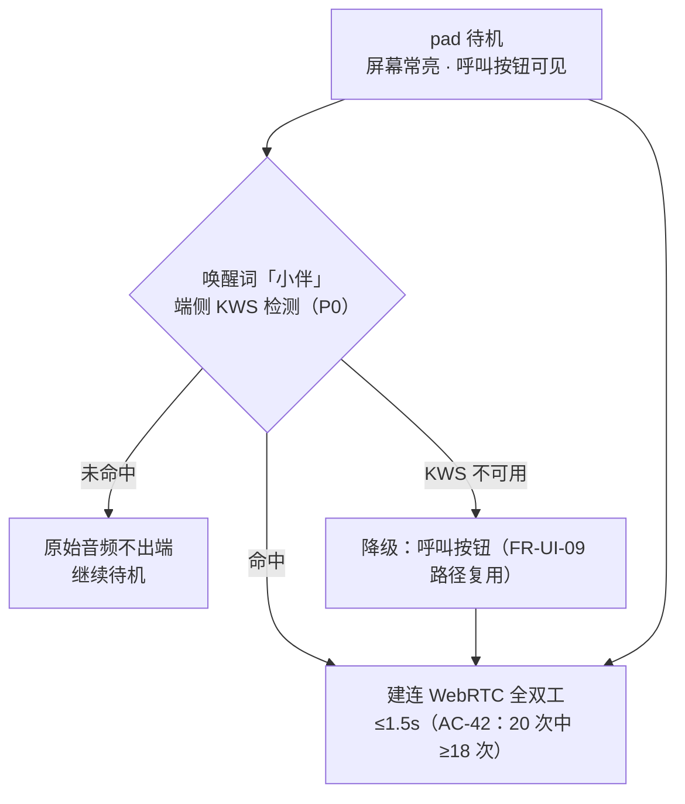
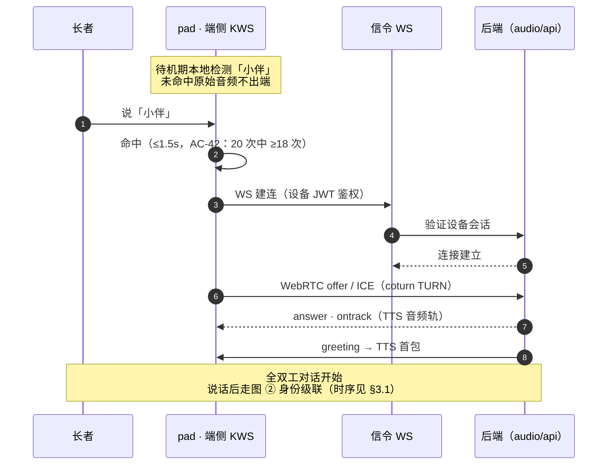
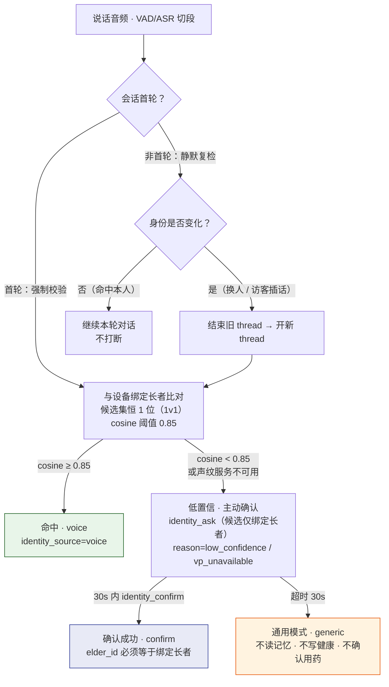
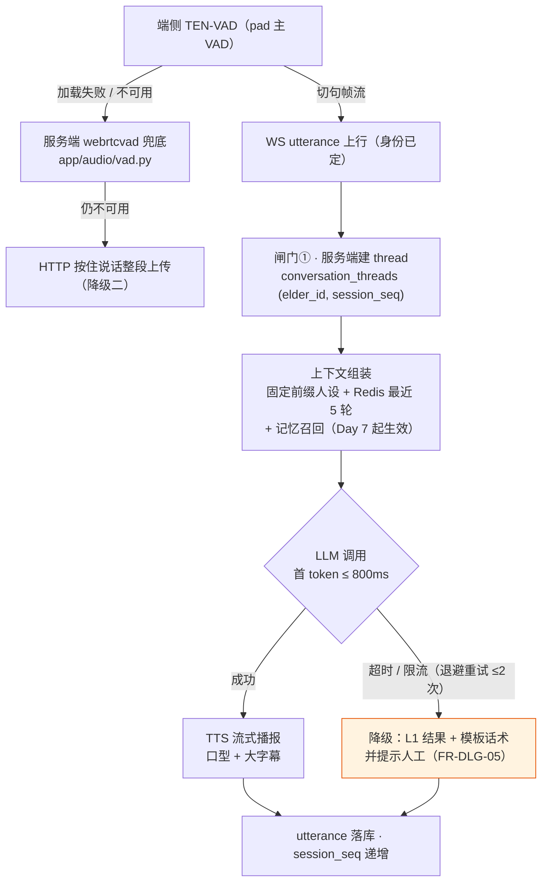
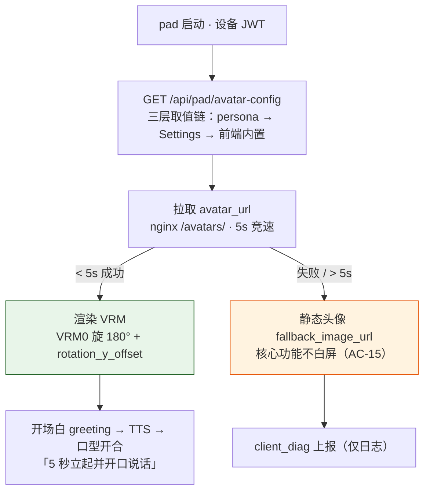
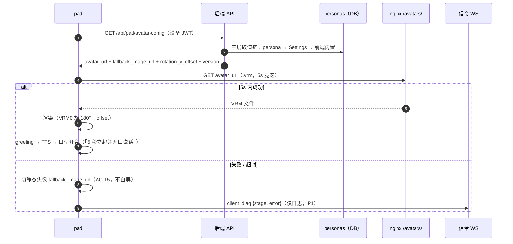
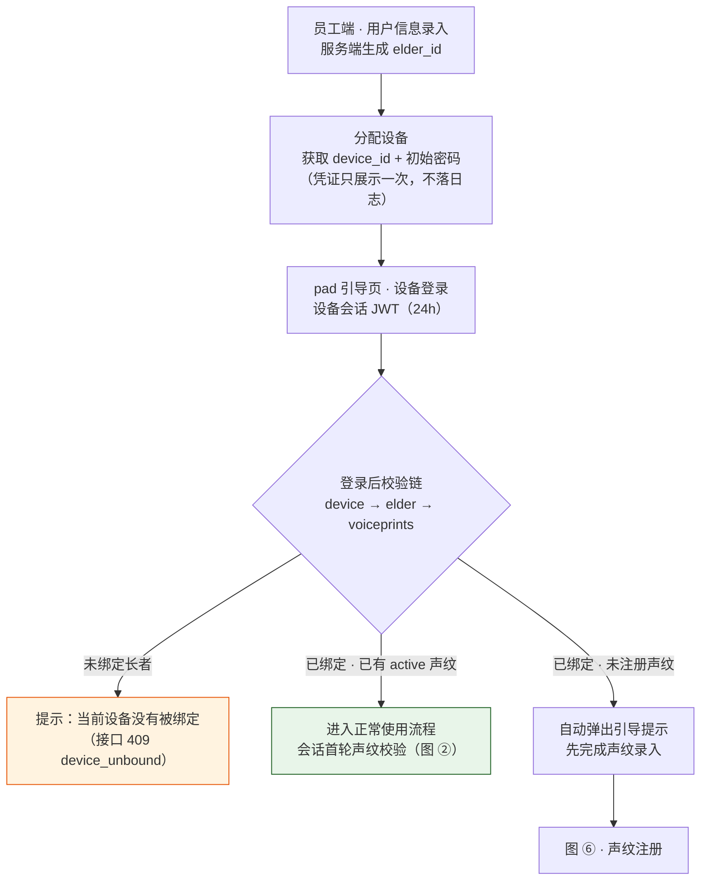
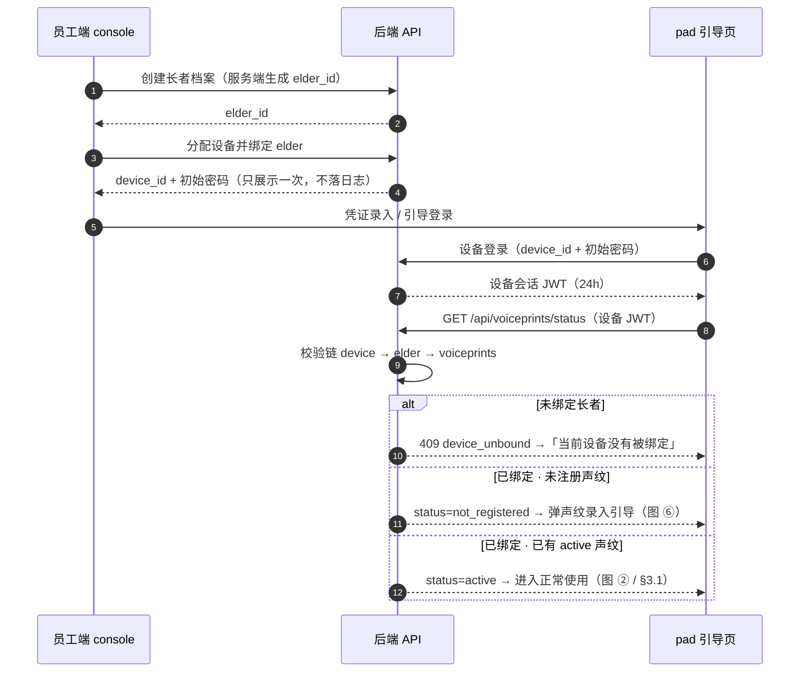
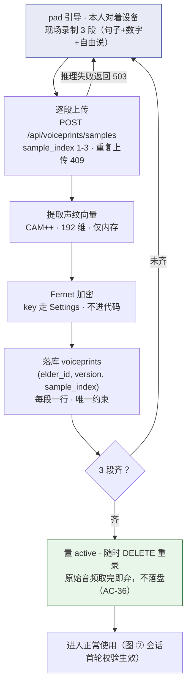
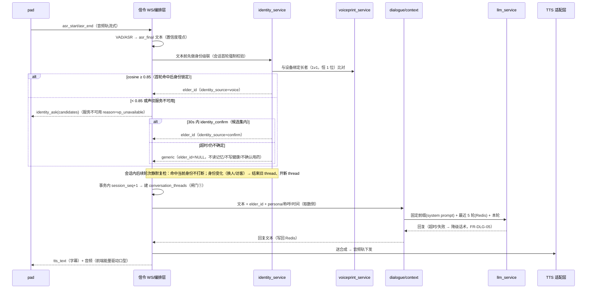

# Day 04 · 3D 数字人与身份闭环 · 后端技术方案与实施计划

> 状态：草稿　｜　版本：v2.3　｜　日期：2026-11-06
> 关联：docs/team_tasks_day04/（任务卡待建，本件为该批卡的后端方案底稿）；day-03-a5（VAD 兜底）、task-a2（信令契约）
> 上游依据：PRD L258-259（FR-3D-01/02）、L270（FR-DLG-05）、L283-286（FR-VPR-01~03）、L496（AC-15）、L523/L544（FR-UI-11/AC-42 唤醒词，2026-11-06 裁决定 P0）、L571（§6.1 Day 4 验收行）、§3.2 身份双条件模型；技术设计文档 L147（边界 3）、L155（边界 11 不做 diarization）、L163/L191（选型）、L200（System 2 统一 LLM 适配器）、L287（session_seq/thread_id 闸门①）、L347（personas.avatar_url）、L410-420（voiceprints 表·裁决 B2/C1）、L536-545（conversation_threads 表）、L983/L1025-1034（Day 4 实现口径）、L1153-1154（FR 归属日）；参考件 `/Users/min/Downloads/asr/docs/语音智能体接入教程.md` §6 L383-421（仅技术参考，不构成事实依据）
> 变更记录见文末

---

## 0. 范围：Day 4 全量五条工作线

Day 4 主题 =「3D 与身份闭环」（技术文档 §8.3 L1025-1034：把「设备锁定 + 声纹确认」做成身份闸门，同时让数字人立起来）。本计划覆盖该日**全部后端工作**，分五条线：

| 线 | 内容 | FR/表 | 优先级 |
| --- | --- | --- | --- |
| W1 · 3D 展示接入 | VRM 配置下发、静态托管、失败可观测、降级 | FR-3D-01/02 | P0 |
| W2 · 声纹身份闭环 | 注册 3 段样本、**候选集=设备绑定长者（1v1，恒 1 位，2026-11-06 裁决回正）**、单/双人间统一级联（每会话首轮校验一次）、低置信主动确认、通用模式兜底 | FR-VPR-01~03；voiceprints、conversation_threads（Day 4 批次 2 张） | P0 |
| W3 · 上下文与对话闭环 | thread_id 生成、人设+时间+称呼组装、System 2 首次接入、回复送 TTS | PRD §6.1 Day 4「Agent 上下文组装」；大纲课时 4.4（流程） | P0 |
| W4 · VAD 正式切段 | 服务端兜底 VAD 接入主链路 utterance 切段 | 技术文档 L983「app/audio（VAD 切段）」；衔接 day-03-a5 | P0 |
| W5 · 唤醒词入口（2026-11-06 裁决定 P0） | 端侧 KWS「小伴」命中才建连、未命中原始音频不出端、不可用降级呼叫按钮；后端无新接口，保证建连链路与降级路径复用 | FR-UI-11、AC-42（PRD L523） | P0 |

**明确不做（与基线对齐，防参考项目口径渗入）**：

| 不做 | 依据 |
| --- | --- |
| FR-3D-03「更多动作与形象」（动作表、`[act:]` 动作标记协议、形象切换） | PRD 标 P2 且技术文档 §8.3 Day 4 / §8.3.2 L1154 **显式不排期**；参考项目 asr 的 `ActionMarkerFilter`/`actions.json`/`avatars.json` 协议一概不引入 |
| 口型 viseme 时间轴 | Day 5 课时 5.1；Day 4 口型 = 前端取播放侧音频能量，后端无新协议 |
| 生产级声纹（防录音重放/合成对抗/跨信道）与 diarization | PRD §1.6 非目标、技术文档边界 8（L155） |
| metrics 打点表 | Day 5（技术文档 §8.3）；Day 4 只做日志级可观测 |
| LangGraph 子图、三级路由、记忆入库 | Day 6/7；W3 只做上下文组装与直连对话，不建 `memory_chunks` |
| VRM 模型文件进 Git | AGENTS §4.11：不提交 `*.vrm`/`*.glb` |

参考项目仅取三条**工程经验**（前端验收点，非后端接口）：① VRM0 加载需旋 180°，`rotationY` 当偏移量叠加；② 口型用 `AnalyserNode` 取 RMS 驱动 `aa/ih` blendshape，静音闭嘴带平滑；③ 能量驱动只做「音量—张口」，不做音素级（教程 §6.4）。

---

## 1. 后端接口设计清单与数据协议

### 1.1 接口清单总览

| # | 接口 | 通道 | 鉴权 | 用途 | 线 | 优先级 |
| --- | --- | --- | --- | --- | --- | --- |
| I1 | `GET /api/pad/avatar-config` | REST | 设备会话 JWT | pad 首屏取数字人形象配置 | W1 | P0 |
| I2 | 信令 WS 上行 `client_diag` | WS（复用 `/ws/signal`） | 连接内已鉴权 | 3D 加载失败/超时一次性上报，仅结构化日志 | W1 | P1 |
| I3 | 静态资源 `/avatars/` | nginx 静态托管 | 无 | `.vrm` 模型与静态头像 | W1 | P0 |
| I4 | `POST /api/voiceprints/samples`、`GET /api/voiceprints/status`、`DELETE /api/voiceprints` | REST | 设备会话 JWT | 声纹注册（3 段现场录制）/进度查询/删除 | W2 | P0 |
| I5 | WS `identity_ask`（下行）/`identity_confirm`（上行） | WS 信令 | 连接内已鉴权 | 低置信主动确认与候选集选择（单/双人间同一协议） | W2 | P0 |
| I6 | 对话主链路 | WS（复用 asr_start/end/partial/final + tts_text） | 已鉴权 | ASR→身份→上下文→LLM→TTS 回环，**零新协议，仅接线** | W3/W4 | P0 |

### 1.2 I1 · `GET /api/pad/avatar-config`

- **鉴权与身份**：复用 Day 2 设备会话依赖；`elder_id` 只从服务端解析（`device JWT → device_id → devices.elder_id → elders.persona_id → personas`），**不接受任何前端传入的 elder_id / avatar_url**（AGENTS §4.9、闸门①）。
- **路径前缀**：路由文件自带前缀（对齐 `app/api/audio.py` 既有装配方式，`app/main.py:86`），注册进 `main.py` 一行。

**响应协议（200）**：

```jsonc
{
  "code": 0,
  "data": {
    "avatar_url": "https://localhost/avatars/xiaoman.vrm",   // 绝对 URL，后端拼 public_base_url
    "fallback_avatar_url": "https://localhost/avatars/fallback/xiaoman.png", // 静态头像 
    "persona_name": "小满",           // 状态条/日志用，不参与渲染
    "voice_id": "xxx",               // TTS 音色
    "rotation_y_offset": 0,          // VRM0 朝向偏移（弧度），数据侧可调
    "scale": 1.0,
    "version": 1                     // 配置版本，前端可缓存
  }
}
```

**取值链与降级**（三层，任何一层缺省都不断链，保证 AC-15）：

1. `personas.avatar_url` 非空 → 直接用（相对路径时后端拼 `public_base_url`）；
2. 为 NULL → `Settings.default_avatar_url` / `default_fallback_avatar_url`（`app/core/config.py` 新增）；
3. 两者皆缺 → 仍返回 200，`fallback_avatar_url` 允许为 NULL（前端退纯占位样式，不白屏）。

**错误语义**：设备未绑定长者（`devices.elder_id IS NULL`）返回 409 `device_unbound`；鉴权失败走既有 401 体系。纯读接口，无写库。

### 1.3 I2 · 信令 WS `client_diag`（P1，已定案）

- 上行 `{"type":"client_diag","event":"3d_load_failed|3d_load_timeout","detail":"<简短原因>"}`；后端 `logger.info("ws_client_diag", ...)` 带 `trace_id`，**不落库、不转发**（metrics 在 Day 5）。
- **约束**：对 A2 已冻结信令契约的**追加**。A2 owner 已于 2026-11-06 确认允许追加；task-a2 计划补契约变更记录留痕。
- **防滥用**：event 枚举校验，未知 event 按 `ws_bad_message` 处理；每连接每 event 只收第一条。

### 1.4 I3 · 静态资源约定

- 路径：`/avatars/<name>.vrm`、`/avatars/fallback/<name>.png`，nginx 直接托管（PRD §2.1：静态文件 URL 直连 nginx，不经后端转发）。
- 存放：宿主机 `deploy/assets/avatars/`（`.gitignore`），compose 只读挂载进 nginx；README 写清 VRM 来源与放置步骤。
- nginx 对 `.vrm` 返回 `Content-Type: model/gltf-binary` + CORS 头（对齐 `frontend_origin`，vite dev 5173 跨源必需）。

**VRM 模型「两步走」方案（已定案，2026-11-06）**：两阶段只换数据不换代码，不做运行时形象切换（FR-3D-03 不排期）；下载与放置步骤写入 README（M17）。

| 阶段 | 模型 | 动作 | 出口判据 |
| --- | --- | --- | --- |
| 阶段一 · 联调期（T5 起） | three-vrm 官方示例 **AvatarSample_A**（VRM 1.0，约 10–15MB） | 下载 → 放 `deploy/assets/avatars/avatar_sample_a.vrm` + 对应 fallback PNG → seed `personas.avatar_url=/avatars/avatar_sample_a.vrm` | W1 全链路联调与 T10 降级演练均用此模型完成 |
| 阶段二 · 演示前 | VRoid Studio 自制「小满」正式形象（VRM 1.0，≤20MB） | 放 `/avatars/xiaoman.vrm` → 仅 UPDATE `personas.avatar_url` 一行（走 seed 脚本，不动已合入迁移） | pad 刷新生效（响应 `version` 字段失效前端缓存），零代码改动 |

### 1.5 I4 · 声纹注册三接口

| 接口 | 语义 | 关键口径 |
| --- | --- | --- |
| `POST /api/voiceprints/samples` | 上传 1 段注册音频（multipart，16k PCM/WAV，`sample_index` ∈ 1..3） | 服务端现场提取 embedding 落 `voiceprints`（同 `(elder_id, version, sample_index)` 重复上传 409，裁决 C1 唯一约束）；**原始音频提取后即弃，不落盘**（PRD §1.5、AC-36）；3 段齐全才置 active |
| `GET /api/voiceprints/status` | 查询当前绑定长者注册进度 | 返回 `{registered_samples, version, is_active}` |
| `DELETE /api/voiceprints` | 删除本人全部声纹（知情可删，页面引导口径） | 连向量一起删（FR-ADM-09 预演）；写审计日志 |

- 身份：设备 JWT → 绑定长者；单/双人间均只操作**本人**的声纹。超时/失败语义：模型推理失败返回 503 `vp_unavailable`，前端引导稍后再试或跳过注册（跳过不阻断其他功能）。

### 1.6 I5 · WS 身份确认消息（W2）

- 下行：`{"type":"identity_ask","candidates":[{"elder_id":"…","display_name":"…"}],"reason":"low_confidence|vp_unavailable"}`——候选集**恒为设备绑定长者本人（1v1，服务端注入，2026-11-06 裁决回正）**，结构保留数组以便将来扩展；不含相似度数值（不对前端暴露 embedding 比对细节）。
- 上行：`{"type":"identity_confirm","elder_id":"…"}`——服务端校验该 elder_id **必须在候选集内**，否则按未确认处理（防自由注入身份）；确认结果由服务端写 `conversation_threads.identity_source=confirm`。
- 超时 30s 无确认 → 转通用模式（`identity_source=generic`，`elder_id=NULL`，FR-VPR-03）。
- **约束**：同为 A2 契约追加，已随 I2 于 2026-11-06 获 A2 owner 确认。

### 1.7 I6 · 对话主链路接线（零新协议）

复用 Day 3 已冻结消息（`asr_start/asr_end/asr_partial/asr_final/tts_text/error`）。Day 4 改变的是**asr_final 之后的处理链**：回环从「回声回复」升级为「身份级联 → 上下文组装 → LLM → TTS」（见 §3 时序）。状态条事件已有（asr_start/end 等），无需新增。

---

## 2. 现有模块改造点与依赖关系

### 2.1 改造清单（新代码落位对齐技术文档 §2.1）

**数据层**

| # | 文件 | 动作 | 内容 | 风险档 |
| --- | --- | --- | --- | --- |
| M1 | `alembic/versions/0004_day4_voice_threads.py` | 新建 | `voiceprints`（除 embedding 外字段，§3.4 L410-420）+ `conversation_threads`（L536-545）；`voiceprints` 含 `(elder_id, version, sample_index)` 唯一约束（裁决 C1）与 `status` CHECK | 高（§5 迁移人审） |
| M2 | `alembic/versions/0005_voiceprint_embedding.py` | 新建 | `ADD COLUMN embedding vector(N)`——**N 由 T3 spike 定模型后一次定准**（裁决 B2：resemblyzer 256 / CAM++ 192，绝不写进已合入迁移）；数据量小（每长者 ≤3 行）**不建 ANN 索引**，精确扫描即可 | 高 |
| M3 | `app/models/voiceprint.py`、`app/models/conversation.py` | 新建 | 两表 ORM，列注释逐字对齐迁移（防 autogenerate 漂移） | 高 |

**服务层（唯一写库层）**

| # | 文件 | 动作 | 内容 |
| --- | --- | --- | --- |
| M4 | `app/services/persona_service.py` | 新建 | `get_avatar_config(elder_id)`：三层取值链（§1.2） |
| M5 | `app/services/voiceprint_service.py` | 新建 | 注册落库（提取→加密→写行）、**绑定长者查询（device→elder 1v1，替代原 beds JOIN 候选集）**、cosine 比对、状态查询、删除+审计 |
| M6 | `app/services/identity_service.py` | 新建 | 身份级联编排（2026-11-06 裁决后统一链路）：**每会话首轮强制声纹校验**（候选集 = 设备绑定长者，1v1 恒 1 位）→ cosine ≥0.85 命中 `voice` → 低置信 `identity_ask` → 确认/超时 → generic；**会话内后续轮次静默复检，仅身份变化时打断**（换人开新 thread、访客插话兜底）；声纹服务不可用 → 主动确认（reason=vp_unavailable）。**只调 M5/M7，不直接碰 ORM 之外的层** |
| M7 | `app/services/elder_service.py`、`device_service.py` | 微改 | 暴露既有查询供 M6 复用（如无合适方法则补只读方法） |
| M8 | `app/services/llm_service.py` | 新建 | 统一 LLM 适配器：OpenAI 兼容 HTTP（httpx），DeepSeek/Qwen 经 Settings 切换（`llm_*` 配置 Day 1 已有）；流式可选，Day 4 非流式即可；超时/重试 2 次后降级话术（FR-DLG-05） |
| M9 | `app/services/dialogue_service.py` | 新建 | 上下文装配的取数侧：从 Redis 取最近 5 轮（key=thread_id）、调 M8 得回复、写回 Redis；组装本身在 M10 |
| M10 | `app/core/context.py` | 扩展 | 现**仅 trace_id**。新增「人设+称呼+时间+医疗边界」固定前缀组装（逐字节稳定保 prompt cache）+ 多轮拼接；**只接收参数不查库**（core 不写库，取数在 M9） |

**音频/WS 链路**

| # | 文件 | 动作 | 内容 |
| --- | --- | --- | --- |
| M11 | `app/audio/signaling.py` | +消息类型 | 上行 `client_diag`（I2）、`identity_confirm`（I5）+ 下行 `identity_ask`。**A2 冻结契约文件，最小追加；追加已获 owner 确认（2026-11-06），task-a2 留痕** |
| M12 | `app/audio/webrtc.py` / 对话编排模块 | 改 | asr_final 后接：M6 身份级联 → M10/M9 上下文 → M8 LLM → 既有 TTS 出轨。**改动限定在编排层，不触碰建连/VAD 帧/编解码** |
| M13 | `app/audio/vad.py` | 接线 | 兜底 VAD 正式接入主链路 utterance 切段（衔接 day-03-a5 交付；不引入第二种 VAD 形态） |

**API/配置/部署**

| # | 文件 | 动作 | 内容 |
| --- | --- | --- | --- |
| M14 | `app/api/pad.py`、`app/api/voiceprints.py` | 新建 | I1、I4 路由：只做校验+调 services+序列化；`main.py` 各 +1 行注册 |
| M15 | `app/core/config.py` | +字段 | `default_avatar_url`、`default_fallback_avatar_url`、`voiceprint_model`、`voiceprint_encrypt_key`、`identity_confirm_timeout_seconds=30`；`.env.example` 同步占位符（**§5 高风险，只加占位**） |
| M16 | `docker-compose.yml` + nginx 配置 | 改 | 挂载 `deploy/assets/avatars/`（`:ro`）+ MIME/CORS；**§5 高风险文件，人工逐行审 diff** |
| M17 | `.gitignore` / README / seed | 改 | gitignore 加 `deploy/assets/avatars/`；README 增「VRM 资源放置」「声纹模型下载」两节；seed 填 `personas.avatar_url`（演示声纹不 seed，现场录制） |

### 2.2 依赖关系与禁触清单

```
T3 spike(定模型/维度) ─→ M2 迁移0005 ─┐
M1 迁移0004 + M3 ORM ────────────────┼─→ M5 voiceprint_service ─→ M6 identity_service ─┐
M15 config ─→ M4 persona_service ─→ M14 pad 路由 ─→ M16 nginx（前端联调前置）          │
M8 llm_service ─→ M9 dialogue ─→ M10 context 组装 ─→ M12 对话编排 ←──────────────────┘
M11 信令消息（A2 追加已于 2026-11-06 获准，task-a2 留痕）
M13 vad 接线（依赖 day-03-a5 交付物）
```

- **禁触**：`app/audio/asr.py`、`tts.py`（Day 3 冻结适配层）；`app/core/auth*.py`、`security.py`（只复用依赖）；已合入迁移（0001–0003，只新增）。
- **自裁项**（技术文档未定，依 AGENTS 铁律 6 随代码同提交留痕）：
  1. LLM 适配器落位 `app/services/llm_service.py`（文档只定「统一适配器」未定路径）；
  2. 声纹 embedding **应用层加密**（Fernet，key 走 Settings `voiceprint_encrypt_key`）——文档只说「加密存储」未定方式；
  3. thread 生命周期：首轮身份判定成功后事务内 `session_seq + 1` 并建 `conversation_threads` 行；**会话中换人（声纹复检变化）→ 结束旧 thread、开新 thread**（支撑「换人内容不进上一位记忆」验收句）；
  4. I2/I5 消息格式：原列自裁，2026-11-06 已获 A2 owner 确认，随 task-a2 契约变更记录留痕（不再是悬置项）。

---

## 3. 交互时序与数据流转

### 3.0 分阶段流程图（按工作线，口径 = v2.3）

> 与 §3.1–§3.4 时序图互补的分支视图；身份级联图已按 2026-11-06 裁决更新（设备 1v1 候选集、每会话首轮校验），与早期 beds JOIN 版本不可混用。

**① W5 · 唤醒词入口（会话开始前）**



配套时序图：



**② W2 · 身份级联（设备 1v1 + 每会话首轮校验）**



> 配套时序：见 §3.1 对话主链路（已含身份级联 + LLM 降级的完整消息流，口径同为 v2.3）。

**③ W4+W3 · 对话闭环（VAD 兜底链 + LLM 降级）**



> 配套时序：与图 ② 同看 §3.1 对话主链路；VAD 兜底链的三场景降级话术见 W4 条目与 day-03-a5 交付物。

**④ W1 · 3D 展示加载与降级**



配套时序图：



**⑤ 前端业务流程 · 设备登录校验（员工端 → pad 引导，W2 前置）**



配套时序图：



**⑥ W2 · 声纹注册流程（3 段注册，图 ⑤ 的 E 节点展开）**



> 配套时序：见 §3.2 声纹注册时序（逐段上传 / 重复 409 / 推理失败 503 / 置 active 的完整消息流）。

### 3.1 对话主链路（W2+W3+W4 合流）



要点：
1. **身份先于一切业务**：generic 模式下 LLM 回复不得引用任何个人记忆，用药/健康动作拒绝（FR-VPR-03）；记忆本身 Day 7 才有，Day 4 的「不读个人记忆」由上下文组装侧保证（无记忆来源可读）。
2. **elder_id 全程服务端注入**（闸门①③），LLM prompt 与工具参数里的身份不采信模型自报。
3. **换人开新 thread**（自裁 3）：声纹复检发现说话人变化 → 旧 thread `ended_at` 落库、新 thread 开启，内容互不渗漏。
4. 声纹 embedding 与原始音频分离：embedding 加密落库，**原始音频不落盘**（AC-36；调试开关默认关，72h 清理属 Day 5 调度）。

> 对应流程图：§3.0 图 ②（身份级联分支视角）+ 图 ③（VAD 兜底与 LLM 降级分支视角）。

### 3.2 声纹注册时序（W2）

```
pad 注册页（知情告知）→ 逐段录音 3 次 → POST /api/voiceprints/samples(sample_index)
  → 服务端 spike 模型提取 embedding → Fernet 加密 → INSERT voiceprints（409 幂等保护）
  → 3 段齐 → status=active → GET status 展示进度 / DELETE 随时可删（写审计）
```

> 对应流程图：§3.0 图 ⑥（分支视角：录制 → 上传 → 提取 → 加密 → 落库 → active，含 409/503 回退）。

### 3.3 3D 展示时序（W1，同 v1.0 结论）

pad 启动 → 设备 JWT → `GET /api/pad/avatar-config` → nginx 拉 `.vrm`（5s 竞速）→ 成功渲染（VRM0 旋 180°+offset）| 失败/超时 → 静态头像 + `client_diag` 上报（仅日志）。开场白：连接成功后服务端取 `personas.greeting` 送 TTS，数字人开口（满足「打开 5 秒内立起并开口说话」技术验收句，不依赖 LLM）；后续多轮对话走 §3.1。

> 对应流程图与时序图：§3.0 图 ④ 及其配套 sequenceDiagram（后者为本节文本的完整消息流展开）。

### 3.4 唤醒词入口（W5，端侧为主，2026-11-06 裁决定 P0）

- 端侧 KWS（默认词「小伴」）命中 → 走既有 WebRTC 建连链路（与呼叫按钮同一路径）；**未命中原始音频不出端**（隐私口径）；KWS 不可用 → 自动降级呼叫按钮（FR-UI-09 路径复用）。
- **后端零新接口**：建连后的身份级联（§3.1）与入口方式正交——唤醒、按钮、反向外呼进入的会话走同一条级联，后端只需保证两条入口路径不引入新形态。
- 验收 AC-42：唤醒后 ≤1.5s 建连进入对话；20 次中 ≥18 次（PRD L544）；误唤醒不触发建连。

> 对应流程图与时序图：§3.0 图 ① 及其配套 sequenceDiagram；建连后的身份级联见 §3.1（入口方式与级联正交）。

---

## 4. 实施排期与风险预判

### 4.1 分步排期（T1–T10）

| 步 | 线 | 内容 | 完成判据 |
| --- | --- | --- | --- |
| T1 | 公共 | M15 config + `.env.example` + M17 gitignore/README/seed | `uv run pytest -q` 全绿；`alembic check` 无漂移 |
| T2 | W2 | M1 迁移 0004 + M3 ORM（0005 等 T3 结论后写） | `alembic upgrade head` 建出 2 表，`downgrade` 可回滚 |
| T3 | W2 | **spikes/voiceprint/**：3D-Speaker CAM++（192 维，已定案）环境验证、提 embedding、同/异人 cosine 分布实测（仅环境受阻才降 resemblyzer 256） | spike 报告出结论：维度确认 + 实测阈值余量；**先有结论再写 0005** |
| T4 | W2 | M2 迁移 0005（ADD COLUMN vector(N)，一次定准） | 迁移人审通过；列维度与 spike 一致 |
| T5 | W1 | M4 persona_service + M14 pad 路由 + M16 nginx 托管 + VRM 阶段一模型（AvatarSample_A）放置与 seed | 接口测试绿；`curl -sI https://localhost/avatars/avatar_sample_a.vrm` 200 + 正确 MIME |
| T6 | W2 | M5 voiceprint_service（注册/候选/比对/删除）+ 单测（全分支含 409 幂等、加密落库、原始音频不落盘） | 新增测试全绿 |
| T7 | W2 | M6 identity_service + M11 信令 identity 消息（追加已获准，落 task-a2 变更记录） | 单/双人间统一三态（命中/确认/通用）+ 单人间每会话首轮校验 + 静默复检分支单测全绿 |
| T8 | W3 | M8 llm_service + M9 dialogue + M10 context 组装 | LLM 断开时降级话术（FR-DLG-05）；连续 10 轮上下文不爆、称呼保持 |
| T9 | W3/W4 | M12 对话编排接线 + M13 VAD 正式切段 + 开场白 greeting | Day 3 回归用例全绿；说完话收到 LLM 回复语音 |
| T10 | 全线 | 端到端联调与降级演练：3D 降级（AC-15）、LLM 断开、声纹服务断开、换人记忆隔离、thread_id 伪造 403（AC-39）、唤醒词命中建连与误唤醒不建连（AC-42，与前端联调） | 技术文档 L1031-1032 功能/技术验收句逐条复现（L1031 单人间句按 2026-11-06 裁决执行） |

> T1/T2 可立即并行；T3 是 W2 关键路径前置；T5（3D 线）与 T6–T8（身份/对话线）可两人并行；T9 需 A2/D3 前端联调节奏配合。每步一个 commit，Conventional Commits；自裁项在 commit 正文留痕。

### 4.2 风险登记

| # | 风险 | 影响 | 缓解 |
| --- | --- | --- | --- |
| R1 | 声纹模型环境重（torch CPU 依赖大、下载慢）或跑不通 | W2 卡死，身份闭环交不出 | T3 spike 最先做；resemblyzer 作轻量备选（维度 256）；**兜底分支（主动确认/通用模式）先写再接真模型**（技术文档 L1033 风险句原文要求） |
| R2 | embedding 维度在 spike 前误写迁移 | 违反裁决 B2，迁移返工 | T2 只建 0004；0005 严格排在 T3 结论之后 |
| R3 | 追加 `signaling.py` 消息类型引发回归 | Day 3 链路回归 | 契约追加已获 A2 owner 确认（2026-11-06）；只追加枚举分支，A2 用例全量复跑 |
| R4 | LLM key/限流/超时 | 对话链路不可用 | 适配器重试 2 次后固定降级话术；`llm_timeout_seconds` 沿用 Settings |
| R5 | 上下文爆窗/成本失控 | 多轮后 token 超限 | 固定前缀逐字节稳定（保 cache）+ 最近 5 轮 + Redis 结构化状态；Day 4 不做滚动摘要 |
| R6 | 隐私收敛漏（generic 读到记忆、confirm 注入非绑定长者） | AC-28/闸门② 破防 | identity_service 单测覆盖「非绑定长者确认拒绝」；候选集恒为设备绑定长者（1v1）；上下文组装参数只来自服务端判定结果 |
| R7 | nginx/compose 改动失误 | 起服失败/端口裸奔 | 人工逐行审 diff；只加挂载与 location 块，不动端口与非 root 约束 |
| R8 | VRM 文件大（10–50MB）触发 5s 降级线 | 频繁降级 | 选 <20MB 模型；降级本身即 AC-15 合格路径 |
| R9 | VRM0 朝向/`rotationY` 赋值坑 | 演示背对镜头 | 写进前端交接验收点；数据侧 `rotation_y_offset` 留调参位 |
| R10 | `avatar_url` 相对/绝对路径口径漂移 | 前端拼 URL 出错 | 定死：库存相对路径，响应层拼 `public_base_url` |
| R11 | VAD 接线触碰 Day 3 冻结媒体层 | 语音链路回归 | M13 只在编排层消费 a5 交付物；asr/tts/webrtc 建连路径禁触，回归用例门禁 |
| R12 | 原始音频被调试开关外落盘 | 违反 §4.10/AC-36 | 注册与对话链路统一走「内存 buffer → 提取 → 即弃」；测试断言无临时文件残留 |
| R13 | 端侧 KWS 误唤醒 / 模型体积大 | AC-42 达标风险、pad 包体膨胀 | 首选 sherpa-onnx 轻量 KWS（Porcupine/OpenWakeWord 备选）；阈值可调 + 20 次实测 ≥18 次；加载失败自动降级呼叫按钮 |

---

## 5. 技术选型确认与兼容性验证方案

### 5.1 选型确认

| 项 | 结论 | 依据 |
| --- | --- | --- |
| 3D 渲染 | three.js + `@pixiv/three-vrm`（pad 专属依赖，不进 console/family 产物） | PRD §2.1 / 技术文档 §3，已冻结 |
| 声纹模型 | **已定 3D-Speaker CAM++**（192 维，2026-11-06 主理人确认）；resemblyzer（256 维）仅环境受阻时兜底；阈值 0.85 写死常量（AGENTS §7）。T3 spike 收窄为：验证 CAM++ 环境可跑 + 实测同/异人 cosine 分布 | 技术文档 L416 裁决 B2、L54 |
| 向量存储 | pgvector，精确扫描（无 ANN 索引） | 候选集每长者 ≤3 行，规模无索引必要 |
| LLM | DeepSeek/Qwen OpenAI 兼容 API，httpx 直连，**不引 SDK** | 技术文档 L200「统一 LLM 适配器」、AGENTS §1 |
| 后端新增依赖 | 仅声纹模型推理所需（spike 验证后 `uv add`） | AGENTS：新依赖先 spikes/ 跑通再合并 |
| 口型 | 前端能量驱动；viseme 留 Day 5 | PRD §2.1 |
| VAD | 端侧 TEN-VAD 主 + 服务端 webrtcvad 兜底（已有），不引入第二种形态 | AGENTS §1、技术文档 L983 |
| 唤醒词 | **端侧 KWS 做 P0**（2026-11-06 主理人落盘）：默认词「小伴」，首选 sherpa-onnx KWS（Porcupine/OpenWakeWord 备选）；命中才建连、未命中原始音频不出端、不可用降级呼叫按钮 | FR-UI-11、AC-42（PRD L523/L544）、技术文档 L117 |
| 加密 | embedding 应用层 Fernet 加密（自裁 2） | PRD §1.5「只存 embedding 与结构化字段」 |

### 5.2 兼容性验证清单

1. **声纹**：spike 实测同/异人 cosine 分布（本人样本现场录制，不涉及真实长者，FR-VPR-04 口径预留）；0.85 阈值下确认可分性再落迁移。
2. **VRM 版本**：确认模型 `metaVersion` 与 `@pixiv/three-vrm` 匹配；VRM0 走 `rotateVRM0`；加载日志输出 metaVersion，模型正对镜头。
3. **构建隔离**：`pnpm --dir frontend build` 后 console/family 产物不含 three-vrm/three chunk。
4. **静态服务**：`.vrm` HTTPS 200 + `model/gltf-binary` + CORS；HTTP 直连被拒。
5. **LLM 连通**：教师 key 实测 DeepSeek/Qwen 各一轮；断 key 复启验证降级话术。
6. **迁移可回滚**：`alembic downgrade -2 && upgrade head` 往返一次。
7. **回归门禁**：`uv run pytest -q` 全绿、A2/D3 用例复跑；§5 清单文件 diff 人工逐行审。
8. **唤醒词**：20 次实测「小伴」命中 ≥18 次（AC-42）、误唤醒不建连；KWS 加载失败自动降级呼叫按钮路径演练。

---

## 6. 验收对照

| 基线条款 | 本件覆盖 |
| --- | --- |
| FR-3D-01/02（PRD L258-259）+ AC-15（L496） | W1：I1 三层取值链 + I3 托管 + I2 可观测 + 降级演练（T5/T10） |
| FR-VPR-01（L283）双条件注册匹配 | I4 三接口 + M5/M6；候选集=设备绑定长者（1v1，2026-11-06 裁决回正，PRD v2.6 已修订） |
| FR-VPR-02（L284）低置信主动询问/服务不可用降级 | I5 identity_ask/confirm + 超时兜底（T7） |
| FR-VPR-03（L285）通用模式不读记忆/不写健康/不确认用药 | §3.1 要点 1；身份先于一切业务（T7/T10） |
| FR-DLG-05（L270）LLM 故障降级 | M8 降级话术 + T8/T10 演练 |
| AC-28（双人间声纹三态）、AC-39（thread_id 伪造 403）、闸门① | §3.1 要点 2/3；T10 演练含伪造 thread 拒绝路径 |
| 技术文档 L1031-1032 Day 4 功能/技术验收句 | T9/T10 逐条复现（含「5 秒立起并开口说话」由 greeting 保证不依赖 LLM）；**L1031「单人间设备 100% 锁定」已被 2026-11-06 裁决取代（每会话首轮校验一次），两份基线文档待按 AGENTS §4.7 修订留痕** |
| FR-UI-11 + AC-42（L523/L544）唤醒词激活 | W5：端侧 KWS P0（T9/T10 与前端联调）；后端保证建连链路复用、降级按钮路径、未命中音频不出端 |
| FR-VPR-04 调优报告 | **不在本日**：归属 Day 9（技术文档 L1153）；T3 spike 数据留档供其复用 |

---

## 修订记录

| 版本 | 日期 | 说明 |
| --- | --- | --- |
| v1.0 | 2026-11-06 | 初版：仅覆盖 3D 展示后端侧（接口 I1–I3、改造 M1–M8、T1–T6、R1–R7） |
| v2.0 | 2026-11-06 | 按主理人要求扩为 Day 4 全量：新增 W2 声纹身份闭环（I4/I5、迁移 0004/0005·裁决 B2/C1）、W3 上下文与 LLM 对话闭环（FR-DLG-05、greeting 开场白）、W4 VAD 正式切段；改造点扩至 M1–M17，排期扩为 T1–T10，风险扩至 R1–R12，登记 4 项自裁；3D 线内容原样并入 W1 |
| v2.1 | 2026-11-06 | 三项裁决落定：① I2/I5 信令契约追加获 A2 owner 确认（定案保留，撤「可裁/待确认」表述）；② 声纹模型定 3D-Speaker CAM++ 192 维（resemblyzer 降为环境受阻兜底）；③ VRM 模型来源定「两步走」（§1.4 新增具体方案：联调期 AvatarSample_A、演示前 VRoid Studio 自制换 avatar_url，零代码改动） |
| v2.2 | 2026-11-06 | 主理人两项裁决落盘：① 单人间由「设备直锁不跑声纹」改为「每会话首轮强制声纹校验，会话内静默复检仅身份变化时打断」，单/双人间统一级联（§0 W2、§1.1 I5、M6、§3.1 时序、T7/T10）；② 唤醒词端侧 KWS 定为 P0（新增 W5、§3.4、R13、§5.1 选型行、AC-42 纳入验收）。基线修订需求已登记 |
| v2.3 | 2026-11-06 | 主理人第三项裁决：**声纹候选集由 beds JOIN（单 1/双 2）回正为设备绑定长者 1v1（恒 1 位）**，双人间另一位长者使用其自己的设备——与 PRD FR-VPR-01 验收行原意一致，原 beds JOIN 系 v1.0 起方案笔误。改 W2/I5/M5/M6/§3.1 时序/R6/§6 验收行。**基线文档已同步修订**：PRD v2.6、技术设计文档 v1.5（均含修订记录，同批落盘） |
| v2.4 | 2026-11-06 | 新增 §3.0 分阶段流程图 6 张（① W5 唤醒词入口 / ② W2 身份级联 / ③ W4+W3 对话闭环 / ④ W1 3D 加载降级 / ⑤ 前端业务流程·设备登录校验三分支 / ⑥ W2 声纹注册 3 段流程），均为 v2.3 口径的分支视图（1v1 候选集、每会话首轮校验、静默复检），与 §3.1–§3.4 时序图互补；标注与早期 beds JOIN 版本不可混用。并为 ①④⑤ 新增 3 张配套 sequenceDiagram（唤醒词建连 / 3D 加载降级 / 设备登录校验三分支），②③ 指注 §3.1、⑥ 指注 §3.2，不重复画 |
