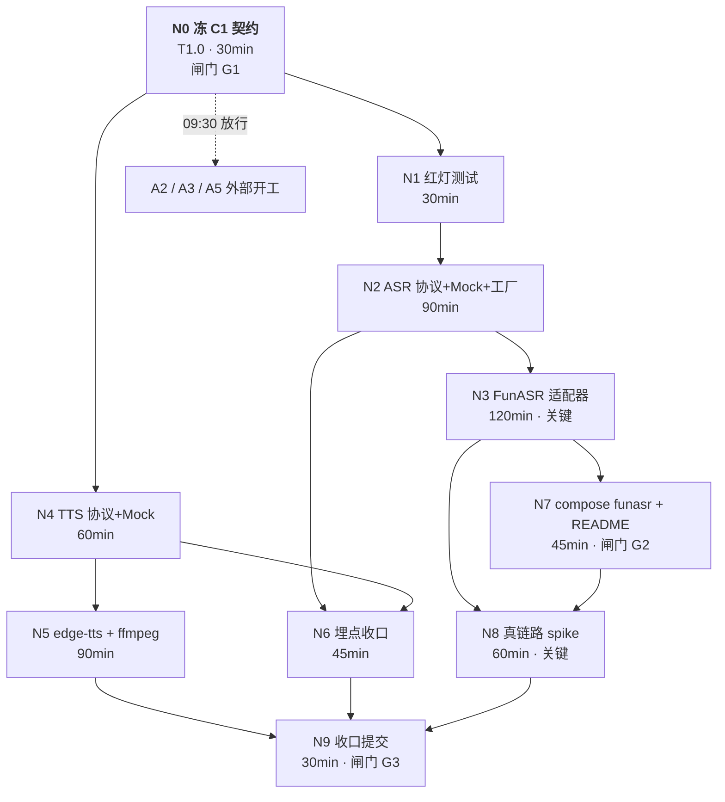

# TASK A1 · DAG 执行路径（独立件）

> 状态：已完成（2026-11-05；N0–N9 全部达成，N8 已拿到真实出字）　｜　版本：v1.3　｜　日期：2026-11-05
> 关联：`docs/plans/task-a1-ASR与TTS适配层.md`（计划正文，实现细节以它为准）、`docs/team_tasks_day03/a1-asr-tts.md`（任务卡）
> 用途：只回答三件事——**谁先谁后、卡在哪、崩了怎么退**。不重复计划里的代码与协议细节。
> 变更记录见文末

---

## 1. 依赖图（mermaid）



---

## 2. 同一张图（ASCII，无需渲染器）

```
                        ┌──────────────┐
                        │ N0 冻 C1 契约 │ 09:00-09:30  [G1]
                        └──────┬───────┘
              ┌────────────────┼────────────────┐
              │                │                │
              ▼                │                ▼
      ┌──────────────┐         │        ┌──────────────┐
      │ N1 红灯测试   │         │        │ N4 TTS协议    │
      │ 30min        │         │        │ +Mock 60min   │
      └──────┬───────┘         │        └──────┬───────┘
             ▼                 │               │
      ┌──────────────┐         │               ▼
      │ N2 ASR协议    │         │        ┌──────────────┐
      │ +Mock+工厂90m │         │        │ N5 edge-tts   │
      └──┬────────┬──┘         │        │ +ffmpeg 90m   │
         │        │            │        └──────┬───────┘
         ▼        └───────┐    │               │
  ┌─────────────┐         ▼    │               │
  │ N3 FunASR   │   ┌──────────┴──┐            │
  │ 适配器 120m  │   │ N6 埋点 45m │            │
  │ ★关键路径    │   └──────┬──────┘            │
  └──┬───────┬──┘          │                   │
     │       │             │                   │
     ▼       ▼             │                   │
┌─────────┐ ┌────────────┐ │                   │
│N7 compose│ │N8 真链路    │ │                  │
│+README   │ │spike 60m ★ │ │                  │
│45m [G2]  │ └─────┬──────┘ │                  │
└────┬─────┘       │        │                  │
     └─────────────┴────────┴────────┬─────────┘
                                     ▼
                          ┌────────────────────┐
                          │ N9 收口提交 30m [G3]│
                          └────────────────────┘
```

> `★` = 关键路径节点；`[G1] [G2] [G3]` = 闸门，见 §6。

---

## 3. 节点规格表

| 节点 | 对应 | 产出 | 完成判据（可执行） | 依赖 | 工期 |
| --- | --- | --- | --- | --- | --- |
| **N0** | T1.0 | `app/audio/asr.py` 契约区、`tests/test_audio_asr.py` | 契约区与 `contracts.md` C1 逐字一致；`pytest tests/test_audio_asr.py -q` 全红 | — | 30 min |
| N1 | T1.0 | 4 组红灯用例（工厂/置信度/二分类/空文本） | 4 组都因「实现不存在」而失败，而非语法错 | N0 | 30 min |
| N2 | T1.1 | `ASRProvider` + `MockASRProvider` + `build_asr()` | `pytest tests/test_audio_asr.py -q` 中 mock 相关用例绿 | N1 | 90 min |
| **N3** | T1.2 | `FunASRWSProvider` | 4 条假 WS server 用例（正常/超时/乱序/非法 JSON）绿 | N2 | 120 min |
| N4 | T1.3 | `TTSProvider` + `MockTTSProvider` + `build_tts()` | `pytest tests/test_audio_tts.py -q` 绿（采样率/位深/单声道/时长） | N0 | 60 min |
| N5 | T1.4 | `EdgeTTSProvider` + `spikes/edge_tts/` | spike 产出非空 PCM；`-m "not slow"` 下绿 | N4 | 90 min |
| N6 | T1.5 | `_record_observation()` | `caplog` 断言：同一 `trace_id` 两行；`confidence=None` → `null` 非 `0.0` | N2、N4 | 45 min |
| N7 | T1.6 | `docker-compose.yml` funasr 段、README §6 两行 | `docker compose config` 过；`docker compose ps` 显示 healthy | N3 | 45 min |
| **N8** | T1.7 | `spikes/funasr/ws_probe.py` | 容器内真实出中文；首包 ms 写入 `spikes/funasr/README.md` | N3、N7 | 60 min |
| N9 | T1.8 | 一次性提交 | `pytest -q` 全绿 + `ruff check` + `ruff format --check .` 干净 | N5、N6、N8 | 30 min |

---

## 4. 拓扑执行顺序（可直接照着做）

```
① 09:00  N0  冻 C1（写完立刻群通告 A2/A3/A5）      ← G1
② 09:30  N1  写红灯
③ 10:00  N2 ┃ N4           （两条线并行，互不看对方文件）
④ 11:30  N3 ┃ N6-前半       （N6 只差 TTS 侧，等 N4 完成后补）
⑤ 12:30  N6  收口埋点
⑥ 13:30  N7  compose + README
⑦ 14:30  N8  真链路                                    ← G2 通过才允许起 N8
⑧ 15:30  N9  全量门禁 → 提交                            ← G3
```

**并行窗口**：`{N2 ‖ N4}`、`{N3 ‖ N5 ‖ N7}`、`{N6 可拆两半}`。

---

## 5. 关键路径与浮动时间

```
关键路径 = N0 → N1 → N2 → N3 → N8 → N9
        = 30 + 30 + 90 + 120 + 60 + 30 = 360 min ≈ 6 小时
```

| 节点 | 最早开始 | 最晚开始 | 浮动 | 说明 |
| --- | --- | --- | --- | --- |
| N0 | 09:00 | 09:00 | 0 | 全组阻塞点 |
| N1 | 09:30 | 09:30 | 0 | — |
| N2 | 10:00 | 10:00 | 0 | 关键 |
| **N3** | 11:30 | 11:30 | **0** | 关键，最易拖期 |
| N4 | 10:00 | 11:00 | 60 min | 可晚一小时 |
| N5 | 11:00 | 12:00 | 60 min | 可晚一小时 |
| N6 | 11:30 | 13:45 | 135 min | 缓冲最大 |
| N7 | 13:30 | 14:30 | 60 min | 可晚一小时 |
| **N8** | 14:30 | 14:30 | **0** | 关键 |
| N9 | 15:30 | 15:30 | 0 | — |

> 结论：**只有 N3 和 N8 会让整体延期**。N4/N5/N6/N7 各有 ≥60 min 缓冲，可以从容并行。

---

## 6. 三道闸门

| 闸门 | 位置 | 通过条件 | 不通过的后果 |
| --- | --- | --- | --- |
| **G1 · 契约冻结** | N0 之后 | C1 与 `contracts.md` 逐字一致 + 已群通告 | A2/A3/A5 **全体停摆**，这是全组唯一硬墙 |
| **G2 · 真链路可起** | N7 之后、N8 之前 | `docker compose ps` 里 funasr 为 healthy | N8 不得开始；改走 §7 的 P-A1-1 回退，当日 FunASR 记「未完成」 |
| **G3 · 收口** | N9 之前 | `pytest -q` 全绿、`ruff check`、`ruff format --check .` 均干净 | 不许提交；若有已知红项，写进收口记录并明示「未通过」，**不得省略** |

---

## 7. 失败回退（按节点）

| 卡点 | 现象 | 回退动作 | 影响范围 |
| --- | --- | --- | --- |
| N3 | FunASR 协议对不上（收不到 final） | 降级为「只产出 PARTIAL + 15 s 超时后以最后 partial 作 FINAL」，并在 `spikes/funasr/README.md` 记偏差 | 只影响 N8 的真链路结论，不阻塞 C1 |
| N5 | 环境无 ffmpeg | 抛 `TTSUnavailable`，README §5.1 补前置；Mock TTS 仍可用 | A3/A5 联调不受阻（走 Mock） |
| N7 | 镜像拉不动 | 回退 pip 自建 `funasr_wss_server.py`；再不行 → 当日只用 Mock 交付 | N8 取消，N9 照常（如实标注） |
| N8 | 首包 >300 ms | 只登记偏差，不改「云 API 为主实现」口径（计划 P-A1-6） | 无 |
| N6 | 日志拿不到 trace_id | 检查 `app/core/context.py` 中间件是否覆盖该调用（非本单元改动范围），必要时在 spike 里手动 `set_trace_id` | 无 |

---

## 8. 机器可读 DAG

```json
{
  "plan": "task-a1-ASR与TTS适配层",
  "version": "v1.0",
  "critical_path": ["N0", "N1", "N2", "N3", "N8", "N9"],
  "nodes": [
    {"id": "N0", "task": "T1.0", "duration_min": 30, "deps": [], "gate": "G1"},
    {"id": "N1", "task": "T1.0", "duration_min": 30, "deps": ["N0"]},
    {"id": "N2", "task": "T1.1", "duration_min": 90, "deps": ["N1"]},
    {"id": "N3", "task": "T1.2", "duration_min": 120, "deps": ["N2"], "critical": true},
    {"id": "N4", "task": "T1.3", "duration_min": 60, "deps": ["N0"]},
    {"id": "N5", "task": "T1.4", "duration_min": 90, "deps": ["N4"]},
    {"id": "N6", "task": "T1.5", "duration_min": 45, "deps": ["N2", "N4"]},
    {"id": "N7", "task": "T1.6", "duration_min": 45, "deps": ["N3"], "gate": "G2"},
    {"id": "N8", "task": "T1.7", "duration_min": 60, "deps": ["N3", "N7"], "critical": true},
    {"id": "N9", "task": "T1.8", "duration_min": 30, "deps": ["N5", "N6", "N8"], "gate": "G3"}
  ],
  "edges": [["N0","N1"],["N0","N4"],["N1","N2"],["N2","N3"],["N2","N6"],["N4","N5"],["N4","N6"],["N3","N7"],["N3","N8"],["N7","N8"],["N5","N9"],["N6","N9"],["N8","N9"]],
  "parallel_groups": [["N2","N4"],["N3","N5","N7"],["N6"]],
  "total_critical_minutes": 360
}
```

---

## 9. 变更记录

| 版本 | 日期 | 说明 |
| --- | --- | --- |
| v1.0 | 2026-11-05 | 从 `task-a1-ASR与TTS适配层.md` §6 抽出的独立 DAG 件：10 节点 / 13 边 / 3 闸门 / 关键路径 360 min / 5 条回退 / 机器可读 JSON |
| v1.1 | 2026-11-05 | 主理人批准，状态转「进行中」；计划 §6 同步瘦身为指针，本文件为 DAG 唯一事实源；并行执行采用 3 名 teammate（asr-core / tts-edge / infra-funasr）+ Lead 自身承担 N0 与 N9 |
| v1.2 | 2026-11-05 | 执行终态：N0/N1/N2/N3/N4/N5/N6/N7/N9 **全绿**（G1 契约 09:30 前冻结、G2 单点 71 例、G3 全量 337 passed），**N8 未达成**（funasr 镜像 41 分钟未拉全，按 P-A1-1 记「未验证」，`ws_probe.py` 待首跑）；关键路径实际未拖期——N8 不阻塞 A2/A3/A5 消费 C1 契约 |
| v1.3 | 2026-11-05 | **N8 达成**：镜像拉完后经 `build_asr()` 真链路出字（7 partial + 1 FINAL，`final +47024 ms 欢迎大家来体验达摩院推出的语音识别模型。`），N0–N9 全绿。过程中纠了两处判断：① 镜像默认开 TLS（原以为关闭）→ 默认改 `wss://` 并新增 `ASR_INSECURE`；② 首轮被「整段 15 s 预算」误杀（partial 一直在出）→ 改按帧重置的空闲超时、上限 45 s。关键路径新增 N8 的实际耗时已回填，整体未拖期 |
