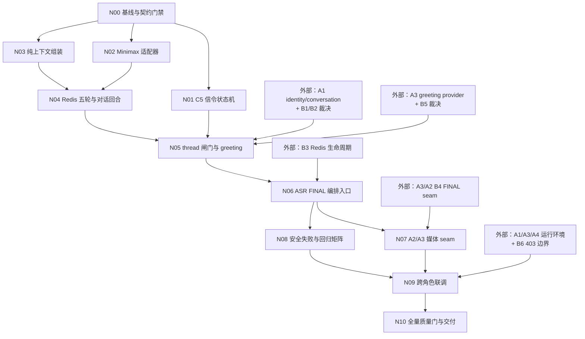

# Day04 A2 · DAG 执行路径（独立件）

> 状态：草稿　｜　版本：v1.0　｜　日期：2026-11-06
> 关联：docs/plans/day04/a2-impl-信令与对话.md（实施细节）；docs/plans/day04/a2-信令与对话.md（小时级原计划）；docs/plans/day04/a2-prompt-信令与对话.md（执行提示词）
> 上游依据：Day04 contracts v1.0 C5/C6；PRD FR-DLG-05、FR-VPR-01~03、FR-ADM-06；技术设计文档 `conversation_threads` 与服务分层
> 变更记录见文末

## 1. 使用规则

本文件是 A2 节点先后、外部依赖、并行分组和门禁的唯一事实源，不重复实施计划中的代码细节。节点号为稳定 ID，执行时不得因局部阻塞自行改边或跳过门禁。

状态只允许使用：`pending / in_progress / done / blocked / partial / failed`。`partial` 表示本地可验部分已完成但生产装配或真链未验，不能视为 `done`。外部节点由对应 owner 完成，A2 不得通过修改他人文件使其“变绿”。

## 2. 依赖图



## 3. 无需渲染器的拓扑视图

```text
                         ┌──────────────── N01 C5 信令 ───────────────┐
                         │                                            │
N00 基线/契约 ───────────┤                                            ├─→ N05 thread/greeting
                         │                                            │      ↑        ↑
                         └─→ N02 Minimax ─┐                           │   X_A1     X_PERSONA
                            N03 Context ──┴─→ N04 Redis/Dialogue ─────┘
                                                                         │
                                                         X_REDIS ────────┤
                                                                         ▼
                                                            N06 ASR FINAL 编排
                                                              │           │
                                                 X_MEDIA ─────┤           │
                                                              ▼           ▼
                                                    N07 媒体 seam     N08 安全/回归
                                                              │           │
                                                X_RUNTIME ────┤           │
                                                              ▼           ▼
                                                              N09 联调 ←──┘
                                                                   │
                                                                   ▼
                                                            N10 质量门/交付
```

## 4. 节点规格与直接依赖

| 节点 | 直接依赖 | 主要输入 | 产出与完成判据 | 阻塞传播 |
| --- | --- | --- | --- | --- |
| N00 | 无 | C2/C5/C6、现有 WS 测试 | 基线结果、C5 变更留痕、B1–B6 清单；未私裁冲突 | 阻塞所有 A2 节点 |
| N01 | N00 | C5、Day3 harness | C5 类型/状态机/诊断日志；A2-01～06 通过 | 阻塞 N05 |
| N02 | N00 | Settings、httpx MockTransport | 文本+degraded 回复、至多 2 次重试；A2-07 单测通过 | 阻塞 N04 |
| N03 | N00 | 固定前缀、显式身份/时间/历史参数 | 纯上下文 builder；5 轮与 generic 测试通过 | 阻塞 N04 |
| N04 | N02、N03 | 注入式 LLM/Redis、服务端 thread_id | Redis 回合 store 与对话服务；10 轮/degraded 测试通过 | 阻塞 N05 |
| N05 | N01、N04、X_A1、X_PERSONA | A1 模型/身份接口、B1/B2/B5 决定 | thread 生命周期、拒绝边界、greeting；A2-09/10 通过 | 阻塞 N06 |
| N06 | N05、X_REDIS | FINAL 文本、服务端连接上下文、Redis 生命周期 | 单一 awaitable 编排入口；FINAL 一次、PARTIAL 零次、顺序测试通过 | 阻塞 N07/N08 最终完成 |
| N07 | N06、X_MEDIA | 冻结的 A3 回调 seam | FINAL 与字幕均一次、异常/取消明确、双连接隔离 | 阻塞 N09 |
| N08 | N06 | N01–N06 全部实现与故障替身 | 安全/失败/回归矩阵有真实结果；无隐藏 skip | 阻塞 N09 |
| N09 | N07、N08、X_RUNTIME | A1/A3/A4 环境、Minimax 本机配置、B6 入口 | 三条主链复现、AC-39 边界、单次延迟观察、真链证据 | 阻塞 N10 全部完成 |
| N10 | N09 | 全部 diff、测试与联调证据 | pytest/ruff/diff 检查通过；节点/阻塞/限制报告完整 | 终端节点 |

> N06 可在 X_REDIS 未交付时完成注入式单元测试，但只能标 `partial`；N09 不可用时 N10 可执行本地检查，同样只能标 `partial`。

## 5. 拓扑执行顺序与并行窗口

```text
第 0 层：N00；同时由 owner 推进 X_A1 / X_PERSONA / X_REDIS / X_MEDIA 的接口确认。
第 1 层：N01 ‖ N02 ‖ N03。
第 2 层：N02+N03 完成后启动 N04；N01 若尚未结束可继续与 N04 并行。
第 3 层：N01+N04+X_A1+X_PERSONA 全部就绪后启动 N05。
第 4 层：N05+X_REDIS 就绪后完成 N06；未完成 Redis 装配时仅可做本地部分。
第 5 层：N06 后，N07 与 N08 并行；N07 另等 X_MEDIA。
第 6 层：N07+N08+X_RUNTIME 全部就绪后启动 N09。
第 7 层：N09 后执行 N10 并出交付报告。
```

推荐单执行器顺序：`N00 → N02 → N03 → N04 → N01 → N05 → N06 → N08 → N07 → N09 → N10`。该顺序只是减少等待的一种拓扑序，不覆盖图中的依赖；若外部节点未就绪，应返回可执行的 N01–N04 或测试工作，而不是越权解锁。

结构主链为：

```text
N00 → N02 → N04 → N05 → N06 → N07 → N09 → N10
                   ↑               ↑
                N01/N03         X_REDIS/X_MEDIA
```

N01 与 N02→N04 两支在 N05 前汇合；N08 与 N07 在 N09 前汇合，因此只完成其中一支不能进入联调。

## 6. 门禁

| 门禁 | 位置 | 必须满足 | 未满足时允许做什么 |
| --- | --- | --- | --- |
| G0 契约与基线 | N00 出口 | C2 基线可复现；C5 追加留痕；B1–B6 已登记 | 修复理解或测试环境，不写业务实现 |
| G1 身份/thread | N05 入口 | B1/B2/B5 已裁决；A1 模型和身份接口可消费；N01/N04 完成 | 继续 N01–N04 单测，不伪造 generic ID |
| G2 Redis 装配 | N06 完整完成前 | B3 明确创建/注入/关闭 owner | 注入式 Fake Redis 单测，节点仅 partial |
| G3 媒体 seam | N07 入口 | B4 已冻结且 A3 接受调用契约 | 提交接口请求和 A2 侧测试，不改 webrtc.py |
| G4 联调准入 | N09 入口 | N07/N08 完成；运行环境与 B6 边界可用 | 完成本地回归并报告真链未验证 |
| G5 收口 | N10 出口 | 全量 pytest、ruff、format、diff 检查通过；范围/安全审查无例外 | 不宣称全部完成，不提交红项 |

## 7. 阻塞处理与回退路径

| 卡点 | 不得做什么 | 回退与可继续路径 |
| --- | --- | --- |
| B1/B2 generic thread 冲突 | 不改冻结 C6、不填空默认 elder、不自创公式 | N05 标 blocked；N01–N04 继续；把所需裁决精确回报 A1/A2 owner |
| A1 identity/model 未交付 | 不在生产代码放 Mock identity | 用测试 Protocol/Fake 验证 A2 本地逻辑；N05 等真实接口 |
| Redis 生命周期未定 | 不每轮创建客户端、不隐藏全局泄漏 | N04 保持构造注入；N06 partial；请求 owner 提供 lifespan 装配 |
| A3 FINAL seam 未定 | 不改 webrtc.py、不用未跟踪 create_task 绕过 | N06 单测继续；N07 blocked；输出最小 awaitable 接口请求 |
| Minimax 不可用 | 不硬编码 key、不伪造成功或延迟数据 | N02 MockTransport 验证降级；N09 真链记 unverified |
| N01 破坏 C2 | 不删除旧用例或放宽断言 | 回退本节点最小增量，恢复 C2 绿后再逐分支追加 |
| N04 历史串线/超 5 轮 | 不用扩大上下文掩盖问题 | 固定服务端 thread key，回退到单回合测试，再加 10 轮与换人用例 |
| N08/N10 出现他域失败 | 不越权修他人文件 | 与 N00 基线对比，保存失败证据并交还 owner；本任务状态如实标记 |
| N09 只有 Mock 证据 | 不写“真链通过” | 保留单测结论，N09/N10 标 partial/blocked，列复现所需环境 |

## 8. 机器可读 DAG

以下 JSON 与上图同构；`deps` 只列直接依赖，外部节点统一以 `X_` 开头。

```json
{
  "plan": "day04/a2-impl-信令与对话",
  "version": "v1.0",
  "terminal": "N10",
  "status_values": ["pending", "in_progress", "done", "blocked", "partial", "failed"],
  "nodes": [
    {"id": "N00", "task": "T0", "deps": [], "gate": "G0", "owned_by": "A2"},
    {"id": "N01", "task": "T1", "deps": ["N00"], "owned_by": "A2"},
    {"id": "N02", "task": "T2", "deps": ["N00"], "owned_by": "A2"},
    {"id": "N03", "task": "T3-context", "deps": ["N00"], "owned_by": "A2"},
    {"id": "N04", "task": "T3-dialogue", "deps": ["N02", "N03"], "owned_by": "A2"},
    {"id": "N05", "task": "T4", "deps": ["N01", "N04", "X_A1", "X_PERSONA"], "gate": "G1", "owned_by": "A2+external"},
    {"id": "N06", "task": "T5-orchestration", "deps": ["N05", "X_REDIS"], "gate": "G2", "owned_by": "A2+external"},
    {"id": "N07", "task": "T5-media-seam", "deps": ["N06", "X_MEDIA"], "gate": "G3", "owned_by": "A2+A3"},
    {"id": "N08", "task": "T6-self-test", "deps": ["N06"], "owned_by": "A2"},
    {"id": "N09", "task": "T5/T6-integration", "deps": ["N07", "N08", "X_RUNTIME"], "gate": "G4", "owned_by": "A1+A2+A3+A4"},
    {"id": "N10", "task": "T6-quality", "deps": ["N09"], "gate": "G5", "owned_by": "A2"}
  ],
  "external_nodes": [
    {"id": "X_A1", "provides": "A1 identity/conversation interfaces and B1/B2 decisions", "owner": "A1/A2+主理人"},
    {"id": "X_PERSONA", "provides": "read-only greeting provider and B5 decision", "owner": "A3/A2"},
    {"id": "X_REDIS", "provides": "Redis create/inject/close lifecycle", "owner": "Day04 owner/A3"},
    {"id": "X_MEDIA", "provides": "single awaitable ASR FINAL seam", "owner": "A2/A3"},
    {"id": "X_RUNTIME", "provides": "integration runtime and B6 HTTP 403 boundary", "owner": "A1/A3/A4/API owner"}
  ],
  "edges": [
    ["N00", "N01"], ["N00", "N02"], ["N00", "N03"],
    ["N02", "N04"], ["N03", "N04"],
    ["N01", "N05"], ["N04", "N05"], ["X_A1", "N05"], ["X_PERSONA", "N05"],
    ["N05", "N06"], ["X_REDIS", "N06"],
    ["N06", "N07"], ["X_MEDIA", "N07"], ["N06", "N08"],
    ["N07", "N09"], ["N08", "N09"], ["X_RUNTIME", "N09"],
    ["N09", "N10"]
  ],
  "parallel_groups": [
    ["N01", "N02", "N03"],
    ["N01", "N04"],
    ["N07", "N08"]
  ],
  "structural_main_path": ["N00", "N02", "N04", "N05", "N06", "N07", "N09", "N10"]
}
```

## 9. 执行器检查规则

执行器在启动节点前必须检查：所有 `deps` 为 `done`；若允许 `partial`，只能完成该节点明确标注的本地部分。完成节点后立即运行其聚焦测试并记录证据。任何依赖缺失都应沿出边传播 `blocked`，不得改写成“跳过依赖后完成”。

最小校验可通过解析上方 JSON 完成：节点 ID 唯一、依赖均存在、边与 `deps` 一致、无环、所有节点均可从 N00 或外部节点到达、唯一终端为 N10。文档评审还应核对 Mermaid、ASCII、节点表和 JSON 四者边关系一致。

## 修订记录

| 版本 | 日期 | 说明 |
| --- | --- | --- |
| v1.0 | 2026-11-06 | 从 A2 编码实施计划抽取独立 DAG：11 个执行节点、5 个外部节点、18 条直接依赖边、6 道门禁；提供 Mermaid、ASCII、拓扑分层、并行组、主链、回退规则与同构 JSON。 |
