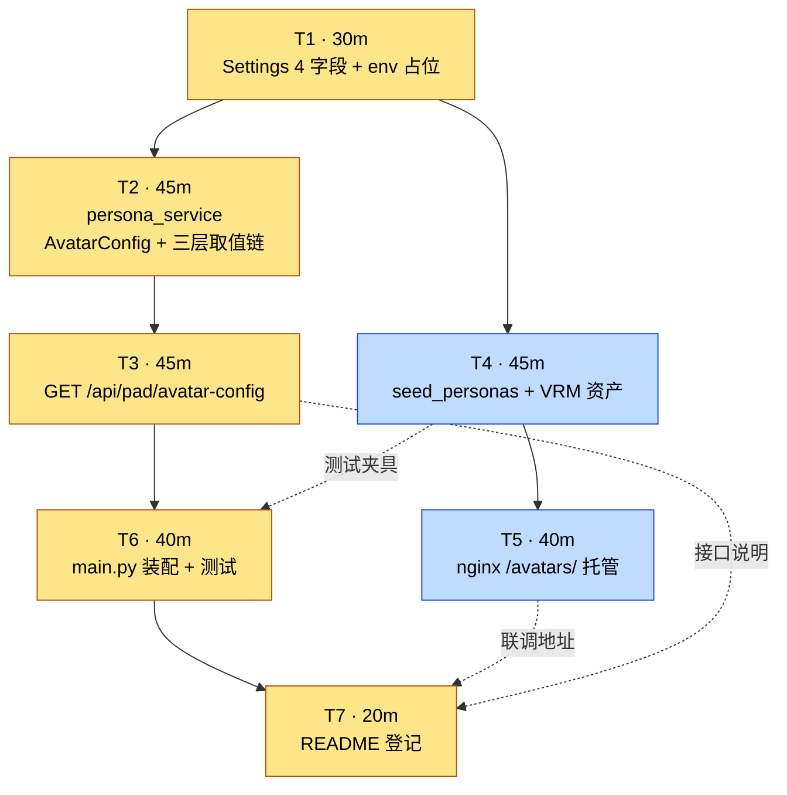

# A3 · 3D 展示后端 — 执行 DAG

> 状态：已完成　｜　版本：v1.1　｜　日期：2026-11-06
> 派生自：`docs/plans/day04/a3-3D展示后端.md` v1.3（§3 实施步骤 T1–T7）
> 关联卡：`docs/team_tasks/day04/task-03-3D展示后端.md`　｜　契约：`docs/team_tasks/day04/contracts.md` C7
> **本图是派生物，不承载口径。** 与计划冲突时以计划为准；计划改了这张图必须同提交同步。

---

## 1. 图（Mermaid）



图例：橙色 = 关键路径（180 分钟）；蓝色 = 可并行旁支（85 分钟）。

## 2. 图（ASCII 兜底，渲染失败时看这个）

```
        T1  30m  Settings 4 字段
         │
    ┌────┴─────────────────────────────┐
    ↓                                  ↓
  T2  45m                          T4  45m
  persona_service                  seed + VRM
    │                                  │
    ↓                                  ↓
  T3  45m                          T5  40m
  avatar-config 接口                nginx /avatars/
    │                                  │
    ↓                                  │
  T6  40m  ←┈┈┈┈┈ T4 提供测试夹具 ┈┈┈┈┘
  装配 + 测试
    │
    ↓
  T7  20m  README

关键路径：T1 → T2 → T3 → T6 → T7 = 180m
旁支：    T1 → T4 → T5            =  85m
```

## 3. 边表（谁把什么交给谁）

| # | 从 | 到 | 类型 | 传递物 | 断了会怎样 |
| --- | --- | --- | --- | --- | --- |
| 1 | T1 | T2 | 硬 | `settings.default_avatar_url`、`default_fallback_avatar_url`、`avatar_rotation_y_offset`、`avatar_cache_version_salt`、`public_base_url` | T2 无默认值可回落，三层链第②层直接塌 |
| 2 | T2 | T3 | 硬 | `AvatarConfig` TypedDict + `async get_avatar_config(session, *, elder_id)` | T3 只能自己写取值逻辑 → 出现第二形态（违反禁区 8） |
| 3 | T3 | T6 | 硬 | `app/api/pad.py:router`（`prefix="/api/pad"`）、403 `device_not_bound` | 接口挂不上，验收命令 curl 全 404 |
| 4 | T6 | T7 | 硬 | 实际可跑的验收结果（401/403/200 三态） | README 写的是没验证过的说明 |
| 5 | T1 | T4 | 硬 | 相对路径约定（库存相对、响应拼绝对） | seed 写绝对 URL，T2 拼接逻辑被绕过，换环境即坏 |
| 6 | T4 | T5 | 硬 | `deploy/assets/avatars/vrm1_sample.vrm`（10,776,032 B） | nginx 无文件可托管，`curl` 404 |
| 7 | T4 | T6 | 软 | 固定 UUID 演示数据（`…1106` 设备、`…1102` 长者） | 测试只能造数据，DB 用例变多但不断链 |
| 8 | T5 | T7 | 软 | 本地 8080 校验结果与 `PUBLIC_BASE_URL` 取值 | README 少一段本地起法 |
| 9 | T3 | T7 | 软 | 接口响应四键的真实样例 | README 的取值链说明靠记忆写 |

「硬」= 没有它下一步无法产出正确结果；「软」= 缺了能降级继续，但要多干活或留坑。

## 4. 并行方案

| 方案 | 排法 | 墙钟时间 | 说明 |
| --- | --- | --- | --- |
| 串行 | T1→T2→T3→T4→T5→T6→T7 | **265 min** | 基线，全程无协调成本 |
| **并行 2（推荐）** | 主线 T1→T2→T3→T6→T7；旁线在 T2 起步后开 T4→T5 | **约 180 min** | 旁线 85 min 落在主线 T2+T3 的 90 min 窗口内，几乎完全遮住 |
| 并行 3 | 再加一条只跑 T7 | 约 180 min | **伪并行**：T7 依赖 T6 与 T5，第三条线无事可做 |

并行 2 的工时账：主线 180 + 旁线 85 = 265 分钟工作量，墙钟压到 180，省 85 分钟（32%）。

## 5. 写锁（这两个文件不许并行）

| 文件 | 独占者 | 冲突后果 | 约束 |
| --- | --- | --- | --- |
| `app/core/config.py` | T1（本人是 Day 4 Settings 唯一录入人） | 与 A1 `VOICEPRINT_*`、A2 `LLM_*`/`ENCRYPTION_KEY` 两套字段并存，后者静默失效 | T1 一次做完，做完立刻通知 A1/A2 来登记 |
| `app/main.py` | T6 | A2/A4 同改 `include_router`（现有 L82–87 六条） | 压到最后、短窗口加两行、先 `git pull`，冲突时后提交者 rebase |

`deploy/`（T4/T5）与 `scripts/`（T4）全组无人使用，**是唯一安全的并行位**。

## 6. 与计划的对应

| 计划 §3 小节 | 本图节点 |
| --- | --- |
| T1 · Settings 与 `.env.example` | T1 |
| T2 · `app/services/persona_service.py` | T2 |
| T3 · `app/api/pad.py` | T3 |
| T4 · seed 与静态资产 | T4 |
| T5 · nginx 托管 | T5 |
| T6 · 装配与测试 | T6 |
| T7 · README 登记 | T7 |

## 变更记录

| 版本 | 日期 | 说明 |
| --- | --- | --- |
| v1.0 | 2026-11-06 | 初稿：按计划 v1.3 的 T1–T7 与 §3 依赖关系绘制；标出关键路径 180m、旁支 85m、两处写锁 |
