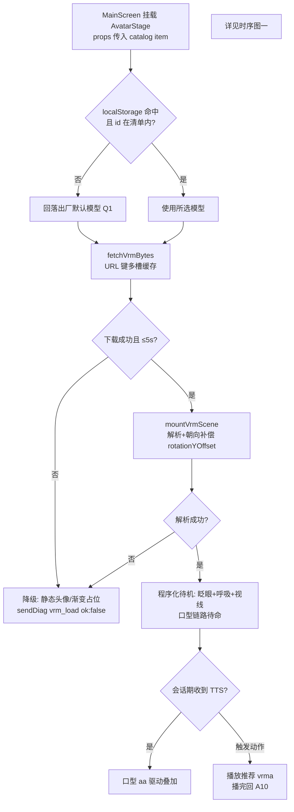
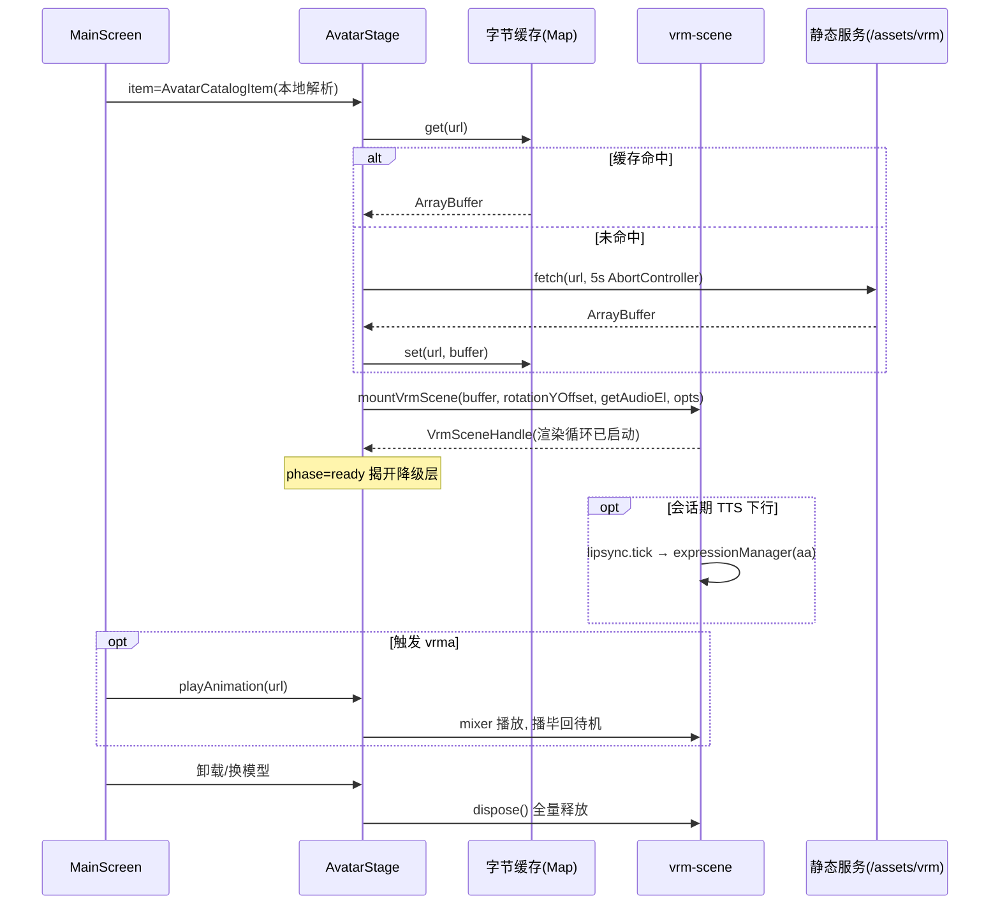
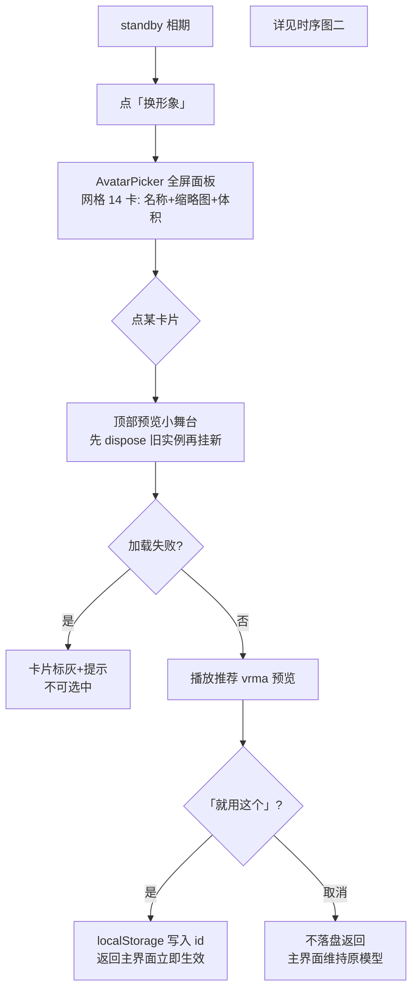
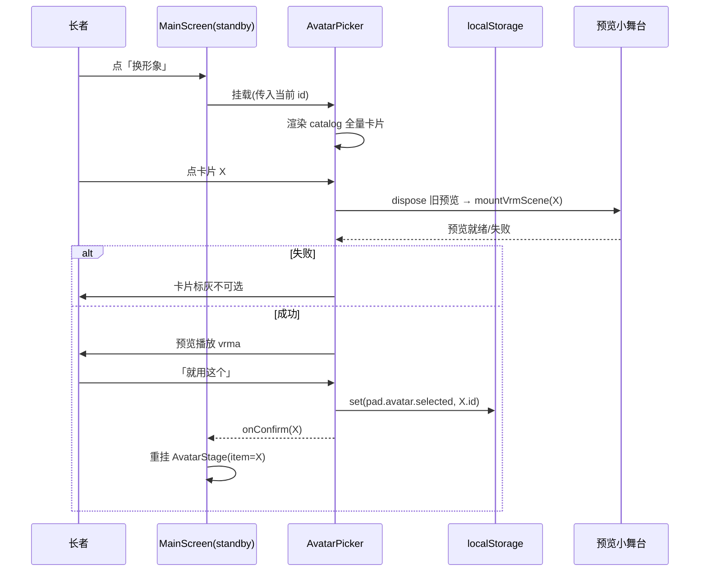

# Day05 A1 · 本地 VRM 接入与形象选择页（方案，不含代码）

> 状态：已冻结　｜　版本：v1.5　｜　日期：2026-11-07
> 关联：docs/plans/day04/f1-Day4前端联调.md（W1 3D 展示现状）；docs/plans/adhoc-20261106-数字人接入方案对比.md（前次方案对比裁决，**已由主理人删除**，本文档部分推翻其结论，见 D1）；docs/team_tasks/day05/a1-本地VRM与形象选择页.md（任务卡，C7 停用留痕所在）
> 上游依据：PRD FR-3D-01/FR-3D-02（加载失败或超 5s 切静态头像，不白屏）；前端页面方案（配色 token、≥48px 触控、大字号）；主理人裁决 2026-11-07（本地默认模型、全量支持 14 个模型、待机 + vrma 播放、只改前端）
> 变更记录见文末

## 1. 背景与目标

pad 端数字人当前走 C7 服务端契约（`GET /api/pad/avatar-config` 下发 `avatar_url`），本地 `frontend/public/assets/vrm/` 下 14 个 VRM 模型与 30+ 个 `.vrma` 动画未被任何代码引用。本方案将数字人改为**本地资产驱动**，并新增「形象选择页」让长者自选模型。

四条目标：

1. 本地 14 个 VRM 模型全部可加载、渲染，无材质丢失、无加载报错；
2. 程序化待机（眨眼 / 呼吸 / 视线看向镜头）+ 指定 `.vrma` 动画播放；
3. 新增形象选择页（standby 期入口），选择结果本地持久化；
4. 全链路打通既有 pad 流程（登录 → 声纹 → 主界面两相轮转），主对话链路零回归。

## 2. 现状基线（已读码确认）

| 事实 | 位置 |
| --- | --- |
| three ^0.187 + @pixiv/three-vrm ^3.5.5 已装；下载/解析/朝向/取景/渲染循环/口型/dispose/ResizeObserver 全部已实现 | [vrm-scene.ts](file:///Users/min/Desktop/repo/kangban/frontend/src/pad/avatar/vrm-scene.ts) |
| 舞台组件走 C7：fetchAvatarConfig → 三层降级（VRM → fallback_image → 渐变占位）→ vrm_load 诊断上行 | [AvatarStage.tsx](file:///Users/min/Desktop/repo/kangban/frontend/src/pad/avatar/AvatarStage.tsx) |
| 模型来源为服务端 `avatar_url` + `rotation_y_offset`（VRM0 朝向补偿）+ `version` 缓存键 | [avatar-config.ts](file:///Users/min/Desktop/repo/kangban/frontend/src/pad/avatar/avatar-config.ts) |
| 本地 14 个 .vrm（6–42MB，共约 260MB）无代码引用；`*.vrm` 在 .gitignore（不入库） | `frontend/public/assets/vrm/` |
| animations/ 下 30+ 个 .vrma（舞蹈/待机/跑步等，部分为日文文件名）；`animations/common/`（含 manifest、LICENSE）已入库 | `frontend/public/assets/vrm/animations/` |
| 现无任何动画播放能力（仅 T-pose + 口型）；无 `@pixiv/three-vrm-animation` 依赖 | package.json |
| App 相位链：LoginPage → VoiceprintGate → MainScreen（standby/inSession 轮转）；DemoSwitcher 仅 DEV 常显，TaskKind 驱动面板 | [App.tsx](file:///Users/min/Desktop/repo/kangban/frontend/src/pad/App.tsx)、[DemoSwitcher.tsx](file:///Users/min/Desktop/repo/kangban/frontend/src/pad/pages/DemoSwitcher.tsx) |
| 模型字节缓存为**单槽**（`version` 键），本地化后不够用（切模型会互相挤掉） | vrm-scene.ts L27–L62 |

## 3. 决策记录

### 3.1 已定（主理人裁决，2026-11-07）

- **D1｜模型来源改为本地**：不走 C7 远程下发，前端内置默认模型 + 长者可选。此裁决**推翻** `adhoc-20261106-数字人接入方案对比.md` 中「avatar_url 接口下发」方向的相关结论，实施时须在该文档追加修订记录、并在 Day05 契约/任务卡留痕「pad 端停止消费 C7」。后端接口与 `avatar-config.ts` 代码**保留不删**（见 D4）。
- **D2｜全量支持 14 个模型**：选择页列出全部 14 个，接受 >20MB 模型的加载耗时风险（R2）。
- **D3｜动画范围 = 待机 + vrma 播放**：新增 `@pixiv/three-vrm-animation` 依赖，先走 spikes 验证（AGENTS §3）。
- **D4｜范围只改前端**：不改后端代码、不做迁移；C7 接口本身保留。模型选择结果存 pad 本地 `localStorage`（pad 为设备绑定唯一长者，设备级存储等价于个人级）。资产同步方式见 §8（仓库管理事项，非后端改动）。

### 3.2 已定（主理人逐项确认，2026-11-07）

- **Q1｜默认模型**：`Yoimiya.vrm`（6MB）为出厂默认；首次进入 pad 无 localStorage 记录时回落到它。
- **Q2｜缩略图方案**：第一期选择页用 token 配色的 **div 占位卡**（不做截图）；待模型稳定可加载展示后，再人工截图 14 张小图（≤100KB/张）入 `thumbs/` 替换，catalog 预留缩略图字段。
- **Q3｜待机形态**：程序化待机为基线；**本地存在可兼容的 idle vrma 时叠加**循环播放（从 waiting-* 系列中挑）；兼容验证不过则回落纯程序化待机。
- **Q4｜朝向标定**：不需主理人裁决——S3 逐模型验证时由实施者现场观察朝向（VRM1 恒 0；VRM0 背对/侧对则试 π 等角度值），标定后写死进 catalog 的 `rotationYOffset`。

## 4. 技术方案

### 4.1 新增依赖与 spike（前置门禁）

| 项 | 内容 |
| --- | --- |
| 新依赖 | `@pixiv/three-vrm-animation`（版本与 three-vrm 3.5.5 同大版本对齐） |
| spike 位置 | `spikes/vrm-animation/`（最小验证页，跑通才合并，AGENTS §3） |
| 验证内容 | ① 用 `VRMAnimationLoaderPlugin` 加载 `animations/VRMA_01.vrma` 并在任一本地模型上播放；② VRM0 模型（游戏改编）humanoid 映射完整性——是否存在播不动的模型；③ 日文文件名经静态服务访问是否正常 |
| 不通过回退 | 放弃 vrma 播放，只做程序化待机（待机不依赖该库，主目标不受阻） |

### 4.2 模型清单（新增 `frontend/src/pad/avatar/avatar-catalog.ts`）

纯前端常量，替代 C7 下发的配置职责：

```ts
interface AvatarCatalogItem {
  id: string;               // 稳定标识（localStorage 存这个，不用文件名）
  displayName: string;      // 选择页展示名（大字号）
  url: string;              // /assets/vrm/Xxx.vrm
  sizeMB: number;           // 选择页标注体积，供长者感知等待
  rotationYOffset: number;  // VRM0 朝向补偿（Q4 逐个标定后写死）
  metaVersion: "0" | "1";   // 记录 VRM 版本，排查用
}
```

- 清单里同时给出**出厂默认 id**（Q1 拍板后写死）。
- 动画清单同理单独一份常量（或同文件第二组）：仅挑验证通过的若干个 vrma（id / url / 用途标签），**不做全量 30+ 都暴露**，避免兼容矩阵失控。

### 4.3 vrm-scene.ts 改造（扩展现有实现，不另起第二套）

| 改动点 | 内容 |
| --- | --- |
| 字节缓存 | 单槽 `version` 键 → 按 `url` 为键的多槽 Map（上限 2–3 个，LRU 即可），支持选择页来回切换不重复下载 |
| 入参 | `mountVrmScene(canvas, buffer, rotationYOffset, getAudioEl?, opts?)` 增加 `opts.animation?: { url, loop }` 与 `opts.idle?: "procedural"` |
| 程序化待机 | 每帧：`expressionManager` 眨眼（周期随机 2–5s）+ 身体 Y 轴微幅正弦 + 相机 lookAt；口型链路原样保留，与待机共存 |
| vrma 播放 | `VRMAnimationLoaderPlugin` 解析 → `createVRMAnimationClip` → `AnimationMixer` 播放；播完（非 loop）自动淡出回程序化待机；播放期间口型仍生效（expression 与骨骼动画通道不冲突） |
| 超时口径 | 本地 fetch 仍保留 5s 上限（FR-3D-02 不动）；本地 nginx 场景 42MB 约 3–4s（R2） |
| dispose | 新增 mixer / clip 资源释放，沿用 `deepDispose` 收口 |

### 4.4 AvatarStage.tsx 改造

- **移除** `fetchAvatarConfig` 调用链：改由 props 接收 `item: AvatarCatalogItem`（App 层解析 localStorage 后传入）；`unbound` 相位移除（设备绑定校验已由声纹门卫承担），保留 `loading / ready / fallback` 三相。
- 降级链保持 FR-3D-02 语义：VRM 下载/解析失败或超 5s → 本地静态头像图（Q2 拍板 A 时用对应缩略图，否则渐变占位）→ 不白屏。
- `sendDiag("vrm_load", ...)` 诊断上行**保留**，本地资产失败同样上报。
- `avatar-config.ts` 文件保留不删，文件头注释标注「C7 消费方已于 Day05 停用（D1），接口契约仍冻结」。

### 4.5 形象选择页（新增 `frontend/src/pad/pages/AvatarPicker.tsx`）

- **入口**：MainScreen standby 相期新增「换形象」按钮（呼叫按钮同级、≥48px 触控、大字号、配色走 token 变量，不硬编码 hex）；**inSession 会话中不提供换装**，避免打断对话链路。
- **页面形态**：全屏面板，网格卡片列出 14 个模型（展示名 + token 配色 div 占位卡 + 体积标注，Q2 第一期不截图）；当前选中卡片高亮（`bg-brand` 反色，同 DemoSwitcher 选中态样式）。
- **预览**：点选某模型后，面板顶部内嵌一个小舞台（复用 `mountVrmScene`，同屏只挂一个实例，切换时先 dispose 旧实例）+ 播放一段推荐 vrma。
- **确认与取消**：「就用这个」写入 localStorage 并返回主界面（立即生效）；「取消」不落盘直接返回。
- **加载中态**：预览加载期间按钮禁用 + 「模型加载中…」提示，沿用现有 loading 文案口径。
- 开发验收期同步在 DemoSwitcher `ITEMS` 增加一个「形象选择」面板项（仅 DEV 常显，生产不受影响）。

### 4.6 数据流与持久化

- localStorage 键：`pad.avatar.selected` = catalog `id`；读取失败 / id 不在清单内（模型文件被删、清单收窄）→ 回落出厂默认（Q1）。
- MainScreen 读值 → 传 `AvatarCatalogItem` 给 AvatarStage；不做热监听，选择页返回时整值重传触发重挂（复用现有 `key`/props 变更语义）。

### 4.7 与现有流程的打通点（零回归约束）

| 既有环节 | 打通方式 | 禁止事项 |
| --- | --- | --- |
| KWS 唤醒 / 呼叫按钮 → inSession | AvatarStage 常驻 MainScreen 中部，两相轮转不受影响；口型 audioEl 仅会话期传入（现状语义保留） | 不改 realtime.ts / kws / voiceprint 任何文件 |
| 声纹门卫 → MainScreen | 形象选择页挂在 MainScreen 内部相位，不越过声纹门卫 | 选择页不读会话、不发请求 |
| 会话过期回登录（T-H 方案 A） | 选择页随 MainScreen 整体卸载 | 不新增会话逻辑 |
| console / family 构建 | avatar 目录 import 天然只在 pad 入口 | build 后核对 console/family 产物无 three chunk |

## 5. 工作线一：模型加载与渲染（流程图 ↔ 时序图互指）





## 6. 工作线二：形象选择（流程图 ↔ 时序图互指）





## 7. 实施步骤

| 步骤 | 内容 | 产出 / 判据 |
| --- | --- | --- |
| S0 | Q1–Q4 拍板 + C7 停用留痕（adhoc 对比文档追加修订记录 + Day05 任务卡/契约登记） | 四项决策落定，留痕可查 |
| S1 | spike：`spikes/vrm-animation/` 验证 three-vrm-animation + 兼容矩阵（14 模型 × 待选 vrma 逐个人工过一遍，产出兼容表） | spike 结论 + 模型×动画兼容表 |
| S2 | `avatar-catalog.ts`（14 模型 + 动画白名单 + 默认项 + 标定 offset） | 常量文件过 tsc |
| S3 | vrm-scene.ts 扩展：多槽缓存 / 程序化待机 / vrma 播放 / dispose 收口 | 单模型加载渲染无控制台报错、无材质丢失 |
| S4 | AvatarStage 改造：去 C7、props 化、降级链、diag 保留 | 断网/坏文件/超 5s 三路降级实测不白屏 |
| S5 | AvatarPicker + standby 入口 + DemoSwitcher 面板项 + localStorage 持久化 | 选择→立即生效→刷新保持 |
| S6 | 全链路回归 + 构建门禁：`pnpm --dir frontend build`（tsc + vite）；核对 console/family 产物无 three；主链路（唤醒→会话→口型→字幕→回待机）回归清单逐项打勾 | 全部通过后计划转「已冻结」 |

## 8. 资产同步与仓库管理（非后端改动）

- `*.vrm` 已被 .gitignore（红线 11），14 个模型**不入库**：统一放共享盘/群文件，路径约定登记进 README（或 `frontend/public/assets/vrm/README.md`），组员 clone 后手动放置到该目录；`animations/common/` 已入库部分不动。
- 日文文件名风险（R4）处理方式随 spike 结论定：优先 catalog 重命名 ASCII 副本，次选运行时 `encodeURIComponent`。
- 截图缩略图（Q2）为**后续增强**：模型加载展示稳定后人工截图 14 张入 `thumbs/`，单张 ≤100KB 可入库。

## 9. 风险登记

| # | 风险 | 缓解 |
| --- | --- | --- |
| R1 | 部分游戏改编模型 humanoid 映射不全，vrma 播不动或姿态怪异 | S1 兼容矩阵逐个验证；不兼容模型在选择页标注「暂不支持动作」或隐藏 |
| R2 | >20MB 模型在慢网络/低端 pad 上超 5s 触发降级 | 主理人已接受（D2）；缓解：standby 期后台预取当前所选模型字节；选择页标注体积 |
| R3 | VRM0 模型朝向需逐个标定，标错会侧身/背身 | Q4 一次性人工标定并写入 catalog；VRM1 恒 0 |
| R4 | 日文文件名 URL 编码在 nginx/静态服务下 404 | spike 验证；回退 ASCII 重命名副本 |
| R5 | 换模型时双实例并存导致 GPU 内存峰值 | 统一「先 dispose 旧、后挂新」顺序，选择页与主舞台同规则 |
| R6 | C7 停用与既有契约/裁决文档冲突被遗漏 | S0 强制留痕（D1）；`avatar-config.ts` 保留并注释，不删契约 |
| R7 | 14 模型全量进选择页首次打开卡顿 | 占位卡为纯 div 非实时渲染；后续截图缩略图同样为静态图片懒加载 |

## 10. 验收清单

1. 14 个模型逐个选择加载：渲染正常、无材质丢失（不透明/不纯白）、控制台无 404 / 解析报错；
2. 待机表现：眨眼 + 呼吸微动 + 视线朝向镜头；T-pose 死桩不出现；
3. vrma：兼容表内模型播放完整、播毕回待机、播放期间 TTS 口型仍生效；
4. 降级：模型文件缺失 / 断网 / 超 5s 三路均切静态兜底，不白屏，vrm_load 诊断发出；
5. 选择页：standby 入口可见、≥48px 触控、大字号、token 配色；选中立即生效、刷新后保持、取消不落盘；
6. 响应式：1920×1080 基线 + 768×1024（iPad Mini 口径）均不截断大字幕；
7. 主链路零回归：KWS 唤醒 / 呼叫按钮 / 按住说话 / 口型 / 字幕 / 会话过期回登录全部照旧；
8. 构建门禁：`pnpm --dir frontend build` 通过；console/family 构建产物不含 three 相关 chunk；pad 构建产物含 three-vrm-animation 后体积增量在预期内；
9. 留痕：C7 停用登记、spike 结论、兼容表随计划同提交。

## 11. 变更范围与禁触

**改动文件**：`frontend/src/pad/avatar/{vrm-scene.ts, AvatarStage.tsx, avatar-config.ts(仅注释)}`、新增 `avatar-catalog.ts`、新增 `pages/AvatarPicker.tsx`、`App.tsx`（standby 入口按钮）、`DemoSwitcher.tsx`（DEV 面板项）、`package.json`（新增依赖）、`spikes/vrm-animation/`、plans 索引与本文件。

**禁触**：`realtime.ts`、`kws/`、`audio/`、`voiceprint/`、`session.ts`、`signal-socket.ts`、后端全部代码与迁移、`docs/接口契约_*` 正文（只做留痕登记不做口径修改）、console/family 全部代码。

## 修订记录

| 版本 | 日期 | 说明 |
| --- | --- | --- |
| v1.0 | 2026-11-07 | 首版：本地 VRM 接入 + 形象选择页方案；含 D1–D4 裁决登记、Q1–Q4 待确认项、双工作线流程图/时序图、S0–S6 步骤与验收清单 |
| v1.1 | 2026-11-07 | Q1–Q4 主理人逐项确认：默认 Yoimiya.vrm、缩略图第一期 div 占位（截图后补）、idle vrma 本地有兼容文件则叠加、朝向标定由实施者 S3 顺带完成；同步 §4.5/§8/§9 R7 |
| v1.2 | 2026-11-07 | S0 落地：adhoc 对比文档经主理人确认已删除，plans/README.md 该行标「已废弃（文件已删除）」；C7 停用留痕改记 docs/team_tasks/day05/a1-本地VRM与形象选择页.md（新建任务卡）；方案状态转「进行中」 |
| v1.3 | 2026-11-07 | S1 spike 通过（spikes/vrm-animation/README.md）：140/140 模型×动画全过，依赖可合并；两条新约束进 S3——① `createVRMAnimationClip(anim, vrm)` 签名，② 14 模型全为 VRM0，rotationYOffset 全量必标定（Q4 原假设失效）；R4 解除（日文文件名可直接用）；Q3 idle 定为 common/idle.vrma |
| v1.4 | 2026-11-07 | R8 裁决（主理人）：口型选 b——无表情模型在选择页卡片标注「不支持口型」，不做下颌骨骼近似、不从 catalog 排除；S2 落地 avatar-catalog.ts（14 模型 + lipsync 字段 + 动画白名单 6 项 + localStorage 读写助手），tsc 通过 |
| v1.5 | 2026-11-07 | S3–S6 全部完成，任务卡置「已完成」。S3 真机标定：14 模型 offset=π 全正脸无例外，idle.vrma ✓；S4 去 C7、S5 选择页落地；**计划外加项**：指针跟随（F-1b 眼+头／F-2a 仅待机／F-3 终态为触摸拖动也跟随，均经主理人确认；iPad 需 touch-action:none 防滚动仲裁）；Q2 立绘提前落地（assets/avatars 14 张 PNG）；S6 门禁全过（build 零报错、console/family 无 three、主链路 5 项回归通过） |
