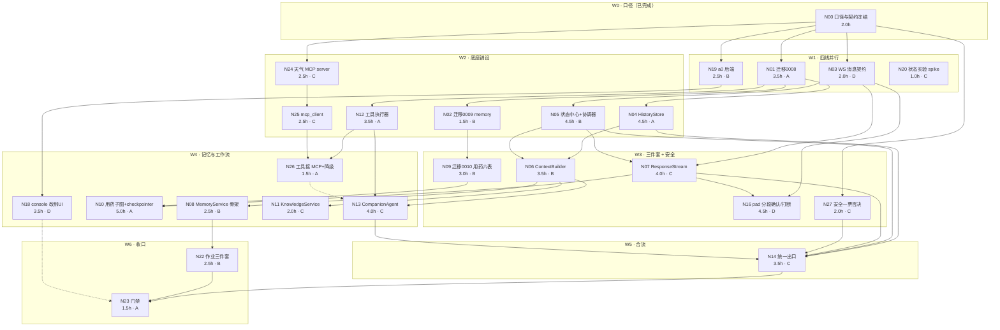

> 状态：进行中（N00 与 S1 数据底座已执行）　｜　版本：v1.0　｜　日期：2026-11-09  
> 关联：docs/plans/day06/day-06-长者侧Agent闭环.md（主计划，节点规格与验收以它为准）｜docs/team_tasks/day06/contracts.md（冻结契约）｜dev-a~dev-d 四张任务卡  
> 上游依据：PRD v2.9 §6.1（Day 6 验收）｜技术设计文档 v2.0 §8.3（Day 6 实现）｜ER v0.5 §4.3.11–4.3.13  
> 变更记录见文末

# Day 6 DAG 执行路径件

> 本文是**唯一执行路径源**：谁先谁后、卡在哪、断哪条会瘫。节点内容（做什么、验收什么）见主计划 §3.1，本文只回答"顺序与依赖"。  
> 与主计划冲突时以主计划为准；本文只保留拓扑、边、波次、锁、门禁、回退。


---

## 1. 节点总表（25 个，含执行状态）

| 节点  | 任务                                             | 负责          | 档 | 人时  | 状态                   |
| --- | ---------------------------------------------- | ----------- | - | --- | -------------------- |
| N00 | 口径变更登记 + 契约冻结                                  | 主理人 + dev-A | S | 2.0 | ✅ 已完成                |
| N01 | 迁移 0008 事件三表 + ORM                             | dev-A       | S | 3.5 | 🟡 迁移已 apply，ORM 待开工 |
| N02 | 迁移 0009 `memory_chunks`                        | dev-B       | M | 1.5 | 🟡 迁移已 apply，ORM 待开工 |
| N03 | WS 消息契约实现 + 事件枚举                               | dev-D       | S | 2.0 | ⬜ 未开始                |
| N04 | HistoryStore                                   | dev-A       | S | 4.5 | ⬜ 未开始                |
| N05 | StateCenter + SessionCoordinator               | dev-B       | S | 4.5 | ⬜ 未开始                |
| N06 | ContextBuilder                                 | dev-B       | S | 3.5 | ⬜ 未开始                |
| N07 | ResponseStream（epoch/分段/ack/打断）                | dev-C       | S | 4.0 | ⬜ 未开始                |
| N08 | MemoryService 骨架（提取 + 召回）                      | dev-B       | M | 2.5 | ⬜ 未开始                |
| N09 | 迁移 0010 用药/风险/工单六表                             | dev-B       | M | 3.0 | 🟡 迁移已 apply，ORM 待开工 |
| N10 | `medication_confirmation_graph` + checkpointer | dev-A       | M | 5.0 | ⬜ 未开始                |
| N11 | KnowledgeService（权威业务事实最小集）                    | dev-C       | L | 2.0 | ⬜ 未开始                |
| N12 | ToolRegistry + ToolExecutor                    | dev-A       | S | 3.5 | ⬜ 未开始                |
| N13 | CompanionAgent ReAct                           | dev-C       | S | 4.0 | ⬜ 未开始                |
| N14 | `handle_user_turn` 统一出口 + 失败分支                 | dev-C       | S | 3.5 | ⬜ 未开始                |
| N16 | pad 分段确认、打断收口与 epoch                           | dev-D       | S | 4.5 | ⬜ 未开始                |
| N18 | a0 console 改绑 UI                               | dev-D       | M | 3.5 | ⬜ 未开始                |
| N19 | a0 后端（E20/409/403/audit）                       | dev-B       | M | 2.5 | ⬜ 未开始                |
| N20 | 讲义 §12 状态实验                                    | dev-C       | S | 1.0 | ⬜ 未开始                |
| N22 | 讲义作业三件套                                        | dev-B       | L | 2.5 | ⬜ 未开始                |
| N23 | 门禁收口                                           | dev-A       | S | 1.5 | ⬜ 未开始                |
| N24 | `mcp-servers/weather`                          | dev-C       | S | 2.5 | ⬜ 未开始                |
| N25 | `app/mcp_client/`                              | dev-C       | S | 2.5 | ⬜ 未开始                |
| N26 | ToolExecutor 接 MCP + 降级                        | dev-A       | S | 1.5 | ⬜ 未开始                |
| N27 | `app/router/safety.py` 最小一票否决 | dev-C | S | 2.0 | ⬜ 未开始 |

> **本版顺延节点**（编号保留不重排，便于与 v1.x 对照）：N15 并入 N14｜N17 取消（待答提示 UI）｜N21 取消（50 例评测基线）。

## 2. 依赖图



ASCII 版（贴汇报/终端用）：

```
W0  N00
     │
W1   ├─ N01 ─┬─ N02 ── N09 ──────── N10
     │        ├─ N04 ─┬─ N06 ─┬─ N08 ── N22 ─┐
     │        └─ N12 ─┤        ├─ N13 ─┐     │
W2   ├─ N24 ── N25 ──┴─ N26 ─ ─┘       │     │
W3   ├─ N03 ─┬─ N05 ── N06/N07         │     │
     │        └─ N07 ─┬─ N10           │     │
     │                └─ N16           │     │
     ├─ N27 ────────────────────── N14 ┴─────┤
W4   ├─ N19 ── N18 ─ ─ ─ ─ ─ ─ ─ ─ ─ ─ ─ ─ ─ ┤
W5   │                              └─ N14 ──┼─ N23
W6   └─ N20（独立）                          │
```

## 3. 边表（36 条：34 硬 + 2 软）

| #  | 边       | 类型      | 传递物                           | 断了的后果                  |
| -- | ------- | ------- | ----------------------------- | ---------------------- |
| 1  | N00→N01 | 硬       | 表语义、事件枚举                      | 三张表字段与契约不符             |
| 2  | N00→N03 | 硬       | 消息字段、段划分口径                    | 前后端字段对不上               |
| 3  | N00→N19 | 硬       | E20 端点形状                      | console 只能继续用假数据       |
| 4  | N00→N24 | 硬       | `get_weather` schema          | 客户端与 server 入参不一致      |
| 5  | N00→N27 | 硬       | 敏感词表与阈值口径                     | 安全判定与验收口径不符            |
| 6  | N01→N02 | 硬（串行迁移） | Alembic head 链                | 双 head，`upgrade` 报错    |
| 7  | N01→N04 | 硬       | 事件/轮次模型                       | 历史无落点                  |
| 8  | N01→N12 | 硬       | `tool_executions`             | 工具幂等与审计无落点             |
| 9  | N02→N09 | 硬（串行迁移） | Alembic head 链                | 双 head                 |
| 10 | N03→N05 | 硬       | 状态事件枚举                        | 状态中心收不认识的事件            |
| 11 | N03→N07 | 硬       | `tts_text` v2 / `segment_ack` | 送达无法结算                 |
| 12 | N03→N16 | 硬       | 同上（前端侧）                       | pad 无法上报 ack           |
| 13 | N04→N06 | 软       | `read_turns`                  | 可先桩，但无法验「只取 delivered」 |
| 14 | N04→N14 | 硬       | `begin_turn/commit_response`  | 统一出口无事实提交              |
| 15 | N05→N06 | 硬       | `snapshot`                    | 上下文拿不到活跃任务             |
| 16 | N05→N07 | 硬       | `apply/epoch`                 | epoch 无处落              |
| 17 | N05→N14 | 硬       | `expected_version`            | 迟到回调覆盖新状态              |
| 18 | N06→N08 | 硬       | 召回接入点                         | 记忆接不进上下文               |
| 19 | N06→N11 | 软       | 知识注入点                         | 知识层无法上线（L 档可裁）         |
| 20 | N06→N13 | 硬       | 组装后 messages + 预算             | Agent 超预算或漏任务          |
| 21 | N07→N10 | 硬       | 触达出口与送达判定                     | 用药提醒无"已送达"语义           |
| 22 | N07→N14 | 硬       | `start/ack/interrupt`         | 统一出口无法下发               |
| 23 | N07→N16 | 硬       | 服务端段与 `epoch`                 | 前端无 ack 目标             |
| 24 | N09→N10 | 硬       | 六表 ORM                        | 子图无业务事实表               |
| 25 | N12→N13 | 硬     | 白名单 + `ToolResult`          | Agent 无法调工具               |
| 26 | N12→N26 | 硬     | `execute()` 结构              | 本地/MCP 两套失败处理             |
| 27 | N24→N25 | 硬     | MCP 工具描述                    | 客户端发现不到工具                 |
| 28 | N25→N26 | 硬     | `MCPResult` 映射              | 分不清四类失败                   |
| 29 | N26⇢N13 | **软** | weather 分支可用性               | Agent 能跑，但「今天天气」失败        |
| 30 | N27→N14 | 硬     | 短路出口                        | 安全判定落在 Agent 之后（AC-04 失效） |
| 31 | N13→N14 | 硬     | ReAct 结果 + `ResponseHandle` | 统一出口无输入                   |
| 32 | N19→N18 | 硬     | E20 端点                      | UI 只能做壳                   |
| 33 | N08→N22 | 硬     | 记忆行为样例                      | 作业缺证据                     |
| 34 | N14→N23 | 硬     | 可运行链路                       | 门禁无对象                     |
| 35 | N22→N23 | 硬     | 三件作业                        | 门禁缺交付                     |
| 36 | N18⇢N23 | **软** | a0 端到端                      | 不影响主链，扣验收分                |

## 4. 波次、关键路径

- **关键路径（22.5 人时）**：N00 → N01 → N04 → N06 → N13 → N14 → N23 = 2.0+3.5+4.5+3.5+4.0+3.5+1.5。
- **次关键（21.0）**：N00 → N03 → N05 → N06 → N13 → N14 → N23。
- **用药支线（15.0）**：N00 → N01 → N02 → N09 → N10。
- **天气支线（8.5）**：N00 → N24 → N25 → N26。
- **安全支线（5.5）**：N00 → N27 → N14。

| 波次 | 节点                                | 可并行度             | 进入条件                   |
| -- | --------------------------------- | ---------------- | ---------------------- |
| W0 | N00                               | 1                | —                      |
| W1 | N01 / N03 / N19 / N20             | 4                | G0 通过                  |
| W2 | N02 / N04 / N05 / N12 / N24 / N25 | 4（A 占 N01→N04 链） | W1 对应节点完成              |
| W3 | N06 / N07 / N09 / N16 / N27       | 4                | W2 对应节点完成              |
| W4 | N08 / N10 / N13 / N11 / N18 / N26 | 4                | W3 对应节点完成              |
| W5 | N14                               | 1（合流瓶颈）          | N04/N05/N07/N13/N27 全绿 |
| W6 | N22 / N23                         | 2                | W5 通过 G4               |

> **W5 是唯一串行点**：`handle_user_turn` 必须等五条输入齐（历史、状态、响应流、Agent、安全），任何一条未合并都会让 G4 失败。这也是为什么 N14 只给一个人。

## 5. 写锁（同一时刻只允许一人改）

| 锁   | 文件 / 目录                                                       | 持有者                 | 释放条件                                      |
| --- | ------------------------------------------------------------- | ------------------- | ----------------------------------------- |
| L1  | `alembic/versions/0008_*`                                     | dev-A               | ✅ 已合入                                     |
| L2  | `alembic/versions/0009_*`                                     | dev-B               | ✅ 已合入                                     |
| L3  | `alembic/versions/0010_*`                                     | dev-B               | ✅ 已合入                                     |
| L4  | `app/models/conversation.py`                                  | dev-A               | N01 完成后只追加只读方法                            |
| L5  | `app/models/__init__.py`                                      | 按序 A→B→A            | 每次只加自己的 import                            |
| L6  | `frontend/src/pad/protocol.ts` + `app/audio/signaling.py` 消息段 | dev-D 起草 → dev-C 复核 | N03 冻结后任何人不得单方加字段                         |
| L7  | `app/services/dialogue_service.py`                            | dev-C               | N14 接线后降为纯 LLM 调用                         |
| L8  | `app/core/context.py`                                         | dev-B               | N06 只新增函数，不改 `build_dialogue_messages` 签名 |
| L9  | `mcp-servers/weather/**`、`app/mcp_client/**`                  | dev-C               | N24/N25 合入后 A 只读接入                        |
| L10 | `app/services/tool_executor.py`                               | dev-A               | N26 只加 mcp 分支，不改 `execute()` 签名           |
| L11 | `alembic/versions/0011_*`                                     | **dev-C**           | 2026-11-09 裁决：0011 由 C 独占；**dev-A/B 本日不再新建迁移** |

## 6. 门禁与回退

| 门  | 时点   | 判据                                                             | 不过怎么办                     |
| -- | ---- | -------------------------------------------------------------- | ------------------------- |
| G0 | W0 末 | D-1~D-5 全有结论；`contracts.md` 冻结；三份基线文档留痕                        | ✅ 已通过                     |
| G1 | W2 末 | `upgrade→downgrade→upgrade` 三次成功；约束与 ER 一致                     | ✅ 迁移部分已通过；ORM 与逐列对照表待开工补  |
| G2 | W3 末 | 两轮对话不丢历史；`segment_ack` 可落库；预算用例通过                              | 砍 L 档（N11/N22），保 S 档      |
| G3 | W4 末 | 子图 `graph.get_state` 可见 + 重启恢复；记忆骨架 supersedes 用例通过            | 子图降为"工具 + 业务表"，**需主理人签字** |
| G4 | W5 末 | 真实语音一轮：事件有序；打断后 `delivered_text` 截断；「今天天气」走 MCP；「我胸口疼」不进 Agent | 不进 W6，转次日续做               |
| G5 | W6 末 | `pytest` 全绿；cov ≥70%；作业齐；看板/索引无过期                              | 不提交，列缺口                   |

| 回退场景                | 动作                                                                      |
| ------------------- | ----------------------------------------------------------------------- |
| 迁移与既有冲突             | 只新增迁移不改历史文件；`alembic heads` 对齐后重生成                                      |
| `segment_ack` 前端来不及 | 服务端按"发送即视为 delivered"降级并打 `delivery_status=unknown`，**不得**写 `delivered` |
| Redis 不可用           | 闲聊降级单进程短会话；用药任务**不得**静默，抛 `StateUnavailable` 提示人工                       |
| 用药子图做不完             | 降级为工具 + 业务表，保留 `task_id` 与幂等键；登记技术债，不静默                                 |
| 天气 key 缺失           | 明确"查不到"，**禁止**用模型常识生成天气                                                 |

## 7. 机器可读（供脚本/CI 用）

```json
{
  "day": 6,
  "version": "v1.0",
  "nodes": [
    {"id": "N00", "owner": "A", "tier": "S", "hours": 2.0, "state": "done"},
    {"id": "N01", "owner": "A", "tier": "S", "hours": 3.5, "state": "migration_applied"},
    {"id": "N02", "owner": "B", "tier": "M", "hours": 1.5, "state": "migration_applied"},
    {"id": "N03", "owner": "D", "tier": "S", "hours": 2.0, "state": "todo"},
    {"id": "N04", "owner": "A", "tier": "S", "hours": 4.5, "state": "todo"},
    {"id": "N05", "owner": "B", "tier": "S", "hours": 4.5, "state": "todo"},
    {"id": "N06", "owner": "B", "tier": "S", "hours": 3.5, "state": "todo"},
    {"id": "N07", "owner": "C", "tier": "S", "hours": 4.0, "state": "todo"},
    {"id": "N08", "owner": "B", "tier": "M", "hours": 2.5, "state": "todo"},
    {"id": "N09", "owner": "B", "tier": "M", "hours": 3.0, "state": "migration_applied"},
    {"id": "N10", "owner": "A", "tier": "M", "hours": 5.0, "state": "todo"},
    {"id": "N11", "owner": "C", "tier": "L", "hours": 2.0, "state": "todo"},
    {"id": "N12", "owner": "A", "tier": "S", "hours": 3.5, "state": "todo"},
    {"id": "N13", "owner": "C", "tier": "S", "hours": 4.0, "state": "todo"},
    {"id": "N14", "owner": "C", "tier": "S", "hours": 3.5, "state": "todo"},
    {"id": "N16", "owner": "D", "tier": "S", "hours": 4.5, "state": "todo"},
    {"id": "N18", "owner": "D", "tier": "M", "hours": 3.5, "state": "todo"},
    {"id": "N19", "owner": "B", "tier": "M", "hours": 2.5, "state": "todo"},
    {"id": "N20", "owner": "C", "tier": "S", "hours": 1.0, "state": "todo"},
    {"id": "N22", "owner": "B", "tier": "L", "hours": 2.5, "state": "todo"},
    {"id": "N23", "owner": "A", "tier": "S", "hours": 1.5, "state": "todo"},
    {"id": "N24", "owner": "C", "tier": "S", "hours": 2.5, "state": "todo"},
    {"id": "N25", "owner": "C", "tier": "S", "hours": 2.5, "state": "todo"},
    {"id": "N26", "owner": "A", "tier": "S", "hours": 1.5, "state": "todo"},
    {"id": "N27", "owner": "C", "tier": "S", "hours": 2.0, "state": "todo"}
  ],
  "edges": [
    ["N00","N01","hard"],["N00","N03","hard"],["N00","N19","hard"],
    ["N00","N24","hard"],["N00","N27","hard"],
    ["N01","N02","hard"],["N01","N04","hard"],["N01","N12","hard"],
    ["N02","N09","hard"],
    ["N03","N05","hard"],["N03","N07","hard"],["N03","N16","hard"],
    ["N04","N06","soft"],["N04","N14","hard"],
    ["N05","N06","hard"],["N05","N07","hard"],["N05","N14","hard"],
    ["N06","N08","hard"],["N06","N11","soft"],["N06","N13","hard"],
    ["N07","N10","hard"],["N07","N14","hard"],["N07","N16","hard"],
    ["N09","N10","hard"],
    ["N12","N13","hard"],["N12","N26","hard"],
    ["N24","N25","hard"],["N25","N26","hard"],["N26","N13","soft"],
    ["N27","N14","hard"],
    ["N13","N14","hard"],
    ["N19","N18","hard"],
    ["N08","N22","hard"],
    ["N14","N23","hard"],["N22","N23","hard"],["N18","N23","soft"]
  ],
  "critical_path": ["N00","N01","N04","N06","N13","N14","N23"],
  "critical_hours": 22.5,
  "gates": ["G0","G1","G2","G3","G4","G5"],
  "write_locks": ["L1","L2","L3","L4","L5","L6","L7","L8","L9","L10","L11"],
  "tiers": {"S": 50.5, "M": 68.5, "L": 73.0}
}
```


```

---

## 8. 变更记录

| 版本 | 日期 | 说明 |
| --- | --- | --- |
| v1.0 | 2026-11-09 | 首版：25 节点 / 36 边（34 硬 + 2 软）/ 7 波次 / 关键路径 22.5h / 10 把写锁 / 6 道门禁 / 5 条回退 + 机器可读 JSON；与主计划 v3.0 对齐，N00 与三条迁移标记为已完成 |
| v1.1 | 2026-11-09 | 新增 **L11**（`alembic/versions/0011_*` 归 dev-C）：主理人裁决 0011 由 C 独占，dev-A/B 本日不再新建迁移，避免双 head；机器可读 JSON 的 `write_locks` 同步为 11 把 |
