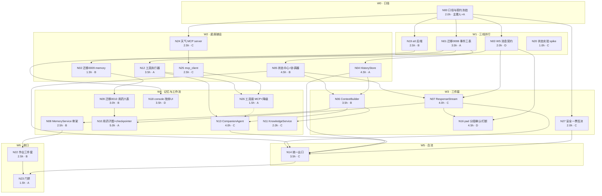

> 状态：进行中（N00 与 S1 数据底座已执行，其余节点待开工）　｜　版本：v3.0　｜　日期：2026-11-09
> 关联：docs/team_tasks/day06/dev-a-历史事件与工具事实.md｜dev-b-状态中心与上下文记忆.md｜dev-c-Agent与统一出口.md｜dev-d-pad送达确认与改绑UI.md
> 上游依据：PRD line 124（§2.3 三级路由）、line 266-275（FR-DLG-01~10）、line 484-516（AC-03/04/17/30/35）、line 573-574（§6.1 Day6/Day7 验收口径）、line 593（§7 完成定义）｜技术设计文档 line 549（memory_chunks）、line 619（decision_logs）、line 690-701（§3.6 迁移批次）、line 822-869（§6 Agent Loop 与护栏）、line 873-962（§7 子图）、line 1046-1064（§8.3 Day6/Day7 实现口径）
> 变更记录见文末

# Day 6 工作推进计划 · 长者侧 Agent 完整闭环

> 本计划的任务内容取自 `D:\Users\QQ\Downloads\康伴_Day06_长者侧Agent完整闭环_学生实战讲义.md`（下称**讲义**），**经主理人 2026-11-09 裁决**：Day 6 走「长者侧 Agent 完整闭环」，三级意图路由后置。该裁决改动了 PRD §6.1 与 TD §8.3 的 Day 6 归属，**属基线文档口径变更，必须按 `AGENTS.md` 禁区第 7 条补修订记录**（见 N00）。
> 讲义不在 `docs/` 事实效力链上（`AGENTS.md` 前置节）：本计划引用讲义只取**任务范围与验收语义**，凡涉及表名、字段、接口路径、阈值，一律回 PRD / 技术设计文档 / ER 取值；两者都没有的，按 §9 登记裁决，不性能默认。

---

## 0. 口径来源与冲突处置（先读这一节）

### 0.1 三份输入的关系

| 来源 | 提供什么 | 本计划如何用 |
| --- | --- | --- |
| PRD v2.8 | 验收标准（AC）、业务规则、权限、幂等口径、Mock 边界 | **只从这里取"过不过"** |
| 技术设计文档 v1.9 | 表结构、模块边界、护栏、子图、迁移批次 | **只从这里取"怎么建、建在哪"** |
| 讲义（Day06） | 本日任务范围与教学验收语义（历史/状态/上下文/记忆/知识/工作流/AI 协作作业） | **只从这里取"今天做哪些事"** |
| `docs/team_tasks/day06/` 既有卡 | a0 改绑接口（未开始）、a1 延迟基线表（已完成） | a1 作为本日对照基线；a0 并入本日（主理人裁决） |

### 0.2 三处冲突与裁决结果

| # | 冲突点 | 大纲 / 讲义口径 | PRD + TD 现行口径 | 裁决（2026-11-09） | 落地动作 |
| --- | --- | --- | --- | --- | --- |
| C-1 | Day 6 主题 | 讲义：先做完整闭环，三级路由最后（讲义 §14/§15/§20）；大纲 §十 Day6：三级路由 | PRD line 573 + TD line 1046：Day 6 = 三级路由 + MCP 天气 + `decision_logs` | **以讲义为准**：Day 6 = 完整闭环，三级路由后置 | N00 改 PRD/TD 排期并补修订记录；`decision_logs`、`app/router/rules.py`、`app/system_one` **本日不建**；**`app/router/safety.py` 建最小一票否决**（AC-04 走 B，见 C-5）；**`app/mcp_client` 与 `mcp-servers/weather` 本日建**（D-4，见 C-4） |
| C-2 | 记忆与用药归属日 | 讲义 §8/§10/§11 全量讲；PRD line 574 与 TD line 1056 排在 Day 7 | Day 7 | **并入 Day 6**（主理人裁决"含用药子图与工作流恢复"） | Day 7 顺延收窄为「娱乐点播 + 记忆衰减归并 + 反思」，Day 8–10 不变；N00 登记 |
| C-5 | AC-04（急症一票否决）归属 | 讲义 §14 把「安全检查」画在路由链最前，但全书未排实现 | PRD §5.1 AC-04 为 P0，且 §6.2 列为不得裁减 | **AC-04 走 B：本日只做 `app/router/safety.py` 的最小一票否决**（急症/敏感词表 → 红色事件 + 工单 + 通知，不进 Agent），**不做** `rules.py` 10 条、不做 Laya、不做 `decision_logs`（2026-11-09 主理人裁决） | 新增 N27（2.0h，dev-C），AC-04 留在 Day 6；S 档 48.5→50.5 |
| C-4 | 天气 MCP 归属日 | 讲义未排（§13.3 增量不含工具接入） | PRD line 573 与 TD line 1049 列为 Day 6 落地项 | **保留在 Day 6**（主理人 2026-11-09 裁决「本日做」）。它是本日唯一的真实外部接口，也是 `ToolExecutor` 与越权审计的真实靶子，比自造 mock 工具更有验收价值 | 新增 N24/N25/N26 三节点 + 交付物 D16 + 自检 V15 |
| C-3 | 三级路由（Laya 真实权重缺位） | 讲义 §14 要求最后才做 | TD line 1049 要求 Day 6 落地 `app/system_one` | **本日不排期**；接线口径定为「HTTP 契约 + 降级标记」，且**降级兜底不得接入任何第三方商业分类 API**（含 Jev 类商业服务），**维持本地部署约束**（主理人 2026-11-09 裁决） | `spikes/laya_hello/README.md` 已记真实 checkpoint 不适配中文；`route_layer` 字段与降级标记留到路由日，本日只保留 `LAYA_ENABLED` 配置不动；**待拿到可用的 Laya 中文开源权重后，恢复原有本地模型推理链路**，期间唯一兜底是"全量走主控 Agent（L2）" |

### 0.3 事实边界（本日**不做**，避免被当漏项）

1. 三级路由三层结构、`app/router/rules.py`（≤10 条固定意图）、Laya 四信号、`decision_logs` 表——顺延，见 C-1/C-3。**本日要做**：`app/router/safety.py` 的**一票否决**（C-5，AC-04 不能顺延）、`app/mcp_client/` 与 `mcp-servers/weather/`（C-4），两者都不依赖规则层与分类器。
2. 娱乐点播（`media_library` / `media_history` / 播放控制指令集 FR-CON-03）——讲义未排，留 Day 7。
3. 健康采集子图、三端后台、日报——PRD line 575-576（Day 8）。
4. 三道隔离闸门 100% 覆盖测试、注入测试集、Langfuse——PRD line 576-577（Day 9/10）。本日只做闸门①（`thread_id` 服务端生成，已由 Day 4 交付）与闸门③（工具只读 `runtime_context`）的**实现侧**，**不做**取证矩阵。
5. 微信 / HIS / 短信 / 支付——禁区内（`AGENTS.md` §4-5），全程不碰。
6. **不接入任何第三方商业分类 / 推理 API**（Jev 类商业服务、云端意图分类 SaaS 等）。Laya 权重到位前，分类层的唯一兜底是"全量走主控 Agent（L2）+ 打降级标记"，**不得**为补分类能力而引外部商业 API，也不得因此新增依赖（`AGENTS.md` §4-12）。此项为 2026-11-09 主理人裁决，写入 N00 契约冻结范围。

---

## 1. 项目认知（本日工作的事实底座）

### 1.1 系统形状

单仓库三端：`frontend/src/pad`（长者端 1920×1080）、`console`（护工/医生/管理员按角色分流）、`family`（375px）。后端 `app/` 为唯一代码根，**`app/services/` 是唯一写库层**，依赖方向单向 `api | audio | scheduler | graphs → services → models`，模块间不得横向 import（`AGENTS.md` §2）。

语音主链路现状（Day 5 收口）：

```
pad 麦克风 → WebRTC 音频轨(aiortc) → VAD 切段 → ASR final
   → DialogueOrchestrator.handle_asr_final（唯一 awaitable 入口）
   → identity_service（首轮声纹校验，产出 thread_id）
   → DialogueService.respond（固定前缀 + Redis 最近 5 轮 + LLM）
   → signaling.deliver("tts_text") → pad 播放
```

### 1.2 现状基线（已实测，直接引用不复测）

| 项 | 现状 | 证据 |
| --- | --- | --- |
| 历史 | `RedisTurnStore` 存 `{user, assistant}` 二元组，5 轮 TTL，**无事件、无 seq、无送达语义** | `app/services/dialogue_service.py` L102-L173 |
| 状态 | 无状态中心；`CallState`（进程内）只管媒体与 ASR 草稿 | `app/audio/` |
| 上下文 | `build_dialogue_messages()` 单轮拼接，无预算、无来源分级 | `app/core/context.py` |
| 工具 | **无** `app/agents/companion.py`、无 tool registry、无 MCP client；`app/agents/` 只有 `guardrails.py` | 目录实测 |
| 路由 | `app/router/`、`app/system_one/`、`app/mcp_client/`、`mcp-servers/` 均空 | 目录实测 |
| 表 | **已建 14 张**（0001 五张身份基础 + 0002 五张账号与绑定 + 0004 两张会话/声纹 + 0005 声纹向量列 + 0006 `metrics` + 0007 `audit_logs`）；待建 13 张，其中本日建 10 张（0008 事件三表 + 0009 `memory_chunks` + 0010 用药/风险/工单六表），余 6 张（media 2、健康与通知 3、`decision_logs` 1）留后续日 | `alembic/versions/` 与 `app/models/` 实测（14 个 ORM 类，14 张 `create_table`） |
| 延迟基线 | e2e P50 **7872ms** / P95 13537ms；AC-42 达标 **0/16**；`route` 段无数据 | `docs/team_tasks/day06/a1-延迟基线表.md` §4.2 |
| Laya | 真实权重未加载（现有包为英文 ModernBERT-large），仅 mock 契约 10/10 | `spikes/laya_hello/README.md` |
| WS 协议 | C→S 9 种、S→C 7 种；`tts_text` **无** response_id / segment / epoch | `frontend/src/pad/protocol.ts` |

### 1.3 硬性数值（本日必须遵守，不得私自调整）

`MAX_TOOL_CALLS_PER_TURN=8`、同 Tool 1 分钟内第 3 次熔断（PRD FR-DLG-10）｜快速决策置信度 0.85（`AGENTS.md` §7，本日不接线但常量不动）｜声纹 cosine ≥0.55｜用药触达 T0/+5/+10/+15 各等 60s｜原始音频 72h｜路由 ≤200ms｜端到端 P95 ≤1.5s（作为目标，本日只记不承诺）｜测试覆盖：核心工具与权限场景 100%、接口 ≥70%。

---

## 2. 第六天任务清单（逐项拆解）

> 编号 T1–T14 对应 DAG 节点组；每项给出**前置条件 / 依赖关系 / 执行步骤 / 量化验收**。步骤级细节在每个成员卡里，本节只到"做到什么程度算完"。

| # | 任务 | 前置条件 | 依赖 | 量化验收（可复核） |
| --- | --- | --- | --- | --- |
| **T1** | 口径变更登记与契约冻结（N00） | 主理人在场 | 无 | PRD/TD/ER 三处修订记录同提交；`docs/team_tasks/day06/contracts.md` 冻结 C→S/S→C 消息与 `ToolResult` 形状；D-1~D-5 全部有结论 |
| **T2** | 事件三表迁移与 ORM（N01） | T1 | T1 | `alembic upgrade head` 成功；`conversation_events` 有 `UNIQUE(thread_id, seq)`；三表均只追加（无 UPDATE 路径）；ER §4.4/§5/§6 同步 |
| **T3** | `memory_chunks` 迁移与 ORM（N02） | T2（迁移 head 顺序） | T2 | 表含讲义 §8.2 结构化字段（subject/predicate/value/polarity/valid_from/valid_to/supersedes_id/conflicts_with_id/source_turn_ids/sensitivity/confidence）；`(elder_id, status)` 索引在 |
| **T4** | WS 消息契约扩展（N03） | T1 | T1 | `tts_text` 增 4 字段（response_id/epoch/segment_id/index）且**向后兼容**；新增 C→S `segment_ack`；`protocol.ts` 与 `signaling.py` 的 TypedDict 双向对齐，字段名零差异 |
| **T5** | HistoryStore（N04） | T2 | T2 | 两轮对话按 `seq` 排序可读回；**partial 不落库**；同一 `turn_id` 重复提交只产生一条；跨 `thread_id` 与跨 `elder_id` 读不到 |
| **T6** | StateCenter + SessionCoordinator（N05） | T4 | T4 | `apply` 带 `expected_version`；版本冲突返回冲突而非覆盖；同 `thread_id` 提交串行（并发 20 写无 seq 重号）；四组正交状态（identity/input/output/media/task）可快照/恢复 |
| **T7** | ContextBuilder（N06） | T5、T6 | T5、T6 | 九层顺序固定；预算裁剪从低优先级开始，`safety/policy`、`identity`、`active_task`、`current_turn` 永不裁掉；只取 `delivered_text` 作 assistant 历史；`waiting_for` 进上下文 |
| **T8** | ResponseStream（N07） | T4、T6 | T4、T6 | 每个 `tts_text` 带 `response_id+epoch+segment_id`；`segment_ack` 单调前进；**迟到 ack 被拒绝**（epoch 过期且 status≠playing）；打断后 `delivered_text` 截断且落事件 |
| **T9** | MemoryService（N08） | T3、T7 | T3、T7 | 六步流水线可跑通；候选必须带 `source_turn_ids`；`subject+predicate` 精确查重后判关系（unrelated/duplicate/supports/supersedes/contradicts 五枚举）；冲突在**同一事务**内完成；召回强制 `elder_id` + `status='active'` + 有效期 |
| **T10** | 用药 6 表迁移 + 子图（N09、N10） | T3 | T3、T8 | 6 表按 TD §3.4 字段建成；`medication_confirmation_graph` 支持 scheduler 与 dialog 双入口；幂等键 `(plan_id, scheduled_at)` 重复不重复建单；`graph.get_state` 可见；重启中途恢复不重发已完成触达 |
| **T11** | ToolRegistry + ToolExecutor（N12） | T2、T4 | T2、T4 | 工具白名单 + 参数 schema 校验；`args` 里的 `elder_id` 一律丢弃并写审计；`tool_executions` 幂等键唯一；四类失败（参数错/目标不存在/临时错误/越权）各有分支 |
| **T12** | CompanionAgent + 统一出口（N13、N14） | T7、T11 | T7、T11 | ReAct 单轮 ≤8 次工具调用；第 9 次被拒并告知用户；同 Tool 1 分钟内第 3 次熔断；`handle_user_turn` 成为**唯一** FINAL 事实提交边界（generic 不落库） |
| **T13** | pad 送达确认与打断（N16） | T4、T8 | T4、T8 | 分段播放 → `segment_ack` 上报率 ≥95%（20 轮）；打断后 200ms 内停声；旧 epoch 回调被服务端拒绝且前端不串音 |
| **T14** | a0 改绑接口与 console UI（N19、N18） | T1 | T1 | admin 可把长者责任护工 A→B，A/B 登录后列表范围随之变；非 admin 403；移除最后一位 `primary_care` → 409；`audit_logs` 可查操作者/trace_id/差集 |
| **T16** | 天气 MCP 首个工具（N24、N25、N26） | T1 | T1、T11 | 说「今天天气」→ 主控 Agent 经 MCP 拿到真实天气并播报；缓存命中时标注数据时间；无 key/上游失败时明确说「查不到」不编造；调用日志与越权审计可查 |
| **T15** | 作业与门禁收口（N20、N22、N23） | T12 | T12 | `pytest -q` 全绿、核心包 cov ≥70%；讲义三件作业齐；`elder_agent_state_demo.py` 输出 PASS；看板与索引无过期 |

---

## 3. 工作流 DAG

### 3.1 节点表（唯一事实源）

代号：**S**=本日必交（骨架闭环）、**M**=标准交付、**L**=讲义全量。人时为净开发估算，不含等待。

| 节点 | 任务 | 负责 | 档 | 人时 | 输入 | 输出 | 依赖 |
| --- | --- | --- | --- | --- | --- | --- | --- |
| **N00** | 口径变更登记 + 契约冻结 | 主理人 + dev-A | S | 2.0 | 讲义 §4/§14；PRD 573；TD 1046 | PRD/TD/ER 修订记录；`day06/contracts.md` v1.0；D-1~D-5 结论 | — |
| **N01** | 迁移 0008 事件三表 + ORM | dev-A | S | 3.5 | **§9.1 ①②③ 已裁决结构**；ER §4.4/§5/§6 | `alembic/versions/0008_day6_conversation_events.py`；`app/models/conversation.py` 扩展 | N00 |
| **N02** | 迁移 0009 `memory_chunks` + ORM | dev-B | M | 1.5 | **§9.1 ④ 已裁决结构**（TD 原字段 + 11 个增列，一次建全） | `0009_day6_memory_chunks.py`；`app/models/memory.py` | N01（head） |
| **N03** | WS 消息契约扩展 + 事件枚举表 | dev-D | S | 2.0 | 讲义 §5.3；`protocol.ts`；`signaling.py` | `protocol.ts` / `signaling.py` TypedDict 同步；contracts.md 追加 C6/C7 | N00 |
| **N04** | HistoryStore | dev-A | S | 4.5 | N01 | `app/services/history_service.py`；`tests/test_history_store.py` | N01 |
| **N05** | StateCenter + SessionCoordinator | dev-B | S | 4.5 | N03 事件枚举 | `app/services/state_service.py`；`app/agents/session_coordinator.py` | N03 |
| **N06** | ContextBuilder | dev-B | S | 3.5 | N04 读接口、N05 快照 | `app/core/context.py` 扩展（新函数，不改旧签名） | N04、N05 |
| **N07** | ResponseStream（epoch/分段/ack/打断） | dev-C | S | 4.0 | N03、N05 | `app/services/response_service.py` | N03、N05 |
| **N08** | MemoryService **骨架**（提取 + 召回，做一类低风险偏好） | dev-B | M | 2.5 | N02、N06 | `app/services/memory_service.py`（只两个入口）；`tests/test_memory_service.py` | N02、N06 |
| **N09** | 迁移 0010 用药/风险/工单六表 + ORM | dev-B | M | 3.0 | TD line 422-534 | `0010_day6_medication.py`；`app/models/medication.py` | N02（head） |
| **N10** | `medication_confirmation_graph` + PG checkpointer | dev-A | M | 5.0 | N07 触达出口、N09 | `app/graphs/medication_confirmation_graph.py`；`app/graphs/checkpointer.py`（schema `langgraph`） | N09、N07 |
| **N11** | KnowledgeService（权威业务事实最小集） | dev-C | L | 2.0 | N06 | `app/services/knowledge_service.py` | N06 |
| **N12** | ToolRegistry + ToolExecutor | dev-A | S | 3.5 | N01 `tool_executions`、N03 | `app/agents/tool_registry.py`；`app/services/tool_executor.py` | N01、N03 |
| **N13** | CompanionAgent ReAct | dev-C | S | 4.0 | N06、N12 | `app/agents/companion.py` | N06、N12 |
| **N14** | `handle_user_turn` 统一出口接线 + 失败分支 | dev-C | S | 3.5 | N04/N05/N07/N13 | `app/services/turn_service.py`；`DialogueOrchestrator` 改调它；工具失败回传话术 | N04、N05、N07、N13 |
| **N16** | pad 分段确认、打断收口与 epoch 上报 | dev-D | S | 4.5 | N03、N07 | `frontend/src/pad/realtime.ts`；`audio/playback-queue.ts` | N03、N07 |
| **N18** | a0 console 改绑 UI | dev-D | M | 3.5 | N19 端点 | `frontend/src/console/pages/AdminUsersPage.tsx` + 弹窗 | N19 |
| **N19** | a0 后端（契约/service/409/403/audit） | dev-B | M | 2.5 | N00；`app/services/staff_service.py` | `docs/接口契约_身份与权限.md` E20；`staff_service.reassign_elders()`；`app/api/staff.py` | N00 |
| **N20** | 讲义 §12 状态实验 + 运行输出 | dev-C | S | 1.0 | 讲义 §12 代码 | `spikes/elder_agent_state_demo.py` + PASS 输出存档 | — |
| **N22** | 讲义作业三件套 | dev-B | L | 2.5 | N06、N08 | 健康采集状态图（mermaid）；上下文样例；路由一致性测试两条（`skip` 骨架） | N06、N08 |
| **N23** | 门禁收口 | dev-A | S | 1.5 | 全部 | `pytest` 绿、cov ≥70%、README 回填、`docs/plans/README.md` 索引 | 全部 |
| **N24** | `mcp-servers/weather`（`get_weather` + 缓存 + 无 key 明确失败） | dev-C | S | 2.5 | N00 契约；TD §3.5/§1.4；PRD FR-CON-01/02 | `mcp-servers/weather/`（server + schema + README） | N00 |
| **N25** | `app/mcp_client/`（发现/调用/超时/越权审计） | dev-C | S | 2.5 | N00；N24 的 tool schema | `app/mcp_client/`（client + 错误映射 + 审计） | N00、N24 |
| **N26** | `ToolExecutor` 接 MCP + 缓存与降级话术 | dev-A | S | 1.5 | N12、N25 | `tool_executor.py` 的 mcp 分支；`weather` 降级话术 | N12、N25 |
| **N27** | `app/router/safety.py` 最小一票否决（AC-04） | dev-C | S | 2.0 | N00；PRD FR-DLG-01/09、AC-04；AGENTS §5 安全清单 | `app/router/safety.py` + 词表/阈值常量 + `tests/test_safety.py` | N00 | 说「我胸口疼」→ `is_sensitive=true` → 红色事件 + 工单 + 通知，**不进 Agent**、不调 LLM；词表外不误杀（误报 ≤2/50 例） |

> **本版顺延节点（编号保留不重排，便于与 v1.1 及四份任务卡对照）**：
>
> | 原编号 | 原内容 | 原人时 | 顺延理由 |
> | --- | --- | --- | --- |
> | N15 | 失败与降级矩阵 | 1.5 | **并入 N14**：Day 5 已有 ASR/LLM/TTS 三档超时话术，本日只需补"工具失败回传"一条分支，不值得单列节点 |
> | N17 | pad 打断收口与待答提示 | 3.0 | 讲义 §13.3 增量三只要求"待答任务优先进入上下文 + 重连可读"，由 N05/N06 后端覆盖；前端顶部提示条非讲义要求，移出本日 |
> | N21 | fixtures 50 例 + 基线报告 | 4.0 | 讲义 §19 只要求三件作业，未要求批量评测；PRD §5.2 测试集属 Day 9/10。**取消**而非延后——a1 延迟基线表已提供对照分母 |

### 3.2 依赖图



ASCII 版（便于贴进汇报与终端）：

```
N00 ─┬─ N01 ─┬─ N02 ── N09 ── N10
     │        ├─ N04 ─┬─ N06 ─┬─ N08 ── N22
     │        └─ N12 ─┼─ N26 ─┼─ N13 ── N14 ─┬─ N23
     ├─ N24 ── N25 ───┘       └─ N11        │
     ├─ N03 ─┬─ N05 ──┘                     │
     │        └─ N07 ─┬─ N10                │
     ├─ N19 ── N18    └─ N16                │
     └─ N20（独立）                         └─ N22 ─┘
```

### 3.3 边表（硬/软依赖）

| 边 | 类型 | 传递物 | 断了的后果 |
| --- | --- | --- | --- |
| N00→N01/N03/N19 | 硬 | 表语义、消息字段、端点形状 | 三张表建错、前后端字段对不上、返工全量 |
| N01→N04/N12 | 硬 | `conversation_events`/`tool_executions` 模型 | 历史与工具审计无落点 |
| N01→N02→N09 | 硬（串行迁移） | Alembic head 链 | 两个 head 冲突，`upgrade head` 报错 |
| N03→N05/N07/N16 | 硬 | `segment_ack` 与 `tts_text` v2 字段 | 前端无法上报送达，服务端无法结算 |
| N04→N06 | 软 | `read_turns(thread_id, elder_id)` | 可先用桩，但 T7 无法验"只取 delivered" |
| N05→N06/N07 | 硬 | `snapshot/apply` 契约 | 状态与响应流各写一套，回退风险 |
| N05→N14 | 硬 | `expected_version` | 迟到回调覆盖新状态 |
| N07→N10/N16 | 硬 | `start/ack/interrupt` | 用药触达无送达判定，pad 无 ack 目标 |
| N06→N13 | 硬 | 组装后的 messages + 预算 | Agent 上下文超预算或漏任务 |
| N12→N13 | 硬 | 工具白名单 + `ToolResult` | Agent 无法调工具 |
| N00→N24 | 硬 | `get_weather(city)` 入参与返回 schema | 天气工具入参不统一，客户端与 server 对不上 |
| N24→N25 | 硬 | MCP 工具描述（名称/参数/返回） | 客户端发现不到工具 |
| N25→N26 | 硬 | `MCPResult` 与错误映射 | 工具层分不清四类失败 |
| N12→N26 | 硬 | `ToolResult` 结构 | 本地工具与 MCP 工具各写一套失败处理 |
| N26⇢N13 | 软 | weather 分支可用性 | Agent 能跑，但「今天天气」会失败 |
| N13→N14→N23 | 硬 | 统一出口 + 可运行 | 门禁无端到端对象 |
| N19→N18 | 硬 | `PUT /api/staff/{id}/elders` | console 只能继续用假数据 |
| N00→N27→N14 | 硬 | 敏感词表 / 阈值 / 红色事件出口 | 安全判定落在 Agent 之后，AC-04 失效（红色事件被闲聊覆盖） |

### 3.4 关键路径与波次

- **关键路径（22.5 人时）**：N00 → N01 → N04 → N06 → N13 → N14 → N23 = 2.0+3.5+4.5+3.5+4.0+3.5+1.5。
- 次关键（21.0 人时）：N00 → N03 → N05 → N06 → N13 → N14 → N23 = 2.0+2.0+4.5+3.5+4.0+3.5+1.5。
- 用药支线（15.0 人时，不压关键路径但决定 M 档能否收口）：N00 → N01 → N02 → N09 → N10 = 2.0+3.5+1.5+3.0+5.0。
- 天气 MCP 支线（8.5 人时，全程并行、不压关键路径）：N00 → N24 → N25 → N26 = 2.0+2.5+2.5+1.5。
- **波次**：W0 口径 → W1 三线并行（迁移/契约/a0 后端/spike）→ W2 底座 → W3 三件套 → W4 记忆+子图+Agent+UI → W5 合流 → W6 收口。同波次内可全并行，跨波次必须等边表里的硬依赖。

### 3.5 写锁（同一时刻只允许一人改）

| 锁 | 文件 / 目录 | 持有者 | 释放条件 |
| --- | --- | --- | --- |
| L1 | `alembic/versions/0008_*` | dev-A | 迁移合入 + `upgrade head` 通过 |
| L2 | `alembic/versions/0009_*` | dev-B | 依赖 L1 已合入（**不并行写迁移**） |
| L3 | `alembic/versions/0010_*` | dev-A | 依赖 L2 已合入 |
| L4 | `app/models/conversation.py` | dev-A | N01 后只追加只读方法 |
| L5 | `app/models/__init__.py` | 按序 A→B→A | 每次只加自己的 model import |
| L6 | `frontend/src/pad/protocol.ts` + `app/audio/signaling.py` 消息段 | dev-D（起草）→ dev-C（复核） | N03 冻结后任何人不得单方加字段 |
| L7 | `app/services/dialogue_service.py` | dev-C | N14 接线完成后，`DialogueService` 降为纯 LLM 调用，不再持有历史 |
| L8 | `app/core/context.py` | dev-B | N06 只新增函数，**不改** `build_dialogue_messages` 现有签名（Day 3–5 测试依赖） |
| L9 | `mcp-servers/weather/**`、`app/mcp_client/**` | dev-C | N24/N25 合入后由 dev-A 只读接入（N26），**不改 server 契约** |
| L10 | `app/services/tool_executor.py` | dev-A | N26 只加 mcp 分支，不改 `execute()` 签名 |

### 3.6 门禁

| 门 | 时点 | 判据（全绿才放行） | 不过怎么办 |
| --- | --- | --- | --- |
| **G0** | W0 结束 | D-1~D-5 全部有结论；`contracts.md` 冻结；PRD/TD/ER 修订记录已在同一提交 | 停止全队，不开工写代码 |
| **G1** | W2 结束 | `alembic upgrade head` 三次连续成功（含 downgrade→upgrade）；三张新表 CHECK/UNIQUE 与 ER 一致；`pytest -q` 未红 | 回退该迁移重写，不带病进 W3 |
| **G2** | W3 结束 | 两轮对话不丢历史（脚本证据）；`segment_ack` 端到端可落库；ContextBuilder 预算用例通过 | 砍 L 档（N11/N22），保 S 档 |
| **G3** | W4 结束 | 用药子图 `graph.get_state` 可见 + 重启恢复；记忆骨架的 `supersedes` 用例通过（冲突治理本版不做） | 用药子图降为"单步工具 + 业务表"并登记降级（**需主理人签**，因违反单一形态原则） |
| **G4** | W5 结束 | 真实语音一轮：`conversation_events` 有 turn_started→…→turn_completed；打断后 `delivered_text` 截断；`thread` 隔离可验；说「今天天气」经 MCP 返回且调用日志可见 | 不进入 W6 收口，转为次日续做 |
| **G5** | W6 结束 | `pytest -q` 全绿；核心包 cov ≥70%；三件作业 + spike 输出齐；看板/索引无过期 | 不提交，列缺口 |

### 3.7 失败回退

| 场景 | 回退动作 |
| --- | --- |
| 迁移与既有 0007 冲突 | 只新增迁移，不改历史文件；冲突则 `alembic heads` 对齐后重生成 |
| `segment_ack` 前端来不及 | 服务端按"发送即视为 delivered"降级并**打 `delivery_status=unknown`**，不得写 `delivered`（讲义 §5.1 明确 allowed 取值） |
| Redis 不可用 | 普通闲聊降级为单进程短会话；**用药任务不退化**，暂停推进并提示人工（讲义 §6.3） |
| 用药子图当日做不完 | 降级为工具 + 业务表，`task_id` 与幂等键保留；登记为技术债，不静默 |
| a0 端点未冻结 | console 侧只做 UI 壳，禁用提交；不得造假数据 |

---

## 4. 阶段与里程碑

| 阶段 | 覆盖节点 | 里程碑（可演示的一句话） |
| --- | --- | --- |
| **S0 口径** | N00 | 主理人签字：Day 6 走讲义主线，三份基线文档修订记录已入档 |
| **S1 数据底座** | N01–N03、N19、N24、N25 | 一条 `alembic upgrade head` 建出 3 张事件表 + `memory_chunks`；消息契约双向字段零差异；天气 MCP server 能独立跑通一次 `get_weather` |
| **S2 三件套** | N04–N07、N12、N27 | 说两句连续的话，第二句能指代第一句；打断后历史只记已播部分；说「我胸口疼」直接出红色事件、不进 Agent |
| **S3 记忆与工作流** | N08–N11、N18 | 说"我喜欢越剧"→ 新会话被主动提起；"我吃过药了"→ 用药事件落库且幂等 |
| **S4 Agent 合流** | N13、N14、N26 | 一句话触发工具调用并流式播报；「今天天气」经 MCP 走通；第 9 次工具调用被拒；工具失败有可读话术 |
| **S5 送达闭环** | N16（并入 S2/S4） | 播到一半插话，服务端 `delivered_text` 与实际听感一致 |
| **S6 收口** | N20、N22、N23 | 三件作业 + 最小实验 PASS 输出齐；`pytest` 全绿 |

---

## 5. 交付物总表（格式 / 范围 / 质量要求）

| # | 交付物 | 格式 | 内容范围 | 质量要求 |
| --- | --- | --- | --- | --- |
| D1 | `docs/team_tasks/day06/contracts.md` | Markdown 表 | C→S `segment_ack`；S→C `tts_text` v2；`ToolResult`；事件枚举 12 种；a0 E20 | 字段名/类型/可空/枚举取值逐行写死；与代码 TypedDict 一致 |
| D2 | `alembic/versions/0008_*.py` | Python 迁移 | `conversation_events` / `conversation_turns` / `tool_executions`（第 28–30 张，字段见 §9.1 ①②③） | 可 downgrade；UUID 主键；`UNIQUE(thread_id, seq)`；不写死连接 |
| D3 | `0009_*.py` | Python 迁移 | `memory_chunks`（TD 原 10 字段 + §9.1 ④ 的 11 个增列，`status` 五值） | 枚举走 CHECK 不用 PG ENUM（TD 裁决 C6）；pgvector 维度 1536；**不拆 ALTER** |
| D4 | `0010_*.py` | Python 迁移 | `medication_plans` / `medication_events` / `medication_attempts` / `risk_events` / `work_orders` / `work_order_transitions` | 字段与 TD line 422-534 逐列对齐；幂等 UNIQUE 齐全 |
| D5 | `app/services/history_service.py` | Python 模块 | 事件追加 + seq 原子分配 + 轮次投影 + 幂等 | 全 async；类型注解完整；无裸 SQL 拼接；只追加不改旧事件 |
| D6 | `app/services/state_service.py` + `app/agents/session_coordinator.py` | Python 模块 | 快照/版本 CAS/串行提交 | 版本冲突不覆盖；Redis 失败有降级路径 |
| D7 | `app/core/context.py`（扩展） | Python | 九层装配 + 预算 + 来源分级 | 旧函数签名不变；预算常量集中；不可信数据加边界标签 |
| D8 | `app/services/response_service.py` | Python | 分段、`response_id`、`epoch`、ack 单调、打断 | 迟到回调必须被拒；epoch 与 status 双校验 |
| D9 | `app/services/memory_service.py` | Python | **骨架**：候选提取 + 召回过滤（一类低风险偏好）；冲突/遗忘留 Day 7 | 强制 `elder_id`；召回带有效期与 `status='active'`；无 `source_turn_ids` 不入库 |
| D10 | `app/graphs/medication_confirmation_graph.py` + `checkpointer.py` | Python | 双入口、重试 ≤3、终态分流、checkpoint | 独立 schema `langgraph` + 独立连接池；重启恢复可演示 |
| D11 | `app/agents/companion.py` + `tool_registry.py` + `app/services/tool_executor.py` | Python | ReAct、白名单、幂等、审计、四类失败 | 身份只从 `runtime_context`；越权写 `audit_logs` |
| D12 | `app/services/turn_service.py` | Python | `handle_user_turn` 唯一事实提交边界 | 顺序固定：begin_turn→snapshot→build→run→commit→apply→stream |
| D13 | `frontend/src/pad/*` | TS/TSX | 分段播放、ack、打断 | 不阻塞首包；任何异常不白屏；类型与 `protocol.ts` 同源 |
| D14 | `AdminUsersPage.tsx` 扩展 + `docs/接口契约_身份与权限.md` E20 | TSX + Markdown | 改绑操作、409/403 呈现；端点契约 | 前端隐藏按钮不算权限；后端 403 必须可见提示 |
| D15 | 讲义作业三件套 | Markdown + mermaid | 健康采集状态图、上下文样例、两条一致性测试（`skip` 骨架） | 状态图每节点标注"写历史/写状态/写业务表" |
| D16 | `mcp-servers/weather/` + `app/mcp_client/` | Python + Markdown | `get_weather` 工具、缓存（TTL 取 `weather_cache_ttl_seconds`）、无 key 明确失败、越权审计 | 入参强校验；错误不回显内部细节；不自由外网访问；调用留 `audit_logs` |
| D17 | `app/router/safety.py`（最小一票否决） | Python | 急症/敏感词表、阈值、红色事件与工单通知出口 | 阈值与分级写在代码不写 prompt；命中即短路，不经 Agent；误报率可复算 |

> **本版取消交付物**：原 D15（`eval/fixtures/day6_agent.jsonl` + `eval/reports/day6_agent_baseline.md`）随 N21 一并取消。理由：讲义 §19 只要求三件作业，不要求批量评测；`a1-延迟基线表` 已提供 e2e 对照分母，不必在同期再造第二份测量口径。

---

## 6. 逐项自检校验标准

> 每条都是命令级或判据级，可被第二人复跑。**没有运行证据只能写"已完成代码审查"，不能写"已验证"。**

| # | 自检项 | 命令 / 判据 | 通过标准 |
| --- | --- | --- | --- |
| V1 | 迁移可升可降 | `uv run alembic upgrade head && uv run alembic downgrade -1 && uv run alembic upgrade head` | 三次全成功，无残留 |
| V2 | 表约束 | `psql -c "\d conversation_events"` | 见 `UNIQUE (thread_id, seq)`、索引、CHECK |
| V3 | 历史语义 | `uv run pytest tests/test_history_store.py -q` | 全绿；覆盖 partial 不入库、跨 thread 不可见、同 turn 幂等 |
| V4 | 状态版本 | `uv run pytest tests/test_state_service.py -q` | 版本冲突用例通过；并发 20 写无 seq 重号 |
| V5 | 上下文预算 | `uv run pytest tests/test_context_builder.py -q` | 超预算时低优先级被裁、四类必保内容未被裁 |
| V6 | 送达与打断 | `uv run pytest tests/test_response_service.py -q` | 迟到 ack 返回拒绝；打断后 `delivered_text` 截断 |
| V7 | 记忆骨架 | `uv run pytest tests/test_memory_service.py -q` | 提取带 `source_turn_ids`、召回带 `elder_id` + 有效期、跨 elder 查不到；**冲突/遗忘本版不验**（顺延 Day 7） |
| V8 | 用药恢复 | `uv run pytest tests/test_medication_graph.py -q` | 重启恢复用例 + 幂等重试不重复建单 |
| V9 | 工具越权 | `uv run pytest tests/test_tool_executor.py -q` | 模型传别人 `elder_id` → 拒绝 + 审计行 |
| V10 | 预算熔断 | `uv run pytest tests/test_guardrails.py -q` | 未回归；第 9 次调用被拒 |
| V11 | 全量门禁 | `uv run pytest -q && uv run pytest --cov=app --cov-report=term-missing` | 全绿；核心包 ≥70% |
| V12 | 前端类型与构建 | `pnpm --dir frontend build` | 零 TS 错误；pad/console/family 三产物均出 |
| V13 | 真实链路 | 喊"小伴"→说两句→插话打断 | `conversation_events` 有序完整；`delivered_text` 与听感一致 |
| V14 | 文档一致性 | `uv run python scripts/update_progress.py --check` 与 `--check-plans` | 两个退出码均 0 |
| V16 | 安全一票否决 | `uv run pytest tests/test_safety.py -q`；手工说「我胸口疼」 | 命中即 `is_sensitive=true`、红色事件 + 工单落库、**`escalated_to_agent=false`**；50 例普通语料误报 ≤2 |
| V15 | 天气 MCP | `uv run pytest tests/test_mcp_weather.py -q`；手工说「今天天气」 | server 独立可调；缓存命中带数据时间；无 key 时返回「查不到」而非编造；他人 `elder_id` 调用被拒并留审计 |

---

## 7. 四人分工与对接

| 成员 | 主题 | 节点 | 本人日总人时 | 一句话职责 |
| --- | --- | --- | --- | --- |
| **dev-A** | 历史事件与工具事实 | N00(共)、N01、N04、N10、N12、N26、N23 | 21.0 | 让「发生过什么」可查可复算，并保证每次有副作用的调用只发生一次 |
| **dev-B** | 状态中心与上下文记忆 | N02、N05、N06、N08、N09、N19、N22 | 20.0 | 让「现在做到哪」有唯一口径，并决定这轮模型该看见什么 |
| **dev-C** | Agent、工具、天气 MCP 与安全短路 | N07、N11、N13、N14、N20、N24、N25、N27 | 21.5 | 把四条执行路径收敛到一个事实提交边界，并保证敏感输入在进 Agent 之前就被短路 |
| **dev-D** | pad 送达与 console 改绑 | N03、N16、N18 | 10.0 | 让「播了多少」能被服务端知道，并补上权限线的改绑入口 |

> 负载分布：A 21.0h / B 20.0h / C 21.5h / D 10.0h（合计 72.5h + 主理人 0.5h = 73.0h）。**较 v2.1 已把 N09 迁移从 A 移到 B**（A 原 22.5h 的瓶颈位解除一半），天气 MCP 交给 C（C 从 14.5 升到 19.5，正好补齐）。
> D 仍是 10.0h 偏轻，可接 N22 里的「上下文样例」（纯文档）或支援 N16 的手工回归录屏。

**对接节点（必须两人同时在场）**

| 编号 | 时点 | 参与 | 交接物 | 完成判据 |
| --- | --- | --- | --- | --- |
| J1 | W1 末 | A+B+D | 三个迁移文件的 `down_revision` 链 | `alembic heads` 只有一个 head |
| J2 | W2 末 | A+B | `read_turns` / `snapshot` 两个函数签名与返回结构 | 签名在 contracts.md 里能查到，且 C 能直接调 |
| J3 | W3 末 | C+D | `tts_text` v2 与 `segment_ack` 字段表 | 双方 TypedDict / interface 字段名逐一对照通过 |
| J4 | W4 末 | A+C | `ToolResult` 与 `execute()` 契约 | 工具失败四分类各跑一条 |
| J5 | W5 末 | C+D+B | 真实语音一轮的 trace | 同一 `trace_id` 串起 asr→turn→response→ack |
| J6 | W6 末 | A+D | a0 端点与 UI | admin 改绑 A→B 端到端通过 |
| J7 | W4 末 | A+C | `get_weather` 入参/返回 schema 与 `MCPResult` 错误映射 | 说「今天天气」经 MCP 返回，缓存命中带数据时间，越权调用被拒并留审计 |

**联调纪律**：契约字段只以 `contracts.md` 为准，口头约定无效；任一方要加字段，先改 contracts.md 再改代码；跨端问题由提出方带 `trace_id` 与请求/响应原文。

---

## 8. 容量评估与裁减顺序

| 档 | 内容 | 人时 | 4 人 × 8h=32h | 4 人 × 10h=40h | 结论 |
| --- | --- | --- | --- | --- | --- |
| **S 骨架闭环** | 事件三表、历史、状态、上下文、响应送达、工具执行器、Agent、统一出口（含失败分支）、**天气 MCP 三节点**、**安全一票否决**、pad 分段确认与打断、spike、门禁 | **50.5** | 158% | 126% | 需 13h/人 或顺延 1 天 |
| **M 标准交付** | S + `memory_chunks`、记忆骨架、用药六表与子图、a0 前后端 + console UI | **68.5** | 214% | 171% | 需 1.7 个工作日 |
| **L 讲义全量** | M + 知识服务 + 三件作业 | **73.0** | 228% | 183% | 需 1.8 个工作日 |

**结论（必须写清，不粉饰）**：加回天气 MCP 与安全一票否决后为 **73.0 人时**，**超单日 4 人容量 1.8 倍**；即使只做 S 档也要 50.5h（4 人 × 13h）。天气 MCP 与 AC-04 安全层都是主理人指定本日交付，**均不列入裁减**，只能压其它档。两条可行路径，需在 G0 选一条：

- **路径①「1.5 日制」**（推荐）：本日交 S 档（50.5h，G4 收官，含天气 MCP 与 AC-04 联调），M/L 档在 Day 6.5 用半天到一天收口，Day 7 顺延为娱乐与反思。质量优先，且 S 档本身就是讲义 §20「三条垂直切片」对应的可验收成果。
- **路径②「单日压缩」**：4 人 × 13h 打满，只保 S 档（50.5h），用药子图、记忆骨架、a0 全部顺延；测试面收窄到 V3/V5/V6/V8/V9/V15 六条。**注意：这条路等于放弃「含用药子图」的原始裁决，需你重新确认。**

**裁减顺序（按序砍，不影响 P0 闭环）**

> 天气 MCP（N24/N25/N26，6.5h）与 AC-04 安全层（N27，2.0h）**不在裁减序列内**——主理人指定本日交付，且 AC-04 是 P0。

1. N11 KnowledgeService（2.0h）→ 知识只留"权威业务事实 = 用药计划结构化查询"，机构文档 RAG 延后一天。
2. N22 作业三件套（2.5h）→ 只交健康采集状态图，另两件转书面说明。
3. N08 记忆骨架（2.5h）→ 只保留召回、提取走 Day 7（**需登记技术债**）。
4. N18 a0 console UI（3.5h）→ 后端端点保留，UI 转次日。
5. N19 a0 后端（2.5h）→ 整卡顺延，看板保持未开始。

**不得裁减**：N00 口径登记、N01/N04 历史、N05/N06 状态与上下文、N07/N16 送达与打断、N12/N13/N14 工具与统一出口、N23 门禁。

---

## 9. 待裁决项与自裁登记

> **D-1 / D-2 已于 2026-11-09 裁决（落地结构见 §9.1）；D-3 口径已定但不排期；D-4 / D-5 仍待定。** 未定项不得动对应文件。

| # | 事项 | 状态 | 裁决内容 | 不裁决时的默认（已失效） |
| --- | --- | --- | --- | --- |
| **D-1** | 讲义三张表（`conversation_events` / `conversation_turns` / `tool_executions`）不在 TD 的 26 张内 | ✅ **已裁决 A**（2026-11-09） | **新增为第 28–30 张表**：写 ER §4.4 + §5（索引/CHECK）+ §6（迁移批次）+ §7（AC 取证），写 TD §3.4 + §3.6，两文档各自补修订记录；总表数 27→30 | 停 N01（已解除） |
| **D-2** | `memory_chunks` 字段口径 | ✅ **已裁决 A**（2026-11-09） | **按讲义 §8.2 结构化字段一次建全**，TD 原字段保留（`content` 即自然语言事实）；`status` 扩为五值、新增 `(elder_id, subject, predicate)` 索引；因该表尚未创建，**不做 ALTER**，在 0009 里一次定准 | 默认 B（已失效） |
| **D-3** | Laya 层的处置口径（**本日不排期**，口径绑定路由日） | ✅ **已裁决 B**（2026-11-09） | 路由日建 `app/system_one/client.py`，只做 HTTP 契约 + 降级标记，**不接权重、不接线到路由**；**本日仍按 §0.3 第 1 条不建该目录**（讲义 §14 把路由放最后）。三条硬约束：① 不接任何第三方商业 Jev API 或其他云端分类服务；② 不新增依赖；③ 权重到位前降级路径唯一——全量走 L2 并打 `route_layer=fallback` 标记。**待拿到可用的 Laya 中文开源权重后，恢复原有本地模型推理链路** | 默认 A（已失效） |
| **D-4** | 天气 MCP 是否本日做 | ✅ **已裁决 B（本日做）**（2026-11-09） | 建 `mcp-servers/weather` + `app/mcp_client`，由主控 Agent 直接调用（不经路由层）。`weather_api_key` 为空时**明确失败不编造**；有缓存则标注数据时间。新增 N24/N25/N26，**不列入裁减序列** | 默认 A（已失效） |
| **D-5** | 讲义是否进 `docs/` 存档 | ✅ **已裁决 A（已存档）**（2026-11-09） | 已复制为 `docs/plans/day06/adhoc-20261109-Day06讲义原文存档.md`（原文未删改，仅加 4 行来源说明；无 `> 状态：` 行故不进计划件统计） | 默认 B（已失效） |

### 9.1 D-1 / D-2 的落地结构（N01 / N02 直接照此建表）

> 本节是**已裁决口径**，N01/N02 不得自行增删列。字段来源：讲义 §4.3 / §8.2 提供语义，TD §3.1（ID 策略）、§3.6（不建 PG ENUM、UUID 主键、索引策略）提供实现约束。

**① `conversation_events`（事件流水，只追加）**

| 字段 | 类型 | 可空 | 说明 |
| --- | --- | --- | --- |
| `event_id` | uuid PK | 否 | 事件编号 |
| `thread_id` | text FK→conversation_threads | 否 | 会话（闸门①） |
| `seq` | bigint | 否 | 会话内递增业务顺序号，`UNIQUE(thread_id, seq)` |
| `event_type` | text | 否 | 12 种枚举，CHECK |
| `occurred_at` | timestamptz | 否 | 事件发生时间（UTC） |
| `payload_json` | jsonb | 否 | 事件载荷，默认 `{}` |
| `call_id` | text | 是 | 一次建连 |
| `turn_id` | text | 是 | 一轮对话 |
| `response_id` | text | 是 | 一次回复（多段共用） |
| `task_id` | text | 是 | 一个业务任务（用药确认等） |
| `trace_id` | text | 是 | 串 OTel / 日志 |
| `ref_event_id` | uuid | 是 | 更正 / 替代指向的旧事件，**不覆盖旧行** |

索引：`UNIQUE(thread_id, seq)`、`(turn_id)`、`(response_id)`。

**② `conversation_turns`（轮次投影，供上下文读取）**

| 字段 | 类型 | 可空 | 说明 |
| --- | --- | --- | --- |
| `turn_id` | text PK | 否 | 轮次编号（服务端生成） |
| `thread_id` | text FK→conversation_threads | 否 | 会话 |
| `elder_id` | uuid FK→elders | 是 | generic 模式为 NULL（与 `conversation_threads` 的 CHECK 口径一致） |
| `call_id` | text | 是 | 建连编号 |
| `user_text` | text | 否 | 只存 ASR final，partial 不入库 |
| `assistant_delivered_text` | text | 是 | **只存已送达文本**（Z-4） |
| `status` | text | 否 | open/completed/interrupted/failed，CHECK |
| `started_at` / `ended_at` | timestamptz | 否 / 是 | 起止时间 |

索引：`(thread_id, started_at DESC)`。

**③ `tool_executions`（工具执行与幂等）**

| 字段 | 类型 | 可空 | 说明 |
| --- | --- | --- | --- |
| `execution_id` | uuid PK | 否 | 执行编号 |
| `turn_id` | text FK→conversation_turns | 是 | 归属轮次 |
| `task_id` | text | 是 | 归属业务任务 |
| `tool_name` | text | 否 | 工具名（白名单内） |
| `idempotency_key` | text | 否 | `UNIQUE`，副作用幂等键 |
| `request_json` / `result_json` | jsonb | 否 / 是 | 入参与结果（已脱敏） |
| `status` | text | 否 | running/succeeded/failed/denied，CHECK |
| `error_class` | text | 是 | bad_args/not_found/transient/forbidden，CHECK（四类失败） |
| `started_at` / `finished_at` | timestamptz | 否 / 是 | 起止时间 |

索引：`UNIQUE(idempotency_key)`、`(turn_id)`、`(tool_name, started_at DESC)`。

**④ `memory_chunks`（0009，按 D-2 一次建全）**

TD line 549 原字段全部保留（`chunk_id` / `elder_id` / `content` / `embedding vector(1536)` / `category` / `importance` / `status` / `source_thread_id` / `created_at` / `last_accessed`），在此基础上增列：

| 新增字段 | 类型 | 可空 | 说明 |
| --- | --- | --- | --- |
| `subject` | text | 否 | 主体，固定为 `elder_id` 字符串（Z-3） |
| `predicate` | text | 否 | 谓词，小写下划线枚举（如 `preferred_opera_genre`） |
| `object_value` | text | 否 | 客体值（"越剧"） |
| `polarity` | text | 否 | positive/negative/neutral，CHECK |
| `confidence` | numeric(3,2) | 否 | 置信度；行为推断必须低于明确陈述（讲义 §8.3） |
| `sensitivity` | text | 否 | private/health/family，CHECK |
| `source_type` | text | 否 | elder_explicit/staff_note/inferred，CHECK |
| `source_turn_ids` | jsonb | 否 | 来源轮次数组，**空数组不得入库** |
| `valid_from` / `valid_to` | timestamptz | 否 / 是 | 有效期；召回条件含 `valid_to IS NULL OR valid_to > now()` |
| `supersedes_id` / `conflicts_with_id` | uuid | 是 | 指向被替代 / 冲突条目 |
| `updated_at` | timestamptz | 否 | 状态迁移时间 |

约束调整（须在 ER §5.3 登记）：`status` 由 TD 原三值 `active/superseded/deleted` **扩为五值**，增加 `disputed`、`pending_review`（讲义 §8.2 的冲突中间态）。索引：`(elder_id, status)` 保留，**新增 `(elder_id, subject, predicate)`** 作为冲突检索键；不加唯一约束（同一键允许多条历史）。

**⑤ 迁移与文档落地顺序（N00 内完成文档，N01/N02 内完成迁移）**

| 步 | 动作 | 落点 |
| --- | --- | --- |
| 1 | ER 增三表 + memory 扩列 + 索引/CHECK/迁移批次 | `docs/ER_数据模型设计.md` §4.4 / §5.1–5.3 / §6 / §10 |
| 2 | TD 增三表 + 批次表加一行（Day 6 由 1 张变 10 张） | `docs/康伴3D数字人_技术设计文档.md` §3.4 / §3.6 / 修订记录 |
| 3 | PRD 排期行改口径（Day 6 主题、Day 7 收窄） | `docs/康伴3D数字人_PRD.md` §6.1 / 修订记录 |
| 4 | README「已知文档冲突」增一行（表数量 27→30） | `README.md` §11 |
| 5 | 迁移 0008 → 0009 → 0010 依次生成 | `alembic/versions/` |

---

**自裁（不影响架构，直接执行并留痕）**

| # | 自裁内容 | 依据 |
| --- | --- | --- |
| Z-1 | `handle_user_turn` 落在**新建** `app/services/turn_service.py`，不改 `DialogueOrchestrator` 对外签名，只在内部改调用目标 | 分层约束：`audio` 不得 import `agents`；`DialogueService` 已承载 LLM 职责，不能塞事实提交 |
| Z-2 | `segment` 由**服务端**切分（按句号/问号/感叹号，≤40 字），不由前端切 | 前端切分会导致 `segment_id` 与 `delivered_text` 对齐困难；服务端切分可复算 |
| Z-3 | 记忆候选的 `subject` 固定为 `elder_id` 字符串，`predicate` 用小写下划线枚举（如 `preferred_opera_genre`） | 讲义 §8.2 要求 `subject+predicate` 作为冲突检索键；不引入自然语言键 |
| Z-4 | `conversation_turns.assistant_delivered_text` 只存**已送达**文本，`generated_text` 存 `conversation_events.payload_json` | 讲义 §5.1 明确 generated 用于审计、delivered 才进上下文；两处不能混 |
| Z-5 | 天气 MCP 本日以**本地进程**启动（端口 7101，`mcp_weather_server_url` 已有默认值），`docker-compose.yml` 收口留 Day 10 | 与 Laya 服务同口径（TD 明示 compose 收口在 Day 10）；本日只需能联调，不引入部署改动 |
| Z-6 | 天气缓存 TTL 直接取既有 `weather_cache_ttl_seconds`（600s），**不新增配置项** | `app/core/config.py` 已有该字段；新增同义配置会造成两套口径 |

---

## 10. 风险登记

| # | 风险 | 触发信号 | 处置 |
| --- | --- | --- | --- |
| R1 | 本日容量不足（L 档 73.0h vs 40h；S 档 50.5h 已超 40h） | G2 时 S 档未收口 | 立即走 §8 裁减顺序；N09 已默认归 B，A 若仍落后 >2h 把 N26 交 C |
| R13 | 安全词表误杀正常表达（「心里难受」「疼得受不了」被判普通闲聊） | 用户说急症但没触发红色事件 | 词表按「部位 + 症状」双命中判定，不靠单字；50 例普通语料误报 ≤2；漏判用例进 `tests/test_safety.py` 回归；宁可错杀不可漏杀（PRD 敏感召回口径） |
| R2 | 三个迁移串行，A/B 互相等 | `alembic heads` 出现两个 head | 按 L1→L2→L3 顺序，后写者 rebase 到前一个 `down_revision` |
| R3 | `RedisTurnStore` 与 `conversation_turns` 双写 | 两处都在写历史 | N14 收口后 `RedisTurnStore` 只保留"最近 5 轮缓存"职责，事实源切到 PG |
| R4 | 用药子图与"单一形态"原则冲突 | 若降级为工具，等于第二套实现 | 降级必须经主理人签字并登记为技术债，不静默降级 |
| R5 | pad 分段确认带来额外首包延迟 | TTS 首包时间上升 >100ms | 分段在**服务端生成文本后**切，不预切 TTS；播放仍连续 |
| R6 | generic 模式误落库 | `thread_id` 形如 `generic:...` 仍有历史行 | 在 `HistoryStore.begin_turn` 与 `turn_service` 双重判定，generic 不写 `conversation_turns` |
| R7 | 记忆萃取阻塞语音 | 对话结束后首包延迟抖动 | 提取走异步任务，不阻塞 `handle_user_turn` 返回 |
| R8 | a0 改绑后旧 token 范围不生效 | 改绑后 A 仍能看该长者 | 按"逐请求查表"实现（`scope_elder_ids` 每次查 `elder_staff_assignments`），并把该口径写进契约 |
| R9 | ER 与迁移漂移 | 迁移字段与 ER §4 不一致 | G1 门禁强制对照 ER 逐列；先改 ER 再改迁移（TD line 673 明文） |
| R10 | 讲义外部路径失效 | 换机后打不开讲义 | 按 D-5 建议复制进 `docs/plans/day06/` |
| R12 | `weather_api_key` 为空 / 上游超时 | 说「今天天气」得到编造内容，或静默无响应 | 无 key 或上游失败一律明确说「这个我暂时查不到」并写 `tool_failed(transient)`；有缓存则播缓存并标注数据时间（PRD AC-02）；**不得**用模型常识生成天气 |
| R11 | Laya 中文开源权重长期不可得，且**禁止接第三方商业 API** | 路由日无法验证"分层命中率 ≥60%" | 接受"全量走 L2"作为现行形态，成本与延迟无改善；评测报告如实写「Laya 层未实装、分层占比按降级口径统计」；**不得**用商业 API 或云端 SaaS 临时补位，也不得把降级说成已达标 |

---

## 11. 执行记录（截至 2026-11-09 11:45）

### 11.1 已完成

| 节点 | 产物 | 证据 |
| --- | --- | --- |
| **N00** 口径变更登记 + 契约冻结 | PRD v2.9 / TD v2.0 / ER v0.5 三份文档正文 + 修订记录；`docs/team_tasks/day06/contracts.md` v1.0（已冻结） | 三份文档各自修订记录唯一；`--check-plans` 通过 |
| **D-5** 讲义存档 | `docs/plans/day06/adhoc-20261109-Day06讲义原文存档.md` | 原文未删改，仅 4 行来源说明 |
| **N01** 迁移 0008 | `alembic/versions/0008_day6_conversation_events.py`（三张事件表 + `last_event_seq`） | `upgrade head` 成功；表数 24（业务表） |
| **N02** 迁移 0009 | `alembic/versions/0009_day6_memory_chunks.py`（23 列 + `vector(1536)` + 五值 status） | `pg_extension` 含 `vector`；`embedding` 列为 `vector` |
| **N09** 迁移 0010 | `alembic/versions/0010_day6_medication.py`（用药/风险/工单六表） | 六表齐备；4 个业务唯一索引在 |

**可逆性实测**：`0007 → head` 升级成功（表数 25 含 `alembic_version`）→ `downgrade 0007` 回退成功（15）→ `upgrade head` 再成功（25）。满足 G1 门禁的"三次连续成功"。

### 11.2 G0 / G1 门禁结论

| 门 | 结论 | 说明 |
| --- | --- | --- |
| **G0** | ✅ 通过 | D-1~D-5 全部有结论（D-4/D-5 于 11:26 裁决），`contracts.md` 已冻结，三份基线文档同批留痕 |
| **G1** | ✅ 通过（迁移部分） | `upgrade → downgrade → upgrade` 三次成功；CHECK 名无双前缀；三张新表 `UNIQUE(thread_id, seq)` 等约束齐全。**未覆盖**：ER 逐列对照表（属 N01/N02 的 PR 描述件，待开工时补） |

### 11.3 未开始

N03 起的全部节点（消息契约实现、HistoryStore、StateCenter、ContextBuilder、ResponseStream、ToolExecutor、CompanionAgent、用药子图、pad 段确认、a0、天气 MCP、安全层、作业与门禁）——**本轮按主理人指令不启动业务代码开发**，等待后续指令。

> 环境备注：执行迁移时 Docker 引擎未运行，由 `docker desktop start` 拉起后 `silvermate-postgres` / `silvermate-redis` 自动就绪；数据库原停在 `0005`，本次顺带补跑 `0006`（metrics）与 `0007`（audit_logs + rooms/beds 变更）。

---

## 12. 变更记录

| 版本 | 日期 | 说明 |
| --- | --- | --- |
| v1.0 | 2026-11-09 | 首版：主理人裁决「Day 6 走讲义主线、含用药子图与工作流恢复、a0 并入、后端 3 + pad 1」；含三处冲突处置（C-1~C-3）、24 节点 DAG、6 道门禁、16 项交付物、14 条自检、5 项待裁决、4 条自裁、10 条风险；容量实测 S=41h / M=65.5h / L=74.5h，明确超单日容量并给出裁减顺序 |
| v1.1 | 2026-11-09 | 主理人补充约束：分类层**不接入任何第三方商业 Jev API 或其他云端分类服务**，维持本地部署约束。改 C-3 口径、§0.3 新增第 6 条禁区、D-3 补三条硬约束（无商业 API / 不新增依赖 / 降级唯一路径为全量走 L2 并打 `route_layer=fallback`）、新增风险 R11；节点、人时、DAG 结构未变 |
| v2.3 | 2026-11-09 | **AC-04 裁决落地（走 B）**：新增 C-5 口径与 **N27**（`app/router/safety.py` 最小一票否决，2.0h，dev-C），AC-04 留在 Day 6；同步改 §0.3 第 1 条（rules.py/system_one/decision_logs 仍顺延，safety.py 本日做）、C-1 落地动作、阶段表 S2、交付物 D17、自检 V16、风险 R13；分工 C 19.5→21.5、S/M/L = 50.5/68.5/73.0；safety 与天气 MCP 均不列入裁减 |
| v3.0 | 2026-11-09 | **执行版**：状态改「进行中」；新增 §12 执行记录——N00（三份基线文档 + `contracts.md` v1.0 冻结）、D-5（讲义存档）、N01/N02/N09 三条迁移全部 apply 并通过 `upgrade→downgrade→upgrade` 可逆性实测；G0/G1 结论与未开始节点清单。节点、人时、DAG 结构未变（仍为 25 节点 / S 50.5 / M 68.5 / L 73.0） |
| v2.2 | 2026-11-09 | **D-4 / D-5 裁决落地**：① 天气 MCP 本日做（新增 C-4 冲突口径、N24 server / N25 mcp_client / N26 接入三节点、交付物 D16、自检 V15、写锁 L9/L10、J7 联调、自裁 Z-5/Z-6、风险 R12）；② 讲义已复制为 `adhoc-20261109-Day06讲义原文存档.md`；③ 为平衡负载把 **N09 迁移从 dev-A 移到 dev-B**（A 21.0 / B 20.0 / C 19.5 / D 10.0）；④ **容量上调**：S 42.0→48.5、M 60.0→66.5、L 64.5→71.0，**S 档本身已超 40h，路径①改为「1.5 日制」**；天气三节点不列入裁减 |
| v2.1 | 2026-11-09 | **D-1 / D-2 裁决落地**：① 三张事件表定为第 28–30 张（总表数 27→30），新增 §9.1 给出三表逐字段结构与约束、`memory_chunks` 的 11 个增列与 `status` 五值扩展、以及 ER/TD/PRD/README 五步落地顺序；② 修正 §1.2 表数量（原写「已建 21 张」有误，实测 **14 张**：14 个 ORM 类 / 14 次 `create_table`，本日建 10 张、余 6 张留后续）；③ N01/N02 的输入改为「照 §9.1 执行，不得增删列」 |
| v2.0 | 2026-11-09 | **按讲义收紧一版**（主理人："再收一版"）。删 N21 评测基线（讲义 §19 未要求批量评测，a1 已提供对照分母）、删 N17 待答提示 UI（§13.3 增量三只要求上下文可读，后端已覆盖）、N15 失败矩阵并入 N14；N08 由六步收为**骨架**（仅提取+召回，冲突/遗忘顺延 Day 7）；N22 由 3.0h 收到 2.5h（一致性测试改 `skip` 骨架）。有效节点 24→21，交付物 16→15，人时 S 41.0→42.0、M 65.5→60.0、L 74.5→64.5，关键路径 26.0→22.5h；§7 分工重算（A 22.5 / B 17.0 / C 14.5 / D 10.0），§8 结论改为「超容量主因是 S 档本身」 |
