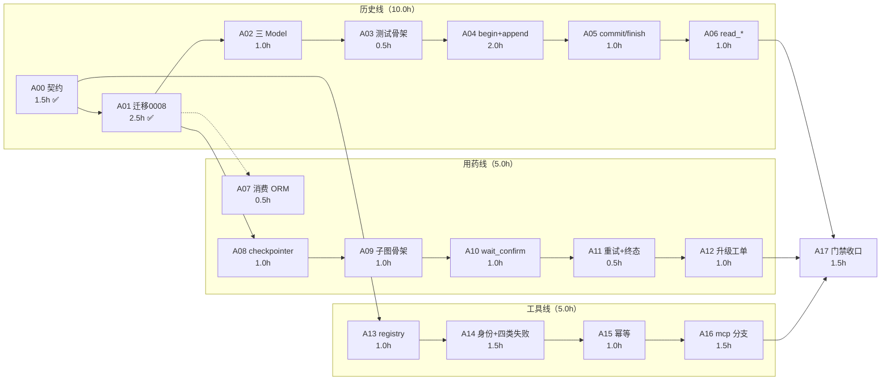

> 状态：已完成（G-A4 通过 + E2 接线 + 收口复查修复）　｜　版本：v1.10　｜　日期：2026-11-09
> 关联：docs/plans/day06/dev-a-历史与工具执行计划.md（本 DAG 的计划件）｜docs/team_tasks/day06/dev-a-历史事件与工具事实.md（任务卡）｜docs/plans/day06/d-DAG.md（Day 6 全队 DAG）
> 上游依据：技术设计文档 v2.0 §3.4/§3.6/§7/§8.3｜ER v0.5 §4.3.11–4.3.13｜contracts.md v1.0 §5
> 变更记录见文末

# dev-A 独立 DAG（历史与工具事实线）

> **用途**：把 7 个主节点拆到"能连续写代码不回头"的粒度。主节点号（N01/N04/N10/N12/N26/N23）用于汇报，本文的 A00–A17 用于执行。
> **前提**：A 是**单线程**（一个人），所以本文不追求并行度，只标**外部等待点**——真正拖慢进度的是别人的交付，不是自己排不过来。

---

## 1. 节点（18 个，合计 21.0h）

| 节点 | 内容 | 人时 | 状态 | 归属主节点 |
| --- | --- | --- | --- | --- |
| A00 | 契约冻结中的"表与事件枚举"章节 | 1.5 | ✅ 已完成 | N00 |
| A01 | 迁移 0008（三表 + `last_event_seq`） | 2.5 | ✅ 已 apply | N01 |
| A02 | `models/conversation.py` 三个 Model + `__init__` 导出 | 1.0 | ✅ | N01 |
| A03 | `test_history_store.py` 夹具骨架（savepoint 写法） | 0.5 | ✅ | N04 |
| A04 | `begin_turn` + `append_event`（seq 行锁） | 2.0 | ✅ | N04 |
| A05 | `commit_response` + `finish_turn`（幂等 + 终态） | 1.0 | ✅ | N04 |
| A06 | `read_turns` / `read_events`（generic 返回空） | 1.0 | ✅ | N04 |
| A07 | 消费 `models/medication.py`（B 交付），不自己建 | 0.5 | ✅（E1 已偿清：切到 ORM，`sa.table()` 已删除） | N10 |
| A08 | `checkpointer.py`（schema `langgraph` + 独立池） | 1.0 | ✅ | N10 |
| A09 | 子图骨架：`MedicationState` + 五个节点签名 | 1.0 | ✅ | N10 |
| A10 | `wait_confirm` + `interrupt` 恢复路径 | 1.0 | ✅ | N10 |
| A11 | 重试 ≤3 + 终态四值分流 | 0.5 | ✅ | N10 |
| A12 | 升级工单（`work_order_service.open_missed_medication`，确定性单号幂等） | 1.0 | ✅（15 条用例 + 子图集成断言；WD-1/WD-2 已登记） | N10 |
| A13 | `tool_registry.py`：白名单 + 参数 schema | 1.0 | ✅ | N12 |
| A14 | `tool_executor`：身份注入 + 四类失败 + 审计 | 1.5 | ✅ | N12 |
| A15 | `tool_executor`：`tool_executions` 幂等 | 1.0 | ✅ | N12 |
| A16 | `tool_executor`：mcp 分支 + 缓存/降级话术 | 1.5 | ✅（`transport="mcp"` 分支 + `tool_error_class` 映射 + 降级话术；7 条用例） | N26 |
| A17 | 门禁收口（pytest / cov / 看板 / README 回填） | 1.5 | ✅（931 passed、cov 81.51%、两个 check 0 退出码；README 新增 §7.4） | N23 |

> 已完成 **21.0h / 21.0h**（A00–A17 全部收口）。

## 2. 三条支线 + 一个收口



ASCII（贴日报用）：

```
A00 ✅ ── A01 ✅ ── A02 ── A03 ── A04 ── A05 ── A06 ─┐
   │                                                 │
   ├── A13 ── A14 ── A15 ── A16 ─────────────────────┤
   │                        ▲                        ├─ A17
   └── A01 ─┬─ A08 ── A09 ── A10 ── A11 ── A12 ──────┘
            └─ A07（等 B 的 ORM）
```

## 3. 边表（16 内 + 3 外）

| 边 | 类型 | 传递物 | 断了会怎样 |
| --- | --- | --- | --- |
| A00→A01 | 硬 | 事件枚举 + 三表字段 | 迁移与契约不符（已通过） |
| A00→A13 | 硬 | `ToolResult` 形状 | registry 编不出 executor 签名 |
| A01→A02 | 硬 | 表结构 | ORM 与库不一致 |
| A02→A03 | 硬 | Model 类 | 夹具无法建数据 |
| A03→A04 | 软 | 可跑的空壳测试 | 先写实现后补测试，风险自担 |
| A04→A05 | 硬 | `TurnRef` | 提交时拿不到 turn |
| A05→A06 | 硬 | 已落库的轮次 | 读不到数据无从验证 |
| A01→A08 | 硬 | `conversation_threads` 表 | checkpointer 无会话可挂 |
| A08→A09 | 硬 | `saver` 实例 | 图无法持久化 |
| A09→A10 | 硬 | State 定义 | interrupt 无处落 |
| A10→A11 | 硬 | 等待结果 | 重试无触发点 |
| A11→A12 | 硬 | 终态 | 工单不知道为何而建 |
| A13→A14 | 硬 | 白名单 + schema | 执行器无法校验入参 |
| A14→A15 | 硬 | `ToolResult` | 幂等分支无处挂 |
| A15→A16 | 硬 | 幂等键生成规则 | MCP 调用重复扣费/重复播报 |
| A06/A12/A16→A17 | 硬 | 三条支线可跑 | 门禁不完整 |
| **E1**（B 的 `models/medication.py`）→A07 | 外部硬 | 六表 ORM | 用 `sa.table()` 临时映射顶着 |
| **E2**（C 的 N07 触达出口）→A10/A12 | 外部软 | `deliver() + ack` | ✅ **已偿清**（2026-11-09 21:10）：信令层 `deliver()` 就绪，`remind` 已接真实下发；「是否真被听到」的 played 闭环留后续 |
| **E3**（C 的 N25 `mcp_client`）→A16 | 外部硬 | `call_tool()` | A16 阻塞，先做 A13–A15 |

## 4. 外部等待点（这才是 A 的真实风险）

| 等待 | 谁 | 最早可用 | 等待期间 A 干什么 |
| --- | --- | --- | --- |
| E1 `models/medication.py` | dev-B | W3 末 | 先做 A08 checkpointer（只依赖 0008） |
| E2 触达出口 | dev-C | W3 末 | 骨架 + 假 `deliver`，把 A11/A12 的逻辑先跑通 |
| E3 `mcp_client` | dev-C | W4 中 | 先把 A13–A15 做完（占 3.5h） |

> 结论：A 内部**无并行**，但三条支线可交错——E1 等待期做 A08，E3 等待期做 A13–A15。真正会让 A 空转的是 **E1 与 E3 同时不到位**，那时只能做 A03–A06。

## 5. 门禁

| 门 | 时点 | 判据 | 不过怎么办 |
| --- | --- | --- | --- |
| **G-A1** | A02 后 | `from app.models import ConversationEvent` 可导入；autogenerate diff 为空 | 回查 ER 逐列对照 |
| **G-A2** | A06 后 | `pytest tests/test_history_store.py` 全绿（含并发 20 写无重号） | ✅ **已通过**：12/12，并发用例 seq 恰为 1..20 |
| **G-A3** | A12 后 | `graph.get_state` 可读 + 重启不重发 + 幂等不重复建单 | ✅ **子图部分已通过**（A11 后：`pytest tests/test_medication_graph.py` 5/5，含重启恢复与四次触达）；A12 的建单部分待补 |
| **G-A4** | A17 | `pytest -q` 全绿 + cov ≥70% + 看板/索引 0 退出码 | ✅ **已通过**：931 passed / 4 skipped / 1 deselected（`-m "not slow"`）、cov **81.51%**、两个 check 均 0 |

## 6. 回退

| 场景 | 动作 |
| --- | --- |
| 子图写库越层（`graphs` 里 `session.add`） | 打回，改调 `medication_service` |
| 并发重号 | 改 `INSERT … SELECT last_event_seq+1` 单语句，或重试一次 |
| B 的 ORM 缺席到 W4 | ✅ **已按此执行**（2026-11-09 主理人签字）：`medication_service.py` 用 `sa.table()` 临时映射，B 交付后只改这一个文件的表定义，子图不动 |
| C 的 mcp_client 缺席到 W5 | A16 标记阻塞，N26 顺延，A17 门禁注明"缺 MCP 分支" |

## 7. 机器可读

```json
{
  "owner": "dev-A",
  "day": 6,
  "total_hours": 21.0,
  "done_hours": 4.0,
  "nodes": [
    {"id":"A00","h":1.5,"state":"done","parent":"N00"},
    {"id":"A01","h":2.5,"state":"done","parent":"N01"},
    {"id":"A02","h":1.0,"state":"todo","parent":"N01"},
    {"id":"A03","h":0.5,"state":"todo","parent":"N04"},
    {"id":"A04","h":2.0,"state":"todo","parent":"N04"},
    {"id":"A05","h":1.0,"state":"todo","parent":"N04"},
    {"id":"A06","h":1.0,"state":"todo","parent":"N04"},
    {"id":"A07","h":0.5,"state":"todo","parent":"N10","external":"E1"},
    {"id":"A08","h":1.0,"state":"todo","parent":"N10"},
    {"id":"A09","h":1.0,"state":"todo","parent":"N10"},
    {"id":"A10","h":1.0,"state":"todo","parent":"N10","external":"E2"},
    {"id":"A11","h":0.5,"state":"todo","parent":"N10"},
    {"id":"A12","h":1.0,"state":"todo","parent":"N10"},
    {"id":"A13","h":1.0,"state":"todo","parent":"N12"},
    {"id":"A14","h":1.5,"state":"todo","parent":"N12"},
    {"id":"A15","h":1.0,"state":"todo","parent":"N12"},
    {"id":"A16","h":1.5,"state":"todo","parent":"N26","external":"E3"},
    {"id":"A17","h":1.5,"state":"done","parent":"N23"}
  ],
  "edges": [
    ["A00","A01"],["A00","A13"],["A01","A02"],["A02","A03"],["A03","A04"],
    ["A04","A05"],["A05","A06"],["A01","A08"],["A08","A09"],["A09","A10"],
    ["A10","A11"],["A11","A12"],["A13","A14"],["A14","A15"],["A15","A16"],
    ["A06","A17"],["A12","A17"],["A16","A17"]
  ],
  "gates": ["G-A1","G-A2","G-A3","G-A4"],
  "external_waits": {
    "E1": "dev-B models/medication.py",
    "E2": "dev-C N07 触达出口",
    "E3": "dev-C N25 mcp_client"
  }
}
```

---

## 8. 变更记录

| 版本 | 日期 | 说明 |
| --- | --- | --- |
| v1.0 | 2026-11-09 | 首版：18 个执行节点（合计 21.0h，已完成 4.0h）、16 条内部边 + 3 个外部等待点、4 道门禁、4 条回退；明确「单线程 + 外部阻塞」的真实风险结构 |
| v1.1 | 2026-11-09 | 开工执行：A02–A06、A13–A15 标记完成（累计 13.0h，剩 8.0h）；G-A2 通过。执行中修正两处设计缺陷：`read_turns` 改按 `turn_started.seq` 排序（`now()` 同事务撞同一时间戳）、`finish_turn` 对 generic 轮次补 `turn_completed` 事件（原实现会让通用模式永远不闭合） |
| v1.10 | 2026-11-09 | **收口复查（主理人要求）**：修三处真问题——① 图重放重复投递（`remind` 改「先查后发」，新增 `get_attempt`；变异验证有效）；② `ToolExecutor` 把外键违反伪装成 transient（改插入前校验轮次存在 → `bad_args`）；③ 补「吞 CHECK 违反」与「同键幂等」两条回归用例。另把「下发语音提醒」改为「字幕通道」（WS 语音仍是 `NullTtsQueue` 桩，登记 TD-1），主动触达 played 闭环登记 TD-2。全量 **975 passed** |
| v1.9 | 2026-11-09 | **E2 触达接线 + 0012 迁移（主理人 21:16 裁决授权，L11 唯一一次破例）**：① 修 mypy `history_service.py:544`（`_as_turn_status` 显式比较链收窄，不用 cast）；② `remind` 接信令层 `deliver()`（tts_text 不带 response_id/epoch，pad 零改动），回执三态 `voice_dispatched/device_offline/no_bound_device`；③ 发现并修复 `record_attempt` 把 CHECK 违反当幂等吞掉的缺陷；④ **0012**：receipt 白名单 3→6 值（ORM 同步），`upgrade→downgrade→upgrade` 可逆实测；⑤ 新增 3 条 E2 用例（在线/未绑设备/全离线），全量 **971 passed**。两处踩坑：迁移名超 version_num 的 VARCHAR(32)（36 字符→改 27）、CHECK 的 drop/create 必须传短名（naming_convention 二次展开，0007 同款坑） |
| v1.8 | 2026-11-09 | **A17 完成，A 线收口**：门禁实测 931 passed / 4 skipped / 1 deselected（口径 `-m "not slow"`，排除需外网的 edge-tts 用例）、覆盖率 **81.51%**（阈值 70%）、`--check` 与 `--check-plans` 均 0；README 新增 §7.4 A 线验收记录并修正过期的进度块与容器 pytest 命令。18 个执行节点全部 done，累计 21.0h |
| v1.7 | 2026-11-09 | **A12 完成**（主理人裁决走 B）：新增 `app/services/work_order_service.py`（`open_work_order`/`open_missed_medication`/`transition`/`resolve_primary_care_staff`），子图 `finalize` 在写终态后建漏服单；幂等改用**确定性单号**（表无 `source_*` 列、0011 已归 C），INSERT 包 SAVEPOINT 以免撤销终态；登记 WD-1（两套建单口并存）与 WD-2（缺通用幂等列）。累计 19.5h，剩 A17 |
| v1.6 | 2026-11-09 | **A16 完成**：`ToolSpec` 增 `transport`（local/mcp），`ToolExecutor` 增 mcp 分支——失败分类只用 `mcp_client.tool_error_class()`、成功原样透传 `cached`/`observed_at`、**不自建第二层缓存**（weather server 已有 TTL + 过期兜底）；MCP 工具禁止绑本地实现；7 条用例（成功/缓存透传/timeout/unauthorized/bad_request 细化/client 崩溃/未接线）。累计 18.5h，剩 2.5h |
| v1.5 | 2026-11-09 | **与 develop 的 B/C 代码合流**：① E1 偿清——`medication_service` 从 `sa.table()` 切到 B 的 ORM，子图与调用方零改动；② 修三处集成缺陷（`read_turns` 的 `session` 必填导致上下文层 TypeError、`commit_response` 被响应层先写的事件短路导致 delivered 恒空、用药层过渡映射）；③ E3 就绪（`app/mcp_client`、`mcp-servers/weather` 已合入），A16 可开工；④ 确认 C 的 `ToolExecutor` 协议与实现签名一致、`state_service` 的水位口径与契约 v1.2 一致。全量 872 passed |
| v1.4 | 2026-11-09 | A12 前置：新增 `docs/plans/day06/a12-工单建单服务接口设计.md` v1.0（只定签名与幂等键，未落实现）——与 C 的 N27 共用唯一建单口 `open_work_order`/`transition`，四元幂等键 `(elder_id, order_type, source_type, source_id)`，并请求 C 把两条索引并入 0011；A12 由「未开始」改为「接口已定，待 C 确认」 |
| v1.3 | 2026-11-09 | 接收两则转达：① J3 **通过**（`tts_text` v2 / `segment_ack` 字段一致），dev-D 进 S2；② **0011 迁移归 dev-C**（写锁 L11），A/B 本日不再新建迁移——A 线剩余 A12/A16/A17 均不涉及新表，不受影响；若 A12 后续确需新列，提给 C 并入 0011 |
| v1.2 | 2026-11-09 | 用药线落地：A07（按主理人签字改用 `sa.table()` + `TODO(E1)`）、A08 checkpointer（独立 schema + 独立池，`search_path` 钉进连接串）、A09–A11 子图（`interrupt` 恢复、四次触达、终态写一次）；累计 17.0h，剩 4.0h。G-A3 子图部分通过。新增 Windows 本地约束：psycopg 异步连接不支持 ProactorEventLoop，`tests/conftest.py` 统一换 Selector 策略 |
