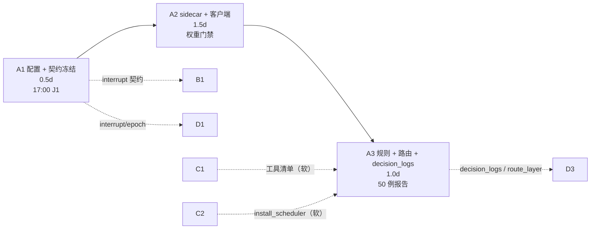

# dev-A · 第 7 天工作推进计划 · 三级路由与决策日志

> 状态：已完成（A1/A2/A3 已落地并入 develop 7565b6a）　｜　版本：v1.1　｜　日期：2026-11-10
> 关联：`docs/team_tasks/day07/dev-a-day07.md`（任务卡，唯一任务源）｜`docs/team_tasks/day07/README.md`（DAG 与总表）｜`docs/team_tasks/day07/contracts.md`｜`docs/plans/day07/handoff-A-to-C-用药到点接线.md`｜`docs/plans/adhoc-20261110-day6全面审查.md`
> 上游依据：PRD §4.2 FR-DLG-01/02/03/05/06/07/09（line 264–274）、§5.2 固定测试集（line 527–541）、§5.3 性能（line 543–550）｜技术设计文档 §1.4（line 182）、§3.4 `decision_logs`（line 686–706）、§6 主控 Agent（line 897）、§8.3
> 变更记录见文末

---

## 0. 一页结论

| 项 | 结论 |
| --- | --- |
| 本日目标 | 把 6 个 `laya_*` 配置与空壳 `app/system_one/` 换成 **Chinese-Jev 本地 sidecar + HTTP 客户端**，补上 **规则层 → System One → Agent** 三级路由与 `decision_logs`，让任取一轮对话都能回答「走了哪一层、为什么、耗时多少」 |
| 我的任务 | A1 配置替换与契约冻结 0.5d → A2 Chinese-Jev sidecar 与客户端 1.5d → A3 规则层 + 路由 + `decision_logs` 1.0d，**共 3.0 人日，唯一硬串行链** |
| 确认点 | **三个**：A1 收口（含 J1 契约冻结）→ A2 收口（含权重门禁结论）→ A3 收口（含 50 例报告）。每个确认点停下交证据，主理人确认后才进下一段 |
| 关键路径 | `A1(0.5) → A2(1.5) → A3(1.0) → D3(0.75)`；我这条线每延 0.5d，D3 真机联调直接顺延 |
| 硬约束 | 200ms 客户端超时 / sidecar 内部 150ms / 置信阈值 0.85 / 规则层 ≤10 条 / 低置信只澄清一次 / `route_layer` 每轮 1 行 / 不接商业 Jev API / 不新增第二套权限逻辑 |
| 今日不做 | 记忆治理五步、娱乐点播片库、健康子图、Langfuse 全量、`docker-compose.yml`、历史迁移 |
| 需你先回话 | §10 的 6 条（`route_layer` 新值、规则命中但能力未就绪的分层写法、`.env.example` 是否纳入 A1 作用域、`eval/` 与 `scripts/` 新建授权、`tool_executor` 路径口径、`notification_failed` 不在我域内但影响 G5） |
| 我会主动找人 | J1 全员契约冻结、J2 与 B1/C1/D3 对 `RouteDecision`、J4 与 C1 对 `medication_confirm`、J5 与 C2 对 `install_scheduler`；详见 §7 |

---

## 1. 项目认知基线

> 本节是我读完 PRD、技术设计文档、全部 `docs/` 层级文档与现有代码后写下的口径。**后续所有实现与验收都以本节为准**，不得凭对话记忆或大纲正文改写。

### 1.1 定位与边界

- 面向 CCRC 康养社区长者卧室的 **3D 数字人陪伴系统**：浏览器页面（模拟平板）上的 VRM 数字人 + WebRTC 全双工语音。
- 五个职责：情感陪伴、用药提醒、健康数据采集、戏曲/天气检索、人工告警。
- **不做**：医疗诊断、药理判断、替代 SOS 紧急呼叫、护工改药单（PRD 权限口径）。
- 三端同仓：`pad`（1920×1080 大字）、`console`（护工/医生/管理员分流）、`family`（375px）。**我这条线只碰后端**，`frontend/**` 属 dev-D 写锁。

### 1.2 与本任务直接相关的六条事实

1. **三级路由顺序固定**：`G0 安全一票否决 → 规则层 → System One → Agent`。低层命中不被高层覆盖，但**安全模块始终可覆盖任何层**（day07 README §1.4）。
2. **System One 出四信号 + 多意图信号**：`intent`（七类）、`is_sensitive`、`confidence`（校准概率，非 logit）、`privacy_scope`、`is_out_of_domain`，v1.1 增 `multi_intent` / `sub_intents`。
3. **七类意图**：`chat / medication / opera / movie / weather / health_checkup / other`。标签是产品决策，不由模型自由生成。
4. **`decision_logs` 是评测数据源**（TD §3.4，line 686–706）：`log_id / thread_id / trace_id / elder_id / input_text(已脱敏) / intent / confidence / is_sensitive / route_layer / escalated_to_s2 / latency_ms / asr_confidence / model_version / created_at`。**只追加**，`input_text` 落库前即脱敏。
5. **性能红线**（PRD §5.3）：固定意图路由分发 **≤200ms**（ASR 文本就绪 → 路由结果，不含 ASR/TTS/外部接口）。
6. **验收红线**（PRD §5.2）：普通固定意图 50 条 **≥45 正确（90%）**；敏感 20 条 **≥19 召回（95%）**；安全边界 20 条（否定/历史/他人/模糊各 5）；模糊普通意图 20 条「均只澄清一次」；分层命中率目标 **≥60% 在快决策层闭环**。

### 1.3 引用纪律（违反即返工）

- 事实只引 **PRD（验收）与技术设计文档（实现）**。`docs/康伴3D数字人_大纲.md` **只提供「今天做哪几件事、按什么顺序」**，其课时正文里的规则清单、表名、字段、阈值**一律不作依据**。
- 本日排期与产出物可引大纲 Day 6 的流程；落地成字段/接口/规则表时，回 PRD 与 TD 取（例如规则层清单从 **PRD FR-CON-03 的播放控制指令集 + FR-CON-01 天气 + FR-DLG-02 固定意图**取，不抄大纲 6.1 的十句清单）。
- 三层护栏不新增框架：G0 落既有 `safety.py` / `safety_service`，G1 在 `Router.decide()` 内复用同一升级口，G2 落唯一 `ToolExecutor.execute()`。

### 1.4 文档体系梳理结论

| 层级 | 文件 | 我用到什么 |
| --- | --- | --- |
| 基线 | `康伴3D数字人_PRD.md` | FR-DLG-01~10、§5.2 测试集、§5.3 性能、AC-03/04/33 |
| 基线 | `康伴3D数字人_技术设计文档.md` | §1.4 选型、§3.4 `decision_logs` 字段、§6 主控 Agent 与四分类、§8.3 排期 |
| 流程 | `康伴3D数字人_大纲.md` | 只取「Day 6 三级路由 + 规则层 + 分类器 + 接主链路」这一顺序 |
| 契约 | `docs/team_tasks/day07/contracts.md` | 触达消息 / `touch_played` / `receipt=played`（我只需知道不越界） |
| 契约 | `docs/team_tasks/day07/README.md` §5.2–5.7 | `/v1/decide` HTTP 契约、`RouteDecision` 字段表、`interrupt` 消息、E20 改绑契约 |
| 任务 | `docs/team_tasks/day07/dev-a-day07.md` | A1/A2/A3 步骤、交付物、命令级验收、写作用域 |
| 任务 | `dev-b/c/d-day07.md`、`dev-c2-用药到点触发接线.md` | 我只读：确认谁等我、我等谁（C2 的 `install_scheduler` 由我装配） |
| 审查 | `adhoc-20261110-day6全面审查.md` | 我域内只有 **P3-31**（`TurnService.commit_response` 第二写口）；P1×6 全是 B/D 的 |
| 方案 | `前端页面方案.md`、`ER_数据模型设计.md`、四份 `接口契约_*.md`、`工作流选型说明.md` | 只做不冲突校验：我不新增 REST 端点、不改 ER 主键口径、不动前端协议 |

---

## 2. 代码现状实测（2026-11-10 11:55 基线）

> 这一节是「改之前先承认现状」。卡里描述与实测有 3 处偏差，已登记在 §10，不自行改口径。

| 项 | 实测 | 影响 | 本日动作 |
| --- | --- | --- | --- |
| `app/core/config.py` | L91–96 只有 6 个 `laya_*` 字段，无任何 Chinese-Jev 模型/路径/设备/并发配置 | 配置替换是 A1 的第一步 | 按 A1 换组 + 兼容映射 |
| `app/system_one/` | 只有 `__init__.py` 一行 docstring | 无 client / schema / questions，路由无法调用 | A1 建 schema/questions，A2 建 backend/server/client |
| `app/router/` | 只有 `__init__.py` docstring + `safety.py`；`safety_check()` → `SafetyDecision` 已可用 | 规则层与路由层从零建 | A3 建 `rules.py` / `decision.py` |
| `app/services/tool_executor.py` | **已存在**且完整（白名单/身份消毒/幂等/审计/四分类），`execute(*, tool_name, args, runtime, turn_id, idempotency_key)` | 卡内写 `app/agents/tool_executor.py`，实际在 `services/`；**这是 C 线写锁** | A3 只**调用**不修改；若发现需要改，提 patch 给 C3 |
| `app/services/turn_service.py` | `TurnService(session_factory, agent, response_stream, history, state_center, context_builder, now_provider, seen_capacity)`；七步顺序在 `handle_user_turn`，第 3 步 `context_builder.build` 与第 4 步 `agent.run` 之间**无路由钩子** | A3 的接线点就在这里 | 增 `router=` 注入 + 第 3.5 步 |
| `app/main.py` | `lifespan` L134；`TurnService` 装配 L286；`DialogueOrchestrator` 装配 L292（`safety_escalator=_escalate_safety`）；`create_app` L653 | 唯一装配点，我独占写锁；G1 要复用 `_escalate_safety` | A3 在此注入 `SystemOneClient` + `Router`，并调 C2 的 `install_scheduler(app)` |
| `app/scheduler/` | 只有占位 docstring（自标 Day 7-9） | C2 会新建 `medication_jobs.py` | **我不实现 scheduler**，只在 lifespan 单点调用 |
| `alembic/versions/` | head = `0013_touch_played_receipt.py` | `0014_decision_logs` 的 `down_revision` 确定 | A3 只允许这一笔迁移 |
| `app/models/` | 无 `decision.py`；`conversation.py` 已有事件/turn/tool_execution 模型可参照风格 | 新建 ORM | A3 建 `decision.py` |
| `eval/` 与 `scripts/eval_router.py` | **均不存在**（`eval/fixtures`、`eval/reports` 目录也没有） | 卡内验收命令引用了它们 | 见 §10-4，需你授权新建 |
| `tests/test_system_one_client.py` 等 4 个测试文件 | **均不存在** | 验收命令会直接报文件不存在 | A2/A3 新建 |
| `LAYA_*` 引用面 | `config.py` L91–96、`README.md` L203/L270、`.env.example` L65–70、`asr.py` L114 注释、`tests/test_audio_asr.py` L200 注释、`docker-compose.yml` 注释 | 只改配置不清理，会留下两套口径 | 见 §10-3 |
| `app/mcp_client/`、`DEFAULT_TOOLS`、`get_weather` | 已存在并已注册进 Agent | 天气直连可复用既有工具与四分类 | A3 直连只走 `ToolExecutor` |

---

## 3. 第 7 天任务清单与依赖拆解

### 3.1 本日 12 任务总表（dev-A 占 3 项）

| ID | 任务 | 负责人 | 人日 | 前置依赖 | 与我的关系 | 量化验收（摘要） |
| --- | --- | --- | ---: | --- | --- | --- |
| **A1** | 配置替换与契约冻结 | **dev-A** | 0.5 | 无 | 本日起点 | 新配置可加载；旧 `LAYA_*` 仅兼容映射且有且仅一次弃用告警；七类 intent/四信号字段冻结 |
| **A2** | Chinese-Jev sidecar 与客户端 | **dev-A** | 1.5 | A1（硬） | 依赖我的 A1 | `/health` 200；20 条样例 20/20；p95 ≤200ms；sidecar 停掉 250ms 内 `degraded=True` |
| **A3** | 规则层 + 路由决策 + `decision_logs` | **dev-A** | 1.0 | A2（硬）｜C1 工具清单（软）｜C2 `install_scheduler`（软） | 我收口，D3 等我 | 50 例可复跑；`decision_logs` 每轮 1 行；低置信只澄清一次；G1 命中不进 Agent；直连只走 `ToolExecutor` |
| B1 | 回合终态与打断闭环 | dev-B | 1.25 | A1 的 `interrupt` 契约（硬） | **我给它契约**（J1/J3） | 末段 `played` 后 `finish_turn` 被调用；打断 200ms 内停声 |
| B2 | 上下文 NULL/预算 + 状态与记忆 | dev-B | 1.25 | 无 | 无直接依赖；它的 `memory_recall` 给 C1 | 空送达不产生 `content:null`；Redis 故障可 `StateUnavailable` |
| B3 | metrics 白名单 + E20 并发 + API 边界 | dev-B | 0.5 | 无 | 无直接依赖 | `response_segment` 可落库；并发摘护工只 1 个成功 |
| C1 | `medication_confirm` 绑定与对话入口 | dev-C | 1.0 | B2 记忆端口（软） | **它给我工具清单**（J4 软依赖） | 「我吃过药了」推进到 `taken_reported`；工具清单含 3 个工具 |
| C2 | 用药到点调度接线 | dev-C | 1.0 | 无（新文件先行） | **它的 `install_scheduler(app)` 由我装配**（J5） | 1 事件/4 触达/1 工单；重启不重复；`scheduler` 零直写 |
| C3 | Agent 工具与安全边界收口 | dev-C | 0.75 | C1 | **它的 `safety.py` 是我 G1 的升级口实现方** | 四类边界各 5 例判定正确；权限注入/超时/重复调用按 §1.4 |
| D1 | pad 播放/打断/VAD | dev-D | 1.25 | A1 的 `interrupt` 契约（硬） | **我给它 `interrupt`/epoch 规则**（J1/J3） | 旧 epoch 不播不 ack；20 轮 ack 100%；打断 200ms 静音 |
| D2 | console 改绑分页与错误 UX | dev-D | 0.75 | 无 | 无 | 完整分页；保存只提交差集 |
| D3 | 触达/路由联调修复与收口 | dev-D | 0.75 | D1/D2/C2/**A3**（硬） | **它等我路由可查**（J6） | 触达播出且 `played` 落库；路由降级提示可见 |
| G7 | 集成门禁 | 全员 | — | 全部 | 我提供 §6.6 证据 | §8 五道门全绿 |

### 3.2 dev-A 依赖图



- **唯一硬串行链**：`A1 → A2 → A3`。理由：模型/客户端/路由必须逐层验证，跨层并行只会把 schema 错误拖到最后一刻。
- **两条软依赖**（断了可降级，不能停）：C1 工具清单缺失 → 用药意图走 `agent`，不直连；C2 `install_scheduler` 缺失 → lifespan 不装配调度器，C2 新文件仍可单测。
- **我不等 B/D**：B1/B2/B3、D1/D2 与我并行；B1 只等 A1 契约（当天 17:00 前给），不等 A2/A3 代码。

### 3.3 每任务的「前置 / 步骤 / 验收」落点

| 任务 | 前置依赖 | 执行步骤 | 量化验收 | 自检 |
| --- | --- | --- | --- | --- |
| A1 | 无（只读 PRD/TD/`config.py`） | §4.3 S1.1–S1.7 | §4.6 | §4.7 |
| A2 | A1 的配置与 schema（硬） | §5.3 S2.1–S2.8 | §5.6 | §5.7 |
| A3 | A2 客户端（硬）；C1/C2（软） | §6.3 S3.1–S3.9 | §6.6 | §6.7 |

---

## 4. A1 · 配置替换与契约冻结（0.5 人日 · 确认点 ①）

### 4.1 目标与完成定义

把 6 个 `laya_*` 换成 `system_one_*`，冻结 `/v1/decide` 请求/响应、七类意图、四信号 + 多意图、`RouteDecision`、`decision_logs.route_layer` 取值，使 B/C/D **不见面也能并行**。

**完成定义**：J1 会上四人对字段名、类型、可空、枚举逐项确认、无口头待定项，且 `contracts-system-one.md` 写下 v1.0 版本号。

### 4.2 前置依赖

- 无前置任务。
- 只读输入：PRD FR-DLG-02/03/06/07（line 267–274）；TD §1.4（line 182）、§3.4（line 686–706）；`README.md` §5.2–5.4（HTTP 契约与 `RouteDecision` 字段表，已由总表给出，A1 只做**冻结与成文**，不重新设计）。
- 时间盒：上午 3 小时出草案，16:30 发群，17:00 主持 J1。

### 4.3 执行步骤

**S1.1 现状核对（20 分钟）**

1. 读 `app/core/config.py` L80–100，确认现有 6 字段与默认值。
2. `grep -rn "settings.laya_\|LAYA_" app/ tests/ README.md .env.example` 记录全部引用点（§2 已列），作为 S1.7 的清理清单。
3. 确认无其他模块读 `settings.laya_*`（实测：仅 `config.py` 定义，无消费方）→ 这意味着替换**不会破现有链路**，风险主要在兼容映射。

**S1.2 新配置组（`app/core/config.py`）**

按 day07 README §6.2 字段表新增 13 个字段，分组注释写明「端口 7001 不变，避免 nginx/防火墙改动」：

| 字段 | 默认 | 语义 |
| --- | --- | --- |
| `system_one_enabled` | `True` | 总开关；关闭时全量 `route_layer=fallback` 走 Agent |
| `system_one_provider` | `"chinese_jev"` | `chinese_jev` / `mock`；生产禁 `mock` |
| `system_one_base_url` | `http://localhost:7001` | sidecar 地址 |
| `system_one_api_key` | `""` | 空则不带 `Authorization` |
| `system_one_timeout_ms` | `200` | 客户端硬预算 |
| `system_one_confidence_threshold` | `0.85` | 低于阈值只澄清一次 |
| `system_one_fallback_to_agent` | `True` | 失败/低置信下沉 Agent（**不是**调另一个 LLM 分类器） |
| `system_one_model_id` | `"chinese-jev-general"` | 权重标识 |
| `system_one_model_path` | `""` | 空则 sidecar `/health` 报 `model_missing` |
| `system_one_model_version` | `"chinese-jev:general:dev"` | 写入 `decision_logs.model_version` |
| `system_one_device` | `"cpu"` | CPU 优先，GPU 可选 |
| `system_one_max_concurrency` | `2` | 防 CPU 打满拖垮语音链路 |
| `system_one_warmup` | `True` | lifespan 预热，避免首句超时 |

**S1.3 旧值兼容映射**

- `model_validator(mode="before")`：把 `LAYA_ENABLED / LAYA_BASE_URL / LAYA_API_KEY / LAYA_TIMEOUT_MS / LAYA_CONFIDENCE_THRESHOLD / LAYA_FALLBACK_TO_LLM` 映射到新字段。
- 映射命中时**有且仅打一次** `DeprecationWarning`（用模块级 `frozenset` 记录已告警变量名，避免每实例重复刷）。
- 新旧同给时**新字段优先**，并在日志写明「旧变量被忽略」——不能静默二选一。
- 删旧字段**留到下一个版本**，本日只做映射，不做删除（删除要同步 README 与 `.env` 示例）。

**S1.4 `app/system_one/schemas.py`**

- `Intent = Literal["chat","medication","opera","movie","weather","health_checkup","other"]`
- `PrivacyScope = Literal["personal","shared","none"]`
- `SystemOneRequest`：`request_id / trace_id / text / questions / model_version`
- `SystemOneResponse`：`request_id / intent / is_sensitive / confidence / privacy_scope / is_out_of_domain / latency_ms / model_version / degraded`
- `SystemOneResult`：业务侧视图，额外含 `multi_intent: bool = False`、`sub_intents: tuple[Intent, ...] = ()`；`confidence` 用 `float` 且 `ge=0, le=1` 校验。
- 质量要求：Pydantic v2 严格模式；`degraded=True` 时**必须**满足 `intent="other"`、`confidence=0.0`、`is_out_of_domain=True`（用 `model_validator` 强制，防止客户端填半套降级值）。

**S1.5 `app/system_one/questions.py`**

- `build_questions() -> dict` 为**唯一构造入口**，返回 `intent`（choice，7 候选）/ `is_sensitive`（noul）/ `confidence`（score 0–1）/ `privacy_scope`（choice）/ `is_out_of_domain`（noul）五组。
- 命题措辞取 PRD 语义（急症/跌倒/走失/轻生、域外），**不写具体病例词表**（词表在 `safety.py`，属 C3）。
- 质量要求：纯函数、无 IO、无 import `settings`；同一进程内多次调用返回等值结构（可断言）。

**S1.6 `app/system_one/__init__.py` 与 `app/router/__init__.py`**

- 前者 docstring 改 Chinese-Jev，导出 `SystemOneResult`（`SystemOneClient` 待 A2 建好后补导出）。
- 后者 docstring 改为 `安全（safety.py）→ 规则（rules.py）→ System One → Agent`，并注明「阈值在代码里，不在 prompt 里」。

**S1.7 契约文档 `docs/team_tasks/day07/contracts-system-one.md` v1.0**

必含 6 节（缺一节 J1 不通过）：

1. `/v1/decide` 请求/响应字段表（字段名/类型/可空/枚举/默认）。
2. `RouteDecision` 字段表（含 `multi_intent` / `sub_intents`）。
3. C→S `interrupt` 消息（`{"type":"interrupt","response_id":"...","reason":"barge_in"}`）+ 幂等语义。
4. `decision_logs.route_layer` 新写值 `rule/system_one/agent/fallback`，历史 `laya` 只读。
5. 低置信「只澄清一次」的判定方式：查**同 `thread_id` 最近一条 `decision_logs`** 是否已 `action=clarify`。
6. 三层护栏口径：G0 入口 → G1 分类器信号复核 → G2 `ToolExecutor` 权限；**Router 与 Agent 共用唯一工具入口**；优先级 `安全 > 权限 > 路由 > 置信度/人设/多意图`。

**S1.8 README 与注释同步**

- `README.md` L203 配置表、L270 端口表、架构图里「Laya」改「Chinese-Jev」；保留一行历史说明（何时改、为什么）。
- `app/audio/asr.py` L114 注释、`tests/test_audio_asr.py` L200 注释：`laya` → `system-one`，**端口 7001 不动**。
- `.env.example` L65–70：见 §10-3 待你确认是否纳入本次作用域。

### 4.4 交付物规格

| 交付物 | 格式 | 内容范围 | 质量要求 |
| --- | --- | --- | --- |
| `app/core/config.py` 新配置组 | Python | 13 个新字段 + 6 条兼容映射 + 弃用告警 | 单测可 `Settings(system_one_provider='chinese_jev')` 实例化；无新增 mypy ignore |
| `app/system_one/schemas.py` | Python（Pydantic v2） | 3 个模型 + 2 个 Literal 别名 | 非法 `confidence`（<0 或 >1）报 `ValidationError`；半套降级值被 `model_validator` 拦 |
| `app/system_one/questions.py` | Python | `build_questions()` + 常量表 | 五键齐全；`intent.choices` 恰 7 项且与 `Intent` 一致 |
| `contracts-system-one.md` v1.0 | Markdown（文件头四行 + 变更记录） | §1.7 六节 | 每个字段有类型与可空；四个人签字段表，不签「大概这样」 |
| `README.md` 段落 | Markdown | 配置表 / 端口表 / 架构图 | 全仓 `grep -i laya README.md` 只剩「历史说明」一处 |

### 4.5 交接物（J1，17:00）

| 交接对象 | 交付内容 | 判据 |
| --- | --- | --- |
| dev-B（B1） | C→S `interrupt` 消息 + `canceled` 终态口径 + `RouteDecision` 字段 | B1 能只凭契约开工，不问我 |
| dev-D（D1） | `interrupt` 字段 + 旧 epoch 淘汰规则 + `degraded` 语义 | D1 能先改前端，等联调校状态 |
| dev-C（C1） | `RouteDecision` 的 `tool_name/tool_args` 分流字段 + 工具清单要求 | C1 知道要绑哪几个工具名 |
| dev-B（B2） | `route_layer` 四值枚举 + `TurnOutcome` 新增字段承诺 | B2 知道不改变响应流契约 |

### 4.6 量化验收

```bash
# 1) 新配置可加载
uv run python -c "from app.core.config import Settings; s=Settings(system_one_provider='chinese_jev'); print(s.system_one_timeout_ms, s.system_one_confidence_threshold)"
# 期望：200 0.85

# 2) questions 结构
uv run python -c "from app.system_one.questions import build_questions; q=build_questions(); print(sorted(q)); print(len(q['intent']['criteria']))"
# 期望：4 个键（intent/is_sensitive/privacy_scope/is_out_of_domain）；7
# 注：confidence 不单独出题——由 intent 候选概率的熵派生（见 spike README §4），故是 4 题不是 5 题

# 3) 旧变量兼容映射（Git Bash 写法）
LAYA_BASE_URL=http://localhost:7001 uv run python -c "from app.core.config import Settings; print(Settings().system_one_base_url)"
# 期望：http://localhost:7001；弃用告警**每个旧变量各一次**（.env 里有 6 个 → 6 条），重复实例化不再刷

# 4) 新代码不再读旧字段
grep -rn "settings.laya_" app/ | wc -l
# 期望：0

# 5) 静态
uv run ruff check app/core/config.py app/system_one
```

| 判据 | 通过标准 |
| --- | --- |
| 字段冻结 | 七类 intent / 四信号 / `RouteDecision`（含 `multi_intent`、`sub_intents`）/ `route_layer` 四值，四人在 J1 无待定项 |
| 兼容性 | `LAYA_*` 能映射，弃用告警**恰好一次**；新旧同给时新值生效且日志可见 |
| 无残留 | `grep -rn "settings.laya_" app/` = 0 |
| 文档一致 | `contracts-system-one.md` v1.0 六节齐全；README 与代码字段名逐字一致 |

### 4.7 自检与停止条件

- 任一条验收命令失败 → 不进 A2。
- 若发现 `README.md` 与卡内字段定义冲突 → **停下来问主理人**，不自行取舍（§10-1 已预置同类问题）。
- J1 有任一字段未签 → 17:30 前必须重签一次；仍不签则 A2 延后，B1/D1 只拿已签部分开工。

---

## 5. A2 · Chinese-Jev 本地 sidecar 与客户端（1.5 人日 · 确认点 ②）

### 5.1 目标与完成定义

在不接商业 API 的前提下，提供本地 `/v1/decide` 服务与 **200ms** 客户端；权重/上游不具备时必须**显式降级并如实报告**，不得伪造「已上线」。

**完成定义**：`/health` 200（或 503 + `model_missing` 且报告写明阻塞）、20 条固定样例字段 20/20 合法、p95 ≤200ms（或如实标红）、sidecar 停掉后 250ms 内 `degraded=True` 不抛异常。

> **形态未锁定（2026-11-10）**：主理人答复「General 权重已到位」但**仓库内零可核验物**（无权重目录、无 torch/transformers 依赖、无入口代码、`spikes/laya_hello/` 只是英文 ModernBERT 的 HTTP mock）。因此本段不写死「真跑通」，改由 **S2.0 形态门禁（2 小时）** 用证据在 A / A′ / B 三形态中判定，见 §5.2.1 与 §5.6 分支验收。
>
> 关键事实：**A 与 B 的前 0.5 天工作完全重叠**（配置、`schemas.py`、`questions.py`、`client.py`、`server.py` 骨架一模一样），分叉点只在 `backend.py` 一个文件。所以先跑门禁不浪费任何工作量。

### 5.2 前置依赖

- A1 的配置字段与 `schemas.py`（硬）。缺一个字段就要返工客户端。
- 上游 Chinese-Jev 仓库/权重（外部）：需先确认 inference 入口（CLI / Python API / 子进程）。
- 时间盒：**S2.0 门禁 2 小时（含在 1.5 人日内）** → S2.1–S2.2 上午 → S2.3–S2.6 下午 → S2.7–S2.8 次日上午收口。

### 5.2.0 上游事实核查（2026-11-10 已核实，含出处）

| 项 | 核实结果 | 出处 |
| --- | --- | --- |
| 公开权重 | **只有 `CJ-Medical`（医学领域）**；仓库 TODO 清单里**没有** General 权重的发布项 | GitHub `gulucaptain/Chinese-Jev` README_zh「开源模型」表 + TODO 列表 |
| 权重地址 | `https://huggingface.co/bbldCVer-hf/CJ-Medical`（仓库 678 MB，`model.safetensors` 644 MB ≈ 322M 参数 fp16） | HF 文件树 |
| 权重许可 | **`apache-2.0`**（model card 头部 `license: apache-2.0` + 仓内 `LICENSE.txt` 10.2 kB 全文） | HF model card |
| 仓库代码许可 | **Apache-2.0**；明确声明「仓库代码许可不改变外部模型权重或数据的许可」 | GitHub README_zh「许可证与来源边界」 |
| 推理入口 | **`laya` 运行时（PyPI 包）**，不是 Transformers pipeline：`from laya import Agent` → `Agent(path, device="cpu")` → `model.system_one(state=..., questions=...)` → `result["answers"][qname]` | HF model card「Use」段 |
| 依赖 | `pip install -r requirements.txt`（torch + transformers + laya） | HF `requirements.txt`（109 B） |
| 题面格式 | 三种：`choice`（criteria=键→描述，返回选中键+概率）/ `noul`（false/true 描述，返回 true 概率）/ `score`（有序等级，返回等级概率与期望索引）；**不生成自由文本** | HF model card 表格 |
| 参数量/延迟 | 322M（mmBERT-base 底座）；论文称平均 15 ms/例（GPU 口径），INT8 端侧约 1.0 s/次 | 论文 arXiv 2609.36965 / README |
| 训练侧 CLI | `chinese-jev prepare / train / calibrate / evaluate`（训练用，非在线推理）；完整训练需 Linux + CUDA + bf16 | GitHub README_zh |

| Laya 通用权重 | `convaiinnovations/laya-multilingual`：**321.9M 参数 / F16 / 678 MB / `apache-2.0`**，语言列表含 `zh` | HF API `models/convaiinnovations/laya-multilingual` |
| Laya 推理代码 | `convaiinnovations/laya` 仓内自带 `rl_agent_api.py` + `rl_common.py`（Apache-2.0，tags 含 `commercial-use`） | HF API siblings 文件树 |
| 讲义实测口径 | CPU 上 3 问一次前向「几百毫秒」；T4 上 10 问批量 72 ms；`act_probability` 恒为 1 **不可用**；置信度按熵算；`noul` 不返回置信度；原始概率偏自信需业务校准；对**选项顺序敏感**；`head_max_len=256` | `D:/Desktop/快决策模型.ipynb` 第 5 课 |

**四条更正后的结论（2026-11-10 14:55 二次核实）**

1. **General 权重确实存在，但不是 Chinese-Jev 的**：`convaiinnovations/laya` 发布通用快决策权重，中文用 `laya-multilingual`（321.9M / F16 / 678 MB / apache-2.0 / 含 `commercial-use`），并**自带 `rl_agent_api.py` + `rl_common.py`**——这正是《快决策模型》讲义第 5 课用的那套，也是「General 权重已到位」的真实所指。
2. **Chinese-Jev 只发 Medical**（已核实）；它与 Laya 共用候选决策接口，但 `CJ-Medical` 对通用意图路由无价值，降为**备选证据**（已下载，保留但不作主线）。
3. **入口不是 pip `laya` 包**，而是仓库自带的 `RLAgent(model_dir).system_one(state, questions)`。主理人「用仓库代码、不用 laya」的要求与此**完全一致**，不是额外成本。
4. **`questions.py` 的形状必须贴合题面**（`choice/noul/score` + `instructions` + `criteria`），Laya 与 CJ-Medical 都吃这个格式；`state` 可为 str / dict / list。

### 5.2.1 S2.0 形态门禁（2 小时，决定 A / A′ / B）

六步逐项打勾，**前一步不过不进下一步**：

| 步 | 检查 | 命令/动作 | 过 = 什么 |
| --- | --- | --- | --- |
| G-1 | 权重可得 | 权重包落盘（`CJ-Medical` 678 MB 或主理人私有 general），记录文件清单 + `sha256` | 存在且可读，记录进 `spikes/chinese_jev_hello/README.md` |
| G-2 | 许可可用 | `CJ-Medical` = `apache-2.0`（已核实）；私有 general 需给许可原文 | 有原文摘录（不是口头「应该可以」） |
| G-3 | 入口可用 | `pip install -r requirements.txt` + `Agent(path, device="cpu").system_one(...)` 跑通 1 条中文样例并打印 `result["answers"]` | 跑通即通过（入口已核实，风险在依赖安装） |
| G-4 | 标签可映射 | 用 `CJ-Medical` 在**我们的七类候选**上跑 20 条：候选接口允许任意候选集，**但医学权重判通用意图的可用性未知**；准确率接近随机（≤2/7≈29%）即判不过 | 有 20 条实测准确率；**不看「标签空间是否医学」看「通用意图是否可分」** |
| G-5 | 性能可测 | 同一进程连跑 20 条，记录 p50/p95/max（预热后、batch=1） | 有真实数字（超 200ms 也算「可测」，只是标红） |
| G-6 | 环境可隔离 | 确认 `torch/transformers` 装在哪：主 venv 还是 sidecar 独立环境 | 有明确方案（独立 venv/独立进程均可；**不得默认污染主 venv**） |

**判定规则（照此落形态，不再讨论）**

| 门禁结果 | 形态 | 含义 |
| --- | --- | --- |
| G-1~G-5 全过 | **A 真跑通** | 按 §5.6-A 硬验收；p95 >200ms 只标红不降级为 B。**公开渠道只可能来自主理人私有 general 权重** |
| G-1~G-3、G-6 过，G-4 不过（`CJ-Medical` 判通用意图不可用） | **A′ 医学权重过渡** | 只验 HTTP 契约/并发/超时/延迟，**不产出意图准确率**；路由保持 fallback。这是当前**最可能的落点** |
| G-1 或 G-2 或 G-3 不过 | **B 适配层 + 显式 fallback** | 按 §5.6-B 验收；报告如实写阻塞 |

> 门禁结论写进 §11 执行记录，**附原始输出**；不许出现「基本可用」「差不多」这类判词。

### 5.3 执行步骤

**S2.1 权重门禁与 spike（`spikes/chinese_jev_hello/`）**

1. 建目录，`README.md` 记录：上游 repo + commit、权重来源与许可、可用的 inference 入口命令、跑不通时的错误原文。
2. 若上游无稳定 Python API → 以 `backend.py` 适配 CLI/子进程，**不把上游代码复制进业务层**。
3. 记录 CPU 单句延迟；若 p95 >200ms，先试 `batch=1` / 预热 / ONNX-INT8（仅上游支持时），**仍超标就如实写「未达 200ms」**，不放大超时。

**S2.2 20 条固定样例（`spikes/chinese_jev_hello/samples.jsonl`）**

- 20 条覆盖七类意图（每类 ≥2 条，`other` ≥2），标注标准意图 + 是否敏感。
- 只用于**字段合法性与延迟**验证；准确率结论留到 A3 的 50 例报告，避免两个口径混算。

**S2.3 `app/system_one/backend.py`**

- `DecisionBackend` Protocol：`async score(text, questions) -> dict`。
- `ChineseJevBackend`：按上游真实入口加载/调用；模型**只加载一次**（模块级懒单例，`asyncio.Lock` 防并发重复加载）；设备取 `settings.system_one_device`。
- `MockBackend`：关键词/固定映射，**仅** `system_one_provider="mock"` 或测试使用；启动时若 `provider=mock` 且 `ENV=prod` → 拒绝启动并报错（生产禁 mock）。
- 质量要求：backend 不 import 任何 `app.models` / `app.services`（sidecar 不碰业务库）。

**S2.4 `app/system_one/server.py`（sidecar）**

- `GET /health` → `{status, model_id, model_version, model_loaded, device, provider}`；模型缺失 → **503 + `model_missing`**（必须显式，不得假 ok）。
- `POST /v1/decide`：Pydantic 校验请求；`asyncio.Semaphore(settings.system_one_max_concurrency)` 限并发；内部推理预算 **150ms**（预留 50ms 网络/序列化）；返回 `SystemOneResponse`，`latency_ms` 为服务端自测耗时。
- lifespan：`system_one_warmup=true` 时预热 1 条样例；**启动失败只影响 health，不让进程崩**（业务侧应能 fallback）。
- 纪律：**不连业务库、不写 `decision_logs`、不读 `runtime_context`**。

**S2.5 `app/system_one/client.py`**

- `async decide(text, trace_id) -> SystemOneResult`；`httpx.AsyncClient(timeout=200ms)`；`api_key` 非空才带 `Authorization: Bearer`。
- 失败口径（连接失败 / 5xx / 超时 / schema 非法）统一 → `degraded=True`、`intent="other"`、`confidence=0.0`、`is_out_of_domain=True`，**不抛异常**。
- 熔断：**连续 3 次失败 / 30s** 打开，半开探测 1 次；打开期间直接返回降级结果（不等 200ms），打 `system_one_degraded` 指标/日志。
- 隐私：日志只记 `text_len` 与哈希前缀，**不记原文**；响应头/日志带 `trace_id`。

**S2.6 `app/system_one/__init__.py` 导出**

`SystemOneClient`、`SystemOneResult`、`build_questions`；`__all__` 显式列出，避免下游 import 到内部类。

**S2.7 测试 `tests/test_system_one_client.py`（新建）**

至少 6 条：正常 / 超时 / 5xx / schema 非法 / 熔断打开后不再发请求 / 半开恢复。用 `httpx.MockTransport` 或本地假 server，**不打真网**。

**S2.8 不收进 compose**

本地启动 `uv run uvicorn app.system_one.server:app --port 7001`；`docker-compose.yml` **不加服务**（7 服务版按 TD 留 Day 10），启动命令写入 spike README 与本计划。

### 5.4 交付物规格

| 交付物 | 格式 | 内容范围 | 质量要求 |
| --- | --- | --- | --- |
| `spikes/chinese_jev_hello/` | 目录：`README.md` + `bench.py` + `samples.jsonl` + `bench.json` | 上游 commit/许可/入口、20 条样例、p50/p95/max | 别人照 README 能复跑；延迟数字带机器与设备说明 |
| `app/system_one/backend.py` | Python | Protocol + ChineseJev + Mock 三件 | 模型只加载一次；无业务 import |
| `app/system_one/server.py` | Python（FastAPI） | `/health` + `/v1/decide` + lifespan | 503 必须显式；并发受限；不写库 |
| `app/system_one/client.py` | Python（httpx） | `decide()` + 熔断 + 降级 | 任何失败都不抛异常；日志无原文 |
| `app/system_one/__init__.py` | Python | 导出 3 个符号 | `__all__` 明确 |
| A2 收口报告 | Markdown（新增到本计划 §11 执行记录，或 `docs/plans/day07/a2-jev基线.md`） | 权重是否可用、真实 p50/p95、20 条通过数、降级证据 | 有命令、有输出、有 commit；不写「基本满足」 |

### 5.5 交接物

| 对象 | 内容 | 判据 |
| --- | --- | --- |
| A3（自己） | `SystemOneResult` 与降级语义、`degraded` 判定条件 | A3 的 `decision.py` 不需要再猜「失败长什么样」 |
| dev-D（D3） | `degraded=true` 可用于前端提示（**本日不新增 UI 协议**） | D3 不新增字段，只做文案 |
| 主理人 | 权重门禁结论 + 真实延迟 | M7.1 判据（第 2 天中午）可判 |

### 5.6 量化验收

```bash
# 1) sidecar 健康
uv run uvicorn app.system_one.server:app --port 7001
curl -s localhost:7001/health
# 期望：status=ok 且 model_loaded=true；若 503 必须是 model_missing，不得假 ok

# 2) 20 条样例形状 + 延迟
uv run python spikes/chinese_jev_hello/bench.py --samples spikes/chinese_jev_hello/samples.jsonl --out spikes/chinese_jev_hello/bench.json
# 期望：20/20 字段合法；打印 p50/p95/max；p95 ≤200ms 或本轮标红并写明真实值

# 3) 客户端六类行为
uv run pytest -q tests/test_system_one_client.py
# 期望：6 条全绿

# 4) 降级时延（停掉 sidecar 后）
uv run python -c "import asyncio,time; from app.system_one.client import SystemOneClient; t=time.perf_counter(); r=asyncio.run(SystemOneClient().decide('测试', 't-1')); print(r.degraded, r.intent, r.confidence, round((time.perf_counter()-t)*1000))"
# 期望：True other 0.0，≤250ms

# 5) 无商业 API
grep -rn "api.jev\|jev.com\|openai" app/system_one | wc -l
# 期望：0
```

| 判据 | 形态 A · 真跑通 | 形态 A′ · 医学权重过渡 | 形态 B · 适配层 + fallback |
| --- | --- | --- | --- |
| 健康 | `/health` **200**，`model_loaded=true`，字段齐全 | 200，但 `provider/model_id` 写明是医学权重 | **503 + `model_missing`**（必须显式，不得假 ok），或 `provider=mock` 且启动日志明示 |
| 形状 | 20/20 合法（真模型输出） | 20/20 合法（真模型输出，标签不映射业务意图） | 20/20 合法（Mock 输出，仅验 schema） |
| 延迟 | p95 ≤200ms 硬判据；超标标红但**不降级为 B** | p95 实测值即可（用途是验证预算可行性） | 用 Mock 实测，证明「客户端 200ms 预算 + 降级 250ms」链路成立 |
| 降级 | 停 sidecar ≤250ms 返回 `degraded=True` | 同左 | 同左（主判据） |
| 隔离 | sidecar 不连业务库、不写 `decision_logs`、无商业 API 域名 | 同左 | 同左 |
| 额外 | `route_layer=system_one` 有真实命中 | **不产出**意图准确率；报告首行写明「仅验契约与延迟」 | 报告写明「权重未就绪，路由全量 fallback」，并登记阻塞 |
| 共同底线 | 四项验收任一不过 → 不进 A3 接线；延迟超标**绝不放大 `system_one_timeout_ms`** | | |

### 5.7 自检与停止条件

- 若 p95 在 200–400ms：先按 §5.3 S2.1 三项优化各试一轮；仍超标 → 交报告，A3 继续做（路由层用真实延迟，不假设 200ms）。
- 若权重不可用（与主理人答复不符）：**立即停**，回报主理人，按 §5.6 B 分支（只交适配层 + Mock + 保持 fallback）执行并登记，不伪造准确率。
- 不许为了「跑通」把 `system_one_timeout_ms` 改大——那会把 200ms 红线做成纸面指标。

---

## 6. A3 · 规则层 + 路由决策 + `decision_logs`（1.0 人日 · 确认点 ③）

### 6.1 目标与完成定义

在 G0 之后、Agent 之前插入规则层与 System One 路由；每轮写 1 行 `decision_logs`；低置信只澄清一次；分类器 `is_sensitive=true` 只作**信号**，由安全模块复用同一升级口裁决，不进 Agent；路由直连与 Agent **共用唯一** `ToolExecutor.execute()`。

**完成定义**：50 例可复跑出报告、`decision_logs` 每轮 1 行且可按 `trace_id` 查、P3-31 关闭、六类边界（否定/多意图/工具超时/打断/重复调用/权限）各有断言。

### 6.2 前置依赖

| 依赖 | 类型 | 拿不到怎么办 |
| --- | --- | --- |
| A2 客户端与降级语义 | 硬 | 不得开工 A3 |
| C1 工具清单（`medication_confirm` / 用药查询） | 软 | 用药意图一律 `action="agent"`；直连表里留空，不做假直连 |
| C2 `install_scheduler(app)` | 软 | lifespan 不装配调度器；**不替 C2 实现**，不留半截 import |
| C3 的 `safety.py` 否定/历史/他人/模糊边界与升级口 | 软（强） | G1 先接既有 `_escalate_safety`；边界词表以 C3 交付为准，我不改 `safety.py`（C 线写锁） |

### 6.3 执行步骤

**S3.1 `app/router/rules.py`**

- `RuleHit` dataclass：`intent / action / tool_name / tool_args / confidence=1.0 / rule_id`。
- `match_rule(text) -> RuleHit | None`：纯函数、无 IO、无 DB、无 `settings`；`RULESET_VERSION` 常量随规则表变更递增。
- **规则 ≤10 条**，来源见附录 A（PRD FR-CON-03 播放控制指令 + FR-CON-01 天气 + FR-DLG-02 固定意图），**不抄大纲 6.1 的十句清单**。
- 规则表写成模块级元组（`(rule_id, pattern, intent, action, tool_name)`），便于测试遍历「每条至少 1 正例/1 负例」。

**S3.2 `app/router/decision.py`**

- `RouteDecision` frozen dataclass，字段按 day07 README §5.3（含 `multi_intent` / `sub_intents`）。
- `async decide(text, *, thread_id, runtime) -> RouteDecision`，顺序固定：**规则 → System One → Agent**。
- 依赖**全部注入**（关键设计决定，见 §10-5）：
  - `system_one: SystemOneClient`
  - `escalate: Callable[[TurnRuntime, str, RouteDecision], Awaitable[Any]]`（G1 升级口，装配层传入既有 `_escalate_safety`）
  - `was_clarified: Callable[[str], Awaitable[bool]]`（查同 `thread_id` 最近一条 `decision_logs` 是否已 `clarify`）
  - `tool_executor_factory`（直连工具用，每次从 session 构造）
- **Router 不 import DB / httpx / mcp / `ToolExecutor` 实现**，只依赖 Protocol —— 保证 `grep` 能证明「Router 无第二套权限判断」。
- G1：`is_sensitive=True` → 调 `escalate(...)`，返回 `action` 为安全路径（不进 Agent、不执行工具）；若 `escalate` 不可用（未装配）→ **保守升级**（按敏感处理），不降级成普通意图。
- 低置信（`< 0.85`）或域外：`was_clarified(thread_id)` 为 False → `clarify`；True → `agent` 且 `escalated_to_s2=True`。
- 意图 → 动作映射：`weather→get_weather`；`medication→` C1 提供的确认/查询工具（未到位则 `agent`）；`health_checkup→` 未就绪则 `agent`；`opera/movie` 未就绪 → `agent` 且标 `reason=capability_not_ready`；`chat/other→agent`。
- 多意图：简单顺序（"放段戏，再大声点"）在 Router 内展开为**有序动作**，逐个过 G1/G2；需要按结果动态决策的组合直接 `action="agent"`；**任一子句敏感 → 整轮升级**。

**S3.3 `app/models/decision.py` + `alembic/versions/0014_decision_logs.py`**

- ORM `DecisionLog`，字段严格按 TD §3.4（14 列），`log_id` UUID PK，`created_at` 服务端默认。
- 索引 3 个：`(thread_id, created_at DESC)`、`(route_layer, created_at DESC)`、`(trace_id)`。
- CHECK：`route_layer IN ('rule','system_one','agent','fallback','laya')`（`laya` 只读兼容）；`intent` 七类；`confidence` 用 `numeric(4,3)`。
- 迁移：`down_revision="0013"`，**可 downgrade**；只建表，不改历史表。
- ⚠️ 已发现的坑：`revision` 字符串必须唯一且与文件名前缀一致，autogenerate 后**人工读 diff** 再 `upgrade`。

**S3.4 `app/services/decision_log_service.py`**

- `async record_decision(session, *, runtime, text, decision, asr_confidence) -> None`：只 INSERT，不 UPDATE。
- `input_text` 复用现有脱敏工具（`app/core/` 内既有实现），落库前脱敏（手机号/身份证/房间号）。
- 失败：**不阻断对话**，打 `decision_log_failed` + 指标；但验收必须证明正常路径每轮 1 行。
- 另出 `async last_action(thread_id) -> str | None`（供 `was_clarified`，只读、单条 `ORDER BY created_at DESC LIMIT 1`，走索引）。

**S3.5 `app/services/turn_service.py` 接线（第 3.5 步）**

- 在第 3 步 `context_builder.build` 之后、第 4 步 `agent.run` 之前插入 `router.decide()`；**七步顺序的既有语义不改**，只在 3 与 4 之间加一层。
- `action="clarify"` → 构造 `AgentTurnResult(text=clarify_text, degraded=False)`，**不调 Agent**。
- `action="tool"` → 经 `ToolExecutor.execute()`；成功/失败都转成可播报文本（`ToolResult` 四分类话术已有，不另写）。
- `action="agent"` → 保持现有 `agent.run()`。
- `TurnOutcome` 增 `route_layer / intent / confidence` 三个字段（**只加字段，不改既有字段语义**，响应流契约不动）。
- `record_decision()` 在**同一 turn 事务**内调用（第 5 步前后均可，选紧随路由结果之后写入，保证失败也有记录）。
- **P3-31**：删除/私有化 `TurnService.commit_response`（现 L385–400 零调用点），只留响应层写口。

**S3.6 `app/main.py` 装配（唯一装配点）**

> 2026-11-10 更新：C2/C3 代码已随 develop `4cefef6` 合入，两个装配依赖的**真实签名**如下（照抄，别凭记忆）。
> 当前 `grep -n scheduler app/main.py` = 0 命中，属 **A3 未开工**，不是漏做。

1. 构造 `SystemOneClient(settings)` 与 `Router(system_one=..., escalate=_escalate_safety, was_clarified=..., tool_executor_factory=...)`，注入 `TurnService(router=...)`；`TurnOutcome` 只加三个字段。
2. **D1 · 调度装配**（C2 已交付，比原计划多 4 个参数）：
   ```python
   from app.scheduler.medication_jobs import install_scheduler
   install_scheduler(
       app,
       session_factory=session_factory,                              # 必填
       checkpointer_dsn=settings.langgraph_checkpoint_database_url,   # None = 走 Settings
       checkpointer_schema=settings.langgraph_checkpoint_schema,
       timezone_name=settings.scheduler_timezone,
   )
   ```
   它内部用 `@app.on_event("startup"/"shutdown")` 自建 `SchedulerRuntime` 并挂 `app.state.medication_scheduler`；
   **A3 不改它的签名**（要改先回报）。
3. **D2 · 工具绑定**（C3 已交付）：
   ```python
   from app.agents.bind_tools import bind_dev_c_tools
   bind_dev_c_tools(default_registry(), session_factory=session_factory, checkpointer=<A3 的实例>)
   ```
   第三个参数是 **checkpointer 实例**（`AsyncPostgresSaver`），不是 dsn；重复绑定抛 `ValueError`（防双写）。
4. **D3 · checkpointer 一致性**：`bind_dev_c_tools` 的实例与 `SchedulerRuntime` 打开的必须指向**同一 DSN + 同一 schema**
   （`langgraph`），否则对话侧 resume 与调度侧 resume 各看一份状态。A3 在 lifespan 只建一次权威实例，另一侧传参对齐。
5. **D4 · 契约稳定**：C1 已按 `default_registry()` 的 `ToolSpec.name/parameters_schema/side_effect` 写死，
   **A3 不得再改 spec**；要加工具只能走注册表 API。
6. `system_one_warmup=true` 时在 lifespan 预热 1 次（失败只打日志，不阻塞启动）；**不改** safety/orchestrator 现有顺序（G0 仍在 Router 之前）。

**S3.7 契约升版 `contracts-system-one.md` v1.1**

记录 `RouteDecision` 最终字段、`route_layer` 取值、G1/G2 摘要不新增列（走 `audit_logs` / metrics / 结构化日志），与实现逐字对齐。

**S3.8 50 例路由报告**

- 命令：`uv run python scripts/eval_router.py --fixtures eval/fixtures/day7_intents.jsonl --report docs/plans/day07/a3-路由基线.md`
- 报告必含：意图准确率、敏感召回率、**分层命中率**（rule/system_one/agent/fallback 四占比）、p50/p95、bad case 清单（逐条写「文本 → 期望 → 实际 → 归因」）。
- 口算规则：**fallback 不计入 system_one 命中**；分层命中率的分母是全集，不是成功集。
- 50 例口径：PRD §5.2 的**普通固定意图 50 条**是主报告分母（≥45 正确才算过）；敏感 20 / 边界 20 / 模糊 20 作为 §1.4 六类边界的输入单独出通过数，**不与 50 混算**。

**S3.9 六类边界断言**

| 类型 | 必测 | 断言写在 |
| --- | --- | --- |
| 否定表达 | 「没有胸痛」「昨天疼现在好了」「我爸爸胸痛」「好像胸口疼」 | `tests/test_router_decision.py` + 复用 C3 `test_safety.py` |
| 多意图 | 简单顺序 / 动态组合 / 含敏感子句 | `tests/test_router_decision.py` |
| 工具超时 | 直连工具超预算 | `tests/test_router_decision.py`（fake executor 返回 transient） |
| 打断 | 与 B1 用例复用，但断言必须存在 | `tests/test_router_decision.py`（route 结果不因打断丢行） |
| 重复调用 | 同 `turn_id` 重放、同工具短连 3 次 | `tests/test_decision_logs.py`（每轮仍 1 行） |
| 权限 | 注入 `elder_id`、非授权工具 | 复用 C3 `test_tool_executor.py`，A3 侧断言「直连也走 execute」 |

### 6.4 交付物规格

| 交付物 | 格式 | 内容范围 | 质量要求 |
| --- | --- | --- | --- |
| `app/router/rules.py` | Python | ≤10 条 + `RuleHit` + `RULESET_VERSION` | 纯函数；每条有正/负例；命中不调 System One/Agent |
| `app/router/decision.py` | Python | `RouteDecision` + `decide()` + G1 + 多意图 | 无 DB/httpx/mcp import；依赖全注入 |
| `app/models/decision.py` | Python | `DecisionLog` 14 列 | 与 TD §3.4 逐字对齐，字段名不改写 |
| `alembic/versions/0014_decision_logs.py` | Python | 建表 + 3 索引 + 2 CHECK | `down_revision="0013"`；可 downgrade；单 head |
| `app/services/decision_log_service.py` | Python | `record_decision` + `last_action` | 只 INSERT；脱敏；失败不阻断 |
| `turn_service.py` / `main.py` 接线 | Python（改） | 第 3.5 步 + 装配 | 七步语义不变；`TurnOutcome` 只加字段 |
| `tests/test_router_rules.py` / `test_router_decision.py` / `test_decision_logs.py` | Python（新建） | 规则/路由/日志三类 | 覆盖 §3.9 六类边界 |
| `eval/fixtures/day7_intents.jsonl` + `scripts/eval_router.py` | JSONL + Python（新建） | 50 + 20 + 20 + 20 | 可复跑；`--report` 输出 Markdown |
| `docs/plans/day07/a3-路由基线.md` | Markdown | 50 例报告 | 有分母、有 bad case、有命令 |
| `contracts-system-one.md` v1.1 | Markdown | 最终字段 | 与代码逐字一致 |

### 6.5 交接物（J2 / J4 / J5 / J6）

| 节点 | 对象 | 内容 | 判据 |
| --- | --- | --- | --- |
| J2 | B1 / C1 / D3 | `RouteDecision`、`decision_logs` 查询 SQL | 同一 `trace_id` 能看到 `rule/system_one/agent/fallback` 之一 |
| J4 | C1 ↔ A3 | `medication_confirm` 工具名/参数/`ToolResult` | 路由直连与 Agent 调用**同一执行器**，无第二套实现 |
| J5 | C2 ↔ A3 | `install_scheduler(app)` 签名 | lifespan 调一次，停机 `shutdown(wait=False)` 成对 |
| J6 | 全员 ↔ D3 | 各任务验收证据 + 真机环境 | G5 端到端通过，问题全部归位 |

### 6.6 量化验收

```bash
# 1) 迁移三连（必须三次都成功）
uv run alembic upgrade head && uv run alembic downgrade -1 && uv run alembic upgrade head
uv run alembic heads          # 期望：单 head（0014）

# 2) 路由三件套
uv run pytest -q tests/test_router_rules.py tests/test_router_decision.py tests/test_decision_logs.py

# 3) 50 例报告
uv run python scripts/eval_router.py --fixtures eval/fixtures/day7_intents.jsonl --report docs/plans/day07/a3-路由基线.md

# 4) 每轮 1 行（真实 PG）
psql "$DATABASE_URL" -c "select count(*) from decision_logs where trace_id='<本轮 trace>';"   # 期望 1
psql "$DATABASE_URL" -c "select route_layer,intent,confidence,latency_ms,model_version from decision_logs order by created_at desc limit 5;"

# 5) P3-31：第二写口清零
grep -rn "commit_response" app/services/turn_service.py | grep -v "_hs_commit_response" | grep -v "history.commit_response"
# 期望：0（或只剩私有方法定义）

# 6) Router 不带第二套权限判断
grep -nE "httpx|session\.|app\.models|import app\.services\.tool_executor" app/router/rules.py app/router/decision.py
# 期望：0
```

| 判据 | 通过标准 |
| --- | --- |
| 规则层 | ≤10 条；每条 ≥1 正例/1 负例；命中时 System One/Agent 调用次数 = 0（fake 断言） |
| System One | ≥0.85 → `system_one`；<0.85 首次 `clarify`、第二次 `agent`；域外 `clarify`/`agent`；sidecar 失败 `fallback` |
| G1 | `is_sensitive=true` → 走既有升级口，**Agent 调用 0、工具执行 0**；重复触发按 `turn_id/thread_id` 幂等，不重复建红色事件 |
| G2 | 直连与 Agent 都只经 `ToolExecutor.execute()`；`grep` 证明 Router 内无权限判断 |
| 多意图 | 简单顺序按序执行且每个子动作过 G1/G2；动态组合进 Agent；任一子句敏感 → 整轮升级 |
| 日志 | 每轮恰好 1 行；`trace_id` 与请求一致；`input_text` 无手机号/身份证明文；`model_version` 为 `chinese-jev:*` |
| 报告 | 普通 50 例 ≥45 正确（90%）；敏感 20 ≥19 召回（95%）；分层命中率 ≥60% 快决策层闭环（未达标要写原因，不粉饰） |

### 6.7 自检与停止条件

- 迁移 `downgrade` 失败 → **立即停止**，不进测试；迁移不可逆等于埋雷。
- 50 例准确率 <90% → 先看归因：若集中在一类意图且属标签设计问题，回报主理人（**不微调模型**，PRD 明确不微调）；若属实现 bug，修完重跑。
- 若 C1 工具未到位 → 用药直连留空，报告里写明「用药走 Agent，直连未验」，**不写「已完成」**。
- 若 C2 未交付 → `install_scheduler` 不装配，在 §11 记「待 J5」，**不自己实现调度器**。

---

## 7. 联调节点与交接清单

> 纪律：字段只以 `contracts-system-one.md` 与 day07 README 为准；**口头约定无效**；加字段先改契约再改代码；跨端问题必须带 `trace_id` + 请求/响应原文。

| 节点 | 时点 | 我找谁 | 我交什么 | 对方交什么 | 完成判据 |
| --- | --- | --- | --- | --- | --- |
| **J1 契约冻结** | 第 1 天 17:00（我主持） | 全员 | `contracts-system-one.md` v1.0 + `RouteDecision` 字段表 + `interrupt` 消息 + `route_layer` 四值 | 逐项确认（字段名/类型/可空/枚举） | 四人签字，无口头待定 |
| **J2 路由可查** | 第 2 天下午 | B1 / C1 / D3 | `RouteDecision` 字段 + `decision_logs` 查询 SQL | B1 报 `TurnOutcome` 新字段是否够用；D3 报前端要看的字段 | 同一 `trace_id` 能查到 `route_layer` 四值之一 |
| **J3 打断** | 第 2 天下午 | B1 ↔ D1（我提供契约，不入会也行） | `interrupt`/`canceled`/`response_interrupted` 字段口径 | B1 交服务端行为；D1 交前端停声证据 | 前端发 `interrupt`，服务端 200ms 内状态 `interrupted` |
| **J4 用药工具** | 第 2 天下午 | C1 | 直连所需的 `tool_name`/`tool_args` 形状 | C1 的 `medication_confirm` 执行器与 `ToolResult` | 路由直连与 Agent 同一执行器，无第二套实现 |
| **J5 调度装配** | 第 2 天结束 | C2 | `main.py` lifespan 装配位（我唯一写） | `install_scheduler(app: FastAPI) -> None` | lifespan 调一次，停机成对 `shutdown` |
| **J6 真机收口** | 第 3 天 | D3 + 全员 | 50 例报告、`decision_logs` 样例、路由降级标记 | D3 的真机证据 | G5 端到端通过，问题全部归位 |

**我需要主动提醒的 3 处联调风险**

1. **C2 想改 `main.py`** → 文件锁 L7-2 在我这。它只能给函数，我装配；若它直接改，我会在合并时冲突。
2. **C1 想让我在 Router 里直接查库/发 HTTP** → 不允许。直连必须走 `ToolExecutor`，否则同一工具出现两套权限。
3. **D3 想让我在路由结果里加前端字段** → 先改 `contracts-system-one.md` 再改代码；本日不新增 UI 协议。

---

## 8. 写锁与协作纪律

| 锁 | 文件/目录 | 持有者 | 我何时释放 |
| --- | --- | --- | --- |
| L7-1 | `app/core/config.py`、`app/system_one/**`、`contracts-system-one.md` | A1/A2（我） | A2 收口 |
| L7-2 | `app/router/rules.py`、`decision.py`、`0014_*`、`decision_log_service.py`、`turn_service.py`、`main.py` | A3（我） | A3 收口 |
| 他人锁（我禁触） | `response_service.py`/`history_service.py`/`signaling.py`（B1）、`context.py`/`state_service.py`/`memory_service.py`（B2）、`metrics_service.py`/`staff_service.py`/`api/staff.py`（B3）、`companion.py`/`tool_registry.py`/`tool_executor.py`/`safety.py`（C1/C3）、`app/scheduler/**`（C2）、`frontend/**`（D1/D2） | — | — |

- 我改别人文件 = 返工。需要别人改时**提 patch + 说明**，不直接写。
- `main.py` 只有我写；C2 只调不改。

---

## 9. 风险与回退

| # | 风险 | 触发信号 | 处置 | 回退 |
| --- | --- | --- | --- | --- |
| R1 | General 权重实际不可用（与答复不符） | `/health` 报 `model_missing` | 只交适配层 + Mock + 保持 fallback，报告如实写阻塞 | `system_one_enabled=false` 全量走 Agent |
| R2 | 上游无稳定 Python API | import/调用失败 | 用 CLI/子进程适配；仍不行则 A2 只交 HTTP 契约 + Mock | 同上 |
| R3 | CPU 推理 p95 >200ms | bench 超标 | batch=1 / 预热 / ONNX-INT8；仍超则记录真实值 | 不放大超时；路由按真实延迟出报告 |
| R4 | 规则层膨胀 | 规则 >10 条 | 超出部分走 System One/Agent，不加规则 | 回滚到 10 条版本 |
| R5 | `0014` 迁移不可逆 | `downgrade` 报错 | 停手修迁移，不进测试 | 删表重建，绝不 `stamp` 掩盖 |
| R6 | C1/C2 软依赖断 | 工具未绑 / 无 `install_scheduler` | 分别降级为 `agent` / 不装配 | 不影响 A1/A2 交付 |
| R7 | 我改动 `turn_service` 波及响应流 | 既有 ack 用例变红 | 先加契约测试再改；只加字段不改语义 | 单文件回滚到改动前 |
| R8 | 50 例准确率不达标 | 报告 <90% | 归因到标签设计 → 回报主理人；实现 bug → 修复重跑 | 不靠加规则硬凑（会破 ≤10 条） |

---

## 10. 口径差异与待确认（**开工前请逐条回话**）

| # | 事项 | 现状/差异 | 我的默认建议 | 需要你决定 |
| --- | --- | --- | --- | --- |
| 1 | `decision_logs.route_layer` 取值 | TD §3.4（line 697）原文写 `rule/laya/agent`；day07 README §5.3 新增 `system_one/fallback` | 按 day07 实现，CHECK 兼容 `laya` 只读；TD 正文建议 Day 9/10 同步修订 | 是否同意「新值 `system_one`、旧值 `laya` 只读」？（O7-1） |
| 2 | 规则命中但能力未就绪的分层写法 | PRD FR-CON-03 要求戏曲控制零延迟；但本日不做媒体库（day07 README §1.3） | 规则命中记 `layer=rule`、`action=agent`、`reason=capability_not_ready`（保留识别价值，不假装能力存在） | 认可「rule 层 + agent 执行」，还是整条记 `agent`？ |
| 3 | `.env.example` 是否纳入 A1 作用域 | 卡内写作用域只列 `config.py`/README；`.env.example` L65–70 仍是 `LAYA_*` | 纳入（纯文档，无代码风险），与 README 同提交 | 同意纳入？ |
| 4 | 新建 `eval/fixtures/`、`eval/reports/`、`scripts/eval_router.py` | 卡内验收命令已引用，但仓库中**均不存在**；`scripts/` 不在 A1 写作用域 | 由我在 A3 新建（属验收必要件），并在 §11 登记 | 授权我新建？ |
| 5 | `tool_executor` 路径口径 | 卡内写 `app/agents/tool_executor.py`，实际在 `app/services/tool_executor.py`（C 线写锁） | 以实际路径为准，我只调用不改；若需改，提 patch 给 C3 | 确认以实际路径为准？ |
| 6 | 规则层「10 条」的具体清单 | 大纲 6.1 有十句清单，但按 `AGENTS` 前置铁律**不得作依据** | 从 PRD 取（见附录 A）：戏曲控制 8 条 + 天气 1 条 + 用药查询 1 条 = 10 条 | 认可附录 A 这 10 条？还是你直接指定？ |
| 7 | **A2 交付形态（A/A′/B）** | 主理人答复「General 权重已到位」，但仓库零可核验物；A2 不能写死「真跑通」 | 由 **S2.0 六步门禁（§5.2.1）** 用证据判定，前 0.5 天工作量三形态共用 | 待你给出权重路径/入口/许可出处后当场判定，**不盲拍** |
| 8 | 形态 B 下 50 例分层命中率口径 | 纯 fallback 时 `system_one` 命中恒 0，PRD §5.2「快决策层 ≥60%」必然不达标 | **已定（2026-11-10 主理人裁决）：如实标红 + 登记阻塞**，四层分布照报，不改分母、不删列 | 无需再议 |
| 9 | **General 权重在哪（已解决）** | 二次核实：General = `convaiinnovations/laya-multilingual`（678 MB / apache-2.0 / 自带 `rl_agent_api.py`），已下载至 `D:\models\laya` | 不再需要私有包；CJ-Medical 降为备选证据 | 无需再议（2026-11-10 14:55 结案） |
| 10 | **200ms 只够 1 个问题（已裁决）** | 实测：1 问 167ms ✅ / 2 问 285ms ❌ / 4 问 668ms ❌（CPU 16 核，加线程无显著改善） | **已定（2026-11-10 主理人裁决）：方案 A** —— 快路径只问 `intent`；`is_sensitive` 走 shadow（并行发出、有果才用，不阻塞路由）；急症仍由 G0 规则硬兜底。**不改 PRD §5.3 的 200ms，不上 GPU** | 无需再议。A2 的 `SystemOneClient` 需提供 `decide_fast()` 与 `decide_shadow()` 两个入口 |
| 11 | **85% → 90% 的 5 个点（新）** | 20 条实测 17/20；3 个错例（换一段/声音小一点/今天几号）全因 `state` 缺上下文 | A1 的 `state` 必须带 `current_task`/`media_status`（讲义第 5 课口径），并按其反推 `criteria` 措辞；50 例实测后再判是否达标 | 认可「先补上下文再测 50 例」？ |
| 12 | **AC-20 `notification_failed` 终态（已实现）** | 原按 C2 卡 O1「统一 `missed_unconfirmed`」挂账；2026-11-10 复核后**已由 A 线小改 `finalize` 实现**（A 线文件，不重开 N10 卡）：四次回执全为 `device_offline`/`no_bound_device` → `notification_failed` + `failure_reason='offline'`（白名单内，**无迁移**），两种终态都建单 | 已改 + 已加/改 2 条子图用例，15 条全绿 | 无需再议；**C2 侧 offline 用例断言需同步改**（见 handoff §2.4） |
| 13 | **P1 文档澄清（已处理）** | ①「60 秒窗口」语义歧义 ②`dev-c2 §4` 的 grep 表达式/`commit` 内聚 ③C1 验收缺 resume 守卫 | ①已写入 handoff §2.3「**下限**：至少给满 60 秒，由 tick 推进，不要求秒级对齐」；②③属 C 卡，已随交接件转达，由其卡内修订 | 无需再议 |
| 14 | **P2 技术债（登记不阻塞）** | ①scheduler shutdown 两套路径（`on_event` vs lifespan）②时区散读 ③多 worker 重复触发 ④边界单测缺口（无绑定/离线/TTS 失败/Cron 非法/played 不洗白） | 全部登记为 Day 8–10 技术债；**本日不做**（A3 只按 D1–D4 装配，不改 scheduler 实现） | 认可延后？ |

> 另：`notification_failed` 终态（C2 卡 O1）不在我域内，但它会让 G5 的「1 事件/4 触达/1 工单」口径与本计划引用不一致；我按 C2 默认（统一 `missed_unconfirmed`）理解，不做额外动作。

---

## 11. 执行记录（待填）

```text
确认点① A1：
  状态：已完成（2026-11-10 15:4x），待 J1 签字
  交付：
  - app/core/config.py：13 个 system_one_* 新字段 + 6 个 laya_* 降级为兼容占位；
    model_validator(mode="before") 映射（每变量一次告警，重复实例化不再刷）；生产禁 provider=mock
  - app/system_one/schemas.py：Intent 七类 / QuestionSpec 三型 / SystemOneRequest·Response·Result
    + 降级不变量（degraded ⇒ other/0.0/ood，半套值 ValidationError）
  - app/system_one/questions.py：题面唯一入口（4 问 / intent 7 候选 / 快路径单问 / shadow 单问）
    + build_state() 带 current_task·media_status（针对 2 个实测错例）+ QUESTIONSET_VERSION=q1
  - app/system_one/__init__.py、app/router/__init__.py：docstring 与导出
  - docs/team_tasks/day07/contracts-system-one.md v1.0（7 节）
  - README.md：配置表 System One 行、端口表 7001 行；app/audio/asr.py 注释
  证据：
  - uv run python -c "...Settings()..."        → 200 0.85 laya
  - build_questions()                          → 4 键，intent 候选 7；fast=['intent']
  - LAYA_BASE_URL=... Settings()                → http://localhost:7001，告警 6 条（6 变量各一次，两次实例化仍 6 条）
  - grep -rn "settings.laya_" app/ | wc -l      → 0
  - uv run ruff check app/                      → All checks passed
  - uv run pytest -q -m "not slow"              → 994 passed, 1 deselected
  未完成：
  - J1 四人签字（等人）
  - .env.example 的 LAYA_* 是否同步（§10-3 待裁决，暂未改动）
  - tests/test_audio_asr.py L200 注释未改（不在 A1 写作用域，留待 A2 顺手处理）

确认点② A2：
  状态：已完成（2026-11-10 16:5x），一处**预算边界**待裁决（见下「未完成」）
  交付：
  - app/system_one/backend.py：DecisionBackend Protocol + ChineseJevBackend（torch/rl_agent_api
    函数内延迟导入、asyncio.Lock + 共享加载任务 shield、失败原因缓存）+ MockBackend
    + map_answers()（原始 answers → SystemOneResult 的唯一映射处）+ text_fingerprint()
  - app/system_one/server.py：/health（缺模型 503 + model_missing）、/v1/decide（Semaphore +
    180ms 内部预算 + 503 timeout/inference_failed）、lifespan（加载 ≤180s 与预热前向 ≤2s 分开）
  - app/system_one/client.py：decide_fast(200ms) / decide_shadow(400ms)，任何失败→degraded_result，
    两条路径各一个熔断器（3 次/30s、半开 1 次探测），日志只留 trace_id + text_len + sha8
  - app/system_one/__init__.py：导出 SystemOneClient（**不导出** backend/server，保 torch 隔离）
  - tests/test_system_one_client.py：10 条（正常/超时/5xx/schema 非法/熔断打开不再发请求/
    半开恢复/shadow 失败当没问过/shadow 敏感解析/总开关关闭不发请求/降级三不变量）
  证据：
  - /health → 200 {"status":"ok","model_loaded":true,"model_id":"laya-multilingual",
                   "model_version":"laya:multilingual:dev","device":"cpu","provider":"laya"}
  - 纯前向（RLAgent 单问 intent，16 核 / torch 8 线程）：p50 161ms / p95 167ms / max 169ms
  - sidecar 端到端（TestClient，放宽预算实测）：p50 188ms / max 193ms
  - 走 HTTP 实测：连续 5 次 POST /v1/decide 全部 503 timeout（0.169~0.193s）
    → **180ms 内部预算与实测前向不匹配**，已按纪律登记为阻塞，**未调大任何超时**
  - 修复：warmup 用 30s 等 40s 的权重加载会取消加载 → 下次再加载一份（两模型抢线程，
    单问掉到 200ms+）。现「加载/推理分开 + shield 复用 _load_task」
  - uv run pytest -q tests/test_system_one_client.py → 10 passed
  - grep -rn "api.jev\|jev.com\|openai" app/system_one | wc -l → 0
  未完成：
  - A2 延迟：**已按主裁裁决落地**——内部预算 180 → **195ms**（仍在 PRD 200ms 内），
    `system_one_timeout_ms` 仍 200ms。实测口径：空闲机纯前向 p50 161/p95 167、端到端
    p50 188/max 193 → 基本通过；本机同时跑 main:8000 + weather MCP + IDE 时前向 185~204
    → 仍会周期性 503（宿主负载问题，非预算可解）。另修两个真缺陷：预热掐断加载导致二次
    加载、超时释放许可导致并发雪崩（许可改为跟随线程）。详见 a3-路由基线.md §6.1

> ⚠️ **合并上游后的编号变更（2026-11-10 18:5x）**：`decision_logs` 迁移原计划占 `0014`，
> 但 develop 上 dev-B 已先合入 `0014_metrics_response_segment` 与 `0015_elders_updated_at`，
> 两笔 `0014` 会在 alembic 里形成双 head。合并时已把本迁移改名为 **`0016_decision_logs`**，
> `down_revision` 指向 `0015_elders_updated_at`。表结构与索引未变，只是链在队尾。

确认点③ A3：
  状态：已完成（2026-11-10 17:0x），2 项指标未达门槛已如实标红
  迁移：alembic upgrade head → downgrade -1 → upgrade head **三次全过**（在 silvermate_test 上实跑），
        alembic heads = 0014_decision_logs（单 head）；alembic check 对本表零漂移
  50 例：普通 **40/50（80%）**、敏感召回 **20/20（100%）**、边界 16/20、模糊 19/20 首澄清 +
        19/20 二次转 Agent；分层 rule/system_one/agent/fallback = **36/74/0/0**（快决策层 100%）
  decision_logs：写入路径 12 条用例全绿（含 FK 链、脱敏、每轮 1 行、SAVEPOINT 失败不污染会话）；
        真实调用样例在 tests/test_decision_logs.py 的 PG 用例里断言（trace_id、confidence 3 位小数）
  P3-31：`TurnService.commit_response` 本就不存在（唯一实现是 HistoryGateway 的直通），
        第 5 步改为**不再调用**（P2-10：response_completed 唯一写口在响应层终态结算），
        generic 直写保留
  G1/G2/六类边界：G1 命中 → action=escalate、tool_name=None、Agent/工具 0 次调用（测试断言）；
        G1 先采信 safety.py 的四类边界结论，不绕过 FR-DLG-07；G2 直连与 Agent 共用同一执行器实例
  J5 装配：install_scheduler 五参数已按真实签名装配；因自定义 lifespan 不执行 on_event 钩子，
        装配后取出新增钩子在 lifespan 内显式驱动（停机成对）
  未完成：
  - 普通意图 80% < 90%：归因题面边界（chat↔other、movie↔opera）+ 322M/CPU 能力上限。
    主理人裁决 **方案 B（分意图澄清）已落地**：`chat`/`other` 低置信不澄清、直接下沉 Agent，
    澄清率 **28% → 8%**、准确率与高置信错误不变（详见 a3-路由基线.md §6.6/§6.7）。
    验收线相应改为「0.85 阈值只约束动作型意图；chat/other 只要求不误执行」
  - 路由 p95 250–270ms：口径已定（shadow 计入路由耗时，主理人 2026-11-10），构成是
    fast(~170ms) + shadow 并行等待；要压进 200ms 只能改题面 token 或让 shadow 退出决策链
  - 4 条安全边界误升级属 safety.py 词表/窗口缺口 → 已列给 C3（a3-路由基线.md §6.3）
  - contracts-system-one.md 仍 v1.0（RouteDecision 未变，故未升版；G1 边界裁决口径口头同步）
```

---

## 附录 A · 规则层 10 条建议清单（来源 PRD，非大纲）

| # | 规则意图 | 触发语义（PRD 依据） | `intent` | `action` | 说明 |
| --- | --- | --- | --- | --- | --- |
| R-01 | 暂停播放 | FR-CON-03 控制指令集 | `opera` | `agent`（能力未就绪） | 媒体库本日不做，保留识别 |
| R-02 | 继续播放 | FR-CON-03 | `opera` | `agent` | 同上 |
| R-03 | 停止播放 | FR-CON-03 | `opera` | `agent` | 与打断区分：打断是回复流，停止是媒体 |
| R-04 | 打断播报 | FR-CON-03 / FR-UI-04 | `chat` | `agent` | 由前端停声 + 信令处理，规则只识别 |
| R-05 | 换一段 | FR-CON-03 | `opera` | `agent` | 需媒体库 |
| R-06 | 调大音量 | FR-CON-03 | `opera` | `agent` | 端侧能力，本日不直连 |
| R-07 | 调小音量 | FR-CON-03 | `opera` | `agent` | 同上 |
| R-08 | 重复一遍 | FR-CON-03 | `opera` | `agent` | 需播放上下文 |
| R-09 | 查天气（含城市） | FR-CON-01 / FR-DLG-02 | `weather` | **`tool`（`get_weather`）** | 本日唯一"真直连"规则，走 `ToolExecutor` |
| R-10 | 用药查询/确认入口 | FR-DLG-02 | `medication` | `tool`（C1 到位后） | C1 未到位则降级 `agent` |

规则写法纪律：正则/关键词**只收高频稳定、无歧义**表达；否定/疑问句式（"不用停"）必须有用例证明不误命中；规则表变更须同步 `RULESET_VERSION` 与 `contracts-system-one.md`。

## 附录 B · 50 例报告模板（`docs/plans/day07/a3-路由基线.md`）

```markdown
# A3 路由基线报告（Day 7）

> 命令：uv run python scripts/eval_router.py --fixtures eval/fixtures/day7_intents.jsonl --report ...
> 环境：<机型 / CPU / provider / system_one_model_version / commit>

## 1. 汇总
| 指标 | 结果 | 门槛 | 判定 |
| 普通固定意图准确率 | x/50 (x%) | ≥90% | 过/不过 |
| 敏感召回率 | x/20 (x%) | ≥95% | 过/不过 |
| 安全边界（否定/历史/他人/模糊） | x/20 | 全对 | 过/不过 |
| 模糊意图只澄清一次 | x/20 | 全对 | 过/不过 |
| 分层命中率 rule/system_one/agent/fallback | a%/b%/c%/d% | 快决策层 ≥60% | 过/不过 |
| 路由延迟 p50/p95 | x/x ms | p95 ≤200ms | 过/不过 |

## 2. bad case（逐条：文本 → 期望 → 实际 → 归因）
## 3. 归因统计（标签设计 / 实现 bug / 数据问题 / 模型能力）
## 4. 结论与下一步
```

---

## 变更记录

| 版本 | 日期 | 说明 |
| --- | --- | --- |
| v1.0 | 2026-11-10 | 首版：项目认知基线（PRD/TD/文档体系/代码实测 12 项）＋ 第 7 天 12 任务总表与依赖拆解 ＋ A1/A2/A3 三段逐步骤执行计划（含交付物规格、量化验收、自检停止条件）＋ J1–J6 交接清单 ＋ 写锁 ＋ 风险回退 ＋ 6 条待确认 ＋ 规则层 10 条建议与 50 例报告模板 |
| v1.1 | 2026-11-10 | A2 形态不写死：新增 §5.2.1「S2.0 六步形态门禁」与判定规则（A/A′/B 三分支），§5.6 验收改为分支表，§11 增门禁与形态字段；新增 §10-7（形态待证据判定）与 §10-8（形态 B 下分层命中率「如实标红 + 登记阻塞」已裁决） |
