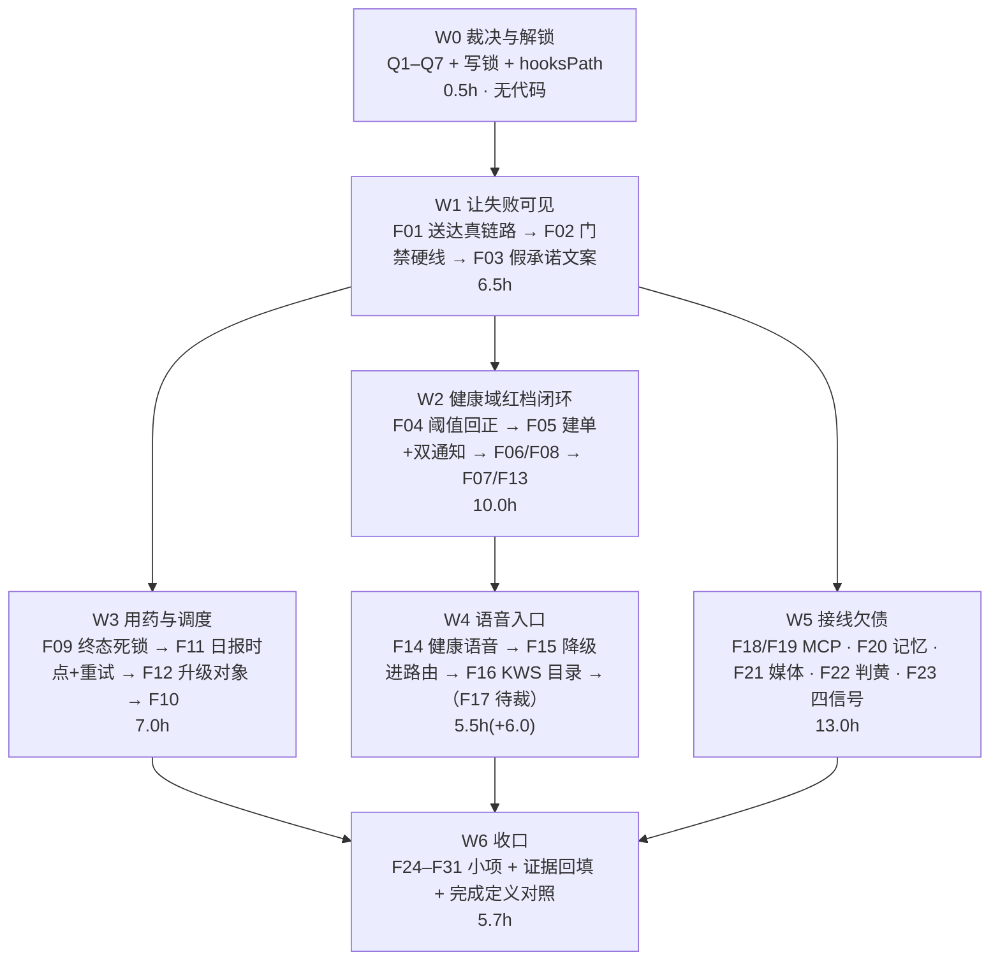

> 状态：草稿（待主理人裁决 Q1–Q7 后转执行）　｜　版本：v1.0　｜　日期：2026-11-12
> 关联：docs/team_tasks/day08/day08-任务总览与DAG.md（v1.1，写域与对接点 X1–X9）｜docs/plans/day08/day-08-健康采集与三端后台.md（v1.2，H0–H16 上游全量计划）｜docs/plans/day08/dev-a-数据分级规则层.md（v1.0，**F04 需回改本件**）｜docs/plans/day08/d-推进计划-日报通知与三端.md（v2.5，Q-D3 手动重发裁决沿用）｜docs/接口契约_照护台业务数据.md（v1.3，§3.2 五值冻结 / §6.4 种子规范）
> 上游依据：PRD line 357–361（分级三档原文＋校验）、line 365–374（FR-HLT-01~10）、line 378–392（告警与通知状态机）、line 394–400（FR-ALT-01~05）、line 405–412（FR-RPT-01~04）、line 247（FR-UI-01 降级须进路由）、line 257（FR-UI-11 唤醒词）、line 272（FR-DLG-07 历史/模糊判黄）、line 320–325（用药终态含 late_taken_reported）、line 336（FR-MED-06 反向外呼）、line 487–523（AC-05/06/08/09/10/20/21/22/23/37/38/41）、line 531–536（固定测试集 ≥45/50）、line 547（路由 ≤200ms）、line 576（Day 8 完成定义）｜技术设计文档 line 1017–1018（分级在代码＋话术＋HITL resume）、line 1144–1165（Day 8 十二项功能验收）、line 1291（#18/#21 提前到 Day 8）、line 1230（工牌只建表 A-04）
> 变更记录见文末

---

# Day 8 · 只读审查缺口修复计划

## 0. 编制说明与执行机制

### 0.1 本计划的来源与效力

本计划是 2026-11-12 **只读审查**的产出下游件。审查以 PRD（验收）＋技术设计文档（实现）为唯一事实依据，逐条回读源码取证，结论为：**Day 8 完成定义不成立**，缺口分三种形态——① 写了但从未接线（12 处）② 假成功出口（6 处）③ 口径与验收基线冲突（6 处）。

遵守 AGENTS.md 前置节铁律：本文一切「是什么/什么字段/什么阈值/什么接口」只引 PRD 与技术设计文档；**大纲与既有计划件不在事实效力链上**。与基线冲突时以基线为准，并**回改冲突的计划件**（见 F04）。

**本文是计划，不是代码。** 编制轮只产出本文档＋README 索引登记；任何编码动作发生在执行轮，受 §0.4 确认点约束。

### 0.2 已裁决项：不重复裁决、不当缺口修

审查中曾疑似缺口、经核对**已有生效裁决**的三项，本计划**不修**，只按裁决口径验收：

| # | 疑似缺口 | 生效裁决 | 本计划处置 |
| --- | --- | --- | --- |
| 1 | `notifications.status` 缺 PRD line 390 的 `simulated` | 照护台契约 v1.0 §3.2（2026-11-11 主理人裁决）：**照 TD 原文 5 值冻结**，Mock 区分由 `is_mock` 布尔承担（`app/models/notifications.py:93` 已落列） | **不新增枚举值**。PRD line 390 与契约的冲突登记进 README「已知文档冲突」表（AGENTS 前置铁律 3），不改代码 |
| 2 | 日报推送「管理员手动重发」无 REST 端点 | d-推进计划 v2.5 §0.2 row 10 / Q-D3（2026-11-11 12:00 对齐）：走 `scan_pending_notifications` pending 扫描重试（A3/B3 调度侧），**不建独立端点** | F11 只修扫描侧重试节奏与 `failed` 终态；**管理员手动触发方式列 Q3 待裁**，不私造端点 |
| 3 | 工牌临时 token 无签发端点（FR-ADM-08） | 技术设计文档 line 1230：**「08 工牌只建表（A-04）」** | **不修**。现有 `sign_staff_card`＋验签链路已超出「只建表」要求，属合规 |

### 0.3 容量与顺延顺位（先裁序，不许静默砍）

Day 8 全量计划已警示 44h > 32h 超载。本计划**净增 38.5h**（§1 合计），必然跨日。按「Day 8 完成定义必须项不容顺延」原则定先裁序：

- **不可顺延（Day 8 完成定义 / P0 安全）**：F01 F02 F04 F05 F09 F11 F14 F15 F16 —— 合计 20.0h
- **可顺延 Day 9（顺位由前到后）**：F22 → F18 F19 → F20 → F21 → F23 → F26 F27 → F10 F13 → F17
- **F17（反向 WebRTC 外呼，6.0h）单独裁决**：PRD line 336 标 P0，但 `app/audio/` 不在任何 day08 写域内，且需前端自动接听配合。**建议列 Q1 由主理人裁「Day 8 硬做 / 顺延 Day 9 并留痕」**，不自行决定。

顺延项必须在 §9 执行记录写明「顺延到哪天、谁接、依据哪条先裁序」。

### 0.4 执行机制：分步确认制（沿用 day06/day07/day08 先例）

- §3 每个修复项末尾设**确认点 CP-Fxx**。完成一项后**必须停下**，按 §6 报告模板输出结果，**等用户明确确认后才进入下一项**。
- 一项一提交（Conventional Commits，正文中文说清为什么）。涉及 AGENTS §5 高风险清单文件（`models/**`、`alembic/versions/**`、`router/safety.py`、`graphs/**`、`core/security.py`、`agents/tool_registry.py`、`mcp_client/**`）时**先出方案再落代码**，且人工逐行读 diff 后才合并。
- **禁止**：改已合入的历史迁移（只新增）；调 PRD §7 硬性数值；为「跑通」放宽阈值；把大纲当依据写进代码注释（F15 须删除现有违规注释）。

---

## 1. 缺口总表（审查编号 → 修复编号）

优先级：**P0**＝Day 8 完成定义或安全失效；**P1**＝验收项但可顺延；**P2**＝口径/健壮性。
写域依据：`docs/team_tasks/day08/dev-{A,B,C,D}-*.md` 各自的「写域仅限」行。**跨域**＝不在任何 day08 写域内，须按 §5 申请写锁。

| 修复号 | 审查号 | 缺口一句话 | 优先级 | 归属 | 写域 | 人时 | 前置 |
| --- | --- | --- | --- | --- | --- | --- | --- |
| F01 | A-4 / B-8 | 通知无条件置 `delivered`；pad 渲染回执无生产者 | **P0** | dev-A＋dev-D | A: notify_service ✓／D: pad ✓／**信令帧跨域** | 3.0 | Q2 |
| F02 | A-10 / C-21 | 门禁不校验 PRD 硬线；hooksPath 未启用 | **P0** | dev-D | eval_gate ✓／**.githooks 跨域** | 2.0 | Q4 |
| F03 | C-18 / B-6 | SOS 结果页与 Agent 硬编码「已通知/已转告」 | **P0** | dev-D＋dev-B | D: pad ✓／**companion+main 跨域** | 1.5 | F01 |
| F04 | C-1 / C-2 / C-3 | 血压 ≤90/≤60 误判红；主诉不判黄；睡眠 12h 上界无依据 | **P0** | dev-A | health_service ✓／**计划件回改** | 2.0 | — |
| F05 | A-2 / A-3 | 红档双通知是降级假出口；REST 红档不建单不通知 | **P0** | dev-B＋dev-A | B: graphs+health_jobs ✓／A: health_service ✓ | 3.0 | F01 F04 |
| F06 | B-10 | 收缩压>舒张压 校验从未注入 | P2 | dev-B | graphs ✓ | 0.5 | F05 |
| F07 | B-9 | 医生复核不 resume 子图（HITL 断点未接） | P1 | dev-C＋dev-B | C: api/health_* ✓／B: graphs ✓ | 1.5 | F05 |
| F08 | A-2 话术 | 「这个数值有点高，我帮您告诉医生」零命中 | P1 | dev-B | graphs ✓ | 0.5 | F05 |
| F09 | A-5 | 用药第 4 次触达终态死锁 | **P0** | 跨域（Day 7 dev-C） | **medication_jobs 跨域** | 1.5 | Q5 |
| F10 | B-7 | `late_taken_reported` 终态与 `late_taken=True` 不可达 | P1 | 跨域 | **models+迁移 跨域** | 2.0 | Q5 F09 |
| F11 | C-4 / C-12 / C-13 | 日报 21:30≠20:00；重试 60s≠30s；1/5/15 重试缺失 | **P0** | dev-B＋dev-A | B: health_jobs ✓／A: notify_service ✓ | 2.5 | F01 Q3 |
| F12 | C-9 / C-10 | 升级通知发护工而非管理员；扫描未按确认过滤 | P1 | dev-A | notify_service ✓ | 1.0 | F01 |
| F13 | C-11 | `risk_events.acknowledged_at/closed_at` 从不写 | P1 | dev-A＋dev-C | A: safety_service ✓／C: api ✓ | 1.5 | F05 |
| F14 | A-1 | 健康采集语音入口未接（`NOT_READY_INTENTS`＋无健康 Tool） | **P0** | dev-B＋跨域 | B: tool_registry ✓／**decision.py 跨域** | 3.0 | F05 Q5 |
| F15 | A-7 | 按住说话降级写死回复，不进路由；上限 30s≠120s | **P0** | 跨域（Day 3） | **api/audio.py 跨域** | 2.0 | Q5 |
| F16 | A-8 | KWS 资源多一层目录 → 404 静默降级 | **P0** | dev-D | pad ✓／public 资产 ✓ | 0.5 | — |
| F17 | A-6 | 反向 WebRTC 外呼完全缺失；`rtc_failed` 无枚举 | **P0**（待裁） | 跨域 | **app/audio 跨域＋迁移** | 6.0 | Q1 |
| F18 | B-1 | `MultiServerMCPClient` 从未实例化，两工具发往 weather | P1 | dev-B | bind_tools ✓／**main.py 跨域** | 1.5 | Q6 |
| F19 | B-2 | MCP 工具绕过幂等重放与 `tool_executions` 记账 | P1 | dev-B | tool_executor ✓（站会写锁） | 1.5 | F18 |
| F20 | B-3 / B-4 | 记忆调度器零调用；embedding 恒 None、召回用 difflib | P1 | dev-B | memory_service＋job 文件 ✓ | 3.0 | — |
| F21 | B-5 / C-6 / C-7 | media_service 读/历史零调用；种子是流行歌；规则缺剧种词 | P1 | dev-B＋dev-C＋dev-A | B: 素材+脚本 ✓／C: media_service ✓／A: rules ✓ | 3.0 | — |
| F22 | A-9 | 历史/模糊/他人语料一律放行，未判黄复核 | P1 | 跨域（Day 7） | **router/safety.py 跨域** | 2.0 | Q5 F02 |
| F23 | C-16 | 快路径只出 intent；`privacy_scope` 无消费方 | P2 | 跨域（Day 7） | **system_one 跨域** | 2.0 | Q5 |
| F24 | B-11 | pad 撤销只 `setState`，不调已实现的后端 | P1 | dev-D | pad ✓ | 0.5 | — |
| F25 | C-19 | console 快捷操作空 catch 吞 403/422 | P2 | dev-C | console ✓ | 0.5 | — |
| F26 | C-20 | `/metrics` 端点缺失 | P2 | dev-C | **api 新文件 跨域** | 1.0 | — |
| F27 | B-12 | 原始音频 72h 清理任务缺失（隐私红线） | P1 | dev-B | scheduler job ✓ | 1.0 | — |
| F28 | C-5 | 本机 `.env` 声纹阈值 0.55≠裁决 0.62 | P2 | 主理人/环境 | **不入库，环境项** | 0.2 | — |
| F29 | C-17 | `RTCPeerConnection` 无 iceServers；无 coturn | P2 | dev-D＋Day 10 | pad ✓／compose 归 Day 10 | 0.5 | Q7 |
| F30 | C-14 | 日报 `audio_url` 恒 null（生成侧从未产出） | P1（O2） | dev-C | report_service ✓ | 1.5 | F11 |
| F31 | C-15 | 七层归因中四层硬编码「无数据」 | P2 | dev-D | eval_gate ✓ | 1.5 | F02 |

**合计 38.5h**（不含 F17 则 32.5h）。

---

## 2. 修复批次与 DAG



**为什么这个顺序**：F01（送达真链路）必须最先——它把 A-2/A-3/F12 的失败从「数据上不可见」变成可观测，否则后续修复无法被证明。F02 紧随其后，否则不达标基线会继续被门禁放行（审查 A-10 的根因）。F04 在 F05 之前，避免用错误阈值去验证通知链路。

**并行边界**：W2（dev-A/B 健康域）与 W3（用药/调度）在 F01 完成后可并行；W5 各子项互不依赖，可分派多人。**写锁冲突点**：`app/main.py`（F03/F14/F18 都要改装配）→ 串行，由 dev-B 统一持锁；`app/services/notify_service.py`（F01/F11/F12）→ 串行归 dev-A。

---

## 3. 逐项修复规格

> 每项格式：现状证据 → 目标口径（引基线）→ 改动点 → 验收 → 禁触。行号均为 2026-11-12 只读审查实测值，执行前须重新核对（代码可能已变）。

### F01 · 通知送达真链路（P0，3.0h，dev-A＋dev-D）

**现状**：`app/services/notify_service.py:785-803` 重试扫描无条件写 `status=_STATUS_DELIVERED`＋`sent_at=now`，无任何回执校验；真实入口 `:551 mark_notification_sent` / `:566 mark_notification_delivered` 只有定义与 `__all__`（`:850-851`），**生产调用零次**。前端 `frontend/src/pad/pages/MedicationCard.tsx:47-50` 挂载即调 `onRendered?.()`，但 `frontend/src/pad/components/TaskPanel.tsx:31-37` **不传该 prop**；全仓 `card_rendered|tts_finished` 仅 5 处命中，全是 docstring 与可选回调。

**目标口径**：PRD line 387「**只有在线客户端返回接收回执才算 delivered**」；FR-ALT-03（P0）；AC-23。契约 §3.2：`pending` 每 30s 重试、3 次失败置 `failed`（终态）。

**改动点**：
1. `notify_service.py`：扫描逻辑改为「发送 → 置 `pending`＋`retry_count+1`」，**删除无条件 `delivered` 赋值**；`retry_count >= 3` 置 `failed`。`delivered` 只由 `mark_notification_delivered` 写入。
2. 回执入口接线：客户端回执 → `mark_notification_sent`（出门口）/ `mark_notification_delivered`（收到回执）。**回执帧形状须先冻结**（Q2），落 `docs/team_tasks/day08/contracts.md`，不私造。
3. `TaskPanel.tsx:31` 补传 `onRendered`，回调内发回执帧（幂等由后端 `dedupe_key` 兜住）。
4. `is_mock=true` 的行不计入送达率分母（`notify_service.py:8` 既有口径，保持）。

**验收**：① 集成测试：无回执时扫描 3 次后 `status='failed'`，**永不出现 delivered**；② 有回执时 `delivered`＋`sent_at` 由回执时间决定；③ `grep -n "_STATUS_DELIVERED" app/services/notify_service.py` 只在 `mark_notification_delivered` 内出现；④ pad 渲染卡片后 DB 对应行 `status='delivered'`，不渲染则保持 `pending`。

**禁触**：不改 5 值枚举（§0.2 row 1）；不改 `is_mock` 语义；不碰 `models/notifications.py` CHECK。

**CP-F01**：报告 4 条验收命令原文输出＋回执帧契约留痕位置。

---

### F02 · 门禁校验 PRD 硬线（P0，2.0h，dev-D）

**现状**：`eval/reports/day8_baseline_lock.json` 记录 `normal_correct 41/50 = 82.0%`、`latency_p50_ms 241`、`latency_p95_ms 297`、`failing_ids` 15 条。`tests/eval_gate.py:546-563` 闸门 B **只与锁文件对比**；`:577-601` 闸门 D 只要求「本次失败 ⊆ 锁内失败」，注释明写「要求全对等于把门禁线抬到比基线更高…那是改验收，不是 D 的权限」；`:72` 唯一 PRD 硬线是 `SENSITIVE_FLOOR_PCT = 95.0`。`.githooks/pre-push` 只跑 `--self-check`，且 `if [ -z "$py" ]; then … exit 0` 静默跳过；**`git config --get core.hooksPath` 返回 exit 1（未设置）**。

**目标口径**：PRD line 531-536 普通集 **≥45/50（90%）**、敏感 ≥19/20（95%）、注入 100%（Day 9）；PRD line 547 路由 **≤200ms**。

**改动点**：
1. 新增**闸门 E（PRD 硬线）**：`normal_correct/normal_total >= 0.90`、`latency_p95_ms <= 200`，与 B/D 的「不回退」判定**并列且独立**——B/D 保留原语义（防回退），E 负责达标。**不修改 B/D 的现有权限边界**（尊重既有裁决）。
2. 闸门 E 失败时：输出未达标项与差值，**退出码非 0**；锁文件写入须显式 `--allow-below-prd` 开关＋留痕理由，禁止默认放行。
3. `.githooks/pre-push`：无 python 时**报错退出**而非 `exit 0`；真门禁接线按 Q4 裁决执行（R1② 曾裁「只自检」，本项申请改判）。
4. 启用钩子：`git config core.hooksPath .githooks`（AGENTS §10.5 已要求，属环境项，需用户执行）。

**注意**：本项**会让当前基线立刻变红**（82% < 90%、297ms > 200ms）。这是预期结果——门禁的职责是如实报红，不是放行。达标依赖 F22/F23/F14 的路由改进，**不许通过调阈值或删用例变绿**。

**验收**：① 以当前锁文件跑 `eval_gate.py`，闸门 E **必须失败**并打印两项差值；② 构造 45/50＋p95 195ms 的假锁，E 通过；③ `bash .githooks/pre-push` 在无 python 环境下退出码非 0。

**禁触**：不改 `rules.py`/阈值（任务卡边界：eval_gate 只读阈值）；不删 failing 用例；不改 `SENSITIVE_FLOOR_PCT`。

**CP-F02**：报告闸门 E 对当前基线的真实判定输出（预期红）＋Q4 裁决结果。

---

### F03 · 拆除假承诺文案（P0，1.5h，dev-D＋dev-B）

**现状**：`frontend/src/pad/pages/SosResult.tsx:83` 硬编码「负责您的护工和家属已经收到通知」，`:95` 硬编码 `["求助已记录","护工已通知","家属已通知"]`，**只要 `status==="sent"` 就渲染**，与实际通知状态无关。`app/agents/companion.py:75` `HIGH_RISK_REFUSED_TEXT = "…我已经帮您把需求转告护工了。"`，但 `:641-643` `if self._followup_sink is None: logger…("react_followup_sink_missing")`，而 `app/main.py:512` `CompanionAgent(` **未传 followup_sink**。

**目标口径**：PRD line 387（送达须回执）；FR-ALT-06；AGENTS §4.4（异常值走「建议问医生」话术＋同步人工告警，不得虚报已告警）。

**改动点**：
1. `SosResult.tsx`：三格状态改为**由后端返回的真实通知状态驱动**（`sent` 只代表事件＋工单已生成）。文案分级：事件已生成 → 「求助已记录，正在通知护工」；仅当 F01 回执确认后才显示「已通知」。家属同理。
2. `main.py:512` 补传 `followup_sink`（接 `notify_service`/`work_order_service` 真实出口）；**或**（若 Q6 裁定暂不接）把 `HIGH_RISK_REFUSED_TEXT` 改为不含「已转告」的如实话术＋`logger.warning` 升级为可观测降级标记。二选一，**不许保留虚假承诺**。
3. 保留 `SosResult.tsx:126-128`「这里不是急救通道」声明（技术设计文档 §1.2 第 2 条，已合规）。

**验收**：① 断开通知出口后按 SOS，页面**不得**出现「已通知」；② `grep -rn "已经帮您把需求转告" app/` 若仍有命中，则 `followup_sink` 必须已接线（二者不可同时为假）；③ 既有 SOS 测试全绿。

**禁触**：不给长者提供红色事件撤销入口（FR-UI-08 / AC-26，现有实现已合规）；不碰 `pad_undo` 后端。

**CP-F03**：报告两条文案路径的真实状态来源＋截图或 DOM 断言。

---

### F04 · 血压分级阈值回正（P0，2.0h，dev-A）

**现状（根因在计划件，不是笔误）**：
- 代码 `app/services/health_service.py:70-96` 常量 `SYSTOLIC_RED_LOWER=90`、`DIASTOLIC_RED_LOWER=60`、`SLEEP_GREEN_UPPER=12.0`；`:150-159` `if valid >= SYSTOLIC_RED_UPPER or valid <= SYSTOLIC_RED_LOWER: → RED`（舒张压同构于 `:162-171`）；`:183-186` 睡眠 >12h 判黄；`:214` 注释「complaint…当前版本仅参与日志，不单独触发升级」＋`:238-239` `if complaint: logger.debug(...)`。
- **上游计划件同样写错**：`docs/plans/day08/dev-a-数据分级规则层.md:170-171`「DIASTOLIC_RED: 120 # 舒张压 ≥120 **或 ≤90（低血压）**」、`:179`「SYSTOLIC_LOW_NORMAL: 90 # 收缩压 ≤90 触发判红」、`:214`「红：… OR 收缩压 ≤90 OR 舒张压 ≤60」、`:217`「绿：… 睡眠 **5–12h**」。

**目标口径（PRD line 357-359 原文，唯一依据）**：
- **红**：收缩压 ≥180 **或** 舒张压 ≥120；或命中急症症状规则。**低血压不判红**。
- **黄**：收缩压 140–179；舒张压 90–119；**收缩压 <90**；**舒张压 <60**；睡眠 <5h；mood ≤2 且未命中急症；**非急症主诉**；任一采集项缺失。
- **绿**：收缩压 **90–139** 且舒张压 **60–89**，其他无异常。
- PRD line 361：睡眠 **>24h** 才无效（**不是 >12h**）；无红分量但血压任一分量缺失判黄。

**改动点**：
1. 删除 `SYSTOLIC_RED_LOWER` / `DIASTOLIC_RED_LOWER` 两个常量及其判红分支；`<90` / `<60` 改判黄。
2. 删除 `SLEEP_GREEN_UPPER=12.0` 与 >12h 判黄分支（无 PRD 依据）；睡眠上界只保留 >24h 无效校验。
3. `complaint` 非空且未命中急症 → 判黄（删除「仅参与日志」注释与 `logger.debug` 占位）。
4. **`rule_version` 从 `g1` 升 `g2`**（PRD line 361「每次分级保存 rule_version」）；既有 `g1` 记录不回改，保留历史可追溯。
5. **同提交回改 `docs/plans/day08/dev-a-数据分级规则层.md`**：修正 line 170-171/179/214/217，并在该件文末变更记录新增一条，写明「依据 PRD line 357-359 回改，原稿把低血压误写为判红、自加睡眠 12h 上界」。**不许静默改计划件**（AGENTS §10）。
6. 若既有测试断言了错误阈值（如 `test_grade_*` 期望 90→red），**改测试期望值而非改 PRD 口径**，并在提交正文说明。

**验收**：① 新增/改造参数化测试覆盖 9 个边界：`90/60→绿`、`89/60→黄`、`90/59→黄`、`139/89→绿`、`140/89→黄`、`90/90→黄`、`180/80→红`、`120/120→红`、`179/119→黄`；② 主诉「有点头晕」＋血压正常 → 黄；③ 睡眠 13h＋其余正常 → **绿**；④ 睡眠 25h → 无效标缺失 → 黄；⑤ `grep -n "RED_LOWER\|SLEEP_GREEN_UPPER" app/services/health_service.py` 零命中；⑥ 新记录 `rule_version='g2'`。

**禁触**：不改 `SYSTOLIC_RED_UPPER=180` / `DIASTOLIC_RED_UPPER=120`（PRD §7 硬性数值）；不改历史迁移；不回改已落库 `g1` 记录。

**CP-F04**：报告 9 个边界值实测表＋计划件回改 diff 摘要。

---

### F05 · 红档建单与双通知接线（P0，3.0h，dev-B＋dev-A）

**现状**：`app/graphs/health_checkup_graph.py:249-264` `_default_notify_red` 返回 `{"delivered": False, "degraded": True, "channels": [], "note": "notify_service 尚未交付（dev-C）…"}`；注入缝 `:358 notify_red_fn` / `:377`；**全仓仅两处构造点** `app/scheduler/health_jobs.py:261-263` 与 `:378-380`，都只传 `session=`/`checkpointer=`。`:267-288 _default_create_red_order` 同样带「dev-C 未交付」注释走通用建单。REST 侧 `app/services/health_service.py:396-422` 建 `RiskEvent(status="open")` 后，`:410` **只有 `if grade.severity == SEVERITY_YELLOW:` 分支建单**，该模块从未 import `notify_service`。

**目标口径**：PRD line 357「立即通知护工 + 红色事件 + 工单，人工复核并行」；line 378-392 红档**同时**通知责任护工＋监护人；FR-ALT-01；AC-38。

**改动点**：
1. **删除过期注释**：`notify_service` 早已交付（`app/services/notify_service.py` 存在且被其他域调用），「dev-C 尚未交付」是失效信息，必须删。
2. `health_jobs.py:261-263` 与 `:378-380` 两处构造点**注入真实 `notify_red_fn`**（调 `notify_service` 护工侧＋监护人侧双出口）与 `create_red_order_fn`。
3. `health_service.py`：红档分支补建单（`open_work_order`，`dedupe_token=f"health_record:{record_id}:red"`，`severity="red"`，`assignee=resolve_primary_care_staff`）＋调双通知。**注意分层**：`health_service` 调 `notify_service`/`work_order_service` 属 services 内部协作，不违反 AGENTS §2；**不得**在 service 里 import graphs。
4. **去重**：语音路径（子图）与 REST 路径不得对同一 `record_id` 重复建单/重复通知——统一用 `dedupe_token` 幂等键兜住（AGENTS §8）。
5. `_default_notify_red` 保留为**显式降级兜底**（注入缺失时仍如实报 degraded），但生产路径必须走注入实现。

**验收**：① 集成测试：REST 录入 185/95 → `risk_events` 1 条 red open＋`work_orders` 1 条 red＋`notifications` **2 条**（护工＋监护人）；② 子图路径同输入 → 同样 2 条通知，**不产生第二事件/第二工单**；③ 同 `record_id` 重复提交 → 幂等返回原结果，同键异内容 409；④ `grep -n "尚未交付" app/graphs/health_checkup_graph.py` 零命中；⑤ 通知状态遵循 F01（无回执时 `pending`，**不得直接 delivered**）。

**禁触**：不改 `escalate_safety_event`（语音急症路径已合规接线：`main.py:94/:412`、`dialogue_service.py:439`）；不新建第二套告警实现（AGENTS §4.8）。

**CP-F05**：报告两条路径的 DB 三表行数对照＋幂等重放结果。

---

### F06 · 血压分量校验注入（P2，0.5h，dev-B）

**现状**：`health_checkup_graph.py:32` docstring 把「收缩压>舒张压」校验交给可注入 `validate_fn`（`:353`），两处构造点均未注入。
**目标**：PRD line 361「两分量均有时校验收缩压 > 舒张压；无效项重问一次，再失败标缺失继续」。
**改动**：实现并注入 `validate_fn`；无效 → 重问一次 → 仍无效标缺失继续（不阻断，FR-HLT-01）。
**验收**：输入 `80/120` → 重问一次 → 标缺失 → 最终黄档（PRD line 361「无红分量但血压任一分量缺失判黄」；注意 120 本身达红阈值，须按「单分量即判红」优先，测试须覆盖两种组合）。
**CP-F06**：报告重问次数与终态。

---

### F07 · 医生复核 resume 子图（P1，1.5h，dev-C＋dev-B）

**现状**：`app/api/health_records.py:505` 与 `:544` 直调 `health_service.review_health_record`，**无 graph resume**。resume 能力在 `health_checkup_graph.py:611 resume_health_checkup` / `:629 Command(resume=payload)`，唯一调用点是 `health_jobs.py:386` 的 `force_close=True`。
**目标**：技术设计文档 line 1017-1018「console 复核后 resume 子图」；PRD FR-HLT-08；AGENTS §5「Interrupt/HITL 分支不漏」。
**改动**：复核端点在写库后调 `resume_health_checkup(thread_id, payload)`；`thread_id` **只从服务端取**（AGENTS §4.9，不接受客户端传入）。分层：api → graphs 属**横向依赖禁止**（AGENTS §2.2），故 resume 须由 `health_service` 或既有编排口转调，**具体落点列 Q5 一并裁决**。
**验收**：① 子图停在 interrupt → console 复核 → 子图恢复并落终态；② 重启后仍可恢复（checkpoint 在独立 `langgraph` schema）；③ `grep -n "from app.graphs" app/api/` 零命中。
**CP-F07**：报告 interrupt→resume 的 checkpoint 前后对照。

---

### F08 · 红档话术落地（P1，0.5h，dev-B）

**现状**：「这个数值有点高」/「我帮您告诉医生」/「告诉医生」/「有点高」/「问医生」在 `app/`、`frontend/src/`、`app/prompts/` **全部零命中**。
**目标**：技术设计文档 line 1017-1018 明列 utterance「这个数值有点高，我帮您告诉医生」；AGENTS §4.4 禁医疗诊断口径。
**改动**：红档出口播该话术；黄档走「建议问医生」类话术。**话术写在代码常量，不写进 prompt**（技术设计文档 line 1017「分级在代码不在 prompt」）。
**验收**：① 红档集成测试断言 TTS 文本含该句；② `grep -rn "高血压\|糖尿病" app/` 零命中（不得出现诊断口径）。
**CP-F08**：报告话术常量位置与断言输出。

---

### F09 · 用药第 4 次触达终态死锁（P0，1.5h，跨域）

**现状**：`app/scheduler/medication_jobs.py:347` `if attempt_no >= MAX_ATTEMPTS: logger.info("…resume_skip_exhausted…"); return`；而 `app/graphs/medication_confirmation_graph.py:81 MAX_ATTEMPTS = 4`，`:386-393 retry` 在 `attempt_no + 1 > 4` 时才写 `{"terminal": "missed_unconfirmed", "needs_escalation": True}`，`:395-412 finalize`（含 AC-20 **唯一分流口** `_split_missed_by_receipt`）需被 resume 才执行。→ `attempt_no=4` 时调度器恰好跳过唯一能收尾的 resume。
**目标**：PRD line 320-325 四类终态严格分离；AC-20；PRD §4.5 T0/+5/+10/+15 每次等 60s。
**改动**：把调度器的跳过条件改为「**已落终态**才跳过」，而非「次数用尽就跳过」；第 4 次窗口结束后必须 resume 一次让 `finalize` 执行。保持 graph 内「不把 attempt_no 加到 5」的既有正确口径（`:388-390` 注释：末态 `retry_count` 必须等于实际重试次数 3）。
**验收**：① 集成测试：四次全无人应答 → 终态 `missed_unconfirmed` 或 `notification_failed`（按回执集合分流），`retry_count=3`、`attempt_no=4`；② 四次全没出过门 → `notification_failed`＋`failure_reason='offline'`；任一条出过门 → `missed_unconfirmed`＋`no_answer`；③ 重复触发调度 → 幂等，不产生第 5 次触达。
**禁触**：不改 `MAX_ATTEMPTS=4`（PRD §7 硬性数值）；不改四时点间隔。
**CP-F09**：报告 AC-20 两条分流分支的实测终态与 `retry_count`。

---

### F10 · `late_taken_reported` 终态（P1，2.0h，跨域＋迁移）

**现状**：`app/models/medication.py:129-137` `terminal_state` CHECK 仅 4 值，**无 `late_taken_reported`**；`failure_reason` CHECK 为 `('no_answer','denied','tts_failed','offline')`，**无 `rtc_failed`**。`app/services/medication_service.py:309 late_taken: bool = False`，`:143`/`:398` 两处调用**都只传 False**；列 `late_taken` 在 `models/medication.py:205` 已存在。
**目标**：PRD line 320-325 明确**追加 `late_taken_reported`**；AC-08。
**改动**：① **新增迁移**（下一个空号，不改历史）扩 CHECK 至 5 值；② `medication_service` 在窗口外补报路径传 `late_taken=True` 并落 `late_taken_reported`；③ `rtc_failed` 枚举**随 F17 一并加**（若 F17 顺延则本项只加 `late_taken_reported`，避免加无出口的枚举值）。④ 家属端四类统计口径须同步（契约 S-01 键名与终态逐字对齐，`frontend/src/family/data-source.ts:16-21`）——**新增第五类须走契约 §7 留痕**，列 Q3。
**验收**：① 窗口外补报 → `terminal_state='late_taken_reported'`＋`late_taken=true`；② 迁移可 upgrade/downgrade；③ `alembic current` 与 `heads` 一致；④ 家属端统计不出现键名错位。
**禁触**：不改已合入迁移（AGENTS §4.6）；不合并四类统计为「实际漏服」（契约 S-01 明禁）。
**CP-F10**：报告迁移号、CHECK 前后对照、契约留痕位置。

---

### F11 · 日报时点与重试节奏（P0，2.5h，dev-B＋dev-A）

**现状**：`app/scheduler/health_jobs.py:59 _DAILY_REPORT_FIRE = "21:30"`（标注自裁）；`:198-211` 五个 job 全部 `CronTrigger.from_crontab("* * * * *")`（60s）；`notify_service.py:45 RETRY_INTERVAL_S = 30` **未被使用**；`app/api/reports.py` 只有 3 个 GET，`grep resend|重发|manual_retry` 零命中。
**目标**：PRD §4.8「采集完成或 **20:00** 生成首版」＋**FR-RPT-03（P0）**「1/5/15 分钟重试」；契约 §3.2「pending 每 **30s** 重试 3 次失败置 failed」；上游计划件 `day-08-健康采集与三端后台.md:67/71`、`dev-B/dev-C 任务卡` **均明写 20:00 与 30s**——21:30 属偏离已冻结计划，非有效自裁。
**改动**：
1. `_DAILY_REPORT_FIRE` 改 **20:00**；采集完成即生成首版的触发保持（`health_jobs.py:438` 是 `generate_daily_report` 唯一调用点）。
2. **区分两条重试节奏**（PRD 与契约各有口径，不混用）：告警通知 pending → **30s×3 → failed**（契约 §3.2）；日报推送 → **1/5/15 分钟**（PRD §4.8）。用 `ntype` 分派退避序列，`RETRY_INTERVAL_S` 真正生效。
3. cron 粒度：60s cron 无法表达 30s → 改 30s tick 或用 `IntervalTrigger`，**并在计划件留痕**（属实现口径，不改 PRD 数值）。
4. 管理员手动重发：**按 Q-D3 裁决不建独立端点**；PRD 要求的「管理员手动重发」如何满足 → **Q3 待裁**（候选：admin-only 端点仅触发一次 scan，不新造重试逻辑）。
**验收**：① 20:00 触发首版日报，未答项标「未采集」；② 告警通知无回执 → 30s/60s/90s 三次后 `failed`；③ 日报推送失败 → 1/5/15 分钟三次重试时间点可断言；④ `grep -n "21:30" app/scheduler/health_jobs.py` 零命中；⑤ 补录生成新版本、旧版保留、每版只发一次更新通知（AC-25，既有能力不回退）。
**禁触**：不读 `memory_chunks` 生成日报（任务卡 C2 明禁，`grep` 须零命中）；不改 `dedupe_key` 口径（X2）。
**CP-F11**：报告两条退避序列的实测时间点＋Q3 裁决结果。

---

### F12 · 升级通知对象与扫描条件（P1，1.0h，dev-A）

**现状**：`notify_service.py:718-770 escalate_red_event` `:739` 正确写 `event.status="escalated"`（不建第二事件/工单 ✓），但 `:759 send_staff_notifications(session, elder_id=event.elder_id, ntype="escalated_red_event", …)` → 走 **primary_care 护工**。`:692-715 scan_escalations` docstring 声称「无 acknowledged_at」，实际 WHERE 只有 `status=="open"`／`severity=="red"`／`created_at < cutoff`。
**目标**：PRD line 385「2 分钟未确认 → 原事件标 `escalated` ＋通知**管理员**」。
**改动**：① 升级通知目标改 admin（按角色查收件人，不用 `resolve_primary_care_staff`）；② `scan_escalations` WHERE 补 `acknowledged_at IS NULL`，与 docstring 一致；③ 保持「不建第二事件/第二工单」。
**验收**：① 红档 2 分钟未确认 → 原事件 `escalated`＋**admin 收到通知**、护工不重复收；② 已确认事件不被扫描命中；③ `risk_events` 行数不变。
**CP-F12**：报告收件人角色与事件行数对照。

---

### F13 · 风险事件确认与关闭联动（P1，1.5h，dev-A＋dev-C）

**现状**：`risk_events.acknowledged_at`／`closed_at` 在 `app/services/safety_service.py:82-83` 与 `:107` 声明，**从不写入**；`closed_at` 全仓唯一写入点是 `app/services/work_order_service.py:387`（写的是**工单**）。
**目标**：PRD line 392「**工单关闭后风险事件才可关闭**」。
**改动**：① 告警确认路径写 `risk_events.acknowledged_at`；② 工单关闭时联动关闭关联 `risk_events`（写 `closed_at`），**顺序不可反**；③ 未关工单时拒绝直接关事件（409）。
**验收**：① 工单 open 时关事件 → 409；② 工单 closed → 事件 `closed_at` 非空；③ 确认告警 → `acknowledged_at` 非空且 F12 扫描不再命中。
**禁触**：不改工单状态机（PRD §4.7）；不新建第二套事件表。
**CP-F13**：报告联动顺序的正反两例。

---

### F14 · 健康采集语音入口（P0，3.0h，dev-B＋跨域）

**现状**：`app/router/decision.py:84-86 NOT_READY_INTENTS = frozenset({"opera","movie","health_checkup","medication"})`，`:535-544` 命中即 `action="agent"`／`reason=capability_not_ready`。`app/agents/tool_registry.py` 共 6 个工具（`:107 memory_recall`／`:122 get_weather`／`:135 medication_confirm`／`:154 create_work_order`／`:172 send_family_notification`／`:190 play_opera`），`grep health app/agents/*.py` **零命中**。子图只能由 `health_jobs.py:257` 与 REST 触发。
**目标**：PRD line 365-374 FR-HLT-01/02；AC-09/10/21/22；技术设计文档 line 1144-1165 Day 8 第 1–4 项。
**改动**：
1. `tool_registry` 新增健康采集工具（**受约束**：身份只从 `runtime_context` 注入，schema `additionalProperties: False`，纳入 `MAX_TOOL_CALLS_PER_TURN=8` 与同工具熔断）。
2. `decision.py` 把 `health_checkup` 移出 `NOT_READY_INTENTS`，路由到子图入口。**`opera`/`movie` 是否同时移出取决于 F21 完成情况**，不许顺手全放开。
3. 进行中任务优先级：PRD §2.3「进行中用药/健康任务 > 固定意图」，须确认既有优先级链不被破坏。
4. **分层**：`router`/`agents` → `graphs` 的调用方向须符合 AGENTS §2.2（`graphs` 与 `agents` 同层，横向 import 禁止）→ 落点列 Q5。
**验收**：① 语音「我要量血压」→ 进健康子图 → 五问五字段 → 分级落库（AC-09/10）；② 单分量 182/缺失 → 立即红，不等另一分量（AC-21）；③ 黄档补录 185 → 升级红、原事件保持 open、不新建第二事件（AC-22）；④ 固定意图路由 ≤200ms 不回退（PRD line 547）。
**禁触**：不改 `MAX_TOOL_CALLS_PER_TURN=8`；不让模型自报 `elder_id`/`thread_id`（AGENTS §4.9）。
**CP-F14**：报告 AC-09/10/21/22 四条实测 trace_id＋路由耗时。

---

### F15 · 降级上传进路由（P0，2.0h，跨域）

**现状**：`app/api/audio.py:311-312`
```python
# --- ④ Day 3 写死回复话术（大纲课时 3.4 明确）---
reply_text = f"您说的是『{asr_text}』，我记下了。"
```
上限 30s（`audio.py:78`）。
**目标**：PRD line 247 FR-UI-01（**P0**）「降级上传**必须进入路由**，单次最长 **120 秒**」。
**改动**：① 删除写死回复，ASR 文本走与 WS FINAL **同一条**编排入口（`user_text` 同路，参照 `MedicationCard.tsx:75` 既有口径）；② 上限 30s → **120s**；③ **删除以大纲为依据的注释**——违反 AGENTS 前置铁律第 1/6 条，改注 PRD line 247。
**验收**：① 上传「今天天气怎么样」→ 返回真实天气工具结果，**不是**「您说的是…」；② 上传急症语料 → 触发安全一票否决＋人工告警；③ 121s 音频 → 422；④ `grep -n "大纲" app/api/audio.py` 零命中。
**禁触**：不改 ASR provider 适配层；不落未经脱敏原始音频（AGENTS §4.10）。
**CP-F15**：报告三条语音用例的真实应答＋上限边界。

---

### F16 · KWS 资源目录层级（P0，0.5h，dev-D）

**现状**：`frontend/src/pad/kws/kws-detector.ts:14 KWS_ASSET_PREFIX = "/kws/"`，`:74` 加载 `prefix + "sherpa-onnx-kws.js"`，`:79 locateFile`，`:82` main.js；实际文件在 `frontend/public/kws/kws/{sherpa-onnx-kws.js, sherpa-onnx-wasm-kws-main.js/.wasm/.data}`——**多一层**。`scripts/build-kws-wasm.md:28-29` 规定平铺 `frontend/public/kws/`。`:129-131 catch → warn + return null` 静默降级。另含 `__MACOSX/` 垃圾目录。
**目标**：PRD line 257 FR-UI-11（P0）；AC-42（≤1.5s，18/20）。
**改动**：① 资产移到平铺 `frontend/public/kws/`（**或**改 `KWS_ASSET_PREFIX` 为 `/kws/kws/`——二选一，**优先改资产布局以对齐 build-kws-wasm.md**，避免脚本与代码长期不一致）；② 删 `__MACOSX/`；③ 加载失败**不再静默**：页面显式提示「唤醒不可用，请按住说话」，并上报可观测降级标记。
**注意**：`frontend/public/kws/` 被 `.gitignore:89` 排除，**符合 AGENTS §4.11（不提交大文件）**，本项不改 gitignore；须保证 `scripts/build-kws-wasm.md` 流程在新克隆机器上可重建。
**验收**：① 浏览器 Network 面板 `sherpa-onnx-kws.js`／`.wasm`／`.data` **全 200**；② 说「小伴」→ 唤醒响应 ≤1.5s；③ 故意改错路径 → 页面出现显式降级提示（不再静默）。
**CP-F16**：报告三个资产 URL 的状态码＋唤醒延迟实测。

---

### F17 · 反向 WebRTC 外呼（P0，6.0h，跨域，**待 Q1 裁决**）

**现状**：`app/audio/` 实存 `__init__.py / _observe.py / asr.py / fixtures/ / signaling.py / tts.py / vad.py / webrtc.py`——**无 outbound.py**。`app/audio/__init__.py:4` docstring 列有「反向外呼」；全仓 `反向外呼|outbound_call|reverse` 仅命中该 docstring 与 `history_service.py:605` 的 `views.reverse()`。`app/audio/webrtc.py:875` 只被动应答 offer。`frontend/src/pad/task-channel.ts:7,39` 自述「主路径未落地/尚无自动接听能力」。`rtc_failed` 在 `app/` 与 `frontend/src/` **零命中**。
**目标**：PRD line 336 FR-MED-06（**P0**）「反向 WebRTC 外呼＋`failure_reason=rtc_failed`」；AC-41。
**改动（若裁定 Day 8 做）**：① 新建 `app/audio/outbound.py`（服务端主动发 offer，复用既有信令 WS，不新建信令服务）；② pad 自动接听（`task-channel.ts` 落地主路径）；③ 失败落 `rtc_failed`（**依赖 F10 的迁移扩枚举**）；④ 触达失败分类与 AC-20 分流对齐。
**风险**：`app/audio/` 不在任何 day08 写域；需前端自动接听配合；6.0h 单项即占满剩余产能。**建议 Q1 裁「顺延 Day 9」并在 §9 留痕**，但**不自行决定**。
**验收**：① 服务端发起外呼 → pad 自动接听 → 双向音频通；② 呼叫失败 → `failure_reason='rtc_failed'`；③ AC-41 演示可复现。
**CP-F17**：先报 Q1 裁决结果，再报实施证据。

---

### F18–F31 · 其余项规格（简表）

| 号 | 现状证据（实测） | 目标口径 | 改动要点 | 验收判据 |
| --- | --- | --- | --- | --- |
| **F18** | `app/agents/bind_tools.py:96-124 MultiServerMCPClient` 完整实现，引用只在 `:132/:137/:141`（自身 docstring）与 `:156 __all__`；`app/main.py:373-376` 用 `MCPClient(settings)`；`app/mcp_client/client.py:302-317` 默认 `mcp_weather_server_url`；`config.py:195-196` weather 7101／operations 7102 | 技术设计文档 §6.3 双 server；AGENTS §1 | `main.py` 改用多服务器客户端，两 ops 工具指向 7102；`bind_dev_b_tools`（`main.py:379-383`）既有接线不回退 | 两工具调用日志显示目标 7102；weather 仍 7101；`grep MultiServerMCPClient app/main.py` 有命中 |
| **F19** | `app/services/tool_executor.py:315-317 if spec.transport == "mcp": return await self._run_mcp(...)` —— 在 `:327-336` 幂等重放与 `:338+` `tool_executions` 记账**之前**返回；`tool_registry.py:154-188` 两 ops 工具 schema 无 `dedupe_token`/`dedupe_key` | AGENTS §8 幂等；PRD FR-DLG-10 预算熔断 | MCP 分支纳入统一幂等与记账；schema 补幂等键（**须走契约 §7 留痕**） | 同键重复调用返回原结果；同键异内容 409；`tool_executions` 有行；第 3 次同工具/分钟被熔断 |
| **F20** | `app/scheduler/memory_jobs.py:39 install_memory_scheduler`＋`:113 __all__`，`app/` 内零调用；`main.py:884-903` 只装 medication/health。`app/services/memory_service.py:457 embedding=None,  # pgvector 接入后填充`；`:135`「不接 LLM/embedding，只做模板匹配」；`:238` difflib 代 cosine；`:517 ORDER BY importance DESC` | PRD line 420-422 FR-MEM-01/02/03；技术设计文档 §3 pgvector | ① `main.py` 装记忆调度器；② 接 embedding 写向量列；③ 召回改 cosine＋**强制 `WHERE elder_id`**；④ 召回失败本轮不加载记忆，**不得臆造** | 归并 job 到点执行有日志；向量列非空；跨长者召回零泄漏（越权测试）；召回失败降级如实 |
| **F21** | `app/services/media_service.py:123/148/181/202/229/264` 六个读/历史函数 `app/` 内**零调用**；`app/services/tool_impls.py:326`「record_playback（未交付），过渡期退化为随机换一首」、`:333`「不写 media_history」、`:335`「查询直接用 ORM 读模型」、`:380-393 order_by(func.random()).limit(1)`；`scripts/media_manifest.json` 为 cruel summer/the cure/仙儿/冷战/安河桥 等流行摇滚说唱，`scripts/seed_media_mp3.py` 全部行 `type=opera`；`app/router/rules.py:133-240` 十条规则无剧种词 | 契约 §6.4（20–30 条、中文剧名、**≥4 剧种必含越剧京剧**、15–60s）；PRD line 297 FR-CON-06；§2.3 固定意图含越剧京剧 | ① Tool 层改调 `media_service`（**Tool 不写 media_history，history 归 C4**——契约 §6 冻结口径）；② 「换一段」改顺序续播非随机；③ **改用已合规的 `scripts/generate_opera_seed.py`**（程序生成 ~3s wav、越剧/京剧/黄梅戏/豫剧/评剧、1950s–1990s，如「梁山伯与祝英台·楼台会/袁雪芬/42s」），并按其 `:16` 注释改调 `media_service.seed_media_library`；④ rules 补剧种关键词（**总数仍 ≤10 条**，只做减法） | 种子 20–30 条、≥4 剧种含越剧京剧、时长 15–60s；`media_history` 有行；「换一段」播下一首而非随机；`grep -c RuleSpec app/router/rules.py` ≤10；AC-37 可演示 |
| **F22** | `app/router/safety.py:203-205 RECOVERY_MARKERS → _not_sensitive("recovery")`；`:211-213 OTHER_PERSON_MARKERS → _not_sensitive("other_person")`；`:215-216 HEDGE_MARKERS → _not_sensitive("hedge")`（注释写「判黄不判红」但返回 not_sensitive）。`eval/fixtures/day7_intents.jsonl` 20 条 boundary 全 `gold_intent="other"`/`is_sensitive=False` | PRD line 272 FR-DLG-07（**P0**）「历史陈述与模糊表述**判黄复核**，不判红」 | 三类边界改产出黄档复核（不判红、不放行）；**同步修正夹具 gold 标签**（属改验收依据，须 Q4 一并批准）；急症一票否决优先级不变 | 「昨天胸口疼」→ 黄档复核任务；「我有点不舒服」→ 澄清一次；真急症仍红；敏感集 ≥19/20 不回退 |
| **F23** | `app/system_one/questions.py:104-106 build_fast_questions` → **仅 intent**；`:109-111 build_shadow_questions` → **仅 is_sensitive**；`:94-100` 四问版自述「不在 200ms 快路径上，四问实测 p95 668ms」；`backend.py:94-112` 解析 `privacy_scope`/`is_out_of_domain`，`decision.py:471/484/486/496` 只消费后者 | AGENTS §6／技术设计文档 §5「一次前向出四信号」；PRD §2.3 双人间隐私收敛 | 在 ≤200ms 预算内补 sensitive/confidence/privacy（**不得为跑通调大 `system_one_timeout_ms=200`**，`config.py:112` 注释明禁）；`privacy_scope` 接决策消费方 | 四信号齐；`INTERNAL_BUDGET_S=0.195`（`server.py:43`）不改；双人间隐私收敛有用例；p95 ≤200ms |
| **F24** | `frontend/src/pad/pages/MedicationCard.tsx:121 onClick={() => setState("pending")}` 纯前端回滚；后端 `app/api/pad_undo.py:50-77` **已实现且有测试** | PRD FR-UI-08／AC-26 | 撤销按钮改调后端撤销端点，成功后再回滚 UI；失败显示可重试 | 点撤销 → DB 终态回退；后端拒绝时 UI 不误显示已撤销 |
| **F25** | `frontend/src/console/pages/WorkOrdersPage.tsx:271-274 catch { // Mock 层不会失败；真实接口接入后此处改为行内错误提示 }`（同文件 `:256` 另一路径已用 `MockApiError` 处理） | AGENTS §8 失败分类；PRD §4.7 状态机 | 空 catch 改行内错误提示，403/422 文案区分；删过期注释 | 越权操作 → 页面显示 403 文案，不静默 |
| **F26** | `grep metrics app/api/*.py app/main.py` 零命中；`app/services/metrics_service.py:191 get_metrics_recorder` 只有 recorder；`config.py:200-204` 仅 Langfuse 配置无 SDK | PRD line 458 FR-TC-08（P1）；AGENTS §1 `/metrics` | 新增 `/metrics` 只读端点（**新 api 文件须追加 `app/api/__init__.py:43-64 ROUTERS` 一行，不改 main.py 公共块**）；鉴权按既有口径 | `curl /metrics` 返回指标；未授权 401；ROUTERS 只增不改 |
| **F27** | `app/scheduler/__init__.py:1` docstring 列「原始音频 72h 清理（Day 7-9）」；`app/core/config.py:211 audio_retention_hours: int = 72`；**无 job 实现或注册** | 技术设计文档 §1.2 第 8 条；PRD §1.5／FR-TC-07；AGENTS §4.10 隐私红线 | 实现清理 job 并注册；**只删原始音频，不删脱敏文本**；调试开关临时打开的口径保持 | 造 73h 前音频 → job 执行后文件消失；72h 内保留；job 不写库（`grep "session.add(" app/scheduler/` 零命中） |
| **F28** | `.env:148 VOICEPRINT_SIMILARITY_THRESHOLD=0.55`；`.env.example:155` 与 `app/core/config.py:227` 均 `0.62`（`config.py:223-226` 注释记录 PRD v3.1 裁决沿革）；`voiceprint_service.py:323` 读 settings | PRD v3.1／AGENTS §7 **cosine ≥0.62** | **改本机 `.env` 为 0.62**（环境项，不入库）。`.env` 未被 git 跟踪（`.gitignore:13-14`），**不构成密钥泄露** | 启动日志/自检显示生效阈值 0.62；三档身份级联演示脚本开场自检通过 |
| **F29** | `frontend/src/pad/realtime.ts:365 const pc = new RTCPeerConnection();` **无 iceServers**；`config.py:166-169` TURN localhost 默认被 `webrtc.py:243 _is_loopback_ice_url` 丢弃；compose 无 coturn | AGENTS §1 coturn；技术设计文档 §7 | 前端从服务端取 ICE 配置（含 TURN，凭据从环境注入，**不硬编码**）；coturn 服务归 **Day 10** compose，本项只做前端与配置下发 | 跨设备/NAT 建连成功；TURN 凭据不出现在前端源码与日志 |
| **F30** | `app/models/report.py:88 audio_url` 声明；`app/api/reports.py:109/:218` 只读；`app/services/report_service.py` **无写入**；`frontend/src/family/pages/ReportsPage.tsx:15`「P0 恒 null，不渲染播放器」 | PRD §4.8 FR-RPT-04（**P1**，O2 溢出池） | 生成侧接 TTS 落 `audio_url`；前端渲染播放器。**属 O2 顺延项**，17:00 未开工即整体顺延 Day 9（沿用 d-计划 §0.2 row 5） | 日报详情 `audio_url` 非空且可播；顺延须留痕 |
| **F31** | `tests/eval_gate.py:205-240` ASR/召回/LLM/Tool 四层为**硬编码字符串「无数据」**，只有分类器/规则层/编排算真实值 | PRD §5.4 七层归因 | 四层接真实数据源（ASR 置信度**已埋点**：`app/audio/_observe.py:69`、`app/models/decision.py:119`、`app/services/decision_log_service.py:87/:114`；funasr 源 confidence 恒 None 属数据源限制，须如实标注而非写「无数据」） | 七层均有真实值或**带原因的空值**；bad case 可定位到召回/LLM 层 |

---

## 4. 待主理人裁决项（W0 前置，未决不写码）

| # | 待决 | 背景与候选 | 影响项 |
| --- | --- | --- | --- |
| **Q1** | **F17 反向外呼 Day 8 硬做还是顺延 Day 9？** | PRD line 336 标 P0，但 `app/audio/` 不在任何 day08 写域，需前端自动接听配合，单项 6.0h。候选：(a) Day 8 硬做，挤掉 W5 全部；(b) 顺延 Day 9 并在 §9 留痕（**本计划建议**）；(c) 只做服务端 offer＋失败枚举，自动接听顺延 | F17 F10 |
| **Q2** | **客户端回执帧形状**（`card_rendered`/`tts_finished`）走信令 WS 还是 REST？字段与幂等键如何定？ | 全仓无帧生产者，`app/audio/signaling.py` 不在 day08 写域。须冻结进 `docs/team_tasks/day08/contracts.md`，**不私造**（参照 Q-D4/Q-D11 先例） | F01 F03 |
| **Q3** | **PRD「管理员手动重发」如何满足**（Q-D3 已裁不建独立端点）？以及 `late_taken_reported` 是否进家属端统计第五类？ | Q-D3 裁决走 `scan_pending_notifications`；PRD §4.8 FR-RPT-03 明写管理员手动重发。候选：admin-only 端点仅触发一次 scan（不新造重试逻辑）／纯调度侧自动重试＋管理员经既有告警页操作。统计第五类须走契约 §7 留痕 | F11 F10 |
| **Q4** | **批准新增闸门 E（PRD 硬线）＋改判 R1②（pre-push 只自检）＋修正 boundary 夹具 gold 标签** | 现闸门 B/D 明确「不许私自加严」（`eval_gate.py:577-601` 注释）；R1② 曾裁 pre-push 只自检（需 torch＋~60s）。**新增硬线校验属改门禁权限，须主理人批准**。夹具 gold 从 `other` 改判黄属改验收依据，同样须批准 | F02 F22 |
| **Q5** | **跨域写锁批准**：`medication_jobs.py`／`models/medication.py`＋新迁移／`router/decision.py`／`router/safety.py`／`api/audio.py`／`app/audio/`／`companion.py`／`main.py`／`system_one/`／`api` 新文件 | 均不在 day08 四人写域内（见 §5）。另需裁 **F07/F14 的 api→graphs 落点**（AGENTS §2.2 禁横向 import，须经 service 或既有编排口转调） | F07 F09 F10 F14 F15 F17 F22 F23 F26 |
| **Q6** | **F03 的 `followup_sink` 接真实出口，还是改如实话术？** | 接出口需定转发目标（工单 or 通知）与幂等键；改话术则须承认「未转告」并给可观测降级标记。**不许保留虚假承诺** | F03 F18 |
| **Q7** | **F29 前端 ICE 配置下发端点归属**（coturn 本体归 Day 10） | 需定端点与凭据下发口径（TURN credential 从环境注入，AGENTS §4.2） | F29 |

---

## 5. 写锁与跨域申请

**day08 既有写域（本计划严格遵守，不擅自扩域）**：

| 成员 | 写域仅限 | 本计划承接项 |
| --- | --- | --- |
| dev-A | `alembic 0017/0018`、`models/health.py`、`models/report.py`、`health_service.py`、`notify_service.py`（增量）、`router/rules.py`（增量，仅播放控制 8 条）、对应 tests | F04 F05(半) F11(半) F12 F13 F21(rules) |
| dev-B | `graphs/health_checkup_graph.py`、`scheduler/health_jobs.py`、衰减归并 job 文件、`agents/tool_registry.py`（＋tool_executor，站会确认写锁）、`memory_service.py`（增量）、`mcp-servers/mock-operations`、`static/media/opera/`＋生成脚本、tests＋两份契约 | F05(半) F06 F08 F11(半) F14(半) F18 F19 F20 F21(素材) F27 |
| dev-C | `api/health_*.py`、`report_service.py`、`media_service.py`、`frontend/src/console/*`、tests | F07(半) F13(半) F21(service) F25 F30 |
| dev-D | `api/reports.py`、`api/family.py`（增量）、`frontend/src/family/*`、`frontend/src/pad/*`（戏曲播放＋SOS）、`eval/fixtures/*`、`tests/eval_gate.py`、tests | F01(半) F02 F03(半) F16 F24 F28 F29 F31 |

**跨域清单（须 Q5 批准，逐项指定持锁人）**：`app/scheduler/medication_jobs.py`、`app/models/medication.py`＋**新增迁移**、`app/router/decision.py`、`app/router/safety.py`、`app/api/audio.py`、`app/audio/`（含新文件 outbound.py）、`app/agents/companion.py`、`app/agents/bind_tools.py`、`app/main.py`、`app/system_one/`、`app/api/` 新文件（/metrics）、`app/audio/signaling.py`、`.githooks/`、`frontend/public/kws/`。

**串行锁**：`app/main.py`（F03/F14/F18/F20 均需改装配）→ **统一由 dev-B 持锁，其余人提改动需求不直接改**；`app/services/notify_service.py`（F01/F11/F12）→ **dev-A 独占串行**。

**AGENTS §5 高风险文件**（先出方案再落代码＋人工逐行读 diff）：本计划涉及 `models/medication.py`＋新迁移（F10）、`router/safety.py`（F22）、`graphs/health_checkup_graph.py`（F05/F06/F07）、`agents/tool_registry.py`＋`mcp_client`（F14/F18/F19）、`api/audio.py`（F15，鉴权相邻）。

---

## 6. 验收总表（Day 8 完成定义对照）

执行完毕后逐条回填，**每条须附可复现命令输出或 trace_id**，不接受「已实现」声明。

| AC / FR | 要求 | 对应修复项 | 验收命令/证据 | 结果 |
| --- | --- | --- | --- | --- |
| AC-09/10 | 五问采集＋分级 | F04 F14 | 语音「我要量血压」全链路 trace | 待填 |
| AC-21 | 单分量达红即红 | F04 F14 | 182/null → red | 待填 |
| AC-22 | 黄升红不新建第二事件 | F04 F05 | 同 elder 当日补录 185 | 待填 |
| AC-38 | 红档护工＋监护人双通知 | F05 F01 | `notifications` 2 行、角色各异 | 待填 |
| AC-23 | 只有客户端回执算 delivered | F01 | 无回执 → pending→failed；有回执 → delivered | 待填 |
| AC-20 | 漏服归因分流 | F09 | 四条全没出门 → notification_failed/offline | 待填 |
| AC-08 | 窗口外补报 | F10 | `late_taken_reported` 落库 | 待填 |
| AC-41 | 反向外呼 | F17 | 服务端 offer → pad 自动接听 | 待填（Q1） |
| AC-37 | 戏曲点播 | F21 | 种子 ≥4 剧种含越剧京剧＋media_history | 待填 |
| AC-42 | 唤醒 ≤1.5s（18/20） | F16 | 三资产 200＋20 次实测 | 待填 |
| AC-26 | 红色事件不可长者撤销 | F03 F24 | SOS 页无撤销入口；普通确认可撤销且落库 | 待填 |
| FR-UI-01 | 降级上传进路由、≤120s | F15 | 天气/急症两条真实应答 | 待填 |
| FR-DLG-07 | 历史/模糊判黄复核 | F22 | 「昨天胸口疼」→ 黄档任务 | 待填 |
| FR-RPT-01/03 | 20:00 首版＋1/5/15 重试 | F11 | 时间点断言 | 待填 |
| FR-HLT-08 | 复核 resume 子图 | F07 | interrupt→resume checkpoint 对照 | 待填 |
| PRD §5.3 | 普通 ≥45/50、路由 ≤200ms | F02 F22 F23 F14 | 闸门 E 真实判定 | 待填 |
| PRD line 392 | 工单关闭后事件才可关 | F13 | 正反两例 | 待填 |
| FR-TC-07 | 原始音频 72h 清理 | F27 | 73h 前音频被删 | 待填 |

**全员门禁四件套**（每项提交前）：`uv run ruff check app tests`＋`ruff format --check`＋`uv run pytest -q`＋`uv run python tests/eval_gate.py`。**F02 完成后闸门 E 预期为红**，须如实报告差值，不许通过放宽阈值变绿。

**报告模板（每个 CP 通用）**：`改了哪些文件 → 验收命令原文输出 → 禁止触碰文件的核对结论 → diff 摘要 → 遗留/顺延项`。

---

## 7. 风险与回退

| # | 风险 | 触发信号 | 回退/处置 |
| --- | --- | --- | --- |
| R1 | **F02 让门禁立刻变红，阻塞全员提交** | 闸门 E 报 82%<90%、297ms>200ms | 这是预期结果。处置：Q4 批准「E 报告但不阻塞」的过渡期（**须显式裁决＋留痕**），或优先做 F22/F23/F14 达标后再启用阻塞。**不许默认放行** |
| R2 | F04 阈值回改导致既有测试大面积红 | `test_health_service*` 断言 90→red | 改测试期望值对齐 PRD，**不改 PRD 口径**；提交正文写明依据 line 357-359 |
| R3 | F01 拆除假 delivered 后，既有依赖「恒 delivered」的测试/前端展示连锁红 | 通知相关用例失败、console 告警页空态 | 按契约 §3.2 五值＋`is_mock` 修展示；`failed` 分支必须可展示（契约 v1.2 明要求） |
| R4 | F05 双路径重复建单/重复通知 | 同 record_id 出现 2 工单或 4 通知 | `dedupe_token` 幂等键兜住；上线前跑重复提交用例 |
| R5 | 跨域写锁未批先改，与 Day 7 责任人冲突 | `git status` 出现他人写域文件 | 立即停手回退该文件，走 Q5 申请；**不许先改后报** |
| R6 | F10 新迁移与既有 19 个迁移冲突 | `alembic heads` 出现多头 | 只新增、不改历史；merge revision 须人工读 diff |
| R7 | F16 改资产布局后新克隆机器无法重建 | `scripts/build-kws-wasm.md` 流程失效 | 同步更新脚本文档；资产不入库属合规，重建流程必须可跑 |
| R8 | 容量再次超载（38.5h 净增） | W3 结束仍未进 W4 | 按 §0.3 先裁序显式顺延，§9 留痕；**Day 8 完成定义项不容顺延** |
| R9 | 计划件与代码不同步（F04 根因复发） | 计划件仍写 ≤90 判红 | 代码与计划件**同提交**回改＋变更记录；AGENTS §10 不许静默改 |

---

## 8. 明确不在本计划范围（未到期，不记为 Day 8 漏做）

依据 PRD §6.1 划期与技术设计文档 line 1230：

- **Day 9**：提示注入测试集（≥10）、`tests/test_gates.py`、`tests/test_injection.py`、人设系统与人设切换（`app/prompts/personas/` 现只有 README.md，真实 prompt 在 `app/core/context.py:162`）、退房清数据、记忆前端、断网本地兜底（FR-MED-08 P1：IndexedDB/ServiceWorker/speechSynthesis）。
- **Day 10**：Docker 七服务（现 `docker-compose.yml` 6 服务：postgres/redis/funasr/mock-operations-mcp/weather-mcp/voiceprint，无 backend/nginx/laya/coturn）、nginx HTTPS（现 `deploy/nginx.conf` 只有 `/avatars/` 片段、listen 80）、Langfuse 接入、五份课程文档（HARNESS_DESIGN／IDENTITY_RULES／AI_USAGE／SECURITY／INTERVIEW_QA，技术设计文档 §2.2 要求）。
- **已裁决只做建表**：工牌临时 token 签发（FR-ADM-08，技术设计文档 line 1230「08 工牌只建表 A-04」）。

**待核实项（缺证据，本计划不列为缺口也不列为已完成）**：WebRTC 端到端实际连通性（未启动服务）；Laya sidecar 实测延迟（d-计划 §12 自述 200–225ms vs `server.py:43 INTERNAL_BUDGET_S=0.195` → 24/25 次 503，需 `scripts/sidecar_bench.py` 原始输出）；FR-TC-09 拦截率（计划件自述阈值不可观测、漏拦截方向不可观测）；测试覆盖率（PRD 要求核心 Tool/权限 100%、接口 ≥70%，无覆盖率报告文件可查）；家属端 375px 实测（`frontend/src/family/index.css` 正文均 16px ✓，但 `.report-preview:441` 为 14px，疑违 PRD line 95「正文 ≥16px」，需实测判定）。

**审查中已纠正的三处错误说法（不再当缺口）**：① ASR 置信度**已埋点**（`_observe.py:69` 等），funasr 源恒 None 属数据源限制；② `scripts/seed_family_reports.py` **已入库**；③ **医生趋势图 #18 已真实落地**（`api/health_records.py:413-426`＋`health_service.py:701`＋`frontend/src/console/TrendChart.tsx:20` 真实 fetch＋Chart.js 三序列＋`ReviewQueuePage.tsx:222-229` 按需展开）——技术设计文档 line 1291 拉到 Day 8 的两项中 **#18 已完成、#21 未完成（F11）**。

**另需肯定的真实落地项（不回退）**：`safety_service.escalate_safety_event` 已接线（`main.py:94/:412`、`dialogue_service.py:439`），语音急症 AC-04 通路成立；`app/api/pad_undo.py` 后端撤销真实且有测试；`bind_dev_b_tools` 已在 `main.py:379-383` 调用；19 个迁移／30 张 ORM 表与技术设计文档一致；家属端 `data-source.ts` 已按 S-11 删除 mock、`api.ts` 走 5 个真实端点；`escalate_red_event` 不建第二事件/工单。

---

## 9. 执行记录（待回填）

| 日期 | 修复号 | 持锁人 | 提交 | 验收结果 | 顺延/遗留 |
| --- | --- | --- | --- | --- | --- |
| — | — | — | — | — | — |

**裁决回填区**（Q1–Q7 结论逐条记此处，含裁决人与日期）：待填。

---

## 变更记录

| 版本 | 日期 | 说明 |
| --- | --- | --- |
| v1.0 | 2026-11-12 | 首版。依据 2026-11-12 只读审查（PRD v3.1＋技术设计文档为唯一事实源）编制：31 个修复项（F01–F31，净增 38.5h）／6 批次 DAG／7 项待裁（Q1–Q7）／跨域写锁清单／18 条完成定义验收对照／9 条风险回退。**编制时核对既有裁决并排除 3 项伪缺口**：`simulated` 枚举（契约 v1.0 §3.2 冻结 5 值＋`is_mock`）、日报手动重发端点（Q-D3 裁走 scan）、工牌签发（技术设计文档 line 1230 只建表）。**F04 定位根因在 `dev-a-数据分级规则层.md:170-171/179/214/217` 计划件误写低血压判红＋自加睡眠 12h 上界**，要求代码与计划件同提交回改。同步登记进 `docs/plans/README.md`（AGENTS §10.3）。 |