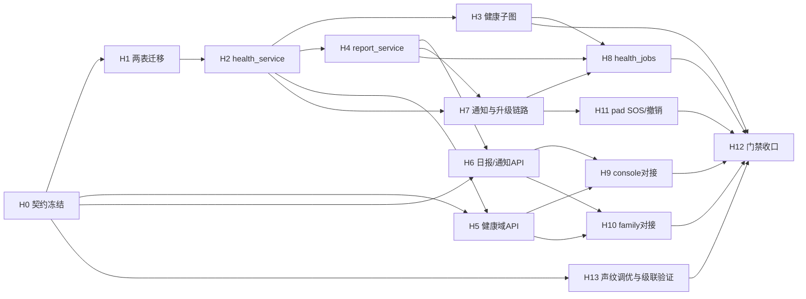

> 状态：草稿（待主理人确认后执行）　｜　版本：v1.1　｜　日期：2026-11-10
> 上游依据（事实来源，本文所有「是什么/有多少/什么字段/什么接口」只引自这两份）：
> ① `docs/康伴3D数字人_PRD.md` v3.0（验收口径：§6.1 Day 8 行、FR-HLT-01~10、FR-RPT-01~04、FR-ALT-01~04/06、FR-UI-08、AC-09~11/21/22/12/23/25/32/34/38）
> ② `docs/康伴3D数字人_技术设计文档.md` v2.1（实现口径：§7.2 健康子图、§3.4/§3.5 表定义、§3.6 Day 8 迁移批次、§8.3 Day 8 落地清单）
> 流程来源：`docs/康伴3D数字人_大纲.md` §十 Day 8（**仅取迭代流程与产出物顺序，不取任何字段/表名/接口/阈值**）
> 关联：`docs/plans/adhoc-20261110-mockoperations提前实现.md`（Day 8 范围提前件，§4 留尾四项）、`docs/接口契约_照护台业务数据.md` v0.1（待冻结）、`docs/接口契约_家属端数据.md` v1.0（待冻结）、`docs/接口契约_工单看板`（f2-D1 已交付）
> 变更记录见文末

---

# Day 8 工作推进计划 · 健康采集与三端后台（Iter 4 收尾开始）

## 0. 文档效力声明与裁决登记

本文遵守 `AGENTS.md` 前置节铁律：**大纲只提供 Day 8 的流程与产出物清单；一切事实依据（表、字段、阈值、接口、验收）回 PRD 与技术设计文档取**。执行中若发现本文与两份基线文档冲突，以基线为准并回改本文。

已裁决事项（2026-11-10 主理人确认，随本计划登记）：

| # | 裁决 | 内容 |
| --- | --- | --- |
| D-1 | **声纹调优纳入 Day 8（P1 尽力）** | 主理人 2026-11-10 晚改裁决（原「顺延 Day 9」作废）：依据 PRD §4 FR-VPR-04 表行（**「Day 8.4 产出报告」**，P1）与大纲 8.4，提前至 Day 8 以 **H13（P1）** 承载；与 PRD §6.1 Day 9 行、TD §8.4.3（FR-VPR 04 归 9）仍冲突——**待修订两文档归属**，修订前以本裁决为准；README §11 冲突行同步改写 |
| D-2 | **红色分支医院对接不排期** | TD §7.2 图中「Mock 医院对接单」节点在 Day 8 批次（仅 3 张表）无承载表、落地清单未写实现；Day 8 红色分支止于「紧急通知护工+监护人 → 紧急工单 → 医生 HITL interrupt」，医院对接节点显式登记为不排期（见 §8 范围外清单），待主理人后续裁决承载形态再补 |
| D-3 | **护工看板维持 React 形态** | 大纲 8.2「最简 HTML+JS 服务端渲染，不引前端框架」与 PRD §2.1（console 统一 React + 原生 CSS，MUI 已于 2026-11-06 裁决移除）冲突；按铁律以 PRD 为准，console 五页在现有 React 工程内真实对接，冲突行已回填 README §11 |
| D-4 | **聚合预警（FR-HLT-10）按 P2 弹性处理** | TD Day 8 功能验收第 12 条含聚合预警，但 PRD §4.6 标 P2；按「PRD 定验收」处理：当天产能富余才做，不进入完成定义，顺延/不做均须在 §11 执行记录留痕 |

## 1. 项目认知基线（一天一页版）

- **项目**：CCRC 康养社区长者卧室 3D 数字人陪伴系统（教学 MVP，10 个工作日）。三端同一仓库：pad（长者，1920×1080 大字）、console（护工/医生/管理员按角色分流）、family（家属，375px 移动优先）。
- **Day 8 在十天中的位置**：Iter 4 收尾的第一天。前序已具备：身份与权限（Day 2）、语音双链路（Day 3）、3D+声纹（Day 4）、延迟护栏（Day 5）、Agent 闭环+用药子图+checkpointer（Day 6）、记忆/用药终态/娱乐/调度外呼（Day 7）。Day 8 交付**第三张也是最后一张业务子图拼图（健康决策图）**与三端后台的真实数据闭环；Day 9 闸门与安全、Day 10 部署观测。
- **验收负载**：单机 Docker、1 路活跃语音、≤10 后台在线用户（非并发容量目标）。
- **分层硬约束（违反即返工）**：`app/services/` 唯一写库层；`api | audio | scheduler | graphs → services → models` 单向依赖、不横向 import；`app/api/` 不写业务逻辑；分级阈值写在代码不写 prompt；scheduler 不做业务写库（`grep "session.add(\|from app.models" app/scheduler/` 零命中）。
- **教学口径红线**：健康数据均为演示/自报数据，页面与日报固定标注「教学模拟信息，不构成医疗诊断」；数字人绝不说「您这是高血压」，只说「这个数值有点高，我帮您告诉医生」。

## 2. 代码现状基线（2026-11-10 实测，计划的起点）

| 项 | 现状 | 对 Day 8 的含义 |
| --- | --- | --- |
| 迁移 | 止于 0016；`notifications` 已由 **0011** 提前建成 | Day 8 批次 3 张表中**只需新迁移建 `health_records` + `daily_reports` 两张**（0017），`notifications` 复用 |
| `app/graphs/` | 仅 `medication_confirmation_graph.py` + `checkpointer.py` | `health_checkup_graph.py` 全新文件；checkpointer 复用（独立 schema `langgraph`） |
| `app/services/` | 已有 `work_order_service`（含建单口/查询面）、`notify_service`（监护人通知唯一写库口）、`audit_log_service`、`medication_*` | **缺** `health_service`、`report_service`（新增）；`work_order_service`/`notify_service` 增量扩展 |
| mock-operations MCP | server + 单测 + 容器化已提前交付（operations_core 覆盖率 99%）；**tool_registry 未注册两工具**（仅 get_weather），`subject_elder_id` 注入与 AC-39 证据留 Day 8 | §4 T4 承接 §4 待办四项 |
| `app/scheduler/` | 仅 `medication_jobs.py`（驱动链模式：scheduler 不写库、调子图/service） | 新增 `health_jobs.py` 照此模式 |
| console | 五 Mock 页均在；工单看板已切真实接口（`app/api/workorders.py` f2-D1 提前件） | 健康代填（health-api）/复核队列（review-api）/告警中心（alerts-api）仍 Mock，需切真实接口 |
| family | 仅通知域 N1/N4 切真实（`app/api/family.py`）；**F0/F1/F2（绑定长者/日报列表/详情）仍 Mock**（data-source USE_MOCK） | 切换层机制已有，按 `day05/d-家属端切换层说明.md` 步骤执行 |
| pad | `SosButton.tsx` 组件已有 | 后端接线与端到端 30 秒验收待完成 |
| 声纹 | `voiceprint_service` cosine 比对链路已有（`CosineMatch` 含 score/threshold），阈值走 `settings.voiceprint_similarity_threshold`；Day 4 spike 数据留档（day04 计划明示「留档供复用」） | H13 直接复用现有链路，无新表/新迁移 |

## 3. Day 8 任务总清单（拆解：前置依赖 · 执行步骤 · 量化验收）

> 编号 H0–H13。**执行顺序 = DAG 拓扑序（§4）**；「验收标准」列为最小可判定口径，命令级自检见 §6。
> 优先级口径：**P0 = 当日完成定义**（PRD §6.1）；**P1 = 当日全力推进**，超载按 PRD §6.2 裁剪顺序顺延 Day 9 且必须在 commit 说明写明，不许静默砍掉；**P2 = 不进完成定义**（PRD §4.6 FR-HLT-10 等）。

| # | 任务 | 优先级 | 前置依赖 | 内容与执行步骤（概要） | 量化验收标准 |
| --- | --- | --- | --- | --- | --- |
| H0 | 契约冻结与基线复核 | P0 | — | ① 冻结《接口契约_照护台业务数据》健康代填/复核/告警相关端点（v0.1→v1.0）；② 冻结《接口契约_家属端数据》日报域端点（v1.0 冻结评审）；③ 按 §2 复核代码基线，登记与本计划的偏差 | 两份契约状态改「已冻结」，变更走各文 §6 留痕；H5/H6/H9/H10 只按冻结口径开发 |
| H1 | 数据层：`health_records` + `daily_reports` 两表 | P0 | H0 | ① `app/models/health.py`（HealthRecord ORM）+ `app/models/report.py`（DailyReport ORM），字段逐列对齐 TD §3.4/§3.5（source 四值 CHECK、severity/rule_version/version/superseded_by/graph_thread_id、medication_stats jsonb、UNIQUE(elder_id,report_date,version)）；② 迁移 `0017_day8_health_reports.py`：两表 + CHECK（血压 0–300、睡眠 0–24、mood 1–5、source 四值）+ 索引 `(elder_id, recorded_at DESC)`；③ autogenerate 后**人工读 diff** 再 upgrade | `alembic upgrade head` 成功且 `\d health_records` CHECK/索引齐全；`alembic downgrade -1 && upgrade head` 可逆；ER §5 索引清单同步 |
| H2 | `health_service.py`：校验 + 分级引擎 + 版本链 | P0 | H1 | ① 5 字段结构化校验（非数字/负值/睡眠>24h 无效；两分量均有时收缩压>舒张压；无效重问一次再失败标缺失）；② 分级规则引擎**纯函数**（阈值照 PRD §4.6 表写在代码：红=收缩压≥180 或舒张压≥120 或命中急症规则，单分量即判红；黄=140–179/90–119/<90/<60/睡眠<5h/mood≤2/非急症主诉/任一项缺失；绿=90–139 且 60–89 无异常；多项并存取最高）；写 `rule_version`；③ 版本链：补录追加版本不覆盖原值（version/superseded_by），黄档未关闭时补录达红阈值 → 原事件升级红并立即通知、不重复建单（AC-22）；④ 代填入口：source 枚举 `staff_scheduled/staff_active` + operator_id 必填，非负责长者 403+审计（AC-32） | 分级单测覆盖红/黄/绿/单分量判红/缺失判黄/无效数据六类（对齐 AC-09/10/11/21）；补录黄升红用例过（AC-22）；代填越权 403+审计用例过（AC-32） |
| H3 | `health_checkup_graph.py`：健康决策子图 | P0 | H2 | ① 节点：collect（5 问循环，每问等 60s，无效重问一次）→ validate（Pydantic HealthRecord）→ grade（调 H2 规则引擎）→ green:persist→END / yellow:创建工单+黄色复核任务→HITL 护工 interrupt / red:紧急通知护工+监护人→创建紧急工单→HITL 医生 interrupt→persist；② interrupt + `Command(resume=...)` 恢复，checkpointer 复用（独立 schema）；③ **双入口共用一张图**：`source=voice_scheduled`（调度器）与 `source=voice_active`（主控 Agent，AC-34）；④ 决策依据/分级阈值/HITL 结果写 graph state，`health_records.graph_thread_id` 回指；⑤ 图节点内业务事实经 `health_service`/`work_order_service` 落库（流程引擎不是唯一事实来源） | 录 180 → 图停在「等医生确认」interrupt → resume 后继续（AC-10/21）；160 走陪护确认（AC-09）；正常值直接入库；`graph.get_state` 可演示三级分支；重启后从 checkpoint 恢复不重复建单（对齐 AC-17/30 口径）；「我头晕」主动主诉走同一张图且 source=voice_active（AC-34） |
| H4 | report_service：家属日报生成 | P0 | H2 | ① 采集完成或 20:00 强制结束生成首版（未答项「未采集」）；② 内容仅来自结构化健康记录、用药结果、需关注事件——**不从私密长期记忆生成**；用药四类（taken_reported/refused/missed_unconfirmed/notification_failed）分别统计进 medication_stats；③ 补录生成新版本保留历史，每版只发一次「日报已更新」通知（dedupe_key 幂等，AC-25）；④ 固定声明「教学模拟信息，不构成医疗诊断」；⑤ `summary_text` 构造 + 可选 `audio_url` 语音条（P1，见 H11） | 首版日报四类用药分列（AC-13 前半）；补录后旧版保留、新版只发一次更新通知（AC-25）；日报文本无记忆/原始对话/音频内容 |
| H5 | API 层：健康域 REST | P0 | H0,H2 | ① 健康代填提交（护工，仅负责长者）、健康记录查询/复核（黄档护工✅红档❌ / 医生✅）、复核确认与纠错新版本（review_status/reviewed_by），字段逐项对齐冻结契约；② 医生趋势查询：近 14 天血压/睡眠序列（供 H9 折线图）；③ 全部走 `ContractAPIRoute` 统一错误体，操作人从 JWT 注入，范围过滤在 services；④ 经 `app/api/__init__.py` ROUTERS 注册表挂载（不碰 main.py 写锁） | 越权（护工代填非负责长者 / 护工复核红档 / 家属访问健康接口）一律 403+审计；tsc 对齐冻结契约字段；新增接口测试全绿 |
| H6 | API 层：家属日报 + 通知域收口 | P0 | H0,H4 | ① 日报列表/详情接口（家属仅绑定长者，越权 403+审计，AC-13/18 后半）；② 通知已读/人工确认接口收口（staff 侧确认走 alerts 域）；③ 家属通知推送状态查询（FR-RPT-03：成功/失败/重试/手动重发——手动重发为管理员能力，P1） | 家属 A 访问长者 B 日报 403+审计；已读幂等；通知状态可区分 generated/delivered/acknowledged（AC-23 后半，回执口径见 H7） |
| H7 | 通知与升级链路（services + scheduler 扫描） | P0 | H2,H4 | ① 红色事件 → 负责护工 + 全部 active 监护人双通知（notify_service 已有监护人侧，补 staff 侧，AC-38）；② 红色事件 2 分钟无人确认 → 原事件标 `escalated` + 通知管理员，**不建第二个事件/工单**，升级计时从 created_at 起不因通知失败暂停（AC-12）；③ 通知状态机收口：只有客户端回执算 delivered、只有人工操作算 acknowledged；pending 每 30s 重试、3 次失败→failed（AC-23 前半 + 状态机表）；④ 全部落 `notifications`（0011 表），dedupe_key 幂等 | 红色事件双通知记录齐（AC-38）；2 分钟升级后事件 status=escalated 且无第二事件/工单（AC-12）；「先持久化→离线→上线回执→人工确认」依次 generated→pending→delivered→acknowledged（AC-23）；重复触发不重复建单 |
| H8 | scheduler 扩展：`health_jobs.py` | P0 | H3,H4,H7 | ① 19:00 采集触发（对当日 active 长者逐一起健康图，source=voice_scheduled）；② 20:00 强制结束 + 漏采派单：窗口结束无任何记录 → `collection_missed` 工单派负责护工（FR-HLT-08，P1）；③ 日报生成触发（接 H4）；④ 红色 2 分钟升级扫描 + 通知 30s 重试扫描（接 H7）；⑤ 沿用 medication_jobs 铁律：scheduler 不写库，只调 services/graphs，图运行后事务提交豁免照既有裁决 | `grep "session\.add(\|from app.models" app/scheduler/` 零命中；到点触发/强制结束/漏采派单/升级扫描四 job 各有可重复执行的集成测试；漏采工单落库且 assignee=负责护工 |
| H9 | console 真实对接（React，D-3 形态裁决） | P0 | H5,H6 | ① 健康代填页 `HealthFormPage`：Mock→真（5 字段表格，校验与语音渠道一致，提交后走同一分级引擎，来源标注「代填」）；② 复核队列 `ReviewQueuePage`：Mock→真（黄/红队列、确认/纠错新版本）；③ 告警通知中心 `AlertsPage`：Mock→真（未读任务、确认、通知状态展示）；④ 护工看板 `WorkOrdersPage`：核对红档置顶/严重度排序（接口已交付，补前端排序核对）；⑤ 医生 14 天趋势图（FR-HLT-09，P1）：负责长者血压/睡眠折线（Chart.js CDN）；⑥ 导出签名不变，仅替换 api.ts 内部实现 | 护工代填 165/85 → 黄色复核任务出现且来源=代填、含操作者（AC-32）；护工 A 看不到护工 B 楼栋数据（AC-18 前半）；看板红档置顶；tsc 通过；3 个页面各留一张走查截图 |
| H10 | family 真实对接 + 375px 验收 | P0 | H5,H6 | ① F0/F1/F2（绑定长者/日报列表/详情）按 `data-source.ts` USE_MOCK 切换层切真实接口（流程照 `day05/d-家属端切换层说明.md`，Mock 删除条件不满足的保留开关）；② 日报 TTS 语音条播放（FR-RPT-04，P1）：audio_url 点播、内容与文本摘要一致；③ 375px 无横向滚动、正文 ≥16px、按钮够大、高对比度（无障碍硬要求）；④ 推送状态展示（FR-RPT-03 前端，P1） | 手机浏览器 375px 打开日报页无横向滚动（截图留证）；语音条可播放且与文本一致；家属仅见绑定长者日报 |
| H11 | pad：SOS 接线核验 + 撤销边界 | P1 | H7 | ① `SosButton` 常显大按钮（≥48×48px）后端接线：点击即生成敏感事件+护工工单，不经语音路由（FR-ALT-06）；② 撤销边界（FR-UI-08）：普通确认 10 秒内可撤销并记审计；红色事件不可一键撤销，只能追加「说错了」由工作人员核实 | SOS 按下 30 秒内护工看板出现红色置顶工单；红色事件撤销尝试仅追加说明、事件保持 open（AC-26 口径） |
| H12 | 门禁收口与文档回填 | P0 | H1–H11 | ① pytest 全绿 + 新增健康/日报/通知测试；② ruff check + format；③ 前端 tsc + build；④ PRD §6.1 Day 8 完成定义逐条复核（AC-09/10/11/21/22 + 后台权限隔离 + 红色 2 分钟升级）；⑤ README / ER / 相关契约文档回填；⑥ 本计划 §11 执行记录回填 | 全部门禁命令绿（§6）；Day 8 完成定义逐条有证据（截图/SQL/测试名）；`uv run pytest -q` 无 skip 新增 |
| H13 | 声纹调优与级联验证（FR-VPR-04，D-1 改裁决提前） | P1 | H0；与健康主线（H1–H12）完全并行 | ① 素材：复用 Day 4 spike 留档 + 现场补录本人样本与**不同使用者互测样本**（不涉及真实长者；录制前告知用途、可随时删除——README 合规口径）；② 阈值扫描：以 `voiceprint_service` 现有 cosine 链路在 0.80–0.90 区间批量评测，统计 FAR（误识）/FRR（拒识），逐条记录误识/拒识 case；③ 阈值定稿：按「隐私场景宁可不通过」取平衡点，结论回写 `Settings` 默认值并记录模型/embedding 版本；④ 三档身份级联端到端验证：单人间设备锁定（100%）+ 声纹辅助 / 双人间声纹确认 / 声纹失败主动确认兜底，各演示一次留证；⑤ 产出 `eval/reports/声纹调优报告.md`（TD 目录树指定位置，先例 day07_router_baseline.md） | 报告四要素齐（样本量 / 模型版本 / FAR-FRR 表含 case 记录 / 阈值结论，对齐 FR-VPR-04）；三档级联各留演示证据；阈值变更进 Settings 且可回溯。产能不足时整体顺延 Day 9（PRD §6.2 口径内，commit 说明写明） |

## 4. 依赖关系与执行顺序（DAG）



- **关键路径**：H0 → H1 → H2 → H3 → H8 → H12（数据层与子图是全局瓶颈，最先启动）。
- **可并行**：H5/H6（API 线）与 H3（子图线）在 H2 完成后并行；H9/H10（前端线）在 H5/H6 后并行；H11 只依赖 H7；**H13 与健康主线完全并行**（只依赖 H0），建议安排在联调等待间隙或由独立同学承接。
- **外部留尾承接**：mock-operations 两工具注册 + `subject_elder_id` 注入 + AC-39 证据在 H3/H8 期间由持有 tool_executor 写锁的同学一并完成（`adhoc-20261110-mockoperations提前实现.md` §4 四项，属 Day 8 范围）。
- **写锁提示**：`tool_registry.py`/`tool_executor.py`（若 Day 7 dev-C 收口仍未完成则按 day07 交接归属）；`app/api/__init__.py` ROUTERS 追加挂载不改 `main.py`；迁移文件一人主导、autogenerate 后人审 diff。

## 5. 交付物总表（格式 · 内容范围 · 质量要求）

| 交付物 | 格式/位置 | 内容范围 | 质量要求 |
| --- | --- | --- | --- |
| 迁移 0017 | `alembic/versions/0017_day8_health_reports.py` | health_records + daily_reports 两表全字段、CHECK、索引 | 人审 diff；可 downgrade；不碰已合入迁移 |
| ORM 模型 | `app/models/health.py`、`app/models/report.py` | 与 TD §3.4/§3.5 逐列一致 | 枚举一律 CHECK 口径；列注释引 TD 行号 |
| 健康服务 | `app/services/health_service.py` | 校验/分级/版本链/代填/复核 | 分级为无 I/O 纯函数；阈值常量 + rule_version；单测覆盖六类分级 |
| 健康子图 | `app/graphs/health_checkup_graph.py` | 双入口、三分支、双 HITL、interrupt/resume | 图内不直接写 SQL（经 services）；graph state 含决策依据可回溯 |
| 日报服务 | `app/services/report_service.py` | 首版/版本链/四类统计/固定声明 | 不读 memory_chunks；dedupe_key 幂等 |
| 调度任务 | `app/scheduler/health_jobs.py` | 19:00 采集/20:00 强制结束/漏采派单/升级扫描/通知重试 | scheduler 零写库（grep 验证）；每 job 可独立测试 |
| REST 端点 | `app/api/health_*.py`、`app/api/reports.py`（命名随既有惯例） | 冻结契约全端点 | `ContractAPIRoute` 错误体；403 必带审计；ROUTERS 注册 |
| 前端对接 | `console/{health,reviews,alerts}-api.ts` + 三页面；`family/api.ts` + F0/F1/F2 | 导出签名不变，内部 Mock→真 | tsc 零错；375px 走查截图；无横向滚动 |
| 测试 | `tests/test_health_*.py`、`tests/test_reports_*.py` 等 | 分级六类/AC-09~11/21/22/25/32/34/38/12/23 对应用例 | AC 用例号写进测试 docstring 便于追溯 |
| 声纹调优报告 | `eval/reports/声纹调优报告.md`（H13，P1） | 样本量、模型/embedding 版本、FAR/FRR 阈值验证表、误识/拒识 case、阈值结论、三档级联验证记录 | FR-VPR-04 四要素齐；样本合规（现场录制、不涉真实长者、可随时删除）；阈值结论回写 Settings 且变更可回溯 |
| 契约冻结 | 两份接口契约文档 v→冻结 | 冻结评审记录 | 变更走各文 §6 留痕 |
| 文档回填 | README §11、ER、plans/README | 本计划登记 + 落地差异 | 同提交登记 |

## 6. 自检校验标准（命令级，收口时逐条执行）

```bash
# 1. 门禁四件套
uv run pytest -q                                   # 全绿，无新增 skip
uv run ruff check app tests && uv run ruff format --check app tests
pnpm --dir frontend exec tsc --noEmit              # 前端类型零错
pnpm --dir frontend build                          # MPA 构建通过，pad 依赖不进 console/family 包

# 2. 迁移与约束
uv run alembic upgrade head                        # 0017 建出两表
uv run alembic downgrade -1 && uv run alembic upgrade head   # 可逆
# psql 抽查：health_records 四条 CHECK + (elder_id, recorded_at DESC) 索引存在

# 3. 分层硬约束
grep -rn "session\.add(\|from app.models" app/scheduler/        # 零命中（commit 豁免照既有裁决）
grep -rn "from app.graphs" app/api/ app/audio/                  # 零横向 import

# 4. AC 抽查（人工可复现场景，各留证据）
# AC-09/10/21：录 165/85 → 黄色复核；180 → 图 interrupt 等医生；182/null → 直接红
# AC-22：黄档未关闭补录 185 → 升级红、不重复建单
# AC-12/38：红色事件双通知 + 2 分钟 escalated
# AC-23：generated→pending→delivered→acknowledged 依次可见
# AC-32：代填 165/85 → 黄任务 + source=staff_* + operator_id
# AC-34：说「我头晕」→ source=voice_active 走同一图
# AC-25：补录 → 日报新版 + 更新通知仅一次
# AC-26：红色事件不可一键撤销
# FR-VPR-04（H13，P1）：eval/reports/声纹调优报告.md 四要素齐；三档级联演示证据各一段
```

## 7. 风险与回退

| # | 风险 | 缓解/回退 |
| --- | --- | --- |
| R1 | Day 8 为全章最重一天（TD §8.4.5：12 条功能验收），产能不足 | P1 项（FR-HLT-08/09、FR-RPT-03/04、FR-ALT-06、FR-UI-08、**FR-VPR-04**）按 §6.2 顺延 Day 9，**commit 说明写明**；P0 六条 AC 不容顺延。H13 与主线全并行、无表/迁移依赖，是顺延代价最小的 P1 项 |
| R2 | 健康子图 interrupt/resume 与 medication_jobs 的调度模式差异踩坑 | 复用 Day 7 驱动链模式与「图运行后事务提交」裁决；先写 HITL 桩测试再接真确认接口 |
| R3 | 黄升红（AC-22）跨事件/工单两表一致性 | severity 快照语义照 TD（已建工单 severity 不变）；升级只改 risk_events + 新建紧急工单，全在 H2 单测覆盖 |
| R4 | family 切真实接口后 Mock 页面回归破坏 | 严格走切换层 USE_MOCK 单独放行模式（N1/N4 先例）；Mock 删除条件不满足则保留开关 |
| R5 | 通知重试/升级扫描与 scheduler 既有 tick 冲突 | health_jobs 独立文件独立注册，不复用 medication tick；扫描 job 幂等（状态条件扫描天然幂等） |
| R6 | `tool_executor` 写锁归属不明导致 mock-operations 注册阻塞 | H0 时确认 Day 7 dev-C C3 收口状态；未收口则按 day07 交接链催办，注册项单列不阻塞 H1–H7 |

## 8. 范围外 / 不排期清单（显式登记，防「以后再说」）

| 项 | 理由 |
| --- | --- |
| 红色分支医院对接（Mock 转诊/预约单） | D-2 裁决不排期，待承载形态裁决 |
| 聚合预警信号（FR-HLT-10） | D-4 裁决按 P2 弹性，PRD §6.2 第二顺位可裁 |
| 自定义采集时间（FR-HLT-05，P2） | PRD P2，不排期 |
| 真实浏览器 Web Push（VAPID/Service Worker） | TD 裁决 B5：P0 只做落库+演示卡片，P1 归属后续 |
| 电影/新闻（FR-CON-05）、分类模型对比（FR-DLG-08） | PRD P2 / Day 9 |

## 9. 大纲流程对照（仅取流程，逐课时映射本计划任务）

| 大纲课时 | 流程要点（仅顺序/产出物） | 本计划映射 |
| --- | --- | --- |
| 8.1 健康事件决策图 | 采集→分级→分支→HITL；同时注册为主控 Agent 子图 | H1–H3、H5、H7 + 主动主诉接线（AC-34） |
| 8.2 护工看板 | 待处理列表+确认/升级闭环 | H9（形态按 D-3 裁决走 React）+ H7 状态机 |
| 8.3 医生视图与家属 H5 | 14 天折线、日报 H5 大字号 | H9⑤、H10 |
| 8.4 声纹调优与级联验证 | 补注册样本 → cosine 阈值扫描（0.80–0.90）→ 三档身份级联验证 → 出验证报告 | H13（D-1 改裁决提前，P1 尽力） |

## 10. 待确认项（执行前需主理人/相关同学回应）

1. **tool_executor/tool_registry 写锁归属**：Day 7 dev-C C3 收口状态与 mock-operations 注册的承接人（R6）。
2. **健康域 REST 端点编号**：冻结《接口契约_照护台业务数据》时为新端点分配编号（沿用 W/N/H 前缀惯例），H5 开工前定。
3. **19:00 采集的测试策略**：演示环境是否允许将采集时间经 Settings 覆盖为可测试时刻（建议允许，环境变量豁免口径同既有端口覆盖）。
4. **日报 TTS 语音条（FR-RPT-04）**：audio_url 生成依赖 TTS 服务配额，若教师 key 受限则按 P1 顺延并在执行记录留痕。
5. **H13 互测样本与演示人员**：FR-VPR-04 需「不同使用者互测样本」与三档级联演示（单人间/双人间场景），执行前确认可参与录制的人员名单与房间场景模拟方式。

## 11. 执行记录（执行时逐条回填）

| 日期 | 任务 | 结果/证据 | 偏差登记 |
| --- | --- | --- | --- |
| （待填） | | | |

---

## 修订记录

| 版本 | 日期 | 说明 |
| --- | --- | --- |
| v1.0 | 2026-11-10 | 首版：基于 PRD v3.0 / TD v2.1 / 大纲 Day 8 流程 + 代码现状实测（迁移止于 0016、健康子图/服务未建、mock-operations 已提前交付未注册）编制；四项主理人裁决登记（D-1 声纹顺延 Day 9 / D-2 医院对接不排期 / D-3 看板 React 形态 / D-4 聚合预警 P2 弹性）；H0–H12 任务拆解 + DAG + 交付物 + 命令级自检 |
| v1.1 | 2026-11-10 | 主理人改裁决 D-1：声纹调优（FR-VPR-04）由顺延 Day 9 改为**纳入 Day 8**（依据 PRD §4 FR 表行「Day 8.4 产出报告」+ 大纲 8.4），新增 **H13（P1 尽力，与健康主线全并行）**；同步调整 §2 基线（声纹链路现状）、§4 DAG、§5 交付物（eval/reports/声纹调优报告.md）、§6 自检、§7 R1、§8 范围外（移除声纹行）、§9 对照、§10 待确认（新增互测样本人员）；PRD §6.1 Day 9 行与 TD §8.4.3 归属待修订登记 |
