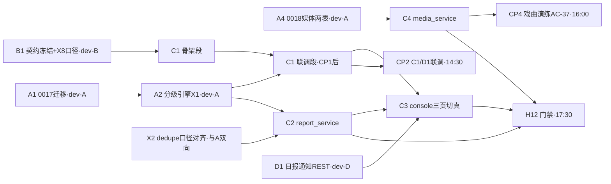

> 状态：执行中　｜　版本：v1.3　｜　日期：2026-11-11
> 关联：docs/team_tasks/day08/dev-C-健康域API与console.md（任务卡 v1.1）
> 上游依据：PRD v3.0（验收：FR-HLT-01~09、FR-RPT-01/02、FR-CON-03/04/06、AC-09/10/11/21/22/25/32/34/37/38）｜技术设计文档 v2.1（实现：§3.4/§3.5 表定义、§7.2 健康子图）｜docs/plans/day08/day-08-健康采集与三端后台.md v1.2（H0–H16 任务线）｜docs/接口契约_照护台业务数据.md v0.1（C1 字段口径，B1 冻结后为准）
> 变更记录见文末

---

# dev-C Day 8 工作推进计划 · 健康域 API / report_service / media_service / console 三页切真

## 0. 效力声明

本文遵守 `AGENTS.md` 前置节铁律：**表名、字段、阈值、接口口径一律回 PRD 与技术设计文档取**；大纲只提供「今天做什么、先做哪个」。本文是任务卡 v1.1 的落地执行计划，不另立事实；与任务卡冲突时以任务卡为准，与 PRD/TD 冲突时以基线为准并回改本文。

## 1. 项目认知基线（dev-C 视角一页版）

- **系统**：CCRC 康养社区长者卧室 3D 数字人陪伴系统。三端同一仓库：pad（长者 1920×1080）、console（护工/医生/管理员）、family（家属 375px）。
- **Day 8 位置**：Iter 4 收尾第一天。前六天已有身份权限/语音双链路/3D+声纹/延迟护栏/Agent 闭环+用药子图/记忆与调度外呼。Day 8 交付**健康决策子图 + 三端后台真实数据闭环 + Day 7 三项欠债（娱乐点播/记忆治理/评测门禁）**；Day 9 闸门安全、Day 10 部署观测。
- **dev-C 在 Day 8 的四条线**：
  1. **C1 健康域 REST**（H5）：代填提交/记录查询复核/复核确认纠错/医生 14 天趋势查询；
  2. **C2 report_service**（H4）：家属日报生成 + 版本链 + 四类用药统计 + dedupe_key 幂等；
  3. **C4 media_service**（H14②）：媒体域唯一写库层（列表/剧种剧目搜索/播放 URL/history）；
  4. **C3 console 三页切真**（H9①–④）：健康代填/复核队列/告警中心 Mock→真 + 工单看板红档置顶核对。
- **分层硬约束**：`app/services/` 唯一写库层；`api → services → models` 单向依赖；`app/api/` 不写业务逻辑；分级阈值在代码不在 prompt；前端只按冻结契约开发，字段缺失走契约 §6 留痕，不私改。
- **教学口径红线**：日报与页面固定标注「教学模拟信息，不构成医疗诊断」；不说诊断话术。
- **容量口径**：C 包合计 9.5h + H12 参与 0.5h，**无包内先裁项**；溢出池 O1（医生 14 天趋势图前端，P1）17:00 未开工即顺延 Day 9。

## 2. 代码现状核查基线（2026-11-11 实测，执行起点）

| # | 项 | 实测现状 | 对 dev-C 的含义 |
| --- | --- | --- | --- |
| 1 | 迁移 | 止于 0016；0017（健康两表）/0018（媒体两表）**不存在**，归 dev-A（A1/A4） | C1 联调段、C4 全部等迁移 upgrade；骨架可先行 |
| 2 | `app/api/` | **已有 `health.py`——是 `/health` 存活探针，不是健康业务域**；ROUTERS 注册表模式运行中（`app/api/__init__.py`） | C1 新文件必须叫 `health_*.py`（如 `health_records.py`），**不得占用/修改 `health.py`**；挂载只在 `__init__.py` 末尾追加一行，不碰 main.py |
| 3 | `app/services/` | **缺** `health_service.py`（dev-A A2 交付）、`report_service.py`、`media_service.py`（后两者 C 自己建）；已有 `notify_service`（dedupe_key 逐监护人键 `<dedupe_key>:<guardian_id>`）、`work_order_service`（唯一建单口）、`audit_log_service` | C2 的 dedupe_key 构造规则必须与 notify_service 既有约定一致（X2 与 dev-A 11:30 对齐）；C2/C4 是新增文件，写域干净 |
| 4 | console | 五 Mock 页均在；`health-api.ts` 已含类型/阈值常量/`classifyHealthRecord` Mock 分级；`review-api.ts`、`alerts-api.ts` 仍 Mock；工单看板已切真（f2-D1） | C3 切真只换三个 api.ts 内部实现 + 页面微调，**导出签名不变**；health-api.ts 现有类型即 C1 契约的前端对照面 |
| 5 | tests | 无 `test_health_api*` / `test_reports_service*` / `test_media_service*`；既有 conftest 单事务回滚隔离、无库 skip 并打印原因 | C 交付内嵌测试照既有隔离模式写 |
| 6 | 契约 | 《接口契约_照护台业务数据》v0.1 待冻结：H-1（复用 E7）、H-2（POST /api/health-records）、复核队列 §3.5 已有草案；**开放问题 Q-1（`review_note`/`superseded_reason` 两列缺口）待主理人裁决** | C1 骨架以 v0.1 为底稿，字段以 B1 10:00 冻结版为准；Q-1 裁决前复核端点字段留桩 |

## 3. 任务拆解总表（前置依赖 · 交付物 · 量化验收）

| # | 任务 | 人时 | 前置 | 交付物 | 量化验收（AC/命令级） |
| --- | --- | --- | --- | --- | --- |
| C1 | 健康域 REST（骨架先行 + A2 后联调） | 2.5h | B1 契约冻结（10:00）；A2 分级引擎就绪（CP1 12:00，联调段） | `app/api/health_records.py`（命名避让探针页）+ `tests/test_health_api*.py` | ① 代填提交/记录查询复核（黄✅红❌/医生✅）/复核确认纠错新版本字段逐项对齐冻结契约；② 医生趋势查询近 14 天序列；③ 全走 ContractAPIRoute，操作人 JWT 注入，范围过滤在 services；④ ROUTERS 注册表挂载；⑤ 越权三例 403+审计（护工代填非负责长者/护工复核红档/家属访问健康接口）；接口测试全绿 |
| C2 | report_service 日报生成 | 2.5h | A2；X2 口径（11:30 与 dev-A 对齐） | `app/services/report_service.py` + `tests/test_reports_service*.py` | ① 采集完成或 20:00 强制结束生成首版，未答项「未采集」；② 内容仅来自结构化记录/用药结果/关注事件，**不读 memory_chunks**（grep 零命中）；③ 用药四类分列进 medication_stats（AC-13 前半）；④ 补录新版本保留历史、每版只发一次更新通知（dedupe_key，AC-25）；⑤ 固定声明「教学模拟信息，不构成医疗诊断」 |
| C4 | media_service 媒体唯一写库层 | 1.5h | A4（0018 就绪）；X8 冻结口径 | `app/services/media_service.py` + `tests/test_media_service*.py` | ① 列表/按剧种剧目搜索/取播放 URL/history 写入测试绿；② media_url 只产 X8 稳定路径 `/static/media/opera/<media_id>.wav`；③ history 含播放时长/完播率（FR-CON-06 P1）；④ 不碰 Tool 层（Tool 归 dev-B B4） |
| C3 | console 三页真实对接（P0①–④） | 3h | C1、D1（CP2 14:30） | `console/{health,reviews,alerts}-api.ts` 切真 + 三页面修正 + 走查截图 ×3 | ① 代填 165/85→黄色复核任务出现、来源=代填、含操作者（AC-32）；② 护工 A 看不到 B 楼栋数据（AC-18 前半）；③ 告警中心未读/确认/状态对齐 X7 四态；④ 看板红档置顶核对（X6 补前端排序核对）；⑤ 导出签名不变、tsc 零错 |
| H12 | 门禁收口（参与） | 0.5h | 各线完成 | 自检证据 + 三页截图归档 | 四件套全绿；证据回填全局计划 §11 |
| O1 | 溢出池：医生 14 天趋势图前端（H9⑤） | 1h | C1 趋势端点 + C3 收口 | 复核页折线图（Chart.js CDN） | 折线展示近 14 天血压/睡眠序列（FR-HLT-09，P1） |

## 4. 依赖 DAG（dev-C 视角）



- **写域互斥**（照总览 §2）：C 只写 `app/api/health_*.py`、`app/services/report_service.py`、`app/services/media_service.py`、`frontend/src/console/*`、对应 tests；不碰 models/迁移/graphs/scheduler/tool_registry/memory_service/rules.py/family/pad/main.py。
- **关键等待点**：10:00（B1 冻结版）→ 11:30（X2 双向、A4 就绪）→ 12:00（CP1：A2 X1 签名冻结）→ 14:30（CP2：D1 就绪）。等待空档按 §5 步骤表穿插（C4 骨架、C2 骨架）。

## 5. 分步执行计划（每步：内容 → 交付物 → 自检 → 等确认）

> 按主理人要求**分步确认制**：每步自检通过后停下汇报 diff 摘要，经确认再进下一步。

### S0 · 启动核查与契约就位（09:15–10:00）

**内容**：
1. 复核 §2 现状基线六项仍成立（迁移仍止 0016、三 service 仍缺、三 api.ts 仍 Mock）；
2. 参加 09:15 B1 契约评审，拿到冻结版《接口契约_照护台业务数据》+ X8 四件口径；核对健康域端点编号已分配；
3. 若 Q-1（`review_note`/`superseded_reason` 两列）已有裁决，记入 C1 字段清单；未裁决则复核端点字段留桩待补。

**交付物**：本文档 §2 基线复核勾选记录（提交到本计划 §10 执行记录）。

**自检**：契约两份状态行 =「已冻结」；X8 media_url 稳定路径口径与任务卡 C4 ②一致。

**等确认点 1**：向主理人汇报「契约冻结版与 v0.1 差异清单」后开工 C1 骨架。

### S1 · C1 骨架段（10:00–12:00，不等 A2）

**内容**：
1. 新建 `app/api/health_records.py`：按冻结契约定义 Pydantic 请求/响应模型（代填提交 H-2、记录查询、复核确认/纠错新版本、医生趋势查询四组端点骨架），service 调用先用 `NotImplementedError` 桩；
2. `app/api/__init__.py` 末尾追加一行 ROUTERS 挂载（自带 `/api/health-records` 前缀，**不改 `health.py`、不碰 main.py**）；
3. 建 `tests/test_health_api*.py` 骨架：鉴权夹具 + 越权三例（403+审计断言）先行；
4. 确认 ContractAPIRoute 统一错误体接入方式照 workorders.py 既有先例。

**交付物**：骨架文件 2 个 + 测试骨架 1 个；格式要求——全量 type hint、async I/O、docstring 引契约端点编号与 TD §3.4 行号；测试用例 docstring 写 AC 编号（AC-32 等）便于追溯。

**自检**：`uv run pytest tests/test_health_api*.py -q`（越权用例在桩阶段即绿：403 路径不依赖 A2）；`uv run ruff check app tests`；`curl localhost:8000/health` 存活探针不受影响。

**等确认点 2**：汇报骨架 diff（含端点清单与契约对照表），确认后待 CP1。

### S2 · X2 口径对齐（11:30，与 dev-A 双向）

**内容**：与 dev-A 对齐 dedupe_key 构造规则与「日报已更新」通知口径——C2 生成侧与 A3 重试/幂等侧使用**同一** dedupe_key 规则；口径写进 C2 服务 docstring 冻结。同时确认 A4（0018）是否 upgrade 完成，决定 C4 骨架可否提前。

**交付物**：dedupe_key 口径一行记录（进 C2 docstring + 本计划 §10）。

**自检**：与 `notify_service` 既有 `<dedupe_key>:<guardian_id>` 家属侧约定不冲突（staff 侧另定键不混用）。

**等确认点 3**：口径双方确认后进 S3（若 CP1 未到，先穿插 S5 骨架段）。

### S3 · C1 联调段（12:00 CP1 后–14:00）

**内容**：
1. 把 S1 桩替换为真实 `health_service` 调用（dev-A X1 冻结签名）：提交校验走服务端分级引擎（前端不传 severity）、范围过滤（仅负责长者）在 services、操作人从 JWT 注入；
2. 复核确认与纠错新版本端点接通版本链（version/superseded_by），黄档未关闭补录升级语义只读 health_service 结果；
3. 医生趋势查询端点：近 14 天血压/睡眠序列（供 C3/O1 折线）；
4. 补齐接口测试：分级结果透传、复核权限矩阵（黄档护工✅红档❌/医生✅）、版本链追加不覆盖。

**交付物**：`app/api/health_records.py` 完整实现 + `tests/test_health_api*.py` 全绿。

**自检**：`uv run pytest tests/test_health_api*.py -q` 全绿；越权三例 403 且 `audit_logs` 有记录（SQL 抽查）；`grep -rn "from app.graphs" app/api/` 零命中（分层约束）。

**等确认点 4**：14:30 CP2 与 dev-D 互相联调（X3/X4）通过后，汇报进入 C2/C3。

### S4 · C2 report_service（12:00 后与 S3 并行，11:30 口径锁定后）

**内容**：
1. 新建 `app/services/report_service.py`：采集完成或 20:00 强制结束生成首版（未答项「未采集」）；补录生成新版本保留历史（UNIQUE(elder_id, report_date, version)）；
2. 内容仅取结构化健康记录/用药结果/关注事件；用药四类（taken_reported/refused/missed_unconfirmed/notification_failed）分列进 medication_stats；
3. dedupe_key 幂等：每版只发一次「日报已更新」通知（S2 口径）；
4. 固定声明「教学模拟信息，不构成医疗诊断」拼入 summary_text。

**交付物**：`app/services/report_service.py` + `tests/test_reports_service*.py`；质量要求——写库只在此文件（api 层不碰）、版本链补录用例覆盖、AC-13/25 用例号写进 docstring。

**自检**：`uv run pytest tests/test_reports_service*.py -q` 全绿；`grep -n "memory_chunks" app/services/report_service.py` **零命中**；补录后旧版保留且更新通知只发一次（测试断言通知记录数=1）。

**等确认点 5**：汇报 C2 diff 摘要。

### S5 · C4 media_service（A4 就绪后；骨架可在等待空档先行）

**内容**：
1. 新建 `app/services/media_service.py`：列表/按剧种（genre）剧目（title）搜索/取播放 URL/media_history 写入（播放时长/完播率）；
2. media_url 只产 X8 冻结稳定路径 `/static/media/opera/<media_id>.wav`，不做其他形态 URL；
3. 服务内不碰 Tool 层（play_opera Tool 归 dev-B B4）、不碰规则层（归 dev-A A5）、不碰 pad 播放（归 dev-D D4）。

**交付物**：`app/services/media_service.py` + `tests/test_media_service*.py`；质量要求——唯一写库层口径（B4/D4/A5 只经它取数/写 history）、docstring 标注 X8 依赖。

**自检**：`uv run pytest tests/test_media_service*.py -q` 全绿；media_url 断言逐条等于稳定路径模板；history 写入含 duration/完播率字段。

**等确认点 6**：向 dev-B（B4）、dev-A（A5）、dev-D（D4）广播「media_service 就绪」+ 汇报主理人。

### S6 · C3 console 三页切真（14:30 CP2 后，15:45–17:15 主段）

**内容**：
1. `health-api.ts`：Mock 分级/提交替换为真实 `POST /api/health-records`（severity 改为服务端返回，前端阈值常量保留仅作提交前即时提示或删除——以冻结契约为准）；`review-api.ts`、`alerts-api.ts` 同法切真；
2. `HealthFormPage`：提交后展示服务端 severity/follow_up，来源标注「代填」+ 操作者（AC-32）；`ReviewQueuePage`：黄/红队列 + 确认/纠错新版本；`AlertsPage`：未读/确认/通知状态按照护台契约 §3.2 五值展示（含 failed），流转语义对齐 AC-23/X7（§8-4）；
3. `WorkOrdersPage`：核对红档置顶/严重度排序（X6，接口已交付补前端核对）；
4. 三个 api.ts **导出签名不变**，页面层不感知替换。

**交付物**：三 api.ts 切真 diff + 三页面修正 + 走查截图 ×3（每页一张，含 AC-32 场景：代填 165/85 → 黄色复核任务出现）。

**自检**：`pnpm --dir frontend exec tsc --noEmit` 零错；护工 A 登录看不到 B 楼栋数据（AC-18 前半，截图）；导出签名 diff 为零（`git diff` 核对 export 行）。

**等确认点 7**：汇报三页走查截图 + tsc 结果。

### S7 · 演练证据与门禁收口（15:30–18:00 穿插）

**内容**：
1. **15:30 X5 红色事件端到端演练**：C 留告警中心侧证据（通知四态依次可见截图，AC-23）；
2. **16:00 CP4 X8 戏曲端到端演练 AC-37**：C 留 media_service 侧证据（列表/搜索/URL 响应记录）；
3. **16:30 X6 看板核对**：红档置顶+严重度排序截图（与 dev-B 共同）；
4. **17:30 H12 门禁**：跑四件套 + 证据回填全局计划 §11 + 本计划 §10 执行记录回填。

**交付物**：三段演练证据 + 自检命令输出归档。

**自检**（命令级，逐条执行）：

```bash
uv run pytest -q                                                # 全量全绿，无新增 skip
uv run ruff check app tests && uv run ruff format --check app tests
pnpm --dir frontend exec tsc --noEmit                           # 前端类型零错
pnpm --dir frontend build                                       # MPA 构建过，pad 依赖不进 console 包
uv run pytest tests/test_health_api*.py tests/test_reports_service*.py tests/test_media_service*.py -q
grep -n "memory_chunks" app/services/report_service.py          # 零命中
grep -rn "session\.add(\|from app.models" app/scheduler/        # 零命中（C 不改 scheduler，回归确认）
```

**等确认点 8**：向主理人交 H12 自检证据，Day 8 dev-C 收口。

### S8 · 溢出池 O1（可选，17:00 未开工即顺延 Day 9）

**内容**：医生复核页加近 14 天血压/睡眠折线（Chart.js CDN），数据源为 S3 趋势端点。
**自检**：折线渲染截图；tsc 零错；不顺延则须在任务卡与全局计划 §11 留痕。

## 6. 交接与联调清单（与谁交接 · 交接什么 · 何时）★

| 方向 | 对象 | 交接内容 | 时点 |
| --- | --- | --- | --- |
| 接收 | **dev-B**（B1） | 冻结版《接口契约_照护台业务数据》健康域端点（含编号）+ X8 四件口径（media_url 稳定路径等） | 09:15–10:00 |
| 双向 | **dev-A + dev-D + dev-B**（09:15 评审会） | 通知状态枚举对齐：以《接口契约_照护台业务数据》§3.2 五值（含 failed）为准，AC-23/X7 状态机作流转语义参照，对齐成一张流转表（§8-4 修正口径，四方当场复核） | 09:15–10:00 |
| 双向 | **dev-A**（A3） | X2：dedupe_key 构造规则 +「日报已更新」通知口径，双方落各自 docstring | 11:30 |
| 接收 | **dev-A**（A4） | 0018 媒体两表迁移 upgrade 完成（C4 测试前提） | 11:30 后 |
| 接收 | **dev-A**（A2） | X1：health_service 分级引擎纯函数签名 + HealthRecord ORM 字段（C1 联调段只调函数不改阈值） | 12:00 CP1 |
| 双向 | **dev-D**（D1） | X3/X4：C 提供健康域 REST 全端点口径；D 提供《接口契约_家属端数据》日报/通知域端点（告警中心通知状态走照护台契约 §3.2，家属端契约仅同源校验，§8-4）；CP2 互测通过 | 14:30 |
| 广播 | **dev-B / dev-A / dev-D** | media_service 就绪通知（B4 的 opera Tool、A5 的规则直连、D4 的 pad 播放均只经 C4 取数/写 history） | S5 完成即广播 |
| 演练 | **全员**（B 牵头） | X5 红色事件端到端：C 出告警中心四态证据 | 15:30 |
| 演练 | **全员**（B 牵头） | CP4 X8 戏曲 AC-37：C 出 media_service 列表/搜索/URL 证据 | 16:00 |
| 演练 | **dev-B** | X6 工单看板红档置顶核对，共同留截图 | 16:30 |

> 联调发现字段缺失/口径冲突：**不得私改契约**，走《接口契约_照护台业务数据》§6 留痕改版，并同步告知 dev-B 与主理人。

## 7. 风险与回退

| # | 风险 | 缓解/回退 |
| --- | --- | --- |
| R1 | `app/api/health.py` 命名冲突（已有 /health 探针） | C1 一律 `health_records.py` 等新名；ROUTERS 追加行自带前缀；禁止改动探针文件 |
| R2 | B1 契约冻结延迟（>10:00） | C1 骨架以契约 v0.1 为底稿先行，字段以冻结版复核；差异走契约 §6 留痕 |
| R3 | Q-1 两列（review_note/superseded_reason）未裁决 | 复核端点该两字段留桩注释，裁决后补齐；不阻塞其余端点 |
| R4 | A4 迁移延迟 → C4 测试受阻 | 空档先写 service 骨架 + 单测桩（ORM import 延迟或夹具 skip 打印原因，照 conftest 惯例）；0018 upgrade 后复跑 |
| R5 | D1 延迟 → C3 告警中心无真实数据 | ✅ 已裁决（2026-11-11）：按冻结契约先开发 + USE_MOCK 桩联调，D1 就绪后切真 |
| R6 | C2 与 A3 dedupe_key 口径不一致导致重复通知 | S2 双向对齐后落 docstring 双留痕；测试断言通知数=1 |
| R7 | 超载 | C 包无先裁项；仅 O1 溢出池按 17:00 规则整体顺延 Day 9 并留痕 |

## 8. 待确认项处置（2026-11-11 主理人逐条回应后回填；v1.3 收口三项）

1. **Q-1 契约缺口裁决（✅ 已收口）**：主理人已裁决「**补列**」；dev-B 核实契约 §5 建议随 TD 修订补列（AC-22 复核留痕承载），落列归 **dev-A**（0017 迁移/ORM），留痕归 **dev-B**。C1 复核端点已按补列口径落响应模型（review_note/superseded_reason，服务层接入前恒 None）。
2. **健康域 REST 端点编号（✅ 已收口）**：dev-B 核实契约既有前缀惯例 W/N/H/M/R，健康域新端点按惯例分配 **H 前缀**，属 B1 Step 1 冻结时正常落实，无需额外裁决；C1 docstring 编号占位待冻结版回填。
3. **R5 处置（✅ 已裁决 2026-11-11）**：若 14:30 CP2 时 dev-D 的 D1 未就绪，C3 告警中心**允许**按冻结契约先开发 + Mock 桩联调 + D1 就绪后切真。
4. **通知状态枚举（✅ 已收口，dev-B 核实与计划 v1.2 口径一致）**：TD §3.5 `notifications.status` = `generated/pending/delivered/acknowledged/failed` **5 值**（failed 为 TD 定义的终态：pending 每 30s 重试、3 次失败置 failed）为事实基线；PRD AC-23 四态为正常链路流转口径，**两者不冲突**。dev-A 的 H7 按 TD 会置 failed；dev-C 前端按 **5 值枚举**开发、正常链路只见 4 态。09:15 评审会主理人确认后即为冻结口径。

## 9. 边界与禁区（红线复核）

- 写域仅限：`app/api/health_*.py`、`app/services/report_service.py`、`app/services/media_service.py`、`frontend/src/console/*`、对应 `tests/test_*`。**不碰** models/迁移/graphs/scheduler/tool_registry/memory_service/rules.py/family/pad/main.py/alembic。
- console 维持 React + 原生 CSS + token 变量（D-3 裁决），不引 UI 框架、不硬编码 hex 色值。
- git commit 仅在主理人明确要求后执行（memory 铁律）。
- 分级阈值/状态机枚举照冻结契约与 PRD 硬编码，不得私自调整。

## 10. 执行记录（执行时逐条回填）

| 日期 | 步骤 | 结果/证据 | 偏差登记 |
| --- | --- | --- | --- |
| 2026-11-11 | S0 启动核查 | 基线六项实测：①迁移止 0016，0017/0018 不存在 ✅；②health/report/media 三 service 缺失 ✅；③console 三页仍 Mock（health-api/review-api/alerts-api 均内存 Mock 层）✅；④**照护台契约仍 v0.1 待冻结、家属端契约仍 v1.0 草案**（B1 冻结版未落盘）；⑤09:15 四态枚举对齐结论待主理人转达 | 契约冻结版未就位，按 R2 回退：C1 骨架以 v0.1 为底稿先行，字段以冻结版复核 |
| 2026-11-11 | S1 C1 骨架段 | 主理人裁决回填：Q-1「补列」（复核端点带 review_note/superseded_reason 透传）、编号沿用 v0.1 草案占位。交付：①`app/api/health_records.py`（7 端点：H-2 提交/R-1 队列/趋势/R-2 详情/R-2b 版本链/R-3 确认/R-4 纠错，Pydantic extra=forbid + 五项指标任一非空校验，处理器 NotImplementedError 桩）；②`app/api/__init__.py` ROUTERS 追加挂载行；③`tests/test_health_api_records.py`（401 门禁 4 例 + 家属主体 401 + 422 校验 2 例 + 范围越权 2 例 skip 带 S3 原因）。自检全绿：ruff check/format ✅、create_app 启动 + OpenAPI 7 条路由注册 ✅、新测试 7 passed/2 skipped ✅、全量回归 1198 passed/2 skipped ✅ | 家属主体访问员工端点为 **401**（auth.py `_require_kind` 既有口径），任务卡「403」表述按代码现状落 401，S3 转正时补审计断言；FastAPI 新版路由包 `_IncludedRouter`，路由核查用 OpenAPI paths 而非 app.routes |
| 2026-11-11 | S2 X2 口径对齐 | dev-A 回传 A3 Step 3.1 **落库基准**口径（截图转达），X2 收口：①红档通知 dedupe_key 三段式——护工侧 `risk_event:{event_id}:staff`、家属侧 `risk_event:{event_id}:guardian`（notify_service 已逐家属幂等）、升级 `risk_event:{event_id}:escalated`（AC-12：同一事件不建第二 risk_event）；②锚点=event_id，**否决 C 原草案** `health_red:{elder_id}:{date}`（同日两次独立红档会被日期去重吞掉第二条）；③notifications 表 (dedupe_key,target_id) 唯一索引（0011）兜底；④C2 日报侧对齐同款三段式 `daily_report:{report_id}:update`（A3 已预留）；⑤H7 置 failed 与 5 值 CHECK 约束对齐（X7 四态系任务书疏漏）。口径已落 `app/api/health_records.py` H-2 docstring 双留痕（提交 99e09d1） | 原草案有误，采纳 A 口径；S3 测试断言：同一 risk_event 重复触发通知数=1，两次独立红档通知数=2 |
| 2026-11-11 | S6a 前置段：console 三页 api 层切真 | 主理人批准 S3 阻塞期前置（R5 口径）。①`frontend/src/console/api.ts`：新增 `USE_MOCK_API` 开关（默认 Mock，`VITE_USE_MOCK_API=0` 切真，后端 CP2 通过后翻转默认值）；②health-api/review-api/alerts-api 三文件按 workorders-api 同构模式切真：导出签名不变、页面层零改动，真实分支走 apiGet/apiPost + 服务端 detail 文案，操作人/复核人/确认人入参仅兼容签名（服务端 JWT 注入）；③alerts 状态枚举按 v1.3 收口（五值含 failed）；④后端模型对齐契约校正（S1 偏差）：bed_label→room_no/bed_no、补 operator_id/operator_name/version/reviewed_by/superseded_by、H-2 状态码 201→200、血压区间改契约 0–300、ChainStep 自裁结构改契约口径（chain=HealthRecordView 版本升序）。自检：ruff ✅、pytest 全量 1198 passed/2 skipped ✅、前端 tsc --noEmit + vite build MPA 三入口 ✅ | 契约 v1.0 冻结版（4046d94）字段复核通过：R-1/R-2/R-3/R-4 与本步实现逐字段一致；初版 H-2 响应的 elder_id/source 展示扩展**未被冻结版收编，已删**（后端响应模型收敛为冻结五字段，HealthFormPage 改用本地 source 状态展示、Mock 提示语按 USE_MOCK_API 条件显示），现为**零契约偏差**；N-1 响应外层 `{items}` 为冻结口径（Mock 直返数组，仅实现差异） |
| 2026-11-11 | S8 前置：医生 14 天趋势图（O1 溢出池，前端先行） | 主理人指定。①依赖：chart.js ^4.6.1（PRD FR-HLT-09 指定，进 package.json）；②`frontend/src/console/health-api.ts`：`getHealthTrend(elderId)` + HealthTrend 类型；③新增 `frontend/src/console/TrendChart.tsx`：Chart.js 折线（收缩压/舒张压左轴 mmHg + 睡眠右轴 h 虚线），useEffect 建图/卸毁；④`ReviewQueuePage` 卡片加「14 天趋势」展开按钮（同长者多条记录共用一张图，trendElderId 按 elder_id 去重）；⑤index.css 追加趋势区块样式。**主理人裁决（同日）**：趋势**不做 Mock 分支**，直连真实端点 `GET /api/health-records/trend/{elder_id}`（删除初版 mockTrendSeries 与「Mock 演示数据」标注；服务层接入前端点 501，页面显示加载失败兜底）。侧栏既有「健康趋势」置灰占位项保持现状（入口在复核卡片内，主理人未选独立页方案）。自检：tsc --noEmit + vite build ✅ | O1 完整收口仍差两件：服务层接入（S3 后）+ 真实模式走查截图（S6 联调段）；本步为前端先行，任务卡 1h 预算口径不变 |
| 2026-11-11 | S3 C1 联调段：健康域 REST 接真实服务 | dev-A 代码合入（A2 health_service + A4 0017/0018）后执行。①`app/services/health_service.py` 增量补查询层：`HealthRecordRow` 视图行、`_view_select`（仅 join 实际取列表，防笛卡尔积）、`_attach_location`（床位二段批量补齐）、`list_pending_reviews`（pending 倒序，care_worker 视图滤红档）、`get_record_row`、`get_record_chain`（superseded_by 双向收集，version 升序）、`get_health_trend`（14 天当前版本升序，长者不存在→None）；②`app/api/health_records.py` 七端点全部接线：H-2 走 create_health_record（越权代填 PermissionError→403+audit）、R-1 走视图、趋势 404/403 门禁、R-2 404、R-2b 链、R-3 确认（红档角色门禁 403+audit；confirmed 幂等返回原结果；corrected→409）、R-4 纠错（fields 白名单 422、空 422、409 重复纠错、成功写 audit `health_record_correct`）；③`tests/test_health_api_records.py` 重写：15 例全绿（401×4、401 家属、422×2、H-2 绿档契约五字段、越权代填 403+审计、红档护工 403/医生 200、队列滤红+床位、确认幂等、纠错链+审计、R-4 校验、趋势 200/404/403）。自检：ruff ✅、健康域 15 passed ✅、全量 **1206 passed, 0 skipped**（原 2 个 S3 占位 skip 转正）✅ | **两处契约勘误待转 dev-B**：①契约 161 行 `reviewed_at` 引注「TD health_records.reviewed_at」，但 TD 17 列无此列（dev-A 落列正确）→ 展示层恒 None；②契约 169 行 chain「同 elder_id+同 recorded_at」与 R-4「新行 recorded_at=纠错时刻、superseded_by 指向新行」自相矛盾 → 按 R-4/AC-22 以 superseded_by 链接实现。另：superseded_reason="review_correction" 写在新行（A 口径），测试断言已对齐；0018 建的媒体表名为 media_library（S5 取数口径） |
| 2026-11-11 | S6 C3 console 三页切真主段 | 主理人裁决：**不走 Mock 桩**，三页直接真实接口为默认（R5 Mock 先行口径被主理人覆盖），D1 未就绪部分由主理人在 dev-D 代码合入后自测。①`api.ts` USE_MOCK_API 默认翻转（默认真实，仅显式 `VITE_USE_MOCK_API=1` 回退 Mock）；②HealthFormPage 接 principal——结果行展示「来源：代填 · 代填人：登录态姓名」（AC-32），提交失败改用服务端 detail 文案（403 越权/422 不再笼统网络文案）；③ReviewQueuePage 接 principal——硬编码「演示·钱医生」改登录态姓名（真实留痕由服务端 JWT 注入），docstring/页面说明按 Q-1 补列口径修正（review_note 随复核落库）；④App.tsx 两处挂载点传 principal；⑤WorkOrdersPage 红档置顶（X6）与 AlertsPage 五值枚举核查**无需改码**（前端排序/枚举已在）。自检：tsc --noEmit 零错 ✅、vite build MPA ✅、三 api.ts 导出签名 diff 为零（唯一 export 变化=开关行本身）✅。走查截图 ×3 移交主理人自测（AC-32 场景：代填 165/85 → 黄色复核任务出现） | R5 处置与 S6a 登记的「CP2 通过后翻转默认值」合并执行：主理人口径=直接真实、Mock 仅显式 env 回退；D1（dev-D）未就绪，告警中心真实数据走查留待主理人自测 |
| 2026-11-11 | S5 C4 media_service：媒体唯一写库层 | 新建 `app/services/media_service.py`（media_library / media_history 两表唯一写库入口，0018 表注释锚定口径，docstring 标注 X8 依赖）：①`seed_media_library` 种子写入——type/title/copyright_status 强校验（值域与 0018 CHECK 同源），media_id 客户端生成、media_url **强制**回填 X8 口径① 稳定路径 `/static/media/opera/<media_id>.wav`（唯一拼 URL 处 `stable_media_url`，服务不提供 URL 改写口，支撑 D-7 热替换）；②取数口 `list_media`（type/genre/title 过滤，「换一段」取同剧种即用 genre，X8 口径③）、`search_media`（ilike 匹配 title/genre/era/artist 四列，X8 口径② play_opera 入参口径，无命中返空不编造）、`get_media`/`get_playback_url`；③history 写入 `start_playback`（finished_at/completion_rate 待回填）+ `finish_playback`（完播率=played_seconds/duration、截断 [0,1]、无 duration 置 None 不猜、负时长/时间倒挂/history 不存在 ValueError）+ `list_media_history`（started_at 倒序走 0018 索引）。`tests/test_media_service.py` 10 例全绿。自检：ruff ✅、`grep -c memory_chunks`=**0** ✅、media_url 断言逐条等于稳定路径模板 ✅。**等确认点 6 已过**：media_service 就绪待向 dev-B（B4 Tool）、dev-A（A5 规则直连）、dev-D（D4 pad 播放）广播——三方取数/写 history 一律经本服务 | ①契约偏差待 dev-B 留痕：契约 §6.2/§6.4 写 `copyright_status: teacher_licensed`，0018 迁移/ORM 枚举实为 `teacher_authorized`，落库以 TD/迁移为准（service docstring 已登记）；②全量回归 1221 passed / 6 failed——失败全在 `tests/test_health_graph.py`（`grade_health_record` 导入名变更未同步，`0ec5872` 合入带入），与本步无关、属 dev-A 写域，已提请转 dev-A |
| 2026-11-11 | S4 C2 report_service：家属日报生成/幂等/版本链 | 新建 `app/services/report_service.py`（daily_reports 唯一写库入口）：①`generate_daily_report`——regenerate=False 幂等（已有版本返回原版不重建不重发）、regenerate=True 补录（version=max+1 新行、旧版保留 AC-25、每版随新 report_id 通知一次）；②四类用药终态分列进 medication_stats（taken_reported/refused/missed_unconfirmed/notification_failed + total + details，MedicationEvent 按 Asia/Shanghai 自然日 UTC 窗口取数）；③summary_text 仅取结构化数据（当日最新版健康记录 + 用药统计 + risk_events 红/黄计数），未采集如实声明，免责声明「本日报为教学模拟信息，不构成医疗诊断」固定拼入；④「日报已更新」通知 dedupe_key=`daily_report:{report_id}:update`（X2 三段式，S2 冻结口径落 docstring 双留痕），无 active 家属绑定不阻塞生成；⑤查询口 `get_daily_report`（最新版）/`list_daily_report_versions`（版本链升序）供家属端复用。`tests/test_reports_service.py` 5 例：AC-13 首版+统计+免责声明+通知一次、幂等（S2 断言通知数=1）、AC-25 补录链（v1 保留+通知数=2）、空日「未采集」不编造、长者不存在 ValueError。自检：ruff ✅、日报 5 passed ✅、全量 **1211 passed** ✅、验收命令 `grep -c memory_chunks`=**0** ✅ | ①踩坑：docstring 里写了「不读 memory_chunks」导致验收 grep 命中 1——已改为「不接记忆检索层」；②rule_version 是字符串列（"1"非 1）；③日报版本链以行为单位（新 report_id=新 dedupe 锚点，每版一次通知天然成立） |

## 修订记录

| 版本 | 日期 | 说明 |
| --- | --- | --- |
| v1.0 | 2026-11-11 | 首版：依据任务卡 v1.1 + 全局计划 v1.2 + 契约 v0.1 + 代码现状实测（迁移止 0016、健康/日报/媒体三 service 缺、console 三页 Mock、health.py 为探针页）编制；C1–C4/C3/H12/O1 六项拆解 + S0–S8 分步确认制 + 交接清单 + 4 项待确认 |
| v1.1 | 2026-11-11 | 主理人逐条回应回填：R5 裁决落地（D1 延迟允许 Mock 桩先行切真后置）；§8-1 Q-1 裁决人=主理人、落列=dev-A、留痕=dev-B；§8-2 端点编号确认人=dev-B（09:15 评审会）；§8-4 四态枚举按推荐口径执行（冻结契约为准、X7 作参照），09:15 评审会 dev-A/B/D 四方当场复核；交接清单补一行 |
| v1.2 | 2026-11-11 | 主理人追问后修正 §8-4 口径：核对两份契约正文，alerts-api（console 告警中心）实际消费《接口契约_照护台业务数据》§3.2 通知中心端点——字段口径改为**照护台契约五值（含 failed）为准**，AC-23/X7 状态机作流转语义参照；《家属端数据》契约 R2 同源但家属侧无 ack 端点，不作 console 字段依据（v1.1 的「家属端契约为准」系误判，已改）；同步修正 §6 交接行、S6 AlertsPage 展示口径 |
| v1.3 | 2026-11-11 | dev-B 三项核实结论回传（主理人截图转达），§8 收口：①Q-1 主理人已裁决「补列」；②H 前缀编号属 B1 Step 1 正常落实，无需额外裁决；③通知状态枚举 dev-B 核实与 v1.2 修正口径一致——TD §3.5 五值（failed 为终态，pending 30s×3 重试）为事实基线，AC-23 四态为正常链路口径，不冲突；状态改「执行中」 |
