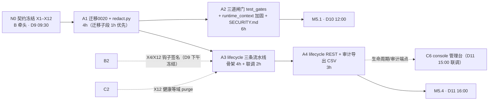

> 状态：待主理人批准　｜　版本：v1.0　｜　日期：2026-11-12
> 关联：docs/team_tasks/day09/dev-A-安全闸门与生命周期.md v1.2（任务书，唯一分工依据）｜docs/team_tasks/day09/day09-任务总览与DAG.md v1.5（§4.1 分工、§5 对接点、§6 写域、§7 检查点）｜docs/team_tasks/day09/contracts.md v0.3（X4/X8/X9/X12 契约正文）
> 上游依据：PRD line 436/439/440/443（FR-ADM-02/05/06/09）、line 500-524（AC-18/19/24/29/36/39）、line 577（Day 9 完成定义）、line 586-590（裁减与不得裁减清单）｜技术设计文档 line 1166-1174（Day 9 落地/功能/技术验收/风险）、line 778（迁移批次，Day 9 新增 0020 须修订留痕）｜AGENTS §2/§4/§5/§8/§10
> 变更记录见文末

---

# dev-A · Day 9 工作推进计划 · 安全闸门与数据生命周期

> 本计划是 dev-A 任务书（`docs/team_tasks/day09/dev-A-安全闸门与生命周期.md` v1.2）的**可执行展开**：把 4 个节点（A1–A4，19h＝骨架 17h＋联调 2h）拆成 S0–S7 八个步骤，每步含操作内容、交付物规格、自检校验与确认点。**每完成一步向主理人确认后再进入下一步**（沿用 Day 8 分步确认制）。本文不替代任务书，冲突时以任务书与总览为准。

---

## 1. 项目认知基线（本轮通读结论）

### 1.1 项目定位与架构

- **一句话定位**：CCRC 康养社区长者卧室的 3D 数字人陪伴系统——pad（1920×1080 长者端，VRM 数字人 + WebRTC 全双工语音）／console（照护台）／family（375px 家属端）三端同仓库；承担情感陪伴、用药提醒、健康数据采集、戏曲/天气检索、人工告警五类职责。**不做医疗诊断，不替代 SOS**。
- **三级路由（L0→L1→L2，低层不得被高层覆盖）**：`app/router/safety.py + rules.py`（≤10 条，一票否决，≤200ms）→ Laya 本地分类器（置信度 ≥0.85 直路由，否则澄清一次）→ DeepSeek/Qwen 兼容 API（ReAct + 工具）。
- **后端分层硬约束**：`app/services/` 是唯一写库层；依赖方向 `api | audio | scheduler | graphs → services → models` 单向，禁横向 import；`app/api/` 只做校验＋范围过滤＋调服务。
- **技术栈**：Python 3.12 + FastAPI + SQLAlchemy 2.x(async) + Alembic（只新增不改历史）+ PostgreSQL 15/pgvector（业务表与 `langgraph` schema 物理隔离）+ Redis + APScheduler + MCP（weather 7101 真实、mock-operations 7102 落库）。
- **三条身份铁律**：`elder_id/thread_id/device_id` 只从服务端 `runtime_context` 注入，客户端与模型传入一律丢弃（AGENTS §4.9）；`app/main.py` 装配归 dev-B 独占；密钥只经 Pydantic Settings 从 `.env` 读。

### 1.2 Day 9 在十天计划中的定位

PRD line 577：**权限闸门与安全**——三道隔离闸门 100% 覆盖、提示注入测试集、日志脱敏验证、审计日志、声纹调优报告（已产出待定稿）、教学周期重置／退房清数据。验收锚点：**AC-18/23/24/29/36/39**。dev-A 承接其中：三道闸门、日志脱敏、审计导出、教学重置、退房、away、`docs/SECURITY.md`；人设切换已裁减（总览 §8.1，不做）。本编排 Day 9 覆盖 D9–D11 三个工作日（总览 §10 Q1，待主理人确认）。

### 1.3 里程碑归属

| 里程碑 | dev-A 判据贡献 | 时点 |
| --- | --- | --- |
| M5.1 安全闸门收口 | A1 脱敏集中＋A2 三道闸门与覆盖率 100% | D10 12:00 |
| M5.4 管理台与生命周期可用 | A3 三条流水线＋A4 REST/CSV；退房端到端（A 负责后端 401/403 断言） | D11 16:00 |
| M5 Day 9 完成定义 | AC-18/19/24/36/39 证据、覆盖率 ≥70% 输入、SECURITY.md | D11 18:00 |

---

## 2. 现状实测（2026-11-12 代码取证，计划编制时逐条核实）

| # | 事实 | 位置 | 对计划的影响 |
| --- | --- | --- | --- |
| 1 | 脱敏分散 4 处：`_mask_phone`（auth_service.py:147）、`mask_phone`（staff_service.py:87）、`_mask_display_name`（device_service.py:153）、`redact_input`（decision_log_service.py:47） | `app/services/` | A1b 需收编 4 处为薄转发，**不保留第二套实现**（AGENTS §4.8） |
| 2 | 迁移头为 **0019**（`0019_day8_medication_plan_version.py`），无 0020 | `alembic/versions/` | A1a 新建 `0020_day9_medication_enums.py`，单头 |
| 3 | `medication_events` 两 CHECK 仅 4 值：`terminal_state`（无 `late_taken_reported`）、`failure_reason`（无 `rtc_failed`） | app/models/medication.py:129-137 | A1a 按契约 X8 各扩至 5 值；ORM CHECK 与迁移 DDL 同步改 |
| 4 | `app/core/logging.py` 为单行 JSON formatter，`trace_id` 恒注入，`msg`/`extra`/`exc`/`stack` 均未脱敏 | app/core/logging.py:53-75 | A1b 在 `JsonFormatter.format` 出口处接 `redact`（含 exc/stack 与 extra 业务字段） |
| 5 | `app/core/runtime_context.py` 闸门③骨架已完备（`Identity` 构造即合法、`require_identity()`、无身份即拒），但**会话闸门①（thread_id 服务端生成与归属校验）未做** | app/core/runtime_context.py | A2 增量聚焦闸门①：thread_id 服务端生成＋归属校验，不动 Identity 结构 |
| 6 | `audit_log_service.record_audit` 已存在（0007 提前落地），可直接断言 | app/services/audit_log_service.py:30 | A2/A3 审计断言复用，不新建审计实现 |
| 7 | `auth_service` 吊销机制走 `token_version`（校验时比对 claims["tv"]），**无批量吊销函数** | app/services/auth_service.py:297-303 | A3 增量 `revoke_all_tokens`＝按主体递增 `token_version`，旧凭证立即 401 |
| 8 | `voiceprint_service.delete_all_for_elder` 已存在（含 RETURNING 计数），注释自述「Day 9 回填 audit_logs 表」 | app/services/voiceprint_service.py:264-297 | A3 声纹清理增量为薄封装＋审计落库，不重写删除逻辑 |
| 9 | `lifecycle_service.py`、`app/api/lifecycle.py`、`app/api/audit_export.py`、`tests/test_gates.py`、`tests/test_lifecycle*.py`、`docs/SECURITY.md` **均不存在** | 全仓 | 全部为本包新建 |
| 10 | `app/api/__init__.py` ROUTERS 为追加式注册表（末尾追加，注释明载约定） | app/api/__init__.py:50-63 | A4 末尾追加 2 行，A→C 顺序提交，冲突面为零 |
| 11 | console 重置/审计入口置灰：frontend/src/console/App.tsx:34、layout/AppLayout.tsx:8,39 | frontend | 解除置灰归 **dev-C 的 C6**，A 不碰前端 |
| 12 | 全量测试基线 1191 passed（Day 8 收口口径），健康子图 6 条预期红已转绿 | tests/ | 每步自检须全绿不回退 |

---

## 3. 任务全景与依赖（A1–A4）

### 3.1 节点依赖与执行顺序



- **硬依赖**：N0 → A1 → A2；A1 → A3 → A4（包内串行，无跨人阻塞）。
- **软依赖（骨架先行，不等停工）**：A3 骨架用桩，待 B2 的 X4（`purge_elder_memories`）与 C2 的 X12（健康/通知/日报/工单四域 `purge_elder_data`）签名 D9 下午冻结后，D10 16:00 联调替换桩。
- **日历口径**：按总览 §10 Q1 默认 2.5 人日粒度，Day 9 覆盖 D9–D11 三个工作日；dev-A 排布 A1+A2 于 D9～D10 上午，A3+A4 于 D10 下午～D11。

### 3.2 写域与禁触（摘自任务书 §0，违者返工）

**写域仅限**：`alembic/versions/0020_*`（新）、`app/core/redact.py`（新）、`app/core/logging.py`（增量）、`app/core/runtime_context.py`（增量）、`app/services/lifecycle_service.py`（新）、`app/services/audit_log_service.py`（增量）、`app/services/auth_service.py`（增量：吊销）、`app/services/voiceprint_service.py`（增量：清理）、`app/services/device_service.py`（增量：解绑）、`app/api/lifecycle.py`（新）、`app/api/audit_export.py`（新）、`app/api/__init__.py`（末尾追加 2 行）、`tests/test_gates.py`（新）、`tests/test_lifecycle*.py`（新）、`docs/SECURITY.md`（新）＋对应测试。

**禁触**：`app/graphs/**`、`app/scheduler/**`、`app/agents/**`、`app/router/**`、`app/main.py`（B 独占）、`memory_service/health_service/notify_service/report_service/media_service`（B/C）、`app/core/context.py`（C）、`frontend/**`（C/D）、`tests/eval_gate.py`（D）。

**高风险文件（AGENTS §5，先出方案再落代码＋人工逐行读 diff）**：`0020_*` 迁移、`runtime_context.py`、`auth_service.py`——本计划 S1/S3/S4 各步的「方案要点」小节即方案登记，落代码前随该步确认一起经主理人过目。

---

## 4. 分步执行计划（S0–S7）

> 每步结束输出**固定格式汇报**：①改了哪些文件（diff 摘要）②验收命令原文输出③等待项/漏洞登记④是否可进下一步。主理人确认后才进入下一步。

### S0 · 启动门槛核对（0.5h，D9 09:30 前）

**内容**：
1. 确认 N0 契约冻结完成：`docs/team_tasks/day09/contracts.md` 状态行已改「已冻结」，重点核对 **X8**（迁移 0020 两枚举）、**X4/X12**（钩子签名与 PurgeRef 结构）、**X9**（脱敏与覆盖率判据归属 A）。
2. 环境自检：`docker compose up -d postgres redis` 起依赖；`uv run alembic current` 确认单头 0019；`uv run pytest -q` 确认基线全绿（健康子图既有用例除外，如仍红须先确认是既有预期红）。
3. 写域核对：`git status` 干净起步；确认无本包外文件待改。

**交付物**：S0 核对清单（三项结论写进 §执行记录）。
**自检**：`uv run alembic heads` 单头；`uv run pytest -q` 无新增红。
**确认点**：❶ N0 是否冻结（未冻结则联调段全部顺延，骨架段仍可开工）。

---

### S1 · A1a 迁移 0020（1h，**D9 12:00 前交付**，B4/D2 在等 X8）

**方案要点（高风险文件，随本步确认）**：新建 `alembic/versions/0020_day9_medication_enums.py`，`op.drop_constraint`＋`op.create_check_constraint` 重建两条 CHECK：`terminal_state` 由 4 值扩 5 值（＋`late_taken_reported`，PRD line 320-325）、`failure_reason` 由 4 值扩 5 值（＋`rtc_failed`，PRD line 336）；**同步改** `app/models/medication.py:129-137` 两处 ORM CHECK 保持 DDL 与 ORM 一致；downgrade 精确回 4 值（先断言无新值行，有则 downgrade 拒绝并提示，防止数据丢失）；不改任何既有行数据；不碰历史迁移。

**注意**：`app/models/medication.py` 不在任务书 §0.1 写域清单字面上，但 ORM CHECK 与迁移不一致会直接造成 autogenerate 漂移与运行期拦截失效——**此为任务书留白，本计划显式登记：ORM 两行 CHECK 属迁移同义变更，纳入 S1 一并修改**（若主理人不认可，则仅改迁移并在执行记录登记差异）。请确认点❷裁决。

**交付物**：
| # | 交付物 | 质量要求 |
| --- | --- | --- |
| 1 | `0020_day9_medication_enums.py` | upgrade/downgrade 可逆；revision 单头接 0019 |
| 2 | `app/models/medication.py` CHECK 两处（待❷裁决） | 与迁移 DDL 逐字一致 |
| 3 | TD 文末修订记录新增一条（Q3） | 同提交：写明「Day 9 迁移由 0 张改 1 张（0020），依据 PRD line 320-325/336」；版本号沿用 TD 现有最大值＋1 |

**自检（验收命令原文）**：
```bash
uv run alembic upgrade head && uv run alembic downgrade -1 && uv run alembic upgrade head
uv run alembic current && uv run alembic heads          # 期望：单头 0020
# DB 侧断言：terminal_state 接受 'late_taken_reported'、failure_reason 接受 'rtc_failed'，
# 写入非法值仍被 CHECK 拒绝（psycopg 脚本或 pytest 用例各 1 条正例 1 条反例）
uv run pytest tests/ -q -k "medication"
uv run ruff check app tests alembic && uv run ruff format --check app tests
```
**通过判据**：迁移三连（upgrade→downgrade→upgrade）无错、单头、正反例断言过、ruff 全绿。
**确认点**：❷ ORM CHECK 是否随迁移同改；❸ S1 交付即向 dev-B（X8 消费方）发交接通知（见 §5.1）。

---

### S2 · A1b 脱敏集中化（3h）

**内容**：
1. 新建 `app/core/redact.py`：集中脱敏函数至少覆盖手机号、身份证号、密钥/API Key、完整住址；命名与签名设计成**纯函数、无 I/O、可单测**；保留既有掩码格式（如 `138****5678`）以最小化调用方行为变化（风险 R-A1）。
2. 收编 4 处分散实现（app/services/auth_service.py:147、staff_service.py:87、device_service.py:153、decision_log_service.py:47）：旧函数体删除或改为对 `redact.py` 的薄转发，**grep 验收零命中**。
3. `app/core/logging.py` 接线：`JsonFormatter.format` 在组装 payload 后、`json.dumps` 前对 `msg`、全部 extra 业务字段、`exc`、`stack` 逐值过 `redact`；**`trace_id` 不参与脱敏**（任务书红线）。
4. 日志脱敏验证样本：构造含手机号/身份证/密钥的请求各 1 次，采集日志样本，跑任务书 §1.4 的三条 grep，期望零命中。

**交付物**：
| # | 交付物 | 质量要求 |
| --- | --- | --- |
| 1 | `app/core/redact.py` ＋ 单测 | 纯函数；正例/反例/边界（空串、None、半截号码）覆盖 |
| 2 | 4 文件收编 diff | 旧实现零残留；调用方无需改签名（薄转发保签名） |
| 3 | `app/core/logging.py` 接线 diff | 每行日志仍带 trace_id；exc/stack 亦脱敏 |
| 4 | 日志样本与 grep 结果 | 回填 §执行记录（S2 行） |

**自检**：
```bash
grep -rn "def _mask_phone\|def mask_phone\|def _mask_display_name\|def redact_input" app/services/
# 期望：零命中
uv run pytest tests/ -q -k "trace or redact or logging"
uv run pytest -q                                   # 全量不回退
```
**通过判据**：grep 零命中＋三条敏感字段 grep 零命中＋trace_id 用例全绿＋全量测试不回退。
**确认点**：❹ S2 完成即 A1 整体收口，CP 报告给主理人。

---

### S3 · A2 三道隔离闸门 ＋ SECURITY.md（6h，D9 下午～D10 上午）

**方案要点（高风险文件 runtime_context.py，随本步确认）**：闸门③已有骨架（Identity 构造即合法），本步**只加闸门①**：`thread_id` 按 `(elder_id, session_seq)` 由服务端生成——在 `runtime_context.py` 增加会话标识的生成与归属校验辅助（或独立小函数集），校验请求携带的 `thread_id` 是否归属当前身份（device 身份的 `elder_id` 或服务端会话表记录），伪造/跨长者 → 403；**不扩 Identity 字段、不改 ContextVar 载体结构**。闸门②（记忆检索强制 elder_id）靶点在 `memory_service`，属 dev-B 写域——A **只写攻击用例证伪，不修实现**，发现漏洞登记给 B（R-A2）。

**内容**：
1. 闸门①加固（上方案）。
2. `tests/test_gates.py`：7 类用例 × 正反（任务书 §2.4 表逐条落地）：伪造 thread_id 403＋审计＋trace_id、跨长者向量检索拒绝、以 B 的 elder_id 调工具拒绝、护工 A 请求 B 详情 403、家属 C 请求未绑定 B 日报 403、停用/解绑后旧凭证三类立即失效（AC-24，复用 `token_version` 机制）、正常路径全绿不误拦。**每条越权断言三件事**：状态码/拒绝结果、`audit_logs` 新增行数、`trace_id` 存在——逐条人读签认（TD line 1174 风险）。
3. 覆盖率：`pytest --cov` 报告，核心 Tool 与权限场景 **100%**（PRD FR-TC-06）。
4. `docs/SECURITY.md` 四节：威胁模型／降级矩阵／数据保留／HITL 清单（TD line 1169）。

**交付物**：
| # | 交付物 | 质量要求 |
| --- | --- | --- |
| 1 | `app/core/runtime_context.py` 增量 | 只加闸门①；既有 Identity/ContextVar 结构不动 |
| 2 | `tests/test_gates.py` | 7 类全落；断言三件事齐；无 skip/无放宽 |
| 3 | `docs/SECURITY.md` | 四节齐；口径引自 PRD/TD 与 contracts，不发明新数值 |
| 4 | 覆盖率报告 | 核心 Tool/权限 100% 的 term-missing 输出存档 |
| 5 | 人读签认记录 | 每条断言一行「断言语义＋确认人」回填 §执行记录 |

**自检**：
```bash
uv run pytest tests/test_gates.py -q               # 越权用例全被拦＝测试全绿
uv run pytest --cov=app --cov-report=term-missing -q
uv run ruff check app tests && uv run ruff format --check app tests
```
**通过判据**：7 类用例全过；覆盖率达标；SECURITY.md 四节齐。
**注意**：闸门②③用例若因 B1/B2 未加固而红——**这是发现漏洞不是失败**，登记给 B 后 M5.1 前复跑转绿；**不得放宽断言**。
**确认点**：❺ 闸门①方案与攻击用例清单过目；❻ 漏洞登记清单是否需要即时转达 dev-B（见 §5.2）。

---

### S4 · A3 生命周期服务（骨架 4h ＋ 联调 2h）

**方案要点（高风险文件 auth_service.py，随本步确认）**：`revoke_all_tokens(session, *, staff_id|guardian_id|device_id)`＝将该主体所有 token 行的 `token_version` 整体＋1（既有校验链 app/services/auth_service.py:297-303 即时 401），幂等（重复调用结果一致）；`lifecycle_service.py` 三条流水线**只编排＋审计＋自有三项清理**（auth 吊销／voiceprint 清理（薄封装既有 `delete_all_for_elder`＋回填 audit_logs）／device 解绑），业务表清理一律调 X4/X12 域钩子，**不直写 `memory_chunks` 等他人表**（AGENTS §2.1）。

**内容**：
1. **骨架段（4h）**：三条流水线＋审计，X4/X12 用桩（接口按 contracts.md v0.3 已定义签名，桩返回合成 PurgeRef 并打 explicit 桩标记）：
   - ①教学周期重置（FR-ADM-02／AC-19）：无确认令牌 → 409 零副作用；带令牌 → 调 X12 清业务数据＋X4 清记忆索引；保留账号/角色/配置/重置审计；重置后业务记录与记忆索引均不可检索。
   - ②退房（FR-ADM-09）：五步顺序吊销 token → 删声纹 → 清记忆（X4）→ 健康脱敏归档（C 的钩子，内部用 `redact.py`，不物理删行）→ 设备解绑；**每步 1 条审计、每步独立可重入**，中途失败可单独重跑，不回滚已吊销 token。
   - ③away 暂离：暂停采集与提醒触达（不改药单/计划本身）；日报改暂离告知；恢复后按原计划继续。
2. **联调段（2h，D10 16:00，X4/X12 签名冻结后）**：桩换真钩子；跑三条流水线全链路＋审计行数对照（步数＝审计行数）。
3. `tests/test_lifecycle*.py`：三条流水线 × 正反 × 审计行数断言；退房端到端后端断言（pad 旧 token→401、原绑定家属→403）。
4. `device_service.unbind_all` 增量（退房解绑）。

**交付物**：
| # | 交付物 | 质量要求 |
| --- | --- | --- |
| 1 | `app/services/lifecycle_service.py` | 编排＋审计＋自有清理；无跨域直写；每步可重入 |
| 2 | `auth_service.py` 吊销增量 | token_version 递增；幂等；旧凭证立即 401 |
| 3 | `voiceprint_service.py`/`device_service.py` 增量 | 薄封装＋审计落库，不重写既有删除逻辑 |
| 4 | `tests/test_lifecycle*.py` | 正反＋审计行数＋幂等（重跑不重复归档） |
| 5 | X4/X12 联调证据 | SQL 行数＋401/403 实测，回填 §执行记录 |

**自检**：
```bash
uv run pytest tests/test_lifecycle*.py -q
# 桩期标记检查：联调段完成后 grep 桩标记须零命中（无残留桩）
uv run ruff check app tests && uv run ruff format --check app tests
```
**通过判据**：任务书 §3.4 九行验收表全过（409/401/403/脱敏归档 grep 零命中/审计行数=步数）；骨架期允许 X4/X12 桩标记存在，联调段后必须清零。
**确认点**：❼ 骨架完成（桩版）；❽ X4/X12 联调完成（与 dev-B/dev-C，见 §5.2）。

---

### S5 · A4 生命周期 REST ＋ 审计导出（3h）

**内容**：
1. `app/api/lifecycle.py`：重置／退房／away 三端点，**admin-only**，重置与退房需二次确认令牌；薄路由（只校验＋调 service＋序列化）。
2. `app/api/audit_export.py`：操作日志 CSV 导出，支持按时间区间与操作人筛选（FR-ADM-05，P2）；**不含 PII 明文**（复用 `redact.py`）；行数与看板查询一致。
3. `app/api/__init__.py` 末尾**追加 2 行** ROUTERS（只增不改；与 dev-C 的 4 行追加按 A→C 顺序提交）。

**交付物**：
| # | 交付物 | 质量要求 |
| --- | --- | --- |
| 1 | `app/api/lifecycle.py` | 3 端点；403/409 口径与契约一致 |
| 2 | `app/api/audit_export.py` | CSV；时间＋操作人筛选；无 PII 明文 |
| 3 | ROUTERS 追加 2 行 | 末尾追加；`main.py` 未被修改 |
| 4 | 接口测试 | 权限 × 筛选 × 二次确认全覆盖 |

**自检**：
```bash
uv run pytest tests/test_api_lifecycle*.py tests/test_api_audit_export*.py -q
grep -c "router" app/api/__init__.py               # 期望较基线 +2
git diff app/main.py                               # 期望：空（装配归 B）
uv run ruff check app tests && uv run ruff format --check app tests
```
**通过判据**：非 admin 403＋审计；无二次确认令牌 409；CSV 抽 3 条与 `audit_logs` 表逐字段一致；PII grep 零命中。
**确认点**：❾ S5 完成即 M5.4 的 A 侧判据达成；向 dev-C 发端点交接通知（见 §5.1）。

---

### S6 · M5.4 联调与证据回填（D11 15:00–16:00，0.5h＋配合）

**内容**：与 dev-C（console 触发）、dev-D（pad/family 前端表现）三方联调**退房端到端**：
- C 在 console 触发退房 → A 确认后端断言：旧设备 token 401、原绑定家属查日报 403＋审计、每步审计行数；
- D 确认前端表现：pad 落回登录/未授权态、family 显示「无权查看该长者的数据」/空态（前端兜底已存在，不需新前端代码，只验证）；
- C 确认 console 该长者显示 archived 且入口不可再操作。

**交付物**：三方联调证据各一份（SQL 行数／HTTP 状态码／截图），回填 §执行记录。
**确认点**：❿ M5.4 退房端到端三方签认。

---

### S7 · 收口门禁与执行记录回填（0.5h，D11 18:00）

**内容**：
1. M5 收口四件套：
```bash
uv run ruff check app tests && uv run ruff format --check app tests
uv run pytest -q
uv run python tests/eval_gate.py
pnpm --dir frontend build   # tsc/build 由 C/D 主跑，A 确认无因本包改动引入的红
```
2. 任务书 §5 执行记录表 4 行＋对接登记 6 行全部回填真实值；漏洞登记清单核对（A2 登记给 B 的项是否已闭环转绿）。
3. 任务卡状态行改「已完成」→ 提交（pre-commit 自动刷新 PROGRESS.md）。

**确认点**：⓫ 收口门禁全绿＋执行记录回填完整＝dev-A 包交付完成。

---

## 5. 跨成员交接与联调提醒（按用户要求显式列出：与谁交接、交接什么）

### 5.1 dev-A 作为**提供方**

| 对接点 | 交接对象 | 交接内容 | 时点 | 交接物形式 |
| --- | --- | --- | --- | --- |
| **X8 迁移 0020** | **dev-B**（B4 用 `late_taken_reported` 落库）、**dev-D**（D2 用 `rtc_failed` 落库） | 迁移号、两枚举扩值、upgrade/downgrade 可逆证明 | **D9 12:00 前**（CP1） | 提交哈希＋`alembic current` 输出，在 dev-B/dev-D 任务书执行记录或 IM 转达 |
| **生命周期/审计端点** | **dev-C**（C6 console 三页消费：重置/退房页、审计导出按钮） | 3 个生命周期端点路径/请求体/403/409 口径＋CSV 导出端点与筛选参数 | D11 15:00 联调前 | contracts.md 回填（若 N0 未覆盖字段细节）＋端点清单 |

### 5.2 dev-A 作为**消费方**

| 对接点 | 交接对象 | 交接内容 | 时点 |
| --- | --- | --- | --- |
| **X4 记忆清理钩子** | **dev-B**（B2 交付 `memory_service.purge_elder_memories`） | 函数签名与 PurgeRef 结构（contracts.md X4 已冻结） | 签名 D9 下午冻结，**D10 16:00 联调**（A3 桩替换） |
| **X12 域清理钩子集** | **dev-B**（用药域 purge）＋**dev-C**（健康/通知/日报/工单四域 purge） | 六个 `purge_elder_data` 签名、reason 枚举、幂等口径 | 同上，D10 16:00 联调 |
| **X9 门禁与脱敏判据** | **dev-D**（D3 闸门 E） | 日志脱敏 grep 判据与覆盖率口径归 A 提供证据 | D11 16:00 复跑 |
| **闸门②③漏洞登记** | **dev-B**（B1 工具闸门／B2 记忆召回隔离） | A2 攻击用例发现的实现侧漏洞清单（A 只证伪不修） | 随❻即时转达，M5.1 前复跑 |

**联调提醒**：凡跨人联调（S4 联调段、S6、S7），执行前**先在本计划 §执行记录登记等待项**，联调完成由双方各留证据（任务书 §5.3 要求 SQL 行数／状态码／trace_id／截图，里程碑抽查须当场复现）。

---

## 6. 待确认项（不阻塞 S0/S1，须在对应步骤前裁决）

| # | 待确认 | 影响步骤 | 默认执行口径 |
| --- | --- | --- | --- |
| **Q-A1** | **日历口径**（总览 §10 Q1）：Day 9 按 2–3 人日粒度覆盖 D9–D11 三个工作日，Day 10 交付项后移 | 全局排期 | 按 2.5 人日执行；若要求压回单日历日，按任务书 R-A5 先裁 A4 的 CSV 筛选维度（P2），**A2 闸门与 A3 重置（P0）不动** |
| **Q-A2** | **ORM CHECK 是否随迁移 0020 同改**（`app/models/medication.py` 未在任务书写域字面清单内） | S1 | 本计划建议**同改**（否则 DDL 与 ORM 漂移、autogenerate 会再生成一条冗余迁移）；请主理人裁决并留痕 |
| **Q-A3** | **TD line 778 修订留痕**（总览 §10 Q3）：Day 9 迁移 0 张改 1 张 | S1 | 同提交在 TD 文末修订记录新增一条（AGENTS §4.7） |
| **Q-A4** | **闸门①落点形态**：thread_id 归属校验函数放 `runtime_context.py` 内还是独立 `app/core/session_gate.py` | S3 | 默认并入 `runtime_context.py`（任务书写域仅列该文件） |

---

## 7. 风险与回退（摘任务书 §6，补计划层处置）

| # | 风险 | 处置 |
| --- | --- | --- |
| R-A1 | 收编脱敏后旧调用方行为变化（掩码格式不一致）→ 既有测试红 | 集中函数为唯一口径，改测试期望值；不保留两套实现 |
| R-A2 | 闸门②③用例因 B 未加固而红 | 登记漏洞给 B，不放宽断言；M5.1 前复跑 |
| R-A3 | 退房流水线中途失败部分清理 | 每步独立审计＋可重入；失败步骤单独重跑，不回滚已吊销 token |
| R-A4 | 迁移 0020 出现多头 | 只新增；`alembic heads` 须单头；与 C 的 ROUTERS 追加按 A→C 顺序提交 |
| R-A5 | 日历压缩（Q-A1）导致超时 | 先裁 A4 CSV 筛选维度（P2 降级为只按时间筛选）；A2/A3 的 P0 不容顺延 |
| R-A6 | X4/X12 签名延迟冻结 → A3 联调段空转 | 骨架段先行不阻塞；联调段若 D10 16:00 未就绪，登记等待项并先推进 A4（A4 不依赖钩子真身） |

---

## 8. 执行记录与对接登记（待回填）

| 日期 | 步骤 | 提交 | 验收结果 | 等待项/漏洞登记 |
| --- | --- | --- | --- | --- |
| 2026-11-12 | S0 | `5f488a0` | ①N0 **未冻结**（contracts.md 仍「待冻结 v0.3」，X1–X12 正文已齐）②迁移单头 0019、DB current 0019、postgres/redis 健康 ③`pytest -q` 全量 **1392 passed**（6:30）④工作区仅本计划两件，无业务改动 | **等待项：N0 冻结评审（B 牵头四方签认）**；X8 正文 v0.3 已定，骨架段可先行 |
| 2026-11-12 | S1（A1a） | `2602d7d`（feat 0020）＋计划件 `5f488a0`（docs） | 迁移三连 upgrade→downgrade→upgrade 通过、单头 `0020_day9_medication_enums`；DB 正例（两新值 INSERT 0 1）反例（bogus_value 被 `ck_medication_events_terminal_state` 拒绝）均过；`pg_constraint` 直读两 CHECK 与 ORM 逐字一致；`ruff check/format` 全绿；用药相关 34 tests passed | 观察项：`app/models/__init__.py` 未导入 medication/workorder 等模块 → `alembic check`/autogenerate 元数据缺表（既有噪音，非 0020 引入，**禁止**在元数据补齐前跑 autogenerate）；踩坑留痕：alembic env 会套 naming_convention，op 约束名必须传短名 |
| 2026-11-12 | S2（A1b） | 待提交 | `app/core/redact.py` 唯一实现＋单测 36 条；4 处旧实现删除改 import re-export（`def` 零命中）；logging formatter 出口接线（msg/extra/exc/stack 过 redact，trace_id 白名单）；日志样本三条 grep 零命中（phone/idcard/secret）；`ruff check/format` 全绿；全量 **1449 passed** 零回归 | 行为变更留痕（R-A1）：auth 日志手机号格式 `****0001`→`138****0001`（与响应体统一）；`redact_obj` 不做猜测式姓名掩码（姓名是字段级 mask_name 职责） |
| — | S3（A2） | — | — | — |
| — | S4 骨架（A3） | — | — | — |
| — | S4 联调（X4/X12） | — | — | — |
| — | S5（A4） | — | — | — |
| — | S6（M5.4） | — | — | — |
| — | S7（收口） | — | — | — |

**对接登记**：

| 对接点 | 对方 | 提供/消费 | 冻结时点 | 联调时点 | 状态 |
| --- | --- | --- | --- | --- | --- |
| X8 迁移 0020 | B4／D2 | 提供 | N0 | D9 12:00 | 待 |
| X4 记忆清理钩子 | B2 | 消费 | D9 下午 | D10 16:00 | 待 |
| X12 域清理钩子集 | B2／C2 | 消费 | D9 下午 | D10 16:00 | 待 |
| X9 门禁与脱敏判据 | D3 | 消费 | N0 | D11 16:00 | 待 |
| 生命周期/审计端点 | C6 | 提供 | N0 | D11 15:00 | 待 |
| 装配需求（如需） | B（main.py 持锁） | 提需求 | — | — | 待 |

---

## 变更记录

| 版本 | 日期 | 说明 |
| --- | --- | --- |
| v1.0 | 2026-11-12 | 首版。基于 dev-A 任务书 v1.2 与 Day 9 总览 v1.5 编制的可执行展开：S0–S7 八步、每步交付物规格与量化自检、11 个确认点；现状实测 12 条逐项回读源码取证（迁移头 0019、脱敏 4 处行号、logging formatter 未脱敏、runtime_context 闸门③已有骨架、voiceprint 已有 delete_all_for_elder、auth 走 token_version）；登记 4 项待确认（Q-A1 日历口径、Q-A2 ORM CHECK 同改、Q-A3 TD 修订、Q-A4 闸门①落点形态）与 6 条风险；跨成员交接按提供/消费双向列明交接对象、内容与时点。本轮仅产出计划，未写任何业务代码。 |
