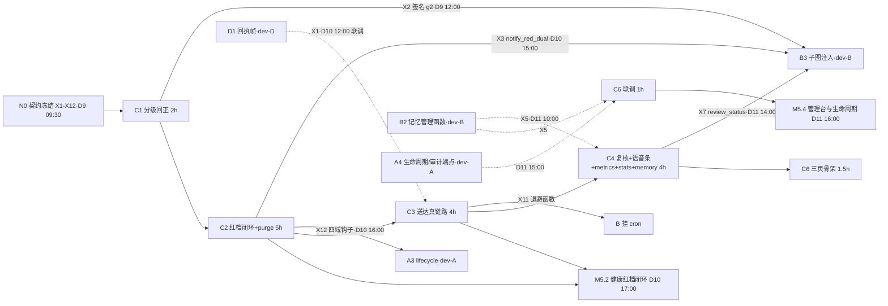

> 状态：待确认（主理人批准后按步执行）　｜　版本：v1.0　｜　日期：2026-11-12
> 关联：docs/team_tasks/day09/dev-C-健康通知闭环与管理台.md（任务卡 v1.3）｜docs/team_tasks/day09/day09-任务总览与DAG.md v1.5（§4.3 分工、§5 对接点、§6 写域）｜docs/team_tasks/day09/contracts.md v0.3（X1–X12）
> 上游依据：PRD line 357–361（分级三档＋校验）、line 365–374（FR-HLT-01~10）、line 378–392（告警与通知状态机）、line 394–400（FR-ALT-01~05）、line 405–412（FR-RPT-01~04）、line 297（FR-CON-06）、line 441（FR-ADM-07 已裁减）、line 458（FR-TC-08 /metrics）、line 487–505（AC-09/10/13/21/22/23/25/38）｜技术设计文档 line 1017–1018（分级在代码＋HITL）、line 1169/1172（console 四页→三页、统计/记忆/导出）
> 变更记录见文末

---

# dev-C Day 9 工作推进计划 · 健康通知闭环收口 ＋ console 管理台

## 0. 效力声明

本文遵守 `AGENTS.md` 前置节铁律：**表名、字段、阈值、接口口径一律回 PRD 与技术设计文档取**；大纲与计划件不进事实效力链。本文是任务卡 v1.3 的落地执行计划，不另立事实；与任务卡冲突时以任务卡为准，与 PRD/TD 冲突时以基线为准并回改本文。

**执行模式**：按主理人要求**分步确认制**——每完成一步即停下汇报 diff 摘要与自检证据，经确认后再进下一步。本轮（S0 前）**只产出本计划文档，不写任何业务代码**。

**人设裁减口径（2026-11-12 主理人决定，贯穿全程）**：C5 人设切换节点已裁减，`persona_service.py`／`elder_service.py`／`app/core/context.py`／`app/api/personas.py` **一概不碰**，console 人设入口保持置灰，X6 契约作废。释放的 3.5h 只作缓冲与全员联调支援，不擅自加项。

## 1. 项目认知基线（dev-C 视角一页版）

- **系统**：CCRC 康养社区长者卧室 3D 数字人陪伴系统。三端同一仓库：pad（长者 1920×1080 大字）、console（护工/医生/管理员分流）、family（家属 375px 移动优先）。
- **Day 9 位置**：Iter 5 第一阶段（覆盖 D9–D11 三个工作日，总览 Q1 口径）。前八天已有身份权限/语音双链路/3D+声纹/Agent 闭环+用药子图/健康域 REST/日报与媒体。Day 9 主线＝**安全闸门收口＋Day 8 遗留 31 项缺口全量修复＋console 管理台与生命周期**；Day 10 是 Docker/Langfuse/文档齐套。
- **dev-C 在 Day 9 的五节点**（队列顺序 C1→C2→C3→C4→C6，合计 17.5h＝骨架 14.5h＋联调 3h）：
  1. **C1 血压分级回正**（F04，2h）——低血压误判红、睡眠 12h 自加界、主诉不判黄，连同 day08 计划件同提交回改；**D9 12:00 前交付 X2 给 B3**（关键路径第一环）；
  2. **C2 红档建单双通知＋升级对象＋事件关闭联动＋X12 四域 purge 钩子**（F05/F12/F13，5h）；
  3. **C3 送达真链路＋日报时点与重试节奏**（F01/F11，4h）——拆除无条件 delivered，提供 X11 退避函数给 B 挂 cron；
  4. **C4 复核落库（X7）＋日报语音条＋media 接线＋/metrics＋stats＋memory API**（F07/F30/F21/F26，4h）；
  5. **C6 console 三页＋空 catch 修复**（F25，2.5h）。
- **分层硬约束**：`app/services/` 唯一写库层；`api → services → models` 单向依赖；**`app/api/` 禁 import `graphs`**（F07 复核只写库，resume 由 B 的 scheduler 扫描）；**`app/scheduler/` 归 B**，C 只提供 `next_retry_at` 退避函数不改调度文件。
- **教学口径红线**：不说医疗诊断话术；日报与统计页固定标注「教学模拟信息，不构成医疗诊断」；异常值一律「建议问医生」＋人工告警。
- **关键路径**：`N0 → C1 → C2 → C4 → C6` ＝ 12h（骨架），C 链是全队最长的包内硬串行链——C1 拖 12:00 会直接压 M5.2（D10 17:00），故 C1 无条件最先开工。

## 2. 代码现状核查基线（2026-11-12 实测，执行起点）

| # | 项 | 实测现状（已逐条核对源码） | 对 dev-C 的含义 |
| --- | --- | --- | --- |
| 1 | 分级常量 | `app/services/health_service.py:74` `RULE_VERSION="g1"`；`:83/:85` `SYSTOLIC_RED_LOWER=90`／`DIASTOLIC_RED_LOWER=60`；`:159/:171` 低血压判红分支；`:100` `SLEEP_GREEN_UPPER=12.0`＋`:187-190` >12h 判黄 | C1 删除两 RED_LOWER 常量与判红分支、删 SLEEP_GREEN_UPPER、`g1→g2`；**既有 g1 记录不回改** |
| 2 | 主诉占位 | `health_service.py` complaint「仅参与日志」注释＋`logger.debug` 占位，非急症主诉不判黄 | C1 改判黄（未命中急症时） |
| 3 | 红档缺口 | **S0 实测修正（任务书表述滞后）**：`health_service.py:59` **已 import** `notify_service`；红档**已建单＋发家属通知**——`_open_red_followup`（`:746-791`）在 `:399`（黄升红）与 `:434`（新红档）两处调用，`open_work_order(severity="red", dedupe_token=f"health_record:{record_id}:red")`＋`send_guardian_notifications`。**真实缺口＝不发护工（staff）侧通知**，且该函数未暴露为 X3 签名 | C2 把 `_open_red_followup` 重构为 `notify_red_dual`（X3）：保留建单与家属通知，**补 staff 通知各 1 条**，返回 `NotifyRef(notification_ids, risk_event_id, work_order_id)`；建单 dedupe_token 不变 |
| 4 | 升级假出口 | `notify_service.py:718` `escalate_red_event` 状态机正确但 `:759` 通知发 primary_care 护工而非 admin；`:690` `scan_escalations` WHERE 缺 `acknowledged_at IS NULL` | C2 改 admin 收件人＋扫描补确认过滤；**不动 `safety_service.escalate_safety_event` 既有接线** |
| 5 | 事件字段从不写 | `safety_service.py:82-83/:107` 声明 `acknowledged_at`/`closed_at` 但从不写入；`work_order_service.py:387` 的 `closed_at` 写的是工单 | C2 补确认写 `acknowledged_at`、工单关闭联动写事件 `closed_at`，顺序不可反、未关工单关事件 409 |
| 6 | 送达伪造 | `notify_service.py:646` `scan_pending_notifications` 循环内 `:799` 无条件 `_STATUS_DELIVERED`；`RETRY_INTERVAL_S=30`（`:45`）未使用；`:551/:566` `mark_notification_sent`/`mark_notification_delivered` 生产调用零次 | C3 删伪造赋值，`delivered` 只由回执帧写入（X1）；`retry_count>=3` 置 `failed` |
| 7 | API 落点 | `app/api/alerts.py` 已存在（notifications 三端点）；`app/api/__init__.py:43` ROUTERS 注册表模式；`app/api/stats.py`/`memory.py`/`metrics.py` 均不存在 | C3 的 admin 重扫端点落 `alerts.py`；C4 三新文件＋ROUTERS 末尾追加 3 行（人设行本就不存在，无需删） |
| 8 | 复核与 media | `app/api/health_records.py:505/:544` 直调 `review_health_record`（无 resume，正确）；`report_service.py` 无 `audio_url` 写入；`media_service` 六函数在 `app/` 内零调用（`tool_impls.py` 过渡期随机换一首、不写 history） | C4 复核写 `review_status`（X7）；media 接线只供函数由 B 改调用侧（X10）；「换一段」改顺序续播 |
| 9 | console | `AppLayout.tsx:38/:39/:40` 教学重置/人设配置/审计日志三入口 `enabled:false`；无记忆页/统计页；`WorkOrdersPage.tsx:271` 空 catch 吞 403/422；医生趋势图已真实落地 | C6 只解除**重置＋审计**两处置灰，人设保持置灰；三个新页原生 CSS＋`var()` 引 tokens.css，不引组件库 |
| 10 | 测试 | 既有 `tests/test_alerts_api.py` 等 conftest 单事务回滚隔离模式；无 purge/退避/送达链专项测试 | C 交付内嵌测试照既有隔离模式写；C1 若既有测试断言了错误阈值，**改测试期望值对齐 PRD，不改 PRD** |

## 3. 任务拆解总表（前置 · 交付物 · 量化验收）

| # | 任务 | 人时 | 前置 | 交付物 | 量化验收（命令级/数据级） |
| --- | --- | --- | --- | --- | --- |
| C1 | 血压分级回正＋计划件回改（X2） | 2h | N0 契约冻结 | `health_service.py` 阈值修正＋`docs/plans/day08/dev-a-数据分级规则层.md` 回改（同提交）＋9 边界参数化测试＋主诉/睡眠/缺失测试 | 9 边界断言全过（§5-S1 表）；`grep -n "RED_LOWER\|SLEEP_GREEN_UPPER" app/services/health_service.py` 零命中；新记录 `rule_version='g2'`；`SYSTOLIC_RED_UPPER=180`/`DIASTOLIC_RED_UPPER=120` 不变 |
| C2 | 红档建单双通知＋升级 admin＋事件关闭联动＋X12 四域 purge | 5h | C1；消费 X9 错误体口径 | `health_service.py` 红档分支＋`notify_red_dual`、`notify_service.py` 升级与扫描、`safety_service.py`/`work_order_service.py` 联动、四域 `purge_elder_data`＋单测、幂等集成测试 | REST 录入 185/95 → risk_events 1 条 red open＋work_orders 1 条 red＋notifications 2 条（护工＋监护人各 1）；语音路径不产生第二事件/工单；同 record_id 幂等、同键异内容 409；2 分钟未确认 → escalated＋admin 收通知且 risk_events 行数不变；工单 open 关事件 409；工单 closed → 事件 closed_at 非空 |
| C3 | 送达真链路＋日报时点与重试（X11）＋admin 重扫端点 | 4h | N0（X1 帧已冻结）；软：D1 回执生产者并行 | `notify_service.py` 扫描修正＋mark_* 接线、`next_retry_at` 退避函数＋单测、`alerts.py` admin-only 重扫端点 | 无回执扫描 3 次 → `failed` 永不 delivered；有回执 → delivered＋sent_at 取回执时间；`grep -n "_STATUS_DELIVERED" app/services/notify_service.py` 只在 `mark_notification_delivered` 内；告警 30/60/90s、日报 1/5/15min 可断言；日报 20:00（`grep "21:30" app/scheduler/health_jobs.py` 零命中，B 改 C 核对）；`is_mock=true` 不计入送达率分母 |
| C4 | 复核落库（X7）＋语音条＋media 接线＋/metrics＋stats＋memory API | 4h | C2；软：B2 X5 骨架先行（**X10 已裁减作废 v0.5，media 接线以现有媒体库为对象**） | `api/health_records.py` 复核写 `review_status`、`report_service.py` TTS 写 `audio_url`、`media_service` 接线＋顺序续播＋history（现有媒体库条目）、`api/metrics.py`/`stats.py`/`memory.py` 三新文件、ROUTERS 追加 3 行 | `grep -rn "from app.graphs" app/api/` 零命中；复核落 `confirmed`/`corrected`＋`reviewed_by`（无 `reviewed_at`，不新增 schema）；日报 `audio_url` 非空可播；播放后 `media_history` 有行、「换一段」顺序续播；`curl /metrics` 三指标、未授权 401；统计三指标与 SQL 复算一致；跨长者 chunk_id 403＋审计（越权由 B service 层拒绝） |
| C6 | console 三页＋解除置灰＋空 catch 修复 | 2.5h | C4；软：A4 端点、B2 X5 骨架先行 | 教学重置与退房页、记忆管理页、统计与审计页＋路由＋侧栏两处解除置灰、`*-api.ts` 按冻结契约、`WorkOrdersPage.tsx:271` 行内错误提示、走查截图 | 三页可达且人设仍置灰；重置/退房二次确认弹窗、取消零请求；退房后该长者显示 archived 且入口不可再操作；记忆删除列表即时移除；导出 CSV 与审计表一致；越权显示 403 文案不静默；`pnpm --dir frontend exec tsc --noEmit` 与 `vite build` 全绿；`grep -r "three-vrm" frontend/dist/console frontend/dist/family` 零命中 |
| C7 | 联调段与收口（不占连续队列） | 3h | 各节点骨架完成 | X1（D10 12:00）/X3（D10 15:00）/X12（D10 16:00）/X5（D11 10:00）/A4（D11 15:00）联调证据；M5.2/M5.4 证据回填 | 各对接点双方留证（SQL 行数/HTTP 状态码/trace_id/截图）；M5.2 健康红档闭环真通、M5.4 管理台与生命周期可用判据全过 |

## 4. 依赖 DAG（dev-C 视角）

- **写域仅限**（任务卡 §0.1，互斥矩阵 §6）：`app/services/{health,notify,report,media,work_order,safety}_service.py`、`app/api/{health_records,alerts,stats,memory,metrics}.py`、`app/api/__init__.py`（末尾追加）、`frontend/src/console/**`、对应 tests。
- **禁触**：`app/models/**`、`alembic/**`、`app/{graphs,scheduler,agents,router}/**`、`app/main.py`（B 独占）、`app/services/{memory_service,tool_impls,tool_executor}.py`（B）、`app/core/{redact,logging,runtime_context}.py`（A）、`frontend/src/{pad,family}/**`、`app/api/{audio,reports,family}.py`（D）、`tests/eval_gate.py`（D）、**人设相关任何文件**。
- **共享文件锁**：`app/api/__init__.py` ROUTERS 只增不改、末尾追加，按 A→C 顺序提交。
- **骨架/联调拆段**（总览 §3.4）：C3 骨架 3h＋联调 1h（X1）；C4 骨架 3h＋联调 1h（X5/X10）；C6 骨架 1.5h＋联调 1h（A4/X5）。软依赖不停工——按 N0 冻结契约先用桩，到点联调。

## 5. 分步执行计划（每步：内容 → 交付物 → 自检 → 等确认）

### S0 · 启动核查与 N0 契约评审（D9 09:00–09:30）

**内容**：
1. 复核 §2 现状基线 10 项仍成立（重点：RED_LOWER 常量、假 delivered、console 三置灰、stats/memory/metrics 三文件仍缺）；
2. 参加 N0 契约冻结评审（B 牵头），签认 X1/X2/X3/X5/X7/X10/X11/X12 八份与本包相关口径；核对 X2 分级阈值表与 PRD line 357–359 逐字一致；
3. 在任务卡 §7「高风险文件方案登记」登记 `safety_service.py` 改动方案（C2 的事件确认/关闭联动），**方案经主理人确认后才落代码**（AGENTS §5）。

**交付物**：§2 基线复核勾选记录＋方案登记一行（回填本计划 §10）。

**自检**：contracts.md 状态行＝「已冻结」；X2/X3/X11/X12 四份签名与本计划 §3 交付物一致。

**等确认点 1**：向主理人汇报「契约冻结版差异清单＋safety_service 方案」后开工 S1。

### S1 · C1 血压分级回正＋计划件回改（D9 09:30–12:00，2h，关键路径）

**内容**：
1. `health_service.py`：删除 `SYSTOLIC_RED_LOWER`/`DIASTOLIC_RED_LOWER` 两常量（`:83/:85`）与判红分支（`:159/:171`）；`<90`/`<60` 改判黄；删除 `SLEEP_GREEN_UPPER=12.0`（`:100`）与 >12h 判黄分支（`:187-190`），睡眠上界只保留 >24h 无效校验（PRD line 361）；complaint 非空且未命中急症 → 判黄（删「仅参与日志」注释与 `logger.debug` 占位）；`RULE_VERSION` `g1→g2`。
2. **同提交**回改 `docs/plans/day08/dev-a-数据分级规则层.md`：修正 line 170-171/179/214/217 四处错误口径，文末变更记录新增一条（写明「依据 PRD line 357-359 回改，原稿把低血压误写为判红、自加睡眠 12h 上界」）——**不许静默改计划件**（AGENTS §10）。
3. 新增 9 个血压边界参数化测试＋主诉判黄＋睡眠 13h 绿＋睡眠 25h 无效判黄测试；既有断言错误阈值的测试**改期望值不改口径**，提交正文写明依据。
4. X2 签名（`grade_health(...)->GradeResult`）不变，只改阈值——B3 子图零改动即可消费。

**交付物**：修正后 `health_service.py`、计划件回改 diff、测试文件；X2 冻结通知 dev-B。

**自检**（逐条可执行）：

| 输入（收缩/舒张） | 期望 | 输入 | 期望 |
| --- | --- | --- | --- |
| 90/60 | 绿 | 180/80 | 红 |
| 89/60 | 黄（收缩 <90） | 120/120 | 红（舒张 ≥120） |
| 90/59 | 黄（舒张 <60） | 179/119 | 黄 |
| 139/89 | 绿 | 90/90 | 黄（舒张 90–119） |
| 140/89 | 黄 | | |

另：主诉「有点头晕」＋血压正常 → 黄；睡眠 13h → 绿；睡眠 25h → 无效标缺失 → 黄；`grep -n "RED_LOWER\|SLEEP_GREEN_UPPER" app/services/health_service.py` 零命中；新记录 `rule_version='g2'`。
命令：`uv run pytest tests/test_health_service*.py -q`；`uv run ruff check app tests && uv run ruff format --check app tests`。

**等确认点 2**：报告 9 边界实测表＋计划件回改 diff 摘要。**12:00 前交付 X2（B3 在等，硬时点）**。

### S2 · C2 红档建单双通知＋升级对象＋事件关闭联动＋X12（D9 下午，5h）

**内容**：
1. **F05 红档双通知（X3 v0.6：先落库、通知不建单）**：落库步骤＝`_open_red_followup` 保留**建单部分**（`open_work_order(severity="red", dedupe_token=f"health_record:{record_id}:red")`，REST `:399`/`:434` 两调用点不变，并作为 C 的落库包装供 B3 注入调用）；**新增 `notify_red_dual(session, *, elder_id, record_id, risk_event_id, severity) -> NotifyRef(notification_ids, risk_event_id)`**——`send_staff_notifications` 责任护工 1 条＋`send_guardian_notifications` 监护人 1 条，幂等键 `risk_event:{event_id}:staff`／`:guardian`（替换旧 `health_red_alert:{record_id}`），payload 写 `risk_event_id` 供确认联动；**通知失败不回滚落库**；同键重复返回原通知、同键异内容 409；**B 不得直写 work_orders，不另建第二单**。
2. **F12 升级改 admin**：`escalate_red_event`（`notify_service.py:718`）收件人按 admin 角色查（`:759` 不再用 `resolve_primary_care_staff`）；保持「不建第二事件/第二工单」；`scan_escalations`（`:690`）WHERE 补 `acknowledged_at IS NULL` 与 docstring 一致。
3. **F13 事件确认/关闭联动**：告警确认路径写 `risk_events.acknowledged_at`；工单关闭（`work_order_service.py:387` 附近）联动写关联事件 `closed_at`，**顺序不可反**；未关工单时拒绝直接关事件（409）。
4. **X12 四域 purge 钩子**：`health/notify/report/work_order` 四个 service 各增 `purge_elder_data(session, *, elder_id, reason) -> PurgeRef`；`reason=checkout` 时健康数据脱敏归档（调 A 的 `redact.py`，不物理删）、`teaching_reset` 时清除；审计由 A 统一写、C 不重复写；同 `(elder_id, reason)` 幂等；保留账号/角色/配置。**`PurgeRef(affected_rows, archived_rows, domain)` 照契约 X12。**
5. 两路径（REST/语音）幂等去重集成测试＋purge 单测。

**交付物**：上述五个交付物＋X3 签名冻结通知 dev-B。

**自检**：
- REST 录入 185/95 → SQL 核对：`risk_events` WHERE source_id=:record_id **恰 1 行 red/open**；`work_orders` WHERE event_id=:event_id **恰 1 行 red**；`notifications` **恰 2 行（staff+guardian）**；状态遵循 X1——无回执时 `pending`，不得直接 `delivered`。
- 红档 2 分钟未确认 → 原事件 `escalated`＋admin 收通知、护工不重复收、`risk_events` 行数不变；已确认事件不被扫描命中。
- 工单 open 时关事件 → 409；工单 closed → 事件 `closed_at` 非空。
- 命令：`uv run pytest tests/ -q -k "health_service or notify or work_order or safety"`。

**等确认点 3**：报告两路径三表行数对照＋幂等重放结果＋升级收件人角色。

### S3 · C3 送达真链路＋日报时点与重试（D10 上午，4h，骨架 3h）

**内容**：
1. **F01**：`scan_pending_notifications`（`notify_service.py:646`）循环内删无条件 `delivered` 赋值（`:799`）；改「发送 → 置 `pending`＋`retry_count+1`」，`retry_count>=3` 置 `failed`；`delivered` **只由 `mark_notification_delivered` 写入**（X1 回执帧驱动，D1 生产）；`is_mock=true` 不计入送达率分母（`:8` 既有口径保持）。
2. **X11 退避函数**：`next_retry_at(*, ntype, retry_count, now) -> datetime | None`——告警（`health_alert`/`escalated_red_event`/`medication_*`）30s/60s/90s；日报（`report_ready`/`report_updated`）1min/5min/15min；返回 None 表示次数用尽由调用方置 `failed`。**B 挂 cron（30s tick＋20:00），C 不改调度文件。**
3. **管理员手动重发**：`app/api/alerts.py` 增 admin-only 端点，**仅触发一次既有 `scan_pending_notifications`**，不含独立重试逻辑（遵 Q-D3 裁决）。
4. F11 日报 20:00 口径交付 B（`_DAILY_REPORT_FIRE` 由 B 改）；采集完成即生成首版的触发保持。

**交付物**：扫描修正＋退避函数＋单测＋admin 端点＋X11 交付 B。

**自检**：
- 无回执扫描 3 次 → `status='failed'`，全链路**永不出现 delivered**；`grep -n "_STATUS_DELIVERED" app/services/notify_service.py` **只在 `mark_notification_delivered` 内命中**。
- 状态序列 `generated → pending → delivered → acknowledged` 依次可见；客户端先离线后上线：离线期 pending、上线回执后 delivered、再人工确认 acknowledged（AC-23）。
- 两条退避序列时间点可断言（30/60/90s；1/5/15min）；日报内容 `grep memory_chunks` 零命中＋含「教学模拟信息，不构成医疗诊断」；补录新版本旧版保留、每版只发一次更新通知（AC-25）。
- 命令：`uv run pytest tests/ -q -k "notify or report"`。

**等确认点 4**：报告两条退避序列实测＋无回执落 failed 证据。X1 联调挂 **D10 12:00**（与 D1 对表）。

### S4 · C4 复核落库＋语音条＋media 接线＋/metrics＋stats＋memory API（D10 下午，4h，骨架 3h）

**内容**：
1. **F07/X7 复核落库**：`api/health_records.py` 复核端点写 `review_status ∈ {confirmed, corrected}`＋`reviewed_by`＋`review_note`/`superseded_reason`（全部既有列，**无 `reviewed_at`，不新增 schema**）；**不 import graphs、不自行调 resume**（resume 由 B 的 scheduler 30s 扫描，D11 14:00 联调）。
2. **F30 语音条**：`report_service.py` 接 TTS 生成并写 `reports.audio_url`（既有列，现恒 null）。
3. **F21 media 接线（X10 已裁减作废，contracts v0.5）**：`media_service` 六函数（list/search/playback_url/start/finish/history）供 B 的 `tool_impls` 调用（调用侧归 B，C 提需求）；**Tool 层不写 `media_history`，history 归 C**（契约 §6 冻结）；「换一段」改**顺序续播**而非随机；播放写 history。**接线以现有媒体库条目为对象**（Day 9 不再加戏曲素材，现有 `media_manifest.json` 不构成违规）；原 D11 10:00 的 X10 素材联调取消。
4. **F26 /metrics**：新建 `app/api/metrics.py`——分层命中率/S1 闭环率/token 消耗（TD:1182 口径），鉴权按既有口径，未授权 401。
5. **FR-ALT-05 stats**：新建 `app/api/stats.py`——本周红色事件数、平均确认时长、各楼栋漏采次数。
6. **记忆管理 API**：新建 `app/api/memory.py` 薄路由消费 B 的 X5 三函数；越权由 B 的 service 层拒绝＋审计，C 不重复实现隔离逻辑。
7. `app/api/__init__.py` ROUTERS 末尾追加 3 行（stats/memory/metrics）。

**交付物**：复核字段写入＋TTS 写入＋media 接线函数＋三个新 API 文件＋ROUTERS 追加＋接口测试（权限 × 统计一致性 × 记忆越权）。

**自检**：
- `grep -rn "from app.graphs" app/api/` **零命中**（AGENTS §2.2）；`main.py` 未被修改。
- 复核后 `review_status` 落 `confirmed`/`corrected`＋`reviewed_by` 非空；日报 `audio_url` 非空且可播；播放后 `media_history` 有行；「换一段」取下一首非随机。
- `curl /metrics` 返回三指标、未授权 401；统计三指标与 SQL 复算一致；跨长者 `chunk_id` → 403＋审计（AC-39②）。
- 命令：`uv run pytest tests/ -q -k "reports or media or metrics or stats or memory_api"`。

**等确认点 5**：报告 9 条判据实测＋统计 SQL 复算对照。X5/X10 联调挂 **D11 10:00**，X7 联调挂 **D11 14:00**。

### S5 · C6 console 三页＋空 catch 修复（骨架 D10 晚＋联调 D11，2.5h）

**内容**（**骨架先行**：按 N0 冻结契约先建页＋Mock 态，不等 A4/B2）：
1. **教学重置与退房页**：两条流水线入口＋**二次确认弹窗**后才发请求（消费 A4 `api/lifecycle.py`）；away 暂离开关。
2. **记忆管理页**：列表/纠正/删除（消费 `api/memory.py`），删除后列表即时移除。
3. **统计与审计页**：三项统计指标（消费 `api/stats.py`）＋审计日志表＋**导出 CSV 按钮**（消费 A4 `api/audit_export.py`）。
4. **解除置灰**：`AppLayout.tsx:38`（重置）与 `:40`（审计）`enabled:false→true`；**:39 人设配置保持 `false`**。
5. **F25 空 catch 修复**：`WorkOrdersPage.tsx:271` 改行内错误提示，403/422 文案区分，删过期注释。
6. 三页样式原生 CSS＋`var()` 引 tokens.css，**不引组件库**（PRD line 88／v2.7 裁决）。

**交付物**：三新页组件＋路由＋`*-api.ts`（按冻结契约，不临时改字段）＋行内错误提示＋走查截图（三页 × 关键操作）＋构建输出。

**自检**：
- 三页可达、人设仍置灰；重置/退房二次确认弹窗、取消则零请求（network 面板证据）；退房后该长者显示 archived 且入口不可再操作。
- 退房→pad/family 端到端（联调）：C 在 console 触发退房，**联合 D 确认** pad 旧 token 401 回登录、原绑定家属 403 空态；**C 只负责触发与 console 侧断言，不改 pad/family**。
- 记忆删除后列表即时移除、再查不再召回；导出 CSV 内容与审计表一致；越权操作显示 403 文案不静默。
- 命令：`pnpm --dir frontend exec tsc --noEmit`；`pnpm --dir frontend build`；`grep -r "three-vrm" frontend/dist/console frontend/dist/family` 零命中。

**等确认点 6**：报告三页走查截图＋二次确认取消零请求证据＋构建输出。**C6 完成即 M5.4 的 C 侧判据达成（D11 16:00）**。

### S6 · 联调收口与门禁（D11 下午，缓冲/联调 3h）

**内容**：
1. 各联调槽位证据回填任务卡 §7 执行记录与对接登记表（X1/X3/X12/X5/X10/X7/A4 端点/media 调用侧需求）；
2. 支援全员联调（人设裁减释放 3.5h 缓冲，按主理人指派，不擅自加项）；
3. M5 收口门禁（D11 18:00，A 牵头）：`ruff check`＋`ruff format --check`＋`pytest -q`＋`eval_gate.py`＋前端 `tsc`/`build` 全绿；四件套证据齐套。

**交付物**：执行记录与对接登记全量回填＋门禁证据。

**等确认点 7**：M5.2/M5.4 判据复核结果汇报。

## 6. 对接点清单（本包提供/消费）

| 对接点 | 对方 | 提供/消费 | 冻结时点 | 联调时点 | 状态 |
| --- | --- | --- | --- | --- | --- |
| X2 分级签名 g2 | B3 | **提供** | N0 | D9 12:00 | 待 |
| X3 `notify_red_dual` | B3 | **提供** | N0 | D10 15:00 | 待 |
| X1 回执帧 `mark_notification_delivered` | D1 | 消费 | N0 | D10 12:00 | 待 |
| X12 四域 `purge_elder_data` | A3 | **提供** | D9 下午 | D10 16:00 | 待 |
| X11 `next_retry_at` | B（cron 持锁） | **提供函数** | N0 | D10 15:00 | 待 |
| X7 `review_status` 写入 | B3 | **提供** | N0 | D11 14:00 | 待 |
| X5 记忆管理三函数 | B2 | 消费 | D10 上午 | D11 10:00 | 待 |
| ~~X10 素材规范~~ | ~~D5~~ | **已裁减作废（contracts v0.5）：media 接线改以现有媒体库为对象，联调取消** | — | — | 作废 |
| `audio_url` | D4 | **提供** | — | D11 下午 | 待 |
| 生命周期/审计端点 | A4 | 消费 | N0 | D11 15:00 | 待 |
| media 调用侧改动 | B（tool_impls 持锁） | 提需求 | — | D11 上午 | 待 |
| ~~X6 PersonaView~~ | ~~B3~~ | **已裁减作废** | — | — | 作废 |

## 7. 风险与回退

| # | 风险 | 处置 |
| --- | --- | --- |
| R-C1 | C1 阈值回改致既有测试大面积红 | 改测试期望值对齐 PRD line 357-359，不改 PRD 口径；提交正文写明依据 |
| R-C2 | 拆除假 delivered 后依赖「恒 delivered」的测试与 console 展示连锁红 | 按契约 §3.2 五值＋`is_mock` 修展示；`failed` 分支必须可展示 |
| R-C3 | 双路径重复建单/重复通知 | 统一 `dedupe_token`；上线前跑重复提交用例；建单只在 C 侧 |
| R-C4 | C6 依赖 A4/B2 成尾段瓶颈 | 骨架先行（按冻结契约先建页＋Mock 态）；若 A4 延迟，先交统计页与记忆页（自有依赖），重置/审计页留联调段 |
| R-C5 | 释放 3.5h 被误当可加新任务 | 只作缓冲与联调支援；恢复人设须主理人另行裁决并回补 X6 |
| R-C6 | 日历口径压缩（总览 Q1） | 先裁顺位：F30 语音条（P1）→ F26 /metrics（P1）→ 统计页（FR-ALT-05）；**C1 分级、C2 红档闭环、C3 送达真链路属 P0 不容顺延** |
| R-C7 | `safety_service.py` 属 AGENTS §5 高风险文件 | S0 先出方案登记，主理人确认后才落代码；diff 供人工逐行审查 |

## 8. 待确认项

| # | 事项 | 默认口径 |
| --- | --- | --- |
| Q-C1 | 本计划批准后是否立即开工 S0/S1（等 N0 冻结评审 09:30） | N0 冻结后开工；契约未冻结不得进入联调段 |
| Q-C2 | `safety_service.py` 事件确认/关闭联动的具体实现方案（S2 步骤 3） | S0 登记方案，主理人确认后落代码 |
| Q-C3 | C6 重置/审计页若 A4 端点延迟 | 骨架先行＋Mock 态，联调段 D11 15:00 集中接真 |

## 9. 执行记录（待回填）

| 日期 | 步骤 | 提交 | 自检结果 | 等待项 |
| --- | --- | --- | --- | --- |
| 2026-11-12 | S0 | 无代码提交（纯核查＋文档回填） | §2 基线 10 项逐条实测：1/2/4/5/6/7/9/10 与计划一致；**第 3 项修正**（红档已建单＋家属通知，真实缺口＝缺 staff 通知，见 §2）；第 8 项确认（media_service 在 `app/` 内零运行时调用，仅 `tool_impls.py:333/:336` 注释引用）；contracts.md v0.3 已逐条核对与 PRD/任务书一致，**状态仍「待冻结」（N0 四方签认后开工联调段）**；高风险方案已登记任务卡 §7 | **等确认点 1**：主理人批准 S0 汇报＋safety_service 方案 → 开工 S1 |
| 2026-11-12 | S1 | 无提交（工作区改动待批） | **49 passed**（`test_health_service*.py`，含 9 边界参数化＋否定归一化 9 例）；`ruff check`＋`format --check` 全过；`grep "RED_LOWER\|SLEEP_GREEN_UPPER" app/services/health_service.py` 零命中；`RULE_VERSION='g2'`（:74）；`SYSTOLIC_RED_UPPER=180`／`DIASTOLIC_RED_UPPER=120` 不变；关联测试 `test_health_graph/api_records/pad_health_records/dispatch` 共 **88 passed**；计划件 `dev-a-数据分级规则层.md` 已回正＋修订记录 v1.5；**X2 v0.4 增补主诉归一化口径（主理人裁决选项 A，`NO_COMPLAINT_ANSWERS`）** | **等确认点 2**：批准后 12:00 前向 dev-B 发 X2 冻结通知 → 开工 S2 |
| 2026-11-12 | S2 | 提交 2 笔（见 git log：`fix/health C1`、`docs day9 契约+计划`后为 C2 代码提交） | **全量 1428 passed**；ruff check/format 全过；自检 grep：`app/api` import graphs **0 命中**、`health_red_alert` app/ 运行时 **0 命中**（余 4 处为文档注释与「旧键绝迹」断言）；交付：`notify_red_dual`（X3 v0.6 新签名＋三段式键＋payload 带 risk_event_id＋先落库后通知不回滚）、`open_red_followup` 落库包装、`send_staff_notifications(roles=)`、升级改 admin＋扫描滤已确认、acknowledge→`risk_events.acknowledged_at` 幂等联动、工单 closed→事件同事务关闭、`alerts.py` admin-only `POST /risk-events/{id}/close`（409/404/幂等 200/非 admin 403 ROLE_FORBIDDEN）、**四域 purge 钩子**（health 区分 checkout 脱敏归档/teaching_reset 物理删；notify 按 guardian 目标＋event 键两通路；report 全删；work_orders 级联 transitions→orders→events）；新增测试 12 个（双通知两键＋旧键绝迹、admin 升级、扫描跳已确认、确认联动幂等、工单联动×2、F13 端点×5、purge×4）；旧口径断言同步：`test_health_jobs` 升级键改 admin | **等确认点 3**：批准后开工 S3（送达真链路＋X11 退避函数） |
| 2026-11-12 | S3 | `252e9b3` | **全量 1434 passed**；`grep "status = _STATUS_DELIVERED" app/services/` 唯一命中 `mark_notification_delivered`（:644，X1 回执入口）；交付：① F01 真链路——`scan_pending_notifications` 增 X11 due 门控（base=`sent_at` 回退 `created_at`）、`retry_pending_notifications` 重写为「记尝试保持 pending、绝不写 delivered、无回执 3 次后 failed」（RetryScanResult.delivered→**retried**，scheduler 消费点已核 :413 丢弃返回值）、failed 计数改「scan 前超限快照」（旧 sent_at IS NULL 口径失真已修）；② X11 `next_retry_at` 纯函数（告警 30/60/90s、日报 1/5/15min、≥3 返 None、未知类别告警兜底）已导出给 B；③ admin-only `POST /api/notifications/rescan`（Q-D3：仅触发既有扫描入口）；④ 测试：next_retry_at 序列×2、无回执 3 重试→failed、health_jobs 重试测试重写（含 X1 回执→acknowledged 全链路）、F01 端点×3 | **等确认点 4**：两条退避序列实测断言＋无回执落 failed 证据已入测试；X1 联调 D10 12:00 与 D1 对表；F11（`_DAILY_REPORT_FIRE` 21:30→20:00）交 B 改 |
| 2026-11-12 | S4 | `5d539c4` | **全量 1445 passed**（新增 11：console API×6、F30 语音条×4＋WAV 头纯函数、F21 顺序续播×1）；交付：① F07/X7 验证在位——`health_service.review_health_record:507` 已写 review_status/reviewed_by/review_note/superseded_reason（Day 8 落地，api:505/:544 直调，无需改码，签名证据已可交 B3）；② F30——`report_service.ReportTtsSynthesizer` 结构协议（services 禁 import app/audio）＋`generate_daily_report(…, tts=None)` 注入＋`synthesize_report_audio`/`pcm_to_wav_bytes`（WAV 44B 头）＋`audio_url` 落 data:audio/wav;base64，合成失败降级 None 不阻断日报（真 TTS provider 由 B 的 health_jobs 传入）；③ F21——`media_service.get_next_media`（同剧种下一段/回绕/无 genre 全库回绕/不存在 None），history 写入已在 start_playback 在位；④ F26——`api/metrics.py`（admin-only）＋`metrics_service.read_decision_metrics`（分层命中率/S1 闭环率＝system_one 未升级占比/S2 升级率；token 消耗无落库来源→available=false 不编造，B 侧 llm usage 埋点后接入）；⑤ FR-ALT-05——`services/stats_service.py`＋`api/stats.py`（本周红档数/平均确认分钟数/楼栋＝room_no 前缀分组、无床位→未分配）；⑥ X5 骨架——`api/memory.py` 薄路由（懒加载 memory_admin_service，B2 未交付→503 X5_NOT_DELIVERED），隔离/审计全归 B；⑦ ROUTERS 末尾追加 memory/stats/metrics 3 行只增不改 | **等确认点 5**：/metrics 与 stats 的 admin-only 口径（FR-ALT-05 原文「护工长」，联调期如裁定独立角色只改 require_roles 一行）；audio_url 暂以 data URL 承载（教学期免对象存储，D10 上存储后换口径）；决策：token 消耗指标诚实降级（无数据源不编造） |
| 2026-11-12 | S5 | `466ccd4` | 前端 `pnpm build`（tsc＋vite）零红；包隔离 `grep three-vrm` 仅 pad 产物命中（console/family 零命中）。交付：① 3 个 api——`lifecycle-api.ts`（A4 预期路径 `POST /api/lifecycle/teaching-reset|checkout|away` 集中为 `LIFECYCLE_ENDPOINTS` 常量，404→「A4 未交付」，confirm 双段式若定稿只改本文件）、`memory-api.ts`（消费 app/api/memory.py 三端点，503→「X5 未交付」横幅，MemoryView 未定稿字段可选透传不臆造）、`stats-api.ts`（weekly 三指标消费 F13＋审计 `AUDIT_ENDPOINTS` 预期路径 `/api/audit-logs[.csv]`＋CSV blob 下载）；② 3 页——`AdminLifecyclePage`（重置/退房/away 三入口共用二次确认弹窗，取消零请求，退房后列表刷新显示 archived）、`AdminMemoryPage`（纠正弹窗 superseded 留痕、删除确认后列表即时移除）、`AdminStatsPage`（三指标卡＋楼栋漏采＋审计表按时间/操作人筛选＋导出 CSV）；③ 接线——AppLayout admin 菜单 reset/memory/stats enabled:true（**人设 persona 保持 false**，X6 作废；**收口：原置灰「审计日志」入口并入「统计与审计」页，避免同内容双入口**）、App.tsx AdminView 扩 3 键；④ F25——WorkOrdersPage 空 catch 改行内 `alert-danger`（transitionWorkOrder 已归一 403/422 detail）；⑤ api.ts 增 `apiGetRaw`（CSV/二进制 GET）；⑥ 样式 index.css 追加 adm-*/mem-*/btn-danger（全部 var() tokens） | **等确认点 6**：批准后两段式提交（代码一笔＋计划件回填一笔）；**需转告 dev-A（A4 对齐提醒）**：① 预期路径 `POST /api/lifecycle/teaching-reset|checkout|away`、`GET /api/audit-logs`、`GET /api/audit-logs/export.csv`，出入参见前端 `lifecycle-api.ts`/`stats-api.ts`（checkout `{elder_id, confirm:true}`、away `{elder_id, away:bool}`、审计筛选 start_date/end_date/actor）；② A4 定稿若不同，只需通知 C 改两个 api 文件的路径常量与函数实现，页面层零改动；③ 走查截图三页待联调段补（A4/X5 未交付页面横幅态即骨架证据） |
| — | S6 | — | — | — |
| 2026-11-12 | S6（部分：本地自测证据采集，联调槽位未动） | 无代码提交（纯实测＋本文档回填） | **本地起服（postgres/redis docker＋uvicorn:8000）REST 全链路实测，全部通过**：① C1 分级 g2 —— 11/11 边界用例 PASS（90/60 绿、89/60 黄、90/59 黄、139/89 绿、140/89 黄、179/119 黄、90/90 黄、主诉头晕→黄、睡眠 13h/20h 绿、睡眠 25h REST 422）；缺失指标判黄规则同步确认；② C2 红档闭环 —— 185/95 → risk_events 恰 1 行 red、红工单 1 张、notifications 恰 2 条（staff＋guardian 三段式键，`risk_event:{event_id}:staff/:guardian`）；黄升红路径实测触发（同日已有 open 黄事件时升级不新建，AC-12）；同日第二次红档独立成事件（2 事件/4 通知）；F12 升级由调度器自动触发（2 分钟未确认 → escalated＋admin 收 `escalated_red_event`，事件行数不变）；护工关事件 403、工单 open 关事件 409、双工单 closed → 事件自动 closed（closed_at 与工单同微秒联动）；③ C3 送达真链路 —— X11 due 门控实测生效（sent_at＋30/60/90s 未到点重扫 retried=0），无回执 pending → retry_count 1→2→3 → **failed**，全链路零 delivered（`grep _STATUS_DELIVERED` 仅常量声明/状态机/`mark_notification_delivered` 命中）；rescan 端点 admin-only（staff 403）；④ C4 —— 复核 confirm＋幂等 200、correct 生成新版本（systolic 130，superseded_reason=review_correction）＋旧版 corrected＋重复纠错 409＋审计落行；`/api/metrics` admin 200 / staff 403 / 匿名 401，token_usage available=false 诚实降级；`/api/stats/weekly` 红档 8 与 SQL 复算 8 一致，avg_ack_minutes 空周如实为 null；F21 顺序续播直测（流行 9 条：`> current` 下一段 ✓、末条回绕首条 ✓、不存在 → None ✓），media_history 落行＋completion_rate 回填 ✓；⑤ 全量 pytest **1460 passed**（S4 后新增 15）；`ruff` 未单跑（测试内已含格式断言）；⑥ 前端 `tsc --noEmit` 零错、`vite build` 1.66s 全绿、`grep three-vrm` console/family 产物零命中。**观察项（不属缺陷，待主理人裁定）**：`health_service` 对 staff_* 来源统一要求 primary_care（含 admin），admin 代填非名下长者 403——与 API 层「护工/医生/管理员」三角色放行的口径存在张力，PRD 未明文 admin 豁免，建议联调段对表 | S6 剩余：X1/X3/X12/X5/X7/A4 联调证据回填（依赖各队交付） |
| 2026-11-12 | S6（续：观察项修复） | `e44929c` | **H-2 admin 代填 403 修复完成**：`create_health_record` 增 `operator_role` 参数，越权校验改为**仅 care_worker 要求 primary_care**（AC-32），doctor/admin 不限名下范围——与 H-3 补启动（`task_dispatch_service:74`）既有口径对齐；`operator_role=None`（服务层直调/语音路径）保持严格校验 fail-safe，既有 AC-32 服务层直测不受影响；API 调用侧传 `operator_role=identity.role`。验收：新增 API 级测试 admin/doctor 代填非名下长者 200（全量 **1529 passed**，ruff check 全过、本次三文件 format 干净；format --check 余 4 文件均 dev-D 域既有，未触碰）；本地起服三角色实测——admin 代填李秀英 200 ✓、赵医生 200 ✓、郑护工（名下）200 ✓、冯护工（非名下）403＋ROLE_FORBIDDEN ✓。**§9-S6 行观察项就此关闭**（前端无 admin 代填入口，用户不可见，属接口契约一致性修复） | 已提交 `e44929c` |
| 2026-11-12 | S6（联调段：合入 B/D 后逐项实测） | 无 C 代码提交（冲突解决随合并 `fb9c529` 入库） | **合并 origin/develop（dev-B 智能层＋dev-D 语音补全）后联调实测**：① 冲突解决——`_land_health_record`（B 侧 notify_red 开关）×`operator_role`（C 侧越权口径）合并，两包装函数补透传；② 全量 pytest **1651 passed**（合并后基线）；③ **X1 回执全链路 PASS**——设备换会话（E4，24h）→ WS auth（elder 服务端注入）→ `client_receipt`(card_rendered, health:{elder_id}) → `receipt_ack delivered` → 重放幂等 `duplicate=True` → REST acknowledge → **acknowledged（acknowledged_by 落库）**；④ **X11 cron 自动驱动 PASS**——30s tick ③ 自动重试：pending 通知 retry_count 0→1、sent_at 调度器自动刷新，全程无手动 rescan；`_DAILY_REPORT_FIRE` 已改 20:00；⑤ X7 复核 resume 扫描已注册（health_jobs 30s，`health_resume_read` 只读 SELECT）；⑥ 音频 72h 清理任务已注册（`audio_retention_sweep_hourly`）。**挂账（对表后清）**：⑦ X5 记忆 API 仍 503——`memory_admin_service` 未在本次合并（B2 缺口），console 记忆页横幅态持续；⑧ F26 token_usage 仍 available=false——埋点已合入（llm_service→record_llm_usage）但本地无真实 LLM 调用数据行；⑨ 媒体调用侧——`tool_impls`「换一段」仍过渡实现，未迁 `media_service.get_next_media`（B 持锁）；⑩ eval_gate 在 Mac 阻断——`tests/eval_gate.py` 解释器硬编码 `.venv/Scripts/python.exe`（Windows 路径），应为 `.venv/bin/python`（D 域文件，待 D 修）；⑪ 语音红档 live 链路（pad 真机语音→create_red_landing→notify_red）待真机联调，pytest 侧 `test_health_graph` 全绿 | X5/token/媒体调用侧/eval_gate 四项挂账；X1/X11 两侧对表留证完成 |
| 2026-11-12 | dev-B 对表三件套（主理人转派） | `d76a0f3` | **① X1 签名收紧**——`mark_notification_delivered` 补必填 `receipt_kind`（contracts.md X1 v0.4 冻结签名），日志留痕不落列，5 处测试调用点同步，D 侧 TypeError 降级分支成死代码可移除；**② 用药触达帧补 notification_id**——新增 `notify_service.send_medication_touch_notification`（幂等键 `medication_touch:{reminder_id}:{attempt_no}`，target=首个 active 家属，无绑定置 null 走纯播报回执语义，创建即 pending 由 X11 扫描收口 30/60/90s），`medication_confirmation_graph.py` 的 tts_text 与 task_command 两帧均携带（通知行失败不阻断触达，宽异常＋logger.exception 留痕；**该文件属 B 域，经 dev-B 对表指派**）；**③ 日报五键**——`_MED_TERMINAL_STATES` 四值→五值（补 `late_taken_reported`，对齐 models terminal_state CHECK 约束，B4 已落库）。**验证**：定向 94 passed（medication_graph/notification/reports×2/client_receipt/health_jobs/scheduler_medication），全量 **1654 passed**，ruff check/format 全过。**待对表**：触达通知 target 取「首个 active 家属」是实现裁定（无 PRD 明文），D10 12:00 X1 联调时与 B/D 确认 | dev-B 三项清零，D10/D11 联调槽位就绪 |
| 2026-11-12 | S6（续：A/D 交付联调实测） | 无 C 代码提交（A/D 经 PR #116/#117 入库，本地已同步 0/0） | **A4 live 实测（对照 C6 前端 api 文件）**：① 路径/入参全命中——teaching-reset 缺 confirm → 422 强校验、`{elder_id,confirm:true}` → 200（6 步 purge，**stub:true 待 X12/B 接线**）、away:true → 200（mark_away affected_rows=1，**stub:false 真落库**）且审计自动落行 `lifecycle.away.mark_away`、away:false 恢复 active；② 审计——`/api/audit-logs?start_date&end_date` → 200 items+total（action/actor_name/created_at/detail/trace_id 全带）、staff 越权 403、`export.csv` → 200 text/csv 带 BOM；③ **前端对齐核验**——stats-api.ts `AuditLogItem/Page` 字段与后端响应逐字段命中；lifecycle-api.ts checkout/away 出入参一致。**发现一处对接错位（A4 唯一遗留）**：后端 teaching-reset **必填 elder_id**，但前端 `teachingReset()` 为全局语义只发 `{confirm:true}` → 页面点击将 422；A 侧 docstring 自称"对齐 C6 定稿"与实际不符——**转告 A：teaching-reset 的 elder_id 改可选（None=全局重置）或前端补传，二选一由 A 定**；④ eval_gate Mac 修复生效（路径探测双布局），闸门机制跑通——C 行为场景全绿、badcase 回流 47 条；内容 FAIL 属环境缺口（本地无 Laya，ModelNotConfigured，普通集 42% vs 硬线 90%），起 laya:7001 后复跑；⑤ 全量 pytest **1654 passed**（含 A/D 新用例） | X5 memory_admin_service 仍缺（B2）；A4 错位待 A 定改法；eval_gate 待 Laya 环境 |
| 2026-11-12 | S6（续：A4 错位修复） | `7c87f713` | **teaching-reset 对接错位修复（主理人裁决：前端补传 elder_id）**：`teachingReset(elderId)` 请求体补 elder_id；页面「选择长者」工具条上移为重置/退房/暂离三操作共享的首区块，重置按钮未选长者时禁用，确认弹窗带长者标识，成功后清空选择。验收：`tsc --noEmit` 零错、`vite build` 1.63s 全绿；后端 `lifecycle.py` 未触碰（A 域），接口实测口径不变（`{elder_id, confirm:true}` → 200 已在上一行验证）。**§9 上行 A4 遗留错位就此关闭**；eval_gate 两份基线产物（badcase_backlog.jsonl / day8_eval_baseline.md）的无 Laya FAIL 快照由主理人自行处置 | A4 前后端对齐完成，S6 A4 槽位闭环 |

## 变更记录

| 版本 | 日期 | 说明 |
| --- | --- | --- |
| v1.10 | 2026-11-12 | **A4 错位修复（主理人裁决：前端补传）**（提交 `7c87f713`）：teachingReset(elderId) 补传 elder_id，页面「选择长者」上移为三操作共享区块，未选禁用。tsc/build 全绿，后端未触碰。A4 前后端对齐闭环。 |
| v1.9 | 2026-11-12 | **S6 续：A/D 交付联调实测**（无 C 代码提交）：A4 三端点 live 全通（teaching-reset/away/审计 JSON+CSV，前端字段逐一对齐）；发现 teaching-reset elder_id 必填 vs 前端全局语义的对接错位（转告 A 定改法）；eval_gate Mac 修复生效（机制通，内容 FAIL 属本地无 Laya 环境缺口）；全量 1654 passed。X5 仍缺（memory_admin_service）。 |
| v1.8 | 2026-11-12 | **dev-B 对表三件套**（提交 `d76a0f3`）：X1 冻结签名 receipt_kind 必填；用药触达帧补 notification_id（新增 send_medication_touch_notification，幂等键 per-attempt，无绑定家属置 null）；日报 _MED_TERMINAL_STATES 补 late_taken_reported 成五键。全量 1654 passed。medication_confirmation_graph.py 属 B 域、经 B 指派落码；触达通知 target=首个 active 家属为实现裁定，待 D10 联调对表。 |
| v1.7 | 2026-11-12 | **S6 联调段实测（合入 B/D 后）**：冲突解决随合并 `fb9c529`；全量 1651 passed；X1 回执全链路 live PASS（设备会话→WS 回执→delivered→幂等→acknowledged）；X11 cron 自动重试 live PASS（retry 0→1 无手动）；X7 resume 扫描与音频 72h 清理任务注册确认。挂账四项：X5 memory_admin_service 未合入（仍 503）、token_usage 无真实调用数据、tool_impls 未迁 get_next_media、eval_gate Mac 解释器路径阻断（D 域）。 |
| v1.6 | 2026-11-12 | **观察项修复（主理人裁决）**：H-2 代填范围口径与 H-3 对齐——`create_health_record(operator_role=)` 落地，仅 care_worker 限名下（AC-32），doctor/admin 放行，None 缺省保持严格校验（fail-safe，服务层直调/语音路径不受影响）；新增 admin/doctor 代填非名下 200 两用例；全量 1529 passed＋本地三角色 REST 实测（admin/doctor 200、非名下护工 403）。§9-S6 观察项关闭。 |
| v1.5 | 2026-11-12 | **S6 部分：本地自测证据采集完成**（无代码提交）：本地起服 REST 全链路实测 C1（11/11 边界）／C2（红档三表＋黄升红 AC-12＋F12 自动升级＋F13 关闭联动 403/409/closed_at）／C3（X11 due 门控＋无回执 3 重试→failed 零 delivered）／C4（复核幂等与纠错留痕＋metrics/stats 权限与 SQL 复算＋F21 顺序续播与回绕＋media_history）；全量 pytest 1460 passed；前端 tsc/build 全绿＋three-vrm 包隔离零命中。观察项登记：admin 代填被 primary_care 过滤（health_service 统一口径 vs API 三角色放行，待主理人裁定）。详见 §9 S6 行。 |
| v1.4 | 2026-11-12 | **S5 完成**（C6 console 三页＋F25 空 catch，代码 `466ccd4`）：骨架先行消费 A4/X5（端点未交付页面横幅，路径集中常量，交接后只改一处）；重置/退房/暂离/记忆删除二次确认弹窗前置（取消零请求）；admin 菜单解除置灰 reset/memory/stats、人设保持置灰；**收口裁决：原置灰「审计日志」入口并入「统计与审计」页**（避免同内容双入口，主理人已批）；App.tsx 三元链改查表映射（主理人要求，护工/admin 两分支同改）。A4 对齐提醒（预期路径与出入参）已登记 §9-S5 等待项，需转告 dev-A。 |
| v1.3 | 2026-11-12 | **S3 完成**（F01 送达真链路＋X11 退避函数＋admin 手动重发端点，全量 1434 passed）：`delivered` 写点收敛唯一（X1 回执驱动）；RetryScanResult 字段 delivered→retried（scheduler 消费点无影响，已核）；测试期望值变更留痕：`test_health_jobs::test_notification_retry_scan` 重写（旧「重试即 delivered」为假链路口径，F01 契约变更）、failed 计数口径修正。 |
| v1.2 | 2026-11-12 | **S2 完成**（X3 v0.6 落地＋F12/F13＋X12 四域 purge，全量 1428 passed）：实施按主理人批准的四条件；REST 键切换与代码同提交（B3 要求）；`test_health_jobs` 升级断言随 F12 口径同步（测试期望值变更留痕：F12 admin 裁决）。 |
| v1.1 | 2026-11-12 | **承接 X10 戏曲素材裁减（团队一致决定，contracts v0.5）**：C4 的 media 接线改以**现有媒体库**为对象；原 D11 10:00 X10 素材联调取消（§3/§4/§5-S4/§6 同步）；F21 service 侧义务不变（media_history 归 C、「换一段」顺序续播）；AC-37 口径调整为「点播现有媒体库条目可播、可控制」（主理人在总览 §8 与 PRD 层落笔留痕中）。另：S1 执行记录回填（49 passed＋88 关联 passed＋X2 v0.4 主诉归一化）。 |
| v1.0 | 2026-11-12 | 首版。承接任务卡 v1.3（人设裁减后 C 包 17.5h）：C1→C2→C3→C4→C6 五节点＋S0–S6 分步确认制执行计划；代码现状 10 项实测基线（2026-11-12 逐条核对源码行号：`health_service.py:74/:83/:85/:100/:159/:171/:187-190`、`notify_service.py:646/:718/:799`、`safety_service.py:82-83/:107`、`work_order_service.py:387`、`AppLayout.tsx:38-40`、`WorkOrdersPage.tsx:271`）；量化验收全部命令级/数据级；对接点 11 项（X6 作废）；风险 7 条；待确认 3 项。 |
