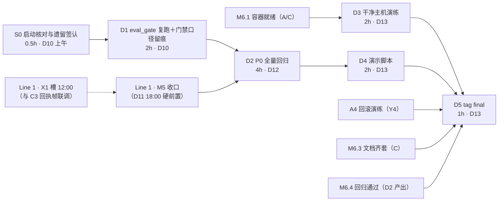

> 状态：进行中（S0/D1/D1-R2 已完成，下一步 D2 P0 全量回归）　｜　版本：v1.4　｜　日期：2026-11-13
> 关联：docs/team_tasks/day10/dev-D-评测回归与演示冻结.md v1.0（任务卡）｜docs/team_tasks/day10/day10-任务总览与DAG.md v1.1（§2 DAG、§3 对接点 Y1–Y5、§4 写域）｜docs/plans/day10/day-10-交付与观测-工作推进计划.md（§4.4 dev-D 节）｜docs/team_tasks/day09/dev-D-长者端语音与评测门禁.md v1.4（day09 完成度核查结果）
> 上游依据：PRD line 455–457（FR-TC-09 评测门禁）、line 578（Day 10 完成定义）、§5.1/§5.2/§5.4（AC 追踪表与固定测试集）｜技术设计文档 §8.3 line 1176–1183（Day 10 实现口径）｜大纲课时 10.3/10.4（仅取流程，不取事实）
> 变更记录见文末

---

# dev-D · Day 10 工作推进计划 · 评测回归与演示冻结线

## 0. 现状核查（2026-11-13 实测，逐项留痕）

| # | 核查项 | 结果 | 对计划的影响 |
| --- | --- | --- | --- |
| 1 | `tests/eval_gate.py` | 五道门（A 敏感召回 / B 不回退 / C 行为场景 / D 无新增误杀 / E PRD 硬线）已就绪，含七层归因与 `--self-check` | D1 直接复跑，无需改门 |
| 2 | `.githooks/pre-push` | 已是「机制自检」模式（无 python 报错退出非 0、fixtures 自检）；真门禁由开发者本地跑 | D1 按已裁决口径**不改钩子行为**，只做留痕与说明 |
| 3 | 真基线复跑环境 | 本机 `.venv_sidecar` 已确认 **torch 2.14.0+cpu / python 3.12.7**，可跑 `--provider local` 真基线 | D1 在本机即可完成真基线复跑 |
| 4 | `eval/fixtures/` | `day7_intents.jsonl` 110 条（普通 50/敏感 20/边界 20/模糊 20）、`injection.jsonl`、`boundary_v1.jsonl`、`badcase_backlog.jsonl` | §5.2 固定测试集复跑数据齐备 |
| 5 | day09 dev-D 完成度（任务卡 v1.5） | **D1–D4 代码收口**（回执帧/outbound+rtc_failed/ICE 下发/闸门 E/七层归因/夹具判黄/hooks/family 五键/语音条/字号/声纹 0.62 定稿均有仓库证据）；**D5 戏曲素材已裁决裁减不做**（2026-11-13 主理人） | D5 遗留已收口（§7 已裁决）；X1 联调与 D11 复测为 Line 1 槽位 |
| 6 | `eval/reports/` | 已有 day7–day9 各类报告与 `day8_baseline_lock.json`（normal 41/50=82%、p95 297ms、锁内失败 15 条） | D1 复跑按此锁对比，闸门 E 预期如实报红 |
| 7 | 本机环境口径 | 后端联调走方案 A 命令（WindowsSelectorEventLoopPolicy）、curl 加 `--noproxy '*'`、种子按台账重建 | 执行类步骤遵总览 §0.4 |

**主理人已裁决项（2026-11-13，本文开工依据）**：

| 裁决项 | 结论 |
| --- | --- |
| D1 复跑环境 | 用本机 `.venv_sidecar` 跑真基线（`--provider local`） |
| 演示视频（总览 Q1） | **最终口径（主理人 2026-11-13 最新指示，覆盖 C 转达的「纳入 D4」）**：**今天不做演示视频**，D4 只交脚本（不安排录屏工时）；如后续要补录，按 C 转达口径另约窗口（≤5min、归档 docs/ 或 eval/artifacts/） |
| **门禁口径（总览 Q3，已更新）** | ~~CI 阻塞＋本地自检留痕~~ **已更新（2026-11-13 dev-C 转达主理人裁决）**：**按阻塞真门禁接线**——push 前跑 eval_gate，不过拒绝 push；**expected-red 显式标注机制已获批**，用于已知挂起红项（不阻塞 push） |
| day09 dev-D 签认（总览 Q9） | 已按仓库证据核查并同步任务卡至 v1.5；D1–D4 收口事实作为 D2 回归基线；D5 戏曲遗留已裁决裁减（见下行） |
| **Q5 TD line 1179 勘误（C 转达确认）** | 按 TD 修订记录条目处理——实际落点 `tests/eval_gate.py`，沿 day07 先例，D1 节点同提交执行（**已于 D1 完成，修订记录 v2.3**） |
| **PRD v3.2（C 转达）** | 仅在 PRD 修订记录加条目登记 AC-37 裁减，不改 §5.4 验收语义正文（**已登记 v3.2**） |
| **戏曲相关全部裁减（2026-11-13 补充裁决）** | **day09 D5 素材替换不做、戏曲相关全部不做**：AC-37 戏曲点播按裁减登记（PRD v3.2 仅修订记录登记）、媒体戏曲种子不补、演示不安排「听戏」场景（任务卡 v1.5） |
| **Q-A1 自动迁移答复（2026-11-13 已裁决）** | **选 entrypoint 自动迁移**：backend 容器启动先 `alembic upgrade head` 再起服务；两条件——①迁移失败容器退出（fail fast，healthcheck 变红），不静默跳过；②只执行 upgrade 不碰历史迁移（AGENTS §4.6），downgrade 仍归 A4 演练手动做。已按此口径答复 dev-A；D3 前置依赖新增：A1 entrypoint 含自动迁移＋fail fast |

---

## 1. 执行总则

1. **按步执行**：本文每个步骤（S0→D1→D2→D3→D4→D5）完成后**暂停并向主理人汇报该步自检结果**，确认后才进入下一步；不批量推进。
2. **写域仅限**任务卡 §0.1：`tests/eval_gate.py`、`.githooks/**`、`eval/reports/day10_*.md`、`docs/测试数据_人员与床位.md`（台账）、演示脚本、`git tag final` 操作。禁触部署编排（A）、观测代码（B）、交付文档正文（C，发现问题**提单**不直改）与 `app/**` 业务代码。
3. **Line 1 槽位优先**：D10 穿插 X1 槽（12:00，与 C3 回执帧联调）/X9 槽（D11 16:00 门禁复跑）；D11 值守 Line 1 M5.3/M5.4。与本文步骤冲突时 Line 1 优先。
4. **纪律**：全员不得为变绿调阈值或删用例；失败项如实记录不粉饰；演示只覆盖回归通过项。
5. 本机环境口径遵总览 §0.4（方案 A 命令启动、`--noproxy '*'`、compose 全栈验证建议主理人自开终端常驻）。

---

## 2. 步骤依赖图

并行关系：D3 与 D4 可并行（分别依赖 M6.1 与 D2），仅汇于 D5。

---

## 3. 逐步执行计划（每步含操作步骤 / 交付物规格 / 自检校验 / 交接提醒）

### S0 · 启动核对与遗留签认（0.5h，D10 上午第一个动作）

**前置**：无。

**操作步骤**：
1. 参与 M6.0 启动核对（dev-A 牵头），确认本文 §0 已裁决三项口头同步全员；Y1–Y5 写域矩阵签认。
2. day09 dev-D 任务卡已核查并同步至 v1.5（本文 §0 第 5 行）；**戏曲相关全部裁减已裁决**（§0 已裁决表第五项），无需再议。
3. 在本文 §6 执行记录登记 S0 完成。

**交付物**：S0 核查记录（写进 §6 执行记录表：日期/节点/结果/等待项）。

**自检校验**：① §0 三项裁决已向全员同步；② day09 任务卡状态行与 §6 执行记录一致；③ §7 待裁决项有明确处置结论或显式挂起。

**交接提醒**：无外部交接；D5 遗留处置结论需主理人拍板。

---

### D1 · eval_gate 复跑与阻塞口径落地（2h，D10，第一个开工项）——产出 Y5

**前置**：S0。

**操作步骤**：
1. **真基线复跑**：`$env:PYTHONPATH='.'; ..\.venv_sidecar\Scripts\python.exe tests/eval_gate.py --provider local`（在仓库根执行），逐闸门记录 A–E 的通过值/差值；闸门 E 预期对 `day8_baseline_lock.json`（82%<90%、297ms>200ms）**如实报红**，属门禁履职，不是失败。
2. **落留痕记录** `eval/reports/day10_gate_rerun.md`：每闸门一节（判据、通过值/差值、结论、复跑命令与环境）；文件头注明环境（torch 2.14.0+cpu / python 3.12.7 / `.venv_sidecar`）。
3. **Y5 口径落地（CI 阻塞＋本地自检留痕）**：`.githooks/pre-push` 维持机制自检不变（已实现：无 python 退出非 0、fixtures `--self-check`）；把「真门禁由开发者本地跑 eval_gate 并留痕、pre-push 只做机制自检」的口径写入门禁记录（README 由 C 合入，我只出素材小抄）。
4. **FR-TC-09 拦截验证**：`SYSTEM_ONE_CONFIDENCE_THRESHOLD=0.30` 临时调低阈值复跑一次 → 门禁必须报红并打印差值；验完清掉环境变量恢复 0.85 再跑一次确认回绿。
5. **TD line 1179 路径勘误**：`eval/eval_gate.py` → 实际落点 `tests/eval_gate.py`，同一次提交在技术设计文档文末修订登记（版本号取该文档现有最大值 +1，AGENTS §4.7）。

**交付物规格**：
- `eval/reports/day10_gate_rerun.md`：五闸门逐节留痕＋拦截验证两段（调低报红/恢复回绿）＋环境说明；质量要求：每个数字可复算、命令可复制执行。
- 门禁口径素材小抄（交 C2）：一段可入 README 的「门禁与推送纪律」文字＋hooksPath 启用说明（`git config core.hooksPath .githooks`）。
- TD 修订记录条目（同提交）。

**自检校验**：① 复跑记录逐闸门有通过值/差值；② 调低阈值后门禁报红打印差值且不放宽；恢复后回绿；③ 无 python 环境跑 pre-push 退出码非 0（已实现，验证一次留痕）；④ TD 修订记录与正文改动同提交；⑤ 未改任何阈值代码、未删用例、`SENSITIVE_FLOOR_PCT` 仍 95.0。

**交接提醒（Y5，D10 下午冻结）**：门禁口径与 pre-push 说明 → **交接 dev-C（C2）合入 README**；口径生效后约束全员，需在 M6.0 后续检查点通报全员。

### D1-R2 · 补充段 · pre-push 真门禁接线＋expected-red 机制（C 转达裁决）——✅ 已落码并验证

**裁决更新（2026-11-13 dev-C 转达）**：Q3 按阻塞真门禁接线——push 前跑 eval_gate，不过拒绝 push；**expected-red 显式标注机制已获批**，用于已知挂起红项（不阻塞 push）。
**主理人补充确认（2026-11-13）**：全员本机均有 torch 环境 → 不需要 SSH 远程链，本机直跑；无环境=没配好，报错退出（A 口径沿 F02）。

**落码结果**：
1. `tests/eval_gate.py`：`--expected-red`（CLI 临时追加）＋ `--strict`（复核态，忽略全部标注）＋ `eval/reports/expected_red.json` 入库留痕文件（gates/reason/expires/evidence/ruling；**expires 过期自动失效**防标注永不摘除）；`append_backlog` 按 id 去重；`--report` 默认改滚动文件 `eval_gate_last_run.md`（历史报告不再被误写）。
2. `.githooks/pre-push`：轻量校验（看板/索引/样本自检，`.venv`）→ **真门禁**（`.venv_sidecar` torch，`--provider local`，约 3~4 分钟）→ 不过拒绝 push；无 sidecar 环境报错退出。
3. 当前标注 B/D/E（evidence=day10_gate_rerun.md，expires=2026-11-15 覆盖 D11 X9 复跑窗口，达标后撤销）。

**四态验证（实测）**：红＋标注 → PASS exit 0 ✓；`--strict` 红未标注 → FAIL exit 1 ✓；绿态与态 1 同一退出分支（mock 非金标无法构造全绿，D11 X9 复跑自然验证）；调低阈值＋strict → FAIL exit 1 ✓；**端到端 `bash .githooks/pre-push` exit 0 ✓**。详见 day10_gate_rerun.md §6。

---

### D2 · P0 全量回归（4h，D12）——M6.4 主体

**前置**：D1 ＋ **Line 1 M5 收口（D11 18:00，硬前置）** ＋ M6.1/M6.2（容器与观测就绪后回归口径才完整）。

**操作步骤**：
1. **种子数据重建**：按台账 `docs/测试数据_人员与床位.md` 重建演示种子，**重建后同步更新台账**（唯一台账口径）。
2. **PRD §5.4 追踪表逐条复跑**：4.1→AC-15/26/40/41/42；4.2→AC-03/04/33；4.3→AC-28；4.4→AC-01/02/37（**AC-37 戏曲点播按 2026-11-13 裁决裁减，登记「裁减—不验收」**，4.4 其余 AC 正常复跑）；4.5→AC-05~08/16/17/20/26/27/30/35/41；4.6→AC-09~11/21/22/32/34；4.7→AC-04/10/12/23/38；4.8→AC-13/25；4.9→AC-14/19；4.10→AC-18/19/24/39；4.11→AC-29/30/31/36/40/41/42。
3. **§5.2 固定测试集复跑**：普通 50 条 ≥45、敏感 20 条 ≥19、边界 20 条、模糊 20 条、注入 ≥10 条 100%（走 `eval_gate.py` 五闸门＋`pytest tests/ -q`）。
4. **AC-31 观测联验**（与 B 联调）：随机挑一次对话，1 分钟内在日志与 Langfuse 里串完「规则→分类器→工具→TTS」，trace_id 与系统 trace_id 同值互查。
5. **落报告** `eval/reports/day10_p0_regression.md`：每条 AC 一行——结论（通过/失败）＋证据指针（SQL 行数 / HTTP 状态码 / trace_id / 截图路径）；失败项当场归层（ASR/Laya/召回/LLM/Tool/编排）。

**交付物规格**：
- `eval/reports/day10_p0_regression.md`：§5.4 追踪表全 AC 覆盖（含证据列）＋§5.2 五组达标率表（可复算）＋失败归层表；质量要求：零「功能正常」类模糊表述，每条可复核。
- 台账更新：与数据库实查一致（`docker exec silvermate-postgres psql -U silvermate -d silvermate`）。

**自检校验**：① 报告逐 AC 有结论与证据指针；② 五组达标率可复算（普通 ≥45/50、敏感 ≥19/20、注入 100%）；③ 失败项如实记录并归层，无粉饰；④ 台账与 psql 实查一致；⑤ **只登记结论，不在此步修任何业务代码**（修复属他人写域，提单流转）。

**交接提醒**：
- 输入侧：向 **dev-A/dev-C** 确认 M6.1（compose 全 healthy＋HTTPS）、向 **dev-B** 确认 M6.2（AC-31 Trace 证据）；向 **dev-A/B/C** 确认 Line 1 M5 收口门禁已过。
- 输出侧：回归报告 → D4（只演示通过项）与 M6.4。

---

### D3 · 干净主机一键启动演练（2h，D13）——M6.5 前置

**前置**：M6.1（容器化就绪）＋ A4（消费 Y4 回滚基准）。

**操作步骤**：
1. 在非开发机（或全新克隆目录/全新容器）执行：`git clone` → `cp .env.example .env` → `docker compose up`（按 TD §8.3 功能验收原文：三步内起全栈）。
2. 浏览器打开 `https://localhost`，走完「喊小伴 → 问天气 → 听回答」整条链。
3. 全程留证：步骤日志＋截图（服务 healthy 状态页、HTTPS 页面、语音链路各一张起）。
4. 演练发现的缺漏（.env 变量缺失、证书步骤缺失等）**以提单形式**交 A（`.env.example`）/C（README），回改后**复跑一次直到通过**。

**交付物规格**：演练记录（markdown，落 `eval/reports/` 或任务卡指定位置）：步骤命令序列＋日志摘录＋截图＋缺漏清单与闭环记录；质量要求：第三方照做可复现。

**自检校验**：① 三步内起全栈；② 全部服务 healthy；③ HTTPS 可访问；④ 语音链路端到端走通；⑤ 缺漏有提单且回改后复跑通过。

**交接提醒**：缺漏提单 → **dev-A**（`.env.example`）/ **dev-C**（README）；演练记录 → D5 打标依据。联调依赖 **dev-A/dev-C 的 M6.1**，需提前约定演练窗口。

---

### D4 · 演示脚本与冻结（2h，D13，可与 D3 并行）

**前置**：D2（**只演示回归报告中的通过项，不得演示未验收功能**）。

**操作步骤**：
1. 编写 5 分钟演示脚本，四场景（大纲课时 10.4，仅取流程；**「白天听戏」已随 2026-11-13 戏曲裁减裁决去除，白天场景改为陪聊**）：早晨提醒吃药 → 白天陪聊 → 晚上健康采集 → 家属收到日报；**每场景标注对应 AC 编号**与操作口令。
2. 每场景核对：所涉 AC 在 `day10_p0_regression.md` 中必须为**通过项**；未通过的 AC 对应场景内容删除或替换为通过项，**不新造需求**。
3. 按脚本走查一遍 AC 冒烟（跑通即可，不改代码）。
4. **演示视频：主理人 2026-11-13 最新指示——今天不做**，本步只交脚本；后续如补录按 C 转达口径（≤5min、归档 docs/ 或 eval/artifacts/）另约窗口。

**交付物规格**：演示脚本（markdown，落 `eval/reports/` 或 `docs/`，M6.0 定）：四场景×（口令/操作/预期表现/AC 编号）＋开场自检清单（阈值 0.62 生效确认，沿 day08 演示脚本先例）；质量要求：零未验收功能入脚本。

**自检校验**：① 四场景齐全且每场景标注 AC 编号；② 脚本中每个 AC 在回归报告中为通过项；③ 冒烟走查通过；④ 无视频交付义务（主理人 2026-11-13 指示今天不做）。

**交接提醒**：脚本 → D5 打标前走查；如脚本依赖他人功能（如外呼、观测），向对应负责人约演示窗口。

---

### D5 · tag final（1h，D13）——M6.5 收口动作

**前置**：D3 ＋ D4 ＋ A4（Y4 回滚演练通过）＋ M6.3 ＋ M6.4，**全部通过后才能打标**。

**操作步骤**：
1. **打标前最后一跑（缺一不打标）**：`uv run ruff check app tests` ＋ `uv run pytest -q` ＋ `.venv_sidecar` 跑 `tests/eval_gate.py --provider local` ＋ 前端 `pnpm --dir frontend exec tsc --noEmit && pnpm --dir frontend build`，全绿。
2. 确认 M6.1–M6.4 与 A4 回滚演练（代码回滚＋`alembic downgrade` 各一次）逐项勾选通过。
3. `git tag final && git push origin final`；打标后改动不在验收范围。

**交付物规格**：tag `final`；打标前最后一跑输出留痕（可并入演练记录或回归报告附录）。

**自检校验**：① `git tag -l` 含 final；② `git describe` 指向收口 commit；③ push 成功；④ 最后一跑四项全绿留痕；⑤ A4 演练通过勾选在案。

**交接提醒**：向 **dev-A** 拿 Y4 回滚基准结论、向 **dev-C** 确认 M6.3 五份文档齐套、向全员确认 M6.4；打标动作是 M6.5 收口，需全员在场确认。

---

## 4. 联调与交接清单（汇总）

| # | 我提供 | 对方 | 交接内容 | 时点 |
| --- | --- | --- | --- | --- |
| 1 | Y5 门禁口径 | dev-C（C2 合入 README）／全员 | 「CI 阻塞＋本地自检留痕」口径＋hooksPath 说明＋门禁复跑记录 | D10 下午（最早冻结） |
| 2 | X1 槽位消费 | dev-C（C3） | 回执帧联调与唤醒实测（Line 1，今日 12:00） | D10 12:00 |
| 3 | 输入确认 | dev-A/dev-C/dev-B | D2 开工前确认 M6.1/M6.2/Line 1 M5 收口 | D11 18:00 后 |
| 4 | 缺漏提单 | dev-A / dev-C | D3 干净主机演练缺漏：`.env.example`（A）/ README（C），提单不直改 | D13 |
| 5 | 回归报告 | D4 消费／M6.4 | `day10_p0_regression.md` 只含通过项供演示 | D12 18:00 |
| 6 | 打标收口 | 全员 | tag final 前四前置确认（Y4/M6.3/M6.4/D3+D4） | D13 16:00 |

---

## 5. 风险与回退

| # | 风险 | 处置 |
| --- | --- | --- |
| R1 | 闸门 E 复跑仍红（82%<90%、297ms>200ms） | 如实报红是门禁履职：差值入 `day10_gate_rerun.md`；达标依赖 Line 1 路由改进，D11 16:00 X9 槽复跑；**不许调阈值/删用例**。已知挂起红项走 **expected-red 显式标注**（已获批，D1-R2），不阻塞 push 但留痕 |
| R2 | M5 收口延后挤压 D2 窗口 | D2 是 M6.4 硬前置，冲突时先与主理人确认压缩方案（总览裁减顺序 A5/B3 先裁），不自行砍 AC 覆盖面 |
| R3 | 干净主机演练依赖 M6.1，若容器链延期 | D3 顺延但不挤占 D4（并行）；D5 打标缺 D3 即不打标，宁延不打 |
| R4 | 种子重建与台账不一致 | 以 psql 实查为准逐表核对；不一致先修台账口径再演示 |
| R5 | `.venv_sidecar` 环境漂移 | 复跑命令与版本号写进报告；环境不可用时改 `--provider mock --allow-mock` 机制自检并**显式标注「非基线」**，不假装真基线 |
| R6 | 戏曲素材遗留（day09 D5）影响回归 4.4/演示场景 | **已裁决（2026-11-13）**：戏曲相关全部裁减不做；AC-37 在回归报告中登记「裁减—不验收」，演示白天场景改为陪聊；不粉饰、不补做 |

---

## 6. 执行记录（开工后逐步回填）

| 日期 | 步骤 | 自检结果 | 证据指针 | 等待项 |
| --- | --- | --- | --- | --- |
| 2026-11-13 | S0 启动核对 | ✓ 三项前置裁决（复跑环境/Y5 口径/演示视频）＋戏曲裁减裁决已落档本文 §0；day09 dev-D 任务卡已同步 v1.5；D5 遗留已裁决收口 | 本文 §0 已裁决表；docs/team_tasks/day09/dev-D-长者端语音与评测门禁.md v1.5 | M6.0 全员会议（dev-A 牵头）现场签认由主理人组织；总览 §6 戏曲裁减登记提单给 dev-C |
| 2026-11-13 | D1-R2 前置 | ✓ 收到 dev-C 四项转达裁决并落档：PRD v3.2 已登记（仅修订记录，不改 §5.4 正文）、演示视频纳入 D4、Q3 改阻塞真门禁＋expected-red 获批（落码待确认，见 D1-R2 段）、Q5 已于 D1 完成（TD v2.3）；另答复 dev-A Q-A1：选 entrypoint 自动迁移＋fail fast＋downgrade 归 A4 | 本文 §0 已裁决表；PRD 修订记录 v3.2 | D1-R2 落码等主理人确认 |
| 2026-11-13 | D1 门禁复跑与口径落地 | ✓ 真基线复跑完成（210.8s，五闸门 A✅C✅ / B❌D❌E❌ 如实报红，规则路径 p95 0ms 硬线通过，模型路径 p95 1147ms 单列挂 F23）；FR-TC-09 拦截验证通过（阈值 0.30 生效→门禁报红打印差值、锁未写；恢复 0.85 同口径）；pre-push 机制自检 exit 0；TD line 1179 勘误＋修订记录 v2.3 同批留痕 | eval/reports/day10_gate_rerun.md（§1 五闸门/§4 拦截验证/§6 Y5 素材小抄）；TD 修订记录 v2.3 | 两个门禁小改进已随 D1-R2 落码 |
| 2026-11-13 | D1-R2 真门禁接线 | ✓ `eval_gate.py` expected-red（CLI＋入库文件＋expires 过期失效＋--strict）＋badcase 去重＋报告路径保护落码；`pre-push` 升级阻塞真门禁（sidecar torch 本机直跑，全员已有环境，无远程链）；四态验证 4/5 实测通过＋端到端钩子 exit 0（绿态沿同分支，D11 X9 自然验证） | eval/reports/expected_red.json（B/D/E，expires 2026-11-15）；eval/reports/eval_gate_last_run.md；day10_gate_rerun.md §6 四态表 | README 门禁小节素材（day10_gate_rerun.md §6 更新版）→ 提单 dev-C 合入；每次 push 约 3~4 分钟成本需告知全员 |

---

## 7. 已裁决遗留（留痕，无需再议）

| # | 遗留项 | 裁决（2026-11-13 主理人） |
| --- | --- | --- |
| 1 | **day09 D5 合规戏曲素材未替换** | **正式裁减**：素材替换不做、戏曲相关全部不做——AC-37 戏曲点播登记「裁减—不验收」，戏曲种子（X10）不补交，演示不安排「听戏」场景（白天改为陪聊）；任务卡 v1.5 已同步留痕。PRD:590「不得裁减」清单（反向外呼/唤醒词）不受影响 |
| 2 | day09 X1 联调与唤醒 20 次实测 | 待今日 12:00 槽位（Line 1 槽位内完成，与 C3 现场对齐） |

---

## 变更记录

| 版本 | 日期 | 说明 |
| --- | --- | --- |
| v1.4 | 2026-11-13 | **D1-R2 落码完成**：Q3 阻塞真门禁接线（`eval_gate.py` expected-red 机制＋`--strict`＋badcase 去重＋报告路径保护；`pre-push` 升级真门禁，主理人确认全员本机有 torch 环境、无远程链）；四态验证＋端到端钩子 exit 0；新增 `eval/reports/expected_red.json`（B/D/E，expires 2026-11-15）。主理人另指示：今天不做演示视频（见 v1.3）。 |
| v1.3 | 2026-11-13 | 主理人最新指示：**今天不做演示视频**（覆盖 C 转达的「纳入 D4」口径）——D4 只交脚本，§0/D4/自检判据同步回退；如后续补录按 C 口径另约窗口。D1-R2 pre-push 真门禁接线仍待确认后落码（待拍板：无 torch 环境时钩子行为 A 报错退出 / B 显式降级自检）。 |
| v1.2 | 2026-11-13 | **C 跨包转达四项裁决落档**：① Q1 演示视频**纳入 D4**（录屏 1~1.5h、≤5min、归档 docs/ 或 eval/artifacts/、白天场景=陪聊）；② Q3 改为**阻塞真门禁接线**＋expected-red 显式标注机制获批（新增 D1-R2 补充段，待确认后落码）；③ Q5 确认按 TD 修订记录条目处理（D1 已完成 v2.3）；④ PRD v3.2 仅修订记录登记 AC-37 裁减（已登记）。同批更新 day10_gate_rerun.md §6 Y5 口径。 |
| v1.1 | 2026-11-13 | **戏曲相关全部裁减落档**（主理人 2026-11-13 裁决）：§0 核查表/已裁决表、S0、D2（AC-37 登记「裁减—不验收」）、D4（白天场景去「听戏」改陪聊）、R6、§7 由「待裁决」改「已裁决」；关联任务卡升至 v1.5。零业务代码改动。 |
| v1.0 | 2026-11-13 | 首版。基于 day10 任务卡 v1.0 / 总览 v1.1 / 计划件 §4.4 编制；2026-11-13 主理人三项裁决落档（复跑用 `.venv_sidecar` 真基线、Y5=CI 阻塞＋本地自检留痕、演示只交脚本）；day09 dev-D 完成度核查结果（D1–D4 收口/D5 素材未替换）签认并作为 D2 基线。仅计划文档，零业务代码改动。 |
