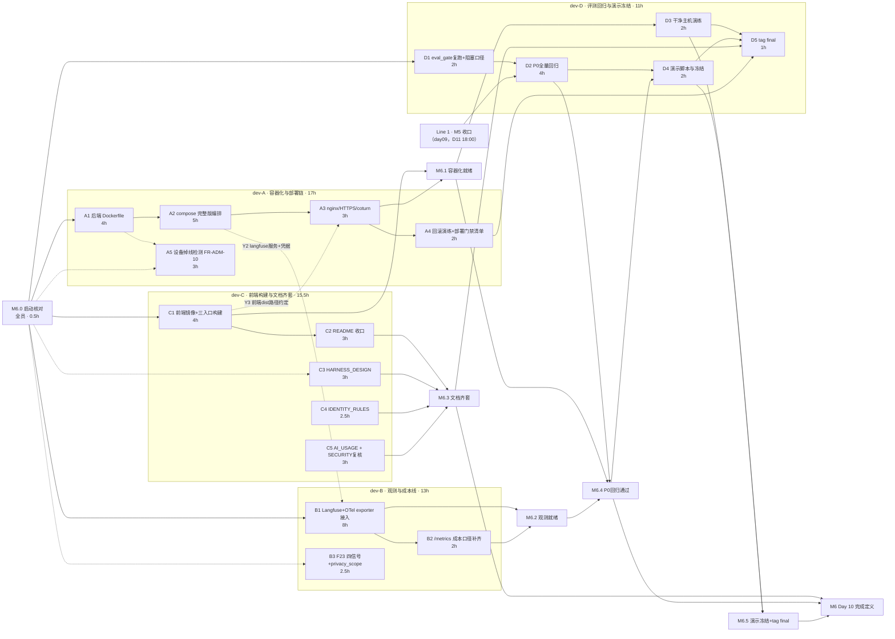

> 状态：草稿 · 待主理人逐项确认后开工（本轮仅计划，未改任何业务代码）　｜　版本：v1.0　｜　日期：2026-11-13
> 上游依据：PRD line 578（Day 10 行与完成定义）、line 453–460（FR-TC-04/05/09）、line 513（AC-31）、line 586–590（裁减顺序与不得裁减）｜技术设计文档 §8.3 Day 10（line 1176–1183，实现口径）、§1.3 模块职责｜大纲 §十 Day 10 课时 10.1–10.4（教学口径）｜day09 总览 §0.2 Q1（日历口径）、§8（顺延项）、§10（待确认）
> 主理人裁决（2026-11-13 会话确认）：① **双线并行**——day09 联调收口线与 Day 10 交付线同时推进，互不阻塞；② **沿用 4 人任务包**（dev-A/B/C/D）编排；③ 课时 10.4 取舍：**tag final + 交付文档齐套纳入任务包**，简历段落 / INTERVIEW_QA / 复盘报告单列「个人学习交付」附录不占团队工时，**5 分钟演示视频【待确认 Q1】**；④ 《康伴3D数字人_技术文档》即《康伴3D数字人_技术设计文档.md》；⑤ **OTel 缺口按 A1 处置（2026-11-13 追加裁决，原 Q10）**——历史计划与代码 hook 均预期「Day 10 接 OTel」（TD §1:205 选型承诺），但任务书曾遗漏；B1 扩为「**OTel SDK + Langfuse exporter 一体接入**」（B1 5h→8h，B 包 9.5h→13h），AC-31 Span 链语义不变。
> 编制口径：事实（字段/接口/阈值/服务清单）只引 PRD 与技术设计文档；本文与基线冲突时以基线为准并回改本文（AGENTS.md 前置节铁律）。

---

# Day 10 · 交付与观测 · 工作推进计划（双线并行）

## 0. 口径声明

### 0.1 双线日历口径

| 线 | 内容 | 日历窗口 | 事实来源 |
| --- | --- | --- | --- |
| **Line 1 · day09 联调收口线** | M5.1 安全闸门（D10 12:00）、M5.2 健康红档闭环（D10 17:00）、M5.3 语音全链路（D11 13:00）、M5.4 管理台与生命周期（D11 16:00）、M5 收口门禁（D11 18:00）；X1/X3/X4/X5/X7/X9/X11/X12 各联调槽位按 day09 §3.4 执行 | **D10–D11（2026-11-13 → 11-15）** | day09 总览 v1.5，本文**不重复编排、不改动其分工**，仅引用其里程碑作为本线前置 |
| **Line 2 · Day 10 交付线（本文编排对象）** | Docker Compose 完整版、Langfuse 观测、评测门禁收口、回滚演练、交付文档齐套、演示冻结与 tag final | **骨架段即日（11-13）启动；收口段排在 Line 1 的 M5 之后，推算为 D12–D13（11-16 → 11-17）【待确认 Q2】** | PRD line 578 / TD §8.3 Day 10 / 大纲课时 10.1–10.4 |

**双线交叠规则**（消除冲突的三条约定）：

1. **人员复用不冲突**：Line 1 的剩余工作是**联调段与验证段**（day09 §3.4 槽位制，不占连续队列），Line 2 的骨架段填各人连续队列；冲突时 **Line 1 优先**（P0 与不得裁减项优先于部署类交付）。
2. **写锁沿用 day09 §6**：`app/main.py` 仍归 dev-B 独占、`app/scheduler/` 仍归 dev-B 持锁、`tests/eval_gate.py` 与 `.githooks/` 仍归 dev-D；Line 2 新增领地（Dockerfile / docker-compose.yml / docs 交付文档）在 §6 重新划锁。
3. **Day 10 收口段（P0 全量回归、干净主机演练、tag final）必须晚于 Line 1 的 M5 收口门禁**——在未收口的代码上做最终回归与冻结没有意义。

### 0.2 三条硬约束（沿用 day09 §0.3，贯穿全部节点）

1. **分层**：`app/services/` 唯一写库层；`api | audio | scheduler | graphs → services → models` 单向。
2. **身份**：`elder_id`/`thread_id`/`device_id` 只从服务端 `runtime_context` 注入。
3. **迁移**：只新增不改历史。Day 10 计划**零新增迁移**（TD line 1178 Day 10 批次无表；FR-TC-05 回滚演练使用既有 0021 及历史迁移做 downgrade 演练）。

### 0.3 本机环境口径（执行类节点必读，来源：项目工作记忆 + README §5.3）

- 后端**禁止**用普通 `uvicorn app.main:app` 启动；Windows 下必须走 `WindowsSelectorEventLoopPolicy + loop='none'` 的方案 A 命令（见 MEMORY 与 README），否则调度器降级。容器化后该问题转由容器内 Linux 环境规避，但**本机联调仍按方案 A**。
- 本机 `HTTP_PROXY=127.0.0.1:52070`：curl 验证本地服务一律加 `--noproxy '*'`。
- 工具托管的后台进程约 2h 被回收：**compose 全栈验证建议用户自开终端常驻执行**。
- Vite 预构建缓存 `frontend/node_modules/.vite/deps` 不要删、不要 `--force`；前端镜像构建用 `npm ci`（容器内全新安装，不受本机缓存影响）。
- 演示/回归前的种子数据一律按台账 `docs/测试数据_人员与床位.md` 重建并**同步更新台账**（§1 台账为唯一测试数据登记处）。

---

## 1. 现状核查表（2026-11-13 实测，逐项留痕）

> 「基线要求」列引 PRD/TD；「现状实测」列为本机核查结果；「缺口」列即 Line 2 的工作来源。**本表是计划的唯一事实起点，未列缺口的项不安排工作。**

| # | 项 | 基线要求 | 现状实测 | 缺口判定 |
| --- | --- | --- | --- | --- |
| 1 | docker-compose.yml | PRD §2.5：PG(+pgvector)+Checkpoint / Redis / backend / nginx 前端 / coturn；TD §8.3：另含 Laya / 两个 MCP server | **已有 6 服务**：postgres(pgvector)、redis、funasr、mock-operations-mcp、weather-mcp、voiceprint；文件头注释明载「完整 7 服务版留到 Day 10」 | 缺 **backend、nginx(前端)、laya、coturn、langfuse** 五类服务编排 → A2/B1 |
| 2 | Dockerfile（后端） | TD §8.3：多阶段、非 root | **不存在** | 新建 → A1 |
| 3 | Dockerfile（前端） | 大纲 10.1：vite build 后 nginx 托管 | **不存在**；前端仍以 Vite dev server 运行 | 新建（含三入口 MPA 构建、three-vrm 不进 console/family 包）→ C1 |
| 4 | nginx 配置 | PRD §2.5：HTTPS 受控开发证书 | `deploy/nginx.conf` 已存在（Day 3 起沉淀）；**未核对 HTTPS 与三入口静态托管段** | 核对+补 HTTPS/静态段 → A3/C1 |
| 5 | coturn | PRD §2.2/FR-TC-10：跨网段 TURN 中继，compose 内置 | compose **无 coturn 服务**；day09 D2.5 已做 ICE 下发端点（`GET /api/audio/ice-config`，凭据环境注入），coturn 本体显式归 Day 10 | 新增 coturn 服务编排 → A3 |
| 6 | Langfuse | FR-TC-04：每次主控 Agent 执行一个 Trace，规则/分类器/模型/工具/TTS 为 Span，脱敏上传；AC-31：一条完整 Trace 可导出。**另 TD §1:205 选型表承诺 OpenTelemetry Traces（全链路 HTTP/DB/WebRTC/MCP/ASR-TTS 耗时、P50/P95），且注明「Langfuse 可作 OTel exporter」；day03/day04 计划与 `app/core/metrics.py`、`app/audio/_observe.py` 注释均预留「Day 10 接 OTel 只改一个函数」的 hook（历史引用的 TD:989 行号已漂移，现行 TD 无此排期行）** | `app/core/config.py:212-216` 已有 5 个 `langfuse_*` 字段（默认 `langfuse_enabled=False`）；`app/audio/_observe.py` 有观测引用；**无 compose 服务、无接入证据；OTel 未接入** | 接入（含 OTel exporter 一体化，裁决 ⑤）+服务编排+AC-31 证据 → B1/A2 |
| 7 | 评测门禁 | FR-TC-09：`eval_gate.py` 本地/pre-push 门禁；TD §8.3 写 `eval/eval_gate.py` | `tests/eval_gate.py` **已存在**（day09 D3 交付，含闸门 E）；`.githooks/pre-push` 已存在 | 复跑+阻塞口径落地（day09 §10 Q2 遗留）→ D1；**TD 路径差异登记勘误**（§8 待确认 Q5） |
| 8 | /metrics 与成本 | FR-TC-08（P1）：分层命中率、S1 闭环率、token 消耗、cache 命中率 | day09 C4 已交付 `app/api/metrics.py`（curl 可见分层命中率/S1 闭环率/token）；**cache 命中率未见字段** | 核对+补 cache 命中口径 → B2 |
| 9 | 交付文档 | 大纲 §11.3 / PRD line 578：README、HARNESS_DESIGN、IDENTITY_RULES、AI_USAGE、评测报告、安全报告 | `README.md` 已有（缺 Docker 部署/回滚/成本/观测章节）；`docs/SECURITY.md` 已有（76 行，day09 A2 交付，需按收口后现状复核）；**HARNESS_DESIGN.md、IDENTITY_RULES.md、AI_USAGE.md 均不存在**；评测报告已有 day7/day8/day9 系列但**无 Day 10 汇总** | 新建 3 份 + README 增补 + SECURITY 复核 + 回归汇总 → C2–C5/D2 |
| 10 | git 标签 | 大纲课时 5.3/7.4/10.4：`iter2-demo`、`iter3-demo`、`final` | `git tag -l` **空**——三个标签均未打 | 回滚演练基准与 tag final → A4/D5（历史两个标签**不补打**，仅登记偏差，见 §8 Q6） |
| 11 | 顺延项 F23 | day09 §8：System One 四信号 + `privacy_scope` 消费方（P2）顺延 Day 10，承接 dev-B | `app/system_one/` 四信号未接（F23 原始缺口） | → B3 |
| 12 | 顺延项 FR-ADM-10 | day09 §8：设备掉线检测通知（P2）顺延 Day 10，承接 dev-A | 无心跳超时判定 job；`device.status='offline'` 仅解绑时写 | → A5 |
| 13 | Line 1 遗留 | day09 PROGRESS：dev-D 卡「D1 代码已收口，待 X1 联调与实测」；dev-D 计划件仍为草稿 | X1 联调槽 D10 12:00 | Line 1 自行收口，本文仅列为其前置（D2 依赖 M5） |

---

## 2. Line 2 里程碑与总体 DAG

### 2.1 里程碑

| 里程碑 | 判据（全部可量化） | 依赖 | 时点（推算） |
| --- | --- | --- | --- |
| **M6.0 启动核对与口径冻结** | 本文 §8 全部待确认项逐项裁决；现状核查表 §1 签认 | 无 | D10 上午（11-13） |
| **M6.1 容器化编排就绪** | `docker compose up -d` 一键起全部服务（含新增 backend/nginx/laya/coturn/langfuse），**全部 healthcheck 通过**；本机 `https://localhost` 可打开长者端页面（受控开发证书）；`.env` 密钥零进镜像层 | A1 A2 A3 C1 | D11（11-14） |
| **M6.2 观测就绪** | AC-31：Langfuse 中一条完整 Trace（规则→分类器→模型→工具→TTS）可导出且脱敏，且 trace_id 与系统 `trace_id` 同值可互查；OTel exporter 承载该 Trace（TD §1:205）；`/metrics` 含 cache 命中率口径 | B1 B2（联调依赖 A2） | D11（11-14） |
| **M6.3 交付文档齐套** | README（部署/回滚/成本/观测章节）+ HARNESS_DESIGN + IDENTITY_RULES + AI_USAGE + SECURITY 复核完成；清单逐项可检（§4 C 包验收） | C2–C5 | D12 上午（11-16） |
| **M6.4 P0 全量回归通过** | PRD §5.1 全部适用 AC 逐条复跑通过并落 `eval/reports/day10_p0_regression.md`；§5.2 固定测试集达标 | **Line 1 M5** + D1 | D12（11-16） |
| **M6.5 演示冻结与 tag final** | 干净主机 `git clone && cp .env.example .env && docker compose up` 全绿 + HTTPS 可访问；回滚演练（代码回滚到基准 tag + `alembic downgrade` 各一次）成功；`git tag final` 打标并 push | A4 D3 D4 | D13（11-17） |
| **M6 Day 10 完成定义** | = PRD line 578：一键启动 + HTTPS + 健康检查；AC-31；全部 P0 回归通过；文档清单逐项可检 | M6.1–M6.5 | D13（11-17） |

### 2.2 任务级 DAG（mermaid，节点定义见 §4）

**无环说明**：实线 10 条（包内 8 + A3→D5→M6.5 2 条）、虚线 9 条、里程碑边不计环——唯一跨线硬边是 `Line 1 M5 → D2` 与 `M6.1 → D3`（干净主机演练须 compose 就绪）。B3/A5/C3–C5 无下游里程碑硬边，可并行垫后。

### 2.3 排程要点（与 Line 1 的人员复用）

| 时段 | dev-A | dev-B | dev-C | dev-D |
| --- | --- | --- | --- | --- |
| D10（11-13） | A1（穿插 Line1 X3/X4/X12 联调槽 15:00/16:00） | B1 骨架（穿插 X11 15:00 槽） | C1 → C3 骨架（穿插 C6 联调） | D1（穿插 X1 12:00 / X9 槽） |
| D11（11-14） | A2 → A3（M6.1 收口） | B1 联调（compose 就绪后）→ B2 | C4 → C5（穿插 M5.4 验证） | 值守 Line1 M5.3/M5.4；收口段待命 |
| D12（11-16） | A4 回滚演练 → A5 | B3 F23 | C2 README 收口 | D2 P0 全量回归 |
| D13（11-17） | 支援干净主机演练 | 支援观测抽验 | 支援文档走查 | D3 → D4 → D5（tag final） |

> 工时合计 56.5h（A 17 / B 13 / C 15.5 / D 11），跨 D10–D13 四个日历日摊开，与 Line 1 联调占用互补；各包均低于 20h 包容量上限，缓冲用于 Line 1 优先抢占。

---

## 3. 跨包对接点（Y1–Y5，N6.0 冻结后生效）

| # | 对接点 | 提供方→消费方 | 契约内容 | 联调时点 |
| --- | --- | --- | --- | --- |
| Y1 | nginx 配置合并 | C → A | C1 产出前端三入口 dist 相对路径约定（`/pad`、`/console`、`/family` 与 `/api`、`/ws` 反代规则草案），**A 独占改 `deploy/nginx.conf`**，按草案合入 | D11 上午 |
| Y2 | Langfuse 服务与凭据 | A → B | compose 的 `langfuse` 服务定义（建议 Langfuse v2 镜像 + 复用 postgres 独立 schema，避免 v3 的 ClickHouse/MinIO 依赖【执行细节，B1 落地前与主理人确认镜像版本】）；`LANGFUSE_PUBLIC_KEY/SECRET_KEY/HOST` 走 `.env` 注入，不硬编码；**B1 走 OTel exporter 路线（裁决 ⑤），exporter 端点/凭据复用同一组变量** | D11 上午 |
| Y3 | 前端构建产物 | C → A | `frontend.Dockerfile` 多阶段产物路径 `/usr/share/nginx/html/{pad,console,family}`；构建命令 `npm ci && npm run build`；验收口径含「three-vrm 不进 console/family 产物」 | D11 上午 |
| Y4 | 回滚基准 | A → D | A4 指定演练基准 tag（当前 `8d506b2` 或 D13 前最后一个收口 commit），D5 的 tag final 在演练通过后才打 | D12 下午 |
| Y5 | 门禁口径 | D → 全员 | D1 裁决 pre-push 阻塞模式（day09 §10 Q2）后的最终口径：阻塞真门禁 / CI 阻塞+本地自检；全员不得为变绿调阈值或删用例（沿 day09 X9 纪律） | D10 下午 |

---

## 4. 任务分配总表（节点 × 操作步骤 × 交付物规格 × 自检校验标准）

> 工时为估算参考；**唯一负责人**即写锁持有人。每个节点的「自检」列即用户要求的**完成自检校验标准**——节点关闭前逐条自查并留证据。

### 4.1 dev-A · 容器化与部署链（17h）

| 节点 | 内容与操作步骤 | 工时 | 前置 | 交付物与规格 | 量化验收 / 自检校验标准 |
| --- | --- | --- | --- | --- | --- |
| **A1** | 后端 Dockerfile：① 多阶段构建（builder：uv sync 装依赖 → runtime：仅复制 `.venv` + `app/` + `alembic/`）；② 非 root 用户运行；③ 入口用容器内 Linux 默认事件循环（uvicorn 标准启动即可，Windows 方案 A 仅本机适用，Dockerfile 内不引入 policy 代码）；④ `.dockerignore` 覆盖 `.env`、`frontend/`、`node_modules`、`.workbuddy/`、`static/media` 大文件 | 4h | M6.0 | 根目录 `Dockerfile`、`.dockerignore` | 自检：`docker build` 成功；容器内 `id` 非 root；`docker run --rm  python -c "import app.main"` 无 ImportError；`docker history` 各层与 `.env` 无关（`grep -ri "SECRET\|PASSWORD" <layers>` 零命中）；镜像体积记录进 A2 的 README 表 |
| **A2** | compose 完整版编排：在既有 6 服务基础上新增 `backend`（build A1，healthcheck=`curl /health`）、`nginx`（挂 `deploy/nginx.conf` + 前端产物）、`laya`（分类器服务，形态按 §8 Q7 裁决）、`coturn`、`langfuse`（Y2 契约）；全部服务 healthcheck + `restart: unless-stopped`；端口沿用 README §6.2 既有约定（7001 laya / 7002 funasr / 7101 weather / 7102 mock-operations）；`.env.example` 同步新增全部变量 | 5h | A1；软：C1（Y3 dist 路径）、B1（Y2 langfuse 细节） | `docker-compose.yml` 增量、`.env.example` 增量 | 自检：`docker compose config` 校验通过；`docker compose up -d` 后 `docker compose ps` 全部 `healthy`；`curl --noproxy '*' https://localhost/health` 返回 `status:ok` 带 trace_id；**密钥零进镜像层**（`docker exec <backend> env | grep -E "PASSWORD|SECRET_KEY"` 仅见容器注入环境变量、不落入镜像层——用 `docker image inspect` 复核 Env 为空） |
| **A3** | nginx/HTTPS/coturn：① `deploy/nginx.conf` 合入 Y1 静态托管段（三入口）+ `/api`、`/ws` 反代 backend + WebSocket upgrade 头；② HTTPS 受控开发证书（mkcert 或自签，证书文件**不进 git**，`.gitignore` 登记）；③ coturn 服务接入，`turn_url/turn_username/turn_credential` 与 day09 D2.5 的 `GET /api/audio/ice-config` 配置字段对齐（`app/core/config.py` 既有字段，不改名） | 3h | A2 | `deploy/nginx.conf` 增量、证书生成说明（进 README §A4 章节） | 自检：浏览器打开 `https://localhost` 无证书告警（受控信任后）；`wss://` 信令建连成功（信令 WS 走 nginx 反代不断）；pad `RTCPeerConnection` 从 ice-config 拿到 TURN 地址；`grep -rn "turn_credential" frontend/src` 零命中（凭据不出现在前端源码，沿 day09 D2.5 判据） |
| **A4** | 回滚演练 + 部署门禁清单：① 代码回滚——以 Y4 基准 tag/commit 部署 → 故意改坏一行 → 回滚到基准并复跑 `/health` + 一条 AC 冒烟（如 AC-01 天气）；② 数据回滚——`alembic downgrade 0020` 再 `upgrade head`，核对业务表数据不丢（演练在**一次性数据卷**上做）；③ 产出部署门禁清单（验收达成/测试通过/密钥安全/迁移可逆/监控就绪/回滚清晰六项，按风险分级） | 2h | A3 | 回滚演练记录（写入 README 回滚章节）、部署门禁清单（README 或独立小节） | 自检：两次演练均有操作日志与结果截图；`alembic downgrade` 后 `alembic_version` 回退一格、`upgrade` 后恢复且表数据完好；清单六项逐项有「检查方法」列 |
| **A5** | FR-ADM-10 设备掉线检测（day09 顺延项，P2）：心跳超 2 个周期判掉线 → `device.status='offline'` → 通知管理员与负责护工；与用药/采集窗口重叠时升级人工介入；设备自检异常（麦克风/网络）→ 工单。**写锁说明**：新增独立文件 `app/scheduler/device_jobs.py`，不碰 dev-B 既有调度文件（day09 §6 的 scheduler 写锁例外，已经 B 口头确认原则，N6.0 正式签认） | 3h | M6.0（软：与 B1 无文件冲突） | `app/scheduler/device_jobs.py`（新）、`device_service.py` 增量、对应测试 | 自检：心跳超 2 周期 → status 置 offline 且 `notifications` 有行（收件人=管理员+负责护工）；恢复心跳回 online；掉线窗口与用药 T0 重叠 → 立即生成人工介入工单；`pytest tests/test_device_offline.py` 全绿；非 admin/非负责护工查询掉线通知按既有权限矩阵 403 |

### 4.2 dev-B · 观测与成本线（13h）

| 节点 | 内容与操作步骤 | 工时 | 前置 | 交付物与规格 | 量化验收 / 自检校验标准 |
| --- | --- | --- | --- | --- | --- |
| **B1** | Langfuse + OTel exporter 一体接入（FR-TC-04 / AC-31 / TD §1:205，裁决 ⑤）：① 启用 `langfuse_enabled`（`.env` 注入 key，Y2 契约）；② **OTel SDK 接入、Langfuse 作 Span Exporter**——每次主控 Agent 执行 = 1 条 OTel Trace，规则路由 / 分类器 / 模型调用 / 工具调用 / TTS 各为 Span（Span 语义与 AC-31 完全一致，仅承载从 Langfuse SDK 直连改为 OTel API + exporter）；③ **全链路 span 最小覆盖**——HTTP 请求 span（trace_id 中间件处）＋ ASR/路由/LLM/TTS 分段耗时 span，经既有单点收口 hook（`app/audio/_observe.py:_record_asr_observation()`、`app/core/metrics.py:record_stage()`）改接 OTel，**兑现 day03/day04 预留的「Day 10 只改一个函数」承诺**；④ Span 记录输入输出摘要、耗时、异常、模型版本；⑤ **脱敏后上传**——复用 `app/core/redact.py` 集中脱敏（day09 A1 交付），不含完整音频、密钥、不必要健康信息；⑥ 采样率沿用 `langfuse_sample_rate` 配置 | 8h | M6.0；联调依赖 A2 的 langfuse 服务 | OTel+Langfuse exporter 接入代码（观测层增量，写域见 §6）、AC-31 证据（Trace 导出记录或截图） | 自检：发起一次含工具调用的完整对话 → Langfuse 界面可见 1 条完整 Trace 且 Span 链=规则→分类器→模型→工具→TTS；**OTel Trace 的 trace_id 与系统 `trace_id`（`app/core/context.py` 32 位 hex）同值可互查**；至少 1 个非 LLM span（HTTP 请求或分段耗时）出现在 Trace 树中；hook 函数已接 OTel 且既有结构化日志字段不丢（grep 既有日志字段仍输出）；Trace 内 `grep` 手机号/身份证/密钥零命中；关闭 `langfuse_enabled` 后业务不中断（降级不白屏）；**证据落 `eval/reports/day10_langfuse_trace.md`**（含 trace_id 可复现） |
| **B2** | `/metrics` 成本口径补齐（FR-TC-08）：核对既有分层命中率/S1 闭环率/token 消耗；补 **prompt cache 命中率**统计口径（大纲 10.2 与 PRD FR-TC-08 均要求）；一次完整演示后导出 token 消耗与成本估算 | 2h | B1 | `app/api/metrics.py` 增量、成本估算记录（进 README 成本章节，由 C2 合入） | 自检：`curl --noproxy '*' -H "Authorization: ..." http://127.0.0.1:8000/metrics` 可见四类指标（命中率/闭环率/token/cache）；未授权访问 401；cache 命中率数字可复算（来源对话数、命中数可查） |
| **B3** | F23 System One 四信号 + `privacy_scope` 消费方（day09 顺延项，P2）：快路径补齐敏感度/升级建议/隐私收敛信号输出；`privacy_scope` 接入消费方（双人间收敛场景）。**注意**：day09 实测四问 p95 668ms，压进 200ms 需模型侧改造——本节点按「信号先齐、延迟如实记录」执行，延迟达标另立任务，不为达标调阈值 | 2.5h | M6.0 | `app/system_one/` 增量、`privacy_scope` 消费接线、day10 侧延迟记录 | 自检：四信号在快路径输出齐全（intent/is_sensitive/confidence/privacy）；`privacy_scope` 至少 1 个消费点可演示；复跑 50 条样例记录 p95（如仍 >200ms，**如实记录不粉饰**并登记 §8 Q8） |

### 4.3 dev-C · 前端构建与文档齐套线（15.5h）

| 节点 | 内容与操作步骤 | 工时 | 前置 | 交付物与规格 | 量化验收 / 自检校验标准 |
| --- | --- | --- | --- | --- | --- |
| **C1** | 前端镜像与三入口构建：① `frontend.Dockerfile` 多阶段（`npm ci` → `vite build` → nginx 托管）；② Vite MPA 三入口 `pad/console/family` 产物分目录；③ 验收红线：**pad 的 three-vrm 不进 console/family 构建产物**（PRD §2.1 单仓库三入口的初衷）；④ 产物路径按 Y3 契约交 A 合入 nginx | 4h | M6.0 | `frontend/frontend.Dockerfile`（或根目录命名，N6.0 定）、构建说明 | 自检：容器内构建成功；`grep -r "three-vrm" dist/console dist/family` **零命中**；`dist/pad` 含 VRM 资产；三入口 URL（`/pad` `/console` `/family`）经 nginx 可打开且静态资源 200 |
| **C2** | README 收口：① 新增「Docker 部署」章节（`git clone && cp .env.example .env && docker compose up` 三步口径 + 服务清单表 + 端口表）；② 新增「回滚」章节（合入 A4 演练记录与门禁清单）；③ 新增「成本数据」章节（合入 B2 输出：S1 闭环率 ≥60% 目标、单会话 Tool ≤8、cache 命中率、分层省 Token——数字全部取实测，未达标如实写）；④ 新增「观测说明」（指标端点、Trace 查询方法、告警规则说明——大纲 §11.3 观测说明验收项）；⑤ 更新 §10 文档索引 | 3h | C1；素材依赖 A4/B2 | `README.md` 增量 | 自检：新章节四项齐全；所有数字与 `eval/reports/`、`/metrics` 实测一致（抽查 3 个数字可回溯）；「局限」节保留教学 MVP 口径（PRD §1.3：不以模拟数据比例作为真实运营效果证明） |
| **C3** | `docs/HARNESS_DESIGN.md` 新建：按大纲 §6.2 十组件表（Context/System One/Tool/State/Checkpoint/Memory/Loop/Policy/Recovery/Observability/Evaluation）逐组件写「本仓落点」——组件行为 + 对应文件路径 + 关键配置。**全部路径实测存在后才能写入**（写前逐个 `ls`） | 3h | M6.0（可与 C1 并行） | `docs/HARNESS_DESIGN.md` | 自检：十组件逐项覆盖；文中每个文件路径 `ls` 通过（零虚构路径）；与 TD §4/§6 口径一致，冲突处以 TD 为准并回改本文档 |
| **C4** | `docs/IDENTITY_RULES.md` 新建：四层身份锚点（设备绑定→房间默认→声纹→主动确认）+ 三档级联（声纹失败→主动确认→通用模式）+ 阈值口径 **0.62**（含沿革 0.85→0.55→0.62 与依据：`eval/reports/声纹调优报告.md`）+ 通用模式边界（不读记忆/不写健康/不确认用药）+ `thread_id=(elder_id, session_seq)` 服务端生成。口径唯一来源 = PRD §3.2 | 2.5h | M6.0 | `docs/IDENTITY_RULES.md` | 自检：阈值、候选集（设备 1v1、恒 1 位）、级联行为三处与 PRD v3.1 逐字一致；文中行为均有对应测试名可引（如 `tests/test_gates.py`、声纹相关用例） |
| **C5** | `docs/AI_USAGE.md` 新建 + SECURITY 复核：① AI_USAGE——AI 辅助范围（哪些模块 AI 生成）、人工审查记录（高风险五类文件 auth/迁移/Tool 权限/MCP/Dockerfile 的人工读 diff 记录）、关键决策（引用 day02–day10 计划件的裁决记录）；② `docs/SECURITY.md` 按 day09 收口后现状复核（威胁模型/降级矩阵/数据保留/HITL 清单四节齐全，与 `tests/test_gates.py`、`eval/fixtures/injection.jsonl` 实况对齐） | 3h | M6.0 | `docs/AI_USAGE.md`、`docs/SECURITY.md` 复核修订 | 自检：AI_USAGE 有「范围/审查/决策」三节且引用真实计划件路径；SECURITY 四节齐全；引用的测试文件与夹具 `ls` 存在；HITL 清单与 PRD（用药 HITL、健康黄/红复核）一致 |

### 4.4 dev-D · 评测回归与演示冻结线（11h）

| 节点 | 内容与操作步骤 | 工时 | 前置 | 交付物与规格 | 量化验收 / 自检校验标准 |
| --- | --- | --- | --- | --- | --- |
| **D1** | eval_gate 复跑与阻塞口径落地：① 以当前锁文件复跑 `tests/eval_gate.py`，逐闸门记录通过/差值；② 落地 day09 §10 Q2 裁决（Y5 契约）：pre-push 阻塞真门禁，或「CI 阻塞+本地自检」并留痕；③ `.githooks/pre-push` 行为与裁决一致；④ **TD line 1179 `eval/eval_gate.py` 路径勘误**——同提交在 TD 修订记录登记（实际落点 `tests/eval_gate.py`，AGENTS §4.7） | 2h | M6.0 | 门禁复跑记录、`.githooks/pre-push`（如需调整）、TD 修订记录条目 | 自检：复跑结果逐闸门留痕（通过值/差值）；人为调低规则阈值后门禁**报红并打印差值**（不放宽）；无 python 环境时 pre-push 退出码非 0；hooksPath 生效说明写入 README 或门禁记录 |
| **D2** | P0 全量回归（M6.4）：① 按 PRD §5.4 追踪表（4.1→AC-15/26/40/41/42；4.2→AC-03/04/33；4.3→AC-28；4.4→AC-01/02/37；4.5→AC-05~08/16/17/20/26/27/30/35/41；4.6→AC-09~11/21/22/32/34；4.7→AC-04/10/12/23/38；4.8→AC-13/25；4.9→AC-14/19；4.10→AC-18/19/24/39；4.11→AC-29/30/31/36/40/41/42）逐条复跑；② §5.2 固定测试集复跑（普通 50 条 ≥45、敏感 20 条 ≥19、边界 20 条、模糊 20 条、注入 ≥10 条 100%）；③ 结果落 `eval/reports/day10_p0_regression.md`（每条 AC：通过/失败/证据指针）；④ 演示前按台账重建种子数据并**同步更新台账** | 4h | **Line 1 M5 收口** + D1 | `eval/reports/day10_p0_regression.md`、台账更新 | 自检：报告逐 AC 有结论与证据（SQL 行数/HTTP 状态码/trace_id/截图）；失败项**如实记录不粉饰**并当场归层（ASR/Laya/召回/LLM/Tool/编排）；固定测试集五组达标率可复算；台账 `docs/测试数据_人员与床位.md` 与 `silvermate-postgres` 实查一致 |
| **D3** | 干净主机一键启动演练（M6.5 前置）：在非开发机（或全新容器/克隆目录）执行 `git clone → cp .env.example .env → docker compose up`，走完「喊小伴 → 问天气 → 听回答」整条链（TD §8.3 功能验收原文） | 2h | M6.1 + A4 | 演练记录（截图 + 步骤日志） | 自检：三步内起全栈、全部服务 healthy、HTTPS 可访问；语音链路端到端走通；演练中发现的缺漏（如 .env 变量缺失、证书步骤缺失）回改 `.env.example`/README 后**复跑一次直到通过** |
| **D4** | 演示脚本与冻结：① 编写 5 分钟演示脚本（四场景：早晨提醒吃药 → 白天陪聊/听戏 → 晚上健康采集 → 家属收到日报，大纲课时 10.4）；② **演示视频【待确认 Q1】**：若纳入则按脚本录制并归档 `docs/`或 `eval/artifacts/`；③ 演示脚本走查一遍 AC 冒烟（不新造需求） | 2h | D2 | 演示脚本（markdown）、演示视频（如 Q1 确认纳入） | 自检：脚本四场景齐全且每场景标注对应 AC 编号；脚本中的功能**全部在 P0 回归报告中为通过项**（不得演示未验收功能）；视频时长 ≤5 分钟（如纳入） |
| **D5** | tag final（M6.5 收口动作）：确认 M6.1–M6.4 + 回滚演练全部通过后 `git tag final && git push origin final`；之后改动不在验收范围 | 1h | D3 + D4 + A4 + M6.4 | tag `final` | 自检：`git tag -l` 含 final；`git describe` 指向收口 commit；push 成功；**打标前最后一跑** `ruff check` + `pytest -q` + `tests/eval_gate.py` + 前端 `tsc`/`build` 全绿 |

### 4.5 个人学习交付（附录，不占团队工时，按主理人裁决单列）

| 项 | 说明 | 依据 |
| --- | --- | --- |
| 简历段落工作坊 | 每人一页「问题+方案+结果+数据」，四反例互挑刺 | 大纲课时 10.4 |
| `INTERVIEW_QA.md` | 20 个高频追问，含面试官四维（拆问题/用工具/会测/稳定用） | 同上 |
| 复盘报告四件套 | 更新 AGENTS.md 踩坑、1 个自定义 Skill、提示词库 v2、复盘报告 | 同上 |
| 十大陷阱复盘 | 上下文死亡螺旋、过度信任、补丁叠补丁、范围蔓延、幻觉测试、监控盲点、成本失控、规则投毒、依赖失控、无回滚上线 | 同上 |

> 以上为**个人学习类交付物**，2026-11-13 裁决不进 4 人任务包；如后续要求纳入，另开任务包并重排容量。

---

## 5. 顺延与裁减留痕（不静默）

| 项 | 处置 | 依据 |
| --- | --- | --- |
| F23（System One 四信号） | **顺延落地**：Day 10 B3 承接，信号先齐、延迟如实记录 | day09 §8 / PRD line 587（P2） |
| FR-ADM-10（设备掉线检测） | **顺延落地**：Day 10 A5 承接 | day09 §8 / PRD line 444（P2） |
| 人设系统 FR-ADM-07 | **维持裁减**（day09 §8.1 裁决）：表/种子/模板保留，入口置灰，本日不安排 | day09 §8.1 |
| Laya/Chinese-Jev 对比 | **维持裁减**（无第二 backend，对比无对象） | day09 §8.1 |
| 课时 10.4 简历/INTERVIEW_QA/复盘 | **移出团队任务包**，附录单列 | 2026-11-13 主理人裁决 |
| 演示视频 | **待确认 Q1**：裁决前不安排录制工时，D4 先交脚本 | 2026-11-13 主理人裁决（「tag+文档」未含视频） |
| iter2-demo / iter3-demo 历史标签 | **不补打**：仅登记偏差（`git tag -l` 现为空），回滚演练直接以当前收口 commit 为基准 | 现状核查表 #10 |

**不得裁减项核对**（PRD line 590 → Day 10 归属）：Docker 部署（A1/A2/C1）✓、Langfuse 最小实现（B1）✓、评测门禁（D1/D2）✓、异常降级（B1 关闭 Langfuse 不中断、B2 未授权 401）✓、WebRTC 全双工与反向外呼含降级（Line 1 D2 已交付，D2 回归覆盖）✓、唤醒词激活（Line 1 D1 已交付，D2 回归覆盖）✓。

---

## 6. 写域互斥矩阵（Line 2 新增领地；既有锁沿用 day09 §6）

| 成员 | Line 2 写域仅限 | 禁触 |
| --- | --- | --- |
| **dev-A** | `Dockerfile`（新）、`.dockerignore`（新）、`docker-compose.yml`（**独占**）、`.env.example`（增量，与 B 协调 langfuse 段走 Y2）、`deploy/nginx.conf`（**独占**）、`app/scheduler/device_jobs.py`（新，B 既有调度文件不碰）、`app/services/device_service.py`（增量）、`app/api/audio.py` ICE 字段只读不改、对应 tests | 不碰前端构建、docs 交付文档、eval_gate、Langfuse 接入代码 |
| **dev-B** | OTel+Langfuse 接入代码（观测层模块，N6.0 定文件落点）、`app/core/config.py` langfuse 段增量、`app/core/metrics.py` 与 `app/audio/_observe.py` **仅 hook 函数体改接 OTel**（`record_stage()`、`_record_asr_observation()`，兑现 day03/day04 单点收口承诺；文件其余部分不改）、`app/system_one/**`（B3）、`privacy_scope` 消费点、`app/api/metrics.py`（增量）、`eval/reports/day10_langfuse_trace.md` | 不碰 compose/Dockerfile/nginx、`app/scheduler/`（除与 A5 的原则性确认外）、docs 交付文档 |
| **dev-C** | `frontend/frontend.Dockerfile`（新）、`docs/README.md` 增量（**README 独占**）、`docs/HARNESS_DESIGN.md`（新）、`docs/IDENTITY_RULES.md`（新）、`docs/AI_USAGE.md`（新）、`docs/SECURITY.md`（复核修订）、`docs/plans/day10/**`（本文维护） | 不碰 backend Dockerfile/compose、观测代码、tests/eval_gate |
| **dev-D** | `tests/eval_gate.py`（沿用 day09 锁）、`.githooks/**`、`eval/reports/day10_p0_regression.md`、`docs/测试数据_人员与床位.md`（台账更新）、演示脚本、tag final 操作 | 不碰部署编排、观测代码、交付文档正文（发现问题提单给 C） |

**共享文件串行锁**：
- `.env.example`：A（部署变量）与 B（langfuse 变量）两段追加，**按 B→A 顺序提交**（B 先定 langfuse 段，A 合编排时一并成文）。
- `README.md`：C 独占；A4/B2/D1/D3 的素材以「章节素材小抄」形式交给 C 合入，不直接改。
- `alembic/`：Day 10 **零新增迁移**；A4 downgrade 演练只执行不新建。

---

## 7. 检查点节奏

| 时点 | 检查点 | 责任 | 判据 |
| --- | --- | --- | --- |
| D10 09:30 | **M6.0 启动核对**：§8 待确认项逐项裁决 + §1 现状表签认 + Y1–Y5 口径冻结 | A 牵头全员 | 全部待确认项有裁决或显式挂起；未冻结项不得开工对应节点 |
| D11 17:00 | **M6.1 容器化就绪** | A/C | compose 全 healthy + HTTPS 可访问 |
| D11 17:00 | **M6.2 观测就绪** | B | AC-31 Trace 证据落档 + /metrics 四类指标 |
| D12 12:00 | **M6.3 文档齐套** | C | 五份文档清单逐项可检 |
| D12 18:00 | **M6.4 P0 回归通过**（硬前置：Line 1 M5） | D | 回归报告逐 AC 有结论 |
| D13 16:00 | **M6.5 演示冻结与 tag final** | D 牵头全员 | 干净主机演练 + 回滚演练 + `ruff`/`pytest`/`eval_gate`/`tsc`/`build` 全绿后打标 |
| D13 17:00 | **M6 收口门禁**：PRD line 578 完成定义逐条复核 + 证据回填 | 全员 | 一键启动+HTTPS+健康检查 ✓ / AC-31 ✓ / P0 回归 ✓ / 文档清单 ✓ |

---

## 8. 待确认项（M6.0 逐项裁决，未裁决不开工对应节点）

| # | 待确认 | 影响 | 默认口径（仅当主理人未裁决时的挂起建议，**不自动执行**） |
| --- | --- | --- | --- |
| **Q1** | **5 分钟演示视频是否纳入**（2026-11-13 裁决答复为「tag+文档」，未提视频） | D4 工时与交付物 | 不安排录制；D4 只交脚本 |
| **Q2** | **Day 10 收口段日历**：本文推算 D12–D13（11-16 → 11-17），是否认可 | 排期对外口径 | 按 D12–D13 编排；如需压缩，按 §6.2 裁减顺序先裁 P1/P2（A5/B3 殿后），P0 与不得裁减项不动 |
| **Q3** | **pre-push 阻塞模式**（day09 §10 Q2 遗留未裁）：阻塞真门禁 vs CI 阻塞+本地自检 | D1 接线方式 | 默认阻塞真门禁（AGENTS §3）；环境不具备则降级并留痕 |
| **Q4** | **Langfuse 部署形态**：v2 单容器+复用 postgres（教学最简）vs v3 全家桶（ClickHouse+MinIO） | A2 编排与 B1 联调 | v2 + 复用 postgres 独立 schema |
| **Q5** | **TD line 1179 `eval/eval_gate.py` 路径勘误**（实际落点 `tests/eval_gate.py`）：确认同提交在 TD 修订记录留痕 | 基线文档一致性 | 按 AGENTS §4.7 同提交留痕 |
| **Q6** | **iter2-demo/iter3-demo 历史标签缺失**：不补打，仅登记偏差——是否接受 | 验收留痕 | 登记于 §5，不补打 |
| **Q7** | **Laya 服务容器化形态**：本地权重（`convaiinnovations/laya-multilingual`）体积大、本机为 conda 环境 `jev`（机器事实）——容器内重新拉权重 or laya 以宿主进程 sidecar 挂载（compose 里只留编排占位） | A2 编排 | 容器内挂载宿主已下载权重卷，避免重复拉取；拉取不可行则 sidecar 化并如实记录 |
| **Q8** | **F23 延迟不达标处置**：四问 p95 实测 668ms > 200ms 硬线，Day 10 只「信号先齐」——是否接受延迟项继续挂起 | B3 验收口径 | 如实记录并挂起，不为达标调阈值（沿 X9 纪律） |
| **Q9** | **dev-D 的 day09 计划件仍为草稿待确认**（day09 PROGRESS 现状）：是否在 M6.0 一并签认，作为 D2 回归基线的一部分 | D2 依据完整性 | M6.0 一并签认 |
| **Q10** | ~~OTel 缺口处置~~ **已裁决（A1，2026-11-13）**：B1 扩为「OTel SDK + Langfuse exporter 一体接入」，兑现 TD §1:205 选型与 day03/day04 hook 承诺；B1 5h→8h、B 包 9.5h→13h；AC-31 Span 链语义不变 | ~~B1/写域~~ 已落 §4.2/§6 | 已裁决，随 v1.1 落档 |

---

## 9. 全量校验结论

| 校验项 | 方法 | 结论 |
| --- | --- | --- |
| Day 10 基线覆盖无遗漏 | PRD line 578 交付重点逐项对照（§2/§4）：Docker Compose ✓（A1/A2/C1）/ Langfuse Trace ✓（B1）/ 回滚 ✓（A4）/ 演示冻结 ✓（D4/D5）/ 文档齐套 ✓（C2–C5）/ 全部 P0 回归 ✓（D2） | **7/7 落节点，零遗漏** |
| 完成定义可判定 | PRD line 578 四句逐句映射 M6.1/M6.2/M6.4/M6.3 | **4/4 有里程碑判据** |
| 顺延项显式留痕 | F23（B3）、FR-ADM-10（A5）、演示视频（Q1）、历史标签（Q6） | **4/4 显式，零静默** |
| DAG 无环 | 跨线硬边仅 2 条（M5→D2、M6.1→D3），包内全为顺序链 | **无环** |
| 写锁零冲突 | §6 矩阵 + day09 §6 既有锁沿用；`.env.example`/`README.md` 两处共享有串行规则 | **零文件重叠** |
| 验收可量化 | 19 个执行节点全部含 grep/状态码/行数/健康检查类判据 | **全部含可执行判据**，无「功能正常」类模糊表述 |
| 本轮合规 | 本计划编写过程**未修改任何业务代码**（仅新建本文档与 plans/day10 目录） | ✓ |
| 现状口径零虚构 | §1 现状核查表 13 项全部来自 2026-11-13 本机实测（ls/grep/git tag/compose 读文件） | ✓ |

---

## 变更记录

| 版本 | 日期 | 说明 |
| --- | --- | --- |
| v1.0 | 2026-11-13 | 首版。基于 2026-11-13 主理人四项裁决（双线并行 / 4 人任务包 / tag+文档齐套纳入·简历类单列附录·演示视频待确认 / 技术文档=技术设计文档）编制。含：现状核查表 13 项（实测）、双线日历口径、4 包 19 节点 DAG 与里程碑 M6.0–M6.5、对接点 Y1–Y5、写域互斥矩阵、待确认 Q1–Q9。未改任何业务代码。 |
| v1.1 | 2026-11-13 | **Q10 裁决 A1 落档**：外部走查发现「TD §1:205 选型承诺 OpenTelemetry Traces、day03/day04 计划与 `app/core/metrics.py`/`app/audio/_observe.py` 注释预留『Day 10 接 OTel 只改一个函数』，但本计划与任务书均未排 OTel」。主理人裁决 A1——B1 扩为「OTel SDK + Langfuse exporter 一体接入」（5h→8h，B 包 9.5h→13h，总计 53h→56.5h）；M6.2 判据增 trace_id 同值互查与非 LLM span；Y2 契约增 exporter 凭据复用；§6 写域增两文件 hook 函数体；Q10 登记已裁决。AC-31 验收口径不受影响。 |
