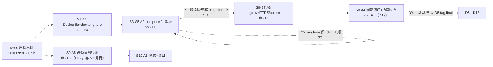

> 状态：进行中（S0 已收口，Q4/Q7/Q-A1/Q-A2 已裁决；Langfuse 共享实例裁决落档，下一步 S1）　｜　版本：v1.2　｜　日期：2026-11-13
> 负责人：**dev-A（唯一）**　｜　任务包：**A · 容器化与部署链（17h）**
> 关联：docs/team_tasks/day10/dev-A-容器化与部署链.md v1.0（任务书，分工与判据唯一依据）｜docs/team_tasks/day10/day10-任务总览与DAG.md v1.1（§2 DAG、§3 对接点 Y1/Y2/Y4、§4 写域、§8 待确认）｜docs/plans/day10/day-10-交付与观测-工作推进计划.md v1.1（总计划件）
> 上游依据：PRD line 578（Day 10 完成定义）、§2.5（一键启动/HTTPS/健康检查）、line 455（FR-TC-05）、line 444（FR-ADM-10）｜技术设计文档 §8.3 Day 10（line 1176–1183：多阶段非 root、七服务编排、回滚演练）、§1.4 选型表 line 206（compose 七服务）
> 变更记录见文末

---

# dev-A · Day 10 工作推进计划 · 容器化与部署链

> 本计划是 dev-A 任务书的**可执行展开**：把 5 个节点（A1–A5，17h）拆成 S0–S10 十一步，每步含子任务拆解、工时与优先级、前置依赖、交付物、命令级自检与确认点。**每完成一步向主理人确认后再进入下一步**（沿用 Day 8/9 分步确认制）。本文不替代任务书，冲突时以任务书与总览为准。

---

## 1. 项目认知基线（本轮通读结论）

### 1.1 定位与硬约束

- **一句话定位**：CCRC 康养社区长者卧室 3D 数字人陪伴系统，三端同仓库（pad/console/family MPA）。Day 10 = 交付与观测：让「在别人电脑上一条命令跑起来」成立（TD §8.3 line 1178）。
- **三条硬约束**（总览 §0.3）：`app/services/` 唯一写库层；身份只从 `runtime_context` 注入；**Day 10 零新增迁移**（A4 只执行既有 0021 及历史迁移的 downgrade，不新建）。
- **dev-A 写域**（任务书 §0.1，违者返工）：`Dockerfile`（新）、`.dockerignore`（增量）、`docker-compose.yml`（**独占**）、`.env.example`（增量，langfuse 段按 B→A 顺序）、`deploy/nginx.conf`（**独占**）、`app/scheduler/device_jobs.py`（新）、`app/services/device_service.py`（增量）、`tests/test_device_offline.py`（新）。
- **高风险文件**（AGENTS §5）：`Dockerfile`、`docker-compose.yml`、`deploy/nginx.conf`——**先出方案（本计划 §4 各步「方案要点」）经确认后才落代码**，人工逐行读 diff。证书文件不进 git。

### 1.2 里程碑归属

| 里程碑 | dev-A 判据贡献 | 时点 |
| --- | --- | --- |
| M6.0 启动核对 | 牵头裁决 §6 待确认项 Q4/Q7（A2 的 langfuse 形态与 laya 形态直接由 A 落编排） | D10 09:30 |
| M6.1 容器化就绪 | A1+A2+A3：compose 全 healthy、`https://localhost` 可访问、密钥零进镜像层 | D11 17:00 |
| M6.5 演示冻结 | A4 回滚演练通过是 D5 `git tag final` 的**前置**（Y4 契约） | D13 16:00 |
| M6.4 P0 回归 | A5 设备掉线检测进 D2 回归覆盖（P2，无硬下游） | D12 18:00 |

---

## 2. 现状实测（2026-11-13 代码取证，逐条留文件:行号）

> 编制时以 Explore 只读巡检结果为准；开工前 S0 复核一遍，有漂移先改本表再动代码。

| # | 事实 | 位置 | 对计划的影响 |
| --- | --- | --- | --- |
| 1 | compose 已有 **6 服务**：postgres(pgvector)、redis、funasr、weather-mcp、mock-operations-mcp、voiceprint；4 个带 healthcheck | docker-compose.yml（182 行） | A2 在此基础上**追加** 5 类服务：backend/nginx/laya/coturn/langfuse |
| 2 | **backend 无 Dockerfile、无 compose 服务**；README 与 mock-operations Dockerfile 头注释均明示「留到 Day 10」 | deploy/mock-operations/Dockerfile L3 | A1 新建根目录 `Dockerfile` |
| 3 | 已有 3 个 Dockerfile（weather/mock-operations/voiceprint），口径统一：`python:3.12-slim` + uv `--frozen` + 非 root 用户 + 密钥不进镜像 | deploy/*/Dockerfile | A1 沿用同一镜像骨架，不发明第二套口径（AGENTS §4.8） |
| 4 | **`.dockerignore` 已存在**，排除清单与 A1「runtime 需复制 alembic/」冲突 | .dockerignore（L22 排除 alembic） | S1 先核对并增改 `.dockerignore`（保留排除 `.env`/frontend/node_modules，放行 alembic/、static/ 需评估体积） |
| 5 | `deploy/nginx.conf` 只有 `/avatars/` location 片段 + 一次性验证用最小 server{}，**无**三入口静态段、`/api` `/ws` 反代、443/TLS | deploy/nginx.conf L17-21 自我声明 | A3 重写为完整托管配置（保留 /avatars 段） |
| 6 | **HTTPS 证书零存在**：全仓无 .crt/.pem/.key；mkcert 仅列为可选前置 | README L118 | A3 交付证书生成说明；证书不进 git |
| 7 | **coturn 无任何部署物**；仅 `.env.example` 有 STUN/TURN 变量、代码有 `GET /api/audio/ice-config` 下发端点（day09 D2.5 已交付） | app/api/audio.py（ICE 字段只读不改名） | A3 新增 coturn 服务编排，字段对齐不改名 |
| 8 | `/static` 挂载依赖 `os.getcwd()` | app/main.py L1114-1118 | A1 方案必须固定 WORKDIR 并拷贝/挂载 static/，否则容器内 404 |
| 9 | `config.py` `_ENV_FILE` 固定取 `Path(__file__)/../../.env` | app/core/config.py L24-25 | 容器内无 .env 文件；pydantic-settings 对缺失 env_file 不报错，全部变量靠环境注入（compose `env_file`/`environment`），S3 方案里显式验证 |
| 10 | MCP/声纹/System One/OTel 地址默认 `localhost`（mcp 7101/7102、voiceprint 7003、system_one 7001、otel 4317） | app/core/config.py L122/207-209/212-220/255 | A2 的 backend 服务环境变量必须改为 compose 服务名（mock-operations 已示范改法：compose L113-114） |
| 11 | **容器内无迁移执行机制**：无 entrypoint/启动脚本，alembic 只在宿主机手动跑 | 全仓 | D3 干净主机三步起全栈的判据要求库有表 → A2 方案含「backend 启动前自动 `alembic upgrade head`」，登记为待确认项（§6 Q-A1） |
| 12 | langfuse 段配置字段已备（5 个 `langfuse_*` + 3 个 `otel_*`），默认 disabled；**无 compose 服务、无接入代码**（接入归 B1） | app/core/config.py L212-220 | A2 只编排 langfuse 服务 + 凭据注入（Y2），不碰接入代码 |
| 13 | laya 是宿主进程 sidecar：615MB 权重 + torch，仅 `jev` conda 环境可跑，`SYSTEM_ONE_MODEL_PATH` 默认空 | scripts/sidecar_requirements.txt、config.py L128 | A2 形态按 §6 Q7 裁决：优先挂载宿主权重卷，不可行则 sidecar 化并如实记录 |
| 14 | 测试基线：全量 pytest 全绿（day09 收口 1660+ passed）；`.githooks/pre-push` 已更新 | tests/ | 每步自检「全绿不回退」 |

---

## 3. 任务全景与依赖

### 3.1 节点依赖与排程



**日历排程**（与总览 §2.3 一致，Line 1 槽位优先）：

| 时段 | 内容 | 说明 |
| --- | --- | --- |
| D10（11-13） | M6.0 → S1（A1 全部 4h） | 穿插 Line 1 X3/X4/X12 联调槽（15:00/16:00），冲突时 Line 1 优先 |
| D11（11-14） | S3–S5（A2）→ S6–S7（A3），M6.1 收口 | Y1/Y3 按契约 D11 上午到位；B 的 langfuse 段先于 A 合入 |
| D12（11-16） | S8（A4）→ S9–S10（A5） | A4 下午产出 Y4 给 D3/D5 |
| D13（11-17） | 支援 D3 干净主机演练 | 待命处置部署类缺漏 |

### 3.2 对接点消费与产出（摘总览 §3）

| 编号 | 方向 | 内容 | 我方动作 |
| --- | --- | --- | --- |
| Y1 | C → A | 三入口 dist 路径表 + 反代规则草案（`/pad` `/console` `/family`、`/api/*`→backend:8000、`/ws/*` 带 Upgrade 头） | S6 按草案独占合入 `deploy/nginx.conf`，联调判据：三入口 200、`wss://` 不断 |
| Y2 | **B ⇄ A（共享实例，2026-11-13 补充裁决：Langfuse 部署于 dev-B 主机，全员连 B）** | B 侧：共享 langfuse v2 实例常驻（含专用库）+ 生成 public/secret key 分发全员 + 防火墙放行 3000 + 提供局域网 IP；A 侧：compose 的 langfuse 服务 **profile 化**（默认 `up` 不起，`--profile langfuse` 激活，供 B 本机或本机自起模式用），`.env.example` 写共享模式注释（`LANGFUSE_HOST=http://<B的局域网IP>:3000` 占位 + 「key 向 B 领取，密钥不进 git」） | S4 编排 profile 化 langfuse；`.env.example` langfuse 段按共享模式成文（key 值由各人 `.env` 自填，不进 git） |
| Y4 | A → D | 回滚基准 commit 登记（当前 `8d506b2` 或 D13 前最后收口 commit） | S8 写入演练记录；D5 打 tag 前必须核「A4 演练通过」 |

---

## 4. 分步执行计划（S0–S10）

> 每步结束输出固定格式汇报：①改了哪些文件（diff 摘要）②验收命令原文输出③等待项/漏洞登记④是否可进下一步。优先级口径：**P0 = 不得裁减项（FR-TC-05 部署主线）／P1 = FR-TC-05 回滚能力／P2 = PRD P2 顺延项（工期不足先裁）**。

### S0 · 启动门槛核对（0.5h，D10 09:30，M6.0）

**内容**：①§6 待确认项 Q4（langfuse v2 vs v3）与 Q7（laya 挂卷 vs sidecar）随 M6.0 裁决——这两项直接决定 A2 编排形态；②环境自检：Docker Desktop 运行中、`docker compose config` 通过、磁盘余量 ≥15GB（funasr/langfuse 镜像与模型）；③现状实测表 §2 逐条复核（有漂移先改表）；④`git status` 干净起步，确认写域无本包外文件。

**交付物**：M6.0 裁决结果登记 + §2 复核结论。
**自检**：`docker compose config` 退出码 0；`git status` 干净。
**确认点**：❶ Q4/Q7 裁决结果；未裁决则 S4 的 langfuse/laya 两段挂起，其余不阻塞。

---

### S1 · A1 后端 Dockerfile（4h，P0，D10 第一个开工项）

**方案要点（高风险文件，随本步确认）**：

1. 多阶段两段式，镜像骨架对齐既有三个 Dockerfile 口径：
   - `builder`：`python:3.12-slim` + `ghcr.io/astral-sh/uv` → `COPY pyproject.toml uv.lock ./` → `uv sync --frozen --no-dev`（依赖层缓存友好，锁文件不变时重建不走全量）；
   - `runtime`：仅 `COPY --from=builder /app/.venv .venv` + `COPY app/ alembic/ alembic.ini` + `static/`（`/static` 挂载依赖 cwd，见 §2#8）→ 非 root 用户（建 `silvermate` 用户，对齐 deploy/weather/Dockerfile）→ `WORKDIR /app` → CMD `uvicorn app.main:app --host 0.0.0.0 --port 8000`（容器内 Linux 默认事件循环，**不引入** Windows policy 代码）。
2. 入口脚本 `deploy/backend-entrypoint.sh`（§2#11 缺口）：`alembic upgrade head && exec uvicorn ...`——服务 D3 三步起全栈的判据依赖库有表。**若主理人裁决不自动迁移**（Q-A1），则改为 compose 里一次性 `migrate` 服务或文档写明手动步骤，二选一，不静默。
3. `.dockerignore` 增改：保留排除 `.env`、`frontend/`、`node_modules`、`.workbuddy/`、`*.vrm/*.glb`、大音频；**放行 `alembic/`**（与 §2#4 冲突修正）；`static/` 体积评估后决定 COPY 或运行时卷挂载。

**子任务拆解**：

| # | 子任务 | 耗时 | 优先级 | 前置 |
| --- | --- | --- | --- | --- |
| A1-a | `.dockerignore` 核对增改（含 alembic 放行） | 0.5h | P0 | S0 |
| A1-b | `Dockerfile` 两阶段 + 非 root + entrypoint | 2h | P0 | A1-a |
| A1-c | 构建验证 + 密钥零进镜像层证明 + 镜像体积记录 | 1.5h | P0 | A1-b |

**交付物**：根目录 `Dockerfile`、`.dockerignore`、`deploy/backend-entrypoint.sh`、镜像体积记录（README 表素材，交 C 合入）。

**自检（验收命令原文）**：

```bash
docker build -t silvermate-backend .
docker run --rm silvermate-backend id            # 非 root（uid=1000 silvermate）
docker run --rm silvermate-backend python -c "import app.main"   # 无 ImportError
docker history silvermate-backend | grep -iE "SECRET|PASSWORD"   # 零命中
docker image inspect silvermate-backend --format '{{.Config.Env}}'  # 无密钥
```

**确认点**：❷ entrypoint 是否含自动 `alembic upgrade head`（Q-A1，§6）。

---

### S2 · （并入 S1 验证）镜像行为冒烟（0.5h，P0）

用临时 `docker run` + 空环境变量组起 backend（不连库，`APP_ENV=test` 跳过 checkpointer），确认 `/health` 可响应、日志无 .env 依赖报错。失败则回改 Dockerfile/entrypoint。

**自检**：`docker run --rm -p 8000:8000 -e APP_ENV=test silvermate-backend` 后 `curl --noproxy '*' http://localhost:8000/health` 返回 `status:ok` 带 trace_id。

---

### S3 · A2-a compose 新增 backend 与 nginx 骨架（2h，P0，D11 上午）

**方案要点**：`docker-compose.yml` 追加（不动既有 6 服务）：

- `backend`：`build: .`（S1 镜像）；`env_file: .env` + `environment` 覆盖容器内地址：`MCP_WEATHER_SERVER_URL=http://weather-mcp:7101`、`MCP_OPERATIONS_SERVER_URL=http://mock-operations-mcp:7102`、`VOICEPRINT_BASE_URL=http://voiceprint:7003`、`SYSTEM_ONE_BASE_URL`（按 Q7 形态定）、`DATABASE_URL/REDIS_URL/LANGGRAPH_CHECKPOINT_DATABASE_URL` 指向服务名、`OTEL_EXPORTER_OTLP_ENDPOINT`（B 联调后对齐）；healthcheck `curl -f http://localhost:8000/health`；`depends_on` postgres/redis healthy；`restart: unless-stopped`。
- `nginx`：挂 `deploy/nginx.conf:ro` + 证书卷 + 前端产物（路径按 Y3 契约，C 未到位前先以 `dist/` 本地卷占位并登记）；80/443；`depends_on` backend。

**子任务**：A2-a1 backend 服务（1h）／A2-a2 nginx 服务骨架（1h）。优先级 P0。

**自检**：`docker compose config` 通过；`docker compose up -d backend` 后 healthy；`docker exec <backend> env | grep MCP_` 为服务名地址。

---

### S4 · A2-b laya / coturn / langfuse 三服务编排（1.5h，P0，依赖 Q4/Q7 裁决）

**方案要点**：

- `langfuse`（Y2，**2026-11-13 补充裁决：共享实例部署于 dev-B 主机，全员连 B**）：按 Q4 形态 v2 单容器 + 复用 postgres 独立 schema。compose 保留 langfuse 服务定义但加 **`profiles: ["langfuse"]`**——默认 `docker compose up` 不启动（共享模式下全员连 B 的实例），`docker compose --profile langfuse up` 时激活（B 本机全栈或本机自起模式用）；langfuse 依赖 compose 的 postgres（独立 schema）。凭据三变量 `LANGFUSE_HOST/PUBLIC_KEY/SECRET_KEY` 全部 `.env` 注入，compose 零硬编码；`.env.example` 按共享模式写注释与占位（key 向 B 领取，不进 git）。M6.1 判据口径随之修正：默认 profile 下**业务服务**全 healthy；langfuse 服务在激活 profile 时亦 healthy。
- `coturn`：`coturn/coturn` 镜像，3478/5349 端口，`deploy/turnserver.conf`（realm/外部 IP 走 `.env`），凭据与 `app/core/config.py` 既有 `turn_url/turn_username/turn_credential` 字段对齐（**不改名**）；S7 联调时与 ice-config 端到端核对。
- `laya`：按 Q7——方案 A（默认）挂载宿主已下载权重卷 + sidecar 镜像；方案 B（兜底）compose 只留编排占位注释、laya 仍以宿主 jev 进程运行，**如实记录不粉饰**。

**子任务**：A2-b1 langfuse（0.5h）／A2-b2 coturn（0.5h）／A2-b3 laya（0.5h）。优先级 P0（langfuse/coturn）、P1（laya 形态兜底可记偏差）。

**自检**：`docker compose config` 通过；`docker compose up -d langfuse coturn` 后两者 healthy；`docker exec <backend> env | grep LANGFUSE_` 见注入值、镜像层 `docker image inspect` Env 无密钥。

---

### S5 · A2-c 全服务 healthcheck / restart / .env.example 增量 / 全栈起验（1.5h，P0）

**内容**：①11 个服务逐个补 healthcheck 与 `restart: unless-stopped`（既有 4 个已有，补 backend/nginx/langfuse/coturn/laya）；②`.env.example` 增量：新增变量分组注释（langfuse 段留位等 B、TURN_*/COTURN_*、宿主端口段）；③全栈起验（**建议主理人自开终端常驻执行**，工具托管后台约 2h 回收，总览 §0.4）。

**自检（验收命令原文）**：

```bash
docker compose config                       # 校验通过
docker compose up -d                        # 一键起
docker compose ps                           # 全部 healthy
curl --noproxy '*' https://localhost/health # status:ok 带 trace_id（S7 证书就绪后走 443）
docker compose ps --format json | grep -c healthy   # =10（默认 profile，langfuse 已 profile 化不随默认起；--profile langfuse 激活时 =11）
```

**确认点**：❸ M6.1 预验收（A 半边）：compose 全 healthy。

---

### S6 · A3-a nginx 完整托管配置（1.5h，P0，消费 Y1）

**方案要点（高风险文件）**：重写 `deploy/nginx.conf`（保留既有 `/avatars/` 段）：`http` 块 upsteam backend → `server 443 ssl`（证书路径 `/etc/nginx/certs/`）→ 三入口静态段（按 Y1 草案：`/pad`→`dist/pad`、`/console`、`/family`，`try_files` SPA 兜底）→ `/api/` 反代 `backend:8000` → `/ws/` 反代含 `Upgrade`/`Connection` 头 → 80 端口 301 跳 443。**联调时点 D11 上午，C 的 Y1 草案未到可先按总览 §3 Y1 默认值落骨架，到位后 diff 对齐**。

**自检**：`docker compose exec nginx nginx -t` 通过；三入口 `curl --noproxy '*' -k https://localhost/pad/` 等 200；`/api/health` 透传 200；`wss://` 信令建连不断（与 dev-D/pad 联调核对）。

---

### S7 · A3-b HTTPS 证书 + coturn 端到端（1.5h，P0/P1）

**内容**：①mkcert（或自签兜底）生成本地受控证书；证书与私钥**不进 git**，`.gitignore` 登记（`.env.example` 同级新增 `deploy/certs/` 排除条目）；生成说明写成「章节素材小抄」交 dev-C 合入 README（我不直接改 README）。②coturn 端到端：pad `RTCPeerConnection` 从 `GET /api/audio/ice-config` 拿到 TURN 地址、跨网段（手机热点）可达。

**子任务**：A3-b1 证书（0.5h）／A3-b2 coturn 联调（1h）。

**自检（验收命令原文）**：

```bash
curl --noproxy '*' -I https://localhost/pad/    # 受控信任后无告警
grep -rn "turn_credential" frontend/src         # 零命中（凭据不下前端，沿 day09 D2.5 判据）
git status --porcelain deploy/certs/            # 空（证书未入库）
```

**确认点**：❹ M6.1 正式收口（与 dev-C 的 C1 合验）。

---

### S8 · A4 回滚演练 + 部署门禁清单（2h，P1，D12）

**内容**：①**代码回滚**：以 Y4 基准（登记 `8d506b2` 或 D13 前最后收口 commit）起栈 → 故意改坏一行 → 回滚到基准 → 复跑 `/health` + AC-01 天气冒烟；②**数据回滚**（一次性数据卷上）：`alembic downgrade 0020` → 核对 `alembic_version` 回退一格且业务表数据在 → `upgrade head` 恢复（**只执行不新建**，Day 10 零新增迁移）；③产出部署门禁清单六项（验收达成/测试通过/密钥安全/迁移可逆/监控就绪/回滚清晰），按风险分级、逐项带「检查方法」列——以「章节素材小抄」交 C 进 README。

**自检**：两次演练均有操作日志；`alembic current` downgrade 后为 0020、upgrade 后为 0021；清单六项齐、基准 commit 写入记录（Y4 闭环）。

---

### S9 · A5 设备掉线检测骨架（2h，P2，D12，与 S3–S5 无文件冲突可提前）

**方案要点**：新建 `app/scheduler/device_jobs.py`（独立文件，**不碰 dev-B 既有调度文件**——day09 §6 写锁例外已在总览 §4 登记）；`device_service.py` 增量：心跳超 2 个周期 → `device.status='offline'` → `notify_service` 通知管理员+负责护工；恢复心跳回 online；掉线窗口与用药 T0 重叠 → 立即生成人工介入工单；设备自检异常（麦克风/网络）→ 工单。分层红线：写库全部走 service，job 只做判定与调用。调度注册由 main.py lifespan 装配——**`app/main.py` 归 dev-B 独占，接线改动以「补丁需求单」提给 dev-B**（沿 day07 handoff 惯例），本包不直接改。

**自检**：`pytest tests/test_device_offline.py` 全绿前先有失败用例（先写测试再实现）。

---

### S10 · A5 测试与收口（1h，P2）

**内容**：`tests/test_device_offline.py`：①超 2 周期置 offline + `notifications` 有行（收件人=管理员+负责护工）；②恢复心跳回 online；③T0 重叠生成人工介入工单；④非 admin/非负责护工查询掉线通知按既有权限矩阵 403。跑全量 `uv run pytest -q` 确认无回退；任务书 §6 执行记录回填；PROGRESS 看板状态更新（改任务卡首部状态行，脚本自动刷新）。

**自检（验收命令原文）**：

```bash
uv run pytest tests/test_device_offline.py -q
uv run pytest -q                                # 全绿不回退
uv run ruff check app tests
```

**确认点**：❺ dev-A 包收口确认。

---

## 5. 工时与优先级总表

| 步骤 | 节点 | 工时 | 优先级 | 硬前置 | 日历 |
| --- | --- | --- | --- | --- | --- |
| S0 | M6.0 启动核对 | 0.5h | P0 | 无 | D10 09:30 |
| S1+2 | A1 Dockerfile | 4.5h | P0 | S0 | D10 |
| S3 | A2-a backend/nginx 骨架 | 2h | P0 | S1；Y3 软依赖 | D11 |
| S4 | A2-b langfuse/coturn/laya | 1.5h | P0/P1 | Q4/Q7 裁决；Y2（B→A） | D11 |
| S5 | A2-c 全栈起验 | 1.5h | P0 | S3+S4 | D11 |
| S6 | A3-a nginx 配置 | 1.5h | P0 | S3；Y1 软依赖 | D11 |
| S7 | A3-b 证书+coturn | 1.5h | P0/P1 | S6 | D11（M6.1 收口 17:00） |
| S8 | A4 回滚演练 | 2h | P1 | S7 | D12 |
| S9+10 | A5 掉线检测 | 3h | P2 | M6.0 | D12（可并行垫后） |
| — | 合计 | **17.5h**（含 0.5h 缓冲吸收） | | | D10–D12 |

> 容量核对：任务包上限 24h，实排 17.5h，余额 6.5h 为 Line 1 联调槽位（X3/X4/X12）+ 缓冲。**裁减顺序**（工期不足时，沿 PRD line 586-590）：先裁 A5（P2），再压 A4 的清单交档形式（演练本身不裁——FR-TC-05 回滚能力属不得裁减），A1/A2/A3 不裁。

---

## 6. 待确认项（M6.0 逐项裁决，未裁决不开工对应子任务）

| # | 待确认 | 影响子任务 | 默认口径（挂起建议，不自动执行） |
| --- | --- | --- | --- |
| **Q-A1** | backend 容器是否自动执行 `alembic upgrade head`（entrypoint 内）vs compose 一次性 migrate 服务 vs 保持手动 | A1-b/D3 判据 | **已裁决（2026-11-13 S0）：entrypoint 自动迁移**——`deploy/backend-entrypoint.sh` 先 `alembic upgrade head` 再 exec uvicorn；D3 三步起全栈判据成立 |
| **Q-A2** | `static/` 进镜像 COPY vs 运行时卷挂载（`/static` 依赖 cwd，main.py L1114-1118） | A1 | **已裁决（2026-11-13 S0）：COPY 进镜像**；VRM 大资产不在此目录，走 nginx 卷 |
| **Q-A3** | nginx 前端产物在 C1（Y3）到位前的占位方式 | S3 | 按默认口径执行（S0 登记，不单独阻塞）：本地 `dist/` 只读卷占位 + 执行记录登记待替换 |
| （沿用总览）Q4 | langfuse v2 vs v3 | S4 | **已裁决（2026-11-13 S0）：v2 单容器 + 复用 postgres 独立 schema**；**补充裁决（2026-11-13，主理人）：共享实例部署于 dev-B 主机，全员连 B**——compose langfuse 服务 profile 化（默认不起），`.env.example` 按共享模式写占位注释 |
| （沿用总览）Q7 | laya 挂卷 vs sidecar | S4 | **已裁决（2026-11-13 S0）：挂载宿主已下载权重卷**；不可行再降级 sidecar 化并如实记录 |
| （沿用总览）Q2 | D12–D13 收口日历 | 排程 | 按 D12–D13 |

---

## 7. 风险预案（阻塞点 → 应对）

| # | 风险 | 触发信号 | 应对 |
| --- | --- | --- | --- |
| R1 | **`.dockerignore` 与 alembic 冲突**：现状已排除 alembic，A1 直接 build 会导致容器内迁移失败（§2#4） | `docker run ... alembic current` 报路径不存在 | S1-a 第一个处理；downgrade 演练前必复验容器内 alembic 可用 |
| R2 | **`/static` cwd 依赖**：容器 WORKDIR 与挂载不符 → 静态资产 404（§2#8） | `/static/...` 404 | A1 固定 `WORKDIR /app` 并 COPY static；联调首验即查 |
| R3 | **容器内地址全错**：MCP/声纹/system_one/otel 默认 localhost，backend 容器化后连不上（§2#10） | backend 日志连接拒绝 | S3 environment 逐项覆盖为服务名；mock-operations compose L113-114 已示范；逐服务冒烟 |
| R4 | **Y1/Y3 未按时到位**（C 的静态段草案与 dist 路径） | D11 上午 C 未交付 | 按 Y1 默认口径先落骨架 + dist 占位卷（Q-A3），C 到位后 diff 对齐；不阻塞 A2/A3 主线 |
| R5 | **langfuse 段写域调整（共享模式后）**：`.env.example` 的 langfuse 注释与占位由 A 在 S4 直接成文（B→A 串行锁的冲突面消失），但**必须防 key 真值进 git** | `git diff .env.example` 出现具体 key/IP 之外的密钥值 | A 只写注释与 `<B的局域网IP>` 占位；key 值只进各人本地 `.env`；提交前 grep 复查 |
| R13 | **共享 Langfuse 单点在 dev-B 主机**：B 关机/离线/防火墙拦截 → 全员 Trace 上传失败 | B1 联调时 Langfuse 界面无新 Trace | `langfuse_enabled=False` 时业务不中断（B1 验收判据复用）；AC-31 取证避开 B 维护时段；B 机器联调窗口（D11 上午起）保持常驻开机；兜底：B 不可用期间本机 `--profile langfuse` 自起一套临时取证 |
| R6 | **laya 容器化不可行**（权重 615MB + torch 依赖宿主 jev 环境） | Q7 方案 A 挂卷后 sidecar /health 报 model_missing | 按 Q7 兜底：compose 占位 + 宿主 sidecar，总览 §6 挂起留痕，不为达标粉饰 |
| R7 | **compose 全栈验证被回收**（工具托管后台 ~2h 生命周期） | 验证中途容器退出 | 全栈验证请主理人自开终端常驻执行（总览 §0.4 明示）；我用分服务逐个 up 验证推进 |
| R8 | **本机代理污染**：`HTTP_PROXY=127.0.0.1:52070` 会劫持 curl 与 docker 拉镜像 | curl 卡死/镜像拉取失败 | curl 一律 `--noproxy '*'`；docker build 拉镜像失败时检查 Docker Desktop 代理配置 |
| R9 | **证书信任链**：mkcert 未装或根证书未信任 → 浏览器告警 | https 告警 | 兜底自签 + 说明文档标注「受控信任」步骤；判据以「受控信任后无告警」为准 |
| R10 | **funasr 首启拉模型数 GB / voiceprint onnx 未放置**：全栈 healthy 超时 | compose ps 长期 starting | 这是既有服务既有缺口，不属于本包写域——提单给主理人/相应负责人，本包判据不含其模型就绪 |
| R11 | **A5 与 dev-B 写域擦边**：main.py 装配归 B | 我需要改 main.py 才能接 job | 以补丁需求单交 dev-B（沿 day07 handoff-A-to-C 惯例），本包不越界；测试用独立装配绕开 main.py |
| R12 | **Line 1 槽位抢占**：D10 15:00/16:00 联调冲突 | 槽位通知 | Line 1 优先（总览 §0.2）；S1 的 A1-c 验证段可拆碎填缝隙，D10 内完成 A1 不受影响 |

---

## 8. 执行记录（开工后填写）

| 日期 | 步骤 | 结果/证据指针 | 等待项 |
| --- | --- | --- | --- |
| 2026-11-13 | S0 | ①环境自检 PASS：Docker 29.9.1（client=server）、`docker compose config` 退出码 0、C 盘余量 141G≥15G；②现状实测表 §2 十四条逐条复核**无漂移**（/static cwd 依赖实位于 main.py L1115-1119、.dockerignore 排除 alembic 实际 L27；**新增登记**：.dockerignore L28 同时排除 `scripts/` → entrypoint 脚本必须放 `deploy/` 下才能进构建上下文，与 §4 S1 方案一致）；③计划件 v1.0+索引已提交 `a19504b`，工作区干净；④裁决落档：Q4=langfuse v2+复用 postgres 独立 schema、Q7=laya 挂载宿主权重卷、Q-A1=entrypoint 自动迁移、Q-A2=static COPY 进镜像、Q-A3 按默认口径（dist 占位卷）执行 | 无（可进 S1） |
| 2026-11-13 | （补充裁决） | **Langfuse 走共享实例模式：部署于 dev-B 主机，全员连 B**。计划件同步：Y2 契约改 B⇄A 双向（B 提供实例+key+放行端口，A 提供 profile 化编排+共享模式 .env 注释）、S4 方案改为 `profiles: ["langfuse"]`（默认 up 不含 langfuse，S5 全栈判据 =10）、新增风险 R13（共享实例单点，兜底 `--profile langfuse` 本机自起）、R5 改写（防 key 真值进 git） | 待 B 侧落实：常驻实例、分发 key、放行 3000、提供局域网 IP |

---

## 变更记录

| 版本 | 日期 | 说明 |
| --- | --- | --- |
| v1.0 | 2026-11-13 | 首版。基于任务书 v1.0、总览 v1.1、PRD v3.1、TD §8.3/§1.4 与 2026-11-13 代码现状巡检（14 条实测，含文件行号）编制：S0–S10 十一步分步确认制，每步含子任务拆解/工时/优先级/前置/命令级自检/确认点；Y1/Y2/Y4 对接动作、待确认 Q-A1–Q-A3、风险预案 R1–R12、工时 17.5h（含缓冲）。未改任何业务代码。 |
| v1.1 | 2026-11-13 | S0 收口：环境自检 PASS（Docker 29.9.1/compose config 0/磁盘 141G）；现状表复核无漂移，新增登记 `.dockerignore` 排除 `scripts/`（entrypoint 须放 deploy/）；四项裁决落档（Q4=v2+复用 postgres、Q7=挂载宿主权重卷、Q-A1=entrypoint 自动迁移、Q-A2=static COPY 进镜像），Q-A3 按默认口径执行；计划件提交 `a19504b`。 |
| v1.2 | 2026-11-13 | **Langfuse 共享实例裁决落档**（主理人：全员连 dev-B 主机）：Y2 契约改 B⇄A 双向；S4 方案改 `profiles: ["langfuse"]` 默认不起；S5 全栈 healthy 判据 11→10；新增风险 R13（共享实例单点＋本机 profile 兜底）、R5 改写（防 key 真值进 git）；Q4 行补充分享模式裁决。 |
