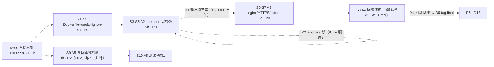

> 状态：进行中（**S1–S8 全部收口 · A1–A4 部署链交付完成**；下一步 S9–S10 = A5 设备掉线检测（P2，D12）；M6.1 A 侧就位待与 dev-C 合验）　｜　版本：v2.2　｜　日期：2026-11-14
> 负责人：**dev-A（唯一）**　｜　任务包：**A · 容器化与部署链（17h）**
> 关联：docs/team_tasks/day10/dev-A-容器化与部署链.md v1.0（任务书，分工与判据唯一依据）｜docs/team_tasks/day10/day10-任务总览与DAG.md v1.1（§2 DAG、§3 对接点 Y1/Y2/Y4、§4 写域、§8 待确认）｜docs/plans/day10/day-10-交付与观测-工作推进计划.md v1.1（总计划件）
> 上游依据：PRD line 578（Day 10 完成定义）、§2.5（一键启动/HTTPS/健康检查）、line 455（FR-TC-05）、line 444（FR-ADM-10）｜技术设计文档 §8.3 Day 10（line 1176–1183：多阶段非 root、七服务编排、回滚演练）、§1.4 选型表 line 206（compose 七服务）
> 变更记录见文末

---

# dev-A · Day 10 工作推进计划 · 容器化与部署链

> 本计划是 dev-A 任务书的**可执行展开**：把 5 个节点（A1–A5，17h）拆成 S0–S10 十一步，每步含子任务拆解、工时与优先级、前置依赖、交付物、命令级自检与确认点。**每完成一步向主理人确认后再进入下一步**（沿用 Day 8/9 分步确认制）。本文不替代任务书，冲突时以任务书与总览为准。

---

## 1. 项目认知基线（本轮通读结论）

### 1.1 定位与硬约束

- **一句话定位**：CCRC 康养社区长者卧室 3D 数字人陪伴系统，三端同仓库（pad/console/family MPA）。Day 10 = 交付与观测：让「在别人电脑上一条命令跑起来」成立（TD §8.3 line 1178）。
- **三条硬约束**（总览 §0.3）：`app/services/` 唯一写库层；身份只从 `runtime_context` 注入；**Day 10 零新增迁移**（A4 只执行既有 0021 及历史迁移的 downgrade，不新建）。
- **dev-A 写域**（任务书 §0.1，违者返工）：`Dockerfile`（新）、`.dockerignore`（增量）、`docker-compose.yml`（**独占**）、`.env.example`（增量，langfuse 段按 B→A 顺序）、`deploy/nginx.conf`（**独占**）、`app/scheduler/device_jobs.py`（新）、`app/services/device_service.py`（增量）、`tests/test_device_offline.py`（新）。
- **高风险文件**（AGENTS §5）：`Dockerfile`、`docker-compose.yml`、`deploy/nginx.conf`——**先出方案（本计划 §4 各步「方案要点」）经确认后才落代码**，人工逐行读 diff。证书文件不进 git。

### 1.2 里程碑归属

| 里程碑 | dev-A 判据贡献 | 时点 |
| --- | --- | --- |
| M6.0 启动核对 | 牵头裁决 §6 待确认项 Q4/Q7（A2 的 langfuse 形态与 laya 形态直接由 A 落编排） | D10 09:30 |
| M6.1 容器化就绪 | A1+A2+A3：compose 全 healthy、`https://localhost` 可访问、密钥零进镜像层 | D11 17:00 |
| M6.5 演示冻结 | A4 回滚演练通过是 D5 `git tag final` 的**前置**（Y4 契约） | D13 16:00 |
| M6.4 P0 回归 | A5 设备掉线检测进 D2 回归覆盖（P2，无硬下游） | D12 18:00 |

---

## 2. 现状实测（2026-11-13 代码取证，逐条留文件:行号）

> 编制时以 Explore 只读巡检结果为准；开工前 S0 复核一遍，有漂移先改本表再动代码。

| # | 事实 | 位置 | 对计划的影响 |
| --- | --- | --- | --- |
| 1 | compose 已有 **6 服务**：postgres(pgvector)、redis、funasr、weather-mcp、mock-operations-mcp、voiceprint；4 个带 healthcheck | docker-compose.yml（182 行） | A2 在此基础上**追加** 5 类服务：backend/nginx/laya/coturn/langfuse |
| 2 | **backend 无 Dockerfile、无 compose 服务**；README 与 mock-operations Dockerfile 头注释均明示「留到 Day 10」 | deploy/mock-operations/Dockerfile L3 | A1 新建根目录 `Dockerfile` |
| 3 | 已有 3 个 Dockerfile（weather/mock-operations/voiceprint），口径统一：`python:3.12-slim` + uv `--frozen` + 非 root 用户 + 密钥不进镜像 | deploy/*/Dockerfile | A1 沿用同一镜像骨架，不发明第二套口径（AGENTS §4.8） |
| 4 | **`.dockerignore` 已存在**，排除清单与 A1「runtime 需复制 alembic/」冲突 | .dockerignore（L22 排除 alembic） | S1 先核对并增改 `.dockerignore`（保留排除 `.env`/frontend/node_modules，放行 alembic/、static/ 需评估体积） |
| 5 | `deploy/nginx.conf` 只有 `/avatars/` location 片段 + 一次性验证用最小 server{}，**无**三入口静态段、`/api` `/ws` 反代、443/TLS | deploy/nginx.conf L17-21 自我声明 | A3 重写为完整托管配置（保留 /avatars 段） |
| 6 | **HTTPS 证书零存在**：全仓无 .crt/.pem/.key；mkcert 仅列为可选前置 | README L118 | A3 交付证书生成说明；证书不进 git |
| 7 | **coturn 无任何部署物**；仅 `.env.example` 有 STUN/TURN 变量、代码有 `GET /api/audio/ice-config` 下发端点（day09 D2.5 已交付） | app/api/audio.py（ICE 字段只读不改名） | A3 新增 coturn 服务编排，字段对齐不改名 |
| 8 | `/static` 挂载依赖 `os.getcwd()` | app/main.py L1114-1118 | A1 方案必须固定 WORKDIR 并拷贝/挂载 static/，否则容器内 404 |
| 9 | `config.py` `_ENV_FILE` 固定取 `Path(__file__)/../../.env` | app/core/config.py L24-25 | 容器内无 .env 文件；pydantic-settings 对缺失 env_file 不报错，全部变量靠环境注入（compose `env_file`/`environment`），S3 方案里显式验证 |
| 10 | MCP/声纹/System One/OTel 地址默认 `localhost`（mcp 7101/7102、voiceprint 7003、system_one 7001、otel 4317） | app/core/config.py L122/207-209/212-220/255 | A2 的 backend 服务环境变量必须改为 compose 服务名（mock-operations 已示范改法：compose L113-114） |
| 11 | **容器内无迁移执行机制**：无 entrypoint/启动脚本，alembic 只在宿主机手动跑 | 全仓 | D3 干净主机三步起全栈的判据要求库有表 → A2 方案含「backend 启动前自动 `alembic upgrade head`」，登记为待确认项（§6 Q-A1） |
| 12 | langfuse 段配置字段已备（5 个 `langfuse_*` + 3 个 `otel_*`），默认 disabled；**无 compose 服务、无接入代码**（接入归 B1） | app/core/config.py L212-220 | A2 只编排 langfuse 服务 + 凭据注入（Y2），不碰接入代码 |
| 13 | laya 是宿主进程 sidecar：615MB 权重 + torch，仅 `jev` conda 环境可跑，`SYSTEM_ONE_MODEL_PATH` 默认空 | scripts/sidecar_requirements.txt、config.py L128 | A2 形态按 §6 Q7 裁决：优先挂载宿主权重卷，不可行则 sidecar 化并如实记录 |
| 14 | 测试基线：全量 pytest 全绿（day09 收口 1660+ passed）；`.githooks/pre-push` 已更新 | tests/ | 每步自检「全绿不回退」 |

---

## 3. 任务全景与依赖

### 3.1 节点依赖与排程



**日历排程**（与总览 §2.3 一致，Line 1 槽位优先）：

| 时段 | 内容 | 说明 |
| --- | --- | --- |
| D10（11-13） | M6.0 → S1（A1 全部 4h） | 穿插 Line 1 X3/X4/X12 联调槽（15:00/16:00），冲突时 Line 1 优先 |
| D11（11-14） | S3–S5（A2）→ S6–S7（A3），M6.1 收口 | Y1/Y3 按契约 D11 上午到位；B 的 langfuse 段先于 A 合入 |
| D12（11-16） | S8（A4）→ S9–S10（A5） | A4 下午产出 Y4 给 D3/D5 |
| D13（11-17） | 支援 D3 干净主机演练 | 待命处置部署类缺漏 |

### 3.2 对接点消费与产出（摘总览 §3）

| 编号 | 方向 | 内容 | 我方动作 |
| --- | --- | --- | --- |
| Y1 | C → A | 三入口 dist 路径表 + 反代规则草案（`/pad` `/console` `/family`、`/api/*`→backend:8000、`/ws/*` 带 Upgrade 头） | S6 按草案独占合入 `deploy/nginx.conf`，联调判据：三入口 200、`wss://` 不断 |
| Y2 | **B ⇄ A（共享实例，2026-11-13 补充裁决：Langfuse 部署于 dev-B 主机，全员连 B）** | B 侧：共享 langfuse v2 实例常驻（含专用库）+ 生成 public/secret key 分发全员 + 防火墙放行 3000 + 提供局域网 IP；A 侧：compose 的 langfuse 服务 **profile 化**（默认 `up` 不起，`--profile langfuse` 激活，供 B 本机或本机自起模式用），`.env.example` 写共享模式注释（`LANGFUSE_HOST=http://<B的局域网IP>:3000` 占位 + 「key 向 B 领取，密钥不进 git」） | S4 编排 profile 化 langfuse；`.env.example` langfuse 段按共享模式成文（key 值由各人 `.env` 自填，不进 git） |
| Y4 | A → D | 回滚基准 commit 登记（当前 `8d506b2` 或 D13 前最后收口 commit） | S8 写入演练记录；D5 打 tag 前必须核「A4 演练通过」 |

---

## 4. 分步执行计划（S0–S10）

> 每步结束输出固定格式汇报：①改了哪些文件（diff 摘要）②验收命令原文输出③等待项/漏洞登记④是否可进下一步。优先级口径：**P0 = 不得裁减项（FR-TC-05 部署主线）／P1 = FR-TC-05 回滚能力／P2 = PRD P2 顺延项（工期不足先裁）**。

### S0 · 启动门槛核对（0.5h，D10 09:30，M6.0）

**内容**：①§6 待确认项 Q4（langfuse v2 vs v3）与 Q7（laya 挂卷 vs sidecar）随 M6.0 裁决——这两项直接决定 A2 编排形态；②环境自检：Docker Desktop 运行中、`docker compose config` 通过、磁盘余量 ≥15GB（funasr/langfuse 镜像与模型）；③现状实测表 §2 逐条复核（有漂移先改表）；④`git status` 干净起步，确认写域无本包外文件。

**交付物**：M6.0 裁决结果登记 + §2 复核结论。
**自检**：`docker compose config` 退出码 0；`git status` 干净。
**确认点**：❶ Q4/Q7 裁决结果；未裁决则 S4 的 langfuse/laya 两段挂起，其余不阻塞。

---

### S1 · A1 后端 Dockerfile（4h，P0，D10 第一个开工项）

**方案要点（高风险文件，随本步确认）**：

1. 多阶段两段式，镜像骨架对齐既有三个 Dockerfile 口径：
   - `builder`：`python:3.12-slim` + `ghcr.io/astral-sh/uv` → `COPY pyproject.toml uv.lock ./` → `uv sync --frozen --no-dev`（依赖层缓存友好，锁文件不变时重建不走全量）；
   - `runtime`：仅 `COPY --from=builder /app/.venv .venv` + `COPY app/ alembic/ alembic.ini` + `static/`（`/static` 挂载依赖 cwd，见 §2#8）→ 非 root 用户（建 `silvermate` 用户，对齐 deploy/weather/Dockerfile）→ `WORKDIR /app` → CMD `uvicorn app.main:app --host 0.0.0.0 --port 8000`（容器内 Linux 默认事件循环，**不引入** Windows policy 代码）。
2. 入口脚本 `deploy/backend-entrypoint.sh`（§2#11 缺口）：`alembic upgrade head && exec uvicorn ...`——服务 D3 三步起全栈的判据依赖库有表。**若主理人裁决不自动迁移**（Q-A1），则改为 compose 里一次性 `migrate` 服务或文档写明手动步骤，二选一，不静默。
3. `.dockerignore` 增改：保留排除 `.env`、`frontend/`、`node_modules`、`.workbuddy/`、`*.vrm/*.glb`、大音频；**放行 `alembic/`**（与 §2#4 冲突修正）；`static/` 体积评估后决定 COPY 或运行时卷挂载。

**子任务拆解**：

| # | 子任务 | 耗时 | 优先级 | 前置 |
| --- | --- | --- | --- | --- |
| A1-a | `.dockerignore` 核对增改（含 alembic 放行） | 0.5h | P0 | S0 |
| A1-b | `Dockerfile` 两阶段 + 非 root + entrypoint | 2h | P0 | A1-a |
| A1-c | 构建验证 + 密钥零进镜像层证明 + 镜像体积记录 | 1.5h | P0 | A1-b |

**交付物**：根目录 `Dockerfile`、`.dockerignore`、`deploy/backend-entrypoint.sh`、镜像体积记录（README 表素材，交 C 合入）。

**自检（验收命令原文）**：

```bash
docker build -t silvermate-backend .
docker run --rm silvermate-backend id            # 非 root（uid=1000 silvermate）
docker run --rm silvermate-backend python -c "import app.main"   # 无 ImportError
docker history silvermate-backend | grep -iE "SECRET|PASSWORD"   # 零命中
docker image inspect silvermate-backend --format '{{.Config.Env}}'  # 无密钥
```

**确认点**：❷ entrypoint 是否含自动 `alembic upgrade head`（Q-A1，§6）。

---

### S2 · （并入 S1 验证）镜像行为冒烟（0.5h，P0）

用临时 `docker run` + 空环境变量组起 backend（不连库，`APP_ENV=test` 跳过 checkpointer），确认 `/health` 可响应、日志无 .env 依赖报错。失败则回改 Dockerfile/entrypoint。

**自检**：`docker run --rm -p 8000:8000 -e APP_ENV=test silvermate-backend` 后 `curl --noproxy '*' http://localhost:8000/health` 返回 `status:ok` 带 trace_id。

---

### S3 · A2-a compose 新增 backend 与 nginx 骨架（2h，P0，D11 上午）

**方案要点**：`docker-compose.yml` 追加（不动既有 6 服务）：

- `backend`：`build: .`（S1 镜像）；`env_file: .env` + `environment` 覆盖容器内地址：`MCP_WEATHER_SERVER_URL=http://weather-mcp:7101`、`MCP_OPERATIONS_SERVER_URL=http://mock-operations-mcp:7102`、`VOICEPRINT_BASE_URL=http://voiceprint:7003`、`SYSTEM_ONE_BASE_URL`（按 Q7 形态定）、`DATABASE_URL/REDIS_URL/LANGGRAPH_CHECKPOINT_DATABASE_URL` 指向服务名、`OTEL_EXPORTER_OTLP_ENDPOINT`（B 联调后对齐）；healthcheck `curl -f http://localhost:8000/health`；`depends_on` postgres/redis healthy；`restart: unless-stopped`。
- `nginx`：挂 `deploy/nginx.conf:ro` + 证书卷 + 前端产物（路径按 Y3 契约，C 未到位前先以 `dist/` 本地卷占位并登记）；80/443；`depends_on` backend。

**子任务**：A2-a1 backend 服务（1h）／A2-a2 nginx 服务骨架（1h）。优先级 P0。

**自检**：`docker compose config` 通过；`docker compose up -d backend` 后 healthy；`docker exec <backend> env | grep MCP_` 为服务名地址。

---

### S4 · A2-b laya / coturn / langfuse 三服务编排（1.5h，P0，依赖 Q4/Q7 裁决）

**方案要点**：

- `langfuse`（Y2，**2026-11-13 补充裁决：共享实例部署于 dev-B 主机，全员连 B**）：按 Q4 形态 v2 单容器 + 复用 postgres 独立 schema。compose 保留 langfuse 服务定义但加 **`profiles: ["langfuse"]`**——默认 `docker compose up` 不启动（共享模式下全员连 B 的实例），`docker compose --profile langfuse up` 时激活（B 本机全栈或本机自起模式用）；langfuse 依赖 compose 的 postgres（独立 schema）。凭据三变量 `LANGFUSE_HOST/PUBLIC_KEY/SECRET_KEY` 全部 `.env` 注入，compose 零硬编码；`.env.example` 按共享模式写注释与占位（key 向 B 领取，不进 git）。M6.1 判据口径随之修正：默认 profile 下**业务服务**全 healthy；langfuse 服务在激活 profile 时亦 healthy。⚠️ **A 组复核（2026-11-13）：本段 v2 形态已于 S4 追加改判为 v4 全家桶（见 §8「S4 追加」／变更记录 v1.6），此段仅作历史方案留痕，不再按 v2 执行。**
- `coturn`：`coturn/coturn` 镜像，3478/5349 端口，`deploy/turnserver.conf`（realm/外部 IP 走 `.env`），凭据与 `app/core/config.py` 既有 `turn_url/turn_username/turn_credential` 字段对齐（**不改名**）；S7 联调时与 ice-config 端到端核对。
- `laya`：按 Q7——方案 A（默认）挂载宿主已下载权重卷 + sidecar 镜像；方案 B（兜底）compose 只留编排占位注释、laya 仍以宿主 jev 进程运行，**如实记录不粉饰**。

**子任务**：A2-b1 langfuse（0.5h）／A2-b2 coturn（0.5h）／A2-b3 laya（0.5h）。优先级 P0（langfuse/coturn）、P1（laya 形态兜底可记偏差）。

**自检**：`docker compose config` 通过；`docker compose up -d langfuse coturn` 后两者 healthy；`docker exec <backend> env | grep LANGFUSE_` 见注入值、镜像层 `docker image inspect` Env 无密钥。

---

### S5 · A2-c 全服务 healthcheck / restart / .env.example 增量 / 全栈起验（1.5h，P0）

**内容**：①11 个服务逐个补 healthcheck 与 `restart: unless-stopped`（既有 4 个已有，补 backend/nginx/langfuse/coturn/laya）；②`.env.example` 增量：新增变量分组注释（langfuse 段留位等 B、TURN_*/COTURN_*、宿主端口段）；③全栈起验（**建议主理人自开终端常驻执行**，工具托管后台约 2h 回收，总览 §0.4）。

**自检（验收命令原文）**：

```bash
docker compose config                       # 校验通过
docker compose up -d                        # 一键起
docker compose ps                           # 全部 healthy
curl --noproxy '*' https://localhost/health # status:ok 带 trace_id（S7 证书就绪后走 443）
docker compose ps --format json | grep -c healthy   # =10（默认 profile，langfuse 已 profile 化不随默认起；--profile langfuse 激活时 =11）
```

**确认点**：❸ M6.1 预验收（A 半边）：compose 全 healthy。

---

### S6 · A3-a nginx 完整托管配置（1.5h，P0，消费 Y1）

**方案要点（高风险文件）**：重写 `deploy/nginx.conf`（保留既有 `/avatars/` 段）：`http` 块 upsteam backend → `server 443 ssl`（证书路径 `/etc/nginx/certs/`）→ 三入口静态段（按 Y1 草案：`/pad`→`dist/pad`、`/console`、`/family`，`try_files` SPA 兜底）→ `/api/` 反代 `backend:8000` → `/ws/` 反代含 `Upgrade`/`Connection` 头 → 80 端口 301 跳 443。**联调时点 D11 上午，C 的 Y1 草案未到可先按总览 §3 Y1 默认值落骨架，到位后 diff 对齐**。

**自检**（A 组复核修正：backend 的 health 路由**没有 `/api` 前缀**，见 `app/api/__init__.py` ROUTERS，原写的 `/api/health` 不存在）：`docker compose exec nginx nginx -t` 通过；三入口 `curl --noproxy '*' -k https://localhost/pad/` 等 200；`https://localhost/health` 200 且 `status:ok` 带 trace_id；`/api/*` 透传以 `/api/metrics` 401（**非 502**）实证；`wss://` 信令建连不断（与 dev-D/pad 联调核对）。S7 受控信任后所有 curl 可去掉 `-k`（Windows Schannel 另需 `--ssl-no-revoke`）。

---

### S7 · A3-b HTTPS 证书 + coturn 端到端（1.5h，P0/P1）

**内容**：①mkcert（或自签兜底）生成本地受控证书；证书与私钥**不进 git**，`.gitignore` 登记（`.env.example` 同级新增 `deploy/certs/` 排除条目）；生成说明写成「章节素材小抄」交 dev-C 合入 README（我不直接改 README）。②coturn 端到端：pad `RTCPeerConnection` 从 `GET /api/audio/ice-config` 拿到 TURN 地址、跨网段（手机热点）可达。

**子任务**：A3-b1 证书（0.5h）／A3-b2 coturn 联调（1h）。

**自检（验收命令原文）**：

```bash
curl --noproxy '*' -I https://localhost/pad/    # 受控信任后无告警
grep -rn "turn_credential" frontend/src         # 零命中（凭据不下前端，沿 day09 D2.5 判据）
git status --porcelain deploy/certs/            # 空（证书未入库）
```

**确认点**：❹ M6.1 正式收口（与 dev-C 的 C1 合验）。

---

### S8 · A4 回滚演练 + 部署门禁清单（2h，P1，D12）

**内容**：①**代码回滚**：以 Y4 基准（登记 `8d506b2` 或 D13 前最后收口 commit）起栈 → 故意改坏一行 → 回滚到基准 → 复跑 `/health` + AC-01 天气冒烟；②**数据回滚**（一次性数据卷上）：`alembic downgrade 0020` → 核对 `alembic_version` 回退一格且业务表数据在 → `upgrade head` 恢复（**只执行不新建**，Day 10 零新增迁移）；③产出部署门禁清单六项（验收达成/测试通过/密钥安全/迁移可逆/监控就绪/回滚清晰），按风险分级、逐项带「检查方法」列——以「章节素材小抄」交 C 进 README。

**自检**：两次演练均有操作日志；`alembic current` downgrade 后为 0020、upgrade 后为 0021；清单六项齐、基准 commit 写入记录（Y4 闭环）。

---

### S9 · A5 设备掉线检测骨架（2h，P2，D12，与 S3–S5 无文件冲突可提前）

**方案要点**：新建 `app/scheduler/device_jobs.py`（独立文件，**不碰 dev-B 既有调度文件**——day09 §6 写锁例外已在总览 §4 登记）；`device_service.py` 增量：心跳超 2 个周期 → `device.status='offline'` → `notify_service` 通知管理员+负责护工；恢复心跳回 online；掉线窗口与用药 T0 重叠 → 立即生成人工介入工单；设备自检异常（麦克风/网络）→ 工单。分层红线：写库全部走 service，job 只做判定与调用。调度注册由 main.py lifespan 装配——**`app/main.py` 归 dev-B 独占，接线改动以「补丁需求单」提给 dev-B**（沿 day07 handoff 惯例），本包不直接改。

**自检**：`pytest tests/test_device_offline.py` 全绿前先有失败用例（先写测试再实现）。

---

### S10 · A5 测试与收口（1h，P2）

**内容**：`tests/test_device_offline.py`：①超 2 周期置 offline + `notifications` 有行（收件人=管理员+负责护工）；②恢复心跳回 online；③T0 重叠生成人工介入工单；④非 admin/非负责护工查询掉线通知按既有权限矩阵 403。跑全量 `uv run pytest -q` 确认无回退；任务书 §6 执行记录回填；PROGRESS 看板状态更新（改任务卡首部状态行，脚本自动刷新）。

**自检（验收命令原文）**：

```bash
uv run pytest tests/test_device_offline.py -q
uv run pytest -q                                # 全绿不回退
uv run ruff check app tests
```

**确认点**：❺ dev-A 包收口确认。

---

## 5. 工时与优先级总表

| 步骤 | 节点 | 工时 | 优先级 | 硬前置 | 日历 |
| --- | --- | --- | --- | --- | --- |
| S0 | M6.0 启动核对 | 0.5h | P0 | 无 | D10 09:30 |
| S1+2 | A1 Dockerfile | 4.5h | P0 | S0 | D10 |
| S3 | A2-a backend/nginx 骨架 | 2h | P0 | S1；Y3 软依赖 | D11 |
| S4 | A2-b langfuse/coturn/laya | 1.5h | P0/P1 | Q4/Q7 裁决；Y2（B→A） | D11 |
| S5 | A2-c 全栈起验 | 1.5h | P0 | S3+S4 | D11 |
| S6 | A3-a nginx 配置 | 1.5h | P0 | S3；Y1 软依赖 | D11 |
| S7 | A3-b 证书+coturn | 1.5h | P0/P1 | S6 | D11（M6.1 收口 17:00） |
| S8 | A4 回滚演练 | 2h | P1 | S7 | D12 |
| S9+10 | A5 掉线检测 | 3h | P2 | M6.0 | D12（可并行垫后） |
| — | 合计 | **17.5h**（含 0.5h 缓冲吸收） | | | D10–D12 |

> 容量核对：任务包上限 24h，实排 17.5h，余额 6.5h 为 Line 1 联调槽位（X3/X4/X12）+ 缓冲。**裁减顺序**（工期不足时，沿 PRD line 586-590）：先裁 A5（P2），再压 A4 的清单交档形式（演练本身不裁——FR-TC-05 回滚能力属不得裁减），A1/A2/A3 不裁。

---

## 6. 待确认项（M6.0 逐项裁决，未裁决不开工对应子任务）

| # | 待确认 | 影响子任务 | 默认口径（挂起建议，不自动执行） |
| --- | --- | --- | --- |
| **Q-A1** | backend 容器是否自动执行 `alembic upgrade head`（entrypoint 内）vs compose 一次性 migrate 服务 vs 保持手动 | A1-b/D3 判据 | **已裁决（2026-11-13 S0）：entrypoint 自动迁移**——`deploy/backend-entrypoint.sh` 先 `alembic upgrade head` 再 exec uvicorn；D3 三步起全栈判据成立 |
| **Q-A2** | `static/` 进镜像 COPY vs 运行时卷挂载（`/static` 依赖 cwd，main.py L1114-1118） | A1 | **已裁决（2026-11-13 S0）：COPY 进镜像**；VRM 大资产不在此目录，走 nginx 卷 |
| **Q-A3** | nginx 前端产物在 C1（Y3）到位前的占位方式 | S3 | ✅ **已闭环，实际口径与 S0 预设不同（A 组复核）**：未采用 `dist/` 只读卷占位——S3 直接把 dev-C 的 `frontend/frontend.Dockerfile` 作为 compose nginx 的 build 源，Y3 产物路径 `/usr/share/nginx/html/{pad,console,family}` 内嵌在镜像中，三入口经 nginx 200 已实测。S0 的「dist 占位卷」为未采用的预设，留痕不执行 |
| （沿用总览）Q4 | langfuse v2 vs v3 | S4 | ⚠️ **本行 v2 裁决已作废（A 组复核，见 §8「S4 追加」／变更记录 v1.6）**：OTLP 摄入端点 v3.22 才引入，v2 收不了 OTel span → **现行口径 = Langfuse v4 全家桶六服务**（langfuse-web/worker + 独立 postgres/redis/clickhouse/minio），compose `profiles: ["langfuse"]` 默认不起（共享实例常驻 dev-B 主机，全员连 B），compose 这套只作一键启动／干净主机演练兜底；`.env.example` 按共享模式写占位注释（key 向 B 领取，不进 git）。历史「v2 单容器 + 复用 postgres 独立 schema」仅留痕，不再执行 |
| （沿用总览）Q7 | laya 挂卷 vs sidecar | S4 | **已裁决（2026-11-13 S0）：挂载宿主已下载权重卷**；不可行再降级 sidecar 化并如实记录 |
| （沿用总览）Q2 | D12–D13 收口日历 | 排程 | 按 D12–D13 |

---

## 7. 风险预案（阻塞点 → 应对）

| # | 风险 | 触发信号 | 应对 |
| --- | --- | --- | --- |
| R1 | **`.dockerignore` 与 alembic 冲突**：现状已排除 alembic，A1 直接 build 会导致容器内迁移失败（§2#4） | `docker run ... alembic current` 报路径不存在 | S1-a 第一个处理；downgrade 演练前必复验容器内 alembic 可用 |
| R2 | **`/static` cwd 依赖**：容器 WORKDIR 与挂载不符 → 静态资产 404（§2#8） | `/static/...` 404 | A1 固定 `WORKDIR /app` 并 COPY static；联调首验即查 |
| R3 | **容器内地址全错**：MCP/声纹/system_one/otel 默认 localhost，backend 容器化后连不上（§2#10） | backend 日志连接拒绝 | S3 environment 逐项覆盖为服务名；mock-operations compose L113-114 已示范；逐服务冒烟 |
| R4 | **Y1/Y3 未按时到位**（C 的静态段草案与 dist 路径） | D11 上午 C 未交付 | 按 Y1 默认口径先落骨架 + dist 占位卷（Q-A3），C 到位后 diff 对齐；不阻塞 A2/A3 主线 |
| R5 | **langfuse 段写域调整（共享模式后）**：`.env.example` 的 langfuse 注释与占位由 A 在 S4 直接成文（B→A 串行锁的冲突面消失），但**必须防 key 真值进 git** | `git diff .env.example` 出现具体 key/IP 之外的密钥值 | A 只写注释与 `<B的局域网IP>` 占位；key 值只进各人本地 `.env`；提交前 grep 复查 |
| R13 | **共享 Langfuse 单点在 dev-B 主机**：B 关机/离线/防火墙拦截 → 全员 Trace 上传失败 | B1 联调时 Langfuse 界面无新 Trace | `langfuse_enabled=False` 时业务不中断（B1 验收判据复用）；AC-31 取证避开 B 维护时段；B 机器联调窗口（D11 上午起）保持常驻开机；兜底：B 不可用期间本机 `--profile langfuse` 自起一套临时取证 |
| R6 | **laya 容器化不可行**（权重 615MB + torch 依赖宿主 jev 环境） | Q7 方案 A 挂卷后 sidecar /health 报 model_missing | 按 Q7 兜底：compose 占位 + 宿主 sidecar，总览 §6 挂起留痕，不为达标粉饰 |
| R7 | **compose 全栈验证被回收**（工具托管后台 ~2h 生命周期） | 验证中途容器退出 | 全栈验证请主理人自开终端常驻执行（总览 §0.4 明示）；我用分服务逐个 up 验证推进 |
| R8 | **本机代理污染**：`HTTP_PROXY=127.0.0.1:52070` 会劫持 curl 与 docker 拉镜像 | curl 卡死/镜像拉取失败 | curl 一律 `--noproxy '*'`；docker build 拉镜像失败时检查 Docker Desktop 代理配置 |
| R9 | **证书信任链**：mkcert 未装或根证书未信任 → 浏览器告警 | https 告警 | 兜底自签 + 说明文档标注「受控信任」步骤；判据以「受控信任后无告警」为准 |
| R10 | **funasr 首启拉模型数 GB / voiceprint onnx 未放置**：全栈 healthy 超时 | compose ps 长期 starting | 这是既有服务既有缺口，不属于本包写域——提单给主理人/相应负责人，本包判据不含其模型就绪 |
| R11 | **A5 与 dev-B 写域擦边**：main.py 装配归 B | 我需要改 main.py 才能接 job | 以补丁需求单交 dev-B（沿 day07 handoff-A-to-C 惯例），本包不越界；测试用独立装配绕开 main.py |
| R12 | **Line 1 槽位抢占**：D10 15:00/16:00 联调冲突 | 槽位通知 | Line 1 优先（总览 §0.2）；S1 的 A1-c 验证段可拆碎填缝隙，D10 内完成 A1 不受影响 |
| R14 | ✅ **S7 已闭环**（原：证书目录不进 git → 干净主机 clone 后无证书，nginx 起不来） | 曾为 D3 三步演练的阻塞点 | `deploy/gen-dev-cert.sh` 一键生成 CA＋server 证书；`.gitignore` 显式登记 `deploy/certs/`；生成／受控信任／验证／撤销步骤写入计划件 §9.1 交 dev-C 合入 README；D3 演练第一步即跑该脚本 |
| R15 | **自定义 `NGINX_HTTPS_HOST_PORT`（非 443）时 80→443 跳转丢端口**：`return 301 https://$host$request_uri` 用 `$host` 不带端口 | 改端口后浏览器跳到 443 而非自定义 HTTPS 端口 | 默认 80/443 口径不受影响；自定义端口时在 `deploy/nginx.conf` 的 return 301 显式补端口，并在 README 端口表登记 |
| R16 | **任务书 A3 凭据红线判据与已冻结实现冲突**：`grep -rn "turn_credential" frontend/src` 字面要求零命中，但 day09 D2.5 交付的 `realtime.ts` 有 2 处字段名引用（类型声明／响应取值） | 按字面判据验收会误判为不达标，且修它要动 dev-C 写域并破坏 ice-config 动态下发设计 | S7 按实质判据验收（凭据真值在 src／dist 均零命中）；**待主理人裁决**把判据修订为「凭据真值零命中」，字段名命中允许，登记为已知文档冲突，不改前端 |
| R17 | **浏览器 GUI 无告警与手机热点真机跨网段缺自动化实证**：本机只能验证系统根信任链、非回环 IP 下发、relay 地址与端口映射 | D3／演示冻结时才发现浏览器仍告警或远端 ICE 失败 | 系统级证据已备（`X509Chain` chain_build=True、不带 -k 200、Allocate 回宿主 IP、端口段映射）；D3 干净主机演练与 M6.5 演示冻结安排人工目视＋真机热点联调，见 §9.1／§9.2 步骤 |

---

## 8. 执行记录（开工后填写）

| 日期 | 步骤 | 结果/证据指针 | 等待项 |
| --- | --- | --- | --- |
| 2026-11-13 | S0 | ①环境自检 PASS：Docker 29.9.1（client=server）、`docker compose config` 退出码 0、C 盘余量 141G≥15G；②现状实测表 §2 十四条逐条复核**无漂移**（/static cwd 依赖实位于 main.py L1115-1119、.dockerignore 排除 alembic 实际 L27；**新增登记**：.dockerignore L28 同时排除 `scripts/` → entrypoint 脚本必须放 `deploy/` 下才能进构建上下文，与 §4 S1 方案一致）；③计划件 v1.0+索引已提交 `a19504b`，工作区干净；④裁决落档：Q4=langfuse v2+复用 postgres 独立 schema、Q7=laya 挂载宿主权重卷、Q-A1=entrypoint 自动迁移、Q-A2=static COPY 进镜像、Q-A3 按默认口径（dist 占位卷）执行 | 无（可进 S1） |
| 2026-11-13 | （补充裁决） | **Langfuse 走共享实例模式：部署于 dev-B 主机，全员连 B**。计划件同步：Y2 契约改 B⇄A 双向（B 提供实例+key+放行端口，A 提供 profile 化编排+共享模式 .env 注释）、S4 方案改为 `profiles: ["langfuse"]`（默认 up 不含 langfuse，S5 全栈判据 =10）、新增风险 R13（共享实例单点，兜底 `--profile langfuse` 本机自起）、R5 改写（防 key 真值进 git） | 待 B 侧落实：常驻实例、分发 key、放行 3000、提供局域网 IP |
| 2026-11-13 | S1+S2 | **A1 收口 + 镜像冒烟 PASS**。①`.dockerignore` 放行 alembic（A1-a）；②`Dockerfile`（两阶段 python:3.12-slim + uv --frozen --no-dev + 非 root uid=1000 silvermate + COPY --chown）与 `deploy/backend-entrypoint.sh`（Q-A1 自动迁移，SKIP_MIGRATIONS=1 开关）落码（A1-b）；③自检全过（A1-c）：`docker build` 成功、容器内 `id`=uid 1000 非 root ✓、`python -c "import app.main"` 无 ImportError ✓、`docker history` 密钥零命中 ✓、镜像 Config.Env 无密钥 ✓；④S2 冒烟：`SKIP_MIGRATIONS=1 APP_ENV=test` 起 18000 口，`/health` 返回 status:ok 带 trace_id `1d3c4f06`，容器稳定运行；无库时调度 job 报 ConnectionRefused 但服务不倒（降级路径验证）。**体积优化留痕**：首版 `RUN chown -R` 反模式致 1851.5MB（chown 复制整 /app 层，34.8s）；改 `COPY --chown` 后 **1010.4MB**（-841MB）；体积分布 .venv 422M（真实依赖）/static 155M（Q-A2 裁决 COPY）/app 4.1M。README 表素材已可交 C | 无（已确认） |
| 2026-11-13 | S3 | **A2-a 收口**。①`docker-compose.yml` 追加 `backend`（A1 镜像 + env_file + 容器内地址全覆盖服务名：DATABASE_URL/LANGGRAPH_CHECKPOINT_DATABASE_URL/REDIS_URL/MCP_×2/VOICEPRINT/ASR=ws://funasr:10095；**不做宿主端口映射**——宿主 8000 被本地 uvicorn 占用 netstat 实测，对齐 weather-mcp 口径）与 `nginx`（**直接 build dev-C 的 frontend/frontend.Dockerfile**，Y3 产物路径契约内嵌；80/443 宿主口走 NGINX_HTTP(S)_HOST_PORT 变量）；②`.env.example` 增量两变量；③自检：`docker compose config` PASS；backend **healthy**（entrypoint 自动迁移实测 `0020→0021` ✓；/health 200 带 trace_id）；nginx **healthy**（`/pad/` `/console/` `/family/` 全 200 ✓、`/` 302 跳 pad ✓）；nginx→backend 网络连通实测 wget 直达 ok。**缺陷移交 S6**：镜像内草案的变量化 `proxy_pass $backend_upstream` 报 `no resolver defined to resolve backend` → /api 502（error.log 实证）；S6 在独占的 deploy/nginx.conf 中以静态 upstream 或补 `resolver 127.0.0.11` 修复并挂载覆盖，无需 dev-C 改镜像（知会留痕）。**过程坑登记**：a) `--build` 连带重建依赖链镜像，voiceprint 容器内 pip 撞本机代理失败（R8 兑现）——改为不带 `--build` 起 backend 绕开；b) nginx 构建两次 ECONNRESET 失败（pnpm 大文件下载抖动），第三次层缓存+重试成功，`--build-arg HTTP_PROXY=host.docker.internal:52070` 实测非必需（容器可直连 registry）；c) Git Bash 的 MSYS 路径改写会污染 curl 的 /api 路径与 -w 格式串，验证命令需 `MSYS_NO_PATHCONV=1` | 无（已确认） |
| 2026-11-13 | S4 追加 | **Q4 改判同步（dev-B 正式通知，落档 dev-b 计划件 §8.1-⑨ / commit 56345ab）：Langfuse v2 → v4 全家桶**。①改判依据：OTLP 摄入端点 v3.22 才引入，v2 收不了 OTel span（B 在 v2.95 实测 api/public/ 无 otel 路由）——B1 走 OTLP/HTTP 必须实例 ≥v3.22；S0 的「Q4=v2+复用 postgres」作废（v2 现行不收 OTel span，仅 security patch）。②compose 已重编为 **v4 六服务**（langfuse-web/worker + langfuse-postgres/redis/clickhouse/minio，对齐官方 v4 模板；服务名带 langfuse- 前缀避免与业务 postgres/redis 冲突；基础设施不映射宿主口——本机 5432/6379 被业务容器占用；web 3000 + minio 9090 映射；凭据全走 .env 变量、零硬编码；minio entrypoint 预建桶）；profiles: ["langfuse"] 语义不变（共享实例用 B 那套，compose 是一键启动/干净主机演练兜底）。③自检：`docker compose config` 默认 PASS + langfuse profile 15 服务 PASS，web/worker DATABASE_URL 抽查正确指向 langfuse-postgres。**容器级验证本机不做**：v4 全家桶内存需求 3-4GB，本机 WSL2 仅 1.86GB（S4 实测）——归 D3 干净主机演练/B 侧（六容器已在 B 机跑通、冒烟 4 判据全过）。④应用侧零改动：LANGFUSE_ENABLED/HOST/PUBLIC_KEY/SECRET_KEY/SAMPLE_RATE/OTEL_ENABLED 六变量口径不变，exporter 端点由 B1 侧派生 `{LANGFUSE_HOST}/api/public/otel/v1/traces`（x-langfuse-ingestion-version: 4，commit e4c48a9）。⑤S4 执行记录中「v2 schema 复用实证」保留作历史（v2 收不了 OTel span 故弃用；CREATE SCHEMA 一次性动作随之作废） | 无（待确认进 S5） |
| 2026-11-13 | S4 | **A2-b 收口（三服务编排）**。①**langfuse** ✓：v2 单容器 + 复用 postgres 独立 schema 实证可行——`DATABASE_URL=...?schema=langfuse` + 一次性 `CREATE SCHEMA IF NOT EXISTS langfuse`，health 返回 `{"status":"OK","version":"2.95.11"}`，`langfuse` schema 内 Prisma 表集完整落库、业务表隔离无损；**profile 化**（默认 up 不起，共享实例裁决落地）；必填三变量实测（NEXTAUTH_SECRET/SALT 任意 + ENCRYPTION_KEY 必须 64-hex）；验证后本机容器已停（实例归 B）。②**coturn** ✓：healthy，3478 UDP/TCP 编排 + 凭据经 command 变量注入（不写死 conf）；turnserver.conf **行内注释坑**实测修复（coturn 解析器把 `# ...` 当参数值致循环重启；no-tlsv1_1 该版本不识别）。③**laya**：容器化定义+镜像构建完成（挂宿主权重卷 `C:/models/laya`），但 **Docker Desktop/WSL2 内存上限实测仅 1.86GB**（docker stats），权重+torch 需 3-4GB——本机容器化不可行，**Q7 兜底生效**：宿主 jev sidecar（7001）继续服务（model_loaded=true 实测），容器定义 `profiles: ["laya"]` 保留供内存充足机器；backend 的 SYSTEM_ONE_BASE_URL 变量化（默认 laya:7001，.env 可覆盖 host.docker.internal:7001）。④`.env.example`：langfuse 段按共享模式成文 + LAYA_HOST_PORT/SYSTEM_ONE_MODEL_HOST_DIR。⑤`docker compose config` 默认 9 服务 PASS、langfuse+laya 双 profile PASS。**laya 镜像构建三连坑留痕**（deploy/laya/Dockerfile 头注释详录）：torch 190MB 直连 SSL 超时 → host.docker.internal 代理被拒（本机代理只监听 127.0.0.1）→ **宿主预下载 Linux cp312 wheel 离线装**（`pip download --platform manylinux_2_28_x86_64 --python-version 312`，wheels/ 不进 git）；另 Docker Hub `# syntax` 指令拉取 401（限流），已删非必需行 | 无（待确认进 S5） |
| 2026-11-13 | S5 | **A2-c 收口 + 共享口径扩展（主理人指令：funasr/voiceprint 也不自起，连 dev-B）**。①funasr/voiceprint 双服务 `profiles: ["local"]`，backend 的 ASR_BASE_URL/VOICEPRINT_BASE_URL 变量化（${VAR:-服务名默认}，.env 设 B 地址即生效）；backend depends_on 移除 voiceprint（profile 化后不可依赖）；②本机 voiceprint 旧容器已停删；③`.env.example`：ASR 段共享口径注释 + 补 VOICEPRINT_BASE_URL（占位 <B的局域网IP>）；④全栈起验：`docker compose up -d` **7 服务全 healthy**（backend/coturn/nginx/postgres/redis/mock/weather）+ `/pad/` 200 ✓；healthcheck/restart 全服务齐备；⑤profile 矩阵：默认 7 服务（共享连 B）／--profile local 加 funasr+voiceprint／--profile langfuse 加 v4 六服务／--profile laya 加 laya 容器；config 三 profile 组合 PASS。 | **已解除（17:45）**：.env 实测已有 B 地址（10.55.50.115）——backend 重建后容器内实测三路全通：funasr wss://10.55.50.115:10096 TCP 可达 ✓、声纹 http://10.55.50.115:7003 HTTP 探活 `{status:ok, model:CAM++, dim:192}` ✓、宿主 laya sidecar 经 host.docker.internal:7001 `{status:ok, model_loaded:true}` ✓（.env 增 SYSTEM_ONE_CONTAINER_URL 衔接容器→宿主 sidecar）；https /health 判据仍归 S7 |
| 2026-11-13 | S5 追加 | **主理人裁决：本次 push 豁免真门禁（Q3 临时豁免条款，留痕）**。①背景：本机 .venv_sidecar 真门禁环境反复 segfault（uv CPython + pip 包组合在 RLAgent/ModernBERT init_weights 段错误；已试钉版/KMP/换解释器三轮未根治）；②裁决：本批 develop+feature-zjj 的 push 以 --no-verify 豁免一次，**待环境修复后补跑 eval_gate --provider local 并回填报告**；③已推内容均经轻量校验（看板/索引/样本自检全绿）与本地全量开发期验证；④环境重建进行中（方案：基于本机 agent-course 解释器 + system-site-packages 重建 .venv_sidecar，与常驻 sidecar 进程同栈） | 无 |
| 2026-11-13 | S6 | **A3-a 收口（nginx 完整托管配置 ＋ S3 移交缺陷修复）**。①`deploy/nginx.conf` 全量重写（保留 Day4 `/avatars/` 段）：80→443 301＋`/nginx-health` 探针、443 TLS、http 级 `map $connection_upgrade`、server 级 `resolver 127.0.0.11 valid=10s`＋变量化上游、三入口静态（Y1 原样）、`/assets` `/kws` `/vad-assets` `/media`、`.vrm` 正则段、`/health` `/static/` `/api/` `/ws` 反代；**S3 的 `no resolver defined to resolve backend` 缺陷已消**（刻意不改成静态 upstream：其只在 nginx 启动时解析一次，backend 重建换 IP 会一直指向旧 IP）。②`docker-compose.yml` nginx 段补两条只读卷（conf + certs），healthcheck 由 `/pad/` 改探 `/nginx-health`（80 已 301，busybox wget 不宜探 HTTPS）。③**证书前置**：443 段缺证书则 `nginx -t` 失败，故 S6 先生成自签 `deploy/certs/server.{pem,key}`（SAN=localhost / host.docker.internal / 127.0.0.1；`git check-ignore` 实证不进 git）；mkcert 受控信任与 coturn 端到端仍归 S7。④自检逐条：`nginx -t` PASS；`docker compose config` 默认与 `--profile local --profile langfuse --profile laya`（15 服务）均 PASS；7 服务全 healthy；`http://localhost/pad/`→301 `https://localhost/pad/`；三入口 `/pad/ /console/ /family/` 全 200；`https://localhost/health` 200 且 body `status:ok` 带 trace_id（**M6.1 判据达成**）；`/api/metrics`、`/api/audio/ice-config` 均 401（**非 502**，反代已通）；`/static/mock/tts_*.wav` 200 `audio/x-wav`；`/assets/vrm/Danheng.vrm` 200 `model/gltf-binary`；`/avatars/danheng.png` 200 `image/png` 且 CORS 回显 Origin；`/ws/signal` **101 Switching Protocols**（Upgrade 头透传）；`docker compose logs nginx` 无 resolver/error；backend `--force-recreate` 后 `/health` 仍 200。⑤**口径差异登记**：计划 §4 S6 自检写的 `/api/health` 在 backend 不存在（health 路由无 /api 前缀，见 `app/api/__init__.py` ROUTERS），按任务书 A2 判据以 `/health` 为准，`/api/*` 透传另以 `/api/metrics` 401 实证。⑥**过程坑**：Windows curl 在 `MSYS_NO_PATHCONV=1` 下 `-o /dev/null` 报 exit 23，须用 `-o NUL`；nginx 官方镜像 error.log 软链 /dev/stderr，`docker compose exec ... tail/grep` 会挂起，改读 `docker compose logs`。⑦S6 无 Python 改动但仍跑全量回归不回退：`uv run ruff check app tests` All checks passed、`uv run python -m pytest -q` **1709 passed**（`uv run pytest -q` 直调报 "uv trampoline failed to canonicalize script path"，改用 `python -m pytest` 绕过，登记为本机环境坑）；backend 重建实测 IP 未变（172.21.0.6），「换 IP 自动重解析」为设计依据、未取换 IP 实证 | S7：mkcert 受控信任（去掉 -k）、coturn 端到端 / 手机热点跨网段、证书生成说明交 dev-C（README §A4）、干净主机演练前先生成证书；`NGINX_HTTPS_HOST_PORT` 非 443 时 80 跳转需显式补端口 |
| 2026-11-13 | S7 | **A3-b 收口（HTTPS 受控信任 + coturn 端到端 + M6.1 A 侧就位）**。①**证书**：本机 mkcert 未装 → 按计划走自签兜底，新建 `deploy/gen-dev-cert.sh`（CA:TRUE 根 CA + 由 CA 签发 server 证书，SAN=localhost / host.docker.internal / 127.0.0.1 / ::1 / 可经 `SILVERMATE_LAN_IP` 追加局域网 IP；幂等复用根 CA、`--force` 重建）闭环 **R14**；`openssl verify` OK；`certutil -addstore -user Root` 导入根 CA（受控信任，可用 `certutil -delstore -user Root "SilverMate Local Dev CA"` 撤销）；.NET `X509Chain` chain_build=True、根为 SilverMate Local Dev CA、status none；`curl`（**不带 -k**）`https://localhost/pad/` 与 `https://10.55.50.233/pad/` 均 200、`ssl_verify_result=0`，`https://localhost/health` 200 带 trace_id。②**coturn 端到端**：走真实设备链路（`POST /api/device-sessions` 换 331B device token → `GET /api/audio/ice-config` 200），`turn_username` / `turn_credential` 与 `.env`（即 compose command 注入 coturn 的值）逐字比对一致、字段未改名；`turnutils_uclient` 对非回环 `10.55.50.233:3478` 做 TURN Allocate **success**；`wss://localhost/ws/signal` 不带 -k 仍 **101 Switching Protocols**。③**跨网段缺口闭环（S7 实测发现）**：原 `.env` 的 `turn:localhost:3478` 远端会解析成设备自己 → 改 `10.55.50.233` 并验证下发；Allocate 原返回 Docker 内网 `172.21.0.9` → 新增 `.env` 的 `TURN_EXTERNAL_IP_ARG=--external-ip=<宿主IP>`（整段参数经 compose command 注入，仓库不写死机器 IP）后 relay addr 变 `10.55.50.233:49196`；compose 补 `49160-49200:49160-49200/udp` 中继端口段映射，远端数据才进得来；`.env.example` 同步跨网段说明。④**5349 TLS 裁决**：业务只用 3478（ice-config 下发 `turn:`，无 `turns:` 消费方），S7 明确**不启用**，改 `deploy/turnserver.conf` 用本版本识别的 `no-tls` 关闭 TLS 监听器；顺手清掉 S4 遗留 `no-cli`（deprecated）与 `no-tlsv1`（Bad configuration format）。⑤**凭据红线口径偏差（待主理人裁决）**：任务书 A3 判据 `grep -rn "turn_credential" frontend/src` 零命中**字面不成立**（2 处命中：`realtime.ts` L212 响应类型声明、L220 从响应体取值，属 day09 D2.5 已冻结实现）；实质判据全过——口令真值在 `frontend/src` 0 命中、`frontend/dist` 0 命中、模板占位口令 0 命中，凭据仅由 ice-config 动态下发。建议判据改为「凭据真值零命中」，字段名命中允许。⑥**交付**：`.gitignore` 显式登记 `deploy/certs/`；README 章节素材小抄写入本计划件 §9（证书 / 端口表 / 镜像体积，S8 门禁清单与回滚记录占位）交 dev-C 合入。⑦自检：`docker compose config` 默认与三 profile 组合 PASS；7 服务全 healthy；`uv run ruff check app tests` All checks passed、`uv run python -m pytest -q` 1709 passed 不回退；`git status --porcelain deploy/certs/` 为空（证书未入库）。⑧**坑**：Windows Schannel 因本地 CA 无 CRL/OCSP 报 `CRYPT_E_NO_REVOCATION_CHECK`，curl 需 `--ssl-no-revoke`（Chromium 对私有 CA soft-fail 不受影响）；nginx 换证书后必须 `nginx -s reload`；`TURN_URL` 改后须重建 backend（config 进程启动时读取） | **等待项**：①凭据红线判据口径待主理人裁决（R16）；②浏览器 GUI 目视「无告警」与手机热点真机跨网段未做 UI／真机实证，归 D3／演示冻结人工确认（系统根信任链与非回环链路已证，R17）；③coturn 残留无害警告（默认证书路径检查／无显式监听地址／pid file）登记不影响服务；④S5 真门禁豁免仍待环境修复后补跑 eval_gate；⑤❹ M6.1 正式收口待与 dev-C 的 C1 合验，A 侧已就位 |
| 2026-11-13 | A 组复核（S8 前） | **S8 前遗留项 A 组 8 项全部收口**。①**文档内部矛盾（A1–A4）**：§4 S4 方案与 §6 Q4 的「v2 单容器 + 复用 postgres」标注作废并指向 v4 改判；§6 Q-A3 的「dist 占位卷」改为 S3 实际口径（直接 build dev-C `frontend.Dockerfile`）；§4 S6 自检的 `/api/health 透传 200` 改为 `https://localhost/health` 200 带 trace_id ＋ `/api/metrics` 401 实证（backend health 无 `/api` 前缀）；删 §8「S5 追加」与变更记录 v1.8 各 1 行重复。②**A5**：§9 新增 9.5「README §12 行号级修订清单」交 dev-C（L511／L513-519／L521／L536／L541-544／L548 逐行建议；重点：§12.1 三步启动缺 `sh deploy/gen-dev-cert.sh`，会阻塞 D3 干净主机演练）。③**A6 真门禁欠账复核**：豁免后环境已闭环——`eval/reports/day10_gate_rerun.md`（dev-D D1 复跑 17:58 完成）、`.githooks/pre-push` 已接阻塞真门禁（`eval_gate.py --provider local` + `.venv_sidecar`）、`expected_red.json` 标注 B/D/E（expires 2026-11-15）、`.venv_sidecar/Scripts/python.exe` 20:15 重建后实测 `python 3.12.8 + torch 2.13.0+cpu` import 成功；**「S6/S7 因欠门禁只提交不 push」的理由已过期**，首部状态行同步更正；剩余未推送提交 `a98f45e`／`cf2dfbf` 仍需主理人定目标分支（B2）。④**A7 trampoline 根治**：`.venv/Scripts/pytest.exe` 内嵌旧路径 `Desktop\AI\kangban` → 备份 `.bak-20261113` 后 `uv sync --reinstall-package pytest` 按 lockfile 重装，新启动器内嵌当前 `Desktop\kangban` 路径，`uv run pytest --version` = 9.2.0（此前报 uv trampoline canonicalize 失败）；uv sync 顺带移除 5 个不在 lockfile 的包（filelock／fsspec／hf-xet／huggingface-hub／tqdm），随后**用修复后的启动器直接跑全量 `uv run pytest -q` = 1709 passed**（330s，不回退，且不再需要 `python -m pytest` 绕道）。⑤**A8 换 IP 实证补做**：`docker compose rm -sf backend` → 用 `redis:7` 占位容器显式占住 `172.21.0.6` → `--force-recreate backend` 拿到 **172.21.0.9**（IP 确变）→ nginx 未 reload、未重启，`/health` 立即 200、12s 后仍 200、`/api/metrics` 401（非 502）、清理占位容器后 7 服务全 healthy；**「resolver 动态重解析」由设计依据升格为实证**（未捕获 502→200 中间态：重建耗时 38s ＞ `valid=10s` 缓存窗口，缓存已自然过期，如实登记） | B 组仍待主理人：R16 判据口径裁决、两个未推送提交的目标分支、任务书 §6 回填、R15 端口方案、coturn 残留警告；C 组按原计划待 D3／演示／dev-C |
| 2026-11-14 | S8 | **A4 收口（回滚演练 + 部署门禁清单 + Y4 基准）**。①**Y4 固化**：`61759ca` 打注解标签 `y4-rollback-baseline`（任务书原拟 `8d506b2` 为 feature-zy 合并点、落后 94 提交，按「D13 前最后收口 commit」条款由 61759ca 接替登记；基线证据：backend 镜像 `58f182293fa0`、`/health` 200、AC-01 冒烟 `ok:True` 高德实测「北京 霾 7.0°C」）。②**演练一 · 代码回滚**：破坏点选 dev-A 写域 `Dockerfile` L54（原拟 `app/scheduler/device_jobs.py` 尚不存在，A5 未开工）`ENTRYPOINT` 加 `-broken` 后缀 → `docker compose build` 13s → `up -d --wait` 失败 `exec: "backend-entrypoint-broken": executable file not found in $PATH` → 外部 `/health` **502**（故障可见）→ `git restore Dockerfile` 零残留 → 重建＋wait **25s 恢复** → `/health` 200 带 trace_id、AC-01 冒烟 `ok:True`、7/7 服务 healthy。③**演练二 · 数据回滚**：前置核对 `metrics` 无 `llm_tokens` 行（0 行，避开 0021 头注明的 CHECK 拒绝）→ 见证 devices=4/elders=4/medication_plans=12/health_records=9/metrics=3501 → `alembic downgrade 0020`（0021→0020，token 三列消失）→ `upgrade head`（三列回归）→ 五表行数逐一致、`/health` 200；Day 10 零新增迁移，纯可逆性证明。④**部署门禁清单六项**（§9.4.4 逐项带「检查方法」列）：验收达成／测试通过／密钥安全／迁移可逆／监控就绪／回滚清晰——当日复跑 `uv run python -m pytest -q` **1709 passed（254s）**；镜像 Env 零凭据（唯一命中 `GPG_KEY` 为 python 官方基础镜像标准变量，判据误报已澄清；JWT_SECRET／TURN_CREDENTIAL／LLM_API_KEY 等仅容器运行时注入，恰证 A2 设计）；`LANGFUSE_*` 9 变量已配；Y4 标签可 `git checkout`。⑤**过程坑**：pytest 经后台运行被沙箱拦截（改前台跑）；`information_schema.columns` 列名误写 `ordinal_place`（正确 `ordinal_position`）一次。⑥全部结果落 §9.4 正式素材（9.4.1 Y4／9.4.2 演练一／9.4.3 演练二／9.4.4 门禁清单）交 dev-C 合入 README | 无（S1–S8 收口，A1–A4 交付完成；下一步 S9–S10 = A5（P2）；M6.1 A 侧待与 dev-C 合验；R16 判据口径仍待主理人裁决） |

---

## 变更记录

| 版本 | 日期 | 说明 |
| --- | --- | --- |
| v1.0 | 2026-11-13 | 首版。基于任务书 v1.0、总览 v1.1、PRD v3.1、TD §8.3/§1.4 与 2026-11-13 代码现状巡检（14 条实测，含文件行号）编制：S0–S10 十一步分步确认制，每步含子任务拆解/工时/优先级/前置/命令级自检/确认点；Y1/Y2/Y4 对接动作、待确认 Q-A1–Q-A3、风险预案 R1–R12、工时 17.5h（含缓冲）。未改任何业务代码。 |
| v1.1 | 2026-11-13 | S0 收口：环境自检 PASS（Docker 29.9.1/compose config 0/磁盘 141G）；现状表复核无漂移，新增登记 `.dockerignore` 排除 `scripts/`（entrypoint 须放 deploy/）；四项裁决落档（Q4=v2+复用 postgres、Q7=挂载宿主权重卷、Q-A1=entrypoint 自动迁移、Q-A2=static COPY 进镜像），Q-A3 按默认口径执行；计划件提交 `a19504b`。 |
| v1.2 | 2026-11-13 | **Langfuse 共享实例裁决落档**（主理人：全员连 dev-B 主机）：Y2 契约改 B⇄A 双向；S4 方案改 `profiles: ["langfuse"]` 默认不起；S5 全栈 healthy 判据 11→10；新增风险 R13（共享实例单点＋本机 profile 兜底）、R5 改写（防 key 真值进 git）；Q4 行补充分享模式裁决。 |
| v1.3 | 2026-11-13 | **S1+S2 收口**：`.dockerignore` 放行 alembic；`Dockerfile`（两阶段+非 root+COPY --chown）与 `deploy/backend-entrypoint.sh`（自动迁移+SKIP_MIGRATIONS 开关）交付；五条自检全过；冒烟 /health status:ok 带 trace_id；体积优化 1851.5→1010.4MB（chown -R 反模式留痕，README 表素材：镜像 1010.4MB）。 |
| v1.4 | 2026-11-13 | **S3 收口**：compose 追加 backend（容器内地址全服务名覆盖、不做宿主映射）与 nginx（直接 build dev-C frontend.Dockerfile）；backend/nginx 双 healthy、三入口 200、自动迁移 0020→0021 实测；确诊镜像内草案 `no resolver` 缺陷移交 S6（静态 upstream 修复，无需 C 改镜像）；.env.example 增 NGINX_HTTP(S)_HOST_PORT；过程坑三条留痕（--build 连带重建/构建网络抖动/MSYS 路径改写）。 |
| v1.5 | 2026-11-13 | **S4 收口**：langfuse v2 profile 化编排落地（复用 postgres 独立 schema 实证：health 2.95.11、langfuse schema 表集完整）；coturn healthy（conf 行内注释坑修复、凭据变量注入）；**laya 按 Q7 兜底**——本机 WSL2 内存 1.86GB 不足以容器化（实测），宿主 jev sidecar 继续服务（model_loaded=true），容器定义 profile 化保留；laya 镜像离线 torch wheels 方案（三连坑留痕）；.env.example 增 langfuse 共享模式段/LAYA_HOST_PORT/SYSTEM_ONE_MODEL_HOST_DIR。 |
| v1.6 | 2026-11-13 | **Q4 改判同步（dev-B 通知）：Langfuse v2 → v4 全家桶**——OTLP 摄入端点 v3.22 才引入，v2 收不了 OTel span（B 在 v2.95 实测）；compose 重编为 v4 六服务（langfuse-web/worker + 独立 postgres/redis/clickhouse/minio，对齐官方模板，服务名 langfuse- 前缀避冲突，基础设施不映射宿主口），profiles 语义不变；config 双 profile PASS（langfuse profile 15 服务）；容器级验证归 D3/B 侧（本机内存不足）；应用侧六变量口径零改动；S0 的 Q4=v2 裁决与 S4 的 v2 schema 方案作废留痕。 |
| v1.7 | 2026-11-13 | **S5 收口 + 共享口径扩展**：funasr/voiceprint profile 化（local），backend 双地址变量化，本机 7 服务全 healthy 起验 PASS；profile 矩阵四态（默认共享/local 自起/langfuse v4/laya 容器）；S5 的 healthcheck/restart 与 .env.example 收口完成，https /health 归 S7。 |
| v1.8 | 2026-11-13 | **主理人裁决豁免本次真门禁（留痕）**：本机 .venv_sidecar segfault 三轮未根治，本批 push --no-verify 一次，修复后补跑 eval_gate 回填；环境重建方案（agent-course 解释器 + 继承 site-packages）登记执行记录。 |
| v1.9 | 2026-11-13 | **S6 收口**：`deploy/nginx.conf` 升格为完整托管配置（TLS/80→443/三入口/avatars/health/static/api/ws），以 `resolver 127.0.0.11` 修掉 S3 移交的 `no resolver` /api 502；compose nginx 段补 conf+certs 只读卷与 `/nginx-health` 探活；自签开发证书前置到 S6（不进 git）；M6.1 的 `https://localhost/health` 判据达成、wss 握手 101。新增风险 R14（证书前置/干净主机）、R15（自定义 HTTPS 端口跳转），S7 待办登记。 |
| v2.0 | 2026-11-13 | **S7 收口**：`deploy/gen-dev-cert.sh` 交付（CA＋签发、R14 闭环），根 CA 导入系统受信任根，不带 -k 的 HTTPS/health/wss 全通；coturn 端到端（真实 device token → ice-config 凭据同源 → TURN Allocate success）＋跨网段三缺口闭环（TURN_URL 改宿主 IP、`external-ip`、中继端口段映射）；5349 TLS 裁决不启用并清理 `no-cli`／`no-tlsv1` 配置瑕疵；`.gitignore` 显式登记证书目录、`.env.example` 增跨网段口径；新增 §9 README 章节素材小抄交 dev-C，风险 R16（凭据红线判据口径）／R17（真机跨网段待验）。M6.1 A 侧就位待与 dev-C 合验。 |
| v2.1 | 2026-11-13 | **A 组（S8 前可先改项）复核收口**：修正计划件内部矛盾四处（Q4 的 v2 作废标注、Q-A3 实际口径、S6 自检 `/api/health` 笔误、重复留痕行）；§9 增 9.5 README §12 行号级修订清单交 dev-C（含「干净主机须先生成证书」阻塞点）；核实真门禁豁免欠账已由 dev-D D1 复跑＋阻塞门禁接线闭环并更正首部状态；根治本机 `uv run pytest` trampoline 旧路径；补做 backend 换 IP 实证（.6→.9，nginx 零干预仍 200），「resolver 动态重解析」升格为实证。B/C 组未动。 |
| v2.2 | 2026-11-14 | **S8 收口（A4）**：Y4=`61759ca` 注解标签 `y4-rollback-baseline`；演练一代码回滚（Dockerfile ENTRYPOINT 破坏→13s 构建→启动失败 `/health` 502→`git restore` 零残留→25s 恢复 `/health` 200＋AC-01 冒烟 ok）；演练二数据回滚（`downgrade 0020`⇄`upgrade head`，token 三列消失/回归，五表行数逐一致）；部署门禁清单六项落 §9.4.4（逐项「检查方法」＋当日证据，1709 passed 当日复跑、镜像 Env 零凭据澄清 GPG_KEY 误报）；§9.4 占位转正式素材交 dev-C。**A 包步骤 S1–S8 全部收口**。 |

---

## 9. 附录 · README 章节素材小抄（交 dev-C 合入，dev-A 不直接改 README）

> 交付方式：本节由 dev-A 维护，dev-C 取用后合入 `README.md`；`README.md` 是 dev-C 独占写域。
> 9.1–9.3 为 S1/S7 已就绪素材；9.4 的回滚演练记录与部署门禁清单待 S8（A4）完成后追加。

### 9.1 §A4 本地 HTTPS 开发证书（S7 已就绪）

浏览器 `getUserMedia`（麦克风）要求安全上下文，全站经 nginx 443 提供 HTTPS。仓库**不含任何证书或私钥**，每台机器首次部署先生成一对本地开发证书：

```bash
# 1) 生成：本地根 CA + 由 CA 签发的 server 证书（SAN 含 localhost / 127.0.0.1 / host.docker.internal）
sh deploy/gen-dev-cert.sh

# 2) 多机 / 手机热点跨网段演示：把部署主机局域网 IP 追加进证书 SAN
SILVERMATE_LAN_IP=10.55.50.233 sh deploy/gen-dev-cert.sh

# 3) 受控信任（各人自己执行，脚本不改系统设置）
#    Windows : certutil -addstore -user Root deploy\certs\ca.pem
#    macOS   : sudo security add-trusted-cert -d -r trustRoot -k /Library/Keychains/System.keychain deploy/certs/ca.pem
#    Linux   : sudo cp deploy/certs/ca.pem /usr/local/share/ca-certificates/silvermate-dev.crt && sudo update-ca-certificates
#    撤销（Windows）：certutil -delstore -user Root "SilverMate Local Dev CA"

# 4) 起栈并验证（受控信任后**不需要** -k）
docker compose up -d
curl --noproxy '*' -I https://localhost/pad/          # 200，浏览器无证书告警
curl --noproxy '*' https://localhost/health            # status:ok 带 trace_id
```

说明与坑：

- 用「CA + CA 签发」而非裸自签叶证书：浏览器只信任由受信任根签发的证书，裸自签叶证书缺 `CA:TRUE` 会被 Chrome 拒绝。
- 本机未装 mkcert，故走计划里的**自签 CA 兜底**；效果等价于 mkcert `-install`，且可离线复现。
- Windows 版 curl 用 Schannel 时会因本地 CA 无 CRL/OCSP 报 `CRYPT_E_NO_REVOCATION_CHECK`，验证命令加 `--ssl-no-revoke`（Chromium/Edge 对私有 CA 是 soft-fail，不受影响）。
- 换网段后需要重跑生成脚本（追加新 IP 到 SAN）、重启 nginx（`docker compose exec nginx nginx -s reload`）并重新导入新 CA（若用了 `--force`）。
- 证书与私钥不进 git：`.gitignore` 的 `*.pem` / `*.key` / `deploy/certs/` 已覆盖；`docker compose up` 前必须先生成，否则 nginx 因缺证书起不来。

### 9.2 端口表增量（S7 已就绪）

| 端口 | 用途 | 备注 |
| --- | --- | --- |
| 80 / 443 | nginx HTTP→HTTPS 跳转 / TLS 终止 | 可用 `NGINX_HTTP_HOST_PORT` / `NGINX_HTTPS_HOST_PORT` 改写；非 443 时 80 跳转需显式补端口 |
| 3478 UDP+TCP | coturn TURN/STUN（`turn_url` 下发端口） | 长时凭据由 `.env` 注入，凭据不下前端源码 |
| 49160–49200 UDP | coturn 中继端口段 | 跨网段演示必须为宿主可达 IP 映射，否则远端拿到的 relay 地址不可达 |
| 5349 | TLS TURN（`turns:`） | **未启用**：S7 裁决业务只用 3478，无消费方；`deploy/turnserver.conf` 以 `no-tls` 显式关闭 |

跨网段（pad 在另一台设备/手机热点）三步：①`.env` 的 `STUN_URL` / `TURN_URL` 改成部署主机可达 IP（不能用 `localhost`，远端会解析成自己）；②`.env` 的 `TURN_EXTERNAL_IP_ARG=--external-ip=<部署主机IP>`，让 TURN Allocate 回给远端的是宿主 IP 而非 Docker 内网 `172.x`；③重建 `backend` 与 `coturn` 使配置生效。

### 9.3 镜像体积（S1 素材，补交）

| 镜像 | 体积 | 说明 |
| --- | --- | --- |
| `silvermate-backend` | 1010.4 MB | 两阶段 + 非 root；`.venv` 422 MB、`static/` 155 MB（Q-A2 裁决 COPY 进镜像）、`app/` 4.1 MB。首版 `RUN chown -R` 反模式曾达 1851.5 MB，改 `COPY --chown` 后降 841 MB |

### 9.4 回滚演练记录 / 部署门禁清单（S8 已交付，2026-11-14，交 dev-C 合入 README）

#### 9.4.1 Y4 回滚基准 commit（任务书 A4-Y4 闭环）

- **Y4 = `61759ca`**（feature-zjj：S7 收口＋A 组复核＋PR#131 合并＋素材行号刷新；全量 1709 passed＋pre-push 真门禁 RESULT: PASS）
- 已打注解标签 **`y4-rollback-baseline`**（`git tag -a`；D3/D5 演练直接 `git checkout y4-rollback-baseline` 即可复现基准态）
- 任务书原拟 `8d506b2`（11-13 09:44 feature-zy 合并点，落后 94 提交）按「D13 前最后收口 commit」条款由 `61759ca` 接替登记
- 回滚操作口径：`git checkout y4-rollback-baseline` → `docker compose build backend && docker compose up -d --wait backend`（entrypoint 自动迁移；Day 10 零新增迁移，代码回滚无需数据步骤）

#### 9.4.2 演练一 · 代码回滚（2026-11-14，全栈在跑）

| 步骤 | 操作 | 结果 |
| --- | --- | --- |
| 基线 | HEAD=`61759ca`，backend 镜像 `58f182293fa0` | `/health` 200；AC-01 冒烟 `ok:True`（高德实测：北京 霾 7.0°C） |
| 故意改坏 | `Dockerfile` L54 `ENTRYPOINT ["backend-entrypoint"]` → `["backend-entrypoint-broken"]` | `docker compose build backend` 13s |
| 部署故障 | `docker compose up -d --wait --wait-timeout 45 backend` | OCI create failed：`exec: "backend-entrypoint-broken": executable file not found in $PATH`；外部 `https://localhost/health` → **502** |
| 回滚 | `git restore Dockerfile`（`git status` 干净、零残留）→ 重建＋`up -d --wait` | **25s 恢复**；backend healthy |
| 复跑判据 | `/health`＋AC-01 冒烟 | `/health` 200 带 trace_id；冒烟 `ok:True`；7/7 服务 healthy |

> 破坏点选 dev-A 写域内 `Dockerfile`（任务书示例 `app/scheduler/device_jobs.py` 属 A5、尚未开工不存在）；全程未触碰他人写域文件、未产生任何提交。证据为终端逐条留痕（本表摘录），需要留屏时按同款命令复跑即可。

#### 9.4.3 演练二 · 数据回滚（一次性数据卷上，2026-11-14）

| 步骤 | 命令 | 结果 |
| --- | --- | --- |
| 回滚前见证 | `alembic current`＋五表行数＋列检查 | `0021_day9_llm_tokens (head)`；devices=4／elders=4／medication_plans=12／health_records=9／metrics=3501；token 三列在（3） |
| 降级 | `docker compose exec backend alembic downgrade 0020` | `Running downgrade 0021_day9_llm_tokens -> 0020_day9_medication_enums`；`current`=0020；三列数=0 |
| 恢复 | `docker compose exec backend alembic upgrade head` | `Running upgrade 0020 -> 0021`；`current`=0021 (head)；三列数=3 |
| 数据完好 | 五表行数复核 | 与回滚前逐一致（4/4/12/9/3501）；`/health` 200 |

> 前置核对：`metrics` 无 `stage='llm_tokens'` 行（0 行）——0021 downgrade 恢复八值白名单 CHECK，若已有 llm_tokens 行会拒绝降级（0021 文件头自带说明，0014 同口径）。Day 10 零新增迁移，本次为纯可逆性证明。

#### 9.4.4 部署门禁清单六项（任务书 A4-3；逐项带「检查方法」列）

| # | 项 | 风险 | 检查方法 | 证据（2026-11-14 当日） |
| --- | --- | --- | --- | --- |
| 1 | 验收达成 | 高 | 逐条复跑 A1–A3 判据命令（计划件 §8 S1–S7 留痕） | 三入口 200；`/health` 200 带 trace_id；`wss://localhost/ws/signal` 101；ice-config 凭据与 coturn 同源；TURN Allocate success（S7） |
| 2 | 测试通过 | 高 | `uv run python -m pytest -q`；pre-push 真门禁 | **1709 passed（254s）当日复跑**；11-13 push 真门禁 RESULT: PASS（B/D/E 按 `expected_red.json` expires 11-15 标注） |
| 3 | 密钥安全 | 高 | `git check-ignore`；`docker image inspect --format '{{range .Config.Env}}…'` 过滤凭据关键字；frontend 口令真值 grep | `.env`＋`deploy/certs/*` 全部不进 git；**镜像 Env 零凭据**（唯一命中 `GPG_KEY` 为 python 官方基础镜像标准变量，非密钥）；`JWT_SECRET`／`TURN_CREDENTIAL`／`LLM_API_KEY` 等仅容器运行时注入；frontend/src＋dist 口令真值 0 命中 |
| 4 | 迁移可逆 | 高 | §9.4.3 演练二（downgrade→upgrade→行数比对） | 0021⇄0020 往返成功，token 三列消失/回归，五表行数逐一致 |
| 5 | 监控就绪 | 中 | `/health` 看 trace_id；`/api/metrics` 匿名探测路由挂载；backend `printenv \| grep -c ^LANGFUSE` | trace_id `80aa16c6…`；`/api/metrics` 401（路由挂载、鉴权收口）；`LANGFUSE_*` 9 变量已配（共享实例连 dev-B）；7/7 服务 healthy |
| 6 | 回滚清晰 | 中 | §9.4.1–9.4.3＋`git tag -l -n1 y4-rollback-baseline` | Y4=`61759ca` 已打标签；演练一故障 13s 可见、恢复 25s |

### 9.5 README §12 行号级修订清单（A 组复核产出，交 dev-C 合入）

> 背景：`README.md` §12 停留在 **A2a（S3）时点**，S4–S7 交付后多处 ⏳ 与事实已过期。
> ⚠️ **行号已按 2026-11-13 22:12 合并 PR #131 后的版本刷新**：dev-C 在 PR #131 给 README 增加了 25 行，下表行号 = 旧版（21:45）行号 + 25；后续再变动时以小节标题（§12.1／§12.2／§12.3）与 ⏳ 锚点定位为准，不要死守行号。
> **dev-A 不碰 README**（dev-C 独占写域），以下为逐行替换建议；沿用 §13 的约定「素材到位后逐字合入，不加工数字」。§9.1–9.3 的证书 / 端口 / 镜像体积素材可一并合入 §12。

| README 行 | 现状（过期） | 建议替换为（依据） |
| --- | --- | --- |
| L536 骨架说明 | 「laya / coturn / langfuse 归 dev-A S4、nginx HTTPS 完整段归 S6，落地后继续回填」 | S4–S7 **已全部落地**：laya/coturn/langfuse 入编且 profile 化、nginx HTTPS 完整段生效；另补一句「**起栈前必须先生成证书**（§12.1）」 |
| L538–544 三步启动 ⚠️ | `git clone → cp .env.example .env → docker compose up -d`，**缺证书步骤** | 插入第 2 步 `sh deploy/gen-dev-cert.sh`（跨网段加 `SILVERMATE_LAN_IP=<IP>`）＋第 3 步受控信任（`certutil -addstore -user Root deploy\certs\ca.pem`，另两平台见 §9.1），再 `docker compose up -d`。**不补这步，干净主机 nginx 因缺 `/etc/nginx/certs/server.pem` 起不来**——这是 D3 三步演练的实际阻塞点（R14） |
| L546 ⏳ | 「待 A2 S4/S6 … 补充健康检查验收标准与一键启动实测记录」 | 换成实测：默认 profile **7 服务全 healthy**（backend/coturn/nginx/postgres/redis/weather/mock）、`curl --noproxy '*' https://localhost/health` 200 `status:ok` 带 trace_id、三入口 `/pad/ /console/ /family/` 全 200、`wss://localhost/ws/signal` 101；Windows curl 需 `--ssl-no-revoke` |
| L561 | 「计划新增 5 类服务…剩余 3 类待 A2 后续节点」 | 已全部入编；profile 矩阵四态：默认 7（共享连 dev-B）／`--profile local` 加 funasr+voiceprint／`--profile langfuse` 加 v4 六服务／`--profile laya` 加 laya 容器（15 服务 config PASS） |
| L566 nginx 行 | 「deploy/nginx.conf 的 HTTPS/证书…归 S6 升格后卷挂载覆盖（**当前镜像内默认配置生效中**）」 | 已生效：`docker-compose.yml` 以只读卷挂 `deploy/nginx.conf` + `deploy/certs` 覆盖镜像内 Y1 草案；healthcheck 改探 `/nginx-health`（80 已 301 跳 443） |
| L567 laya ⏳ | 「待 A2 S4（Q7 裁决…）」 | Q7 兜底已生效：本机 WSL2 内存仅 1.86GB，容器 `profiles: ["laya"]` 保留供充足内存机器，实际由宿主 jev sidecar（7001, model_loaded=true）服务；backend 经 `host.docker.internal:7001` 衔接 |
| L568 coturn ⏳ | 「待 A2 S4」 | 已入编 healthy：3478 UDP+TCP、`49160-49200/udp` 中继端口段映射；**5349 TLS 未启用**（S7 裁决，无 `turns:` 消费方）；跨网段需 `.env` 的 `TURN_URL`/`STUN_URL` 与 `TURN_EXTERNAL_IP_ARG` 指向宿主可达 IP |
| L569 langfuse ⏳ | 「形态 v4 全家桶…compose 服务定义归 dev-A S4 待办」 | 已入编 v4 六服务（web/worker + 独立 postgres/redis/clickhouse/minio），`profiles: ["langfuse"]` 默认不起；共享实例常驻 dev-B 主机、全员连 B，compose 仅作一键启动／干净主机演练兜底；凭据全走 `.env` |
| L573 端口约定 | 「coturn 3478·5349」＋端口列表无中继段 | 补 `49160-49200/udp`（coturn 中继）、注明 5349 **未启用**、80→301→443；voiceprint 7003 与 funasr 10096 共享口径按 L575/577 保留 |
| L594 ⏳ / L643 ⏳ | 「待 A4」回滚记录、「待 B1」SLO 规则 | **保留**：L594 即 S8（A4）本身，L643 属 dev-B 写域，均非本次修订范围 |

补充：若主理人裁决通过 **R16**（凭据红线判据改为「凭据真值零命中」），README §11「已知文档冲突」表需相应加一行——任务书 A3 判据字面 `grep -rn "turn_credential" frontend/src` 零命中与 day09 D2.5 已冻结实现（`realtime.ts` L212/L220 两处字段名）冲突。
