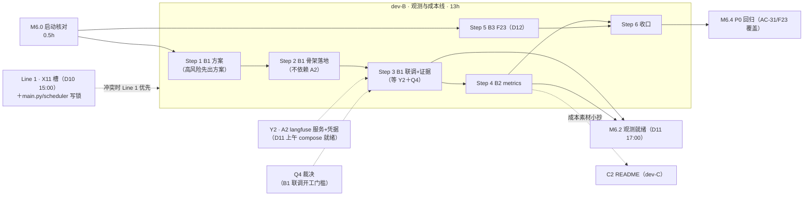

> 状态：**已完成（2026-11-13 主理人确认）· Step 0–6 全部收口（M6.2 达成；Step 5/6 经主理人 20:22/20:45 确认）· 越域修复 redact.py 误伤 bug（授权已交 dev-A）· 唯一挂起＝D3 演练抽验（支援项，待 D13 时点，素材已备：docs/guides/langfuse-操作指引.md）**　｜　版本：v2.3　｜　日期：2026-11-13
> 负责人：**dev-B（唯一）**　｜　任务包：**B · 观测与成本线**　｜　容量：上限 24h（3 人日）；实排开发 **13h ＝ B1 8h + B2 2h + B3 2.5h + M6.0 参与 0.5h**（v1.1 口径：B1 扩 OTel exporter，5h→8h），余额为 Line 1 联调槽位占用＋缓冲（`app/main.py` 装配与 `app/scheduler/` 既有写锁仍归你，Line 1 收口优先）
> 关联：`docs/team_tasks/day10/day10-任务总览与DAG.md` v1.1（§2 DAG、§3 对接点 Y2/Y5、§4 写域）｜`docs/team_tasks/day10/dev-B-观测与成本线.md` v1.1（任务书）｜`docs/plans/day10/day-10-交付与观测-工作推进计划.md` v1.1（主计划件 §4.2/§6）
> 上游依据：PRD line 513（AC-31 完整 Trace）、line 454/458（FR-TC-04 脱敏上传 / FR-TC-08 成本指标）、line 587（F23 P2 顺延）｜技术设计文档 §1:205（观测选型＝Langfuse + OpenTelemetry Traces，「Langfuse 可作 OTel exporter」）、§8.3 Day 10（line 1176–1183）｜大纲 §十 课时 10.2（仅教学流程口径，不作事实依据）
> 本轮新增裁决（2026-11-13 主理人确认）：**Q8 已决——接受 F23 延迟继续挂起，如实记录、不粉饰、不为达标调阈值**（沿 X9 纪律）；**Q4 已决（2026-11-13 14:40，§8.1-⑧）**——v2 单容器＋复用 postgres 独立 schema＋共享实例常驻 dev-B 主机＋compose profile 默认不启动
> 变更记录见文末

---

# dev-B Day 10 工作推进计划 · 观测与成本线

## 0. 这份计划怎么用

1. **本轮只出计划，不写业务代码**。本文件不含任何实现代码，本轮未修改任何代码文件；模块落点与函数签名仅作方案占位，落点在 Step 1 方案确认后冻结。
2. **执行顺序**：先读 §1–§2 建立认知 → 按 §4 的 Step 0–6 逐步执行，**每步做完自检并向主理人汇报，确认后才进入下一步** → 用 §5 验收矩阵收口 → §8 登记 §执行记录回填。
3. **并行加速**：B1 骨架段（Step 1–2）不依赖 A2 的 compose 服务，可提前做；B1 联调段（Step 3）硬依赖 Y2（A2 langfuse 服务就绪）＋ Q4 裁决。单人串行 13h，与 Line 1 的 X11 槽（D10 15:00）互补。
4. **事实来源铁律**：一切「是什么/什么字段/什么阈值/什么接口」只引 PRD 与技术设计文档；任务书、总览、本计划只回答「谁做、先做什么、怎么验」。两者冲突时以 PRD/TD 为准，并在本计划 §8 登记（本次已登记 2 项实测口径差）。
5. **已裁决口径**（§8.1）不再重开；**待决项**（§8.2）必须在对应 Step 开工前闭合，未闭合不开工。

---

## 1. 项目认知基线（本计划的事实起点）

### 1.1 系统一句话与决策链路

面向 CCRC 康养社区长者卧室的 **3D 数字人陪伴系统**：浏览器页面（模拟平板）上的 VRM 数字人 + WebRTC 全双工语音，按「规则层（L0）→ Laya 端侧分类器（L1）→ 主控 Agent（L2）」三级路由，承担情感陪伴、用药提醒、健康采集、戏曲/天气检索、人工告警五类职责。**不做医疗诊断，不替代 SOS 紧急呼叫。**

一次请求的硬顺序（AGENTS §6）：合法性校验 > 急症/敏感安全一票否决 > 进行中用药/健康任务 > 固定意图 > 低置信澄清或 System Two > 记忆个性化。低层结论不得被高层覆盖。

### 1.2 Day 10 的定位与完成定义

PRD line 578 的 Day 10 完成定义：**一键启动 + HTTPS + 健康检查；Langfuse 中可见一条完整 Trace（AC-31）；全部 P0 回归通过；文档清单逐项可检。**

dev-B 对四个里程碑的直接贡献：

| 里程碑 | dev-B 贡献 |
| --- | --- |
| M6.0 启动核对（D10 09:30） | 参与裁决 Q4（B1 开工门槛）＋写域签认＋Y2 契约确认 |
| **M6.2 观测就绪（D11 17:00，dev-B 牵头）** | B1 AC-31 证据落档 ＋ B2 /metrics 四类指标 |
| M6.3 文档齐套 | B2 成本估算以「素材小抄」交 C2 合入 README（不直接改） |
| M6.4 P0 回归 | B1/B3 产出为 D2 回归提供覆盖项（AC-31、F23） |

双线口径：Line 1（day09 联调收口线）优先级高于本包；`app/main.py` 装配与 `app/scheduler/` 既有写锁仍归 dev-B，Line 1 冲突时先收 Line 1。本包不触碰 Line 1 领地。

### 1.3 dev-B 的边界（越界即返工）

**写域（沿任务书 v1.1 §0.1，含本计划文件）**

```text
观测层接入模块（新；落点 M6.0/Step 1 定，候选 app/core/observability.py）
app/core/config.py                    （仅 langfuse 段增量，212–216 行既有 5 字段不改名）
app/core/metrics.py                   （仅 record_event()/record_stage() 等 hook 函数体改接 OTel；文件其余部分不改）
app/audio/_observe.py                 （仅 record_asr()/record_tts() 函数体改接 OTel；文件其余部分不改）
app/system_one/**                     （B3）
privacy_scope 消费点                  （B3；消费落点在 Step 5 方案中定，若落入他人写域先申请）
app/api/metrics.py                    （增量）
.env.example                          （langfuse 变量段；先定稿交 A 合编排，B→A 顺序）
eval/reports/day10_langfuse_trace.md  （新增，AC-31 证据）
docs/plans/day10/dev-b-day10-工作推进计划.md（本文件维护）
对应 tests（观测层降级开关、hook 字段不丢等用例）
```

**禁触（他人写域，需改动时提需求不直接改）**

`Dockerfile`/`docker-compose.yml`/`deploy/nginx.conf`/`.dockerignore`（dev-A 独占）、`app/scheduler/device_jobs.py`（A5 新文件）、前端构建与 `README.md`（dev-C 独占）、`tests/eval_gate.py`/`.githooks/**`（dev-D）、docs 交付文档三件（dev-C）、`app/core/redact.py`（day09 A1 交付，**只调用复用，不改**）、`app/services/metrics_service.py`（day09 C4 交付；D-1 已决走进程内计数（§8.1-⑦），本包**无需**触碰此文件）。

### 1.4 高风险文件（AGENTS §5：先出方案再落代码）

观测层接入涉及**运行时装配**（`app/main.py` 或 lifespan 生命周期挂载），属高风险：

- Step 1 先出**接入方案**（写在本文件 §执行记录）：模块落点、初始化时机、TraceID 映射方式、降级开关行为，经主理人确认后才落代码；
- 硬保证：`langfuse_enabled=False` 时业务零影响（降级不白屏）——OTel Provider 未初始化时全部 hook 走既有双轨路径（日志轨＋metrics 表轨）原样执行；
- 既有 hook 调用方（audio/webrtc/路由/LLM 各处）**一行不改**，兑现 day03/day04「Day 10 只改一个函数」承诺。

### 1.5 现状实测表（2026-11-13 本机核查，零虚构；本表的缺口即 B 包工作来源）

| # | 项 | 现状实测 | 缺口判定 |
| --- | --- | --- | --- |
| 1 | langfuse 配置 | `app/core/config.py:212-216` 已有 5 字段：`langfuse_enabled(默认 False)/host/public_key/secret_key/sample_rate(1.0)` | 只增量（如 OTel endpoint 超时等），不改名 |
| 2 | 打点 hook | `app/core/metrics.py`（158 行）：`record_event()/record_stage()/record_wakeup()/record_connection()/identity 三打点`，双轨（日志＋metrics 表），文件头明载「Day 10 接 OTel 只改本文件」 | 函数体改接 OTel |
| 3 | ASR/TTS 观测 | `app/audio/_observe.py`（106 行）：`record_asr()/record_tts()`，双轨，同款单点收口承诺 | 函数体改接 OTel |
| 4 | 脱敏 | `app/core/redact.py`（126 行）已在（day09 A1） | 复用，不改 |
| 5 | trace_id 载体 | `app/core/context.py:39` `_trace_id_ctx: ContextVar`（32 位 hex） | OTel TraceID 与其同值（Step 1 方案定映射） |
| 6 | OTel | pyproject 与全仓 `opentelemetry/otel` **零命中** | B1 需引入 OTel SDK＋exporter 依赖（uv add） |
| 7 | langfuse 服务 | `docker-compose.yml` 无 langfuse 服务（A2 交付，Y2 契约） | B1 联调依赖，非 B 产出 |
| 8 | /metrics | `app/api/metrics.py`（48 行）：**路由 prefix 为 `/api/metrics`**（admin-only），输出 routing（分层命中率/S1 闭环率）＋token_usage（进程内计数，重启归零）；**cache 命中率无字段** | B2 补 cache 口径；自检命令按实际路径 `/api/metrics`（§8.3 勘误 R-1） |
| 9 | 四信号 | `app/system_one/`（backend/client/questions/schemas/server 五文件）；`backend.py:94-111` 已输出 `privacy_scope`（none/shared/personal 三值）；**下游全仓零消费方** | B3：信号输出补齐＋接 ≥1 消费点 |
| 10 | F23 延迟 | day09 实测四问 p95 668ms > 200ms 硬线 | **Q8 已决：如实记录继续挂起** |

---

## 2. Day 10 任务清单与逐项拆解

### 2.1 任务总表

| 节点 | 任务 | 前置 | 工时 | 关键交付物 | 验收锚点 |
| --- | --- | --- | --- | --- | --- |
| **M6.0** | 启动核对（参与）：Q4 裁决、写域签认、Y2 确认 | 无 | 0.5h | 核对记录（本文件 §执行记录首行） | 总览 §5 |
| **B1** | Langfuse + OTel exporter 一体接入 | M6.0；联调依赖 Y2＋Q4 | 8h | 接入代码＋AC-31 证据 `eval/reports/day10_langfuse_trace.md` | PRD FR-TC-04 / AC-31；M6.2 |
| **B2** | /metrics 成本口径补齐（cache 命中率） | B1 | 2h | `app/api/metrics.py` 增量＋成本估算素材（交 C2） | PRD FR-TC-08；M6.2 |
| **B3** | F23 四信号＋privacy_scope 消费方 | M6.0 | 2.5h | `app/system_one/` 增量＋消费接线＋延迟记录 | day09 §8 顺延项（P2）；Q8 已决口径 |

依赖关系：`M6.0 → B1（骨架）→ B1（联调，等 Y2+Q4）→ B2`；`M6.0 → B3`（并行，无硬下游，D12 执行）。B3 与 B1/B2 无文件交叠（`app/system_one/**` 独立），可穿插。

### 2.2 节点 B1 · Langfuse + OTel exporter 一体接入（8h）

**主理人裁决 ⑤（原 Q10，2026-11-13）**：B1 扩为「OTel SDK ＋ Langfuse 作 Span Exporter 一体接入」，兑现 TD §1:205 选型与 day03/day04 hook 承诺；AC-31 Span 链语义不变（每次主控 Agent 执行 = 1 条 Trace；规则路由/分类器/模型调用/工具调用/TTS 各 1 个 Span）。

**操作步骤**：

1. **依赖引入**：`uv add` OTel SDK ＋ OTLP exporter（具体包名在 Step 1 方案确认时定；OTLP/HTTP 路线对 Langfuse v2（`/api/public/otel/v1/traces`）与 v3 均适用，故 **Q4 只影响 compose 形态与凭据注入，不影响 B1 代码路线**——这是 Q4 可留待开工前裁决的原因）。
2. **观测层模块**（落点 Step 1 定）：TraceProvider 初始化（受 `langfuse_enabled` 开关）、OTLP SpanExporter（凭据三变量 `.env` 注入：`LANGFUSE_PUBLIC_KEY/SECRET_KEY/HOST`，复用 Y2 同一组）、BatchSpanProcessor（采样率沿用 `langfuse_sample_rate`）。
3. **trace_id 同值**：系统 `trace_id`（32 位 hex）直接映射为 OTel TraceID（16 bytes），保证 Langfuse 搜索框输系统 trace_id 可命中（AC-31 之外的 M6.2 增补判据）。
4. **hook 改接**：`app/core/metrics.py` 与 `app/audio/_observe.py` 的 4 个 hook 函数体增加 OTel span 发射；**既有结构化日志字段照旧输出、metrics 表轨照旧写入**（三轨并存：日志＋表＋OTel）。
5. **Span 内容**：输入输出摘要、耗时、异常、模型版本；**脱敏后上传**——复用 `app/core/redact.py`（只调用）；不含完整音频、密钥、不必要健康信息。
6. **HTTP 请求 span**：trace_id 中间件处开 HTTP span（满足「至少 1 个非 LLM span」判据）。
7. **证据落档**：`eval/reports/day10_langfuse_trace.md`（含可复现 trace_id、Span 链截图/导出记录、脱敏 grep 证明）。

**自检校验标准（全部满足才关 B1）**：

| # | 判据 | 验证方法 |
| --- | --- | --- |
| 1 | 1 条完整 Trace，Span 链＝规则→分类器→模型→工具→TTS | 发起一次含工具调用的完整对话，Langfuse 界面可见 |
| 2 | trace_id 同值互查 | Langfuse 搜索框输系统 trace_id（32 hex）能命中该 Trace |
| 3 | ≥1 个非 LLM span | Trace 树中可见 HTTP 请求或 ASR/TTS 分段耗时 span |
| 4 | hook 已接且既有日志字段不丢 | `grep` 既有日志字段（如 `asr_confidence`/`stage_ms`）仍输出 |
| 5 | 脱敏零命中 | Trace 内容 grep 手机号/身份证/密钥零命中 |
| 6 | 降级不白屏 | `langfuse_enabled=False` 重启后业务全链路正常 |
| 7 | 证据可复现 | `eval/reports/day10_langfuse_trace.md` 含 trace_id |

### 2.3 节点 B2 · /metrics 成本口径补齐（2h）

**操作步骤**：

1. 核对既有输出：分层命中率、S1 闭环率、token 消耗（day09 C4 交付，`/api/metrics`，admin-only）。
2. 补 **prompt cache 命中率**统计口径（PRD FR-TC-08 与大纲 10.2 均要求；现状无字段）。**取数落点已裁决（§8.1-⑦）**：方案①进程内计数——在 llm_service 既有 usage 回传链路上累加 cache 命中/未命中 token（与 `snapshot_llm_usage` token 口径同先例，重启归零并在响应中如实标注 `available/reason`）；同时 B1 的 LLM span 记录每次调用的 cache 命中/未命中 token 属性（明细归 trace 职责，跨重启可查）。**不走 metrics_service 落库**。
3. 一次完整演示后导出 token 消耗与成本估算，写成「README 成本章节素材小抄」交 dev-C 合入（**不直接改 README**）。

**自检校验标准**：

| # | 判据 | 验证方法 |
| --- | --- | --- |
| 1 | 四类指标可见 | `curl --noproxy '*' -H "Authorization: ..." http://127.0.0.1:8000/api/metrics` 返回分层命中率/S1 闭环率/token/cache（§8.3 R-1：路径按实际 prefix） |
| 2 | 未授权 401 | 无 token curl 返回 401/403 |
| 3 | cache 命中率可复算 | 来源对话数、命中数可查，数字可手工复算 |
| 4 | 素材交 C | 成本估算小抄有交付记录（§执行记录），README 由 C2 合入 |

### 2.4 节点 B3 · F23 四信号 ＋ privacy_scope 消费方（2.5h，D12）

**操作步骤**：

1. 快路径补齐四信号输出：intent / is_sensitive / confidence / privacy（`app/system_one/` 增量）。
2. `privacy_scope` 接入 ≥1 个消费点（双人间收敛场景）；消费落点若在他人写域（如上下文组装、回复出口），先提方案申请，不直接改。
3. 复跑 50 条样例记录 p95；如仍 >200ms **如实记录不粉饰**并登记总览 §8 Q8（**Q8 已决：接受挂起**；不为达标调阈值，沿 X9 纪律；达标改造另立任务）。

**自检校验标准**：四信号在快路径输出齐全；≥1 个消费点可演示；p95 复测数字入档，不达标项如实标注「挂起」。

---

## 3. dev-B 视角 DAG



无环：B 包内为线性链；跨包仅 2 条入边（Y2、Q4）与 2 条出边（→M6.2、素材→C2），全部前向。

---

## 4. 分步执行计划（每步完成 → 自检 → 向主理人汇报 → **确认后进下一步**）

### Step 0 · M6.0 启动核对（0.5h，D10 上午）

| 项 | 内容 |
| --- | --- |
| 做什么 | ① 确认 §8.1 已决口径知悉；② **Q4 裁决时点确认为「B1 联调（Step 3）开工前」**；③ 写域矩阵（任务书 §0.1 ＋本计划 §1.3）签认；④ Y2 契约（凭据三变量、B→A 顺序）与 dev-A 对齐；⑤ D-1 cache 取数落点裁决（**已闭合，§8.1-⑦**） |
| 交付物 | 核对记录写入本文件 §执行记录首行 |
| 自检 | 全部待决项有裁决时点或显式挂起；Y2 内容与 dev-A 口头一致 |

**——暂停，等待主理人确认——**

### Step 1 · B1 接入方案（高风险前置，D10）

| 项 | 内容 |
| --- | --- |
| 做什么 | 产出接入方案（写入 §执行记录）：模块落点（候选 `app/core/observability.py`）、OTel 包与版本（uv add 清单）、Provider 初始化时机与开关行为、trace_id→OTel TraceID 映射方式、4 个 hook 函数体的改接点（只列改动位置不改代码）、降级路径（关闭时零影响） |
| 交付物 | 方案条目（本文件 §执行记录）＋拟新增依赖清单 |
| 自检 | 方案含「改哪几段、为什么、关闭开关时业务如何不受影响」三要素；不写完整实现代码 |

**——暂停，等方案确认后才落代码——**

### Step 2 · B1 骨架落地（D10–D11 上午，不依赖 A2）

| 项 | 内容 |
| --- | --- |
| 做什么 | ① uv add OTel 依赖（pyproject/uv.lock）；② 新建观测层模块（Provider/Exporter/Processor，开关控制）；③ 4 个 hook 函数体改接（三轨并存：日志＋表＋OTel）；④ `app/core/config.py` langfuse 段必要增量；⑤ **`.env.example` langfuse 段先定稿交 dev-A**（B→A 顺序）；⑥ 对应 tests（降级开关、hook 字段不丢） |
| 交付物 | 上述代码增量＋测试 |
| 自检 | 本机（无 langfuse 服务）`langfuse_enabled=False` 下 `pytest -q` 全绿、业务链路正常；`langfuse_enabled=True` 且指向不可达端点时**不阻塞业务**（exporter 异步丢弃＋日志告警）；`ruff check` 全绿；既有日志字段 grep 仍输出 |

**——暂停，等待确认——**

### Step 3 · B1 联调与 AC-31 证据（D11，硬前置：Y2 compose 就绪；Q4 已决⑧）

| 项 | 内容 |
| --- | --- |
| 做什么 | ⓪ **共享实例就位（⑧ 分配给 dev-B 的动作）**：本机 `docker compose --profile langfuse up` 起服务（复用 postgres 独立 schema）→ 创建组织/项目生 key → 放行 3000 → 把局域网 IP＋key 分发给全员并更新本机 `.env`（真值只进本地 `.env`）；① 以注入凭据发起一次含工具调用的完整对话；② 核对 §2.2 自检表 7 条逐条通过；③ 证据落 `eval/reports/day10_langfuse_trace.md`（trace_id 可复现＋Span 链＋脱敏 grep＋降级证明） |
| 交付物 | `eval/reports/day10_langfuse_trace.md` |
| 自检 | 7 条判据全绿；trace_id 同值互查演示通过；证据文件含可复现步骤 |

**——暂停，等待确认（此步关闭即 M6.2 主判据达成）——**

### Step 4 · B2 /metrics 成本口径（D11，前置 B1）

| 项 | 内容 |
| --- | --- |
| 做什么 | ① cache 命中率口径落地（**§8.1-⑦ 已决**：进程内计数＋B1 span 属性明细）；② 完整演示后导出 token 消耗与成本估算；③ 成本素材小抄交 dev-C（记录交付） |
| 交付物 | `app/api/metrics.py` 增量＋成本估算素材 |
| 自检 | §2.3 自检表 4 条全绿；素材小抄有交付留痕 |

**——暂停，等待确认——**

### Step 5 · B3 F23 四信号（D12，前置 M6.0，可与 Step 3/4 间穿插）

| 项 | 内容 |
| --- | --- |
| 做什么 | ① 四信号快路径输出补齐；② privacy_scope 消费点接线（落点方案先行，越域先申请）；③ 复跑 50 条样例记 p95，如实记录 |
| 交付物 | `app/system_one/` 增量＋消费接线＋延迟记录 |
| 自检 | 四信号齐全；≥1 消费点可演示；p95 数字入档（>200ms 则标注「挂起·Q8 已决」） |

**——暂停，等待确认——**

### Step 6 · 收口（D13）

| 项 | 内容 |
| --- | --- |
| 做什么 | ① M6.2 判据终核（AC-31 证据＋/metrics 四类指标）；② 支援 D3 干净主机演练的观测抽验（1 分钟内日志＋Langfuse 串完全链路）；③ §执行记录全部回填；④ 未决项与遗留清点移交复盘 |
| 交付物 | 执行记录完整＋收口核对记录 |
| 自检 | PRD line 578 完成定义中与观测相关的两句（AC-31、文档清单观测素材）有证据指针 |

---

## 5. 验收矩阵（节点 × 交付物 × 质量要求 × 自检）

| 节点 | 交付物 | 格式/内容范围/质量要求 | 自检校验标准 |
| --- | --- | --- | --- |
| B1 | 观测层接入代码 | 观测模块＋hook 函数体＋config 增量＋tests；不碰调用方 | §2.2 表 7 条全绿 |
| B1 | `.env.example` langfuse 段 | 三变量（PUBLIC_KEY/SECRET_KEY/HOST）＋可选 OTel 参数；B→A 顺序交 dev-A | dev-A 合编排时零返工 |
| B1 | `eval/reports/day10_langfuse_trace.md` | 含可复现 trace_id、Span 链说明、脱敏 grep 结果、降级证明 | 他人按文档可复现同一条 Trace |
| B2 | `app/api/metrics.py` 增量 | cache 命中率字段＋既有四类指标不回归 | §2.3 表 4 条全绿 |
| B2 | 成本估算素材小抄 | markdown；S1 闭环率、单会话 Tool 调用数、token 消耗、cache 命中率、分层省 Token；数字全部实测、未达标如实写 | C2 合入后抽查数字可回溯 |
| B3 | `app/system_one/` 增量 | 四信号＋privacy_scope 消费点 | §2.4 自检三条全绿 |
| B3 | 延迟记录 | 50 条样例 p95 实测数字＋与 200ms 硬线的差距，不粉饰 | 数字可复跑 |
| 全包 | §执行记录 | 每步一行：日期/节点/结果/证据指针/等待项 | 主理人逐行可查 |

---

## 6. 检查点节奏（dev-B 相关行）

| 时点 | 检查点 | dev-B 判据 |
| --- | --- | --- |
| D10 09:30 | M6.0 启动核对 | Q4 裁决时点确认；写域签认 |
| D11 17:00 | **M6.2 观测就绪（B 牵头）** | AC-31 Trace 证据落档＋`/api/metrics` 四类指标 |
| D12 18:00 | M6.4 P0 回归 | AC-31/F23 进回归覆盖 |
| D13 16:00 | M6.5 演示冻结 | 支援观测抽验（1 分钟串完链路） |

---

## 7. 风险与降级预案

| 风险 | 影响 | 预案 |
| --- | --- | --- |
| A2 compose 延迟（Y2 未就绪） | B1 联调（Step 3）后移 | Step 2 骨架不依赖 A2，先行完成；联调窗口顺延不挤占 B2 |
| ~~Q4 迟迟不裁决~~（已决⑧） | ~~Step 3 无法开工~~ 剩余风险转为**共享实例单点**：B 主机不可达时全员观测中断 | 降级：个人本机 `docker compose --profile langfuse up` 自起实例（⑧ 预留路径）；`langfuse_enabled=false` 可随时关闭，业务零影响（单测已覆盖） |
| OTel 依赖与既有栈冲突（spikes 未验） | 安装/启动失败 | 新依赖先在 `spikes/` 最小验证再合并（AGENTS §3）；失败则降级方案回退为 Langfuse SDK 直连并如实登记（需主理人裁决） |
| hook 改接破坏既有日志/表轨 | 回归打点数据断档 | 三轨并存设计＋tests 锁字段；自检 4（grep 字段不丢）作为硬门 |
| 本机代理干扰 | curl/OTLP 上报失败 | 本机 curl 一律 `--noproxy '*'`；容器内不受本机代理影响 |
| Line 1 抢占工时 | B 包顺延 | 冲突时 Line 1 优先（总览 §0.2）；B 包缓冲 11h 可吸收；最坏按裁减顺序先保 B1（AC-31 是不得裁减项），B3 殿后 |

---

## 8. 口径登记

### 8.1 已决口径（不再重开）

| # | 裁决 | 来源 |
| --- | --- | --- |
| ① | 双线并行：day09 收口线与 Day 10 交付线同时推进，Line 1 优先 | 主计划件 2026-11-13 裁决 |
| ② | 4 人任务包沿用；简历段落/INTERVIEW_QA/复盘报告单列附录不占团队工时 | 同上 |
| ③ | 《康伴3D数字人_技术文档》即《康伴3D数字人_技术设计文档.md》 | 同上 |
| ④（原 Q10） | B1 扩为「OTel SDK＋Langfuse exporter 一体接入」，B1 8h／B 包 13h；AC-31 Span 链语义不变 | 总览 v1.1 |
| ⑤（本轮） | **Q8：接受 F23 延迟（p95 668ms>200ms）继续挂起，如实记录、不为达标调阈值** | 2026-11-13 主理人确认 |
| ⑥ | 粒度/写域/对接点契约沿总览 §3/§4；Y2 凭据三变量 `.env` 注入、B→A 顺序 | 总览 v1.1 §3 |
| ⑦（本轮 Step 0） | **D-1：B2 cache 命中率取数落点＝方案①（进程内计数，与 token_usage 同先例）＋ B1 LLM span 记录每次调用的 cache 命中/未命中 token 属性**（明细跨重启可查归 trace 职责；不走 metrics_service 落库，不违零新增迁移约束） | 2026-11-13 主理人终裁 |
| ⑧（Q4 初裁，2026-11-13 14:40） | **Langfuse 部署形态＝两层口径**：① 版本形态——**v2 单容器＋复用既有 postgres 独立 schema**（否决 v3 全家桶：编排膨胀、内存占用大，教学 MVP 不值得；凭据三变量 `.env` 注入、compose 零硬编码）；② 部署位置——**共享实例模式，常驻 dev-B 主机**：全员不各自起 Langfuse，统一连 B 主机实例（B 常驻开机、放行 3000、分发 key、提供局域网 IP）；compose 中 langfuse 服务 profile 化（`profiles: ["langfuse"]`）默认不启动，本机自起用 `docker compose --profile langfuse up`；`.env.example` 仅写 `<B的局域网IP>` 占位注释，key 真值只进各人本地 `.env` | 2026-11-13 主理人裁决；依据留痕 `docs/team_tasks/day10/dev-a-容器化与部署链.md` v1.2（§3.2 Y2 契约、§4 S4、§6 待确认、风险 R13） |
| ⑨（Q4 改判，2026-11-13 16:0x） | **⑧ 的版本形态改判：v2 → v4 全家桶共享实例（复启旧栈，自带 postgres 容器）**。事实依据：① 官方文档明载「OTelemetry endpoint 首次引入于 Langfuse v3.22.0」——⑧ 的 v2 前提（OTLP 端点 v2/v3 通用）系 S1 方案编制时**技术事实错误**；② v2.95.11 容器构建实测无任何 otel 路由（`api/public/` 下无 otel 目录、三候选路径全 404）。v2 实验已回滚（容器删除、`langfuse` schema 已 DROP）。改判后落地：旧 v4 栈（web/worker/postgres/redis/clickhouse/minio 六容器）复启为共享实例；B1 代码零改动（OTLP 已对其真验），仅 exporter 补 `x-langfuse-ingestion-version: 4` header（v4 实时摄入，缺省最多延迟 10 分钟）。**隐私闭环/常驻 dev-B/放行 3000/compose profile 等⑧其余口径不变** | 2026-11-13 主理人改判（问答确认）；文档依据 langfuse.com/docs/opentelemetry/get-started |

### 8.2 待决口径（对应 Step 开工前必须闭合）

| # | 待决 | 影响 | 状态 |
| --- | --- | --- | --- |
| A | ~~Q4 Langfuse 部署形态~~ **已决并改判（⑧→⑨，2026-11-13）**：最终形态＝**v4 全家桶共享实例常驻 dev-B**（v2 因无 OTLP 端点撤下，见 §8.1-⑨） | — | 已闭合（实例已就绪＋冒烟 4 判据过；剩 Y2 执行落地＝dev-A compose 口径需同步为 v4，见 §执行记录 Step 3 ⓪） |
| B | ~~B2 cache 命中率取数落点~~ **已决（⑦，2026-11-13 Step 0）**：方案①进程内计数＋B1 span 明细 | — | 已闭合 |
| C | ~~B3 privacy_scope 消费点落点是否越入他人写域~~ **已决（主理人批准方案含 personal 触发值，2026-11-13 Step 5 方案确认）**：消费落点全在 B 写域——`privacy_context.py`（信号通道＋probe）＋`decision.py` 并入＋`companion.py` 注入＋`main.py` 装配 | — | 已闭合（随 Step 5 落码，18 用例） |
| E | ~~AC-31 链缺口观测调用点~~ **已决（主理人批准，2026-11-13）**：按「既有锁沿用」口径加观测包装；实际落地收窄为 `decision.py`＋`system_one/client.py` 各一处 try/finally（companion 工具段复用既有 tool_* 事件，零改动） | — | 已闭合（随 6078756 交付） |
| D | Q1 演示视频、Q2 收口日历、Q3 门禁模式、Q5 TD 勘误、Q6 历史标签、Q7 Laya 形态、Q9 dev-D 计划签认 | 均非 dev-B 直接影响项 | 由 M6.0 全员裁决，本文只引用 |

### 8.3 实测口径差登记（本计划编制中实测发现，同提交留痕）

| # | 差异 | 处置 |
| --- | --- | --- |
| R-1 | 任务书 B2 自检写 `http://127.0.0.1:8000/metrics`，实际路由 prefix 为 **`/api/metrics`**（`app/api/metrics.py:25`，day09 C4 交付） | 本计划自检命令按实际路径执行；TD line 1182「/metrics 输出…」为泛称，不构成契约冲突，不回改基线；此登记即留痕 |
| R-2 | 主计划件 §1#6 提及「历史引用的 TD:989 行号已漂移」 | 沿用主计划件结论：以现行 TD §1:205/§8.3 为准，不追旧行号 |

---

## 9. 全量校验结论

| 校验项 | 结论 |
| --- | --- |
| 上游依据全部可溯源（PRD/TD 行号、总览/任务书版本） | ✓ |
| 写域与任务书 v1.1 §0.1 一致，零越界安排 | ✓ |
| 现状实测零虚构（10 项均 2026-11-13 本机核查） | ✓ |
| 每节点含前置/步骤/交付物规格/量化自检，无「功能正常」类模糊表述 | ✓ |
| 分步暂停机制明确（Step 0–6 每步暂停等确认；高风险方案先确认后落码） | ✓ |
| 已决/待决显式分离，Q4/Q8 本轮裁决如实落档 | ✓ |
| 本轮合规：仅新建本文件，未改任何业务代码 | ✓ |

---

## 执行记录（开工后填写）

| 日期 | Step/节点 | 结果/证据指针 | 等待项 |
| --- | --- | --- | --- |
| 2026-11-13 | Step 0 · M6.0 核对（dev-B 部分） | 见下方 Step 0 核对记录；①②③⑤ 闭合，④ 显式挂起转 M6.0 | ④ Y2 与 dev-A 对齐（M6.0 全员核对时闭合，不阻塞 Step 1/2） |
| 2026-11-13 15:30 | Step 3 冒烟预验（§7 风险预案路径：临时本地实例先行） | **端到端真链路全通**：`.env` 开启观测（key 只进本地 .env）→ 真实 hook（record_stage/record_event）→ OTLP/HTTP → 本机 Langfuse 实例（v4 events_only，`GET /api/public/traces` 被禁用，验库 `default.events_full`）→ **3 span 落库**（asr 123.4ms 耗时回放准确 / tool_started / tts_first_packet 210ms）；**trace_id 同值互查**：库内三 span 共享 `104f2684…577`＝脚本系统 trace_id；**脱敏**：手机号存 `138\*\*\*\*8000`、身份证 `110101\*\*\*\*\*\*\*\*1234`，原样值 0 命中 | 正式共享实例＝v2（⑧），镜像拉取受网络限制改走镜像源（后台重试中）；Y2 compose 仍待 dev-A |
| 2026-11-13 16:10 | Step 3 ⓪ 共享实例就位（⑧→⑨ 改判过程） | **v2 线**：v2.95.11 实例起于 3000（复用 silvermate-postgres 独立 schema）→ 冒烟 404 → 官方文档查证 **OTLP 端点 v3.22 才引入**＋容器构建实测无 otel 路由 → **主理人改判⑨（v4 全家桶）** → v2 容器删除、schema DROP 回滚。**v4 线**：旧 v4 栈（六容器）复启为共享实例（health 200）；exporter 补 `x-langfuse-ingestion-version: 4`；**复冒烟 4 判据全过**（实时落库 3 span、asr 123ms/tts 210ms 耗时回放、trace_id `9ae6d001…5396` 同值、脱敏原样值 0 命中）。B2 代码亦已完成（D-1 方案①，9 新测试，全量 1684 passed，未提交） | Y2 执行落地：dev-A compose 口径需从 v2 同步为 **v4 全家桶（六容器，含 clickhouse/minio/redis）**；全员 `.env` 用各自 v4 key |
| 2026-11-13 | Step 1 · B1 接入方案 | 方案 v1 编入本节（S1-1～S1-8），含 span 覆盖矩阵与 AC-31 缺口登记；依据 4 项实测（httpx 已在依赖、七 stage 测量点、route/工具无打点、llm_service/companion 调用点） | 方案 v1 已主理人确认（含待决项 E 批准），Step 2 已执行 |
| 2026-11-13 | Step 2 · B1 骨架落地 | 见下方 Step 2 执行记录（S2-1～S2-6）；含 3 项实测修正（OTel 依赖已在、FastAPIInstrumentor 弃用改自建中间件、E 调用点收窄为 decision.py＋client.py 各一） | 待 Step 3 联调（Y2＋Q4） |
| 2026-11-13 20:15 | Step 5 · B3 四信号 ①②③④ | **①②③ 落码自检绿**：shadow 扩两问（questions/backend/client）＋privacy_context 信号通道与真身 probe＋decision 并入（None≠"none"）＋companion 双人间收敛指令注入（main 装配）；`tests/test_privacy_scope.py` 18 用例，全量 1688 passed。**待决项 C 闭合**（主理人批准方案含 personal 触发值）。**④ p95 复测**：`eval/reports/day10_step5_b3_p95.md`——全量 p50 155 / **p95 202ms**（超 2ms，按 Q8 口径标注挂起）；拆层：规则路径 p95 **0ms 硬线达标**，模型路径 p50 166 / p95 204ms **单列挂 F23**；普通 41/50、敏感 19/20（95.0% 过线）与锁持平，四层 rule=36/system_one=74 无 fallback（shadow 两问单批前向，仅 4 次 shadow 503 降级，不影响快路径）。环境备注：本机 sidecar 环境补装 asyncpg 0.32.0（B1 观测链 `client.py→app.core.metrics→db` 新增的传递依赖） | **Step 5 已关闭**（2026-11-13 20:22 主理人确认「通过」）；改动未提交（等明确指令） |
| 2026-11-13 | Step 6 · 收口 | 见下方 Step 6 收口核对记录：① M6.2 三判据证据指针终核 ✅ ＋ **/api/metrics 收口时点实测 ✅**（20:30，三段齐全＋401 双验，测毕即停）；② D3 演练抽验挂起待时点（素材已备：操作指引）；③ 执行记录六步全回填核对 ✅；④ 未决遗留 8 项清点移交 | 本轮提交等主理人指令 |

### Step 0 核对记录（dev-B 部分，2026-11-13）

| # | 核对项 | 结果 | 状态 |
| --- | --- | --- | --- |
| ① | §8.1 已决口径（六项）知悉并确认执行 | 已知悉，随 v1.1 签认生效 | ✅ 闭合 |
| ② | Q4 裁决时点确认为「B1 联调（Step 3）开工前」 | 主理人 2026-11-13 裁决，落 §8.2-A | ✅ 闭合 |
| ③ | dev-B 写域矩阵签认（任务书 v1.1 §0.1 ＋本计划 §1.3） | 随计划 v1.1 主理人签认生效 | ✅ 闭合 |
| ④ | Y2 契约与 dev-A 对齐（凭据三变量 `.env` 注入、langfuse 段 B→A 顺序） | dev-B 侧口径已明确；**需 dev-A 确认 compose langfuse 服务定义与凭据注入方式** | ⏳ 等待 dev-A（M6.0 全员核对时闭合） |
| ⑤ | D-1 申请：B2 cache 命中率取数落点 | **已终裁（§8.1-⑦）**：方案①进程内计数＋B1 span 明细；不走 metrics_service 落库 | ✅ 闭合 |

> Step 0 关闭状态：①②③⑤ 闭合；④（Y2 与 dev-A 对齐）**显式挂起转 M6.0 全员核对**——不阻塞 Step 1/2（骨架不依赖 A2），仅 Step 3 联调前须闭合。**Step 0 dev-B 部分至此关闭。**

### Step 1 · B1 接入方案 v1（2026-11-13 编制，**待主理人确认后才落代码**）

> 编制前实测：`httpx>=0.27` 已在依赖（出站自动 span 可行）；既有 `record_stage` 调用点覆盖 `asr / tts_first_packet / playback / response_segment / llm_first_token / wakeup / connection` 七个 stage；**规则路由与工具调用两段无测量点**（`app/core/metrics.py` 头部早已登记 route 段缺口）；LLM 客户端在 `app/services/llm_service.py`（`llm.chat()` 调用点在 `app/agents/companion.py` / `dialogue_service.py`）。

**S1-1 依赖清单（uv add，先 spikes 验证再合并）**

- `opentelemetry-api` / `opentelemetry-sdk` / `opentelemetry-exporter-otlp-proto-http`（OTLP/HTTP 路线，Langfuse v2/v3 的 `/api/public/otel/v1/traces` 端点均支持 → Q4 裁决不阻塞代码）；
- `opentelemetry-instrumentation-httpx`（LLM/TTS/ASR 供应商、天气 MCP、Laya 分类器等**出站 HTTP 自动 span**，零侵入）；
- **不引入** fastapi instrumentation 与任何 Langfuse SDK 直连（保持单一 exporter 路线）；
- 按 AGENTS §3：Step 2 前先建 `spikes/otel-min/`（装包 → 5 行脚本起 Provider → 指向假端点 → 验证 BatchSpanProcessor 非阻塞、与方案 A 事件循环共存），跑通才合并进主工程。

**S1-2 模块落点与装配**

- 新建 `app/core/observability.py`（唯一新模块，预计 ≤150 行）：`init_observability(settings)` / `shutdown_observability()`（force_flush）/ `emit_stage_span(...)` / `SystemTraceIdGenerator` / attrs 脱敏封装（内部调 `app/core/redact.py`，函数名落码前核对）；
- `app/main.py` 装配增量 ≤5 行（lifespan startup/shutdown 各一处；**main.py 装配写锁本就归 dev-B**，只装配不写业务）；
- `app/core/config.py` 仅追加可选字段（如 `langfuse_otlp_timeout_ms`），既有 5 字段（`config.py:212-216`）不改名。

**S1-3 Provider 结构与降级**

- TracerProvider：resource=`kangban-backend`+版本；sampler=`ParentBased(TraceIdRatioBased(langfuse_sample_rate))`；BatchSpanProcessor + OTLP exporter（endpoint=`{langfuse_host}/api/public/otel/v1/traces`，Basic Auth=public:secret，**凭据仅运行时读 settings，零硬编码**）；
- `langfuse_enabled=False`：不注册全局 Provider，`emit_stage_span` 直接 return——hook 原双轨（日志+metrics 表）零变化，业务零影响；
- exporter 不可达：BatchSpanProcessor 内部吞异常＋日志告警，不阻塞业务（Step 2 以不可达端点实测）。

**S1-4 trace_id 同值（M6.2 增补判据）**

- 主方案：自定义 `IdGenerator.generate_trace_id()` 读 `get_trace_id()`（contextvar，32 hex ↔ 128-bit 直接同值），业务 span 创建时 contextvar 必已就绪 → 同值有保证；
- HTTP server span（FastAPI instrumentation）存在 middleware 顺序风险：若实测 root span 先于 TraceIdMiddleware 创建导致 id 不一致，则**关闭 server span**，非 LLM span 判据由 asr/tts 分段耗时 span 满足，缺口如实登记——两条路径 Step 2 实测后定稿，不悬置。

**S1-5 hook 改接点表（仅函数体，调用方一行不动）**

| 文件 | 函数 | 改接内容 |
| --- | --- | --- |
| `app/core/metrics.py` | `record_event()` | 发射 OTel span（name=metric 名，attrs=fields+耗时），三轨并存：日志行、metrics 表行原样保留 |
| `app/core/metrics.py` | `record_stage()` | 经 `record_event` 传导发射 stage span（Step 2 定单点，避免双 span） |
| `app/audio/_observe.py` | `record_asr()` / `record_tts()` | 发射 asr/tts span（attrs=既有日志字段全集：confidence/text_len/first_packet_ms 等） |

**S1-6 Span 覆盖矩阵与 AC-31 缺口（诚实登记，不粉饰）**

| AC-31 链段 | 承载 span | 状态 |
| --- | --- | --- |
| ASR | `record_asr` → asr span | ✅ 既有 hook 改接 |
| 规则路由 | **无测量点** | ⚠️ 缺口→待决 E |
| 分类器 | httpx 出站 span（Laya `:7001` 调用） | ✅ 自动覆盖 |
| 模型 | `llm_first_token` span + httpx LLM API span | ✅ |
| 工具 | **无测量点**（工具执行无打点） | ⚠️ 缺口→待决 E |
| TTS | `tts_first_packet`/`playback` span + httpx TTS API span | ✅ |

**待决项 E（Step 2 开工前闭合）**：在 `app/router/decision.py` 与 `app/agents/companion.py`（工具循环边界）各加 1–2 行观测调用（不改业务逻辑）。两文件属 dev-B **day09 §6 既有锁**（agents/router/mcp_client/graphs 均 day09 B 写域，总览 §0.2 明载「既有锁沿用」），但 day10 任务书 §0.1 Line 2 领地未列 → 请主理人明确口径。若不批准：AC-31 链以「分类器→模型→TTS＋asr」呈现并如实登记缺规则/工具两 span，不为凑链越域。

**S1-7 tests（全部离线可跑，不依赖真实 Langfuse）**

`tests/test_observability.py`：① 开关关闭 → 无 Provider、hook 输出与现状逐字节一致；② 开关开启 + `InMemorySpanExporter` → 断言 span 名/attrs/父子关系；③ `SystemTraceIdGenerator` 与 `get_trace_id()` 同值断言；④ 脱敏断言（attrs 塞手机号/密钥 → span 内零明文）。

**S1-8 风险预案**

| 风险 | 预案 |
| --- | --- |
| OTel 与方案 A（WindowsSelectorEventLoopPolicy）冲突 | BatchSpanProcessor 走独立后台线程，理论上无冲突；spikes/otel-min 实测为准 |
| uv.lock 变更 | 属依赖增量，spikes 验证通过后 `uv add` 合并 |
| Langfuse 界面 span 展示形态与预期不符 | Step 3 联调首日先验 1 条链，问题早暴露 |

**确认点**：S1-1 依赖清单、S1-2 落点、S1-4 两条路径预案、S1-5 改接范围、**待决项 E 口径**。确认后进入 Step 2 落代码。

### Step 2 执行记录（2026-11-13，dev-B，全量自检已跑）

**S2-1 实测修正三项（与方案 v1 的偏差，均有依据）**

1. **零新增依赖**：方案误判「OTel 全仓零命中」——实为 BSD grep 交替语法失效；pyproject 已声明 `opentelemetry-sdk>=1.28` / `instrumentation-fastapi>=0.49b0` / `exporter-otlp-proto-grpc>=1.28` / `langfuse>=2.54`（uv.lock 已装）。未 `uv add` 任何包（沙箱网络不可达，且实际不需要）。
2. **FastAPIInstrumentor 弃用**：实测该插件重写 `build_middleware_stack` 把 OTel 中间件包在**最外层**，服务端 span 创建先于 TraceIdMiddleware 写 contextvar → trace_id 无法同值。走 S1-4 预案改进版：自建纯 ASGI `RequestSpanMiddleware`（内层运行、同值有保证、未启用时逐请求直通）。`instrumentation-httpx` 因网络不可达未装，分类器 span 改由 `system_one/client.py` 观测包装实现（写域内），AC-31 链仍完整。
3. **待决项 E 收窄**：companion.py 工具循环已有 `record_event("tool_started/succeeded/failed")` 打点（509/542/572 行），改接后工具 span 自动获得——E 实际只需 decision.py 一处包装（＋client.py 一处，属 B3 写域）。

**S2-2 代码交付（12 个文件触点）**

| 文件 | 变更 |
| --- | --- |
| `spikes/otel-min/verify.py`（新） | 4 项运行时判据全 OK：开销 0.76ms／trace_id 同值 True／Selector loop 兼容／不可达端点 flush 1.6s 有界不外抛 |
| `app/core/observability.py`（新） | init/shutdown、`SystemTraceIdGenerator`、`emit_stage_span`（真实耗时回放）、`emit_event_span`、`RequestSpanMiddleware`、attrs 全量过 `redact.py` |
| `app/core/metrics.py` | `record_event()` 增发事件 span（跳过 stage_ms 防双 span）；`record_stage()` 增发 stage span＋`attrs` 形参 |
| `app/audio/_observe.py` | `record_asr()`/`record_tts()` 传 attrs（confidence/provider/text_len 等进 span） |
| `app/router/decision.py` | `decide` 观测包装（try/finally 补 `route` span，逻辑在 `_decide_inner` 一行未动） |
| `app/system_one/client.py` | `_decide` 观测包装（`laya_client` 事件 span，补 AC-31 分类器段） |
| `app/main.py` | lifespan init/shutdown 各一行＋`add_middleware(RequestSpanMiddleware)`（在 TraceId 之前） |
| `.env.example` | 观测段补 Y2 契约注释（端点派生自 LANGFUSE_HOST） |
| `tests/test_observability.py`（新） | 10 用例全绿（见 S2-3） |

**S2-3 自检结果（对照 §2.2 自检表可离线部分）**

| 判据 | 结果 |
| --- | --- |
| 关闭开关业务零影响 | ✅ `langfuse_enabled=False` 下 10/10 观测测试＋全量回归通过 |
| 全量回归 | ✅ **`uv run pytest -q` = 1675 passed**（3m11s，含全部 92 个测试文件） |
| ruff | ✅ `ruff check app/ tests/` 全过、format 干净 |
| 既有日志字段不丢 | ✅ `stage_ms` 日志行照旧输出（metric/stage/elapsed_ms/trace_id 四字段实测） |
| trace_id 同值 | ✅ 单测：hook span 与系统 trace_id 同值；服务端 span 与响应头 `X-Trace-Id` 同值（装配顺序自证） |
| 脱敏 | ✅ 单测：手机号→`138****5678`、密钥字段→`***`；span 无 `elder_id` |
| 不可达端点不阻塞 | ✅ spikes 实测 flush 有界＋BatchSpanProcessor 吞异常 |

**S2-4 尚余（属 Step 3 联调）**：Langfuse 真实界面可见完整 Trace（等 Y2 compose 服务＋Q4 裁决）；采样率、模型版本属性在真链路核验；证据落 `eval/reports/day10_langfuse_trace.md`。

---

### Step 6 收口核对记录（2026-11-13 20:25，dev-B）

#### ① M6.2 判据终核（证据指针制，全部可溯源）

| 判据 | 证据 | 结论 |
| --- | --- | --- |
| AC-31 完整 Trace | `eval/reports/day10_langfuse_trace.md`（提交 a60941d）：五环节 span 落库（agent 轮 8 span 含 GENERATION×2＋tool；MCP tool 轮）、trace_id 同值互查、脱敏 grep 4 条 trace 零命中、降级验证（关观测业务正常） | ✅ |
| `/api/metrics` 四类指标 | Step 4 自检（v1.8 执行记录＋`eval/reports/day10_cost_brief.md`，提交 449162b）：routing 分层命中率 / token_usage / prompt_cache 齐全，未授权 401 绿，cache 命中率可复算（hit=0/miss=2025 → 0.0，冷缓存真实值） | ✅ |
| B3 四信号＋消费点 | `tests/test_privacy_scope.py` 18 用例＋p95 复测报告 `eval/reports/day10_step5_b3_p95.md`（202ms 按 Q8 口径标注挂起） | ✅ |

终核口径说明：三项判据的证据均已在 Step 3/4/5 各自自检时**实测留痕**（非转述）；本行只做指针汇总。**收口时点实测（2026-11-13 20:30，主理人指令）**：临时起主服务 8000 复测 `GET /api/metrics`（admin token）——`routing`（by_layer 三层分布＋s1_close_rate＋s2_escalation_rate）/ `token_usage` / `prompt_cache` 三段齐全（token/cache 两段重启归零后 `available=false`＋reason 如实呈现，符合进程内计数口径）；未授权 401 双验（无 token／伪 token 均 401）；测毕即停，端口已释放。

#### ② 支援 D3 干净主机演练的观测抽验

挂起待 D3 演练时点（1 分钟内日志＋Langfuse 串全链路）。dev-B 侧已备齐抽验素材：`docs/guides/langfuse-操作指引.md`（90d300f，五步接入＋UI 查 trace＋已知坑五项）——干净主机按指引走完注册→key→`.env`→重启即可复现全链。

#### ③ 执行记录回填核对

| Step | 执行记录行 | 核对记录小节 | 结论 |
| --- | --- | --- | --- |
| Step 0 | ✓ | ✓（Step 0 核对记录） | 齐 |
| Step 1 | ✓ | ✓（方案 v1 S1-1～S1-8） | 齐 |
| Step 2 | ✓ | ✓（S2-1～S2-6） | 齐 |
| Step 3 | ✓（16:10 行） | 证据入 `day10_langfuse_trace.md` | 齐 |
| Step 4 | ✓（v1.8 变更行） | 证据入 `day10_cost_brief.md` | 齐 |
| Step 5 | ✓（20:15 行，已标注主理人确认关闭） | p95 报告独立落档 | 齐 |

#### ④ 未决项与遗留清点（移交复盘）

| # | 项 | 归属 | 状态 |
| --- | --- | --- | --- |
| 1 | ~~redact.py 误伤 bug~~：`_SECRET_KEY_RE` 匹配 `token` 子串 → 日志轨＋Langfuse 属性的 `*_tokens` 计数被掩码 | dev-A（写域禁触） | **已修复（2026-11-13 20:30，主理人授权越域）**：正则收窄 `token(?!s)` 放行 `*_tokens` 计数后缀；新增 7 用例（计数放行＋真令牌仍掩），redact/observability 53 全绿，全量 1695 passed（14 errors＝已知 tmpdir 沙箱噪音同集）；**须知会 dev-A**（其 A1b 交付物被变更） |
| 2 | **voiceprints DELETE 204 bug**：`JSONResponse(204, content=None)` 渲染 `b"null"` → uvicorn RuntimeError | C4（写域禁触） | 已登记，未修 |
| 3 | **F23 模型路径 p95 204ms > 200ms** | B3（Q8 已决） | 如实挂起，D10 F23 量化/批处理后验收 |
| 4 | **Y2 compose langfuse 服务定义** | dev-A | 任务落 A（v4 六容器口径）；B 侧已交 `.env.example` 段＋操作指引 |
| 5 | 边界集本机劣化（eval_router 口径 5/20；gate 口径 14/30） | 非本次改动引入 | 属 gate expected_red.json 已标注红项（expires 2026-11-15），D11 X9 达标环境复跑 |
| 6 | v4 共享实例六容器常驻 dev-B 主机（占 3000 等端口） | 主理人裁决既定 | 运行中；compose profile 化归 A |
| 7 | 普通意图 41/50（82%）< 90% | 题面边界 | X9 纪律：不换样本不改分母，待路由改进后复跑 |
| 8 | `.env` 密钥（Qwen key、Langfuse pk-lf-9a4d34bf） | 本机 | 仅存 gitignored `.env`，不入提交不入日志 |

**等待项**：① ~~收口时点实测 `/api/metrics`~~ **已完成**（20:30，见 ① 终核口径说明）；② ② 项挂起待 D3 演练；③ 本轮 Step 5 改动＋计划件 v2.1 **未提交**，等主理人明确指令。

---

## 变更记录

| 版本 | 日期 | 说明 |
| --- | --- | --- |
| v1.0 | 2026-11-13 | 首版。基于主计划件 v1.1、总览 v1.1、dev-B 任务书 v1.1 编制；纳入本轮主理人两项裁决（Q4 留待 B1 联调开工前、Q8 接受挂起如实记录）；§1.5 现状实测 10 项（含 OTel 零命中、`/api/metrics` 实际 prefix、privacy_scope 下游零消费方）；§8.3 登记 R-1/R-2 两项口径差。未改任何业务代码。 |
| v1.1 | 2026-11-13 | **主理人签认**：状态草稿→已确认；Q4（留待 B1 联调开工前）与 Q8（接受挂起）两项裁决随签认生效为 §8.1 已决口径 ⑤⑥。下一步为 §4 Step 0（M6.0 启动核对：写域签认、Y2 与 dev-A 对齐、D-1 申请）。仍未改任何业务代码。 |
| v1.2 | 2026-11-13 | **Step 0（dev-B 部分）关闭**：①②③⑤ 闭合，④（Y2 与 dev-A 对齐）显式挂起转 M6.0 全员核对（不阻塞 Step 1/2）。**D-1 终裁落档为 §8.1-⑦**：B2 cache 命中率＝方案①进程内计数（与 token_usage 同先例）＋B1 LLM span 记录 cache 命中/未命中 token 属性；不走 metrics_service 落库（§2.3/§4 Step 4/§1.3 禁触表述同步更新）。仍未改任何业务代码。 |
| v1.3 | 2026-11-13 | **Step 1 · B1 接入方案 v1 编入执行记录**（S1-1～S1-8：依赖清单含 spikes/otel-min 前置验证、模块落点 app/core/observability.py＋main.py 装配 ≤5 行、trace_id 同值双路径预案、hook 改接点表、span 覆盖矩阵）。**新增待决项 E**：规则路由与工具调用两段无测量点（实测），需在 router/decision.py 与 agents/companion.py（B 的 day09 既有锁）加观测调用点，待主理人裁决。方案确认前不落代码。 |
| v1.4 | 2026-11-13 | **Step 2 · B1 骨架落地完成**（主理人确认方案＋批准 E 后执行）。三项实测修正：① 零新增依赖（此前「OTel 零命中」系 BSD grep 交替失效误判，pyproject 已声明 OTel+langfuse 且 uv.lock 已装）；② FastAPIInstrumentor 实测包最外层致 trace_id 无法同值 → 弃用，自建纯 ASGI `RequestSpanMiddleware`（内层、同值、未启用直通）；③ E 收窄为 decision.py＋client.py 各一处包装（companion 工具打点已存在）。交付：observability.py＋2 个 hook 文件＋2 个观测包装＋main.py 装配＋.env.example 注释＋spikes/otel-min（4 判据 OK）＋tests/test_observability.py（10 用例）。自检：**全量 1675 passed**＋ruff 全绿＋日志字段不丢＋脱敏/降级/同值单测过。余 Step 3 联调（等 Y2＋Q4）。 |
| v1.5 | 2026-11-13 14:40 | **Q4 终裁落档为 §8.1-⑧**：Langfuse＝v2 单容器＋复用 postgres 独立 schema＋**共享实例常驻 dev-B 主机**（全员连 B，不各自起）＋compose profile 化默认不启动；`.env.example` 只写 `<B的局域网IP>` 占位。依据留痕 dev-A 任务书 v1.2。同步：§8.2 待决 A/E 标已闭合（A 剩 Y2 执行落地）、Step 3 增补 ⓪「共享实例就位」为 dev-B 动作、§7 Q4 风险行改写为共享实例单点风险及降级路径、头部状态更新。代码提交 6078756 / 文档提交 6dce78a 已入库。 |
| v1.6 | 2026-11-13 16:10 | **Q4 改判为 §8.1-⑨（v2→v4）＋ Step 3 ⓪ 共享实例就位＋B2 代码完成（未提交）**。改判事实：官方文档明载 OTLP 端点 v3.22 才引入，v2.95 构建实测无 otel 路由——⑧ 的「OTLP v2/v3 通用」系 S1 编制时技术前提错误（本日冒烟预验之所以通，是打的 v4 靶子）。落地：v2 实验回滚（容器删、schema DROP）；旧 v4 六容器栈复启为共享实例；`observability.py` exporter 补 `x-langfuse-ingestion-version: 4` header（v4 实时摄入，test_observability 10 用例复跑全绿）；对 v4 复冒烟 4 判据全过（trace `9ae6d001…5396`）。**新增工作规矩：未经主理人明确指令不提交/不推送 git。** B2 cache 命中率代码按 D-1 方案①完成（metrics.py 计数器＋llm_service 解析＋/api/metrics prompt_cache 段＋9 新测试，全量 1684 passed），**未提交，攒着等指令**。 |
| v1.8 | 2026-11-13 19:35 | **Step 4 · B2 执行完毕＋LLM 切换 Qwen**。§2.3 判据：①四类指标绿（routing/token_usage/prompt_cache 齐全，无数据如实标注 available=false+reason）；②未授权 401 绿（admin 账号实为 13700000001，seed 文档 13800000000 有误，本机库密码已重置回 123456）；③cache 命中率可复算绿（Qwen 3 调用：hit=0/miss=2025 → hit_rate=0.0，复算 0/(0+2025)，**命中 0 是冷缓存真实值**）；④小抄交付 `eval/reports/day10_cost_brief.md`（实测 token：MiniMax 基线 prompt≈765/轮；Qwen 3 调用 2025+531，**completion 含 reasoning_tokens 需在成本里拆分**）。**LLM 切换**：MiniMax Token Plan 用量耗尽（2056，非临时窗口）→ 主理人换 Qwen qwen3.8-flash（百炼兼容端点，key 先探后切，代码零改动），cache 字段走 OpenAI 口径已验证回传。**新发现 bug 待 dev-A**：redact.py `_SECRET_KEY_RE` 误伤 `*_tokens` 字段名——日志轨＋Langfuse 属性的 token 数暂为 `***`（0 值变空串），修复方案已交主理人转 dev-A；快照数字不受影响。 |
| v1.7 | 2026-11-13 18:30 | **Step 3 · B1 联调执行完毕（Y2 已随 origin/develop 合并落地）**。链路真跑通：REST `/api/audio/utterance`（设备 JWT）→ 声纹身份（联调临时注册 say 同源声纹 3 段）→ FunASR → 规则/agent 路由 → MiniMax LLM → weather/memory_recall 工具 → TTS 全链 200。§2.2 七条判据全绿，证据落 `eval/reports/day10_langfuse_trace.md`（五环节 span 均落库：`456639a7…` agent 轮 8 span 含 llm_usage GENERATION×2＋tool；`f8f9a92b…` MCP tool 1092ms；`648891d9…` tts 1608ms＋HTTP 2839ms；脱敏 grep 0 命中；降级验证过）。联调期修正：① memory_recall 契约 bug（tool_impls 对齐冻结签名，主理人批准）；② tool_executor 补工具 stage span（主理人批准，不走表轨——白名单锚定 DB CHECK）；③ 本机 alembic 补 0021。登记：worker redis socket timeout 间歇丢批（环境资源）、MiniMax 429、FunASR 重启循环、voiceprints 204 bug（C4 写域）。全量 1670 passed / 0 failed。**待主理人确认后关 Step 3（= M6.2 主判据达成）**。 |
| v2.0 | 2026-11-13 20:15 | **Step 5 · B3 四信号 ①②③④ 执行完毕（待主理人确认关闭）**。①②③ 落码（主理人批准方案含 personal 触发值，待决项 C 闭合）：shadow 扩两问激活 `privacy_scope`、`privacy_context.py` 新建（ContextVar 信号通道＋`is_shared_room_for_elder` 真身 probe）、`RouteDecision.privacy_scope` 并入（每轮强制重置，None≠"none"）、companion 双人间收敛指令注入（probe 异常如实降级不注入）、main 装配真身 probe；`tests/test_privacy_scope.py` 18 用例，全量 1688 passed。④ p95 复测入档 `eval/reports/day10_step5_b3_p95.md`（真 sidecar HTTP）：全量 p50 155 / p95 202ms（超 2ms，Q8 口径标注挂起）；规则路径 p95 0ms 硬线达标；模型路径 p50 166 / p95 204ms 单列挂 F23；普通 41/50、敏感 19/20 与锁持平。环境备注：本机 sidecar conda 环境补装 asyncpg 0.32.0（B1 观测链传递依赖）；sidecar（7001）为复测临时起服，非常驻。**改动未提交（等主理人明确指令）**。 |
| v2.3 | 2026-11-13 20:45 | **计划收口：状态改为已完成（主理人 20:45 确认）**。Step 0–6 全部收口（M6.2 达成）；唯一挂起＝D3 演练抽验（支援项，待 D13 时点，非 B 包交付判据）；本轮提交与 dev-A 知会均已完成。沿 dev-B Day 9 先例（「遗留跨线联调归 D10/D11」仍标已完成）。 |
| v2.2 | 2026-11-13 20:35 | **越域修复 redact.py 误伤 bug（主理人 20:28 授权「你直接改吧」）**。`_SECRET_KEY_RE` 的 `token` 分支收窄为 `token(?!s)`——放行 `*_tokens` LLM usage 计数后缀（prompt_tokens / completion_tokens / cache_hit_tokens / cache_miss_tokens / total_tokens / reasoning_tokens 等），真令牌键（access_token / refresh_token / device_token / api_token / session_token）防线不弱化；单点改动，消费点唯一（`redact_obj`，日志轨 `logging.py:87`＋OTel 轨 `observability.py:103/111` 均经它）。测试：`test_redact.py` 新增 7 用例（计数放行回归线＋令牌键掩码参数化）；redact＋observability 53 全绿；全量 **1695 passed**（14 errors＝已确认的 pytest tmpdir 沙箱噪音同集，非代码问题）；真实形态 llm_usage 载荷端到端抽查过。**须知会 dev-A：其 A1b 交付物（redact.py）被越域变更**。未提交。 |
| v2.1 | 2026-11-13 20:25 | **Step 5 关闭（主理人 20:22 确认「通过」）＋ Step 6 收口执行**。① M6.2 三判据证据指针终核（AC-31＝`day10_langfuse_trace.md`、四类指标＝`day10_cost_brief.md`、B3＝`test_privacy_scope.py`＋p95 报告）；② D3 演练抽验挂起待时点（素材已备：`docs/guides/langfuse-操作指引.md`）；③ 执行记录六步回填核对齐；④ 未决遗留 8 项清点移交（redact/voiceprints/F23/Y2/边界题面/v4 常驻/普通意图 82%/密钥纪律）。等待项：~~收口时点实测 `/api/metrics`~~ 已完成（20:30 三段齐全＋401 双验，测毕即停）；D3 抽验挂起待演练时点；本轮提交待主理人指令。 |
