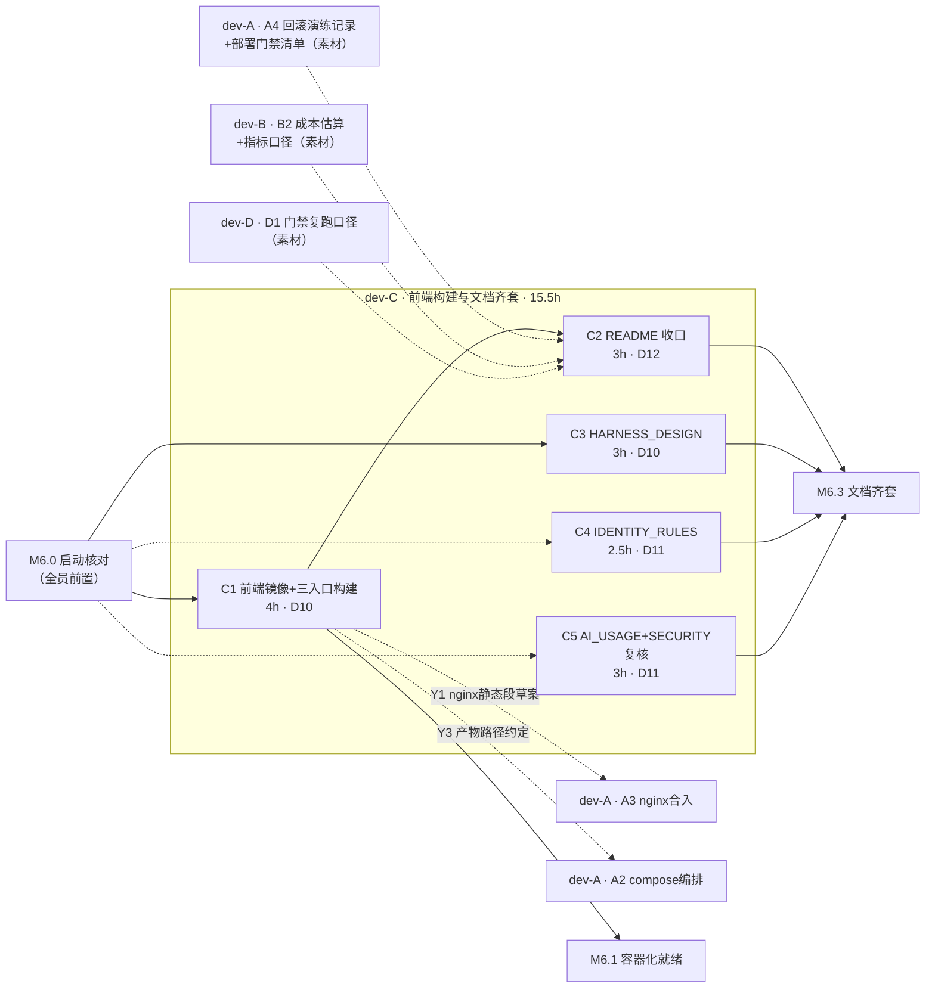

> 状态：进行中（S0–S3 收口；J1/J2 Y3 闭环、J4 B2/B1 闭环、J5 门禁口径闭环；**仅剩 J3·A4 素材回填 README §13**）　｜　版本：v1.1　｜　日期：2026-11-13
> 负责人：**dev-C（唯一）**　｜　任务包：C · 前端构建与文档齐套线（15.5h / 容量上限 24h）
> 上游依据（唯一事实源，本文不另立口径）：
> - `docs/plans/day10/day-10-交付与观测-工作推进计划.md` v1.1（§4.3 dev-C 节点表、§3 Y1/Y3、§6 写域）
> - `docs/team_tasks/day10/dev-C-前端构建与文档齐套.md` v1.0（任务书）
> - `docs/team_tasks/day10/day10-任务总览与DAG.md` v1.1（§2 DAG、§3 对接点、§4 写域）
> - PRD line 578（Day 10 完成定义）、PRD §2.1/§3.2、TD §4/§6、大纲 §十 课时 10.1–10.4、§11.3
> 变更记录见文末

---

# dev-C · Day 10 执行计划（DAG 路径 · 子 agent 并行编排 · AI 提示词）

## 1. 项目认知基线（读后共识，执行前提）

1. **项目定位**：CCRC 康养社区长者卧室 3D 数字人陪伴系统。三端同一仓库：长者端 `pad`（1920×1080 大字，three-vrm）、照护台 `console`（原生 CSS + tokens）、家属端 `family`（375px 移动优先）。**不做医疗诊断，不替代 SOS**。
2. **Day 10 完成定义**（PRD line 578，四句）：Docker Compose 一键启动 + HTTPS + 健康检查 ✓；AC-31 完整 Trace ✓；全部 P0 回归通过 ✓；交付文档清单逐项可检 ✓。
3. **dev-C 在 Day 10 的位置**：四个交付里程碑中牵头 **M6.3 交付文档齐套**，并参与 **M6.1 容器化就绪**（C1 是 M6.1 判据之一）。
4. **三条硬约束**（贯穿全部节点）：`app/services/` 唯一写库层；身份字段只从服务端 `runtime_context` 注入；**Day 10 零新增迁移**。
5. **本机环境红线**：Vite 预构建缓存 `frontend/node_modules/.vite/deps` 不删、不 `--force`；本机 curl 验证加 `--noproxy '*'`；本机后端联调走方案 A 命令（Windows 事件循环），容器内不受限。

## 2. dev-C 任务清单与依赖拆解（Day 10 既定任务，5 节点）

> 每节点：前置条件 → 执行步骤 → 交付物规格 → 自检校验标准。事实口径全部引自任务书与总计划 §4.3，本文不新增事实。

### C1 · 前端镜像与三入口构建（4h，D10 第一个开工项）

| 项 | 内容 |
| --- | --- |
| 前置依赖 | M6.0 启动核对完成（写域与 Y3 契约口径冻结） |
| 执行步骤 | ① 新建 `frontend/frontend.Dockerfile`：多阶段（`npm ci` → `vite build` → nginx 托管），容器内全新安装，不受本机 Vite 缓存影响；② 确认 Vite MPA 三入口（`index.html` / `console.html` / `family.html`）产物分目录 `dist/{pad,console,family}`；③ 核对红线：pad 的 three-vrm 依赖不进 console/family 构建产物；④ 按下表产出 Y1/Y3 契约草案 |
| 交付物 | `frontend/frontend.Dockerfile`（多阶段、非 root 可选）、构建说明（Y1 静态段草案 + Y3 产物路径约定，写入本计划 §8 执行记录或独立小抄交 dev-A） |
| 自检校验 | `docker build -f frontend/frontend.Dockerfile` 成功；`grep -r "three-vrm" dist/console dist/family` **零命中**；`dist/pad` 含 VRM 资产；容器内产物路径 `/usr/share/nginx/html/{pad,console,family}` |

### C2 · README 收口（3h，排在 D12）

| 项 | 内容 |
| --- | --- |
| 前置依赖 | C1 完成；**外部素材三项**：A4 回滚演练记录＋部署门禁清单（dev-A）、B2 成本估算＋四类指标口径（dev-B）、D1 门禁复跑口径（dev-D） |
| 执行步骤 | ① 新增「Docker 部署」章节（`git clone && cp .env.example .env && docker compose up` 三步口径＋服务清单表＋端口表）；② 新增「回滚」章节（合入 A4 素材）；③ 新增「成本数据」章节（合入 B2 素材：S1 闭环率 ≥60% 目标、单会话 Tool ≤8、cache 命中率、分层省 Token——**数字全部取实测，未达标如实写**）；④ 新增「观测说明」章节（指标端点、Trace 查询方法、告警规则说明）；⑤ 更新 README §10 文档索引 |
| 交付物 | `README.md` 增量（dev-C 独占写域） |
| 自检校验 | 四个新章节齐全；抽查 3 个数字可回溯到 `eval/reports/` 或 `/metrics` 实测；「局限」节保留教学 MVP 口径（PRD §1.3）；D3 干净主机演练的缺漏提单回改本章节 |

### C3 · docs/HARNESS_DESIGN.md 新建（3h，可与 C1 并行）

| 项 | 内容 |
| --- | --- |
| 前置依赖 | M6.0；TD §4/§6 十组件口径 |
| 执行步骤 | 按大纲 §6.2 十组件表（Context / System One / Tool / State / Checkpoint / Memory / Loop / Policy / Recovery / Observability / Evaluation）逐组件写「本仓落点」：组件行为＋对应文件路径＋关键配置。**全部路径实测存在后才能写入（写前逐个 `ls`）** |
| 交付物 | `docs/HARNESS_DESIGN.md`（新建） |
| 自检校验 | 十组件逐项覆盖；文中每个文件路径 `ls` 通过（**零虚构路径**）；与 TD §4/§6 口径一致，冲突以 TD 为准并回改本文档 |

### C4 · docs/IDENTITY_RULES.md 新建（2.5h，可与 C1 并行）

| 项 | 内容 |
| --- | --- |
| 前置依赖 | M6.0；**口径唯一来源 = PRD §3.2** |
| 执行步骤 | ① 四层身份锚点：设备绑定→房间默认→声纹→主动确认；② 三档级联：声纹失败→主动确认→通用模式；③ 阈值口径 **0.62**，含沿革（0.85→0.55→0.62）与依据（`eval/reports/声纹调优报告.md`）；④ 通用模式边界：不读记忆 / 不写健康 / 不确认用药；⑤ `thread_id=(elder_id, session_seq)` 服务端生成 |
| 交付物 | `docs/IDENTITY_RULES.md`（新建） |
| 自检校验 | 阈值、候选集（设备 1v1、恒 1 位）、级联行为三处与 PRD v3.1 **逐字一致**；文中行为均有对应测试名可引（如 `tests/test_gates.py`、声纹相关用例） |

### C5 · docs/AI_USAGE.md 新建 ＋ SECURITY.md 复核（3h，可与 C1 并行）

| 项 | 内容 |
| --- | --- |
| 前置依赖 | M6.0；day02–day10 计划件（决策引用素材）；day09 收口后现状 |
| 执行步骤 | ① `AI_USAGE.md` 三节：AI 辅助范围（哪些模块 AI 生成）、人工审查记录（高风险五类：auth / 迁移 / Tool 权限 / MCP / Dockerfile 的人工读 diff 记录）、关键决策（引用 day02–day10 计划件裁决）；② `docs/SECURITY.md` 复核修订：威胁模型 / 降级矩阵 / 数据保留 / HITL 清单四节齐全，与 `tests/test_gates.py`、`eval/fixtures/injection.jsonl` 实况对齐 |
| 交付物 | `docs/AI_USAGE.md`（新建）、`docs/SECURITY.md`（复核修订） |
| 自检校验 | AI_USAGE 三节齐全且引用真实计划件路径；SECURITY 引用的测试文件与夹具 `ls` 存在；HITL 清单与 PRD（用药 HITL、健康黄/红复核）一致 |

### 节点间依赖关系小结

- **包内硬链仅 1 条**：`C1 → C2`（C2 的部署章节需要 C1 的构建事实与产物路径）。
- **C3 / C4 / C5 互相独立、与 C1 无依赖**——这是子 agent 并行的拓扑基础。
- **跨包依赖**：C2 ← A4（素材）/ B2（素材）/ D1（口径）；C1 → Y1/Y3 → dev-A 的 A3 合入 nginx。

## 3. dev-C DAG 路径（基于 task10 总计划绘制）

### 3.1 DAG 图



### 3.2 关键路径与波次

- **关键路径**：`M6.0 → C1 → C2 → M6.3`，共 7h 开发工时；C2 被 A4/B2/D1 素材卡点，实际落 D12。
- **并行余量**：C3/C4/C5 共 8.5h 与 C1 链完全独立，可全部并行摊平。
- **Line 1 槽位**（优先级高于本包，冲突时 Line 1 优先）：D10 穿插 day09 C6 联调；D11 穿插 M5.4 验证。

### 3.3 机器可读 DAG（供子 agent 编排与执行器消费）

```json
{
  "owner": "dev-C",
  "nodes": [
    {"id": "C1", "title": "前端镜像与三入口构建", "hours": 4, "deps": ["M6.0"], "wave": 1, "outputs": ["frontend/frontend.Dockerfile", "Y1/Y3 契约草案"]},
    {"id": "C3", "title": "HARNESS_DESIGN.md 新建", "hours": 3, "deps": ["M6.0"], "wave": 1, "outputs": ["docs/HARNESS_DESIGN.md"]},
    {"id": "C4", "title": "IDENTITY_RULES.md 新建", "hours": 2.5, "deps": ["M6.0"], "wave": 1, "outputs": ["docs/IDENTITY_RULES.md"]},
    {"id": "C5", "title": "AI_USAGE.md 新建 + SECURITY 复核", "hours": 3, "deps": ["M6.0"], "wave": 1, "outputs": ["docs/AI_USAGE.md", "docs/SECURITY.md 修订"]},
    {"id": "C2", "title": "README 收口", "hours": 3, "deps": ["C1", "A4素材", "B2素材", "D1素材"], "wave": 2, "outputs": ["README.md 增量"]}
  ],
  "edges_hard": [["C1", "C2"]],
  "waves": [["C1", "C3", "C4", "C5"], ["C2"]],
  "critical_path": ["M6.0", "C1", "C2", "M6.3"]
}
```

## 4. 子 agent 并行执行编排（分步确认制）

> 执行方式：由主控（本会话）按 DAG 波次派发子 agent，**每步完成后停下等主理人确认，再进下一步**。本轮（本计划件交付）不启动任何子 agent。

### 分步确认制

| 步 | 内容 | 产出 | 确认点 |
| --- | --- | --- | --- |
| **S0** | 启动核对：主理人裁决本文 §7 待确认项 + 上游 Q1–Q9 中影响 C 包的项（Q1/Q3/Q5）；核对写域无冲突 | 裁决记录回填 §7 | **等确认** |
| **S1** | **波次 1 · 四路并行**：4 个子 agent 分别执行 C1 / C3 / C4 / C5（各自独立写域，零文件交集） | C1 Dockerfile＋构建验证；C3/C4/C5 四份文档 | 逐路汇报后**等确认** |
| **S2** | **波次 2 · C2 串行**：确认 A4/B2/D1 素材已到位 → 单子 agent 执行 README 收口 | README 四新章节 | **等确认** |
| **S3** | 收口自检：§2 全部自检判据逐条复跑；Y1/Y3 交 dev-A 回执确认；执行记录回填；更新 plans/README.md 索引与任务书状态 | 自检报告 | **等确认** |

### 并行约束（S1 四路必须遵守）

1. **写域零交集**：C1 只写 `frontend/frontend.Dockerfile`（+dist 构建产物）；C3 只写 `docs/HARNESS_DESIGN.md`；C4 只写 `docs/IDENTITY_RULES.md`；C5 只写 `docs/AI_USAGE.md` 与 `docs/SECURITY.md`。任何一路需要越界（如改 README）→ 停下登记，不直接改。
2. **C1 红线**：不删不动本机 `frontend/node_modules/.vite/deps`；构建在容器内 `npm ci` 完成。
3. **C3/C4/C5 红线**：文档内引用的每个文件路径写前 `ls` 实测；与 PRD/TD 冲突时以基线为准回改本文档，不自创口径。
4. **失败处置**：任一路失败不阻塞其余三路；失败路登记等待项后重派或转人工。
5. **Docker 构建耗时风险**：C1 首次 `npm ci` 拉包可能受代理环境影响（本机 `HTTP_PROXY=127.0.0.1:52070`），若容器内拉包失败，登记后由主理人开终端常驻执行，不静默重试。

## 5. 联调与交接提醒（与谁交接、交接内容）

> 联调触发时点到达时，主控会显式提醒主理人。下表为全部交接清单。

| # | 方向 | 交接对象 | 交接内容 | 时点 | 联调判据 |
| --- | --- | --- | --- | --- | --- |
| J1 | C → A（**Y3**） | dev-A（A2/A3 节点） | `frontend.Dockerfile` 多阶段产物路径约定：容器内 `/usr/share/nginx/html/{pad,console,family}`；构建命令固定 `npm ci && npm run build`；红线「three-vrm 不进 console/family 产物」 | D11 上午 | 三入口 URL（`/pad` `/console` `/family`）经 nginx 200；grep 零命中 |
| J2 | C → A（**Y1**） | dev-A（A3 节点，nginx.conf 由 A 独占改） | 三入口静态托管段草案（`/pad`→`dist/pad` 等）＋ `/api/*`、`/ws/*` 反代规则草案（WS 带 Upgrade/Connection 头） | D11 上午 | 三入口经 nginx 200；`wss://` 信令建连不断 |
| J3 | A → C（素材） | 接收 dev-A A4 产出 | 回滚演练记录＋部署门禁清单 → 合入 README「回滚」章节 | D12 前到齐 | 数字与演练记录一致 |
| J4 | B → C（素材） | 接收 dev-B B2 产出 | 成本估算＋四类指标口径（S1 闭环率/Tool 调用数/cache 命中率/分层省 Token）→ 合入 README「成本数据」章节 | D12 前到齐 | 抽查数字可回溯 `/metrics` |
| J5 | D → C（素材） | 接收 dev-D D1 产出 | 门禁复跑口径与 pre-push 阻塞模式裁决结果 → 合入 README 门禁相关小节 | D12 前到齐 | 与 `.githooks/pre-push` 行为一致 |
| J6 | D → C（提单） | 接收 dev-D D3 提单 | 干净主机演练发现的 README/.env 缺漏 → C 回改对应章节并复验 | D13 | 提单闭环留痕 |
| J7 | Line 1 槽位 | day09 联调线（dev-B/dev-D 主持） | D10 穿插 day09 C6 联调；D11 穿插 M5.4 验证。**冲突时 Line 1 优先**，本包骨架顺延 | 按槽位 | 按 day09 §3.4 |

**交接纪律**：素材未到齐时 C2 只写骨架不填数字（占位符显式标注「待 A4/B2/D1」），**不得编造数字**；J1/J2 交付后必须拿到 dev-A 回执（口头/IM 均可，留痕在 §8 执行记录）才算闭环。

## 6. AI 提示词（可直接投喂子 agent / 编码助手）

> 使用说明：每段提示词自包含，投喂前无需补充上下文。`【S1-C1】` 等编号对应 §4 波次。若主控代为派发，原样粘贴即可。

### 【S1-C1】前端镜像与三入口构建

```
你是康伴（SilverMate）项目的 dev-C，执行 Day 10 节点 C1：前端镜像与三入口构建。工作目录为仓库根。

必读（读完再动手）：
1. docs/team_tasks/day10/dev-C-前端构建与文档齐套.md 的 §1（C1 节点）
2. docs/plans/day10/day-10-交付与观测-工作推进计划.md §4.3 C1 行、§3 Y1/Y3 契约
3. frontend/vite.config.ts 与 frontend/index.html / console.html / family.html（确认三入口 MPA 配置现状）

写域（只允许新建/修改以下文件）：
- frontend/frontend.Dockerfile（新建）
- 如确需 vite 构建配置调整：先停下报告，不得直接改（vite.config.ts 不在你的写域）

任务步骤：
1. 新建 frontend/frontend.Dockerfile，多阶段构建：stage1 用 node 镜像执行 npm ci 与 npm run build；stage2 用 nginx 镜像托管 dist 产物到 /usr/share/nginx/html/{pad,console,family}。
2. 容器内全新安装依赖（npm ci），严禁 COPY 本机 node_modules；严禁在容器构建中引用 .env（前端密钥不进镜像）。
3. 构建并验证：
   - docker build -f frontend/frontend.Dockerfile -t silvermate-frontend-verify . 成功
   - 临时容器内检查三目录产物齐全
   - grep -r "three-vrm" dist/console dist/family 必须零命中；dist/pad 必须含 VRM 相关资产
4. 产出两份契约草案（写入执行报告，不改 dev-A 的文件）：
   - Y3：产物路径约定 /usr/share/nginx/html/{pad,console,family}、构建命令 npm ci && npm run build
   - Y1：nginx 静态托管段草案（/pad /console /family 静态映射 + /api、/ws 反代 backend:8000，WS 带 Upgrade/Connection 头）

硬约束：
- 不删除、不 --force 本机 frontend/node_modules/.vite/deps 预构建缓存
- 不碰 backend Dockerfile、docker-compose.yml、deploy/nginx.conf（dev-A 独占）
- 不碰 app/** 业务代码与 tests/**
- 任何超出写域的需要 → 停下登记，不自行决定

完成报告格式：节点号、改动文件清单、自检四项逐条结果（构建成功/grep 零命中/pad 含 VRM/三入口产物）、Y1/Y3 契约草案全文、遗留与等待项。
```

### 【S1-C3】HARNESS_DESIGN.md 新建

```
你是康伴（SilverMate）项目的 dev-C，执行 Day 10 节点 C3：新建 docs/HARNESS_DESIGN.md。

必读：
1. docs/康伴3D数字人_大纲.md §6.2 十组件表（唯一组件清单来源）
2. docs/康伴3D数字人_技术设计文档.md §4/§6（实现口径唯一来源）
3. 仓库 app/ 目录实际结构（逐路径 ls 实测）

写域：仅新建 docs/HARNESS_DESIGN.md。

任务：
1. 按十组件逐项写「本仓落点」：Context / System One / Tool / State / Checkpoint / Memory / Loop / Policy / Recovery / Observability / Evaluation。
2. 每组件三要素：组件行为（做什么）、对应文件路径（本仓真实落点）、关键配置（环境变量/常量，注明取值来源）。
3. 铁律：文中出现的每个文件路径必须先 ls 验证存在才能写入，零虚构路径；与 TD 口径冲突时以 TD 为准并回改本文档，不自创口径；不引用大纲正文里的表名/字段/接口作事实依据（AGENTS.md 前置节铁律）。

自检：十组件逐项覆盖无缺；抽查文中 5 个路径 ls 通过；与 TD §4/§6 无口径冲突。
完成报告格式：节点号、文件路径、十组件覆盖表（组件→落点路径→配置）、自检结果、遗留项。
```

### 【S1-C4】IDENTITY_RULES.md 新建

```
你是康伴（SilverMate）项目的 dev-C，执行 Day 10 节点 C4：新建 docs/IDENTITY_RULES.md。

必读：
1. docs/康伴3D数字人_PRD.md §3.2（身份规则口径唯一来源，逐字核对）
2. eval/reports/声纹调优报告.md（阈值沿革依据）
3. tests/test_gates.py 与声纹相关测试文件名（行为可追溯性）

写域：仅新建 docs/IDENTITY_RULES.md。

任务（五节）：
1. 四层身份锚点：设备绑定 → 房间默认 → 声纹 → 主动确认。
2. 三档级联：声纹失败 → 主动确认 → 通用模式。
3. 阈值口径 0.62，含沿革（0.85→0.55→0.62）与依据（引用声纹调优报告）。
4. 通用模式边界：不读记忆 / 不写健康 / 不确认用药。
5. thread_id=(elder_id, session_seq) 由服务端生成（不是前端/设备传入）。

铁律：阈值、候选集（设备 1v1、恒 1 位候选）、级联行为三处必须与 PRD v3.1 逐字一致；文中每个行为断言都要能对应到一个真实测试名。

自检：五节齐全；三处逐字一致核对留痕；引用的测试文件 ls 存在。
完成报告格式：节点号、文件路径、五节覆盖说明、与 PRD 逐字核对结果、引用测试清单、遗留项。
```

### 【S1-C5】AI_USAGE.md 新建 + SECURITY.md 复核

```
你是康伴（SilverMate）项目的 dev-C，执行 Day 10 节点 C5：新建 docs/AI_USAGE.md + 复核修订 docs/SECURITY.md。

必读：
1. docs/plans/ 下 day02–day10 计划件目录结构（关键决策引用来源）
2. docs/SECURITY.md 现状（day09 A2 交付，76 行）
3. tests/test_gates.py、eval/fixtures/injection.jsonl（安全实况核对）
4. PRD 中用药 HITL、健康黄/红复核相关验收条目

写域：仅 docs/AI_USAGE.md（新建）与 docs/SECURITY.md（复核修订）。不碰其他任何文档与代码。

任务 A（AI_USAGE.md，三节）：
1. AI 辅助范围：哪些模块由 AI 生成（按 day02–day10 计划件实况归纳）。
2. 人工审查记录：高风险五类文件（auth / 迁移 / Tool 权限 / MCP / Dockerfile）的人工读 diff 记录，引用真实计划件路径。
3. 关键决策：引用 day02–day10 计划件中的裁决记录（列文件路径与决策要点）。

任务 B（SECURITY.md 复核）：
1. 核对四节齐全：威胁模型 / 降级矩阵 / 数据保留 / HITL 清单。
2. 与实况对齐：引用的测试文件与夹具必须 ls 存在；HITL 清单与 PRD（用药 HITL、健康黄/红复核）一致；数据保留口径含原始音频 72h 自动删除、声纹 embedding 加密存储。
3. 发现过期/缺失内容 → 修订并留变更说明，不推翻 day09 已收口结论。

自检：AI_USAGE 三节齐全且引用路径真实存在；SECURITY 四节齐全、引用文件 ls 通过、HITL 与 PRD 一致。
完成报告格式：节点号、两份文件、三节/四节覆盖表、ls 核对结果、修订差异清单、遗留项。
```

### 【S2-C2】README 收口（波次 2，素材到位后执行）

```
你是康伴（SilverMate）项目的 dev-C，执行 Day 10 节点 C2：README 收口。

必读：
1. README.md 现状全文（你在本包内独占此文件）
2. 素材三件：dev-A A4 回滚演练记录+部署门禁清单；dev-B B2 成本估算+指标口径；dev-D D1 门禁复跑口径
3. C1 已交付的 Y3 产物路径与 docker compose 服务清单
4. PRD §1.3（教学 MVP 口径）、大纲 §11.3（观测说明验收项）

写域：仅 README.md 增量。

任务（四个新章节 + 索引）：
1. 「Docker 部署」：git clone && cp .env.example .env && docker compose up 三步口径 + 服务清单表 + 端口表（端口按 README §6.2 既有约定：postgres 5432 / redis 6379 / backend 8000 / nginx 80·443 / laya 7001 / weather 7101 / mock-operations 7102 / coturn 3478·5349）。
2. 「回滚」：合入 A4 演练记录与部署门禁清单（逐字引用素材，不加工数字）。
3. 「成本数据」：S1 闭环率（目标 ≥60%）、单会话 Tool 调用（≤8）、prompt cache 命中率、分层记忆省 Token——数字全部取 B2 实测，未达标如实写，不得粉饰。
4. 「观测说明」：指标端点（/metrics）、Trace 查询方法（Langfuse 界面 + trace_id 互查）、告警规则说明。
5. 更新 README 文档索引节。

铁律：素材未到位的章节写骨架并显式标注「待 X4/B2/D1」，不得编造数字；「局限」节保留教学 MVP 口径（不以模拟数据比例作为真实运营效果证明）。

自检：四章节齐全；抽查 3 个数字可回溯 eval/reports/ 或 /metrics 实测；教学口径保留。
完成报告格式：节点号、README 增量 diff 摘要、数字回溯表（数字→来源）、遗留与等待项。
```

## 7. 待确认项（主理人裁决，未裁决不开工对应步骤）

| # | 待确认 | 影响步骤 | 裁决 |
| --- | --- | --- | --- |
| **QC-1** | **子 agent 并行启动时机** | S1 | **已裁决（2026-11-13）：确认启动 S1 四路并行** |
| **QC-2** | **C1 写代码授权** | S1 | **已裁决（2026-11-13）：S1 启动即授权 C1 新建 `frontend/frontend.Dockerfile` 并执行 Docker 构建验证** |
| **QC-3** | **C2 素材等待策略** | S2 | **已裁决（2026-11-13）：D11 先写骨架、显式占位「待 A4/B2/D1」，素材到后填实测数字** |
| **QC-4** | **上游 Q1/Q3/Q5 结论**（需写进 C2 门禁章节） | S0/S2 | **主理人答复已裁决，具体结论待补充**——C2 对应小节先挂「待裁决」占位，结论补齐后回填 |
| **QC-5** | **Day 10 双线日历**（上游 Q2） | 全局排期 | 按 D12–D13（未获相反指示） |

## 8. 执行记录（开工后填写）

| 日期 | 步骤/节点 | 结果/证据指针 | 等待项 |
| --- | --- | --- | --- |
| 2026-11-13 | S0 | QC-1/2/3 裁决落档（§7）；QC-4 结论待补 | Q1/Q3/Q5 具体结论 |
| 2026-11-13 | S1 · C1 ✅ | `frontend/frontend.Dockerfile` 新建；容器构建成功（489MB）；三入口产物齐全；grep three-vrm 零命中加固验证（根 assets 无残留 chunk）；pad 含 14 个 .vrm 资源；`/pad /console /family` 独立冒烟全 200。Y1/Y3 契约草案见子代理报告 | **Y3 构建命令口径修订待裁决**（npm ci → pnpm@11.15.1 --frozen-lockfile，目录内仅 pnpm-lock.yaml）；M6.1 全栈 nginx 终验待 A3 |
| 2026-11-13 | S1 · C3 ✅ | `docs/HARNESS_DESIGN.md` 新建；十组件覆盖；全部 58 个路径批量实测零缺失；4 处大纲 vs TD 口径差异注明以 TD 为准 | 无阻塞 |
| 2026-11-13 | S1 · C4 ✅ | `docs/IDENTITY_RULES.md` 新建；五节齐全；与 PRD §3.2 逐字机械比对通过；21 个引用测试实存验证 | 大纲 §7.1 两处过时表述（0.85/候选列表）建议另立勘误（未改动） |
| 2026-11-13 | S1 · C5 ✅ | `docs/AI_USAGE.md` 新建（三节，56 引用路径全通过）；`docs/SECURITY.md` 复核至 v1.1（补 §4 降级矩阵/§5 数据保留/§6 HITL，22 引用全通过） | auth 审查底稿待主理人补签；闸门②用例回填归 M5.1；后端 Dockerfile 人工读 diff 待 A1 交付 |
| 2026-11-13 | S1 收口 | 四路完成，主理人确认：**进 S2 + 接受 Y3 口径修订**（pnpm@11.15.1 --frozen-lockfile）；修订已同步四处（主计划 v1.2 / 总览 v1.2 / 任务卡 v1.1 / 本计划件） | Q1/Q3/Q5 结论待补 |
| 2026-11-13 | S2 · C2 ✅ | `README.md` 增量 +112/−1：§12 Docker 部署（6 实测服务写实+C1 前端镜像小节全写实）、§13 回滚骨架、§14 成本数据骨架（四指标口径写实）、§15 观测说明半写实、§10 索引增 4 行；占位符 15 处（待 A2×3/待 A4×4/待 B2×6/待 B1×2/待 D1×1/待裁决×1），零编造数字 | A4/B2/B1/D1 素材回填（D12）；Q1/Q3 裁决回填 |
| 2026-11-13 | S3 收口自检 ✅ | 5 份交付物 ls 全在位（frontend.Dockerfile 9.3KB / HARNESS_DESIGN 21.9KB / IDENTITY_RULES 8.6KB / AI_USAGE 14.0KB / SECURITY 13.5KB）；README §12–§15 四章节 grep 验证齐全；占位符 8 处 ⏳ 显式标注；Y1/Y3 契约草案已备妥待交 dev-A | **dev-C 包除素材回填外全部收口** |
| 2026-11-13 | J5 · Y5 素材知会 | dev-D 通知：门禁口径素材在 `day10_gate_rerun.md` §6（D1 产出）。**该文件尚未在远端 develop / 本地出现**（14:32 实测 fetch + find 零命中）；README §15.4 回填位已就绪（含 expected-red 落地说明位） | **待 dev-D push 该文件后知会 C**，C 即按 §6 逐字合入 README §15.4 并闭环 J5 |
| 2026-11-13 | J5 · 提单事实先行合入 | 15:17 提单两条纪律事实按原文合入 README §15.4（push 3~4 分钟既定成本 / hooksPath 启用要求 / expected-red 2026-11-15 过期）＋总览 Y5 契约增补（v1.7）；**素材文件仍待 push**，显式标注「到位后逐字校对」，未虚构引用 | dev-D push 文件后逐字校对回填，J5 闭环 |
| 2026-11-13 | **J5 ✅ 闭环** | dev-D push PR #124/#125：`eval/reports/day10_gate_rerun.md`（§6 Y5 素材小抄＋四态验证表）＋`expected_red.json`（B/D/E，expires 2026-11-15，入库留痕）＋`tests/eval_gate.py` expected-red 机制落码（+132 行）；README §15.4 已按 §6 **逐字校对并填实**（pre-push 双段链路/expected-red 机制/当前标注/四态验证/启用方式/纪律），占位符删除 | 无——J5 关闭；README 剩余等待仅 A4/B2/B1 三项 |
| 2026-11-13 | 门禁拦截与环境配置 | 首次 push 被**真门禁正确拦截**：本机缺 `.venv_sidecar`（F02 不静默放行，主理人裁决 A=现场配置）；已建 `.venv_sidecar`（python 3.12）并后台安装 torch 2.14 CPU + sidecar 依赖 + sqlalchemy/tzdata（对齐 day10_gate_rerun.md §0 口径） | 安装完成后重推 162ba99（J5 闭环提交） |
| 2026-11-13 | 改判⑨登记 | 主理人改判 Langfuse 形态：**v2 单容器+复用 postgres → v4 全家桶（六容器）**；已落总览 Q4/Y2（v1.8）＋README §12.2；compose 仍无 langfuse（Y2 归 dev-A S4 待办） | **提单 dev-A**：计划件 S0/S4/Y2 的「v2+连 dev-B」口径过时需自行同步；`.env.example` 占位 `LANGFUSE_HOST` 指向主理人 IP；注册地址 `http://<主理人局域网IP>:3000` |
| 2026-11-13 | **J4 ✅ 闭环（B2 素材）+ §15.2（B1 素材）** | dev-B PR #129 交付 `eval/reports/day10_cost_brief.md`＋`docs/guides/langfuse-操作指引.md`＋`day10_langfuse_trace.md`（AC-31 证据）；README §14 成本四指标实测回填（S1 闭环率 5.19% 如实登记未达标、cache 命中率 0.0% 真实值、单轮 prompt 基线 765 tokens、价格按当日定价页公式代入）＋§15.1 cache 口径＋§15.2 指引引用；§15.3 SLO 告警素材未含，如实挂起 | **README 剩余等待仅 A4（回滚）一项** |
| 2026-11-13 | J1/J2 · Y3 闭环、Y1 部分闭环 | dev-A A2a（commit `6eaafe1`）**逐字消费 Y3 契约**：compose nginx 服务 build=`./frontend` + `frontend.Dockerfile`、产物路径、镜像内默认配置三入口+反代；实测证据「双 healthy + 三入口 200 + 自动迁移 0020→0021」——**回执成立，J1/J2（Y3 部分）闭环**；`deploy/nginx.conf` 静态段/HTTPS 归 A-S6 卷挂载覆盖（Y1 残余部分）；README §12 已按 A2a 实况更新（backend/nginx 转写实，langfuse profile 化+共享实例裁决、laya Q7、coturn 待 S4） | Y1 残余（deploy/nginx.conf 三入口+HTTPS 段）待 A-S6 |

---

## 变更记录

| 版本 | 日期 | 说明 |
| --- | --- | --- |
| v1.0 | 2026-11-13 | 首版。基于总计划 v1.1 与任务书 v1.0 编制 dev-C 专属执行计划：项目认知基线、C1–C5 依赖拆解、DAG（mermaid + 机器可读 JSON）、S0–S3 分步确认制与四路并行编排、交接清单 J1–J7、五段可投喂 AI 提示词、待确认 QC-1–QC-5。本轮仅计划件，未改任何业务代码。 |
