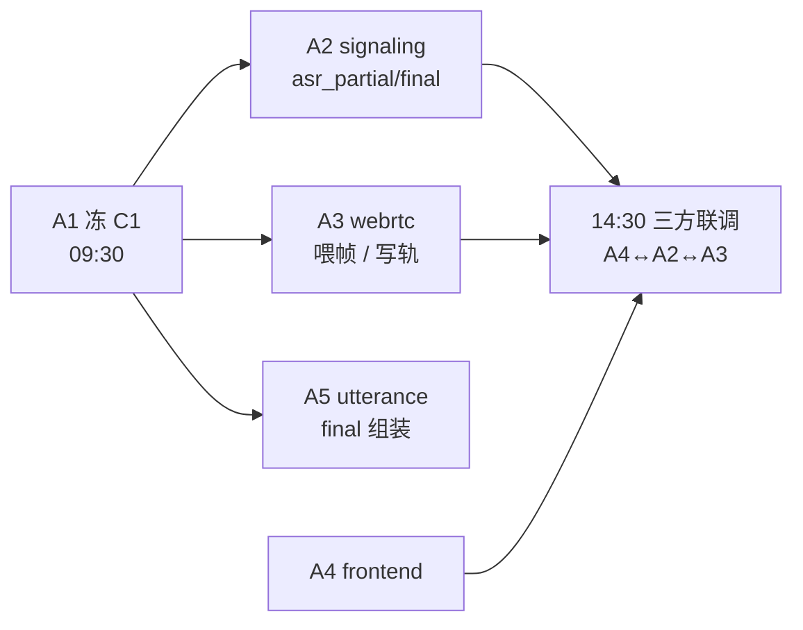

# TASK A1 · ASR/TTS 适配层 · 执行计划与 DAG

> 状态：已完成（2026-11-05 N9 收口；N1–N7、N9 交付，**N8 真链路未达成**——funasr 镜像未拉全，见 §10 v1.2）　｜　版本：v1.2　｜　日期：2026-11-05
> 关联：`docs/team_tasks_day03/a1-asr-tts.md`（任务卡）、`docs/team_tasks_day03/contracts.md`（C1/C2/C3）、`docs/team_tasks_day03/README.md`（五人分工）、`docs/plans/day-03-WebRTC与语音闭环.md`（T1 与 §3 裁决）
> 上游依据：PRD v2.6 §4.2 FR-UI-01/02/05/09、§4.4 FR-DLG-02、§4.11 P2、§5.3 延迟口径、AC-40、Day 3 验收；技术设计文档 v1.7 §1.3 `app/audio` 职责（:167）、§8 Day 3 落地清单（:1019）与技术验收（:1022）、§3.7 `decision_logs.asr_confidence`（:633）
> 命名说明：编号沿用 Day 3 卡片 id `a1`（该组卡片为 a1–a5，与 Day 2 的 `task-01`–`task-07` 不冲突）
> 变更记录见文末

---

## 1. 目标（一句话）

在 `app/audio/` 里把 **ASR 与 TTS 收成两套可替换的流式适配器**（协议 + 工厂 + Mock + FunASR 本地基线 + 云 API 骨架），并让「置信度」与「首包耗时」以结构化字段进入 trace，成为 A2/A3/A5 的唯一音声出入口。

**不做**（任务卡禁触 + day-03 计划 :103）：
- 不碰 `signaling.py` / `webrtc.py` / `vad.py` / `app/api/audio.py` / `frontend/`
- 不做重采样、分帧、写轨、打断、VAD 判句（分别归 A3 / A3 / A5）
- 不做第二种 ASR 形态（无「批量转写 / 文件转写」第二入口）
- 不改 `app/core/config.py`（Day 3 只读；`asr_*` 7 项 / `tts_*` 7 项已够用）

---

## 2. 验收口径（PRD 为准，逐条可测）

| ID | 出处 | 要求 | 本单元如何证明 | 归属 |
| --- | --- | --- | --- | --- |
| A1-V1 | TD:1022、PRD:461 | **ASR 置信度进 trace**，不得伪造数值 | 结构化日志一行含 `trace_id` / `asr_confidence` / `asr_source`；FunASR 恒 `null` | 本单元 |
| A1-V2 | TD:1019、PRD:546/550 | 流式适配器**带首包耗时埋点** | 日志含 `asr_first_packet_ms` / `tts_first_packet_ms` | 本单元 |
| A1-V3 | PRD:248、FR-UI-02 | 字幕文字必须与语音内容**逐字一致** | TTS 输入文本原样回带（`tts_text` 由 A2 下发，源头同一字符串） | 本单元保证不加工文本 |
| A1-V4 | PRD:251、FR-UI-05 | ASR 无文本 → 提示「没有听清」**不生成空消息、不伪造** | `final` 且 `text.strip()==""` 时返回空文本事件，由 A2/A5 判定提示；适配器不造词 | 本单元定语义 |
| A1-V5 | PRD:255、FR-UI-09 | ASR/TTS 不可用时**页面降级不白屏** | 抛 `ASRUnavailable` / `TTSUnavailable`，异常类型即降级信号 | 信号本单元，页面归 A4 |
| A1-V6 | PRD:247、FR-UI-01 | 按住说话单次 ≤120 秒 | 整段入口由 A5 限长；本单元对超长流不缓存整段 | 归属 A5，本单元不设上限 |
| A1-V7 | day-03 计划 :103 | 单一 ASR 抽象、两个实现 | 目录下只有 `ASRProvider` 一个协议 | 本单元 |

**验收命令**（收口时逐条贴输出）：

```bash
# 1. 单测全绿（本单元新增）
uv run pytest tests/test_audio_asr.py tests/test_audio_tts.py -q

# 2. 全量不回归
uv run pytest -q

# 3. 静态门禁
uv run ruff check app tests
uv run ruff format --check .

# 4. 真链路（容器内，见 §6 T1.7）
docker compose up -d funasr && uv run python spikes/funasr/ws_probe.py --text "今天天气怎么样"
```

---

## 3. 实现基准（技术文档为准）

1. **形态**：`app/audio/asr.py` + `tts.py` 是**流式适配器**（TD:1019），带置信度与首包耗时埋点；不是「一次性转写工具」。
2. **职责**：`app/audio` 把「音频轨 PCM 分帧送 ASR / TTS PCM 写入音频轨」包在里面（TD:167）；本单元只负责**协议与适配器**，媒体搬运归 A3。
3. **观测落点**：`decision_logs.asr_confidence numeric(4,3)` 已建表（TD:633），但**落库是 Day 6 的事**；Day 3 只要求「字段进 trace」——本单元用 `app/core/context.py` 的 `trace_id` + 结构化日志承载，**留 OTel span hook**（`_record_asr_observation()` 单点收口，Day 10 接 OTel 时只改这一个函数）。
4. **格式契约**（不可协商）：入口 `AsyncIterator[bytes]` = 16 kHz / 16 bit / 单声道 / 60 ms 帧（960 帧点 = 1920 字节）；出口 `bytes` = 16 kHz / 16 bit / 单声道 PCM 整段。
5. **置信度纪律**（day-03 计划 :88，主理人已裁）：云 API 有则透传、FunASR 无则 `None` + `source=provider`，**禁止 `0.0` 假值**；该字段只进观测，不参与任何业务判定。

---

## 4. 功能边界与对接面（本计划的重点）

### 4.1 谁给我什么 / 我给谁什么

| 对端 | 方向 | 契约 | 我方边界 |
| --- | --- | --- | --- |
| **A3 webrtc** | 进 | 16 k/16 bit/单声道 60 ms PCM 帧流 → `ASRProvider.stream()` | 我只消费帧流；**重采样、AEC、分帧、缓冲归 A3** |
| **A3 webrtc** | 出 | `await TTSProvider.synthesize(text)` → PCM 整段 | 我只产 PCM；**写轨、打断时停写、音画同步归 A3** |
| **A2 signaling** | 出 | `AsyncIterator[ASREvent]`（partial/final/error） | 我只抛事件；**转 WS 帧、auth/4401、ping-pong、error code 映射归 A2** |
| **A5 vad/utterance** | 进 | A5 把 WAV 解码成 PCM 帧流喂我 | **WAV 解码、30 s 限长、preRoll 补发归 A5** |
| **A5 utterance** | 出 | A5 取 `final` 的 `text` 组装响应 | 我不做回复生成、不落库、不碰 `app/api/` |
| **A4 frontend** | — | 无直接对接 | 我不产任何前端契约；字幕/播放归 A4 |
| **全组** | 出 | C1 契约（`ASRResult`/`ASREvent`/两个异常类/`TTSProvider`） | **09:30 前冻结**，下游只准 import 契约类型 |

### 4.2 明确不做（否则会与队友撞文件）

```
app/audio/signaling.py   → A2 专属，我不建、不 import
app/audio/webrtc.py      → A3 专属
app/audio/vad.py         → A5 专属
app/api/audio.py         → A5 专属
frontend/**              → A4 专属
app/core/config.py       → Day 3 只读；确需新字段由 A1 统一动并群通告（本计划不需要）
app/main.py              → A2 只改路由装配行；我不碰
tests/                   → 我只写 tests/test_audio_asr.py、tests/test_audio_tts.py、tests/fixtures/audio_*.py，
                           其余测试文件归 A5
```

### 4.3 联调时序依赖（我卡别人）



> **硬约束**：C1 不冻，A2/A3/A5 都不能开工 —— 所以本计划把「契约落地 + 红灯测试」放在 DAG 的第一层（N0–N1）。

### 4.4 端口与配置登记（可能撞车，务必先看 §9-1）

- **冲突**：任务卡写「funasr 端口 7001」，但 `README.md:194` 与 `AGENTS.md` 端口表已把 **7001 记给 laya**。
- 本计划暂按 **funasr = 7002** 落地，并在 README §6 端口表补两行（funasr 7002）。改回 7001 需要主理人同时改 laya 的登记，属全局改名，不建议。
- 配置**零新增**：FunASR 地址复用现有 `ASR_BASE_URL`（`ws://localhost:7002`），provider 用 `ASR_PROVIDER=funasr`；`.env.example` 中 `ASR_*` 已齐。

---

## 5. 分步任务（每步都有可执行的完成判据）

### T1.0 · 契约落地（30 min，阻塞全组）

产出：`tests/test_audio_asr.py`（先写红），`app/audio/asr.py` 顶部原样拷贝 C1 契约区。
判据：`uv run pytest tests/test_audio_asr.py -q` 全红（`ImportError`/`AttributeError` 即可），且契约区与 `contracts.md` 逐字一致。
门禁：**C1 冻结后立刻群通告**（A2/A3/A5 依赖它）。

### T1.1 · ASR 协议 + Mock + 工厂（90 min）

产出：`app/audio/asr.py`（`ASRProvider` 协议、`MockASRProvider`、`build_asr()`）、`app/audio/__init__.py`（工厂导出）。
要点：
- `build_asr()` 空值归一：`settings.asr_provider.strip().lower()`，`""`/未知值 → `mock`（**不改 Settings 默认值**）。
- `MockASRProvider` 读固定脚本（`tests/fixtures/asr_script.py`）：`partial×N → final`，可注入 `latency_ms` 与 `raise_error`，供 A2/A3/A5 在无网络下联调。
判据：`pytest tests/test_audio_asr.py -q` 绿；工厂分派 3 条用例（`mock`/`funasr`/`cloud`/空值）。

### T1.2 · FunASR 适配器（120 min，难度最高）

产出：`FunASRWSProvider`（在 `asr.py` 内）。
固化协议（day-03 计划 :136，已核）：
- 握手 JSON：`mode=2pass`、`chunk_size=[5,10,5]`、`audio_fs=16000`、`wav_format=pcm`、`itn=true`
- `websockets.connect(..., subprotocols=["binary"], ping_interval=None)` ← **禁 ping 帧**，开了会被判超时踢掉
- 发送：每 60 ms PCM 帧（1920 B），末尾 `is_speaking=false + is_end=true`
- 接收：`asyncio.timeout(15)` 包住整个接收循环（等 offline final；对端不回会挂住）
- 解析：`mode=2pass` 的 online 段 → `PARTIAL`；offline 段 → `FINAL`（`is_final=True`）
- 异常映射：建连失败/超时/对端断开 → `ASRUnavailable`；JSON 不可解析/缺字段 → `ASRProtocolError`
判据：`pytest tests/test_audio_asr.py -q` 绿（含 4 条假 WS server 用例：正常流、超时、乱序、非法 JSON）。

### T1.3 · TTS 协议 + Mock（60 min）

产出：`app/audio/tts.py`（`TTSProvider` 协议、`MockTTSProvider`、`TTSUnavailable`、`build_tts()`）。
要点：`MockTTSProvider` 生成 16 k/16 bit/单声道**正弦扫频 + 静音** PCM，时长 `max(0.4s, 0.06s × 字数)`，让 A3 写轨与 A5 组装在断网下也能跑通。
判据：`pytest tests/test_audio_tts.py -q` 绿（采样率/位深/单声道/非空/时长单调）。

### T1.4 · edge-tts 兜底实现（90 min）

产出：`EdgeTTSProvider`（`synthesize()` 整段 → mp3 → **ffmpeg 子进程**解成 16 k/16 bit/单声道 PCM）。
要点：**不新增 Python 依赖**（`pydub` 本质也调 ffmpeg，直接 `subprocess.run(["ffmpeg","-i","pipe:0","-f","s16le","-ar","16000","-ac","1","pipe:1"])` 更薄）；ffmpeg 缺失 → 抛 `TTSUnavailable("ffmpeg not found")`。
先做 spike：`spikes/edge_tts/spike_synthesize.py`（AGENTS：新依赖先 spike，本次零新依赖，spike 只验 ffmpeg 链路）。
判据：spike 输出 wav 时长 > 0；`pytest tests/test_audio_tts.py -q` 绿（网络用例标 `@pytest.mark.slow`，CI 可跳）。

### T1.5 · 置信度与首包耗时埋点（45 min）

产出：`asr.py` / `tts.py` 内单点函数 `_record_observation(...)`。
字段：`asr_confidence`、`asr_source`（`provider|funasr|mock`）、`asr_first_packet_ms`、`asr_total_ms`、`tts_first_packet_ms`、`tts_bytes`、`tts_voice`。
判据：`pytest tests/test_audio_asr.py -q` 含 `caplog` 用例，断言同一请求内两行日志 `trace_id` 一致、`asr_confidence` 为 `None` 时序列化为 `null` 而非 `0.0`。

### T1.6 · compose funasr 服务 + README §6 登记（45 min）

产出：`docker-compose.yml` 追加 `funasr` 服务（端口 7002、healthcheck、`deploy.resources` 限核）、`README.md` §6 端口表 + 变量说明各补一行。
要点：镜像候选 `registry.cn-hangzhou.aliyuncs.com/funasr_repo/funasr:funasr-runtime-sdk-online-cpu-0.1.12`；**拉不动就走回退**（见 §8 P-A1-1），不阻塞 T1.2 编码。
判据：`docker compose config` 通过；`docker compose up -d funasr` 后 `docker compose ps` 显示 healthy。

### T1.7 · 真链路 spike（60 min）

产出：`spikes/funasr/ws_probe.py`（命令行喂 16 k PCM，打印 partial/final 与首包 ms）。
判据：容器起来后真实出一句中文（日志留痕），首包耗时记录进 `spikes/funasr/README.md`（PRD 预算 300 ms，实测不达标只登记偏差不改口径）。
风险：FunASR 首次加载模型慢（healthcheck `start_period` ≥180 s）。

### T1.8 · 收口（30 min）

`uv run pytest -q` 全绿 → `ruff check` + `ruff format .` → README 回填 → **一次性提交**（提交信息 `feat(audio): A1 ASR/TTS 适配层（C1 契约 + FunASR 基线 + Mock/edge-tts + 置信度埋点）`）。

---

## 6. DAG 执行路径

> **完整 DAG 已单独成件：[`task-a1-DAG.md`](./task-a1-DAG.md)（唯一事实源）**
> 该文件含：10 节点 13 边依赖图（mermaid + ASCII 双版本）、节点规格与可执行判据、拓扑执行顺序（具名到钟点）、
> 关键路径 360 min 与每个节点的浮动时间、G1–G3 三道闸门、5 条失败回退、机器可读 JSON。
>
> 本节只留结论，避免两处维护漂移：

- **关键路径**：`N0 冻契约 → N1 红灯 → N2 ASR协议+Mock → N3 FunASR适配器 → N8 真链路 → N9 收口`，合计 **360 min**
- **并行窗口**：`{N2 ‖ N4}`、`{N3 ‖ N5 ‖ N7}`
- **只有 N3 / N8 能拖期**：N4/N5/N6/N7 各有 ≥60 min 浮动
- **三道闸门**：G1 契约冻结（阻塞 A2/A3/A5）→ G2 funasr healthy（放行 N8）→ G3 全量门禁（放行提交）

---

## 7. 交付清单（文件级）

| 文件 | 动作 | 归属 |
| --- | --- | --- |
| `app/audio/asr.py` | 新建（契约区 + 协议 + Mock + FunASR + 云骨架） | 本单元 |
| `app/audio/tts.py` | 新建（协议 + Mock + edge-tts + 云骨架） | 本单元 |
| `app/audio/__init__.py` | 改写（工厂 `build_asr()/build_tts()` 导出） | 本单元 |
| `tests/test_audio_asr.py` | 新建 | 本单元 |
| `tests/test_audio_tts.py` | 新建 | 本单元 |
| `tests/fixtures/asr_script.py` | 新建（Mock 脚本夹具） | 本单元 |
| `spikes/funasr/ws_probe.py`、`spikes/edge_tts/spike_synthesize.py` | 新建 | 本单元 |
| `docker-compose.yml` | 追加 `funasr` 服务 | 本单元 |
| `README.md` §6 | 补 funasr 端口与变量 | 本单元 |

---

## 8. 风险与降级

| ID | 风险 | 触发条件 | 降级动作 |
| --- | --- | --- | --- |
| P-A1-1 | FunASR 镜像拉不动 / 无教师 compose 参数 | `docker pull` 失败或 healthcheck 起不来 | 回退：`pip install funasr` + 官方 `funasr_wss_server.py` 自建；再不行则当日只用 Mock 交付，FunASR 记「未完成」，配方写进 `spikes/funasr/README.md` |
| P-A1-2 | 云 key 未到（P3） | `.env` 四项为空 | Mock + FunASR 先行；key 到位只改 `.env`，代码不动 |
| P-A1-3 | FunASR 无置信度（P4） | 协议不带 confidence | `None` + `source=funasr`；验收以「字段进 trace」为准 |
| P-A1-4 | edge-tts 非流式首包远超 300 ms（P8） | 实测首包 >1 s | 定位为**断网兜底**而非主实现；不计入 Day 5 基线 |
| P-A1-5 | 环境无 ffmpeg | `subprocess` 报 `FileNotFoundError` | 抛 `TTSUnavailable`；README §5.1 前置工具补一行 ffmpeg |
| P-A1-6 | FunASR 推理延迟未实测（P12） | 首包 >300 ms | 只登记偏差，不改「云 API 为主实现」口径 |
| P-A1-7 | 端口 7001 与 laya 冲突 | 两者同机启动 | 见 §9-1，本计划按 7002 |

---

## 9. 三项自裁（2026-11-05 主理人已批准，按默认执行）

1. **funasr 端口 7002**（而非任务卡的 7001）——7001 已登记给 laya（`README.md:194`、`AGENTS.md` §3）。**默认按 7002 执行**，如要统一改 laya，请一次说清。
2. **观测用「结构化日志 + 留 OTel hook」**承载 confidence 与首包耗时——OTel 在 Day 10 才接线（TD:989），Day 3 若强上 OTel 会拖垮本单元。日志字段名已按 TD:633 与 PRD:546 对齐，接 OTel 时只改一个函数。
3. **TTS 走 `ffmpeg` 子进程、不引入 `pydub`**——`pydub` 底层同样依赖 ffmpeg，多一层依赖无收益，且触发 AGENTS「新依赖先 spike」的门禁。

> 三项均不影响 A2/A3/A5 的契约消费。C1 契约本身**不含**这三项的任何耦合。

---

## 10. 变更记录

| 版本 | 日期 | 说明 |
| --- | --- | --- |
| v1.0 | 2026-11-05 | 初稿：PRD 验收口径 7 条、TD 实现基准 5 条、五方功能边界与禁触清单、T1.0–T1.8 八步与判据、DAG 六层与关键路径、7 项风险降级、3 项待裁决自裁 |
| v1.1 | 2026-11-05 | 主理人批准执行，状态转「进行中」；§9 三项自裁按「默认」生效（funasr 端口 **7002**、埋点由结构化日志承载并留 OTel hook、TTS 走 **ffmpeg** 子进程不引 pydub）；DAG 明细移交独立件 `task-a1-DAG.md` |
| v1.2 | 2026-11-05 | N9 收口。实测：`ruff check .` 全过 / `ruff format --check .` 49 files / 带库容器全量 **337 passed, 4 skipped**（skip 为容器无 ffmpeg 的真转码用例）/ `alembic upgrade head` 到 `0003_fix_day1_ck_names`。落地 `app/audio/{asr,tts,__init__,_observe}.py` + `tests/test_audio_{asr,tts}.py`（71 例）+ `spikes/{funasr,edge_tts}/` + compose funasr 段 + README §6。**N8 真链路未达成**：镜像两轮共 41 分钟未拉全（12 层中 3 层解压完成），已按 P-A1-1 在 `spikes/funasr/README.md` §4/§6 如实记录，`ws_probe.py` 未对真容器跑过。附：`websockets` 从 `uvicorn[standard]` 传递依赖提为直接依赖；`ruff format` 排除 `*.md`（避免重排契约文档列对齐）；`.gitignore` 补 `pytest-of-*/` 等 |
| v1.3 | 2026-11-05 | **代码审查修复**（3 个 P0 + 1 处注释）。P0-1 `MockASRProvider` 的脚本夹具从 `tests/fixtures/` 迁入 `app/audio/fixtures/`——mock 是 `ASR_PROVIDER` 未配置时的默认实现，生产镜像没有 `tests/`，原路径等于给默认配置埋 `FileNotFoundError`；`tests/fixtures/asr_script.py` 退化为再导出。P0-2 新增 `_watch_sender`：上行音频源抛错**立刻**产 `ERROR(ASRUnavailable("上行音频中断…"))`，不再被收尾的 `gather(return_exceptions=True)` 吞掉而伪装成「15s 未等到终稿」；连接类异常仍由 `_receive` 单点负责，不重复告警。P0-3 `MockASRProvider` 的 drain task 改局部变量（原存 `self._drain_task`，同实例并发 `stream()` 会互相覆盖并取消错人）。P1-6 修正 `mock_duration_seconds` 里「全角标点不计入」的错误注释（实现只 strip 首尾空白，中间标点照算）。补 3 条回归用例：夹具必须在包内 / 音频源故障必须产 ERROR 且留日志 / 同实例并发流不泄漏 drain task。实测：`ruff check .` 全过、`ruff format --check .` 52 files、audio 单点 **74 passed, 1 skipped**、带库容器全量 **340 passed, 4 skipped**。**仍未做**：P1-4（契约与实现拆 `app/audio/contracts.py`）与 P1-5（PCM 常量收口、消除 `FRAME_BYTES`/`PCM_FRAME_BYTES` 歧义）按审查结论推到 A2/A3 开工前，避免现在动契约模块搅乱下游节奏 |
