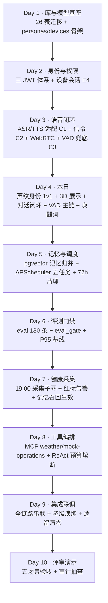
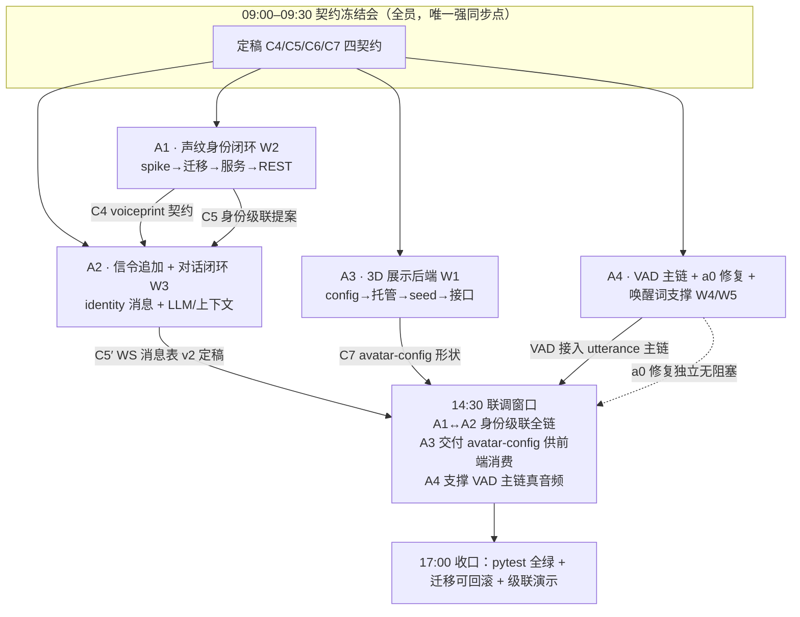

# Day 4 四人后端并行分工总览

> 状态：进行中　｜　版本：v1.0　｜　日期：2026-11-06
> 关联：docs/plans/day-04-3D与身份闭环.md（v2.4，唯一执行基线）｜docs/team_tasks/day04/a0-联调遗留问题修复.md
> 上游依据：PRD v2.6（验收：FR-VPR/FR-3D/FR-DLG-05/AC-42）｜技术设计文档 v1.5（实现口径）｜大纲十、迭代计划（仅取 Day 1–10 流程顺序）
> 变更记录见文末

**本卡只分后端工作**：前端（pad 三态引导、KWS 端侧接入、口型）、测试角色（eval 评测集）、产品职责一律不在本分工内；验收标准里的 `uv run pytest` 属于各任务自验动作，不是测试岗位工作。

---

## 1. 项目整体 DAG（Day 1–10，仅取大纲流程顺序）

**关键里程碑**：M1 = Day 2 设备 JWT（E4）✅；M2 = Day 3 全双工语音闭环 ✅；M3 = **Day 4 收口：身份 1v1 级联全绿 + 「打开 5 秒立起并开口说话」**（本日）；M4 = Day 6 评测门禁；M5 = Day 10 终验。

**Day 4 在 DAG 中的位置**：上游消费 Day 3 的 C1（ASR 事件）/C2（WS 消息表）/C3（REST 降级）与 Day 2 的设备 JWT；下游向 Day 5 交付 `conversation_threads`/`voiceprints` 两张新表与身份级联服务（记忆召回按 `elder_id` 强制过滤的前提），向 Day 6 交付身份链路的 trace 打点。

---

## 2. Day 4 后端 DAG（T1–T10 压缩为 4 人单元）

依赖要点：
- **A1 → A2 是本日唯一跨人依赖**（identity_service 消费 voiceprint_service）；缓解：C5 提案晨会先定接口形状，A2 可先按 Mock 比对结果开发，A1 spike 结论只影响迁移参数（维度 192），不阻塞 A2。
- **A2 的 signaling.py 追加属 A2 day03 写作域延伸**，他人禁触；A1 只在 C5 定形状，不写 signaling。
- **A3、A4 全程无跨人依赖**，晨会后立即可并行。
- a0 遗留修复（P1-2/F-01/F-02）与四条工作线零耦合，A4 先清它（预计上午完成）再进 W4。

---

## 3. 四人分工表（仅后端，写作域互斥）

| 代号 | 单元（计划条目） | 核心职责 | 固定写作域（唯一所有权） | 禁触 |
| --- | --- | --- | --- | --- |
| **A1** | 声纹身份闭环（W2，T3/T5/T7） | CAM++ spike、迁移 0004/0005、voiceprint/identity 双服务、REST 三接口 | `app/services/voiceprint_service.py`、`app/services/identity_service.py`、`app/api/voiceprints.py`、`alembic/versions/` 0004+0005、`spikes/voiceprint*` | signaling.py、llm/dialogue、frontend |
| **A2** | 信令追加 + 对话闭环（W3，T4/T6） | WS 追加 identity_ask/confirm 与 client_diag、llm_service、dialogue_service、context 组装、greeting 开场白、thread 闸门① | `app/audio/signaling.py`、`app/services/llm_service.py`、`app/services/dialogue_service.py`、`app/core/context.py`、`app/main.py`（仅装配行） | voiceprints 域、frontend、迁移文件 |
| **A3** | 3D 展示后端（W1，T1/T2） | Settings/env 新字段、seed 数据、nginx `/avatars/` 静态托管、`GET /api/pad/avatar-config`、README 登记 | `app/core/config.py`（新增字段）、`app/api/pad.py`（avatar-config）、`deploy/assets/`、`deploy/nginx*.conf`、`scripts/seed*`、README | signaling.py、services、迁移文件 |
| **A4** | VAD 主链 + a0 修复 + 唤醒词支撑（W4/W5，T8/T9） | a0 三问题修复（P1-2/F-01/F-02）、webrtcvad 兜底接 utterance 主链、唤醒词建连 metrics 打点（唤醒→ASR→…）、task-a2 契约变更记录 | `app/api/audio.py`、`app/audio/vad.py`、`app/main.py`（校验 handler）、`app/core/metrics.py`（新增打点）、a0 卡 | signaling.py、voiceprints 域、frontend |

**公共文件规则**：`app/core/config.py` 本日由 **A3 统一新增字段**（A1 的 `VOICEPRINT_*`、A2 的 `LLM_*`/`ENCRYPTION_KEY`、A3 的 `AVATAR_*`/`PUBLIC_BASE_URL` 均报 A3 汇总录入，群内通告）；`app/main.py` 只允许「路由装配行 + 校验 handler」两类改动，A2 与 A4 各占一行级改动、先后提交冲突时后提交者 rebase。

**开工前已定约定（2026-11-06 主理人裁决，执行期不再议）**：
1. **LLM = minimax**：key 已到位，`LLM_PROVIDER` 走泛化分支（OpenAI 兼容端点，httpx 直连不引 SDK）；待办——技术文档 §1.4 选型行补「minimax（OpenAI 兼容）」字样，随首次提交走修订记录。
2. **声纹独立容器**：`deploy/voiceprint/` 推理容器（端口 7003，只做 `/extract`），比对在主服务进程内；主服务 pyproject 不新增 torch（task-01 v1.1）。**端点可外指**：`VOICEPRINT_BASE_URL` 支持指向任意可达的推理容器——默认走 compose 网络内 `voiceprint:7003`（本地起容器），也可在各自 `.env` 配局域网 IP 直连他人共享实例（IP 只经群内分发，禁止写进仓库任何文件，AGENTS §5）；共享实例不可用时自动走 503 → 主动确认降级链，不阻塞他人开发；队友亦可 `docker compose up -d voiceprint` 自起（镜像自包含，跨架构注意 `--platform`）。
3. **ENCRYPTION_KEY**（Fernet）：本地 `.env` 生成、不入 Git，`.env.example` 只放占位符（AGENTS 红线 §4.2 既有口径）。
4. **VRM 资产**：AvatarSample_A 由 A3 下载预置（CC0，≤15MB），属 task-03 交付物。
5. **迁移合入顺序**：0004 无依赖先合；0005 等 A1 午站会（12:30）通报 spike 结论后再合。
6. **个人实施计划落位**：四人如需为各自任务卡写实施计划，统一放 `docs/plans/day04/`（命名如 `a1-声纹身份.md`，小写代号 + 中文主题），并在 `docs/plans/README.md` 索引同提交登记；不要放 team_tasks 或对话里（AGENTS §10.1）。

---

## 4. 接口契约（**已定稿**：[contracts.md](contracts.md) v1.0，2026-11-06 主理人裁决提前冻结，晨会签字确认）

| 契约 | 冻结人 | 内容要点 | 消费方 | 基线出处 |
| --- | --- | --- | --- | --- |
| **C4** voiceprint REST | A1 | `POST /api/voiceprints/samples`（WAV ≤10s，`sample_index` 1–3，重复 409，推理失败 503）；`GET /api/voiceprints/status`（`status: none|partial|active`）；`DELETE /api/voiceprints`（写审计）；响应统一 `{detail, code, trace_id}` | A2（identity_service 比对输入）、pad 前端（引导页，联调对接） | 计划 I4；PRD FR-VPR-01/02 |
| **C5** 身份级联与 WS 消息 v2 | A1 提案 → A2 定稿 | `identity_ask{reason: low_confidence\|vp_unavailable, candidates:[绑定长者]}`、`identity_confirm{elder_id}`（候选集外一律按未确认）；`client_diag{stage, error}` 仅日志；级联=每会话首轮强制 + 静默复检（1v1，cosine ≥0.85） | pad 前端（信令对接）、A4（metrics 打点位） | 计划 I5；v2.2/v2.3 裁决 |
| **C6** 对话链路 | A2 | thread 闸门①（服务端建 `(elder_id, session_seq)`）；utterance→回复组装：固定前缀 + Redis 最近 5 轮；LLM 失败退避 ≤2 → 模板话术（FR-DLG-05）；greeting 首包形状 | A4（utterance 主链消费）、pad 前端（字幕/口型） | 计划 I3/W3 |
| **C7** avatar-config | A3 | `GET /api/pad/avatar-config`（设备 JWT）→ `{avatar_url, fallback_image_url, rotation_y_offset, version}`；三层取值链 persona→Settings→前端内置 | pad 前端（AvatarStage 挂载）、A2（无耦合，仅知情） | 计划 I1；PRD FR-3D-01/02 |

对接标准（沿 day03 惯例）：契约类型写在对应模块顶部 dataclass/TypedDict 并同提交；跨模块只引用契约类型；**C5 属 A2 day03 冻结契约的追加，A2 须在 `docs/plans/task-a2-*.md` 补契约变更记录后才能合入**。

## 5. 联调要求与对接节点

1. **14:30–16:30 主联调窗口**：A1↔A2 走「说话 → 身份级联 → 开 thread → LLM → TTS」全链（用 FunASR 真链路 + 声纹 Mock 机器人为两个真人声）；A3 交付 avatar-config 与 `/avatars/` 静态文件后，由前端同学独立消费（A3 待命 30min 排障即转支援 A1/A2）；A4 在真音频下验证 VAD 兜底链三场景。
2. **与前端对接节点**（前端不在 4 人分工内，由 day03 A4 线同学承接）：**C7 已定稿**，前端可立即开发挂载；**C5 已定稿**（含 identity_confirm 大按钮点选与 30s 时序裁决），前端直接按 contracts.md 开发；契约缺口一律走「四人在场通告 + 卡上留痕」变更流程，16:00 前后端不得反向阻塞前端。
3. **联调准入**：各任务先自验（见 §6）再进窗口；联调中发现契约缺口的，改契约必须四人在场通告 + 各卡变更记录留痕。

## 6. 任务卡（交付物与验收标准见各卡）

| 卡 | 代号 | 单元 | 写作域要点 |
| --- | --- | --- | --- |
| [task-01-声纹身份闭环.md](task-01-声纹身份闭环.md) | A1 | W2 声纹身份 | spike→迁移 0004/0005→voiceprint/identity 双服务→REST 三接口 |
| [task-02-信令与对话闭环.md](task-02-信令与对话闭环.md) | A2 | W3 + WS 追加 | identity 消息/client_diag、llm/dialogue/context、greeting、闸门① |
| [task-03-3D展示后端.md](task-03-3D展示后端.md) | A3 | W1 3D 展示 | config 唯一录入人、seed、nginx 托管、avatar-config |
| [task-04-VAD主链与遗留修复.md](task-04-VAD主链与遗留修复.md) | A4 | W4/W5 + a0 | 先清 a0 三问题，再接兜底 VAD 主链、metrics 打点 |

各卡自验准入后进联调窗口；执行期以各卡 `> 状态：` 行为准（PROGRESS 看板自动汇总）。

## 7. 时间节点总表

| 时点 | 事件 | 参与人 |
| --- | --- | --- |
| 09:00–09:30 | 契约确认会：C4–C7 签字确认（已定稿于 contracts.md v1.0，含 C5 五项裁决） | 全员 |
| 09:30–12:00 | 并行开发：A1 spike→迁移；A2 signaling 追加；A3 config→托管→接口；A4 清 a0 | 全员 |
| 12:30–12:40 | 午站会：spike 结论通报（A1）、进度/阻塞 | 全员 |
| 13:00–14:30 | A1 服务与接口、A2 LLM/上下文、A3 收尾转支援、A4 进 W4 | 全员 |
| 14:30–16:30 | 联调窗口（§5.1/5.2） | 全员 |
| 17:00–17:30 | 收口会：pytest 全绿 + 迁移可回滚验证 + 级联演示 + 一次性提交 | 全员 |

## 8. 风险与熔断（对应计划 R1–R13 的执行侧口径）

- **R-spike（最高）**：A1 CAM++ 若 12:30 仍不可跑 → 启 resemblyzer 兜底并通告，迁移 0005 维度参数随结论改（0005 尚未合入，可改）；仍不可行 → identity 走纯主动确认兜底，声纹比对降级到 Day 5，不阻塞 A2（C5 Mock 比对已解耦）。
- **R-公共文件**：config.py 字段冲突 → 晨会统一报 A3；main.py 装配冲突 → 后提交者 rebase，禁止互改。
- **R-契约变更**：联调期改契约必须四人在场 + 卡上留痕；单方改动合并即回滚。

## 变更记录

| 版本 | 日期 | 说明 |
| --- | --- | --- |
| v1.0 | 2026-11-06 | 初稿：项目整体 DAG（Day 1–10 里程碑）+ Day 4 后端四人分工（A1 声纹/A2 信令与对话/A3 3D/A4 VAD 与 a0），四契约 C4–C7 晨会冻结机制，14:30 联调窗口与自验准入，风险熔断口径 |
| v1.1 | 2026-11-06 | §6 交付物/验收细节拆为四张任务卡（task-01～04，沿 day02 命名规范），README 保留总览与链接表 |
| v1.2 | 2026-11-06 | 主理人两项开工前裁决落盘：① LLM 定 minimax（key 已到位，OpenAI 兼容泛化分支）；② 声纹定独立容器（deploy/voiceprint，端口 7003，主服务不装 torch）。另登记 ENCRYPTION_KEY 生成约定、VRM 资产归属 A3、迁移 0004/0005 合入顺序；新增 §3「开工前已定约定」段 |
| v1.3 | 2026-11-06 | **契约提前定稿**：新增 contracts.md v1.0（C4–C7 代码级定义 + C5 五项开放点裁决：大按钮点选 / 30s 起点为 ask 下发 / ask_id 不匹配忽略 / generic 经 identity_result 通知 / metrics 三打点位；C6 复用 C2/C3 零新消息类型）；§4/§5/§7 与三张卡前置依赖同步，晨会改为签字确认 |
| v1.4 | 2026-11-06 | §3 新增约定 6：个人实施计划统一放 `docs/plans/day04/` 并登记 plans 索引（AGENTS §10.1 已同步立通用规则） |
| v1.5 | 2026-11-06 | 约定 2 补机制说明：`VOICEPRINT_BASE_URL` 支持指向局域网共享推理实例（IP 仅群内分发不入仓库），不可用自动降级不阻塞，队友可自起容器 |
