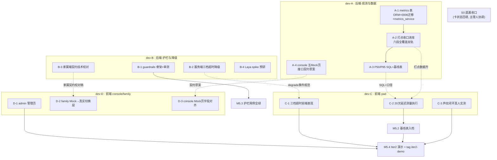

# Day 05 · 项目工作流 DAG 与联调节点总览

> 性质：总览参考文档（无任务卡状态行，不进看板）　｜　版本：v1.0　｜　日期：2026-11-07
> 上游依据：大纲「十、迭代计划」（仅取流程与产出物）｜技术设计文档 §8 各 Day 落地清单｜PRD（事实与验收）
> 配套分工表：dev-a / dev-b / dev-c / dev-d 四份（同目录）

---

## 1. 项目整体工作流 DAG（Day 1–10）

```mermaid
flowchart LR
    D1["M1 · Day1 工程地基<br/>FastAPI骨架+trace_id<br/>五表迁移+契约冻结"]
    D2["M2 · Day2 身份与权限<br/>三套凭证+权限矩阵<br/>长者档案/房间床位"]
    D3["M3 · Day3 语音通道<br/>WebRTC全双工+降级<br/>信令/ASR/TTS/唤醒词"]
    D4["M4 · Day4 3D与身份闭环<br/>three-vrm+声纹1v1<br/>Agent上下文组装"]
    D5["M5 · Day5 延迟与护栏<br/>metrics基线+三档超时<br/>guardrails ★Iter2演示"]
    D6["M6 · Day6 三级路由<br/>L0规则层+Laya四信号<br/>MCP天气+基线评测"]
    D7["M7 · Day7 记忆·用药·娱乐<br/>五步治理+四次触达<br/>用药子图+Checkpoint"]
    D8["M8 · Day8 健康采集+三端后台<br/>19:00五问+分级<br/>护工/医生/管理员后台"]
    D9["M9 · Day9 可观测与审计<br/>Langfuse+OTel+/metrics<br/>audit_logs+脱敏"]
    D10["M10 · Day10 评测与收尾<br/>评测门禁+演示<br/>基线报告+复盘"]

    D1 --> D2 --> D3 --> D4 --> D5 --> D6 --> D7 --> D8 --> D9 --> D10
    D1 -. "契约冻结件<br/>身份/对话/家属契约" .-> D6
    D5 -. "延迟基线表<br/>(Day6对照分母)" .-> D6
    D6 -. "规则层/Laya信号" .-> D7
    D7 -. "用药/健康子图" .-> D8
    C1["console 五 Mock 页<br/>(工单/告警/健康/药单/复核)"]
    C2["family 三业务页<br/>(日报/通知/长者)"]
    C1 -. "Day7/8 表与端点交付后对接" .-> D7
    C1 -.-> D8
    C2 -. "Day8 批次+家属契约冻结后对接" .-> D8
```

### 1.1 阶段输入输出与里程碑

| 阶段 | 输入 | 输出 | 里程碑锚点（验收出处） |
| --- | --- | --- | --- |
| M1 Day1 | 基线文档+冻结契约 | 骨架、5 表迁移、trace_id、契约件 | `/health` 带 trace_id；`alembic upgrade head` 建 5 表（大纲 M1 产出物） |
| M2 Day2 | M1 骨架+身份契约 | 三套 JWT、权限矩阵、档案/房间/床位 CRUD | 四角色各进首页；AC-18/AC-24 |
| M3 Day3 | M2 凭证+语音契约 | WebRTC 全双工+按住说话降级、信令、ASR/TTS、唤醒词 | AC-40 打断插话；唤醒 ≤1.5s（AC-42） |
| M4 Day4 | M3 音频链路 | 3D 数字人+口型、声纹 1v1、设备绑定、Agent 上下文 | AC-15 降级不白屏；AC-28 声纹双人间 |
| **M5 Day5（本周）** | M4 链路+打点单点 | **metrics 表+P50/P95 基线表、三档超时降级、guardrails 骨架** | **Iter2 演示不翻车 + tag `iter2-demo`**；连问 20 次 ≥19 次 ≤1.5s（PRD §5.3）；第 9 次工具调用被拒（FR-DLG-10） |
| M6 Day6 | M5 基线表 | L0 规则层、Laya 四信号、MCP 天气、固定测试集初跑 | AC-04 急症一票否决；AC-01/02 天气不编造 |
| M7 Day7 | M6 路由信号 | 记忆治理、用药四次触达+外呼、用药子图+Checkpoint、戏曲点播 | AC-05~08/20/27/30/41 |
| M8 Day8 | M7 子图 | 健康五问+分级、健康决策图+HITL、三端后台、Mock Operations | AC-09~11/21/22；红标 2 分钟通知 |
| M9 Day9 | M8 全链路 | Langfuse/OTel//metrics、audit_logs、脱敏 | AC-31 完整 Trace；全行带 trace_id |
| M10 Day10 | 全部 | 评测门禁、演示、复盘报告 | PRD §5 通过条件 |

> 铁律提醒：本表只取大纲流程与产出物；表名、字段、接口、阈值一律以 PRD 与技术设计文档为准（AGENTS 前置铁律）。

---

## 2. Day 5 执行 DAG（分工视图）

### 2.1 联调节点与接口规范（对接即检查单）

| # | 对接双方 | 对接物 | 接口规范（对接即按此验收） | 时间窗 |
| --- | --- | --- | --- | --- |
| N1 | dev-A A-2 ↔ dev-C C-2 | 分段耗时打点 | `metrics_service.record_stage(trace_id, elder_id\|None, stage, duration_ms, source)`；stage 枚举 `wakeup/connection/asr/route/llm_first_token/tts_first_packet/playback`；端侧 `wake_ts` 优先、WS accept 兜底；**不含转写全文与隐私字段** | A-2 完成后即时 |
| N2 | dev-B B-2 ↔ dev-C C-1 | 三档超时降级事件 | WS 下发 `degrade` 事件：`{"stage": "asr"\|"llm"\|"tts", "message": <常量话术>}`；话术进常量不进 prompt；前端收到即展示且不白屏 | B-2 定稿当天 |
| N3 | dev-A A-4 ↔ dev-D D-3 | console 契约草案 | 每个字段行标注 TD §3 表名+字段出处；Mock 字段与 TD 逐一对齐，差异清单双向确认 | Day5 内 |
| N4 | dev-B B-3 ↔ dev-D D-2 | 家属端契约校对稿 | 对照《接口契约_家属端数据》草案逐端点核对（5 端点：elders/reports/notifications）；差异只登记不私改 | Day5 内 |
| N5 | dev-A（identity/voiceprint 后端）↔ dev-C C-3 | 声纹闭环联调 | 阈值 0.55（PRD v2.8）；流程：录入 3 段 → 同人命中（voice 终态+cosine 值）→ 非同人主动确认 → 失败按 C4 降级放行；实测记录回填 task-01 卡 | S0 后立即，演示前必须完成 |
| N6 | dev-B B-1 ↔ Day6 Agent | guardrails 预留接口 | `check(tool_name) → allow/deny(原因)`；常量 `MAX_TOOL_CALLS_PER_TURN=8`、同 Tool 1min 第 3 次熔断；Day6 注册 Tool 零改动接入 | Day5 收口 |

### 2.2 关键里程碑（Day5）

| 里程碑 | 判定 | 依赖 |
| --- | --- | --- |
| M5.1 metrics 链路通 | 任取一行 metrics 能按 trace_id 串起一次对话各分段；日志/库内双轨一致 | A-1→A-2 |
| M5.2 基线表入档 | P50/P95 由 SQL 复算可复现；FunASR 段按本地基线单独归档（O-1 口径）；三档超时降级录屏 | A-3+C-2、B-2+C-1 |
| M5.3 护栏用例全绿 | 第 9 次调用被拒 + 同 Tool 1min 第 3 次熔断，单测全绿 | B-1 |
| M5.4 Iter2 演示 | 5 分钟脚本一次通过（对话/声纹/口型/降级），tag `iter2-demo` | M5.2、C-3、C-1、D-1 |

### 2.3 非开发项（不在四人分工内，主理人/原负责人跟进）

- **a0 设备密钥轮换溯源**（D5-1）：问询 A2/E 组同事、脚本排查、审计落库复核——主理人协调，结论回填 day05/a0 卡。
- **演示脚本与主持**（M5.4）：主理人定脚本节奏，dev-C 主操 pad。
- **卡状态回填**（task-04/05、day04/a0）：原执行者名下补变更记录（S0 项）。
- **家属端契约冻结评审**（A1）：主理人组织评审，dev-B 技术校对稿为输入。
- **F-03 复核**：主理人读 tasks.ts 重建 diff。
