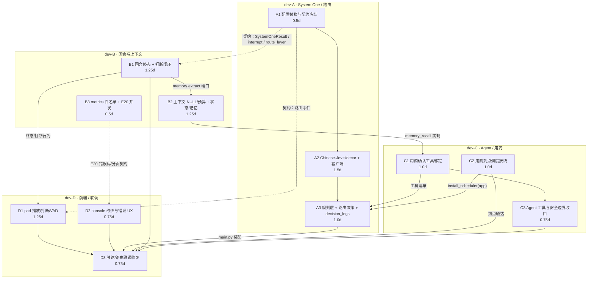

# Day 7 工作流 DAG 与四人开发任务总表

> 性质：执行总表（README，不进看板）　｜　版本：v1.1　｜　日期：2026-11-10
> 变更记录：v1.1 补充三层安全护栏、统一工具执行入口与六类边界验收；v1.0 首版 DAG 与四人分工。
> 任务映射：**实际执行第 7 天 = 原大纲 Day 6「三级路由 + System One + 规则层」内容**。实际 Day 6 已完成的「长者侧 Agent 完整闭环」，按内容归属主要是**原大纲 Day 7 的记忆/用药/Agent 收尾**，外加原大纲 Day 6 中的 MCP 与安全一票否决；因此存在 **Day 6/Day 7 内容互换**，本表按内容而非日期对齐。
> 事实来源：`docs/康伴3D数字人_PRD.md`（验收）｜`docs/康伴3D数字人_技术设计文档.md`（实现口径）｜`docs/plans/adhoc-20261110-day6全面审查.md`（Day 6 遗留）｜`docs/plans/day06/day-06-长者侧Agent闭环.md`（实际 Day 6 执行基线）
> 任务卡：`dev-a-day07.md`｜`dev-b-day07.md`｜`dev-c-day07.md`｜`dev-d-day07.md`
> 既有卡：`dev-c-触达语音接线.md`（已完成）｜`dev-c-触达played闭环.md`（已完成）｜`dev-c2-用药到点触发接线.md`（未开始，并入 C2）｜`dev-d-触达真机联调.md`（未开始，并入 D3）

---

## 0. 一页结论

- **本日范围不是重做实际 Day 6 的 Agent 闭环**（其内容主要是原大纲 Day 7 主线），而是补齐被顺延的**原大纲 Day 6 三级路由**，并把实际 Day 6 审查发现的 P1/P2/P3 全部收口。
- **System One 从 Laya 配置切换为 Chinese-Jev 本地推理**：保留 200ms 超时、0.85 置信阈值、失败全量下沉 Agent 三条硬口径；**不接任何商业 Jev API**。
- **保留原有三级路由架构，新增三层安全护栏**：入口规则安全检查 → 分类器信号触发的安全复核 → Tool 执行权限校验；Agent 与普通路由都必须走同一个 `ToolExecutor`，不建第二套权限逻辑。
- **验收补齐六类边界**：否定表达、多意图、工具超时、打断、重复调用、权限越权；全部进入 A3/C3/B1/D1 的可执行验收。
- 四人并行、每人 2.75–3.0 人日，拆成 12 个任务；单任务 0.5–1.5 人日，避免“一人一个三天大包”造成串行。
- 只有一条硬串行链：**A1 契约/配置 → A2 Chinese-Jev sidecar → A3 路由接线**；其余 B/C/D 三线均可在契约冻结后并行。
- 现有 Day 7 遗留：`dev-c2` 用药到点触发 → **C2**；`dev-d` 触达真机联调 → **D3**。TD-1/TD-2 已完成，不重复开发，只做回归。
- 验收以“可复算命令 + 可查库/日志 + 可重放请求”为准；开发自证，不另设测试、产品、设计角色。

### 0.1 负载与关键路径

| 成员 | 任务 | 人日 | 一句话 |
| --- | --- | ---: | --- |
| dev-A | A1 / A2 / A3 | 3.0 | Chinese-Jev 配置、侧车、客户端、规则层、路由与 `decision_logs` |
| dev-B | B1 / B2 / B3 | 3.0 | 回合终态/打断、上下文崩溃、状态与记忆、E20 并发与指标白名单 |
| dev-C | C1 / C2 / C3 | 2.75 | 用药确认工具、到点调度接线、Agent 工具与安全边界收口 |
| dev-D | D1 / D2 / D3 | 2.75 | pad 播放/VAD、console 改绑、触达与路由联调修复 |

- **关键路径**：A1(0.5) → A2(1.5) → A3(1.0) → D3 集成(0.75)，按并行窗口可在第 3 个工作日收口。
- **最大并行宽度**：第 1 天 4 人同时开工（A1/B1/B2/C1/D1/D2 可两两并行），第 2 天 A2/B/C/D 四线并行。
- **无冗余串行**：B1/B2/B3 相互独立；C2 可先写新文件，最后通过 `install_scheduler(app)` 交给 A3 的 `main.py` 单点装配；D1/D2 独立。

---

## 1. 口径、映射与边界

### 1.1 执行日与原大纲的映射

| 执行阶段 | 原大纲内容归属 | 本项目实际口径 | 本日是否处理 |
| --- | --- | --- | --- |
| 实际 Day 1–5 | 原大纲 Day 1–5 | 地基、身份、语音、3D/声纹、延迟与护栏 | 否，已完成 |
| 实际 Day 6 | **原大纲 Day 7 为主**（长期记忆、用药提醒、Agent 收尾）＋ **原大纲 Day 6 部分**（MCP 天气、安全一票否决） | **主理人 2026-11-09 改为「长者侧 Agent 完整闭环」**：历史/状态/上下文/送达/记忆骨架/用药子图/天气 MCP/安全一票否决；原大纲 Day 6 的规则层与 System One 顺延 | 仅收口审查遗留，不重开闭环 |
| **实际 Day 7（本日）** | **原大纲 Day 6：规则层 + System One + 主控 Agent + 路由评测** | **本表**：Chinese-Jev 替换 Laya，补规则层、路由决策、`decision_logs`，并收口实际 Day 6 的 P1/P2/P3 | **是** |
| 实际 Day 8 | **原大纲 Day 8 为主**（健康采集与三端后台）＋ **原大纲 Day 7 剩余**（记忆治理完整五步、娱乐点播、评测基线 v1） | 健康决策图、console/family 后台，并补齐被提前拆走的 Day 7 剩余项 | 否，另日 |
| 实际 Day 9–10 | 原大纲 Day 9–10 | 可观测、评测门禁、部署与复盘 | 否 |

> **铁律**：原大纲只提供“今天做哪几件事、产出物是什么”，不提供表名、字段、接口、阈值。所有实现字段以 PRD/技术设计文档为准；本表已按此拆分。
>
> **C2/D3 的归属说明**：C2「用药到点调度接线」是实际 Day 6 已建用药子图后的**遗留生产接线**，不是把原大纲 Day 7 的完整用药提醒重做一遍；D3 是 TD-1/TD-2 已完成代码后的收口联调。原大纲 Day 7 的**剩余主线**（记忆治理完整五步、娱乐点播、评测基线 v1）仍归实际 Day 8，不在本日展开。
>
> **为什么原大纲 Day 7 剩余项顺延到实际 Day 8**：
> 1. **不是没做，而是被实际 Day 6 提前拆走了一部分**：记忆骨架、用药子图、Agent 工具面已在实际 Day 6 落地；剩下的是“治理完整五步/娱乐点播/完整评测基线”这类增强项，不是本轮对话能否跑通的阻塞项。
> 2. **本日容量已被硬缺口占满**：三级路由（原大纲 Day 6）＋40 条审查收口＋C2/D3 遗留接线，四人已按 2.75–3.0 人日排满；再塞原大纲 Day 7 剩余项只能牺牲 P1 修复或路由验收。
> 3. **依赖方向不支持提前做**：记忆治理完整五步需要 B1/B2 修好的稳定回合终态与上下文；娱乐点播需要 A3 的路由意图与降级口径；完整评测基线 v1 需要 `decision_logs` 与路由层先稳定。本日先做会返工。
> 4. **本日产出是 Day 8 的输入**：A3 的 50 例路由报告、`route_layer` 统计和 P1 修复后的稳定链路，正好是 Day 8 做“完整评测基线 v1 / 失败分层归因”的分母与前置。
> 5. **C2 是唯一例外**：它虽源自原大纲 Day 7 的用药提醒主题，但子图已在实际 Day 6 交付，本日只补“到点触发”这一段遗留接线，否则用药闭环无法收口。

### 1.2 本日必须交付

1. `System One` 从 Laya 配置切到 **Chinese-Jev 本地 sidecar**，具备健康检查、200ms 超时、熔断、降级。
2. 规则层 ≤10 条固定意图、System One 七类意图 + 敏感/置信度/隐私/域外四信号、低置信只澄清一次。
3. `decision_logs` 落库，`route_layer` 可统计，`trace_id` 可串全链路。
4. Day 6 审查 **P1×6、P2×20、P3×14 全部有归属**（报告摘要写 P2×18，正文编号 7–26 实为 20 条，本表按正文全收，共 40 条）；P1 必须本日关闭；P2 关闭或登记明确延期；P3 随所属模块修复。
5. 现有 Day 7 遗留：用药到点调度、触达真机联调收口。
6. 所有跨成员接口先冻结后编码；字段变更先改契约再改代码。
7. 三层安全护栏 + 统一工具执行入口落位（见 §1.4）；验收补齐否定表达、多意图、工具超时、打断、重复调用、权限越权六类边界。

### 1.3 明确不做（防止范围膨胀）

- 不做测试、产品、设计角色任务；验收由开发自证，不另设 QA/PM/UI 岗。
- 不做家属端（`family`）新功能；不做健康采集子图、日报、Langfuse/OTel 全量接入。
- 不做娱乐点播完整片库；戏曲/电影只保留路由意图与“能力未就绪”的明确降级，不在本日造媒体库。
- 不改历史迁移；新迁移只允许 `0014_decision_logs` 一笔，且由 A3 独占。
- 不接商业 Jev API、不新增云端分类依赖；Chinese-Jev 必须本地部署。
- 不把 `played` 纳入用药重试/终态判定；沿用 Day 7 已冻结口径。
- 不重开 N10 子图；C2 只做到点驱动，不改 `app/graphs/**`、`medication_service.py`、`work_order_service.py`。

### 1.4 三层安全护栏与统一工具执行（保留原架构）

> 原则：**不加新框架、不改三级路由顺序、不建第二套权限逻辑**。三层护栏分别落在已有的 `safety.py`、`router/decision.py`、`tool_executor.py`。

| 层 | 位置 | 触发时机 | 行为 | 归属 |
| --- | --- | --- | --- | --- |
| **G0 · 入口规则安全检查** | 既有 `DialogueOrchestrator` → `safety.py` / `safety_service` | ASR final 进入业务前 | 急症/跌倒/轻生/红色阈值一票否决；命中即走红色事件/工单/通知，不进 Router、不进 Agent | C3 维护规则与边界 |
| **G1 · 分类器信号触发的安全复核** | `Router.decide()` 内，System One 返回后 | 规则层未命中、分类器已出四信号 | 分类器只输出 `is_sensitive` 信号；是否升级由安全模块复用同一升级口（`_escalate_safety` / `safety_service`）裁决，进入人工/安抚路径；不调 Agent、不执行工具；`decision_logs` 照写 | A3 接线，C3 提供安全规则与升级口 |
| **G2 · Tool 执行权限校验** | `ToolExecutor.execute()` 唯一入口 | Agent 调用工具或路由直连工具前 | 身份只取 `runtime.elder_id`；args 中的 `elder_id/thread_id/device_id` 丢弃并审计；按工具 `side_effect/permission` 校验；失败四分类 | C3 持有实现 |

**职责边界与优先级**：

| 组件 | 只负责 | 明确不负责 |
| --- | --- | --- |
| 分类器（Chinese-Jev / System One） | 识别 `intent`、`is_sensitive`、`confidence`、`privacy_scope`、`is_out_of_domain`、多意图信号 | **不决定执行路径**、不选工具、不做权限判断、不直接执行 |
| 规则层 `rules.py` | 高频固定意图的确定性识别，产出 `RuleHit` 候选 | 不直接执行工具，不绕过安全与权限 |
| 路由器 `Router.decide()` | 消费规则与分类器信号，决定 `layer/action/tool/clarify/agent` 与多意图展开顺序 | **不实际执行工具**、不复制权限判断、不覆盖安全拦截 |
| Agent `CompanionAgent` | 复杂任务规划、ReAct、多工具动态编排 | 不绕过 `ToolExecutor`，不覆盖安全拦截，不自行扩权 |
| Tool Executor `tool_executor.py` | 权限校验、身份收敛、幂等、审计、实际执行 | 不决定业务路径，不重试第二套安全逻辑 |
| 安全模块 `safety.py` / `safety_service` | **最高优先级拦截与升级**：G0 入口、G1 分类器信号复核、G2 工具前最终校验 | 不做意图分类；不被 Router / Agent / Tool Executor 覆盖或绕过 |

- **优先级固定**：`安全拦截/升级 > 身份与权限 > 路由路径 > 模型置信度/人设/多意图优化`。
- 等价伪代码：`if safety_hit: escalate(); elif not authorized: forbidden(); else: execute_route()`。
- 因此，分类器给出 `is_sensitive=true` 只是**触发安全复核的信号**；Router 不能把它降级成普通意图，Agent 不能把它当上下文继续规划，Tool Executor 不能在安全未放行时执行。

**统一工具执行入口的硬约束**：

1. Agent 的 `CompanionAgent` 与 A3 的路由直连**都只允许调用 `ToolExecutor.execute()`**。
2. Router 不得直连 HTTP/MCP/DB，也不得复制权限判断；权限、审计、幂等、失败四分类只在 `ToolExecutor` 一处实现。
3. 分类器信号触发的安全复核命中时不执行工具；若同一轮已经被 G0 处理，按 `turn_id/thread_id` 幂等，不重复建红色事件。
4. `decision_logs` 按既有字段记录最终路由结果；**G1/G2 的安全与权限摘要不改表、不加列**，用现有 `audit_logs` / `metrics` / 结构化日志打点，保证可查但不引入第二套口径。

**多意图口径**：

- `SystemOneResult` 与 `RouteDecision` 契约增加可选 `multi_intent: bool`、`sub_intents: tuple[Intent, ...]`。
- **简单顺序多意图**（“放段戏，再大声点”）：Router 按序产出多个工具/控制动作，仍逐个走 `ToolExecutor`；不调 Agent。
- **需要按结果动态决策的组合**（“吃完药放戏，再告诉我儿子别来”）：直接 `action="agent"`，由 CompanionAgent ReAct 编排。
- 多意图不得绕过 G1/G2：每个子动作都要过分类器安全摘要与工具权限校验。

**验收必须覆盖六类边界**：

| 类型 | 必测场景 | 通过口径 |
| --- | --- | --- |
| 否定表达 | “没有胸痛” / “昨天疼现在好了” / “我爸爸胸痛” / “好像胸口疼” | 否定不红；历史/模糊黄复核；他人主体不为本人建红色 |
| 多意图 | 简单顺序、动态组合、含敏感子句 | 简单顺序按序执行；动态组合进 Agent；任一子句敏感即整体升级 |
| 工具超时 | MCP/本地工具超过预算 | `transient` 退避 ≤2 后降级话术；不阻塞整轮 |
| 打断 | 播放中插话、重复 interrupt、旧 epoch 回调 | 200ms 内停声；`response_interrupted` 唯一；重复 interrupt 幂等 |
| 重复调用 | 同 `turn_id` 重放、同工具短连 3 次、同幂等键重复 | 不重复副作用；熔断生效；重复回执无操作 |
| 权限 | 注入 `elder_id`、非授权工具、跨长者资源 | 参数身份丢弃并审计；`forbidden` 拒绝；资源不可跨长者访问 |

### 1.5 MCP 在本日计划中的位置

> 结论：**MCP 已经在计划里，但不是“本日新建 MCP”**。实际 Day 6 已交付 `app/mcp_client/` 与 `mcp-servers/weather/`；本日只把既有 MCP 能力接进三级路由和统一 Tool Executor。

| 位置 | 计划体现 | 说明 |
| --- | --- | --- |
| 路由直连 | `weather → get_weather` | Router 判定 `action=tool` 后，调用 `ToolExecutor.execute()`；`ToolExecutor` 再走既有 `MCPClient`，Router 不直连 MCP |
| Agent 侧 | `CompanionAgent` 的 `get_weather` 工具 | Agent 与路由直连共用同一个 `ToolExecutor` → `MCPClient` 入口，避免两套权限/审计/超时逻辑 |
| 失败语义 | MCP 超时、上游失败、schema 非法 | 统一映射为 `transient` / `upstream_error` / `bad_response`，退避 ≤2 后降级话术；不阻塞整轮 |
| 可观测 | `decision_logs` + `audit_logs` / `metrics` | `decision_logs` 记路由层与意图；MCP 调用耗时/失败分类走既有审计与指标，不改表 |
| 验收 | 工具超时 + 真机天气 | 至少 1 条 MCP 超时/失败用例；G5 真机天气一例可查 `decision_logs` 与工具执行留痕 |

**本日 MCP 边界**：

1. 不新建 MCP server；不把 `mock-operations` 提前进 Day 7（按既有口径仍留 Day 8）。
2. Router、Agent 都不得绕过 `ToolExecutor` 直连 MCP。
3. 不为 MCP 新增 docker-compose 服务；完整 7 服务仍按技术设计文档留 Day 10。
4. 若天气 MCP 上游不可用，只做降级话术和留痕，不得用模型常识编造天气。

---

## 2. 项目整体工作流 DAG（执行视角）

```mermaid
flowchart LR
    P1["P1 · 工程地基<br/>FastAPI + 5 表 + trace_id"]
    P2["P2 · 身份与权限<br/>三套 JWT + 档案/房间"]
    P3["P3 · 语音通道<br/>WebRTC + 信令 + ASR/TTS"]
    P4["P4 · 3D 与身份闭环<br/>VRM + 声纹 + 设备绑定"]
    P5["P5 · 延迟与护栏<br/>metrics + 三档降级"]
    P6["P6 · 实际 Day6<br/>原大纲Day7主线：<br/>Agent闭环+记忆/用药"]
    P7["P7 · 实际 Day7（本日）<br/>原大纲Day6：<br/>Chinese-Jev 三级路由 + 收口"]
    P8["P8 · 健康与三端后台<br/>原大纲Day8 + Day7剩余"]
    P9["P9 · 可观测与审计<br/>Langfuse/OTel/audit"]
    P10["P10 · 评测与收尾<br/>门禁 + 演示 + 复盘"]

    P1 --> P2 --> P3 --> P4 --> P5 --> P6 --> P7 --> P8 --> P9 --> P10
    P1 -. "契约冻结件" .-> P6
    P5 -. "延迟基线" .-> P7
    P6 -. "工具/子图/历史" .-> P7
    P7 -. "路由日志/意图" .-> P8
    P6 -. "用药/健康子图" .-> P8
    P8 -. "全链路" .-> P9
    P9 -. "Trace/指标" .-> P10
```



### 2.1 阶段输入、输出与里程碑

| 阶段 | 关键输入 | 关键输出 | 里程碑（验收锚点） |
| --- | --- | --- | --- |
| P1 工程地基 | PRD/TD/ER、冻结契约 | 骨架、5 表、`trace_id`、`/health` | `alembic upgrade head` 成功；`/health` 带 trace |
| P2 身份与权限 | P1 骨架、三套凭证契约 | JWT 三体系、档案/房间/床位、权限矩阵 | 四角色可登录；越权 403 可查审计 |
| P3 语音通道 | P2 凭证、语音契约 | WebRTC 全双工、按住说话降级、信令、ASR/TTS | 20 轮语音可通；打断可停声 |
| P4 3D 与身份闭环 | P3 音频链路 | VRM 加载/口型、声纹 1v1、设备绑定 | 加载失败不白屏；声纹 cosine ≥0.55 |
| P5 延迟与护栏 | P4 链路、打点 | metrics 表、P50/P95 基线、三档超时、guardrails | 第 9 次工具调用被拒；延迟基线可复算 |
| P6 实际 Day6 | P5 基线、冻结契约 | **原大纲 Day 7 主线**：历史事件、状态中心、九层上下文、送达/打断、记忆骨架、用药子图；**外加原大纲 Day 6 部分**：天气 MCP、安全短路 | 一轮真实语音 `turn_started→turn_completed`；打断截断正确；“胸口疼”不进 Agent |
| **P7 实际 Day7（本日）** | P6 代码与审查报告、PRD FR-DLG | **原大纲 Day 6**：Chinese-Jev sidecar、规则层、路由决策、`decision_logs`；同时收口实际 Day 6 的 P1/P2/P3 | 固定 50 例路由可复跑；`route_layer` 可统计；P1 全关；`decision_logs` 可查 |
| P8 健康与三端后台 | P7 路由意图、P6 子图 | **原大纲 Day 8**：健康五问/分级、console 实接口、家属端；**补原大纲 Day 7 剩余**：记忆治理完整五步、娱乐点播、评测基线 v1 | 健康采集闭环；红标 2 分钟通知 |
| P9 可观测与审计 | P8 全链路 | Langfuse/OTel、`/metrics`、审计与脱敏 | 一条 trace 串全链路；日志无明文敏感 |
| P10 评测与收尾 | 全部 | 评测门禁、演示、复盘 | PRD §5 通过；演示脚本一次通过 |

> 说明：P6 的“实际 Day6”是主理人 2026-11-09 裁决后的口径——**按内容归属主要是原大纲 Day 7 的记忆/用药/Agent 收尾，并提前做了原大纲 Day 6 的 MCP/安全一票否决；原大纲 Day 6 的规则层与 System One 顺延**。本日 P7 才回到原大纲 Day 6 的三级路由主题。这个 **Day 6/Day 7 内容互换** 是本表所有依赖设计的前提。

---

## 3. Day 7 执行 DAG

### 3.1 DAG 图



> 虚线是契约/软依赖，实线是交付物/装配依赖。**没有环**；`A1→A2→A3` 是唯一的长串行链，原因是模型/客户端/路由必须逐层验证。

### 3.2 节点表（唯一任务事实源）

| ID | 任务 | 负责人 | 人日 | 输入 | 输出 | 前置依赖 | 关闭判据（摘要） |
| --- | --- | --- | ---: | --- | --- | --- | --- |
| **A1** | Laya→Chinese-Jev 配置替换与契约冻结 | dev-A | 0.5 | PRD FR-DLG-02/03/06；TD §1.4/§3.6；`config.py` 现状 | `system_one` 配置组；`questions.py`；`schemas.py`；`contracts-system-one.md` v1.0 | 无 | 新配置可加载；旧 `LAYA_*` 仅兼容映射；七类 intent/四信号字段冻结 |
| **A2** | Chinese-Jev 本地 sidecar 与 HTTP 客户端 | dev-A | 1.5 | A1 契约；Chinese-Jev 上游代码/权重 | `app/system_one/backend.py`、`server.py`、`client.py`；spike 记录 | A1 | `/health` 200；20 条固定样例形状 20/20；p95 ≤200ms；服务不可用 250ms 内降级 |
| **A3** | 规则层 + 路由决策 + `decision_logs` | dev-A | 1.0 | A2 客户端；PRD FR-DLG-02/03/06/07/09；TD §3.4；§1.4 三层护栏 | `app/router/rules.py`、`decision.py`；`0014_decision_logs`；`decision_log_service.py`；`turn_service.py` 接线 | A2；C1 工具清单（软）；C2 `install_scheduler`（软） | 50 例路由报告可复跑；`decision_logs` 每轮 1 行；低置信只澄清一次；G1 二次安全命中不进 Agent；路由直连只走 `ToolExecutor`；否定/多意图边界过验收 |
| **B1** | 回合终态与打断闭环 | dev-B | 1.25 | 审查 P1-1/P1-3、P2-7~11、P3-27/28/30/32；contracts §4.2 | `response_service.py`、`history_service.py`、`signaling.py` 修改；`tests/test_response_service.py` 扩展 | A1 的 `interrupt` 契约 | 末段 `played` 后 `finish_turn` 被调用；`assistant_delivered_text` 非 NULL；打断 200ms 内停声且截断正确；重复 `response_completed` 为 0 |
| **B2** | 上下文 NULL/预算 + 状态降级 + 记忆生产接线 | dev-B | 1.25 | 审查 P1-2、P2-13~18/21、P3-29/35；`context.py`/`state_service.py`/`memory_service.py` | 上下文修复；状态回写；偏好提取异步接线；预算口径 | 无（可与 A 并行） | 空送达历史不产生 `content:null`；Redis 故障可 `StateUnavailable`；偏好提取至少 1 条落库且不阻塞首包；预算计入全部层 |
| **B3** | metrics 白名单 + E20 并发 + API 边界 | dev-B | 0.5 | 审查 P1-12、P2-19/20、P3-33/34 | `metrics_service.py`、`staff_service.py`、`api/staff.py`、`api/schemas/staff.py` | 无 | `response_segment` 可落库；并发摘护工只允许 1 个成功；最后一个 admin/护工保护；参数枚举/上限生效 |
| **C1** | 用药确认工具绑定与对话入口 | dev-C | 1.0 | `medication_confirm` 未绑定；N10 子图；B2 记忆端口 | `tool_executor.py` 绑定；`companion.py` 工具清单；`medication_service` 只读查询；测试 | B2（软，可用 stub） | “我吃过药了”推进子图到 `taken_reported`；不再 `not_found`；工具清单含 3 个工具；预算不变 |
| **C2** | 用药到点调度接线 | dev-C | 1.0 | 现有 `dev-c2` 卡；`handoff-A-to-C`；子图签名 `tts_fn` | `app/scheduler/medication_jobs.py`、`medication_due_service.py`、`install_scheduler(app)`、测试 | 无（新文件可先行）；main 装配由 A3 单点落 | 到点 1 事件/4 触达/1 工单；重启不重复；双驱动先到先得；`scheduler` 零直写 |
| **C3** | Agent 工具与安全边界收口 | dev-C | 0.75 | C1；审查 companion generic；PRD FR-DLG-07/09；§1.4 G2 | `companion.py` identity 修正；`tool_executor.py` 权限/超时/重复调用；`safety.py` 否定/历史/他人/模糊；医疗拒答话术 | C1 | generic 不再静默走陌生人设；四类边界各 5 例判定正确；医疗判断问题固定拒答并留转告任务；权限注入/工具超时/重复调用按 §1.4 验收 |
| **D1** | pad 播放/打断/VAD 可靠性 | dev-D | 1.25 | 审查 P1-4/5/6、P2-22/23/24、P3-36/37/38/39；contracts §4.2 | `realtime.ts`、`playback-queue.ts`、`vad.ts`、`vad-worker.js`、`protocol.ts` | A1 的 interrupt 契约；B1 行为（软） | 旧 epoch 不播不 ack；20 轮 ack 100%；VAD 运行期异常可自愈并 diag；打断 200ms 内静音 |
| **D2** | console 改绑分页与错误 UX | dev-D | 0.75 | 审查 P2-25/26/40；E20 契约 | `AdminUsersPage.tsx`、`admin-api.ts` | 无 | 长者候选完整分页；保存只提交差集；401 引导重登；刷新有并发保护 |
| **D3** | 触达/路由联调修复与收口 | dev-D | 0.75 | D1/D2；C2；A3；TD-1/TD-2 卡 | 联调记录；前端缺陷修复；真机证据 | D1、D2、C2、A3 | 触达音频播出且 `played` 落库；TTS 降级只出字幕；路由降级提示可见；问题回写上游任务而非口头 |
| **G7** | 集成门禁（不占人日，主理人/四人共同） | 全员 | — | 全部 | 门禁报告 | 全部 | 下列 §7 五道门全绿 |

### 3.3 边表与传递物

| 边 | 类型 | 传递物 | 断了的后果 |
| --- | --- | --- | --- |
| A1→A2 | 硬 | 配置字段、问题 schema、`SystemOneResult`、模型版本格式 | sidecar 与业务字段对不上，返工客户端 |
| A2→A3 | 硬 | `/v1/decide` 响应、超时/熔断语义、降级结果 | 路由无法判断置信度/域外，误升级或误短路 |
| A1→B1 | 硬 | C→S `interrupt` 消息与 `canceled` 终态口径 | 服务端没有打断入口，P1-3 无法关闭 |
| A1→D1 | 硬 | `interrupt` 字段、旧 epoch 淘汰规则 | 前端只能本地停声，服务端状态不收敛 |
| B1→D1 | 软 | `response_interrupted` 事件、`delivery_status` | 前端可先按契约改，联调时再校状态 |
| B2→C1 | 软 | `memory_recall` 查询函数/端口 | C 可先用 stub，最终联调需真实召回 |
| C1→A3 | 软 | 工具清单与 `medication_confirm` 执行器 | 路由直连用药查询会失败，降级到 Agent |
| B3→D2 | 软 | E20 409/422 错误码、分页字段 | 前端可先按既有契约做，联调时再对齐错误文案 |
| C2→A3 | 软 | `install_scheduler(app)` 装配函数 | 调度任务无法进 lifespan；C2 新文件仍可单测 |
| A3→D3 | 硬 | 路由结果/降级标记、`decision_logs` 可查 | 联调无法证明“走了哪一层” |
| B1/C1/C2→D3 | 硬 | 终态、用药工具、到点触达 | 真机只能验播放，不能验业务闭环 |

### 3.4 关键路径与浮时

- **关键路径**：`A1(0.5) → A2(1.5) → A3(1.0) → D3(0.75)`。
- **次关键路径**：`B1(1.25) → D1(1.25) → D3(0.75)`；B1 若晚于第 2 天中午，D3 会被压缩。
- **可并行浮时**：B2/B3 与 A 线无硬依赖，最晚第 2 天下午合并；C2 新文件第 1 天即可写，`main.py` 装配等 A3 单点落；D2 独立，最晚第 3 天上午合并。
- **无冗余串行**：没有“B 等 A 全部完成”的边；B1 只依赖 A1 的契约，不依赖 A2/A3 的实现。

---

## 4. 四人分工总表

| 成员 | 任务 | 合计 | 主交付物 | 写锁（独占） |
| --- | --- | ---: | --- | --- |
| **dev-A** | A1 + A2 + A3 | 3.0 | Chinese-Jev 配置/契约、sidecar/client、规则层、路由、`decision_logs` | `app/core/config.py`、`app/system_one/**`、`app/router/rules.py`、`app/router/decision.py`、`alembic/versions/0014_*`、`app/services/decision_log_service.py`、`app/services/turn_service.py`、`app/main.py` 最终装配 |
| **dev-B** | B1 + B2 + B3 | 3.0 | 终态/打断、上下文/状态/记忆、metrics 白名单、E20 并发 | `app/services/response_service.py`、`history_service.py`、`core/context.py`、`state_service.py`、`memory_service.py`、`metrics_service.py`、`staff_service.py`、`api/staff.py` |
| **dev-C** | C1 + C2 + C3 | 2.75 | 用药工具绑定、调度接线、Agent/安全收口 | `app/agents/companion.py`、`tool_registry.py`、`tool_executor.py`、`app/scheduler/**`、`app/services/medication_due_service.py`、`app/router/safety.py` |
| **dev-D** | D1 + D2 + D3 | 2.75 | pad 可靠性、console 改绑、联调修复 | `frontend/src/pad/**`、`frontend/src/console/pages/AdminUsersPage.tsx`、`console/admin-api.ts`、`frontend/src/pad/protocol.ts`（仅 D1 提案，A1 冻结） |

> 看板说明：`docs/team_tasks/day07/PROGRESS.md` 由脚本扫描 `dev-*.md` 生成，会同时列出既有的 `dev-c2-用药到点触发接线.md` 与 `dev-d-触达真机联调.md`。它们分别是 **C2 / D3 的执行明细卡**，与本表同范围，**不另计人日、不是额外任务**；四份 `dev-a/b/c/d-day07.md` 才是本日分工入口。

### 4.1 启动顺序（第 1 天上午 30 分钟）

1. dev-A 发 `contracts-system-one.md` 草案 + `SystemOneResult` 字段表到群里，B/C/D 只读确认。
2. dev-B 先开 `B2`（无依赖，最影响上下文崩溃）；`B1` 等 A1 的 interrupt 字段确认后立即开工。
3. dev-C 先开 `C2` 新文件（不碰 `main.py`），同时 `C1` 用 stub 记忆端口开发。
4. dev-D 先开 `D2`（无依赖）与 `D1` 的 VAD 修复（不依赖后端），`D1` 的 interrupt 部分等 A1 契约。
5. 当天 17:00 做 J1 契约对齐（15 分钟），只对齐字段，不讨论实现。

---

## 5. 对接节点、接口规范与联调要求

> 对接纪律：**字段只以本表与 `contracts-system-one.md` 为准；口头约定无效；加字段先改契约再改代码；跨端问题必须带 `trace_id` + 请求/响应原文。**

### 5.1 J1 · A1 契约冻结（第 1 天 17:00）

参与：A/B/C/D。交接物：

- `SystemOneRequest` / `SystemOneResult` 字段表；
- `RouteDecision` 字段表；
- C→S `interrupt` 消息；
- `decision_logs.route_layer` 取值。

完成判据：四人对字段名、类型、可空、枚举逐项签字；A1 把版本号写进 `contracts-system-one.md`。

**J2–J6 联调节点**

| 编号 | 参与 | 时点 | 交接物 | 完成判据 |
| --- | --- | --- | --- | --- |
| J2 | A3 ↔ B1/C1/D3 | 第 2 天下午 | `RouteDecision`、`decision_logs` 查询 SQL | 同一 `trace_id` 能看到 `rule/system_one/agent/fallback` 之一 |
| J3 | B1 ↔ D1 | 第 2 天下午 | `interrupt`/`canceled`/`response_interrupted` 字段 | 前端发 `interrupt`，服务端 200ms 内状态 `interrupted` |
| J4 | C1 ↔ A3 | 第 2 天下午 | `medication_confirm` 工具名/参数/`ToolResult` | 路由直连与 Agent 调用同一执行器，无第二套实现 |
| J5 | C2 ↔ A3 | 第 2 天结束 | `install_scheduler(app)` 签名 | A3 在 lifespan 调用一次，停机成对 `shutdown` |
| J6 | 全员 ↔ D3 | 第 3 天 | 各任务验收证据 + 真机环境 | G5 端到端通过，问题全部归位 |

### 5.2 System One HTTP 契约（A2 对外唯一入口）

```jsonc
POST /v1/decide
{
  "request_id": "uuid",
  "trace_id": "trace",
  "text": "今天天气怎么样",
  "questions": {
    "intent": {
      "type": "choice",
      "choices": ["chat", "medication", "opera", "movie", "weather", "health_checkup", "other"]
    },
    "is_sensitive": {
      "type": "noul",
      "proposition": "这句话包含本人急症、跌倒、走失或轻生风险"
    },
    "confidence": { "type": "score", "min": 0.0, "max": 1.0 },
    "privacy_scope": {
      "type": "choice",
      "choices": ["personal", "shared", "none"]
    },
    "is_out_of_domain": {
      "type": "noul",
      "proposition": "这句话不属于康养陪伴系统的已知能力范围"
    }
  },
  "model_version": "chinese-jev:general:2026-11"
}
```

```jsonc
200 OK
{
  "request_id": "uuid",
  "intent": "weather",
  "is_sensitive": false,
  "confidence": 0.91,
  "privacy_scope": "personal",
  "is_out_of_domain": false,
  "latency_ms": 18,
  "model_version": "chinese-jev:general:<git-sha>",
  "degraded": false
}
```

- **字段口径**：`confidence` 是校准后的概率，不是 logit；`privacy_scope` 仅双人间隐私收敛使用，P2 不阻塞主链；`degraded=true` 只允许客户端在 sidecar 不可用/超时时本地填充，sidecar 自身不返回假结果。
- **超时**：客户端 200ms；sidecar 内部推理预算 150ms，预留 50ms 网络/序列化。
- **降级**：连接失败、5xx、超时、schema 非法 → `SystemOneResult.degraded=True`、`intent="other"`、`confidence=0.0`、`is_out_of_domain=True`，路由直接下沉 Agent，并记 `route_layer=fallback`。

### 5.3 路由决策契约（A3 对 B/C/D）

```python
@dataclass(frozen=True)
class RouteDecision:
    layer: Literal["rule", "system_one", "agent", "fallback"]
    intent: Literal["chat", "medication", "opera", "movie", "weather", "health_checkup", "other"]
    action: Literal["tool", "clarify", "agent"]
    tool_name: str | None
    tool_args: dict[str, object]
    clarify_text: str | None
    confidence: float
    is_sensitive: bool
    privacy_scope: Literal["personal", "shared", "none"]
    is_out_of_domain: bool
    model_version: str
    latency_ms: int
    # 多意图扩展（v1.1）：简单顺序多意图由 Router 内部展开为有序动作；
    # 动态组合仍走 Agent。子动作也必须过 G1/G2。
    multi_intent: bool = False
    sub_intents: tuple[Literal["chat", "medication", "opera", "movie", "weather", "health_checkup", "other"], ...] = ()
```

- 路由顺序固定：**G0 安全一票否决（已有，先于本层）→ 规则层 → System One → Agent**；低层命中不被高层路由覆盖，但**安全模块始终可覆盖任何层**。System One 返回后执行 **G1 分类器信号触发的安全复核**；工具执行前统一执行 **G2 权限校验**（见 §1.4）。
- `confidence >= 0.85` 且 `intent` 有直接能力 → `action="tool"`；低置信/域外 → `action="clarify"`（同一 `thread_id` 只澄清一次，靠最近一条 `decision_logs` 判断），第二次仍模糊 → `action="agent"`。
- 规则层命中 → `layer="rule"`，`confidence=1.0`，`action` 由规则表决定；规则层**不超过 10 条**，清单在 A1 契约中冻结。
- `decision_logs.route_layer` 新写 `rule/system_one/agent/fallback`；历史 `laya` 值保留只读，迁移 CHECK 兼容四值 + `laya`。`model_version` 记录 `chinese-jev:*`，不再写 `laya:*`。

### 5.4 C→S 打断契约（B1/D1 共用）

```jsonc
{ "type": "interrupt", "response_id": "r17", "reason": "barge_in" }
```

- 服务端：校验 `response_id` 属于当前设备/会话；调用 `ResponseService.interrupt()`；写 `response_interrupted`；`finish_turn(status="interrupted")`；`delivery_status="interrupted"`。
- 客户端：本地 `stopPlayback()` 后立即发送；不等待服务端回执；旧 epoch 回调必须丢弃。
- 幂等：重复 `interrupt` 对已结束 response 为 no-op，不重复写事件、不重复 bump epoch。

### 5.5 B/C 接口：记忆召回与用药工具

```python
async def recall_for_turn(*, elder_id: str, query: str, limit: int = 5) -> list[MemoryNote]
async def medication_confirm(*, runtime: TurnRuntime, answer: str, plan_id: str | None) -> ToolResult
```

- `memory_recall` 只从 `runtime.elder_id` 取身份；参数里出现 `elder_id` 一律丢弃并审计。
- `medication_confirm` 必须查当前待确认事件；无待确认 → `not_found` 可读话术，不创建新事件。
- 两者失败都返回 `ToolResult` 四分类，不抛异常穿透 Agent。

### 5.6 C2/D3 接口：到点触达

沿用 `docs/plans/day07/handoff-A-to-C-用药到点接线.md`：

- `install_scheduler(app: FastAPI) -> None`：由 C2 提供，A3 在 `main.py` lifespan 内调用；C2 不直接改 `main.py`，避免与 A3 双写。
- 触达消息继续使用 `tts_text` + `touch_id/touch_event_id/touch_attempt_no/audio`；scheduler 只驱动图，不自己拼消息。
- D3 只验“收到即播/播完回 played/失败降级”，发现问题回 C2 或 C1，不在前端兜底伪造回执。

### 5.7 E20 改绑 REST 契约（B3/D2 共用）

```text
PUT /api/staff/{staff_id}/elders          # admin only
body   { "elder_ids": ["uuid", ...] }     # 全量覆盖；前端只提交差集
200    { "staff_id": "...", "added": ["uuid"], "removed": ["uuid"] }
403    非 admin / 受保护 admin
409    移除后某长者失去全部 primary_care / 乐观锁冲突
422    elder_ids 超 200 或 role/status 非法
```

- 后端以 `elder_id` 排序行锁 + 乐观并发保护；失败路径写 `audit_logs`，返回稳定错误码，不返回 500。
- 前端候选必须完整分页；未加载长者不得进入“未勾选”集合；保存只提交 `added/removed` 差集。
- 契约变更先改本表与 `docs/team_tasks/day06/contracts.md` §6，再改代码。

---

## 6. Chinese-Jev 替换方案（具体到文件与函数）

### 6.1 现状事实（先承认，再改）

| 项 | 现状 | 影响 |
| --- | --- | --- |
| 配置 | `app/core/config.py` L90-96 只有 6 个 `laya_*` 字段 | 没有任何 Chinese-Jev 模型/路径/服务版本配置 |
| 客户端 | `app/system_one/` 只有 `__init__.py` 一行 docstring | 没有 client、schema、questions，路由无法调用 |
| 规则层 | `app/router/` 只有 `__init__.py` docstring；`safety.py` 存在 | 没有 `rules.py`、`decision.py` |
| 决策日志 | 无 `decision_logs` 模型/迁移/服务 | FR-DLG-06 无法验收，路由统计无数据源 |
| Chinese-Jev 上游 | 公开页提供 CLI/训练/评测，**未提供 HTTP server / Python API 的稳定签名**；只有 Medical 权重明确开放，General 权重状态需在 A2 首日核实 | 不能假设“pip 装完就有 `/classify`”；必须做 sidecar + 适配层 + 权重门禁 |
| 现有 Laya spike | `spikes/laya_hello/` 已证明 HTTP mock 链路 10/10，但真实 checkpoint 是英文 ModernBERT | 只能复用“HTTP 契约 + 延迟测量”方法，不能复用模型 |

> **结论**：本方案不是“把 `laya_base_url` 改个名”，而是 **配置替换 + 本地 sidecar + 适配层 + 路由接线 + 决策日志** 五件事。任何一件缺失，都不能宣称 Chinese-Jev 已上线。

### 6.2 配置结构：旧 → 新

| 旧字段 | 新字段 | 默认值 | 说明 |
| --- | --- | --- | --- |
| `laya_enabled` | `system_one_enabled` | `True` | 总开关；关闭时 `route_layer=fallback` 全量走 Agent |
| `laya_base_url` | `system_one_base_url` | `http://localhost:7001` | sidecar 地址；端口不变，避免 nginx/防火墙改动 |
| `laya_api_key` | `system_one_api_key` | `""` | 本地服务可空；非空时 `Authorization: Bearer` |
| `laya_timeout_ms` | `system_one_timeout_ms` | `200` | 硬预算，不因模型慢而放大 |
| `laya_confidence_threshold` | `system_one_confidence_threshold` | `0.85` | 低于阈值只澄清一次 |
| `laya_fallback_to_llm` | `system_one_fallback_to_agent` | `True` | 失败/低置信下沉 Agent；不是“调另一个 LLM 分类器” |
| — | `system_one_provider` | `"chinese_jev"` | 允许 `chinese_jev` / `mock`；生产禁止 `mock` |
| — | `system_one_model_id` | `"chinese-jev-general"` | 权重/模型标识 |
| — | `system_one_model_path` | `""` | 本地权重目录；空则 sidecar `/health` 报 `model_missing` |
| — | `system_one_model_version` | `"chinese-jev:general:dev"` | 写入 `decision_logs.model_version` |
| — | `system_one_device` | `"cpu"` | CPU 优先；GPU 可选 |
| — | `system_one_max_concurrency` | `2` | 防止 CPU 打满拖垮语音链路 |
| — | `system_one_warmup` | `True` | lifespan 预热，避免首句超时 |

**兼容策略**：`Settings` 增加 `model_validator(mode="before")`，把旧 `LAYA_*` 环境变量映射到新字段并打一次 `deprecation_warning`；**新代码不得再读 `settings.laya_*`**。保留一个版本后删除旧字段，删除时同步 README 与 `.env` 示例。

### 6.3 新增/修改文件清单

| 文件 | 动作 | 关键内容 |
| --- | --- | --- |
| `app/core/config.py` | 改 | 替换 Laya 配置块；加新旧环境变量映射；加模型路径/设备/并发/预热字段 |
| `app/system_one/__init__.py` | 改 | docstring 改为 Chinese-Jev；导出 `SystemOneClient`、`SystemOneResult` |
| `app/system_one/schemas.py` | 新增 | `SystemOneRequest/Response`、`SystemOneResult`、`Intent`/`PrivacyScope` 枚举；Pydantic v2 校验 |
| `app/system_one/questions.py` | 新增 | 七类 intent、敏感命题、置信度、隐私、域外五组问题；`build_questions()` 唯一构造入口 |
| `app/system_one/client.py` | 新增 | `async decide(text, trace_id) -> SystemOneResult`；httpx；200ms 超时；3 次失败/30s 熔断；schema 校验；降级结果 |
| `app/system_one/backend.py` | 新增 | `DecisionBackend` Protocol；`ChineseJevBackend`（加载本地权重/调用上游 inference）；`MockBackend`（仅测试/无权重开发） |
| `app/system_one/server.py` | 新增 | FastAPI sidecar：`GET /health`、`POST /v1/decide`；lifespan 预热；并发信号量；不写业务库 |
| `app/router/rules.py` | 新增 | ≤10 条规则；`RuleHit`；纯函数、无 IO、无 DB；规则表版本号 |
| `app/router/decision.py` | 新增 | `RouteDecision`；`decide()` 顺序；低置信澄清一次；直接工具/Agent 分流；`decision_logs` 写入调用 |
| `app/router/__init__.py` | 改 | 更新 docstring：L0 安全 → 规则 → System One → Agent |
| `app/models/decision.py` | 新增 | `DecisionLog` ORM；字段按 TD §3.4 |
| `alembic/versions/0014_decision_logs.py` | 新增 | 建表 + 索引 + CHECK；`down_revision="0013"`；可 downgrade |
| `app/services/decision_log_service.py` | 新增 | `record_decision()` 只插入；`input_text` 脱敏；失败不阻断对话但打 `decision_log_failed` |
| `app/services/turn_service.py` | 改 | 第 3.5 步调用 `Router.decide()`；按 `action` 走工具/澄清/Agent；`TurnOutcome` 带 `route_layer/intent/confidence` |
| `app/main.py` | 改 | 构造 `SystemOneClient` + `Router` 注入 `TurnService`；调用 C2 的 `install_scheduler(app)`；唯一装配点 |
| `app/audio/asr.py`、`tests/test_audio_asr.py` | 改注释 | 7001 从“laya”改为“system-one”；不改端口 |
| `README.md` | 改 | 配置表、架构图、端口表、降级说明从 Laya 改 Chinese-Jev；保留历史说明 |
| `spikes/chinese_jev_hello/` | 新增（A2 首日） | 最小推理/延迟/契约 spike；跑通才合并 client 实现 |

### 6.4 数据流（一轮对话）

```text
ASR final
  → G0 DialogueOrchestrator（入口规则安全检查，已有）
  → TurnService.begin_turn / state.apply
  → Router.decide(text)
       ├─ rules.py 命中 → RouteDecision(layer=rule, action=tool)
       ├─ SystemOneClient.decide()
       │     ├─ G1 is_sensitive=true → 复用同一安全升级口，不进 Agent/不执行工具
       │     ├─ 高置信 → RouteDecision(layer=system_one, action=tool)
       │     ├─ 低置信/域外 → RouteDecision(action=clarify)
       │     └─ 超时/失败 → RouteDecision(layer=fallback, action=agent)
       └─ 其余 → RouteDecision(layer=agent, action=agent)
  → 执行：G2 ToolExecutor（Agent 与路由直连唯一入口）/ 固定澄清话术 / CompanionAgent
  → decision_log_service.record_decision()（同一 turn 事务；G1/G2 摘要走 audit_logs/metrics，不加列）
  → 原有 response/history/state 七步契约（B1 修复后）
```

### 6.5 路由语义与降级

| 情况 | `route_layer` | `action` | 行为 |
| --- | --- | --- | --- |
| G0 入口安全命中 | 既有安全层 | 短路 | 不进 Router，不调 LLM；写红色事件/工单/通知 |
| 规则命中 | `rule` | `tool` | 直接执行固定能力，不调 LLM；每个动作过 G2 |
| System One 置信 ≥0.85、intent 有直接能力 | `system_one` | `tool` | 调 `ToolExecutor`；失败按四分类话术 |
| 置信 <0.85 或域外、本会话未澄清 | `system_one` | `clarify` | 一次固定澄清话术；写 `decision_logs`；不调 Agent |
| 同一会话已澄清仍模糊 | `system_one` | `agent` | 下沉 Agent，`escalated_to_s2=true` |
| sidecar 不可用/超时/schema 非法 | `fallback` | `agent` | 全量走 Agent；`degraded=true`；打指标 |
| **G1 分类器信号触发的安全命中** | `system_one` | 短路升级 | 分类器只给 `is_sensitive` 信号；由安全模块复用既有升级口裁决；不进 Agent、不执行工具；`decision_logs` 照写；按 `turn_id/thread_id` 幂等 |

### 6.6 迁移、部署与回滚

- **迁移**：`0014_decision_logs` 只建表，不改历史表；`upgrade → downgrade -1 → upgrade` 三次连续成功才算过。
- **部署**：本日 sidecar 以本地进程 `uv run uvicorn app.system_one.server:app --port 7001` 启动；**不改 `docker-compose.yml`**（完整 7 服务仍按 TD 留 Day 10）。
- **回滚**：`system_one_enabled=false` 或 `system_one_provider=mock` 只用于开发；生产回滚是“关闭 sidecar + 全量 fallback”，**不得**切回商业 API。
- **权重门禁**：A2 首日必须核实 Chinese-Jev General 权重是否可用；若不可用，只允许用 `CJ-Medical` 做契约/延迟验证，**不得**把 Medical 模型当通用意图模型上线；业务侧保持 `fallback`，并在报告中如实写“权重未就绪”。

### 6.7 A2 的权重/上游风险（必须写进交付报告）

| 风险 | 触发 | 处置 |
| --- | --- | --- |
| General 权重未开放 | `/health` 报 `model_missing` | 只交付适配层 + mock/医学权重验证；路由保持 fallback；登记阻塞，不伪造准确率 |
| 上游无 Python API | import 失败 | 以 `backend.py` 适配 CLI/子进程或仓库 inference 脚本；不把上游代码复制进业务层 |
| CPU 推理 >200ms | p95 超标 | 降 batch=1、ONNX/INT8（若上游支持）、预热；仍超标则报告“未达 200ms”，不调大超时掩盖 |
| 中文标签与七类 intent 不对齐 | 预测分布偏移 | `questions.py` 固定候选标签；A2 用 20 条样例校准；不微调模型（PRD 明确不微调） |

---

## 7. Day 6 审查遗留项追踪矩阵

> 来源：`docs/plans/adhoc-20261110-day6全面审查.md`。**P1 必须本日关闭；P2 关闭或登记明确延期；P3 随所属模块修复。** 报告摘要写「P1×6 + P2×18 + P3×14」，但正文 P2 编号为 7–26、实际 20 条；本表按正文编号全收，**共 6+20+14=40 条**，不让摘要少算的 2 条漏掉。

### 7.1 P1（6 条，全部本日关闭）

| # | 问题 | 归属 | 关闭判据 |
| --- | --- | --- | --- |
| 1 | `finish_turn` 零调用、`assistant_delivered_text` 恒 NULL | B1 | 末段 played 后 turn 变 `completed`，投影非 NULL；打断变 `interrupted` 且截断 |
| 2 | `context.py` NULL 拼接崩/`content:null` | B2 | 空送达/打断组合不抛异常，LLM 请求无 `content:null` |
| 3 | 打断链路断线（无 WS、无调用点、canceled 不改状态） | B1 | `interrupt` 端到端生效；`response_interrupted` 落库；200ms 内停声 |
| 4 | VAD `threshold=0.6` 与注释 0.5 不符 | D1 | 代码/注释/配置一致；近场/远场各 10 句检出率有记录 |
| 5 | `feedWindow` 一次抛错永久砖死 | D1 | 注入异常后下一帧仍可处理；有 try/catch + diag |
| 6 | VAD 运行期死亡零遥测 | D1 | `worker.onerror`/`init_error` 写 `client_diag` 并触发服务端兜底 |

### 7.2 P2（18 条，关闭或登记）

| # | 问题 | 归属 | 处置 |
| --- | --- | --- | --- |
| 7 | canceled 后同代 played 仍被接受 | B1 | canceled 终态化；同代 played 拒绝 |
| 8 | canceled 的 segment_id 未消费 | B1 | 与水位不一致告警；`-1` 不产生 0ms 指标 |
| 9 | ack 水位/epoch 仅进程内 | B1 | 本日至少 Redis 回写 + 重启恢复；多 worker 留登记 |
| 10 | `response_completed` 双写 | B1 | 末段只写一次；`commit_response` 只补投影 |
| 11 | 下发窗口断连无补偿 | B1 | 启动失败重试 1 次 + 事件告警；重放留登记 |
| 12 | metrics 白名单缺 `response_segment` | B3 | 加入白名单；不再产生 WARNING |
| 13 | `StateUnavailable` 生产不可达 | B2 | Redis 故障 + 用药任务可触发；死代码清除 |
| 14 | Redis 降级后无回写 | B2 | 恢复后内存状态回写/合并，避免分叉 |
| 15 | `from_dict` 无校验/Lua -2 绕过/内存泄漏 | B2 | schema 校验；CAS 分支修正；内存淘汰 |
| 16 | generic 轮 `waiting_for` 冲突 | B2 | generic 短路任务绑定；隐私闸门不被拆 |
| 17 | 四处裸 `except` 无日志 | B2 | 加 `degraded` 标记与日志，不静默 |
| 18 | 预算双重失真 | B2 | history/waiting_for 计入；中文 token 估算可复算 |
| 19 | E20 最后一位护工无行锁 | B3 | 并发两 admin 只 1 个成功；409 可复现 |
| 20 | 改绑无乐观锁/失败不审计/自我保护 | B3 | `version` 或 `updated_at` CAS；409/403/404 写审计；admin 自保护 |
| 21 | 上下文重复查询/摘要重叠 | B2 | 每轮 `read_turns` 1 次；摘要与历史去重 |
| 22 | 旧 epoch 在播放层不设防 | D1 | `handleSegment` 判定提前到 unmute/play 前 |
| 23 | `devicechange` 监听泄漏 | D1 | teardown 解绑；重连不累积 |
| 24 | `total` 缺失响应不收口 | D1 | 缺省按单段收口 + diag |
| 25 | 长者候选 `pageSize:100` 误解除 | D2 | 完整分页/增量 diff；保存只提交差集 |
| 26 | 401/400 文案误导 | D2 | 401 引导重登；400 具体字段提示 |

### 7.3 P3（14 条，随模块修复）

| # | 问题 | 归属 | 处置 |
| --- | --- | --- | --- |
| 27 | `CancelledError` 被吞 | B1 | 重抛，保持取消传播 |
| 28 | signaling handler 无异常包裹 | B1 | 统一 try/except，单条消息不炸连接 |
| 29 | `state.apply` 失败回滚全部事实 | B2 | 失败终态兜底；必要事实不整轮消失 |
| 30 | response 公开方法裸下标 | B1 | `.get()` + 明确错误 |
| 31 | `TurnService.commit_response` 第二写口 | A3 | 删除/私有化，只留响应层写口 |
| 32 | `read_turns` limit 无上限 | B1 | 上限 50，超出截断并日志 |
| 33 | staff role/status 无枚举校验 | B3 | Pydantic `Literal`/枚举 |
| 34 | `elder_ids` 无条数上限 | B3 | 上限 200，超出 422 |
| 35 | context 防御式 getattr/零记忆误报 | B2 | 已知 dataclass 直接访问；degraded 只在真异常 |
| 36 | playback cancelRetry/epoch/diag | D1 | 修 5 个状态点，补 diag |
| 37 | VAD reset 不发 `speech_end` | D1 | reset 显式结束 |
| 38 | realtime stop 不复位/reopen 无守卫 | D1 | 复位状态；并发守卫；失败 diag |
| 39 | playing ack 早于实际起播 | D1 | 起播后再发 playing；指标可解释 |
| 40 | Admin 刷新无并发保护 | D2 | `cancelled`/请求序号 |

---

## 8. 里程碑与门禁

| 里程碑 | 时点 | 判据 | 不过怎么办 |
| --- | --- | --- | --- |
| **M7.0 契约冻结** | 第 1 天 17:00 | A1 交付 `contracts-system-one.md`；四人字段确认 | 不进入 A2/B1/D1 实现 |
| **M7.1 Chinese-Jev 可用** | 第 2 天中午 | `/health` 200；20 条样例 20/20；p95 ≤200ms；降级 ≤250ms | 只允许 fallback，A2 报告阻塞；不伪造准确率 |
| **M7.2 路由闭环** | 第 2 天结束 | 50 例报告；`decision_logs` 每轮 1 行；低置信只澄清 1 次 | 砍非 P0 意图直连，保规则/降级/日志 |
| **M7.3 P1 全关** | 第 2 天结束 | 审查 P1×6 全部有复现命令与通过证据 | 不进入 D3 集成 |
| **M7.4 用药闭环** | 第 3 天上午 | C1/C2 验收；scheduler 1 事件/4 触达/1 工单；双驱动不重复 | 关闭 scheduler，退化为对话入口；登记 |
| **M7.5 前端可靠** | 第 3 天上午 | 20 轮 ack 100%；旧 epoch 不播；VAD 异常自愈；console 分页正确 | 回滚前端改动，保后端契约 |
| **M7.6 集成收口** | 第 3 天结束 | 五道门全绿（§8.1） | 不提交，列缺口；不把未验证写成已完成 |

### 8.1 五道门（命令级）

| 门 | 命令/判据 | 通过标准 |
| --- | --- | --- |
| G1 后端静态 | `uv run ruff check app tests && uv run mypy app` | 新增文件 0 错误，无新增 ignore |
| G2 后端测试 | `uv run pytest -q` | 全绿；新增用例覆盖本表 P1/P2 关键路径，且覆盖 §1.4 六类边界：否定表达、多意图、工具超时、打断、重复调用、权限越权 |
| G3 迁移 | `uv run alembic upgrade head && uv run alembic downgrade -1 && uv run alembic upgrade head` | 三次成功；`alembic heads` 单 head |
| G4 前端 | `pnpm --dir frontend build` | 零 TS 错误；pad/console/family 三产物均出 |
| G5 端到端 | 真机一轮：唤醒→路由→回复→打断→触达→played；查 `decision_logs`/`medication_attempts` | `trace_id` 可串；P1 场景全过；无静默降级；G0/G1/G2 三层护栏至少各验 1 例（敏感不进 Agent、直连不绕权限）；至少 1 例证明“安全命中优先于 Router/Agent/ToolExecutor 的后续动作” |

---

## 9. 依赖校验：无死锁、无冗余串行

### 9.1 拓扑序（可直接作为开工顺序）

```text
A1 → B1 → B2 → B3 → A2 → C1 → C2 → D1 → D2 → A3 → C3 → D3
```

> 该序列只是拓扑序之一，**不是排期**。实际排期按第 4 节四线并行；B1/B2/B3 不依赖 A2，D1/D2 不依赖 A3。

### 9.2 校验结论

- **无环**：所有边从“契约/底座”指向“消费/装配”，没有反向边；A3 不回写 A1，B1 不回写 A2。
- **无死锁**：唯一共享文件 `app/main.py` 由 A3 单点持有；C2 只提供 `install_scheduler(app)`，不直接改 `main.py`；B1/D1 通过契约并行。
- **无冗余串行**：B2 不等 B1；C2 不等 C1；D2 不等 D1；A2 与 B1/B2/C2/D1/D2 全部可并行。
- **关键资源**：`app/core/config.py` 仅 A1；`turn_service.py` 仅 A3；`response_service.py` 仅 B1；`companion.py` 仅 C1/C3（同一人串行）；`AdminUsersPage.tsx` 仅 D2。
- **可回退**：A 线可整体 `system_one_enabled=false`；B1 可回退到旧响应层；C2 可关闭 scheduler；D1/D2 可单独回滚前端文件。

### 9.3 文件写锁

| 锁 | 文件/目录 | 持有者 | 释放条件 |
| --- | --- | --- | --- |
| L7-1 | `app/core/config.py`、`app/system_one/**`、`contracts-system-one.md` | A1/A2 | A2 收口 |
| L7-2 | `app/router/rules.py`、`decision.py`、`0014_*`、`decision_log_service.py`、`turn_service.py`、`main.py` | A3 | A3 收口 |
| L7-3 | `app/services/response_service.py`、`history_service.py`、`app/audio/signaling.py` | B1 | B1 收口 |
| L7-4 | `app/core/context.py`、`state_service.py`、`memory_service.py` | B2 | B2 收口 |
| L7-5 | `app/services/metrics_service.py`、`staff_service.py`、`api/staff.py`、`api/schemas/staff.py` | B3 | B3 收口 |
| L7-6 | `app/agents/companion.py`、`tool_registry.py`、`tool_executor.py`、`app/router/safety.py` | C1→C3 | C3 收口 |
| L7-7 | `app/scheduler/**`、`medication_due_service.py` | C2 | C2 收口 |
| L7-8 | `frontend/src/pad/**`、`frontend/src/pad/protocol.ts` | D1 | D1 收口（protocol 字段以 A1 冻结为准） |
| L7-9 | `frontend/src/console/pages/AdminUsersPage.tsx`、`console/admin-api.ts` | D2 | D2 收口 |

> 冲突处理：同一文件被两人需要时，**先改契约的一方持有锁**；另一方只提 patch，不直接写。`main.py` 只允许 A3 写，C2 提供函数与两行装配说明。

---

## 10. 风险与待裁决

| # | 风险 | 触发 | 处置 |
| --- | --- | --- | --- |
| R7-1 | Chinese-Jev General 权重不可用 | `/health` `model_missing` | 保持 fallback；只交适配层与医学权重契约验证；报告如实写阻塞，不伪造指标 |
| R7-2 | 上游无 Python API，sidecar 集成超时 | A2 第 1 天未跑通 | 改用上游 CLI/子进程适配；仍不行则 A2 只交 HTTP 契约 + mock，A3 走 fallback |
| R7-3 | 200ms 预算与 CPU 推理冲突 | p95 >200ms | batch=1、预热、ONNX/INT8；仍超则记录真实值，不放大超时 |
| R7-4 | B1 打断修复波及响应流 | 现有 ack 用例红 | 先加契约测试再改；保留旧路径开关；D1 可独立回滚 |
| R7-5 | C2 与 A3 争 `main.py` | 双写冲突 | 文件锁 L7-2；C2 只提供 `install_scheduler`，A3 装配 |
| R7-6 | 规则层膨胀 | 规则 >10 条 | A1 契约冻结上限；超出走 System One/Agent，不加规则 |
| R7-7 | 用药调度与对话双驱动重复 | 两次 resume | C2 按交接件“先查 `aget_state` + attempt_no 校验”；A2-6 用例拦截 |
| R7-8 | 真机环境不可用 | D3 无设备 | 用浏览器 localhost 走通；真机证据登记补测，不把浏览器结果冒充真机 |

**待裁决（不阻塞开工，但需在 M7.0 记录）**

- O7-1：`decision_logs.route_layer` 新值用 `system_one`，历史 `laya` 保留只读；若主理人要求完全沿用 `laya`，只改 CHECK 与统计口径，不改路由逻辑。
- O7-2：Chinese-Jev General 权重未开放时，是否允许用 `CJ-Medical` 做“契约/延迟”验证；默认允许，但不得作为通用意图模型上线。
- O7-3：P2-9 多 worker ack 归属是否本日必须；默认本日只做 Redis 回写 + 单进程重启恢复，多 worker 登记 Day 9。

---

## 11. 完成定义（DoD）

1. 12 个任务全部达到各自卡内验收；P1×6 全关，P2×20（正文编号 7–26）全部关闭或有登记，P3×14 随模块修复。
2. `System One` 配置中不再有新代码读取 `laya_*`；`/health`、`/v1/decide`、`decision_logs` 可演示。
3. 一条真实语音可查：`turn_started → asr_final_committed → response_started → response_segment_delivered → response_completed → turn_completed`。
4. 打断后 `delivered_text` 与听感一致；旧 epoch 不播不 ack。
5. “我吃过药了”推进用药子图；“到点”产生 1 事件/4 触达/1 工单；重启不重复。
6. `decision_logs` 可按 `trace_id` 查到 `route_layer/intent/confidence/latency_ms/model_version`。
7. `ruff`、`pytest`、`alembic` 三连、`pnpm build` 全绿；四份成员卡有完成记录与证据链接。
