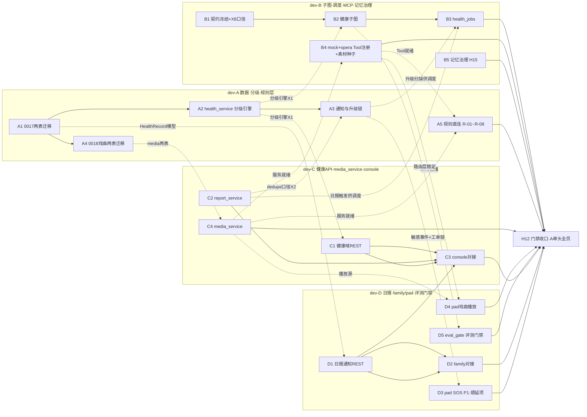

> 状态：可执行（任务已分配到人，可直接开工）　｜　版本：v1.1　｜　日期：2026-11-11
> 上游依据：`docs/plans/day08/day-08-健康采集与三端后台.md` v1.2（任务 H0–H16、验收口径、代码基线均引自该计划，本组文档不另立事实）
> 角色口径：4 名成员均为前后端开发（dev-A/B 偏后端、dev-C/D 偏全栈）；**不含**独立测试/产品/设计角色工作——单测是开发交付物内嵌部分，UI 按既有页面与 PRD 既有要求实现，不产生新设计工作
> 粒度口径（主理人裁决）：按 Day 8 当日拆分，每任务标注人时估算，全员任务包当日可收口
> 容量口径（2026-11-11 主理人裁决）：**不限工时全量分配**——H0–H16 全部到人；各任务书内标注「超载先裁项」（按计划 §7 R1 顺延顺位：衰减归并 → pre-push 接线 → pad SOS → 溢出池），做不完的显式顺延 Day 9 并留痕，不许静默砍掉

---

# Day 8 团队任务总览与 DAG（4 人并行分工）

## 1. 全项目十天阶段级 DAG（里程碑总览）

| 阶段 | 前置 | 关键输入 | 关键输出 | 里程碑 |
| --- | --- | --- | --- | --- |
| Day 1–2 | — | PRD/TD/大纲 | 可登录三端 + 角色/设备/权限基座 | **M1** 身份权限基座可用 |
| Day 3–5 | M1 | 语音需求、延迟预算 | ASR/TTS 双链路、3D 数字人、声纹注册比对、延迟护栏 | **M2** 语音管道全通（「认得人、听得懂、说得出」） |
| Day 6–7 | M2 | 路由/Agent 设计 | 主控 Agent + 用药子图 + checkpointer + 记忆骨架 + 调度外呼 | **M3** Agent 业务闭环首通 |
| **Day 8** | M3 | 健康决策图设计、冻结契约 | 健康子图 + 三端后台真实数据闭环 + Day 7 欠债三项收口 | **M4** 健康业务闭环（AC-09/10/11/21/22 + 红色 2 分钟升级 + 戏曲 AC-37 + 记忆冲突 FR-MEM-03 + 评测门禁 FR-TC-09）★本日 |
| Day 9 | M4 | 攻击用例集 | 三道隔离闸门 100% + 审计/脱敏 + 声纹报告兜底承接位 | **M5** 安全闸门收口 |
| Day 10 | M5 | 部署清单 | Docker 交付 + /metrics 观测 | **M6** 十日交付 |

## 2. Day 8 任务级 DAG（按人着色）

- **无环验证**：全部边按 B1/A1（晨）→ A4/B5 骨架（午前）→ C4/B2（午前—午后）→ B4/B3/D5（午后前段）→ A5/D4/D2/D3（午后后段）→ H12（收口）单向流动，拓扑序存在，无死锁。唯一跨层回边候选「C4→B4→A5→C4」不存在（B4 联调段只依赖 C4 服务就绪，A5 直连只依赖 B4/C4，均不回到 C4 的前置）。
- **无冗余串行**：A1（0017 迁移）字段来源是 TD §3.4/§3.5 而非接口契约，与 B1 并行开工；A4（0018 迁移）由迁移主导人 A 在 A1 后顺做，避开迁移写锁；C1/D1 均拆「骨架先行 + 依赖完成后联调」两段；B5/H16 的 fixtures 段不依赖健康主线，分别在 B/D 的等待空档穿插。
- **写域互斥**（含 v1.1 扩域声明）：迁移=A（0017+0018）；graphs/scheduler/tool_registry/memory_service=B；health/notify/report/media 四个 services 与 api=C（C1/C2/C4）+D（D1 reports/family）；rules.py=A；eval/fixtures+eval_gate=D；前端 console=C、family=D、pad=D。**零文件重叠**。

## 3. 任务分配总表（全量分配，人时为估算参考；超载按 R1 顺延顺位裁包内标注项）

| 任务 | 负责人 | 内容（对应计划 H 项） | 人时 | 前置 | 关键交付物 | 验收（量化） |
| --- | --- | --- | --- | --- | --- | --- |
| A1 | dev-A | H1：health_records/daily_reports 迁移 0017 + ORM | 2h | 无（与 B1 并行） | `0017_day8_health_reports.py`、`app/models/health.py`、`report.py` | upgrade/downgrade 可逆；CHECK+索引齐全；人审 diff |
| A4 | dev-A | H14①：media_library/media_history 迁移 0018 | 0.5h | A1（迁移写锁顺做） | `0018_day8_media.py` | 可逆；字段照 TD §3.4；ER 同步；戏曲表与两健康表互不触碰 |
| A2 | dev-A | H2：health_service 校验+分级引擎+版本链+代填 | 3.5h | A1 | `app/services/health_service.py` + 分级单测 | 六类分级用例过（AC-09/10/11/21）；黄升红不重复建单（AC-22）；越权 403+审计（AC-32） |
| A3 | dev-A | H7：通知双轨+2 分钟升级+状态机收口 | 2h | A2、C2（X2 口径） | notify_service staff 侧扩展 + 升级/重试扫描逻辑 | 双通知记录齐（AC-38）；escalated 无第二事件（AC-12）；四态依次可见（AC-23） |
| A5 | dev-A | H14④：规则层直连真实执行（rules.py R-01~R-08） | 1.5h | B4（Tool 就绪）、C4（服务就绪），骨架可先行 | rules.py 播放控制 8 条规则 capability_not_ready→直连 | AC-37 端到端：换一段/大声点/小声点/重复一遍直连执行、路由耗时 ≤200ms（decision_logs layer=rule）；不存在曲目→提示且天气仍可用（FR-CON-04） |
| B1 | dev-B | H0：契约冻结牵头 + X8 戏曲链口径冻结 | 1h | — | 两份契约改「已冻结」+ X8 四件口径（media_url 稳定路径/opera Tool schema/规则动作映射/种子数据规范） | 冻结评审留痕；健康域端点编号 + X8 口径 10:00 前发布 |
| B2 | dev-B | H3：health_checkup_graph 双入口三分支双 HITL | 3.5h | A2（X1） | `app/graphs/health_checkup_graph.py` | 180→医生 interrupt→resume（AC-10/21）；三分支 get_state 可演示；重启不重复建单 |
| B3 | dev-B | H8：health_jobs 四类调度 job | 2h | B2、A3、C2 | `app/scheduler/health_jobs.py` + 集成测试 | scheduler 零写库 grep 零命中；四 job 各可重复执行测试 |
| B4 | dev-B | mock-operations 注册 + H14③ opera Tool + 素材种子 | 2.5h | B1（X8 冻结）；联调段等 A4/C4 | tool_registry 注册 create_work_order/send_family_notification/play_opera + subject_elder_id + AC-39 证据 + `static/media/opera/` 种子（程序生成 wav + 20–30 条 media_library 种子） | AC-39 拦截留痕；opera Tool 经 ToolExecutor 调通（G2 权限照走）；素材替换演练一次成功（D-7 热替换口径） |
| B5 | dev-B | H15：记忆治理收尾（冲突检测+召回过滤+衰减归并） | 3.5h | B1（基线复核）；不依赖健康主线 | memory_service 冲突五关系判定（替换 deferred 占位）+ 召回过滤 + 衰减归并 job | 「喜欢越剧→不喜欢越剧了」两版本均留、旧值 superseded、仅新值生效（FR-MEM-03）；删除记忆不再召回注入；归并 job 输出归并记录（FR-MEM-07）；scheduler 零写库 |
| C1 | dev-C | H5：健康域 REST（骨架先行 + A2 后联调） | 2.5h | B1；A2（联调段） | `app/api/health_*.py` + 接口测试 | 越权 403+审计；契约字段 tsc 对齐；ContractAPIRoute 错误体 |
| C2 | dev-C | H4：report_service 日报生成+版本链 | 2.5h | A2 | `app/services/report_service.py` + 单测 | 四类用药分列（AC-13 前半）；更新通知仅一次（AC-25）；无记忆内容泄漏 |
| C4 | dev-C | H14②：media_service（唯一写库层） | 1.5h | A4 | `app/services/media_service.py` + 单测 | 列表/剧种剧目搜索/取播放 URL/history 写入接口测试绿；media_url 照 X8 稳定路径约定 |
| C3 | dev-C | H9：console 三页真实对接 + 看板核对（P0 部分） | 3h | C1、D1 | 三个 api.ts 切真 + 页面走查截图 | 代填 165/85→黄任务含操作者（AC-32）；楼栋隔离（AC-18）；红档置顶；tsc 通过 |
| D1 | dev-D | H6：家属日报+通知域 REST 收口 | 2h | B1；C2（联调段）；A1 | `app/api/reports.py` 等 + 接口测试 | 家属 A 访问 B 日报 403+审计；已读幂等；状态可区分 |
| D2 | dev-D | H10：family F0/F1/F2 切真 + 375px 验收（P0 部分） | 2.5h | D1 | data-source 切换 + 走查截图 | 375px 无横向滚动截图；仅见绑定长者日报 |
| D4 | dev-D | H14⑤：pad 戏曲播放模块 | 1.5h | C4、B4（X8 联调） | pad `<audio>` 播放组件 | 直连 media_url 播放；与播报流互斥、可打断；播放/暂停演示留证 |
| D5 | dev-D | H16：评测基线 v1 + eval_gate 门禁 | 3h | fixtures 段无前置；gate 本体等 B2 | `eval/fixtures/` 扩充（50 例+六类边界）+ `tests/eval_gate.py` + 分层归因报告 + bad case 回流 | FR-TC-09：人为调低规则阈值跑门禁**被拦截**；报告含七层归因表且可复跑；bad case 回流有记录 |
| D3 | dev-D | H11：pad SOS 接线 + 撤销边界（P1，**R1③ 超载先裁项**） | 2h | A3 | SosButton 后端接线 | 30 秒内红色置顶工单；红档不可一键撤销（AC-26 口径） |
| H12 | 全员（A 牵头） | 门禁四件套 + 完成定义逐条复核 + 文档回填 | 0.5h/人 | 各自任务 | 证据回填计划 §11 | pytest/ruff/tsc/build 全绿 |

## 4. 跨成员对接点与接口契约（联调要求）

| # | 对接点 | 提供方→消费方 | 接口/契约 | 联调时刻 | 联调要求 |
| --- | --- | --- | --- | --- | --- |
| X1 | 分级引擎纯函数签名 + HealthRecord ORM 字段 | A→B、C | 函数签名在 A2 提交时以 docstring 冻结；字段照 TD §3.4 | 12:00 | B2 的 grade 节点、C1 的提交校验只调函数不改阈值 |
| X2 | dedupe_key 与「日报已更新」通知口径 | C→A | 口径写入 C2 服务 docstring，双方 11:30 口头对齐后落码 | 11:30 | A3 的重试/幂等逻辑与 C2 生成侧使用同一 dedupe_key 构造规则 |
| X3 | 健康域 REST 全端点 | C→C(H9)、B(演示) | 冻结《接口契约_照护台业务数据》+ ContractAPIRoute 统一错误体 | 14:30 | H9 前端只按冻结契约开发，不得临时改字段 |
| X4 | 日报/通知域 REST | D→D(H10)、C(H9 告警状态) | 冻结《接口契约_家属端数据》 | 14:30 | 同上 |
| X5 | 红色事件端到端演练 | B(图/调度)→A(通知)→C(告警中心)→D(家属通知) | AC-12/23/38 演练脚本（计划 §6 抽查清单） | 15:30 | 四人各留一段证据（SQL/截图） |
| X6 | 漏采工单→看板置顶核对 | B(H8)→C(H9④) | f2-D1 工单看板契约（已交付） | 16:30 | 红档置顶+严重度排序核对留截图 |
| X7 | 通知状态四态 | A→D | AC-23 状态机表（计划 H7） | 15:30 | D 的 H6 状态查询与 H10 展示按四态枚举开发 |
| X8 | **戏曲链四方契约（v1.1 新增）**：① media_url 稳定路径约定 `/static/media/opera/<media_id>.wav`（D-7 热替换口径）；② opera Tool schema（工具名+参数+返回）；③ 规则动作→Tool/服务调用映射表；④ 种子数据规范（20–30 条字段值域） | B（冻结牵头）→A（规则直连）/C（media_service）/D（pad 播放） | X8 四件口径随 B1 契约评审一并冻结，变更走契约 §6 留痕 | 16:00（AC-37 端到端演练） | A5 只按冻结映射改 rules.py；C4 只按冻结路径产 media_url；D4 只按冻结 schema 消费；四方各留 AC-37 演练证据 |
| X9 | 路由层基线交接（B2 完成→D 跑评测基线） | B→D | day7_intents.jsonl + 评测口径（fixtures 六类边界定义） | 14:00 | B2 桩测试绿后 D 即启动 D5 gate 本体；D 不得改 rules.py/阈值，失败归因回 B |

## 5. 当日节奏（关键检查点）

| 时刻 | 检查点 | 责任 |
| --- | --- | --- |
| 09:00–09:15 | 站会：确认 R6 写锁归属（tool_registry 归 B4）、待确认项 2/3/5 | 全员 |
| 09:15–10:00 | B1 契约冻结 + X8 口径（A1 并行开工） | B 牵头 |
| 12:00 | **CP1**：A1+A4 完成、X1/X2 对齐完成 | A/C/B |
| 14:00 | B2 桩测试绿 → X9 交接，D 启动 D5 gate 本体 | B/D |
| 14:30 | **CP2**：C1/D1 联调通过（X3/X4） | C/D |
| 15:30 | **CP3**：红色事件端到端演练通过（X5/X7） | 全员 |
| 16:00 | **CP4**：戏曲端到端演练 AC-37（X8） | A/B/C/D |
| 16:30 | X6 看板核对 | B/C |
| 17:30–18:00 | **H12 门禁**：四件套 + 证据回填计划 §11 | A 牵头，全员 |

## 6. 顺延机制（超载先裁项 + 溢出池，全部按计划 §7 R1 顺延顺位；顺延必须 commit 说明写明 + §11 留痕）

**包内超载先裁项**（按 R1 顺位，各自任务书内同标注）：

| 顺位 | 项 | 所在包 | 对应 |
| --- | --- | --- | --- |
| R1① | FR-MEM-07 衰减归并 job | dev-B（B5③） | PRD P1 |
| R1② | pre-push 钩子接线（eval_gate 本体保留） | dev-D（D5⑤） | FR-TC-09 部分 |
| R1③ | pad SOS 接线 | dev-D（D3） | FR-ALT-06/FR-UI-08，P1 |

**溢出池**（17:00 未开工即整体顺延 Day 9）：

| 溢出项 | 负责人 | 对应 | 顺延合规口径 |
| --- | --- | --- | --- |
| O1 医生 14 天趋势图（1h） | dev-C | H9⑤ | PRD §6.2 P1 |
| O2 日报 TTS 语音条（1.5h）+ 推送状态前端（0.5h） | dev-D | H10②④ | PRD §6.2 P1 |
| O3 声纹调优与级联验证（3h） | dev-B | H13 | D-1 改裁决「能做就做」，P1 尽力 |
| O4 聚合预警（弹性） | dev-A | FR-HLT-10 | D-4 裁决 P2 |

## 7. 出工前校验结论（按主理人验收要求逐项自检）

| 校验项 | 结论 |
| --- | --- |
| 依赖链路无死锁 | ✅ 全部依赖边单向（§2 拓扑序论证，含 C4→B4→A5 链无回边）；共享写锁 tool_registry 归 B4 单点、不阻塞健康主线 |
| 无冗余串行节点 | ✅ A1 与 B1 并行；A4 由迁移主导人顺做避开写锁；C1/D1 骨架先行；B5 冲突检测段与 D5 fixtures 段各自在等待空档穿插，不占关键路径 |
| 任务无遗漏 | ✅ 计划 H0–H16 全部映射：H1→A1、H14①→A4、H2→A2、H7→A3、H14④→A5、H0→B1、H3→B2、H8→B3、mock注册+H14③→B4、H15→B5、H5→C1、H4→C2、H14②→C4、H9→C3、H6→D1、H10→D2、H14⑤→D4、H16→D5、H11→D3、H13→O3、H12→全员 |
| 任务无冲突 | ✅ 写操作零重叠（§2 写域互斥清单，含扩域声明：memory_service→B、media_service→C、rules.py→A、eval/fixtures+eval_gate→D） |
| 验收可量化可校验 | ✅ 每任务验收含命令或 AC/FR 编号（§3），收口统一执行计划 §6 命令级自检 |
| 跨成员对接有契约 | ✅ 9 个对接点 X1–X9 均指定契约来源与联调时刻（§4），X8 为戏曲链四方契约新增 |
| 个人任务书可直接执行 | ✅ 见同目录 dev-A/B/C/D 四份任务书（含时间线、顺延序与自检命令） |
