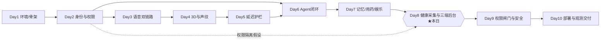
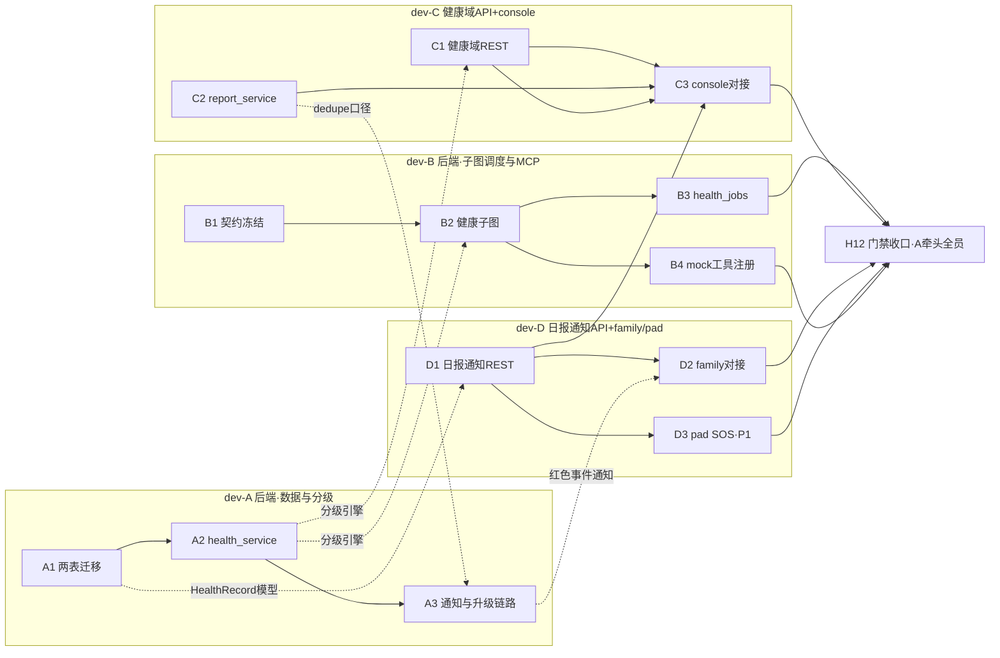

> 状态：可执行（任务已分配到人，可直接开工）　｜　版本：v1.0　｜　日期：2026-11-10
> 上游依据：`docs/plans/day08/day-08-健康采集与三端后台.md` v1.1（任务 H0–H13、验收口径、代码基线均引自该计划，本组文档不另立事实）
> 角色口径：4 名成员均为前后端开发（dev-A/B 偏后端、dev-C/D 偏全栈）；**不含**独立测试/产品/设计角色工作——单测是开发交付物内嵌部分，UI 按既有页面与 PRD 既有要求实现，不产生新设计工作
> 粒度口径（主理人裁决）：按 Day 8 当日拆分，每任务标注人时估算，全员任务包当日可收口；P1 溢出项显式进入溢出池（§6）

---

# Day 8 团队任务总览与 DAG（4 人并行分工）

## 1. 全项目十天阶段级 DAG（里程碑总览）

| 阶段 | 前置 | 关键输入 | 关键输出 | 里程碑 |
| --- | --- | --- | --- | --- |
| Day 1–2 | — | PRD/TD/大纲 | 可登录三端 + 角色/设备/权限基座 | **M1** 身份权限基座可用 |
| Day 3–5 | M1 | 语音需求、延迟预算 | ASR/TTS 双链路、3D 数字人、声纹注册比对、延迟护栏 | **M2** 语音管道全通（「认得人、听得懂、说得出」） |
| Day 6–7 | M2 | 路由/Agent 设计 | 主控 Agent + 用药子图 + checkpointer + 记忆/娱乐 + 调度外呼 | **M3** Agent 业务闭环首通 |
| **Day 8** | M3 | 健康决策图设计、冻结契约 | 健康子图 + 三端后台真实数据闭环 | **M4** 健康业务闭环（AC-09/10/11/21/22 + 红色 2 分钟升级）★本日 |
| Day 9 | M4 | 攻击用例集 | 三道隔离闸门 100% + 审计/脱敏 + 声纹报告兜底承接位 | **M5** 安全闸门收口 |
| Day 10 | M5 | 部署清单 | Docker 交付 + /metrics 观测 | **M6** 十日交付 |

## 2. Day 8 任务级 DAG（按人着色）

- **无环验证**：全部边按 A1/B1（晨）→ A2/C1/C2 骨架（午前）→ A3/B2/B4/D1（午后前段）→ B3/C3/D2/D3（午后后段）→ H12（收口）单向流动，拓扑序存在，无死锁。
- **无冗余串行**：A1（两表迁移）字段来源是 TD §3.4/§3.5 而非接口契约，**与 B1 并行开工**（计划原文 H1→H0 依赖仅「基线复核」部分，提交前对齐即可）；C1/D1 均拆「骨架先行 + 依赖完成后联调」两段，消除等待空转。

## 3. 任务分配总表（人时合计 ≈ 7.5–8h/人）

| 任务 | 负责人 | 内容（对应计划 H 项） | 人时 | 前置 | 关键交付物 | 验收（量化） |
| --- | --- | --- | --- | --- | --- | --- |
| A1 | dev-A | H1：health_records/daily_reports 迁移 0017 + ORM | 2h | 无（与 B1 并行） | `0017_day8_health_reports.py`、`app/models/health.py`、`report.py` | upgrade/downgrade 可逆；CHECK+索引齐全；人审 diff |
| A2 | dev-A | H2：health_service 校验+分级引擎+版本链+代填 | 3.5h | A1 | `app/services/health_service.py` + 分级单测 | 六类分级用例过（AC-09/10/11/21）；黄升红不重复建单（AC-22）；越权 403+审计（AC-32） |
| A3 | dev-A | H7：通知双轨+2 分钟升级+状态机收口 | 2h | A2、C2（口径对齐） | notify_service staff 侧扩展 + 升级/重试扫描逻辑 | 双通知记录齐（AC-38）；escalated 无第二事件（AC-12）；四态依次可见（AC-23） |
| B1 | dev-B | H0：契约冻结牵头（全员 09:15 评审 30min） | 1h | — | 两份契约改「已冻结」 | 冻结评审留痕；编号分配完成（待确认项 2） |
| B2 | dev-B | H3：health_checkup_graph 双入口三分支双 HITL | 3.5h | A2 | `app/graphs/health_checkup_graph.py` | 180→医生 interrupt→resume（AC-10/21）；三分支 get_state 可演示；重启不重复建单 |
| B3 | dev-B | H8：health_jobs 四类调度 job | 2h | B2、A3、C2 | `app/scheduler/health_jobs.py` + 集成测试 | scheduler 零写库 grep 零命中；四 job 各可重复执行测试 |
| B4 | dev-B | mock-operations 两工具注册 + subject_elder_id + AC-39 证据 | 1.5h | B2；写锁确认（R6） | tool_registry/executor 注册 + 越权证据 | AC-39 拦截留痕；注册单测绿 |
| C1 | dev-C | H5：健康域 REST（骨架先行 + A2 后联调） | 2.5h | B1；A2（联调段） | `app/api/health_*.py` + 接口测试 | 越权 403+审计；契约字段 tsc 对齐；ContractAPIRoute 错误体 |
| C2 | dev-C | H4：report_service 日报生成+版本链 | 2.5h | A2 | `app/services/report_service.py` + 单测 | 四类用药分列（AC-13 前半）；更新通知仅一次（AC-25）；无记忆内容泄漏 |
| C3 | dev-C | H9：console 三页真实对接 + 看板核对（P0 部分） | 3h | C1、D1 | 三个 api.ts 切真 + 页面走查截图 | 代填 165/85→黄任务含操作者（AC-32）；楼栋隔离（AC-18）；红档置顶；tsc 通过 |
| D1 | dev-D | H6：家属日报+通知域 REST 收口 | 2h | B1；C2（联调段）；A1 | `app/api/reports.py` 等 + 接口测试 | 家属 A 访问 B 日报 403+审计；已读幂等；状态可区分 |
| D2 | dev-D | H10：family F0/F1/F2 切真 + 375px 验收（P0 部分） | 2.5h | D1 | data-source 切换 + 走查截图 | 375px 无横向滚动截图；仅见绑定长者日报 |
| D3 | dev-D | H11：pad SOS 接线 + 撤销边界（P1） | 2h | A3 | SosButton 后端接线 | 30 秒内红色置顶工单；红档不可一键撤销（AC-26 口径） |
| H12 | 全员（A 牵头） | 门禁四件套 + 完成定义逐条复核 + 文档回填 | 0.5h/人 | 各自任务 | 证据回填计划 §11 | pytest/ruff/tsc/build 全绿 |

## 4. 跨成员对接点与接口契约（联调要求）

| # | 对接点 | 提供方→消费方 | 接口/契约 | 联调时刻 | 联调要求 |
| --- | --- | --- | --- | --- | --- |
| X1 | 分级引擎纯函数签名 + HealthRecord ORM 字段 | A→B、C | 函数签名在 A2 提交时以 docstring 冻结；字段照 TD §3.4 | 12:00 | B2 的 grade 节点、C1 的提交校验只调函数不改阈值 |
| X2 | dedupe_key 与「日报已更新」通知口径 | C→A | 口径写入 C2 服务 docstring，双方 11:30 口头对齐后落码 | 11:30 | A3 的重试/幂等逻辑与 C2 生成侧使用同一 dedupe_key 构造规则 |
| X3 | 健康域 REST 全端点 | C→C(H9)、B(演示) | 冻结《接口契约_照护台业务数据》+ ContractAPIRoute 统一错误体 | 14:30 | H9 前端只按冻结契约开发，不得临时改字段 |
| X4 | 日报/通知域 REST | D→D(H10)、C(H9 告警状态) | 冻结《接口契约_家属端数据》 | 14:30 | 同上 |
| X5 | 红色事件端到端演练 | B(图/调度)→A(通知)→C(告警中心)→D(家属通知) | AC-12/23/38 演练脚本（计划 §6 抽查清单） | 15:30 | 四人各留一段证据（SQL/截图） |
| X6 | 漏采工单→看板置顶核对 | B(H8)→C(H9④) | f2-D1 工单看板契约（已交付） | 16:30 | 红档置顶+严重度排序核对留截图 |
| X7 | 通知状态四态 | A→D | AC-23 状态机表（计划 H7） | 15:30 | D 的 H6 状态查询与 H10 展示按四态枚举开发 |

## 5. 当日节奏（关键检查点）

| 时刻 | 检查点 | 责任 |
| --- | --- | --- |
| 09:00–09:15 | 站会：确认 R6 写锁归属、待确认项 2/3/5 | 全员 |
| 09:15–10:00 | B1 契约冻结（A1 并行开工） | B 牵头 |
| 12:00 | **CP1**：A1+A2 完成、X1/X2 对齐完成 | A/C/B |
| 14:30 | **CP2**：C1/D1 联调通过（X3/X4） | C/D |
| 15:30 | **CP3**：红色事件端到端演练通过（X5/X7） | 全员 |
| 16:30 | X6 看板核对；D3 完成 | B/C/D |
| 17:30–18:00 | **H12 门禁**：四件套 + 证据回填计划 §11 | A 牵头，全员 |

## 6. P1/P2 溢出池（当日 17:00 未开工即顺延 Day 9，commit 说明写明）

| 溢出项 | 负责人 | 对应 | 顺延合规口径 |
| --- | --- | --- | --- |
| O1 医生 14 天趋势图（1h） | dev-C | H9⑤ | PRD §6.2 P1 |
| O2 日报 TTS 语音条（1.5h）+ 推送状态前端（0.5h） | dev-D | H10②④ | PRD §6.2 P1 |
| O3 声纹调优与级联验证（3h） | dev-B | H13 | D-1 改裁决「能做就做」，P1 尽力 |
| O4 聚合预警（弹性） | dev-A | FR-HLT-10 | D-4 裁决 P2 |

## 7. 出工前校验结论（按主理人验收要求逐项自检）

| 校验项 | 结论 |
| --- | --- |
| 依赖链路无死锁 | ✅ 全部 17 条依赖边单向（§2 拓扑序论证），唯一共享写锁 tool_registry 归 B4 且不阻塞 H1–H7 |
| 无冗余串行节点 | ✅ A1 与 B1 并行（依赖仅基线复核）；C1/D1 骨架先行消除等待；C2→C3 由同一人承接免跨人阻塞 |
| 任务无遗漏 | ✅ 计划 H0–H13 全部映射：H1→A1、H2→A2、H7→A3、H0→B1、H3→B2、H8→B3、mock注册→B4、H5→C1、H4→C2、H9→C3、H6→D1、H10→D2、H11→D3、H13→O3、H12→全员 |
| 任务无冲突 | ✅ 写操作零重叠：迁移(A1)/graphs+scheduler(B)/api(C1,D1)/services(C2,A2,A3)/前端(C3,D2,D3) 文件域互斥 |
| 验收可量化可校验 | ✅ 每任务验收含命令或 AC 编号（§3），收口统一执行计划 §6 命令级自检 |
| 跨成员对接有契约 | ✅ 7 个对接点 X1–X7 均指定契约来源与联调时刻（§4） |
| 个人任务书可直接执行 | ✅ 见同目录 dev-A/B/C/D 四份任务书（含时间线与自检命令） |
