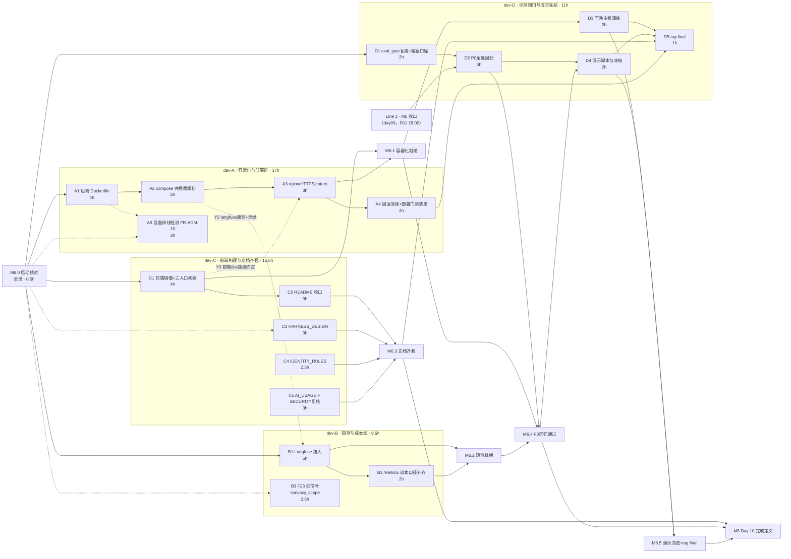

> 状态：可执行（待 M6.0 启动核对逐项裁决 §8 待确认项后开工）　｜　版本：v1.0　｜　日期：2026-11-13
> 上游依据：PRD line 578（Day 10 行＝完成定义）、line 513（AC-31）、line 453–460（FR-TC-04/05/09）、line 513 附近（FR-TC-08）、line 586–590（裁减顺序与不得裁减）｜技术设计文档 §8.3 Day 10（line 1176–1183，实现口径）｜大纲 §十 课时 10.1–10.4（教学口径）
> 计划来源：docs/plans/day10/day-10-交付与观测-工作推进计划.md v1.0（2026-11-13 主理人四项裁决：双线并行 / 4 人任务包 / tag+文档齐套纳入·简历类单列附录 / 技术文档=技术设计文档）
> 角色口径：4 名成员均为前后端开发（dev-A 偏后端部署、dev-B 偏后端观测、dev-C 全栈、dev-D 全栈/评测），**不含**独立测试/产品/设计角色工作——P0 回归、eval_gate 门禁、交付文档（HARNESS_DESIGN / IDENTITY_RULES / AI_USAGE）均为 TD §8.3 明列的**开发实现口径交付物**，由承接该域的开发自产（沿 day09 总览同一口径）
> 粒度口径：按任务包分配，每包容量上限 **3 人日（24h）**；Day 10 实排开发工时 **A 17h／B 9.5h／C 15.5h／D 11h（合计 53h）**，各包余额为 **Line 1（day09 联调收口）槽位占用＋缓冲**——双线并行下每人 Day 10 阶段总占用仍为 2–3 个工作日（D10–D13 四个日历日摊开），符合粒度要求
> 变更记录见文末

---

# Day 10 团队任务总览与 DAG（4 人并行分工 · 交付与观测）

## 0. 口径声明

### 0.1 文档效力

遵守 AGENTS.md 前置节铁律：**一切「是什么/有多少/什么字段/什么接口/什么阈值」只引 PRD 与技术设计文档**。本文与基线冲突时以基线为准并回改本文。任务书内容与 `docs/plans/day10/` 计划件一一对应；计划件管「怎么做」，本文管「谁做、前置、写域、验收、对接」。

### 0.2 双线日历口径（须主理人知悉，沿计划件裁决）

| 线 | 内容 | 日历窗口 | 本文关系 |
| --- | --- | --- | --- |
| **Line 1 · day09 联调收口线** | M5.1–M5.4 与 M5 收口门禁；X1/X3/X4/X5/X7/X9/X11/X12 槽位 | D10–D11（11-13 → 11-15） | **不重复编排、不改动其分工**，仅作为本文 D2 的硬前置与各人槽位占用 |
| **Line 2 · Day 10 交付线（本文编排对象）** | Docker Compose 完整版、Langfuse、评测门禁收口、回滚演练、交付文档齐套、演示冻结与 tag final | 骨架段即日（11-13）启动；收口段排在 Line 1 M5 之后，推算 D12–D13（11-16 → 11-17）【待确认 Q2】 | 本文全部节点 |

冲突规则：**Line 1 优先**（P0 与不得裁减项优先于部署类交付）；写锁沿 day09 §6 既有锁，Line 2 新增领地在本文 §6 重新划锁；**Day 10 收口段（D2/D3/D5）必须晚于 Line 1 的 M5 收口门禁**。

### 0.3 三条硬约束（沿计划件 §0.2，贯穿全部节点）

1. **分层**：`app/services/` 唯一写库层；`api | audio | scheduler | graphs → services → models` 单向。
2. **身份**：`elder_id`/`thread_id`/`device_id` 只从服务端 `runtime_context` 注入。
3. **迁移**：只新增不改历史。Day 10 **零新增迁移**（A4 回滚演练用既有 0021 及历史迁移做 downgrade，只执行不新建）。

### 0.4 本机环境口径（执行类节点必读）

- 本机后端联调禁用普通 `uvicorn app.main:app`，一律走方案 A 命令（WindowsSelectorEventLoopPolicy + loop='none'，见 README/MEMORY）；容器内 Linux 不受此限，Dockerfile **不引入** policy 代码。
- 本机 `HTTP_PROXY=127.0.0.1:52070`：curl 验证一律加 `--noproxy '*'`。
- compose 全栈验证约 2h 会被工具托管环境回收：**建议主理人自开终端常驻执行**。
- Vite 预构建缓存 `frontend/node_modules/.vite/deps` 不删、不 `--force`；前端镜像构建用 `npm ci`（容器内全新安装）。
- 种子数据一律按台账 `docs/测试数据_人员与床位.md` 重建并同步更新台账。

---

## 1. 里程碑（M6.0–M6.5，判据全部可量化）

| 里程碑 | 判据 | 依赖 | 时点（推算） | 牵头 |
| --- | --- | --- | --- | --- |
| **M6.0 启动核对与口径冻结** | 本文 §8 待确认项逐项裁决；对接点 Y1–Y5 口径冻结；写域矩阵签认 | 无 | D10 09:30 | dev-A 牵头全员 |
| **M6.1 容器化编排就绪** | `docker compose up -d` 一键起全部服务（含新增 backend/nginx/laya/coturn/langfuse）全 healthy；`https://localhost` 打开长者端页面；`.env` 密钥零进镜像层 | A1 A2 A3 C1 | D11 17:00 | dev-A/dev-C |
| **M6.2 观测就绪** | AC-31：一条完整 Trace（规则→分类器→模型→工具→TTS）可导出且脱敏；`/metrics` 含 cache 命中率口径 | B1 B2（联调依赖 A2） | D11 17:00 | dev-B |
| **M6.3 交付文档齐套** | README（部署/回滚/成本/观测章节）+ HARNESS_DESIGN + IDENTITY_RULES + AI_USAGE + SECURITY 复核，清单逐项可检 | C2–C5 | D12 12:00 | dev-C |
| **M6.4 P0 全量回归通过** | PRD §5.1 全部适用 AC 逐条复跑并落 `eval/reports/day10_p0_regression.md`；§5.2 固定测试集达标 | **Line 1 M5 收口** + D1 + M6.1/M6.2 | D12 18:00 | dev-D |
| **M6.5 演示冻结与 tag final** | 干净主机三步起全栈全绿 + HTTPS 可访问；回滚演练（代码回滚 + `alembic downgrade` 各一次）成功；`git tag final` 打标并 push | A4 D3 D4 + M6.3 + M6.4 | D13 16:00 | dev-D 牵头全员 |
| **M6 · Day 10 完成定义** | ＝ PRD line 578：一键启动+HTTPS+健康检查 ✓；AC-31 ✓；全部 P0 回归 ✓；文档清单逐项可检 ✓ | M6.1–M6.5 | D13 17:00 | 全员 |

---

## 2. 任务级 DAG（含输入输出标注）

### 2.1 DAG 图（mermaid；实线＝包内硬依赖，虚线＝跨包对接/软依赖）

### 2.2 节点输入输出表（DAG 边的文字化，供逐节点核对）

| 节点 | 负责人 | 输入（来自） | 输出（交付物） | 下游消费方 |
| --- | --- | --- | --- | --- |
| **A1** 后端 Dockerfile | dev-A | M6.0 裁决；既有 `app/`、`alembic/`、`pyproject/uv.lock` | `Dockerfile`（多阶段非 root）、`.dockerignore` | A2（build 源） |
| **A2** compose 完整版 | dev-A | A1 镜像；Y3 dist 路径（C）；Y2 langfuse 变量段（B，`.env.example` 按 B→A 顺序合入） | `docker-compose.yml` 完整 11 服务版、`.env.example` 增量 | A3、B1 联调、D3、M6.1 |
| **A3** nginx/HTTPS/coturn | dev-A | A2；Y1 静态段草案（C）；既有 `GET /api/audio/ice-config` 配置字段（只读） | `deploy/nginx.conf` 增量、HTTPS 证书说明、coturn 编排 | M6.1、D3、pad 语音链路 |
| **A4** 回滚演练 | dev-A | A3；Y4 回滚基准（自定并登记）；既有迁移 0021 | 回滚演练记录、部署门禁清单 | C2（README 素材）、D5 |
| **A5** 设备掉线检测 | dev-A | M6.0；既有 `device_service.py`、通知服务（只读调用） | `app/scheduler/device_jobs.py`（新）、`device_service.py` 增量、测试 | D2 回归覆盖（P2，无硬下游） |
| **B1** Langfuse 接入 | dev-B | M6.0；Y2 langfuse 服务与凭据（A）；既有 `app/core/redact.py`、`langfuse_*` 配置字段 | Langfuse 接入代码、AC-31 证据 `eval/reports/day10_langfuse_trace.md` | M6.2、B2、C2（观测章节素材） |
| **B2** /metrics 补齐 | dev-B | B1 | `app/api/metrics.py` 增量（cache 命中率）、成本估算记录 | M6.2、C2（成本章节素材） |
| **B3** F23 四信号 | dev-B | M6.0；既有 `app/system_one/`、`privacy_scope` 字段 | 四信号输出接线、`privacy_scope` ≥1 消费点、延迟记录 | D2 回归覆盖（P2，无硬下游） |
| **C1** 前端镜像 | dev-C | M6.0；`frontend/`（三入口 MPA） | `frontend/frontend.Dockerfile`、三入口产物路径约定（Y3） | A2/A3（合入 nginx）、M6.1 |
| **C2** README 收口 | dev-C | C1；A4 演练记录+门禁清单（素材）；B2 成本估算（素材）；D1 门禁口径（素材） | `README.md` 四个新章节 | M6.3 |
| **C3** HARNESS_DESIGN | dev-C | M6.0；TD §4/§6 十组件口径＋实测 `ls` | `docs/HARNESS_DESIGN.md` | M6.3 |
| **C4** IDENTITY_RULES | dev-C | M6.0；PRD §3.2（口径唯一来源） | `docs/IDENTITY_RULES.md` | M6.3 |
| **C5** AI_USAGE+SECURITY | dev-C | M6.0；day02–day10 计划件（决策引用）；day09 收口后现状 | `docs/AI_USAGE.md`、`docs/SECURITY.md` 复核修订 | M6.3 |
| **D1** eval_gate 收口 | dev-D | M6.0；既有 `tests/eval_gate.py`、`.githooks/pre-push` | 门禁复跑记录、pre-push 阻塞口径（Y5）、TD line 1179 路径勘误 | D2、Y5→全员 |
| **D2** P0 全量回归 | dev-D | **Line 1 M5 收口**；D1；M6.1/M6.2；台账种子数据 | `eval/reports/day10_p0_regression.md`、台账更新 | D4、M6.4 |
| **D3** 干净主机演练 | dev-D | M6.1；A4 | 演练记录（截图+日志）、`.env.example`/README 缺漏回改提单 | D5、M6.5 |
| **D4** 演示脚本与冻结 | dev-D | D2（只演示回归通过项） | 5 分钟演示脚本（四场景，标 AC 编号）；视频【待确认 Q1】 | D5 |
| **D5** tag final | dev-D | D3+D4+A4+M6.3+M6.4 | `git tag final` 并 push | M6.5 收口 |

### 2.3 排程表（与 Line 1 槽位互补，D10–D13 摊开）

| 时段 | dev-A | dev-B | dev-C | dev-D |
| --- | --- | --- | --- | --- |
| D10（11-13） | **A1**（穿插 Line1 X3/X4/X12 槽 15:00/16:00） | **B1 骨架**（穿插 X11 15:00 槽） | **C1 → C3 骨架**（穿插 day09 C6 联调） | **D1**（穿插 X1 12:00 / X9 槽） |
| D11（11-14） | A2 → A3（M6.1 收口） | B1 联调（compose 就绪后）→ B2 | C4 → C5（穿插 M5.4 验证） | 值守 Line1 M5.3/M5.4；收口段待命 |
| D12（11-16） | A4 回滚演练 → A5 | B3 F23 | C2 README 收口 | D2 P0 全量回归 |
| D13（11-17） | 支援干净主机演练 | 支援观测抽验 | 支援文档走查 | D3 → D4 → D5（tag final） |

---

## 3. 跨包对接点契约（Y1–Y5，M6.0 冻结后生效）

> 冻结规则沿 day09 contracts.md：M6.0 评审四方签认后不得私改；字段/口径变更须在变更记录留痕并通知全部消费方。身份铁律与错误体口径（403＋审计 / 409 / 422）沿用 day09 contracts.md §0，全部对接点适用。

### Y1 · nginx 静态托管段草案（C → A）

| 项 | 内容 |
| --- | --- |
| 提供方→消费方 | dev-C（C1）→ dev-A（A3，**`deploy/nginx.conf` 由 A 独占改**） |
| 契约内容 | 三入口 dist 相对路径约定表＋反代规则草案：`/pad`→`dist/pad`、`/console`→`dist/console`、`/family`→`dist/family`（MPA 静态托管）；`/api/*` 反代 backend:8000；`/ws/*` 反代 backend:8000 且带 WebSocket upgrade 头（`Upgrade`/`Connection`） |
| 联调时点 | D11 上午 |
| 联调判据 | 三入口 URL 经 nginx 返回 200；`/api` 透传后端可响应；`wss://` 信令建连不断 |

### Y2 · Langfuse 服务与凭据（A → B）

| 项 | 内容 |
| --- | --- |
| 提供方→消费方 | dev-A（A2）→ dev-B（B1） |
| 契约内容 | compose `langfuse` 服务定义（形态按 §8 Q4 裁决，默认建议 Langfuse v2 镜像＋复用 postgres 独立 schema，避免 v3 的 ClickHouse/MinIO 依赖）；凭据三变量 **`.env` 注入、不硬编码**：`LANGFUSE_PUBLIC_KEY` / `LANGFUSE_SECRET_KEY` / `LANGFUSE_HOST`；`.env.example` 的 langfuse 段由 **B 先定稿、A 合编排时一并成文**（B→A 提交顺序） |
| 联调时点 | D11 上午（compose 就绪后） |
| 联调判据 | B1 以注入凭据发起一次对话，Langfuse 界面可见 Trace 落库可查 |

### Y3 · 前端构建产物（C → A）

| 项 | 内容 |
| --- | --- |
| 提供方→消费方 | dev-C（C1）→ dev-A（A2/A3） |
| 契约内容 | `frontend.Dockerfile` 多阶段：`npm ci` → `vite build` → nginx 托管；产物容器内路径 `/usr/share/nginx/html/{pad,console,family}`；构建命令固定 `npm ci && npm run build`；**红线：three-vrm 不进 console/family 产物** |
| 联调时点 | D11 上午 |
| 联调判据 | `grep -r "three-vrm" dist/console dist/family` 零命中；`dist/pad` 含 VRM 资产；三入口经 nginx 200 |

### Y4 · 回滚基准（A → D）

| 项 | 内容 |
| --- | --- |
| 提供方→消费方 | dev-A（A4）→ dev-D（D3/D5） |
| 契约内容 | A4 指定并登记演练基准（当前 `8d506b2` 或 D13 前最后一个收口 commit）；**D5 的 `git tag final` 必须在 A4 回滚演练通过后才可打** |
| 联调时点 | D12 下午 |
| 联调判据 | 基准 commit 写入 A4 演练记录；D5 自检项含「A4 演练通过」勾选 |

### Y5 · 门禁口径（D → 全员）

| 项 | 内容 |
| --- | --- |
| 提供方→消费方 | dev-D（D1）→ 全员 |
| 契约内容 | D1 裁决 pre-push 阻塞模式（day09 §10 Q2 遗留）：阻塞真门禁，或「CI 阻塞＋本地自检」并留痕；裁决结果写入 README 或门禁记录。纪律：**全员不得为变绿调阈值或删用例**（沿 day09 X9） |
| 联调时点 | D10 下午（最早冻结，全员开工即受约束） |
| 联调判据 | 人为调低规则阈值 → 门禁报红并打印差值；无 python 环境时 pre-push 退出码非 0 |

---

## 4. 写域互斥矩阵（Line 2 新增领地；既有锁沿用 day09 §6）

| 成员 | Line 2 写域仅限 | 禁触 |
| --- | --- | --- |
| **dev-A** | `Dockerfile`（新）、`.dockerignore`（新）、`docker-compose.yml`（**独占**）、`.env.example`（增量，langfuse 段走 Y2 B→A 顺序）、`deploy/nginx.conf`（**独占**）、`app/scheduler/device_jobs.py`（新，不碰 B 既有调度文件）、`app/services/device_service.py`（增量）、`app/api/audio.py` ICE 字段**只读**、对应 tests | 前端构建、docs 交付文档、eval_gate、Langfuse 接入代码 |
| **dev-B** | Langfuse 接入代码（观测层模块，M6.0 定落点）、`app/core/config.py` langfuse 段增量、`app/system_one/**`（B3）、`privacy_scope` 消费点、`app/api/metrics.py`（增量）、`eval/reports/day10_langfuse_trace.md` | compose/Dockerfile/nginx、`app/scheduler/`（A5 例外见其任务书）、docs 交付文档 |
| **dev-C** | `frontend/frontend.Dockerfile`（新）、`README.md` 增量（**独占**）、`docs/HARNESS_DESIGN.md`（新）、`docs/IDENTITY_RULES.md`（新）、`docs/AI_USAGE.md`（新）、`docs/SECURITY.md`（复核修订）、`docs/plans/day10/**`、`docs/team_tasks/day10/**` | backend Dockerfile/compose、观测代码、tests/eval_gate |
| **dev-D** | `tests/eval_gate.py`（沿 day09 锁）、`.githooks/**`、`eval/reports/day10_p0_regression.md`、`docs/测试数据_人员与床位.md`（台账更新）、演示脚本、tag final 操作 | 部署编排、观测代码、交付文档正文（发现问题提单给 C） |

**共享文件串行锁**：`.env.example`（A/B 两段追加，B→A 顺序）；`README.md`（C 独占，A4/B2/D1/D3 素材以「章节素材小抄」交 C 合入）；`alembic/`（零新增迁移，A4 只执行 downgrade/upgrade）。

---

## 5. 检查点节奏

| 时点 | 检查点 | 牵头 | 判据 |
| --- | --- | --- | --- |
| D10 09:30 | **M6.0 启动核对**：§8 待确认逐项裁决＋Y1–Y5 冻结＋写域签认 | dev-A 牵头全员 | 全部待确认项有裁决或显式挂起；未冻结项不开工对应节点 |
| D11 17:00 | **M6.1 容器化就绪** | A/C | compose 全 healthy＋HTTPS 可访问 |
| D11 17:00 | **M6.2 观测就绪** | B | AC-31 Trace 证据落档＋`/metrics` 四类指标 |
| D12 12:00 | **M6.3 文档齐套** | C | 五份文档清单逐项可检 |
| D12 18:00 | **M6.4 P0 回归通过**（硬前置 Line 1 M5） | D | 回归报告逐 AC 有结论 |
| D13 16:00 | **M6.5 演示冻结与 tag final** | D 牵头全员 | 演练全绿后打标 |
| D13 17:00 | **M6 收口门禁**：PRD line 578 完成定义逐条复核＋证据回填 | 全员 | 四句完成定义逐条 ✓ |

---

## 6. 顺延与挂起留痕（不静默）

| 项 | 处置 | 承接 |
| --- | --- | --- |
| F23（System One 四信号，P2） | day09 顺延落地：信号先齐、延迟如实记录（p95 668ms>200ms 挂起【Q8】） | B3 |
| FR-ADM-10（设备掉线检测，P2） | day09 顺延落地 | A5 |
| 人设系统 FR-ADM-07 | 维持裁减（day09 §8.1），本日不安排 | — |
| 演示视频 | 【待确认 Q1】，裁决前 D4 只交脚本 | D4 |
| iter2-demo/iter3-demo 历史标签 | 不补打，仅登记偏差【Q6】；回滚演练以收口 commit 为基准 | A4/D5 |
| 简历段落/INTERVIEW_QA/复盘报告 | 个人学习交付，附录单列不占团队工时（2026-11-13 裁决） | — |

---

## 7. 全量校验结论（用户验收要求逐项）

| 校验项 | 方法 | 结论 |
| --- | --- | --- |
| 仅前后端开发范畴 | 4 包全部为代码/编排/开发自产文档交付；回归与门禁为开发内嵌自验收（day09 同口径），无独立测试/产品/设计角色工作 | ✓ |
| 粒度 2–3 人日 | 每包容量 ≤24h（3 人日）；实排 A 17/B 9.5/C 15.5/D 11h，余额为 Line 1 槽位占用，每人 D10–D13 总占用 2–3 个工作日 | ✓ |
| 4 人并行无串行阻塞 | 包内唯一硬链 A1→A2→A3→A4、B1→B2、C1→C2、D1→D2→D4→D5 均为单人链；跨包边仅 2 条硬边（M5→D2、M6.1→D3），其余为软依赖并行 | ✓ |
| 责任边界 | 19 节点每节点唯一负责人＋写域矩阵 §4 零文件重叠 | ✓ |
| 验收可量化 | 19 节点全部含 grep/状态码/healthy/退出码类判据，无「功能正常」类模糊表述 | ✓ |
| 对接点契约明确 | Y1–Y5 含提供/消费方、字段与路径、联调时点、联调判据（§3） | ✓ |
| 依赖链路无死锁 | DAG 拓扑排序可完成（M6.0 → 包内链 → M6.1/M6.2/M6.3 → M6.4 → M6.5 → M6）；跨线边 M5→D2、M6.1→D3 均为前向 | 无环 |
| 无冗余串行节点 | A5/B3/C3–C5 无下游硬边，可垫后并行；D3 与 D4 并行（分别依赖 M6.1/A4 与 M6.4），仅汇于 D5 | ✓ |

---

## 8. 待确认项（M6.0 逐项裁决，未裁决不开工对应节点）

| # | 待确认 | 影响节点 | 默认口径（仅挂起建议，不自动执行） |
| --- | --- | --- | --- |
| Q1 | 5 分钟演示视频是否纳入 | D4 | 不安排录制，D4 只交脚本 |
| Q2 | Day 10 收口段日历 D12–D13 是否认可 | 排期对外口径 | 按 D12–D13；压缩则按裁减顺序先裁 A5/B3 |
| Q3 | pre-push 阻塞模式（day09 §10 Q2 遗留） | D1/Y5 | 默认阻塞真门禁；环境不具备则降级留痕 |
| Q4 | Langfuse 部署形态：v2 单容器+复用 postgres vs v3 全家桶 | A2/B1 | v2＋复用 postgres 独立 schema |
| Q5 | TD line 1179 `eval/eval_gate.py` 路径勘误留痕（实际 `tests/eval_gate.py`） | D1 | 按 AGENTS §4.7 同提交留痕 |
| Q6 | iter2-demo/iter3-demo 缺失：不补打仅登记偏差 | A4/D5 | 接受登记 |
| Q7 | Laya 容器化形态：宿主权重卷挂载 vs sidecar | A2 | 挂载宿主已下载权重卷；不可行则 sidecar 化并如实记录 |
| Q8 | F23 延迟 668ms>200ms 继续挂起 | B3 | 如实记录不为达标调阈值（沿 X9 纪律） |
| Q9 | dev-D 的 day09 计划件签认（作为 D2 回归基线） | D2 | M6.0 一并签认 |

---

## 变更记录

| 版本 | 日期 | 说明 |
| --- | --- | --- |
| v1.0 | 2026-11-13 | 首版。基于 `docs/plans/day10/` 计划件 v1.0 与 2026-11-13 主理人四项裁决编制：里程碑 M6.0–M6.5、19 节点 DAG（含输入输出表）、对接点契约 Y1–Y5、写域互斥矩阵、排程表、校验结论、待确认 Q1–Q9。 |
