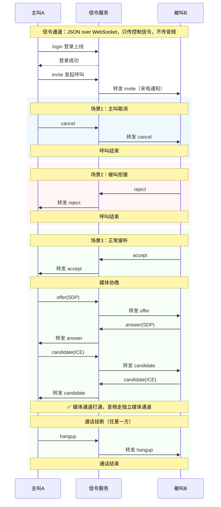

# WebRTC Python AI Agent

> 适用场景：局域网内，网页端和 Python Agent 可以互相呼叫、接听、拒接、挂断
> 技术栈：WebSocket（信令）+ WebRTC + aiortc（Python WebRTC 端点）+ FastAPI
> 阅读建议：先理解概念，再跑通最小 demo，最后看并发优化、坑点

> 前置约定
>
> 1. 支持 1500 连接：这里指**信令并发连接**，WebRTC 媒体通道是单独的 UDP，信令是瓶颈
> 2. 通信模型：
>    - 网页 ↔ Agent：双向呼叫（网页呼 Agent，Agent 呼网页）
>    - 信令：统一 WebSocket 服务，负责呼叫通知、SDP、ICE 候选转发
>    - Agent：Python + aiortc，作为 WebRTC 端点，收发音频帧，对接 ASR/LLM/TTS

***

# 目录

1. WebRTC 核心概念（由浅入深）
2. aiortc 基础用法（编写 Agent 前必看）
3. 整体架构与呼叫时序
4. 环境准备 & 证书生成（局域网 HTTPS 强制要求）
5. 模块 1：WebSocket 信令服务（FastAPI，核心调度）
6. 模块 2：网页前端（被叫/主叫一体页面）
7. 模块 3：Python AI Agent（aiortc，双向呼叫、Provider 架构）
8. 康伴数字人接入 WebRTC（声纹 + ASR + LLM + TTS 全链路）
9. 启动、测试流程
10. 常见问题排查手册
11. 扩展方向
12. 附录：Provider 抽象架构（可插拔替换）

***

# 架构总览（2026-11 更新）

```
┌─────────────┐      WebSocket 信令       ┌─────────────┐
│   浏览器     │ ◄──────────────────────► │  信令服务    │
│  (网页端)    │    HTTPS + WSS 同端口     │ signaling.py │
└──────┬──────┘                            └──────┬──────┘
       │                                          │
       │              WebRTC 媒体通道              │
       │         (UDP, Opus 音频, 48kHz)           │
       │                                          │
┌──────▼──────┐                            ┌──────▼──────┐
│   网页端     │ ◄────────────────────────► │  Python     │
│  RTCPeerConn │    音频流双向传输            │   Agent     │
└─────────────┘                            └──────┬──────┘
                                                  │
                                           ┌──────▼──────┐
                                           │  Provider   │
                                           │  架构层      │
                                           │             │
                                           │  Voiceprint │
                                           │  ASR        │
                                           │  LLM        │
                                           │  TTS        │
                                           └─────────────┘
```

***

# 1. WebRTC 核心概念（知识点）

> 很多同学一上来就贴代码，分不清信令、媒体、ICE，很容易卡住。WebRTC 本质：**浏览器/Python 端点之间建立 UDP 直连通道传输音视频，但是它自己不带"呼叫通知"能力**。

## 1.1 两大部分：信令通道 + 媒体通道

✅ **信令（Signaling）**

- 作用：传递呼叫指令、SDP、ICE 候选；**不传输音频**
- 协议：我们自定义 JSON over WebSocket；工业 VoLTE 用 SIP
- 消息类型：`login`、`invite`、`accept`、`reject`、`cancel`、`hangup`、`offer`、`answer`、`candidate`
- 类比：打电话的"拨号、响铃、接听、挂机"控制信号

✅ **媒体通道（Media）**

- 作用：传输音频 RTP 包
- 底层：UDP，低延迟；局域网不需要 STUN/TURN
- 载体：`RTCPeerConnection`（浏览器）/ `aiortc.RTCPeerConnection`（Python）

> 一句话区分：信令是"传话安排接通"，媒体通道是"真正说话的通道"



## 1.2 SDP（Session Description Protocol，会话描述）

SDP 是一段文本，描述：

- 我支持什么编码（opus 音频）
- 媒体端口、传输方式
- 加密参数（DTLS）

分为两种：

1. **Offer**：发起方生成，"我想和你建立通话，我的能力如下"
2. **Answer**：接收方生成，"同意，我的能力如下"

> 规则：谁发 offer，谁是本次协商的发起方；双向呼叫时，offer 永远由**接听方网页生成**（简化开发，推荐方案）

## 1.3 ICE / ICE Candidate

ICE：Interactive Connectivity Establishment，连通性探测。ICE Candidate = 一个地址（IP+端口），用来尝试和对方建立 UDP 通道。局域网场景：只会生成内网地址，不需要 STUN 服务器。流程：PC 自动收集候选，通过信令发给对方，双方互相尝试连通。

## 1.4 RTCPeerConnection（PC）

WebRTC 核心对象，一个通话对应一个 PC 实例。能力：

- 收集 ICE 候选
- 交换 SDP
- 收发 Track（音视频轨）
- DTLS 加密媒体流
  - TLS：TCP，可靠，不适合低延迟音视频
  - DTLS：UDP，保留 UDP 低延迟，增加加密

## 1.5 MediaTrack

音频轨/视频轨：

- 浏览器：`getUserMedia` 拿到本地麦克风 AudioTrack
- aiortc：可以接收远端 AudioTrack 读取 PCM 帧；也可以自定义 AudioTrack 推送 TTS 音频给浏览器

## 1.6 关键限制（和你的项目强相关）

1. 浏览器 `getUserMedia` 获取麦克风，**必须 HTTPS 或者 localhost**，局域网其他设备必须自签名证书
2. WebRTC 没有内置的"呼叫、响铃"，呼叫逻辑全部在信令层自己实现
3. 一个网页客户端同一时间只维持一条 WebSocket 长连接（信令），通话时额外建立一条 WebRTC 媒体 UDP 流
4. WebSocket 是**长连接**：客户端在线才能收到 Agent 的呼叫；连接断开 = 收不到来电（类比手机失去信号收不到寻呼）

***

# 2. aiortc 基础用法（编写 Agent 前必看）

aiortc 是 Python 的 WebRTC 实现，和浏览器 API 对应。理解这 5 个核心概念就能写 Agent：

## 2.1 RTCPeerConnection（对等连接）

```python
from aiortc import RTCPeerConnection

pc = RTCPeerConnection()


# 监听远端媒体轨
@pc.on("track")
def on_track(track):
    print(f"收到远端 {track.kind} 轨")
    if track.kind == "audio":
        # 处理音频帧
        pass


# 添加本地媒体轨（推送音频给对方）
pc.addTrack(my_audio_track)

# 创建 Answer（响应对方的 Offer）
answer = await pc.createAnswer()
await pc.setLocalDescription(answer)

# 设置远端描述（对方的 Offer）
await pc.setRemoteDescription(offer)
```

## 2.2 MediaStreamTrack（媒体轨）

```python
from aiortc import MediaStreamTrack


class MyAudioTrack(MediaStreamTrack):
    kind = "audio"  # 必须指定类型

    async def recv(self):
        # 返回 AudioFrame，aiortc 会自动编码发送
        # 每次调用返回一帧（通常 20ms）
        pass
```

## 2.3 AudioFrame（音频帧）

PyAV 的 `AudioFrame` 不是直接传 `data` 参数，要先创建再填充：

```python
from aiortc.mediastreams import AudioFrame
import fractions
import numpy as np

# 创建空帧：格式 s16（16bit PCM），单声道，960 个采样（20ms @ 48kHz）
frame = AudioFrame(format="s16", layout="mono", samples=960)

# 填充 PCM 数据（int16 字节流）
pcm_data = np.zeros(960, dtype=np.int16).tobytes()
frame.planes[0].update(pcm_data)

# 设置元数据
frame.sample_rate = 48000
frame.pts = 0  # 时间戳
frame.time_base = fractions.Fraction(1, 48000)  # 时间基准
```

## 2.4 RTCSessionDescription（SDP）

```python
from aiortc import RTCSessionDescription

# 从 JSON 恢复（浏览器发来的 offer）
offer = RTCSessionDescription(sdp=msg["sdp"], type=msg["type"])

# 创建 Answer
answer = await pc.createAnswer()
await pc.setLocalDescription(answer)

# 发送给浏览器
await ws.send(
    json.dumps(
        {
            "type": "answer",
            "sdp": answer.sdp,
        }
    )
)
```

## 2.5 ICE Candidate（连通性候选）

浏览器 JSON 序列化后的 candidate 是 dict，Python 端要重新组装：

```python
from aiortc.sdp import candidate_from_sdp

candidate_dict = msg["candidate"]
candidate = candidate_from_sdp(candidate_dict["candidate"])
candidate.sdpMid = candidate_dict.get("sdpMid")
candidate.sdpMLineIndex = candidate_dict.get("sdpMLineIndex")
await pc.addIceCandidate(candidate)
```

## 2.6 MediaRelay / MediaBlackhole（媒体工具）

```python
from aiortc.contrib.media import MediaBlackhole, MediaRelay

relay = MediaRelay()

# 订阅远端轨（不消费数据，只转发）
sink = MediaBlackhole()
sink.addTrack(relay.subscribe(track))
await sink.start()
```

***

# 3. 整体架构与呼叫时序

## 架构图

```
网页客户端(Web) ←WebSocket(信令)→ 信令服务(FastAPI)
                                      ↑
                                      ↓
                          Python Agent(aiortc WebRTC端点)
<媒体流>
网页 ←WebRTC UDP→ Agent（双向音频）
```

## 时序 A：网页呼叫 Agent（网页做主叫）

1. 网页登录 WS 信令（上报 uid）
2. 网页发送 `invite(to=agent_uid)`
3. 信令转发 invite 给 Agent
4. Agent 收到 invite，自动接听/人工控制接听
5. Agent 回复 `accept`
6. 网页收到 accept，打开麦克风，创建 offer，通过 WS 发给 Agent
7. Agent 收到 offer，构造 answer 回传
8. 交换 ICE 候选，媒体通道打通，双向通话

## 时序 B：Agent 呼叫网页（Agent 做主叫）

1. 网页提前登录 WS，保持在线
2. Agent 发送 `invite(to=web_uid)`
3. 信令转发 invite 给网页
4. 网页弹出来电弹窗，用户选择【接听/拒接】
5. 如果接听：网页回复 accept，网页创建 offer 发给 Agent
6. Agent 返回 answer，交换 ICE，通话建立

> 为什么让网页生成 offer？aiortc 接收 offer 的代码更稳定；如果 Agent 生成 offer，需要在 Agent 侧提前创建 pc，管理大量 pc 实例，状态复杂，并发更容易崩。

***

# 4. 环境准备 & 证书生成

## 依赖安装

```bash
uv add fastapi uvicorn aiortc websockets numpy
```

> aiortc：Python WebRTC 端点
> websockets：WebSocket 客户端（Agent 连接信令用）

## 生成自签名证书（局域网 HTTPS 必备）

```bash
openssl req -x509 -newkey rsa:4096 -nodes -out cert.pem -keyout key.pem -days 3650
```

生成后目录下：`cert.pem`、`key.pem`

> 目录结构

```
project/
├─ cert.pem
├─ key.pem
├─ signaling.py        # 信令服务（FastAPI，同时托管静态文件）
├─ static/
│   └─ index.html      # 网页前端
└─ agent.py            # aiortc agent
```

***

# 5. 模块 1：WebSocket 信令服务（FastAPI）

特点：

- ping/pong 心跳保活，NAT 不会踢连接
- 全局在线表 + 通话状态标记（用来做忙线检测）
- 统一消息路由
- 同时托管静态文件（网页和信令同端口，避免跨端口证书问题）
- uvicorn 支持多 worker 部署

```python
# signaling.py
import asyncio
import json
import logging
import time
from contextlib import asynccontextmanager

from fastapi import FastAPI, WebSocket, WebSocketDisconnect
from fastapi.staticfiles import StaticFiles

logging.basicConfig(level=logging.INFO)
logger = logging.getLogger(__name__)

# 在线用户：uid -> {ws, last_ping_time}
online: dict[str, dict] = {}
# 通话忙线标记：uid -> True/False
busy: dict[str, bool] = {}

PING_INTERVAL = 15
PING_TIMEOUT = 46


async def ping_watcher():
    """后台任务：定时清理僵死连接"""
    while True:
        now = time.time()
        remove_list = []
        for uid, info in online.items():
            if now - info["last_ping_time"] > PING_TIMEOUT:
                remove_list.append(uid)
        for uid in remove_list:
            try:
                await online[uid]["ws"].close()
            except Exception:
                pass
            del online[uid]
            busy.pop(uid, None)
            logger.warning(f"心跳超时，移除用户 {uid}")
        await asyncio.sleep(5)


@asynccontextmanager
async def lifespan(_app: FastAPI):
    task = asyncio.create_task(ping_watcher())
    yield
    task.cancel()
    try:
        await task
    except asyncio.CancelledError:
        pass


app = FastAPI(title="WebRTC Signaling Server", lifespan=lifespan)


@app.websocket("/ws")
async def ws_endpoint(ws: WebSocket):
    await ws.accept()
    uid = None
    try:
        while True:
            raw = await ws.receive_text()
            msg = json.loads(raw)
            msg_type = msg.get("type")
            uid = msg.get("uid") if msg_type == "login" else uid

            if msg_type == "login":
                uid = msg["uid"]
                online[uid] = {"ws": ws, "last_ping_time": time.time()}
                busy[uid] = False
                logger.info(f"上线 {uid} online={len(online)}")
                continue

            if msg_type == "ping":
                if uid in online:
                    online[uid]["last_ping_time"] = time.time()
                    await ws.send_text(json.dumps({"type": "pong"}))
                continue

            target_uid = msg.get("to")
            if not target_uid:
                continue

            # 忙线检测：invite 时检查对方是否忙
            if msg_type == "invite":
                if target_uid not in online:
                    await ws.send_text(
                        json.dumps({"type": "error", "reason": "offline", "to": uid})
                    )
                    continue
                if busy.get(target_uid, False):
                    await ws.send_text(
                        json.dumps({"type": "error", "reason": "busy", "to": uid})
                    )
                    continue

            # 转发消息
            if target_uid in online:
                target_ws = online[target_uid]["ws"]
                await target_ws.send_text(json.dumps(msg))
            else:
                await ws.send_text(
                    json.dumps({"type": "error", "reason": "offline", "to": uid})
                )

    except WebSocketDisconnect:
        logger.info(f"断开 {uid}")
    finally:
        if uid and uid in online:
            del online[uid]
        if uid and uid in busy:
            del busy[uid]


# 静态文件挂载放在最后，避免截胡 /ws 的 WebSocket 请求
app.mount("/", StaticFiles(directory="static", html=True), name="static")


def main():
    import uvicorn

    # 和网页共用同一套证书，保持 HTTPS/WSS 协议一致
    uvicorn.run(
        "asr.signaling:app",
        host="0.0.0.0",
        port=8765,
        workers=1,
        ssl_certfile="cert.pem",
        ssl_keyfile="key.pem",
    )


if __name__ == "__main__":
    main()
```

> 启动：`python signaling.py`，连接地址：`wss://ip:8765/ws`

***

# 6. 模块 2：网页前端（index.html）

关键修复点：

1. 添加 `case "accept"` 处理（主叫方收到 accept 后创建 offer）
2. 提取 `createAndSendOffer` 公共函数（主叫/被叫复用）
3. 适配 WSS 路径

```html
<!DOCTYPE html>
<html lang="zh-CN">
<head>
<meta charset="UTF-8">
<title>WebRTC 通话客户端</title>
<style>
.ring-box{display:none;border:2px solid red;padding:16px;margin:10px 0;}
</style>
</head>
<body>
<div>
    <label>我的UID：</label>
    <input id="myUid" value="web001">
    <button onclick="login()">登录到信令</button>
</div>
<div style="margin-top:8px">
    <label>呼叫目标UID：</label>
    <input id="targetUid" value="agent001">
    <button onclick="callRemote()">发起呼叫</button>
    <button onclick="cancelCall()">取消呼叫</button>
</div>
<div class="ring-box" id="ringBox">
    收到来电！呼叫方：<span id="callerName"></span>
    <button onclick="acceptCall()">接听</button>
    <button onclick="rejectCall()">拒接</button>
</div>
<button id="hangBtn" onclick="hangup()" disabled>挂断通话</button>
<audio id="remoteAudio" autoplay playsinline>

<script>
const ws = new WebSocket(`wss://${location.hostname}:8765/ws`);
const remoteAudio = document.getElementById('remoteAudio');

let myUid = "";
let pc = null;
let localStream = null;
let callerId = null;
let callTimer = null;
const CALL_TIMEOUT = 20000;

// 响铃生成器
let audioCtx = null;
let ringOsc = null;
function startRing() {
    if(!audioCtx) audioCtx = new (window.AudioContext || window.webkitAudioContext)();
    ringOsc = audioCtx.createOscillator();
    const gain = audioCtx.createGain();
    ringOsc.type = "sine";
    ringOsc.frequency.value = 800;
    gain.gain.value = 0.15;
    ringOsc.connect(gain);
    gain.connect(audioCtx.destination);
    ringOsc.start();
}
function stopRing() {
    if(ringOsc) { ringOsc.stop(); ringOsc = null; }
}

// 心跳ping
setInterval(()=>{
    if(ws.readyState === WebSocket.OPEN) {
        ws.send(JSON.stringify({type:"ping"}));
    }
}, 12000);

function login(){
    myUid = document.getElementById("myUid").value.trim();
    ws.send(JSON.stringify({type:"login", uid:myUid}));
    console.log("登录成功 uid=", myUid);
}

function callRemote(){
    const target = document.getElementById("targetUid").value.trim();
    if(!target) return;
    ws.send(JSON.stringify({type:"invite", from:myUid, to:target}));
    console.log("发起呼叫 ->", target);
    callTimer = setTimeout(()=>{
        alert("呼叫超时，对方未接听");
        cancelCall();
    }, CALL_TIMEOUT);
}

function cancelCall(){
    clearTimeout(callTimer);
    const target = document.getElementById("targetUid").value.trim();
    ws.send(JSON.stringify({type:"cancel", from:myUid, to:target}));
}

// 建立 WebRTC 连接并发送 offer 的公共逻辑
async function createAndSendOffer(targetUid){
    pc = new RTCPeerConnection({iceServers:[]});
    localStream = await navigator.mediaDevices.getUserMedia({audio:true});
    localStream.getTracks().forEach(track=>pc.addTrack(track, localStream));

    pc.ontrack = e => { remoteAudio.srcObject = e.streams[0]; }
    pc.onicecandidate = e => {
        if(e.candidate){
            ws.send(JSON.stringify({
                type:"candidate",
                from:myUid,
                to:targetUid,
                candidate:e.candidate
            }))
        }
    }
    const offer = await pc.createOffer();
    await pc.setLocalDescription(offer);
    ws.send(JSON.stringify({...offer, type:"offer", from:myUid, to:targetUid}))
    document.getElementById("hangBtn").disabled = false;
}

async function acceptCall(){
    clearTimeout(callTimer);
    stopRing();
    document.getElementById("ringBox").style.display = "none";
    ws.send(JSON.stringify({type:"accept", from:myUid, to:callerId}));
    await createAndSendOffer(callerId);
}

function rejectCall(){
    clearTimeout(callTimer);
    stopRing();
    ws.send(JSON.stringify({type:"reject", from:myUid, to:callerId}));
    document.getElementById("ringBox").style.display = "none";
    callerId = null;
}

function hangup(){
    stopRing();
    if(pc) pc.close();
    if(localStream) localStream.getTracks().forEach(t=>t.stop());
    pc = null;
    localStream = null;
    document.getElementById("hangBtn").disabled = true;
    if(callerId){
        ws.send(JSON.stringify({type:"hangup", from:myUid, to:callerId}));
    }
}

ws.onmessage = async (ev)=>{
    const msg = JSON.parse(ev.data);
    switch(msg.type){
        case "invite":
            callerId = msg.from;
            document.getElementById("callerName").innerText = callerId;
            document.getElementById("ringBox").style.display = "block";
            startRing();
            callTimer = setTimeout(()=>{
                alert("来电超时无人接听");
                rejectCall();
            }, CALL_TIMEOUT);
            break;
        case "accept":
            clearTimeout(callTimer);
            await createAndSendOffer(msg.from);
            break;
        case "answer":
            await pc.setRemoteDescription(new RTCSessionDescription(msg));
            break;
        case "candidate":
            await pc.addIceCandidate(new RTCIceCandidate(msg.candidate));
            break;
        case "reject":
            clearTimeout(callTimer);
            alert("对方拒接");
            break;
        case "hangup":
            clearTimeout(callTimer);
            alert("对方挂断");
            hangup();
            break;
        case "cancel":
            clearTimeout(callTimer);
            stopRing();
            alert("呼叫被取消");
            document.getElementById("ringBox").style.display = "none";
            callerId=null;
            break;
        case "error":
            clearTimeout(callTimer);
            if(msg.reason === "busy") alert("对方正在通话中（忙线）");
            else if(msg.reason === "offline") alert("对方不在线");
            break;
        case "pong":
            break;
    }
}
</script>
</body>
</html>
```

***

# 7. 模块 3：Python AI Agent（aiortc）

关键修复点：

1. `ssl_context` 跳过自签名证书验证
2. `candidate_from_sdp` 从 `aiortc.sdp` 导入（不是 `rtcicetransport`）
3. `AudioFrame` 正确创建方式（`planes[0].update()`）
4. 添加 `fractions` 导入

```python
# agent.py（2026-11 更新：Provider 架构 + 双向呼叫）
import asyncio
import fractions
import json
import logging
import ssl

import numpy as np
import websockets
from aiortc import MediaStreamTrack, RTCPeerConnection, RTCSessionDescription
from aiortc.mediastreams import AudioFrame
from aiortc.sdp import candidate_from_sdp

from providers.kangban_agent import KangbanDigitalHuman, create_default_agent

logging.basicConfig(level=logging.INFO)
logger = logging.getLogger(__name__)

AGENT_UID = "agent001"
SIGNAL_URL = "wss://127.0.0.1:8765/ws"

# 本地自签名证书，跳过验证
ssl_context = ssl.create_default_context()
ssl_context.check_hostname = False
ssl_context.verify_mode = ssl.CERT_NONE

digital_human: KangbanDigitalHuman | None = None
pc = None
is_busy = False
ws = None  # 全局 WebSocket，用于主动呼叫


async def initiate_call(target_uid: str):
    """Agent 主动呼叫网页端"""
    global pc, is_busy, ws
    if is_busy or not ws:
        return False
    logger.info(f"Agent 主动呼叫 {target_uid}")
    await ws.send(json.dumps({"type": "invite", "from": AGENT_UID, "to": target_uid}))
    return True


async def agent_loop():
    global digital_human, pc, is_busy, ws

    # 初始化数字人（Provider 架构）
    digital_human = create_default_agent()

    ws = await websockets.connect(SIGNAL_URL, ssl=ssl_context)
    await ws.send(json.dumps({"type": "login", "uid": AGENT_UID}))
    logger.info(f"Agent {AGENT_UID} 上线成功")

    # 心跳
    async def ping_task():
        while True:
            await asyncio.sleep(12)
            try:
                await ws.send(json.dumps({"type": "ping"}))
            except Exception:
                break

    asyncio.create_task(ping_task())

    # CLI：输入 target_uid 主动呼叫
    async def cli_task():
        loop = asyncio.get_event_loop()
        while True:
            try:
                cmd = await loop.run_in_executor(
                    None, input, "输入 target_uid 呼叫 (或 q 退出): "
                )
                if cmd.strip() == "q":
                    break
                if cmd.strip():
                    await initiate_call(cmd.strip())
            except EOFError:
                break

    asyncio.create_task(cli_task())

    async for raw_msg in ws:
        msg = json.loads(raw_msg)
        msg_type = msg.get("type")
        sender_uid = msg.get("from")

        if msg_type == "invite":
            logger.info(f"收到来自 {sender_uid} 的呼叫邀请")
            await ws.send(
                json.dumps({"type": "accept", "from": AGENT_UID, "to": sender_uid})
            )

        elif msg_type == "accept":
            # 网页接受 Agent 的主动呼叫，Agent 创建 offer
            logger.info(f"{sender_uid} 接受呼叫，创建 offer")
            is_busy = True
            pc = RTCPeerConnection()

            @pc.on("track")
            def on_track(track):
                if track.kind == "audio" and digital_human:
                    asyncio.create_task(digital_human._process_asr(track))

            @pc.on("icecandidate")
            def on_icecandidate(candidate):
                if candidate:
                    asyncio.create_task(
                        ws.send(
                            json.dumps(
                                {
                                    "type": "candidate",
                                    "from": AGENT_UID,
                                    "to": sender_uid,
                                    "candidate": {
                                        "candidate": candidate.candidate,
                                        "sdpMid": candidate.sdpMid,
                                        "sdpMLineIndex": candidate.sdpMLineIndex,
                                    },
                                }
                            )
                        )
                    )

            if digital_human and digital_human.tts_track:
                pc.addTrack(digital_human.tts_track)

            offer = await pc.createOffer()
            await pc.setLocalDescription(offer)
            await ws.send(
                json.dumps(
                    {
                        "type": "offer",
                        "from": AGENT_UID,
                        "to": sender_uid,
                        "sdp": offer.sdp,
                    }
                )
            )

        elif msg_type == "offer":
            logger.info("收到 offer，建立通话")
            is_busy = True
            pc = RTCPeerConnection()

            @pc.on("track")
            def on_track(track):
                if track.kind == "audio" and digital_human:
                    asyncio.create_task(
                        digital_human.handle_call(
                            RTCSessionDescription(sdp=msg["sdp"], type=msg["type"]),
                            sender_uid,
                            ws,
                            call_token=msg.get("token"),
                        )
                    )

            @pc.on("icecandidate")
            def on_icecandidate(candidate):
                if candidate:
                    asyncio.create_task(
                        ws.send(
                            json.dumps(
                                {
                                    "type": "candidate",
                                    "from": AGENT_UID,
                                    "to": sender_uid,
                                    "candidate": {
                                        "candidate": candidate.candidate,
                                        "sdpMid": candidate.sdpMid,
                                        "sdpMLineIndex": candidate.sdpMLineIndex,
                                    },
                                }
                            )
                        )
                    )

            if digital_human and digital_human.tts_track:
                pc.addTrack(digital_human.tts_track)

            offer = RTCSessionDescription(sdp=msg["sdp"], type=msg["type"])
            await pc.setRemoteDescription(offer)
            answer = await pc.createAnswer()
            await pc.setLocalDescription(answer)
            await ws.send(
                json.dumps(
                    {
                        "type": "answer",
                        "from": AGENT_UID,
                        "to": sender_uid,
                        "sdp": answer.sdp,
                    }
                )
            )

        elif msg_type == "answer":
            if pc:
                answer = RTCSessionDescription(sdp=msg["sdp"], type=msg["type"])
                await pc.setRemoteDescription(answer)

        elif msg_type == "candidate":
            if pc:
                candidate_dict = msg["candidate"]
                candidate = candidate_from_sdp(candidate_dict["candidate"])
                candidate.sdpMid = candidate_dict.get("sdpMid")
                candidate.sdpMLineIndex = candidate_dict.get("sdpMLineIndex")
                await pc.addIceCandidate(candidate)

        elif msg_type in ("reject", "hangup"):
            logger.info(f"通话结束: {msg_type}")
            if pc:
                await pc.close()
                pc = None
            is_busy = False

        elif msg_type == "pong":
            continue


def main():
    asyncio.run(agent_loop())


if __name__ == "__main__":
    main()
```

***

# 8. 康伴数字人接入 WebRTC（Provider 架构）

> 2026-11 更新：声纹/ASR/LLM/TTS 已抽象为 Provider 接口，可插拔替换。
> 详细架构文档：[康伴数字人-Provider架构.md](./康伴数字人-Provider架构.md)

## 8.1 Provider 架构总览

```
┌─────────────────────────────────────────┐
│           KangbanDigitalHuman           │
│         (kangban_agent.py)              │
│  ┌─────────┐ ┌─────┐ ┌─────┐ ┌───────┐ │
│  │Voiceprint│ │ ASR │ │ LLM │ │  TTS  │ │
│  │Provider │ │Provider│ │Provider│ │Provider│ │
│  └────┬────┘ └──┬──┘ └──┬──┘ └──┬────┘ │
└───────┼─────────┼───────┼───────┼──────┘
        │         │       │       │
   ┌────▼────┐ ┌──▼───┐ ┌─▼────┐ ┌▼───────┐
   │ Sherpa  │ │FunASR│ │ Mock │ │ Edge   │
   │ Voiceprint│ │ WS   │ │ LLM  │ │ TTS    │
   │ (本地)   │ │(远程)│ │(模拟)│ │(微软)  │
   └─────────┘ └──────┘ └──────┘ └────────┘
```

## 8.2 四大抽象接口

```python
# providers/__init__.py


class VoiceprintProvider(ABC):
    """声纹识别抽象"""

    async def verify(self, audio_16k: bytes) -> tuple[bool, float, str]: ...
    async def enroll(self, name: str, audio_files: list[bytes]) -> None: ...
    def profile_revision(self) -> str: ...


class ASRProvider(ABC):
    """语音识别抽象"""

    async def start_session(self) -> None: ...
    async def feed_audio(self, audio_16k: bytes) -> None: ...
    async def finish(self) -> None: ...
    async def results(self) -> AsyncIterator[ASRResult]: ...
    async def close(self) -> None: ...


class LLMProvider(ABC):
    """大模型抽象"""

    async def chat(self, message: str, context=None) -> LLMResponse: ...
    async def reset_context(self) -> None: ...


class TTSProvider(ABC):
    """语音合成抽象"""

    async def synthesize(self, text: str, emotion=None) -> bytes: ...
    def sample_rate(self) -> int: ...
```

## 8.3 替换 Provider 示例

```python
from providers.kangban_agent import KangbanDigitalHuman

# 场景1：换 OpenAI
from openai import AsyncOpenAI


class OpenAIProvider(LLMProvider):
    def __init__(self, api_key: str):
        self.client = AsyncOpenAI(api_key=api_key)

    async def chat(self, message: str, context=None) -> LLMResponse:
        resp = await self.client.chat.completions.create(
            model="gpt-4o",
            messages=[{"role": "user", "content": message}],
        )
        return LLMResponse(text=resp.choices[0].message.content, emotion="neutral")

    async def reset_context(self) -> None:
        pass


# 场景2：换 Azure TTS
class AzureTTSProvider(TTSProvider):
    async def synthesize(self, text: str, emotion=None) -> bytes:
        # 调 Azure Cognitive Services
        pass

    def sample_rate(self) -> int:
        return 16000


# 组装自定义数字人
agent = KangbanDigitalHuman(
    voiceprint=SherpaVoiceprintProvider(model_dir="models/sherpa-onnx"),
    asr=FunASRWSProvider(url="wss://127.0.0.1:10096"),
    llm=OpenAIProvider(api_key="sk-..."),  # ← 替换 LLM
    tts=AzureTTSProvider(),  # ← 替换 TTS
)
```

## 8.4 文件结构（2026-11 更新）

```
asr/src/asr/
├── providers/
│   ├── __init__.py              # 抽象接口 + 数据模型
│   ├── orchestrator.py          # 会话编排器（声纹→ASR→LLM→TTS）
│   ├── voiceprint/
│   │   ├── __init__.py
│   │   └── sherpa_gate.py       # Sherpa-ONNX 声纹实现（独立）
│   ├── asr/
│   │   ├── __init__.py
│   │   └── funasr_ws.py         # FunASR WebSocket 实现（独立）
│   ├── voiceprint.py            # 声纹兼容层
│   ├── funasr.py                # ASR 兼容层 + MockASR
│   ├── mock_llm.py              # Mock LLM 实现
│   ├── edge_tts.py              # Edge-TTS 实现
│   └── kangban_agent.py         # 数字人整合 + WebRTC 封装
├── agent.py                     # WebRTC Agent 入口（轻量，双向呼叫）
├── voice.py                     # CLI 工具（只保留 microphone + main）
├── webapp.py                    # 浏览器网关（已迁移到 Provider）
├── signaling.py                 # 信令服务（含静态文件）
└── web/                         # 前端静态文件
    ├── index.html
    ├── app.js
    └── ...
```

## 8.2 关键改造点

### 8.2.1 音频格式转换

WebRTC 默认 48kHz，FunASR 需要 16kHz，必须重采样：

```python
import numpy as np
from scipy import signal


class AudioConverter:
    @staticmethod
    def webrtc_to_funasr(pcm_48k: bytes) -> np.ndarray:
        """48kHz int16 -> 16kHz float32"""
        samples = np.frombuffer(pcm_48k, dtype=np.int16)
        # 48k -> 16k，3倍抽取
        samples_16k = signal.resample(samples, len(samples) // 3)
        return samples_16k.astype(np.float32) / 32768.0

    @staticmethod
    def funasr_to_webrtc(pcm_16k: bytes) -> bytes:
        """16kHz int16 -> 48kHz int16"""
        samples = np.frombuffer(pcm_16k, dtype=np.int16)
        samples_48k = signal.resample(samples, len(samples) * 3)
        return samples_48k.astype(np.int16).tobytes()
```

### 8.2.2 实时声纹验证 Track（带 Token 缓存）

WebRTC 通话场景下，用户可能频繁进出房间。设计目标：**首次通话验证声纹，验证通过下发 token，后续通话凭 token 免验证**。

```python
import secrets
import time


class WebRTCSessionTokens:
    """WebRTC 通话级 token：验证通过一次，后续通话免验证"""

    def __init__(self, ttl_seconds=300):
        self.ttl_seconds = ttl_seconds
        self._items = {}  # token -> (expires_at, uid, profile_revision)

    def issue(self, uid: str, profile_revision: str):
        now = time.time()
        token = secrets.token_urlsafe(32)
        expires_at = now + self.ttl_seconds
        self._items[token] = (expires_at, uid, profile_revision)
        return token, expires_at

    def validate(self, token: str, uid: str, profile_revision: str):
        now = time.time()
        item = self._items.get(token)
        if (
            item is None
            or item[0] <= now
            or item[1] != uid
            or not secrets.compare_digest(item[2], profile_revision)
        ):
            self._items.pop(token, None)
            return None
        return item[0]

    def revoke(self, token: str):
        self._items.pop(token, None)

    def clear_expired(self):
        now = time.time()
        for token, (expires_at, _, _) in list(self._items.items()):
            if expires_at <= now:
                self._items.pop(token, None)


class VoiceprintGateTrack(MediaStreamTrack):
    """声纹门控：验证通过前静音，通过后透传；支持 token 免验证"""

    kind = "audio"

    def __init__(
        self,
        source_track,
        gate: SpeakerGate,
        profile_path: str,
        tokens: WebRTCSessionTokens,
        uid: str,
        token: str | None = None,
    ):
        super().__init__()
        self.source = source_track
        self.gate = gate
        self.profile = profile_path
        self.tokens = tokens
        self.uid = uid
        self.token = token
        self.buffer = []
        self.verified = False
        self.sample_rate = 48000

        # 如果有有效 token，直接免验证
        if token:
            record = json.loads(Path(profile_path).read_text())
            revision = record.get("model_sha256", "")
            if tokens.validate(token, uid, revision):
                self.verified = True
                logger.info(f"Token 有效，用户 {uid} 免验证直接进入通话")

    async def recv(self):
        frame = await self.source.recv()

        if not self.verified:
            pcm = frame.planes[0].to_bytes()
            self.buffer.append(pcm)

            if len(self.buffer) >= 100:  # 2 秒
                audio_16k = AudioConverter.webrtc_to_funasr(b"".join(self.buffer))
                try:
                    embedding = self.gate.embedding(self.gate.speech_only(audio_16k))
                    record = json.loads(Path(self.profile).read_text())
                    reference = np.array(record["embedding"])
                    score = float(np.dot(reference, embedding))

                    if score >= 0.55:
                        self.verified = True
                        logger.info(f"声纹验证通过，得分 {score:.3f}")
                        # 下发 token，后续通话免验证
                        revision = record.get("model_sha256", "")
                        self.token, _ = self.tokens.issue(self.uid, revision)
                        logger.info(
                            f"已下发通话 token，有效期 {self.tokens.ttl_seconds}s"
                        )
                    else:
                        logger.warning(f"声纹验证失败，得分 {score:.3f}")
                        silence = np.zeros(frame.samples, dtype=np.int16)
                        frame.planes[0].update(silence.tobytes())
                except Exception as e:
                    logger.error(f"声纹验证异常: {e}")

                self.buffer.clear()

        return frame
```

### 8.2.3 Token 在信令层的传递

网页呼叫 Agent 时，把之前拿到的 token 放在 `invite` 消息里带给 Agent：

```javascript
// 网页端：呼叫时携带 token
function callRemote(){
    const target = document.getElementById("targetUid").value.trim();
    const callToken = localStorage.getItem("voice_token");  // 从 localStorage 取
    ws.send(JSON.stringify({
        type:"invite",
        from:myUid,
        to:target,
        token: callToken  // 携带 token，Agent 侧免验证
    }));
}
```

Agent 收到 invite 后，如果 token 有效，直接跳过声纹验证：

```python
# Agent 处理 invite 时提取 token
if msg_type == "invite":
    call_token = msg.get("token")
    logger.info(
        f"收到来自 {sender_uid} 的呼叫邀请，token={call_token[:8] if call_token else '无'}"
    )

    # 创建带 token 的声纹门控
    gated_track = VoiceprintGateTrack(
        track,
        self.gate,
        "data/speaker.json",
        tokens=self.tokens,
        uid=sender_uid,
        token=call_token,
    )
```

### 8.2.4 实时 ASR 处理

在 `read_audio_frame` 里接入 FunASR：

```python
async def read_audio_frame_with_asr(track, funasr_url: str):
    """接收网页音频，实时送 FunASR 识别"""
    logger.info("开始接收网页音频帧（带ASR）")

    # 连接 FunASR
    ssl_ctx = ssl.create_default_context()
    ssl_ctx.check_hostname = False
    ssl_ctx.verify_mode = ssl.CERT_NONE

    ws = await websockets.connect(funasr_url, ssl=ssl_ctx, subprotocols=["binary"])
    await ws.send(
        json.dumps(
            {
                "mode": "2pass",
                "chunk_size": [5, 10, 5],
                "chunk_interval": 10,
                "audio_fs": 16000,
                "wav_format": "pcm",
                "is_speaking": True,
            }
        )
    )

    # 启动接收识别结果的协程
    async def receive_results():
        async for raw in ws:
            result = json.loads(raw)
            if result.get("is_final") and "offline" in (result.get("mode") or ""):
                text = result.get("text", "")
                logger.info(f"ASR识别结果: {text}")
                # TODO: 送 LLM 处理，生成回复

    asyncio.create_task(receive_results())

    try:
        while True:
            frame = await track.recv()
            # 重采样 48k -> 16k
            pcm_48k = frame.planes[0].to_bytes()
            audio_16k = AudioConverter.webrtc_to_funasr(pcm_48k)
            pcm_bytes = (audio_16k * 32767).astype(np.int16).tobytes()
            await ws.send(pcm_bytes)
    except Exception as e:
        logger.info(f"ASR音频流结束: {e}")
        await ws.close()
```

### 8.2.5 TTS 音频推送

把 TTS 生成的 PCM 通过自定义 Track 推给网页：

```python
class TTSAudioTrack(MediaStreamTrack):
    """TTS音频推送轨：从队列取TTS PCM，封装成AudioFrame"""

    kind = "audio"

    def __init__(self, sample_rate=48000):
        super().__init__()
        self.sample_rate = sample_rate
        self.chunk = int(sample_rate * 0.02)  # 20ms
        self.queue = asyncio.Queue()
        self.pts = 0
        self._silence = np.zeros(self.chunk, dtype=np.int16).tobytes()

    async def recv(self):
        try:
            # 从队列取TTS音频（非阻塞，超时返回静音）
            pcm_data = await asyncio.wait_for(self.queue.get(), timeout=0.02)
        except asyncio.TimeoutError:
            pcm_data = self._silence

        frame = AudioFrame(format="s16", layout="mono", samples=self.chunk)
        frame.planes[0].update(pcm_data)
        frame.sample_rate = self.sample_rate
        frame.pts = self.pts
        frame.time_base = fractions.Fraction(1, self.sample_rate)
        self.pts += self.chunk
        return frame

    async def push_tts(self, pcm_16k: bytes):
        """外部调用：推送TTS生成的16kHz PCM"""
        pcm_48k = AudioConverter.funasr_to_webrtc(pcm_16k)
        # 按20ms分块放入队列
        for i in range(0, len(pcm_48k), self.chunk * 2):
            chunk = pcm_48k[i : i + self.chunk * 2]
            if len(chunk) == self.chunk * 2:
                await self.queue.put(chunk)
```

### 8.2.6 完整整合 Agent（带 Token 机制）

```python
class KangbanAgent:
    def __init__(self):
        self.gate = SpeakerGate(Config())
        self.tts_track = TTSAudioTrack()
        self.tokens = WebRTCSessionTokens(ttl_seconds=300)  # 5分钟免验证
        self.pc = None

    async def handle_call(self, offer, sender_uid, ws, call_token=None):
        """处理网页呼叫，建立带声纹/ASR/TTS的完整通话"""
        self.pc = RTCPeerConnection()

        @self.pc.on("track")
        def on_track(track):
            if track.kind == "audio":
                # 1. 声纹门控（支持 token 免验证）
                gated_track = VoiceprintGateTrack(
                    track,
                    self.gate,
                    "data/speaker.json",
                    tokens=self.tokens,
                    uid=sender_uid,
                    token=call_token,
                )
                # 2. ASR识别（带重采样）
                asyncio.create_task(
                    read_audio_frame_with_asr(gated_track, "wss://127.0.0.1:10096")
                )

        # 3. 添加TTS推送轨（Agent说话给网页听）
        self.pc.addTrack(self.tts_track)

        await self.pc.setRemoteDescription(offer)
        answer = await self.pc.createAnswer()
        await self.pc.setLocalDescription(answer)

        await ws.send(
            json.dumps(
                {
                    "type": "answer",
                    "sdp": answer.sdp,
                }
            )
        )

    async def on_asr_result(self, text: str):
        """ASR识别完成，调用LLM生成回复，TTS合成语音"""
        # TODO: 调用LLM
        reply_text = f"收到: {text}"
        # TODO: 调用TTS生成PCM
        # tts_pcm = await tts_synthesize(reply_text)
        # await self.tts_track.push_tts(tts_pcm)
```

## 8.3 数据流总结（含 Token 流程）

```
首次通话：
网页麦克风 → WebRTC → Agent(48kHz)
    → 重采样(16kHz) → 声纹验证 → 下发 token → FunASR ASR → LLM → TTS
    → TTS PCM(16kHz) → 重采样(48kHz) → WebRTC → 网页扬声器

后续通话（token 有效期内）：
网页呼叫时携带 token → Agent 验证 token 有效 → 免声纹验证
    → 直接 FunASR ASR → LLM → TTS → WebRTC → 网页扬声器
```

***

# 9. 启动 & 测试步骤

```bash
# 1. 启动信令服务（含静态文件）
cd asr
uv run signaling

# 2. 启动数字人 Agent（Provider 架构）
uv run voice-agent

# 3. 浏览器访问 https://127.0.0.1:8765
#    - 先接受证书警告
#    - 登录 web001，呼叫 agent001（被叫）
#    - 或在 Agent 终端输入 web001 回车（主叫）
```

## 双向呼叫测试

| 场景         | 操作                     | 预期结果                          |
| ---------- | ---------------------- | ----------------------------- |
| 网页 → Agent | 浏览器输入 `agent001`，点击呼叫  | Agent 终端显示"收到来自 web001 的呼叫邀请" |
| Agent → 网页 | Agent 终端输入 `web001` 回车 | 网页弹出来电，点击接听后建立通话              |

> 浏览器提示证书不安全 → 高级 → 继续访问

***

# 10. 常见问题排查手册

| 问题                        | 原因                   | 解决                                        |
| ------------------------- | -------------------- | ----------------------------------------- |
| 浏览器无法获取麦克风                | 非 HTTPS/localhost    | 用 HTTPS 或 localhost 访问                    |
| 呼叫发出去，网页收不到 invite        | uid 写错、WS 断开、信令没开    | 检查 uid、WS 状态、信令服务                         |
| SDP 交换成功但听不到声音            | ICE 不通               | 检查防火墙、局域网隔离                               |
| 呼叫超时，对方未接听                | 前端缺少 `case "accept"` | 添加 accept 处理，创建 offer                     |
| `candidate_from_sdp` 导入失败 | 路径错误                 | 从 `aiortc.sdp` 导入                         |
| `AudioFrame` 构造报错         | 参数不对                 | 用 `planes[0].update()` 填充数据               |
| WebSocket 403             | 静态文件挂载顺序             | WebSocket 路由放 mount 之前                    |
| 自签名证书验证失败                 | Python 客户端默认验证       | `ssl_context.verify_mode = ssl.CERT_NONE` |

***

# 11. 扩展方向

1. 增加通话超时、忙线检测（Agent 正在通话时，新呼叫自动拒接）
2. 增加通话录音（aiortc 保存音频）
3. 房间模式，多人会议
4. 完整 TTS 接入（当前是正弦波演示）
5. 增加鉴权，防止随意接入
6. 监控：在线连接数、通话数量、ICE 连通成功率
7. 康伴数字人完整链路：声纹验证 → ASR → LLM → TTS → WebRTC 推送

***

# 12. 附录：Provider 抽象架构（可插拔替换）

> 2026-11 新增。核心思想：**声纹/ASR/LLM/TTS 全部抽象为接口，实现可插拔替换**。

## 12.1 为什么需要 Provider 架构

| 场景            | 无 Provider                     | 有 Provider           |
| ------------- | ------------------------------ | -------------------- |
| 换 LLM         | 改 kangban\_agent.py 里所有 LLM 调用 | 实现新 LLMProvider，注入即可 |
| 换 TTS         | 改代码里所有 TTS 合成逻辑                | 实现新 TTSProvider，注入即可 |
| 无 FunASR 环境开发 | 无法运行                           | 换 MockASRProvider    |
| 单元测试          | 依赖真实服务                         | Mock 所有 Provider     |

## 12.2 数据模型

```python
@dataclass
class ASRResult:
    text: str
    is_final: bool
    mode: str = ""  # online / offline / 2pass-offline
    confidence: float = 0.0


@dataclass
class LLMResponse:
    text: str
    emotion: str = "neutral"  # neutral / happy / sad / angry / surprised
    action: str | None = None  # 可选动作指令
```

## 12.3 默认实现组合

| Provider   | 默认实现                       | 说明                 |
| ---------- | -------------------------- | ------------------ |
| Voiceprint | `SherpaVoiceprintProvider` | sherpa-onnx 本地声纹   |
| ASR        | `FunASRWSProvider`         | WebSocket 连 FunASR |
| LLM        | `MockLLMProvider`          | 关键词匹配 + 模拟延迟       |
| TTS        | `EdgeTTSProvider`          | 微软免费 TTS           |

## 12.4 快速替换指南

```python
# 换 LLM（OpenAI 示例）
from providers.kangban_agent import KangbanDigitalHuman

agent = KangbanDigitalHuman(
    voiceprint=...,  # 保持不变
    asr=...,  # 保持不变
    llm=OpenAIProvider(api_key="sk-..."),  # ← 只换这个
    tts=...,  # 保持不变
)
```

## 12.5 单元测试

```bash
cd asr
uv run pytest tests/test_providers.py -v
# 18 passed
```

测试覆盖：MockLLM、EdgeTTS、FunASR Mock、SessionTokens、Orchestrator、AudioConverter、集成测试。
